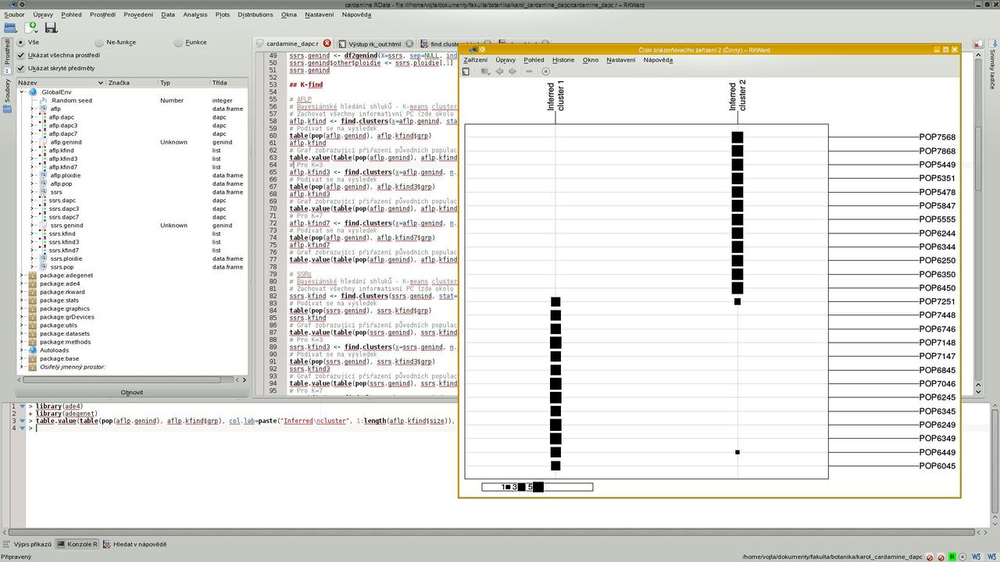
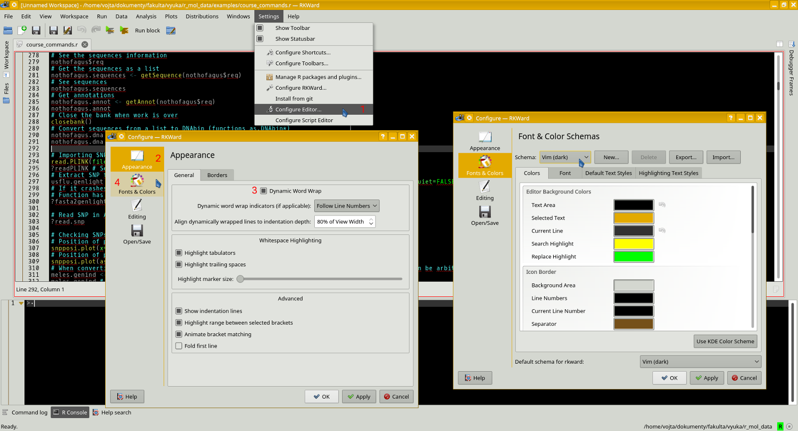
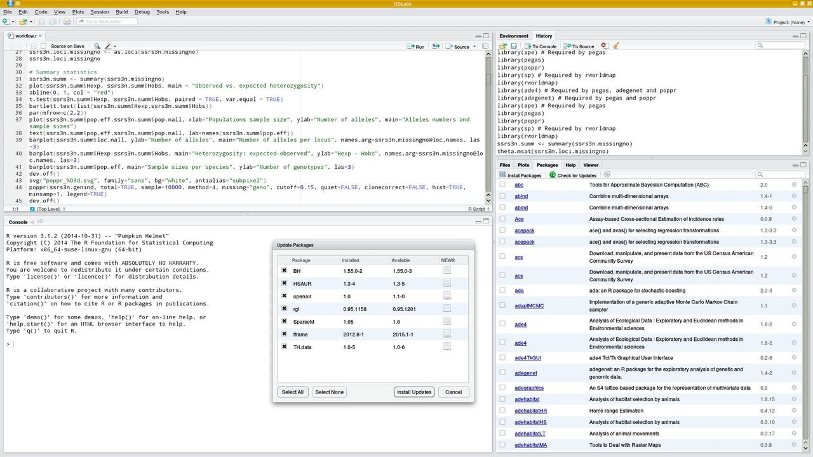
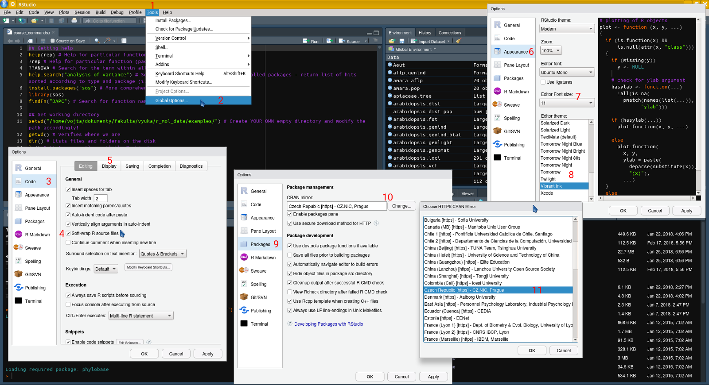
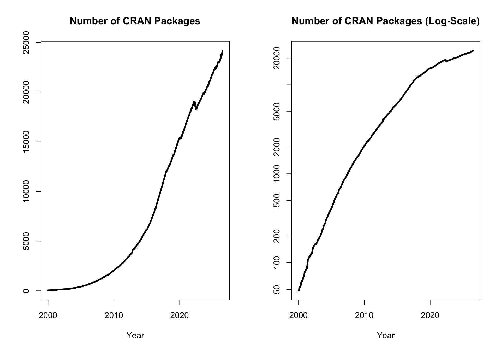
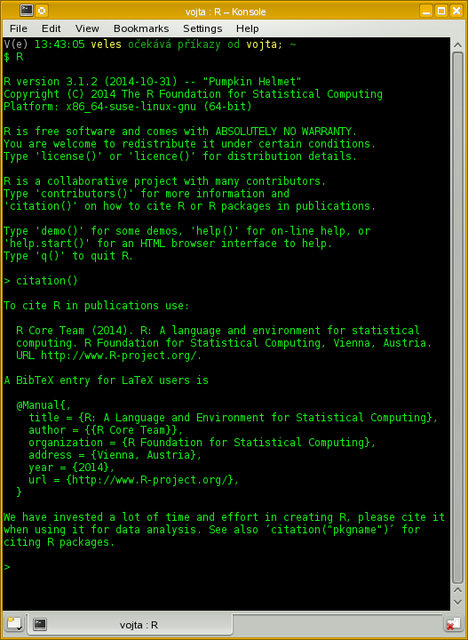
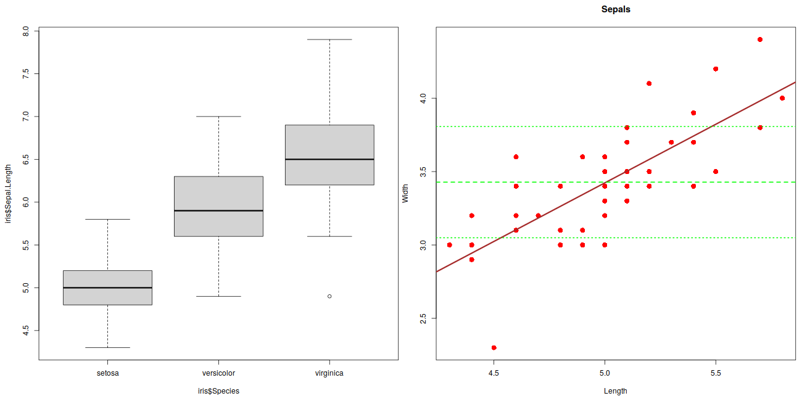

# R

### About R

- Project for Statistical Computing
- Open-source - freely available with source code - anyone can use and modify it and contribute its development
- Development is organized by non-governmental non-profit organization from Vienna
- Thousands of packages extending its functionality are available - all fields of computations in any scientific discipline
- Provides only command line interface - full control over the analysis, easy to rerun and/or modify analysis in the future, easy creation of scripts for batch analysis etc.
- Several projects provide convenient graphical user interfaces (GUI, slide )
- More details: <https://www.r-project.org/> <!-- MERGE-REVIEW: no counterpart section found in QMD; content from TEX kept as-is. -->

### Graphical user interfaces (GUI)

- Most users use some GUI - it is more convenient than plain command line
- Provide more comfortable interface for work with scripts (source code highlight, ...), overview of loaded packages and variables, easier work with figures, ...
- RStudio <https://posit.co/products/open-source/rstudio/> - probably the most common, multi-platform, very powerful
  - For Linux it is commonly available in distribution repository
- RKWard <https://rkward.kde.org/> - feature very rich, developed mainly for Linux, available also for another operating systems
  - RKWard must be compiled for the same version of R as you use
  - If downloading for Windows or macOS, check your version of R and download respective version of RKWard
  - On Linux, do not mix package repositories, ensure RKWard is compiled for your R version (typically install both from same resource)
- R commander (Rcmdr) <https://www.john-fox.ca/RCommander/> - multi-platform, not so rich as previous
- Java GUI for R <https://rforge.net/JGR/> - Java (multi-platform, but with all Java issues like memory consumption)
- Tinn-R (Windows only) <https://sourceforge.net/projects/tinn-r/> and <https://tinn-r.org/en/>
- [Emacs speaks statistics](https://ess.r-project.org/), [R Tools for MS Visual Studio](https://code.visualstudio.com/docs/languages/r), [Rattle](https://rattle.togaware.com/), [Radiant](https://radiant-rstats.github.io/docs/), ...
- And more...
- Pick one you like (from above list or any else) and install it...

### RKWard



### When using RKWard, consider change of settings of text editor for more comfortable work



### RStudio



### When using RStudio, turn on soft line wrap, select Czech mirror to download packages and consider change of appearance for more comfortable work



## Installation

### MS Windows & Apple macOS

- Go to <https://CRAN.R-project.org/>
- Download appropriate version and install as usual
- Download and install selected GUI (not required, but highly recommended)
- Most of packages are available as pre-compiled and can be immediately installed from R - it is convenient, but usually not tuned for particular computer architecture (type of CPU)
- Usually there are some problems every time new version of OS is released - it takes time to modify and recompile packages for new version of OS
- You have to check for new version of R manually
- RStudio is available from its [download page](https://posit.co/products/open-source/rstudio/)
- RKWard is also available for [Windows](https://rkward.kde.org/rkward-on-windows/) and [macOS](https://rkward.kde.org/rkward-on-mac/), but it requires some work to install it

### Linux - general

- R, and usually also GUI, is available in repositories - use standard package management according to distribution
- Linux repositories provide automatic updates
- Packages are also partially available in repositories and can be installed and updated as usual application or from R
- Packages commonly have to be compiled - R will do it automatically, but install basic Linux packages for building of C, C++, FORTRAN, ...
- Compilation takes longer time and there are sometimes issues with missing dependencies (tools required by particular packages), but it can then provide higher performance...

### Linux - Debian/Ubuntu and derivatives like Linux Mint or Kali Linux

- Install package `build-essential` (general tools to compile software, including R packages)
- Debian (and derivatives): follow instructions at <https://CRAN.R-project.org/bin/linux/debian/>
- Ubuntu (and derivatives): follow instructions at <https://CRAN.R-project.org/bin/linux/ubuntu/>
- Install packages `R-base` (the R), `R-base-dev` (required to compile additional R packages - only some are available in repositories) and optionally `rkward` and/or `rstudio`
- Various R packages can require their own build dependencies (packages `*XXX*-dev(el)`)
- RStudio is also available from its [download page](https://posit.co/products/open-source/rstudio/)

### Linux - openSUSE and SUSE Linux Enterprise

```{=html}
<!--
- See instructions at <https://CRAN.R-project.org/bin/linux/suse/>
-->
```

- Add repository/ies for appropriate version of your distribution
  - <https://download.opensuse.org/repositories/devel:/languages:/R:/patched/> (daily updated) or/and
  - <https://download.opensuse.org/repositories/devel:/languages:/R:/released/> (updated with new R release)
- Install packages `R-base` (the R), `R-base-devel` (required to compile additional R packages - only some are available in repositories) and optionally `rstudio` and/or `rkward`
- Install packages `patterns-openSUSE-devel_basis` and `gcc-fortran` for compilation of R packages when installing them from R (only some R packages are available in openSUSE repositories)
- Various R packages can require their own build dependencies (packages `*XXX*-dev(el)`)
- RStudio is also available from its [download page](https://posit.co/products/open-source/rstudio/)

### Linux - RedHat, Fedora and derivatives like CENTOS, Scientific Linux, etc.

- See instructions for Red Hat at <https://CRAN.R-project.org/bin/linux/redhat/> and Fedora at <https://cran.r-project.org/bin/linux/fedora/>
- Install packages `R-core` (the R), `R-core-devel` (required to compile additional R packages - only some are available in repositories) and optionally `rkward`
- Install group packages `"Development Tools"` and `"C Development Tools and Libraries"`
- Various R packages can require their own build dependencies (packages `*XXX*-dev(el)`)
- RStudio is available from its [download page](https://posit.co/products/open-source/rstudio/)

### Important note about names of directories

- **There must not be any spaces or accented characters in the path to R working directory or local R library**, otherwise some R functions can fail (and there is no other solution than creating new directory/user)
- If the user has e.g. on Windows (where the problem is the biggest) path like `C:/Documents and Settings/Šíleně úpějící kůoň/kurzíček`, change it to something like `C:/Users/username/rcourse`, otherwise user can experience a lot of problems...
- It might be required to make a new user on the computer...
- Similarly on macOS and Linux, avoid directory names with spaces and accented characters

### Sources of R packages

- R CRAN <https://CRAN.R-project.org/> - main and largest source of R packages (over 25,000 packages + many orphaned and archived - abandoned by developers, might be working)
- Bioconductor <https://bioconductor.org/> - mainly bioinformatics packages, genomic data (over 2,400 packages)
- R-Forge <https://r-forge.r-project.org/> (over 2,100 packages)
- RForge <https://www.rforge.net/> (much smaller)
- And more ([GitHub](https://github.com/)), custom webs, ...
- Some packages are available from more resources
- Same name for function can be used in different packages (there is no central index) - to distinguish them call functions like this: `muscle::read.fasta()` vs. `seqinr::read.fasta()` - call function `read.fasta()` from package `muscle` **or** `seqinr` (and their parameters can be different...) - see further

### CRAN keeps growing...



<https://journal.r-project.org/news/RJ-2026-2-cran/>

## Let's start with R

### First steps in R

**Recommended is usage of GUI (RKWard or RStudio)**

- Linux (UNIX): open any terminal, type `R` and hit Enter
- Windows and Mac: find it as normal application in menu
- Type commands to work...
- **Ever wished to be Harry Potter? Secret spells make magic operations :-)**
- Learning new language is always hard...
- Use arrows up and down to navigate in history
- `Ctrl+R` works as reverse search - searches text in history



### How it works

- General look of R commands:

```{r}
function(argument1 = "SomeName", argument2 = SomeVariable, argument3 = 8)
ModifiedObject <- SomeFunction(argument1 = MyData, argument2 = TRUE)
```

- New/modified object (with data, ...) is on the left: "`<-`" says to insert result of the function `SomeFunction` on the right into the object `ModifiedObject` on the left
- Functions have various parameters/arguments (in brackets, separated by comas): `argument=ItsValue`
- Arguments are named - if you keep default order (as in help page), no need to name them:

```{r}
SomeFunction(MyData, TRUE, 123, "SomeName")
```

- When only some of the arguments are in use, use the names (order doesn't matter)

```{r}
SomeFunction(argument2 = TRUE, argument3 = 123, argument1 = MyData)
```

- Some arguments are required, some optional

### Get help in R

Get help for particular function (package must be loaded) by `help(function)` or `?function`

```{r}
# "#" marks comments - notes within code which are not executed
# Help for particular function (package must be loaded), two options
help(rep)
?rep
```

Search for the term within all installed packages - return list of hits sorted according to type and package (i.e. `package::function`)

```{r}
??"ANOVA" 
help.search("analysis of variance")
```

`?` shows help for questioned function (in console type `q` to close it):

- Name of the package (top left)
- Function name (headline)
- Description
- Usage
- Comments on arguments
- Details
- Output value(s)
- About author(s)
- Reference(s) to cite
- Related functions
- Example code

### Importance of working directory

- Very important point to get familiar with paths in R
- Default place to load/save, import/export data/results
  - It changes paths - one of the most common mistakes - something (input file, ...) is not found because of wrong path
  - Private folder for particular R project (task) prevents unwanted inferences with another tools/projects
- Without saving and loading the R data next time, it is not possible to do any longer work or to check the work in the future
- **Get used that R always work in some directory and by default saves/loads files there** (R usually starts in user's home directory)
- RStudio and RKWard also save session information (list of opened files, ...) - very convenient
- Regularly save your work to prevent looses in case of crash or any other accident
- **There must not be any space or accented characters in the path/directory name!**

NOTE Create YOUR OWN empty directory and modify the path accordingly!

```{r}
setwd("~/dokumenty/vyuka/r_mol_data/examples/")
getwd() # Verifies where we are
dir() # Lists files and folders on the disk
ls() # Lists currently available R objects
```

### Where we are?

- In Linux/UNIX, R starts in current directory (use `cd` to change it before launching R)
- **Set and check working directory** in R:

```{r}
setwd("/some/path/") # Or "~/...". In Windows "C:/..."
getwd() # Verifies where we are
dir() # Lists files and folders on the disk
ls() # Lists currently available R objects
```

- In Windows plain R (**File \| working directory**), in RStudio (**Session \| Set working directory**) or in RKWard (**Workspace \| Set Working Directory**) set it in menu or by the above command
- R saves history of commands into file `.Rhistory` file within working directory (by default hidden in Linux/macOS)
- When closing R by `q()` you can save all R data in `.RData` (and command history in `.Rhistory`) file(s) and it/they can be loaded next time (files can be renamed)
- **Task:** Create new empty directory for this course and set R working directory there! <!-- MERGE-REVIEW: no counterpart section found in QMD; code below comes from the old TEX version. -->

## Basic operations in R

### Types of objects

- As any programming language, R has plenty of types of objects (variables) with different features, usage and aims

- **Vectors** - numbers, characters, boolean

- **Matrices** - columns are of same type (numeric, character, etc.) and same length

- **Arrays** - like matrices, but with possibly more dimensions

- **Data frames** - more general - columns can be of different type ("sheet of Excel")

- **Lists** - ordered collections of objects (vectors, matrices, ...) - not necessarily of same type

- **Factors** - a vector of levels, e.g. populations, colors, etc.

- More "advanced" objects to store plots, genetic data, ...

  - Commonly called "**S3**" and "**S4**" objects in R terminology
  - Technically commonly just lists putting together various information
  - We will meet many of them...

- Functions require particular object types - take care about it <!-- MERGE-REVIEW: no counterpart section found in QMD; content from TEX kept as-is. -->

### Popular object classes (we are going to use)

- `AAbin` - stores amino acid sequences (aligned or not)

- `alignment` - aligned sequences (package seqinr)

- `dapc` - results of DAPC

- `dist` - distance matrices

- `DNAbin` - stores DNA sequences (aligned or not)

- `genind` - stores various genetic information for individuals

- `genlight` - variant of genind to store large multiple genomes

- `genpop` - like genind, but on population level

- `haplonet` - networks without reticulation

- `haplotype` - unique sequences from DNAbin

- `hclust` - output of hierarchical clustering, can be converted to phylo

- `loci` - extension of data frame (DF), stores information about loci

- `matching` - binary phylogenetic trees

- `matrix` - general matrix (numeric or not)

- `pco`; `dudi` - results of PCA, PCoA, ...

- `phyDat` - "preparation" of data for some phylogenetic analysis (usually sequences and characters)

- `phylo` - phylogenetic information, typically trees

- `phylo4` - derived from phylo (more data), S4 instead of S3

- `SNPbin` - stores large SNP data for single genome

- `spca` - results of sPCA

- `treeshape` - derived from hclust

- `vcfR` - imported (and possibly edited) VCF

- and more... common task is converting among formats...

- ... not all formats are (easily) convertible among each other...

- To get information about content of each data type see e.g. `getClassDef("data.frame")` (Or any other class name of loaded package) - there are information about slots within that classes you can access

- Common task is conversion among various formats - functions commonly require different input format

  - Wrong class as input is common error... <!-- MERGE-REVIEW: no counterpart section found in QMD; content from TEX kept as-is. -->

### Conversions among data types I

| **From** | **To**    | **Command**           | **Package** |
|----------|-----------|-----------------------|-------------|
| phylo    | phylo4    | `as(x, "phylo4")`     | phylobase   |
| phylo    | matching  | `as.matching(x)`      | ape         |
| phylo    | treeshape | `as.treeshape(x)`     | apTreeshape |
| phylo    | hclust    | `as.hclust(x)`        | ape         |
| phylo    | prop.part | `prop.part(x)`        | ape         |
| phylo    | splits    | `as.splits(x)`        | phangorn    |
| phylo    | evonet    | `evonet(x, from, to)` | ape         |
| phylo    | network   | `as.network(x)`       | ape         |
| phylo    | igraph    | `as.igraph(x)`        | ape         |
| phylo4   | phylo     | `as(x, "phylo")`      | phylobase   |
| matching | phylo     | `as.phylo(x)`         | ape         |

<!-- MERGE-REVIEW: no counterpart section found in QMD; content from TEX kept as-is. -->

### Conversions among data types II

| **From**  | **To**     | **Command**        | **Package** |
|-----------|------------|--------------------|-------------|
| treeshape | phylo      | `as.phylo(x)`      | apTreeshape |
| splits    | phylo      | `as.phylo(x)`      | phangorn    |
| splits    | networx    | `as.networx(x)`    | phangorn    |
| evonet    | phylo      | `as.phylo(x)`      | ape         |
| evonet    | networx    | `as.networx(x)`    | ape         |
| evonet    | network    | `as.network(x)`    | ape         |
| evonet    | igraph     | `as.igraph(x)`     | ape         |
| haploNet  | network    | `as.network(x)`    | pegas       |
| haploNet  | igraph     | `as.igraph(x)`     | pegas       |
| hclust    | phylo      | `as.phylo(x)`      | ape         |
| hclust    | dendrogram | `as.dendrogram(x)` | stats       |

<!-- MERGE-REVIEW: no counterpart section found in QMD; content from TEX kept as-is. -->

### Conversions among data types III

| **From**  | **To**    | **Command**           | **Package** |
|-----------|-----------|-----------------------|-------------|
| DNAbin    | character | `as.character(x)`     | ape         |
| DNAbin    | alignment | `as.alignment(x)`     | ape         |
| DNAbin    | phyDat    | `as.phyDat(x)`        | phangorn    |
| DNAbin    | genind    | `DNAbin2genind(x)`    | adegenet    |
| character | DNAbin    | `as.DNAbin(x)`        | ape         |
| character | loci      | `as.loci(x)`          | pegas       |
| alignment | DNAbin    | `as.DNAbin(x)`        | ape         |
| alignment | phyDat    | `as.phyDat(x)`        | phangorn    |
| alignment | character | `as.matrix(x)`        | seqinr      |
| alignment | genind    | `alignment2genind(x)` | adegenet    |

<!-- MERGE-REVIEW: no counterpart section found in QMD; content from TEX kept as-is. -->

### Conversions among data types IV

| **From**   | **To**     | **Command**                | **Package** |
|------------|------------|----------------------------|-------------|
| phyDat     | DNAbin     | `as.DNAbin(x)`             | phangorn    |
| phyDat     | character  | `as.character(x)`          | phangorn    |
| loci       | genind     | `loci2genind(x)`           | pegas       |
| loci       | data frame | `class(x) <- "data.frame"` | \-          |
| genind     | loci       | `genind2loci(x)`           | pegas       |
| genind     | genpop     | `genind2genpop(x)`         | adegenet    |
| genind     | df         | `genind2df(x)`             | adegenet    |
| data frame | phyDat     | `as.phyDat(x)`             | phangorn    |
| data frame | loci       | `as.loci(x)`               | pegas       |
| data frame | genind     | `df2genind(x)`             | adegenet    |
| matrix     | phyDat     | `as.phyDat(x)`             | phangorn    |

<!-- MERGE-REVIEW: no counterpart section found in QMD; content from TEX kept as-is. -->

### Conversions among data types V

| **From** | **To**   | **Command**        | **Package** |
|----------|----------|--------------------|-------------|
| vcfR     | chromR   | `vcfR2chromR(x)`   | vcfR        |
| vcfR     | genind   | `vcfR2genind(x)`   | vcfR        |
| vcfR     | migrate  | `vcfR2migrate(x)`  | vcfR        |
| vcfR     | loci     | `vcfR2loci(x)`     | vcfR        |
| vcfR     | tidy     | `vcfR2tidy(x)`     | vcfR        |
| vcfR     | DNAbin   | `vcfR2DNAbin(x)`   | vcfR        |
| vcfR     | genlight | `vcfR2genlight(x)` | vcfR        |

<!-- MERGE-REVIEW: no counterpart section found in QMD; content from TEX kept as-is. -->

### Basic operations with data I

**R doesn't ask neither notifies when overwriting objects! Be careful!**

```{r}
x <- c(5, 6, 7, 8, 9) # Creates vector (see also ?rep)
x # Print "x" content
c() # Is generic function to concatenate objects into new one
length(x) # Length of the object - for matrices and DF use dim()
str(x) # Information about structure of the object
mode(x) # Gets type of storage mode of the object
class(x) # Shows class of the object
x[2] # Shows second element of the object
x <- x[-5] # Removes fifth element
y <- matrix(data = 5:20, nrow = 4, ncol = 4) # Creates a matrix
is.matrix(y) # Is it matrix? Try is.<TAB><TAB>
# TAB key shows available functions and objects starting by typed text
y # Prints the matrix
dim(y) # Dimensions of "y"
y[, 2] # Prints second column
```

<!-- MERGE-REVIEW: 1 old code block(s) in TEX frame were dropped in favor of the .qmd section 'Basic operations'. -->

<!-- MERGE-REVIEW: content of the .qmd section 'Basic operations' was inserted at 6 frames; remove the unwanted duplicates. -->

When loading saved project, you have to load again libraries and scripts (see further), data objects are restored This can be conveniently done in RStudio/RKWard

When loading saved project, you have to load again libraries and scripts (see further), data objects are restored

```{r}
x <- c(5, 6, 7, 8, 9) # Creates vector (see also ?rep)
x # Print "x" content
c() # Is generic function to concatenate objects into new one
length(x) # Length of the object - for matrices and DF use dim()
str(x) # Information about structure of the object
mode(x) # Gets type of storage mode of the object
class(x) # Shows class of the object
x[2] # Shows second element of the object
x <- x[-5] # Removes fifth element
x # See modified object
y <- matrix(data = 5:20, nrow = 4, ncol = 4) # Creates a matrix
is.matrix(y) # Is it matrix? Try is.<TAB><TAB> TAB key shows available functions and objects starting by typed text
y # Prints the matrix
dim(y) # Dimensions of "y"
y[, 2] # Prints second column
y[3, ] # Prints third row
y[4, 3] # Prints element from fourth row and third column
c(x, y[4, ]) # Concatenate "x"and 4th row of "y"
x2 <- c(x, 3, 2, 1) # Concatenate "x"and values "3", "2"and "1"
x <- y[2, ] # Replaces "x"by second row of "y"(no warning) - R doesn't ask neither notifies when overwriting objects! Be careful!
x # See modified object
rm(x) # Deletes x (no warning)
y[, 1:3] # Prints first through third column of the matrix
y[3, ] <- rep(x = 20, each = 4) # Replaces third line by value of 20
y # See modified object
y[y == 20] <- 10 # If value of y's element is 20, replace it by 10
y # See modified object
summary(y) # Basic statistics - according to columns
colnames(y) <- c("A", "B", "C", "D") # Set column names - Objects and functions are without quotation marks; files, text with
colnames(y) # Prints column names, use rownames() in same way
y # See modified object
y[, "C"] # Prints column C (R is case sensitive!)
y[, c("C", "B")] # Extract columns "C"and "B"
t(y) # Transposes the matrix
diag(y) # Get diagonal of the matrix
diag(y) <- rep(x = c(50, 100), times = 2) # Replace diagonal by repetition of values 50 and 100
y # See modified object
y <- as.data.frame(y) # Turns into DF (see other functions as.*)
class(y) # Is it data frame now?
y[y == 17] <- "NA"# Removes values of 17
y # See modified object
y$B # Gets variable B of data frame y ($ works similarly in S3 objects)
```

```{r}
save(list = ls(), file = "test.RData") # Saves all objects during the work
load("test.RData") # Loads saved R environment with all objects
```

```{r}
fix(y) # Use to edit matrices, data frames, functions, ...
rm(y) # Removing...
```

### Basic operations with data II

```{r}
y[3,] # Prints third row
y[4, 3] # Prints element from fourth row and third column
c(x, y[4, ]) # Concatenate "x" and 4th row of "y"
x2 <- c(x, 3, 2, 1) # Concatenate "x" and values "3", "2" and "1"
x <- y[2, ] # Replaces "x" by second row of "y" (no warning)
rm(x) # Deletes x (no warning)
y[ ,1:3] # Prints first through third column of the matrix
y[3, ] <- rep(x = 20, each = 4) # Replaces third line by value of 20
y[y == 20] <- 10 # If value of y's element is 20, replace it by 10
summary(y) # Basic statistics - according to columns
colnames(y) <- c("A", "B", "C", "D") # Set column names
# Objects and functions are without quotation marks; files and text with
colnames(y) # Prints column names, use rownames() in very same way
y # See modified object
y[, "C"] # Prints column C (R is case sensitive!)
y[, c("C", "B")] # Extract columns "C" and "B"
```

<!-- MERGE-REVIEW: 1 old code block(s) in TEX frame were dropped in favor of the .qmd section 'Basic operations'. -->

<!-- MERGE-REVIEW: content of the .qmd section 'Basic operations' was inserted at 6 frames; remove the unwanted duplicates. -->

When loading saved project, you have to load again libraries and scripts (see further), data objects are restored This can be conveniently done in RStudio/RKWard

When loading saved project, you have to load again libraries and scripts (see further), data objects are restored

```{r}
x <- c(5, 6, 7, 8, 9) # Creates vector (see also ?rep)
x # Print "x" content
c() # Is generic function to concatenate objects into new one
length(x) # Length of the object - for matrices and DF use dim()
str(x) # Information about structure of the object
mode(x) # Gets type of storage mode of the object
class(x) # Shows class of the object
x[2] # Shows second element of the object
x <- x[-5] # Removes fifth element
x # See modified object
y <- matrix(data = 5:20, nrow = 4, ncol = 4) # Creates a matrix
is.matrix(y) # Is it matrix? Try is.<TAB><TAB> TAB key shows available functions and objects starting by typed text
y # Prints the matrix
dim(y) # Dimensions of "y"
y[, 2] # Prints second column
y[3, ] # Prints third row
y[4, 3] # Prints element from fourth row and third column
c(x, y[4, ]) # Concatenate "x"and 4th row of "y"
x2 <- c(x, 3, 2, 1) # Concatenate "x"and values "3", "2"and "1"
x <- y[2, ] # Replaces "x"by second row of "y"(no warning) - R doesn't ask neither notifies when overwriting objects! Be careful!
x # See modified object
rm(x) # Deletes x (no warning)
y[, 1:3] # Prints first through third column of the matrix
y[3, ] <- rep(x = 20, each = 4) # Replaces third line by value of 20
y # See modified object
y[y == 20] <- 10 # If value of y's element is 20, replace it by 10
y # See modified object
summary(y) # Basic statistics - according to columns
colnames(y) <- c("A", "B", "C", "D") # Set column names - Objects and functions are without quotation marks; files, text with
colnames(y) # Prints column names, use rownames() in same way
y # See modified object
y[, "C"] # Prints column C (R is case sensitive!)
y[, c("C", "B")] # Extract columns "C"and "B"
t(y) # Transposes the matrix
diag(y) # Get diagonal of the matrix
diag(y) <- rep(x = c(50, 100), times = 2) # Replace diagonal by repetition of values 50 and 100
y # See modified object
y <- as.data.frame(y) # Turns into DF (see other functions as.*)
class(y) # Is it data frame now?
y[y == 17] <- "NA"# Removes values of 17
y # See modified object
y$B # Gets variable B of data frame y ($ works similarly in S3 objects)
```

```{r}
save(list = ls(), file = "test.RData") # Saves all objects during the work
load("test.RData") # Loads saved R environment with all objects
```

```{r}
fix(y) # Use to edit matrices, data frames, functions, ...
rm(y) # Removing...
```

### Basic operations with data III

```{r}
t(y) # Transposes the matrix
diag(y) # Get diagonal of the matrix
# Replace diagonal by repetition of values 50 and 100
diag(y) <- rep(x = c(50, 100), times = 2)
y # See modified object
y <- as.data.frame(y) # Turns into DF (see other functions as.*)
class(y) # Is it data frame now?
y[y == 17] <- "NA" # Removes values of 17 (NA = not available = missing)
y$B # Gets variable B of data frame y ($ works similarly in S3 objects)
# When loading saved project, you have to load again libraries and
# scripts (see further), data objects are restored
# This can be conveniently done in RStudio/RKWard
save(list = ls(), file = "test.RData") # Saves all objects during the work
load("test.RData") # Loads saved R environment with all objects
fix(y) # Use to edit matrices, data frames, functions, ...
rm(y) # Removing...
?iris # Information about R test dataset with morphometry of Iris species
```

<!-- MERGE-REVIEW: 1 old code block(s) in TEX frame were dropped in favor of the .qmd section 'Basic operations'. -->

<!-- MERGE-REVIEW: content of the .qmd section 'Basic operations' was inserted at 6 frames; remove the unwanted duplicates. -->

When loading saved project, you have to load again libraries and scripts (see further), data objects are restored This can be conveniently done in RStudio/RKWard

When loading saved project, you have to load again libraries and scripts (see further), data objects are restored

```{r}
x <- c(5, 6, 7, 8, 9) # Creates vector (see also ?rep)
x # Print "x" content
c() # Is generic function to concatenate objects into new one
length(x) # Length of the object - for matrices and DF use dim()
str(x) # Information about structure of the object
mode(x) # Gets type of storage mode of the object
class(x) # Shows class of the object
x[2] # Shows second element of the object
x <- x[-5] # Removes fifth element
x # See modified object
y <- matrix(data = 5:20, nrow = 4, ncol = 4) # Creates a matrix
is.matrix(y) # Is it matrix? Try is.<TAB><TAB> TAB key shows available functions and objects starting by typed text
y # Prints the matrix
dim(y) # Dimensions of "y"
y[, 2] # Prints second column
y[3, ] # Prints third row
y[4, 3] # Prints element from fourth row and third column
c(x, y[4, ]) # Concatenate "x"and 4th row of "y"
x2 <- c(x, 3, 2, 1) # Concatenate "x"and values "3", "2"and "1"
x <- y[2, ] # Replaces "x"by second row of "y"(no warning) - R doesn't ask neither notifies when overwriting objects! Be careful!
x # See modified object
rm(x) # Deletes x (no warning)
y[, 1:3] # Prints first through third column of the matrix
y[3, ] <- rep(x = 20, each = 4) # Replaces third line by value of 20
y # See modified object
y[y == 20] <- 10 # If value of y's element is 20, replace it by 10
y # See modified object
summary(y) # Basic statistics - according to columns
colnames(y) <- c("A", "B", "C", "D") # Set column names - Objects and functions are without quotation marks; files, text with
colnames(y) # Prints column names, use rownames() in same way
y # See modified object
y[, "C"] # Prints column C (R is case sensitive!)
y[, c("C", "B")] # Extract columns "C"and "B"
t(y) # Transposes the matrix
diag(y) # Get diagonal of the matrix
diag(y) <- rep(x = c(50, 100), times = 2) # Replace diagonal by repetition of values 50 and 100
y # See modified object
y <- as.data.frame(y) # Turns into DF (see other functions as.*)
class(y) # Is it data frame now?
y[y == 17] <- "NA"# Removes values of 17
y # See modified object
y$B # Gets variable B of data frame y ($ works similarly in S3 objects)
```

```{r}
save(list = ls(), file = "test.RData") # Saves all objects during the work
load("test.RData") # Loads saved R environment with all objects
```

```{r}
fix(y) # Use to edit matrices, data frames, functions, ...
rm(y) # Removing...
```

### Some basic statistics

```{r}
summary(iris) # Basic summary statistics
# Boxplot comparing sepal lengths of the three species
boxplot(formula = iris$Sepal.Length ~ iris$Species)
setosa <- iris[which(iris$Species == "setosa"), ] # Extract only setosa
# Testing correlation between sepal length and width of setosa
cor.test(x = setosa$Sepal.Length, y = setosa$Sepal.Width)
# Plot correlation between sepal length and width of setosa
plot(x = setosa$Sepal.Length, y = setosa$Sepal.Width, main = "Sepals",
  xlab = "Length", ylab = "Width", pch = 16, cex = 1.5, col = "red")
# Add linear model line
abline(reg=lm(setosa$Sepal.Width~setosa$Sepal.Length), col='brown', lwd=3)
# Add sepal width mean and standard deviation
abline(h = mean(setosa$Sepal.Width), col = "green", lwd = 2, lty = 2)
abline(h = mean(setosa$Sepal.Width) + sd(setosa$Sepal.Width),
  col = "green", lwd = 2, lty = 3)
abline(h = mean(setosa$Sepal.Width) - sd(setosa$Sepal.Width),
  col = "green", lwd = 2, lty = 3)
```

<!-- MERGE-REVIEW: 1 old code block(s) in TEX frame were dropped in favor of the .qmd section 'Some basic statistics'. -->

<!-- MERGE-REVIEW: content of the .qmd section 'Some basic statistics' was inserted at 2 frames; remove the unwanted duplicates. -->

Information about R test dataset with morphometry of Iris species

Basic summary statistics

Boxplot comparing sepal lengths of the three species

Extract only setosa

Testing correlation between sepal length and width of setosa

Plot correlation between sepal length and width of setosa

Add linear model line

Add sepal width mean and standard deviation

ANOVA

Basic analysis of variance

Wrapping aov() by summary() gives output which is easier to read (this is common practice for plenty of outputs)

```{r}
?iris
```

```{r}
summary(iris)
```

```{r}
boxplot(formula = iris$Sepal.Length ~ iris$Species)
```

```{r}
setosa <- iris[which(iris$Species == "setosa"), ]
```

```{r}
cor.test(x = setosa$Sepal.Length, y = setosa$Sepal.Width)
```

```{r}
plot(x = setosa$Sepal.Length, y = setosa$Sepal.Width, main = "Sepals", xlab = "Length", ylab = "Width", pch = 16, cex = 1.5, col = "red")
```

```{r}
abline(reg = lm(formula = setosa$Sepal.Width ~ setosa$Sepal.Length), col = "brown", lwd = 3)
```

```{r}
abline(h = mean(setosa$Sepal.Width), col = "green", lwd = 2, lty = 2)
abline(h = mean(setosa$Sepal.Width) + sd(setosa$Sepal.Width), col = "green", lwd = 2, lty = 3)
abline(h = mean(setosa$Sepal.Width) - sd(setosa$Sepal.Width), col = "green", lwd = 2, lty = 3)

```

```{r}
aov(formula = iris[["Sepal.Length"]] ~ iris[["Species"]])
```

```{r}
summary(aov(formula = iris[["Sepal.Length"]] ~ iris[["Species"]]))
```

### Figures from previous basic statistics



<!-- MERGE-REVIEW: content of the .qmd section 'Some basic statistics' was inserted at 2 frames; remove the unwanted duplicates. -->

Information about R test dataset with morphometry of Iris species

Basic summary statistics

Boxplot comparing sepal lengths of the three species

Extract only setosa

Testing correlation between sepal length and width of setosa

Plot correlation between sepal length and width of setosa

Add linear model line

Add sepal width mean and standard deviation

ANOVA

Basic analysis of variance

Wrapping aov() by summary() gives output which is easier to read (this is common practice for plenty of outputs)

```{r}
?iris
```

```{r}
summary(iris)
```

```{r}
boxplot(formula = iris$Sepal.Length ~ iris$Species)
```

```{r}
setosa <- iris[which(iris$Species == "setosa"), ]
```

```{r}
cor.test(x = setosa$Sepal.Length, y = setosa$Sepal.Width)
```

```{r}
plot(x = setosa$Sepal.Length, y = setosa$Sepal.Width, main = "Sepals", xlab = "Length", ylab = "Width", pch = 16, cex = 1.5, col = "red")
```

```{r}
abline(reg = lm(formula = setosa$Sepal.Width ~ setosa$Sepal.Length), col = "brown", lwd = 3)
```

```{r}
abline(h = mean(setosa$Sepal.Width), col = "green", lwd = 2, lty = 2)
abline(h = mean(setosa$Sepal.Width) + sd(setosa$Sepal.Width), col = "green", lwd = 2, lty = 3)
abline(h = mean(setosa$Sepal.Width) - sd(setosa$Sepal.Width), col = "green", lwd = 2, lty = 3)

```

```{r}
aov(formula = iris[["Sepal.Length"]] ~ iris[["Species"]])
```

```{r}
summary(aov(formula = iris[["Sepal.Length"]] ~ iris[["Species"]]))
```

### Analysis of Variance (ANOVA)

- [ANOVA](https://en.wikipedia.org/wiki/Analysis_of_variance) tells us if there is significant difference among means of samples (here sepal lengths among species)

```{r}
aov(formula = iris[["Sepal.Length"]] ~ iris[["Species"]]) # Output:
Call:
   aov(formula = iris[["Sepal.Length"]] ~ iris[["Species"]])
Terms:
                iris[["Species"]] Residuals
Sum of Squares           63.21213  38.95620
Deg. of Freedom                 2       147
Residual standard error: 0.5147894
Estimated effects may be unbalanced
summary(aov(formula = iris[["Sepal.Length"]] ~ iris[["Species"]])) # Output:
                   Df Sum Sq Mean Sq F value Pr(>F)
iris[["Species"]]   2  63.21  31.606   119.3 <2e-16 ***
Residuals         147  38.96   0.265
---
Signif. codes:  0 ‘***’ 0.001 ‘**’ 0.01 ‘*’ 0.05 ‘.’ 0.1 ‘ ’ 1
```

<!-- MERGE-REVIEW: no counterpart section found in QMD; code below comes from the old TEX version. -->

## Tasks

### Practice basic operations I

1.  Load R training dataset `iris` (`data(iris)`) and read about it (`?iris`).

2.  Explore it - print it, display only beginning of data (`head()`). How many rows and columns does it have (`dim()`)? Which variables? Which species (`levels()`)?

3.  Extract from `iris` dataset only sepal lengths and save it as new vector.

4.  Extract from `iris` dataset petal length and species and save it as new data frame.

5.  Extract from `iris` dataset lines 10--20.

6.  Read help of `rep` function and

7.  Create repetition of five times value of "A".

8.  Create repetition of five times vector of "1, 3".

<!-- MERGE-REVIEW: content of the .qmd section 'Basic operations' was inserted at 6 frames; remove the unwanted duplicates. -->

When loading saved project, you have to load again libraries and scripts (see further), data objects are restored This can be conveniently done in RStudio/RKWard

When loading saved project, you have to load again libraries and scripts (see further), data objects are restored

```{r}
x <- c(5, 6, 7, 8, 9) # Creates vector (see also ?rep)
x # Print "x" content
c() # Is generic function to concatenate objects into new one
length(x) # Length of the object - for matrices and DF use dim()
str(x) # Information about structure of the object
mode(x) # Gets type of storage mode of the object
class(x) # Shows class of the object
x[2] # Shows second element of the object
x <- x[-5] # Removes fifth element
x # See modified object
y <- matrix(data = 5:20, nrow = 4, ncol = 4) # Creates a matrix
is.matrix(y) # Is it matrix? Try is.<TAB><TAB> TAB key shows available functions and objects starting by typed text
y # Prints the matrix
dim(y) # Dimensions of "y"
y[, 2] # Prints second column
y[3, ] # Prints third row
y[4, 3] # Prints element from fourth row and third column
c(x, y[4, ]) # Concatenate "x"and 4th row of "y"
x2 <- c(x, 3, 2, 1) # Concatenate "x"and values "3", "2"and "1"
x <- y[2, ] # Replaces "x"by second row of "y"(no warning) - R doesn't ask neither notifies when overwriting objects! Be careful!
x # See modified object
rm(x) # Deletes x (no warning)
y[, 1:3] # Prints first through third column of the matrix
y[3, ] <- rep(x = 20, each = 4) # Replaces third line by value of 20
y # See modified object
y[y == 20] <- 10 # If value of y's element is 20, replace it by 10
y # See modified object
summary(y) # Basic statistics - according to columns
colnames(y) <- c("A", "B", "C", "D") # Set column names - Objects and functions are without quotation marks; files, text with
colnames(y) # Prints column names, use rownames() in same way
y # See modified object
y[, "C"] # Prints column C (R is case sensitive!)
y[, c("C", "B")] # Extract columns "C"and "B"
t(y) # Transposes the matrix
diag(y) # Get diagonal of the matrix
diag(y) <- rep(x = c(50, 100), times = 2) # Replace diagonal by repetition of values 50 and 100
y # See modified object
y <- as.data.frame(y) # Turns into DF (see other functions as.*)
class(y) # Is it data frame now?
y[y == 17] <- "NA"# Removes values of 17
y # See modified object
y$B # Gets variable B of data frame y ($ works similarly in S3 objects)
```

```{r}
save(list = ls(), file = "test.RData") # Saves all objects during the work
load("test.RData") # Loads saved R environment with all objects
```

```{r}
fix(y) # Use to edit matrices, data frames, functions, ...
rm(y) # Removing...
```

### Practice basic operations II

1.  Read help of `seq` function and create sequence from 5 to 20 with steps of 0.5 and save it as new vector.
2.  Extract from that vector $2^nd$, $4^th$ and $8^th$ position and save it as new vector.
3.  Remove from that vector $2^nd$ element.
4.  Concatenate previous two vectors into new vector.
5.  What is difference between `iris["Sepal.Width"]`, `iris[2]`, `iris[["Sepal.Width"]]` and `iris$Sepal.Width`? Compare. What are the different ways good for?
6.  Try similar tasks as on slide with another species and characters. Try to improve the plots.

<!-- MERGE-REVIEW: content of the .qmd section 'Basic operations' was inserted at 6 frames; remove the unwanted duplicates. -->

When loading saved project, you have to load again libraries and scripts (see further), data objects are restored This can be conveniently done in RStudio/RKWard

When loading saved project, you have to load again libraries and scripts (see further), data objects are restored

```{r}
x <- c(5, 6, 7, 8, 9) # Creates vector (see also ?rep)
x # Print "x" content
c() # Is generic function to concatenate objects into new one
length(x) # Length of the object - for matrices and DF use dim()
str(x) # Information about structure of the object
mode(x) # Gets type of storage mode of the object
class(x) # Shows class of the object
x[2] # Shows second element of the object
x <- x[-5] # Removes fifth element
x # See modified object
y <- matrix(data = 5:20, nrow = 4, ncol = 4) # Creates a matrix
is.matrix(y) # Is it matrix? Try is.<TAB><TAB> TAB key shows available functions and objects starting by typed text
y # Prints the matrix
dim(y) # Dimensions of "y"
y[, 2] # Prints second column
y[3, ] # Prints third row
y[4, 3] # Prints element from fourth row and third column
c(x, y[4, ]) # Concatenate "x"and 4th row of "y"
x2 <- c(x, 3, 2, 1) # Concatenate "x"and values "3", "2"and "1"
x <- y[2, ] # Replaces "x"by second row of "y"(no warning) - R doesn't ask neither notifies when overwriting objects! Be careful!
x # See modified object
rm(x) # Deletes x (no warning)
y[, 1:3] # Prints first through third column of the matrix
y[3, ] <- rep(x = 20, each = 4) # Replaces third line by value of 20
y # See modified object
y[y == 20] <- 10 # If value of y's element is 20, replace it by 10
y # See modified object
summary(y) # Basic statistics - according to columns
colnames(y) <- c("A", "B", "C", "D") # Set column names - Objects and functions are without quotation marks; files, text with
colnames(y) # Prints column names, use rownames() in same way
y # See modified object
y[, "C"] # Prints column C (R is case sensitive!)
y[, c("C", "B")] # Extract columns "C"and "B"
t(y) # Transposes the matrix
diag(y) # Get diagonal of the matrix
diag(y) <- rep(x = c(50, 100), times = 2) # Replace diagonal by repetition of values 50 and 100
y # See modified object
y <- as.data.frame(y) # Turns into DF (see other functions as.*)
class(y) # Is it data frame now?
y[y == 17] <- "NA"# Removes values of 17
y # See modified object
y$B # Gets variable B of data frame y ($ works similarly in S3 objects)
```

```{r}
save(list = ls(), file = "test.RData") # Saves all objects during the work
load("test.RData") # Loads saved R environment with all objects
```

```{r}
fix(y) # Use to edit matrices, data frames, functions, ...
rm(y) # Removing...
```

## Packages for our work

### Packages, repositories and their management

- Standalone plain R doesn't have enough tools for most of scientific disciplines - only basic methods and tools for programmers, including for package management

- Users/developers contribute by making extra packages extending computational possibilities - one of biggest R advantages - it then has unlimited possibilities

- R has infrastructure for maintaining (for developers) and installing (for users) packages - the [CRAN](https://CRAN.R-project.org/) repository (comprehensive R archive network)

- For various reasons, some people build their own infrastructures to maintain and install R packages - compatible with R, bud separated (not in CRAN)

- User has basically 3 options

  1.  Set all repositories in R and use basic commands to install packages (slide )
  2.  Specify non-CRAN repository every time installing from it (e.g. slide )
  3.  Use special tools (e.g. for [Bioconductor](https://bioconductor.org/install/) - slide )

- Repositories work in similar way as various app stores in Android, iOS, ...

<!-- MERGE-REVIEW: content of the .qmd section 'Packages and repositories' was inserted at 4 frames; remove the unwanted duplicates. -->

Set repositories for the current R session We will need extra repositories

Install packages

Installation of multiple packages may sometimes fail - install then packages in smaller groups or one by one

Updates installed packages (by default from CRAN)

Install package Geneland (since version 4 not available in CRAN anymore) Other packages used when using Geneland Needed is PBSmapping or mapproj for conversion of coordinates GUI uses for parallelization snow and Rmpi RgoogleMaps can be used to plot output on top of Google map, sf and related tools on GIS layer

On Windows install Rtools from https://cran.r-project.org/bin/windows/Rtools/

Install Geneland from GitHub Devtools package is required to install from GitHub

Install Geneland itself

Install package phyloch not available in any repository If not done already, install required packages first

It is possible to specify direct path (local or web URL) to package source

Install kdetrees package (removed from CRAN) Ensure package 'devtools' is installed

Install 'kdetrees' from https://github.com/V-Z/kdetrees Git repository

When needed, the package can be loaded as "library("kdetrees")"

We will load packages by library("package") one by one when needed...

```{r}
getOption("repos") # Shows actual repositories
options(repos = c("https://cloud.r-project.org", "https://r-forge.r-project.org/", "https://rforge.net/"))
options() # Generic function to modify various settings
?options # Gives details
```

```{r}
install.packages(pkgs = c("ade4", "adegenet", "adegraphics", "adephylo", "adespatial", "ape", "BiocManager", "caper", "corrplot", "devtools", "gee", "geiger", "ggplot2", "gplots", "hierfstat", "ips", "kdetrees", "lattice", "mapdata", "mapplots", "mapproj", "maps", "nlme", "PBSmapping", "pegas", "permute", "phangorn", "philentropy", "phylobase", "phytools", "picante", "plotrix", "poppr", "raster", "rentrez", "rgl", "RgoogleMaps", "Rmpi", "rworldmap", "rworldxtra", "seqinr", "sf", "shapefiles", "snow", "sp", "spdep", "splancs", "StAMPP", "TeachingDemos", "tripack", "vcfR", "vegan"), repos = "https://cloud.r-project.org", dependencies = "Imports")
?install.packages # See for more options
```

```{r}
update.packages(ask = FALSE)
```

```{r}
install.packages(pkgs = c("PBSmapping", "mapproj", "rgdal", "RgoogleMaps", "Rmpi", "sf", "sp", "maptools", "shapefiles", "snow", "tripack"), repos = "https://cloud.r-project.org", dependencies = "Imports")
```

```{r}
if (!"devtools" %in% installed.packages()) {
  install.packages("devtools")
}
```

```{r}
devtools::install_github("gilles-guillot/Geneland")
```

```{r}
install.packages(pkgs = c("ape", "colorspace", "XML"), dependencies = "Imports")
```

```{r}
install.packages(pkgs = "http://www.christophheibl.de/phyloch_1.5-3.tar.gz", repos = NULL, type = "source")
```

```{r}
if (!"devtools" %in% installed.packages()) {
  install.packages("devtools")
}
```

```{r}
devtools::install_github("V-Z/kdetrees")
```

### Repositories

- Repositories (internet directories full of R packages - slide ) can be set via `options(repos=c(...))` (global) or (every relevant time) as `repos` parameter for each `install.packages(..., repos=c(...))` command (slide and onward)

- Repositories don't have to be set as global options, e.g. Bioconductor (slide ) has its own way to manage packages

- **RStudio:** set repositories by command from slide and in bottom right pane select **Packages** and click on **Install Packages...**

- **RKWard:** go to menu **Settings \| Configure 'RKWard'** and select **R-Packages**. Add URLs of repositories from slide . **OK**. Go to menu **Settings \| Manage R packages and plugins...**, click to **Install...**, select and install desired packages...

<!-- MERGE-REVIEW: content of the .qmd section 'Packages and repositories' was inserted at 4 frames; remove the unwanted duplicates. -->

Set repositories for the current R session We will need extra repositories

Install packages

Installation of multiple packages may sometimes fail - install then packages in smaller groups or one by one

Updates installed packages (by default from CRAN)

Install package Geneland (since version 4 not available in CRAN anymore) Other packages used when using Geneland Needed is PBSmapping or mapproj for conversion of coordinates GUI uses for parallelization snow and Rmpi RgoogleMaps can be used to plot output on top of Google map, sf and related tools on GIS layer

On Windows install Rtools from https://cran.r-project.org/bin/windows/Rtools/

Install Geneland from GitHub Devtools package is required to install from GitHub

Install Geneland itself

Install package phyloch not available in any repository If not done already, install required packages first

It is possible to specify direct path (local or web URL) to package source

Install kdetrees package (removed from CRAN) Ensure package 'devtools' is installed

Install 'kdetrees' from https://github.com/V-Z/kdetrees Git repository

When needed, the package can be loaded as "library("kdetrees")"

We will load packages by library("package") one by one when needed...

```{r}
getOption("repos") # Shows actual repositories
options(repos = c("https://cloud.r-project.org", "https://r-forge.r-project.org/", "https://rforge.net/"))
options() # Generic function to modify various settings
?options # Gives details
```

```{r}
install.packages(pkgs = c("ade4", "adegenet", "adegraphics", "adephylo", "adespatial", "ape", "BiocManager", "caper", "corrplot", "devtools", "gee", "geiger", "ggplot2", "gplots", "hierfstat", "ips", "kdetrees", "lattice", "mapdata", "mapplots", "mapproj", "maps", "nlme", "PBSmapping", "pegas", "permute", "phangorn", "philentropy", "phylobase", "phytools", "picante", "plotrix", "poppr", "raster", "rentrez", "rgl", "RgoogleMaps", "Rmpi", "rworldmap", "rworldxtra", "seqinr", "sf", "shapefiles", "snow", "sp", "spdep", "splancs", "StAMPP", "TeachingDemos", "tripack", "vcfR", "vegan"), repos = "https://cloud.r-project.org", dependencies = "Imports")
?install.packages # See for more options
```

```{r}
update.packages(ask = FALSE)
```

```{r}
install.packages(pkgs = c("PBSmapping", "mapproj", "rgdal", "RgoogleMaps", "Rmpi", "sf", "sp", "maptools", "shapefiles", "snow", "tripack"), repos = "https://cloud.r-project.org", dependencies = "Imports")
```

```{r}
if (!"devtools" %in% installed.packages()) {
  install.packages("devtools")
}
```

```{r}
devtools::install_github("gilles-guillot/Geneland")
```

```{r}
install.packages(pkgs = c("ape", "colorspace", "XML"), dependencies = "Imports")
```

```{r}
install.packages(pkgs = "http://www.christophheibl.de/phyloch_1.5-3.tar.gz", repos = NULL, type = "source")
```

```{r}
if (!"devtools" %in% installed.packages()) {
  install.packages("devtools")
}
```

```{r}
devtools::install_github("V-Z/kdetrees")
```

### Set repositories

```{r}
getOption("repos") # Shows actual repositories
# Set new repositories for the current R session
options(repos=c("https://cloud.r-project.org/",
  "https://r-forge.r-project.org/", "https://rforge.net/"))
options() # Generic function to modify various settings
?options # Gives details
```

- **Keep newest version of R and and newest versions of packages!**
- Installation of multiple packages may sometimes fail - install then packages in smaller groups or one by one - check output and examine why installation failed - commonly due to missing external dependency (read installation output and look for notes about missing libraries, etc.)
- Avoid mixing of several R versions
- After upgrade of R (e.g. from 4.5 to 4.6), user **must** reinstall all packages <!-- MERGE-REVIEW: 1 old code block(s) in TEX frame were dropped in favor of the .qmd section 'Packages and repositories'. -->

<!-- MERGE-REVIEW: content of the .qmd section 'Packages and repositories' was inserted at 4 frames; remove the unwanted duplicates. -->

Set repositories for the current R session We will need extra repositories

Install packages

Installation of multiple packages may sometimes fail - install then packages in smaller groups or one by one

Updates installed packages (by default from CRAN)

Install package Geneland (since version 4 not available in CRAN anymore) Other packages used when using Geneland Needed is PBSmapping or mapproj for conversion of coordinates GUI uses for parallelization snow and Rmpi RgoogleMaps can be used to plot output on top of Google map, sf and related tools on GIS layer

On Windows install Rtools from https://cran.r-project.org/bin/windows/Rtools/

Install Geneland from GitHub Devtools package is required to install from GitHub

Install Geneland itself

Install package phyloch not available in any repository If not done already, install required packages first

It is possible to specify direct path (local or web URL) to package source

Install kdetrees package (removed from CRAN) Ensure package 'devtools' is installed

Install 'kdetrees' from https://github.com/V-Z/kdetrees Git repository

When needed, the package can be loaded as "library("kdetrees")"

We will load packages by library("package") one by one when needed...

```{r}
getOption("repos") # Shows actual repositories
options(repos = c("https://cloud.r-project.org", "https://r-forge.r-project.org/", "https://rforge.net/"))
options() # Generic function to modify various settings
?options # Gives details
```

```{r}
install.packages(pkgs = c("ade4", "adegenet", "adegraphics", "adephylo", "adespatial", "ape", "BiocManager", "caper", "corrplot", "devtools", "gee", "geiger", "ggplot2", "gplots", "hierfstat", "ips", "kdetrees", "lattice", "mapdata", "mapplots", "mapproj", "maps", "nlme", "PBSmapping", "pegas", "permute", "phangorn", "philentropy", "phylobase", "phytools", "picante", "plotrix", "poppr", "raster", "rentrez", "rgl", "RgoogleMaps", "Rmpi", "rworldmap", "rworldxtra", "seqinr", "sf", "shapefiles", "snow", "sp", "spdep", "splancs", "StAMPP", "TeachingDemos", "tripack", "vcfR", "vegan"), repos = "https://cloud.r-project.org", dependencies = "Imports")
?install.packages # See for more options
```

```{r}
update.packages(ask = FALSE)
```

```{r}
install.packages(pkgs = c("PBSmapping", "mapproj", "rgdal", "RgoogleMaps", "Rmpi", "sf", "sp", "maptools", "shapefiles", "snow", "tripack"), repos = "https://cloud.r-project.org", dependencies = "Imports")
```

```{r}
if (!"devtools" %in% installed.packages()) {
  install.packages("devtools")
}
```

```{r}
devtools::install_github("gilles-guillot/Geneland")
```

```{r}
install.packages(pkgs = c("ape", "colorspace", "XML"), dependencies = "Imports")
```

```{r}
install.packages(pkgs = "http://www.christophheibl.de/phyloch_1.5-3.tar.gz", repos = NULL, type = "source")
```

```{r}
if (!"devtools" %in% installed.packages()) {
  install.packages("devtools")
}
```

```{r}
devtools::install_github("V-Z/kdetrees")
```

### Install packages

- If repositories from slide are not set, it is possible to install in several steps packages from main repository (CRAN) and from another sources (following slides)
- This is the basic and default the most common usage
- After upgrade of R (e.g. from 4.5 to 4.6), all packages must be reinstalled

```{r}
# Simplest usage
install.packages("PackageName") # Case sensitive!
?install.packages # See for more options
install.packages(pkgs = c("pkg1", "pkg2", "pkg3", ...),
  dependencies = "Imports")
# Installed packages are "inactive" - the must by loaded to use them:
library("PackageName") # Loads installed package (we will do it on the fly)
# Updates installed packages (by default from CRAN)
update.packages(ask = FALSE)
```

<!-- MERGE-REVIEW: 1 old code block(s) in TEX frame were dropped in favor of the .qmd section 'Install packages from GitHub'. -->

<!-- MERGE-REVIEW: content of the .qmd section 'Install packages from GitHub' was inserted at 3 frames; remove the unwanted duplicates. -->

Needed library

Install selected package from GitHub (user/project)

when finished go back to normal version

```{r}
require(devtools)
dev_mode(on = TRUE)
```

```{r}
install_github("thibautjombart/adegenet")
```

```{r}
dev_mode(on = FALSE)
```

### Install packages needed for the course

```{r}
# Install packages. Installation of multiple packages may sometimes
# fail - install then packages in smaller groups or one by one
install.packages(pkgs = c("ade4", "adegenet", "adegraphics", "adephylo",
  "ape", "BiocManager", "caper", "corrplot", "devtools", "adespatial",
  "gee", "geiger", "ggplot2", "gplots", "hierfstat", "ips",
  "lattice", "mapdata", "mapplots", "mapproj", "maps", "nlme",
  "PBSmapping", "pegas", "permute", "phangorn", "philentropy",
  "phylobase", "rentrez", "phytools", "picante", "plotrix", "poppr",
  "raster", "rgl", "RgoogleMaps", "Rmpi", "rworldmap", "rworldxtra",
  "seqinr", "sf", "shapefiles", "snow", "sp", "spdep", "splancs",
  "StAMPP", "TeachingDemos", "tripack", "vcfR", "vegan"),
  repos = "https://cloud.r-project.org/", dependencies = "Imports")
update.packages(ask = FALSE) # Regularly update installed packages
```

<!-- MERGE-REVIEW: 1 old code block(s) in TEX frame were dropped in favor of the .qmd section 'Install packages from GitHub'. -->

<!-- MERGE-REVIEW: content of the .qmd section 'Install packages from GitHub' was inserted at 3 frames; remove the unwanted duplicates. -->

Needed library

Install selected package from GitHub (user/project)

when finished go back to normal version

```{r}
require(devtools)
dev_mode(on = TRUE)
```

```{r}
install_github("thibautjombart/adegenet")
```

```{r}
dev_mode(on = FALSE)
```

### Install Geneland package

- Since version 4, not in CRAN anymore, check its [manual](https://github.com/gilles-guillot/Geneland/blob/master/vignettes/Geneland.pdf) and [homepage](https://github.com/gilles-guillot/Geneland)
- **On Windows** install [Rtools](https://cran.r-project.org/bin/windows/Rtools/) first to be able to compile source package on Windows

```{r}
# Other packages used when using Geneland
# Needed is PBSmapping or mapproj for conversion of coordinates
# GUI uses for parallelization snow and Rmpi
# RgoogleMaps can be used to plot output on top of Google map,
# sf and related tools on GIS layer
install.packages(pkgs = c("PBSmapping", "mapproj", "RgoogleMaps", "Rmpi",
  "sf", "sp", "shapefiles", "snow", "tripack"),
  repos = "https://cloud.r-project.org/", dependencies = "Imports")
# Install Geneland from GitHub
# Devtools package is required to install from GitHub
if (!"devtools" %in% installed.packages()) { install.packages("devtools") }
# Install Geneland itself
devtools::install_github("gilles-guillot/Geneland")
```

<!-- MERGE-REVIEW: no counterpart section found in QMD; code below comes from the old TEX version. -->

### Install packages phyloch and kdetrees

**Example of installation of package not available in any repository and simple installation from GitHub**

- [Phyloch](http://www.christophheibl.de/Rpackages.html) is similar to [ips](https://CRAN.R-project.org/package=ips) from same author - both are great for usage of external applications within R, ips seems to develop more and phyloch will probably be deprecated...

```{r}
# If not done already, install required packages first
install.packages(pkgs=c("ape", "colorspace", "XML"),
  dependencies="Imports")
# It is possible to specify direct path
# Local or web URL - be careful about correct path) to package source
install.packages(pkgs="http://www.christophheibl.de/phyloch_1.5-3.tar.gz",
  repos=NULL, type="source")
```

- Kdetrees was removed from CRAN, then forked on [GitHub](https://github.com/V-Z/kdetrees), usage at slide

```{r}
# Ensure package 'devtools' is installed
if( ! 'devtools' %in% installed.packages()) {install.packages('devtools')}
# Install 'kdetrees' from https://github.com/V-Z/kdetrees Git repository
devtools::install_github('V-Z/kdetrees')
```

<!-- MERGE-REVIEW: 2 old code block(s) in TEX frame were dropped in favor of the .qmd section 'Packages and repositories'. -->

<!-- MERGE-REVIEW: content of the .qmd section 'Packages and repositories' was inserted at 4 frames; remove the unwanted duplicates. -->

Set repositories for the current R session We will need extra repositories

Install packages

Installation of multiple packages may sometimes fail - install then packages in smaller groups or one by one

Updates installed packages (by default from CRAN)

Install package Geneland (since version 4 not available in CRAN anymore) Other packages used when using Geneland Needed is PBSmapping or mapproj for conversion of coordinates GUI uses for parallelization snow and Rmpi RgoogleMaps can be used to plot output on top of Google map, sf and related tools on GIS layer

On Windows install Rtools from https://cran.r-project.org/bin/windows/Rtools/

Install Geneland from GitHub Devtools package is required to install from GitHub

Install Geneland itself

Install package phyloch not available in any repository If not done already, install required packages first

It is possible to specify direct path (local or web URL) to package source

Install kdetrees package (removed from CRAN) Ensure package 'devtools' is installed

Install 'kdetrees' from https://github.com/V-Z/kdetrees Git repository

When needed, the package can be loaded as "library("kdetrees")"

We will load packages by library("package") one by one when needed...

```{r}
getOption("repos") # Shows actual repositories
options(repos = c("https://cloud.r-project.org", "https://r-forge.r-project.org/", "https://rforge.net/"))
options() # Generic function to modify various settings
?options # Gives details
```

```{r}
install.packages(pkgs = c("ade4", "adegenet", "adegraphics", "adephylo", "adespatial", "ape", "BiocManager", "caper", "corrplot", "devtools", "gee", "geiger", "ggplot2", "gplots", "hierfstat", "ips", "kdetrees", "lattice", "mapdata", "mapplots", "mapproj", "maps", "nlme", "PBSmapping", "pegas", "permute", "phangorn", "philentropy", "phylobase", "phytools", "picante", "plotrix", "poppr", "raster", "rentrez", "rgl", "RgoogleMaps", "Rmpi", "rworldmap", "rworldxtra", "seqinr", "sf", "shapefiles", "snow", "sp", "spdep", "splancs", "StAMPP", "TeachingDemos", "tripack", "vcfR", "vegan"), repos = "https://cloud.r-project.org", dependencies = "Imports")
?install.packages # See for more options
```

```{r}
update.packages(ask = FALSE)
```

```{r}
install.packages(pkgs = c("PBSmapping", "mapproj", "rgdal", "RgoogleMaps", "Rmpi", "sf", "sp", "maptools", "shapefiles", "snow", "tripack"), repos = "https://cloud.r-project.org", dependencies = "Imports")
```

```{r}
if (!"devtools" %in% installed.packages()) {
  install.packages("devtools")
}
```

```{r}
devtools::install_github("gilles-guillot/Geneland")
```

```{r}
install.packages(pkgs = c("ape", "colorspace", "XML"), dependencies = "Imports")
```

```{r}
install.packages(pkgs = "http://www.christophheibl.de/phyloch_1.5-3.tar.gz", repos = NULL, type = "source")
```

```{r}
if (!"devtools" %in% installed.packages()) {
  install.packages("devtools")
}
```

```{r}
devtools::install_github("V-Z/kdetrees")
```

### Bioconductor

- Tools for analysis of genomic data, see <https://bioconductor.org/>
- To install it **use Bioconductor's special helper package**
- Explore available packages: <https://bioconductor.org/packages/release/BiocViews.html>

```{r}
# Install CRAN package BiocManager used to manage Bioconductor packages
if (!requireNamespace("BiocManager")) install.packages("BiocManager")
?BiocManager::install # See options
# Install Bioconductor packages
BiocManager::install("muscle") # Simplest usage
BiocManager::install(pkgs = c("Biostrings", "muscle"))
# Update installed packages
BiocManager::install()
# Search for Bioconductor packages
BiocManager::available() # List everything
?BiocManager::available # See options
```

<!-- MERGE-REVIEW: 1 old code block(s) in TEX frame were dropped in favor of the .qmd section 'Bioconductor'. -->

Install CRAN package BiocManager used to manage Bioconductor packages

Install Bioconductor packages

Update installed packages

Search for Bioconductor packages

Standard installation

Installation from custom repository (ParallelStructure is not used in our course)

```{r}
if (!requireNamespace("BiocManager")) install.packages("BiocManager")
?BiocManager::install # See options
```

```{r}
BiocManager::install("muscle") # Simplest usage
BiocManager::install(pkgs = c("Biostrings", "muscle"))
```

```{r}
BiocManager::install()
```

```{r}
BiocManager::available() # List everything
?BiocManager::available # See options
```

```{r}
install.packages(c("adegenet", "poppr", "phytools"))
update.packages() # Update packages
```

```{r}
install.packages("ParallelStructure", repos = "https://r-forge.r-project.org/")
?install.packages # See help for details
```

### Bioconductor and others - differences from another repositories

**Bioconductor has its own installation method, little comparison**

```{r}
# Standard installation
install.packages(c("adegenet", "poppr", "phytools"))
update.packages() # Update packages
# Installation from custom repository (ParallelStructure is not used here)
install.packages(pkgs = "ParallelStructure",
  repos = "https://r-forge.r-project.org/")
?install.packages # See help for details
# Install CRAN package BiocManager used to manage Bioconductor packages
if (!requireNamespace("BiocManager")) install.packages("BiocManager")
# Install Bioconductor packages
BiocManager::install("muscle") # Simplest usage
BiocManager::install(pkgs=c("Biostrings", "muscle"))
?BiocManager::install # See more options
BiocManager::install() # Update installed packages
```

<!-- MERGE-REVIEW: no counterpart section found in QMD; code below comes from the old TEX version. -->

### Non-R software

- We use several software packages outside R

  - R functions can use this software
  - External software can be used (depending on R package) to create/modify R object, or just as different method for (batch) usage of the software (similarly to BASH, Python, etc.)
  - User must install this software manually

- Clustal (W/X; Omega is not used in the course) <http://clustal.org/>

  - Aligner of sequences (from slide )

```{=html}
<!--
        \item Gdal \url{https://gdal.org/}
        \begin{itemize}
            \item Recommended for conversion of coordinates for Geneland (from slide~\ref{GenelandUse}), loading of SHP files, etc.
            \item Optional for Windows users, Linux users should use \texttt{gdal} and respective development (\texttt{-dev(el)}) packages
        \end{itemize}
-->
```

- GIMP <https://www.gimp.org/> (optional)

  - Image manipulation, free open-source alternative to products of Adobe or Corel
  - Optional, one of possibilities to view and edit output graphics from R

- Inkscape <https://inkscape.org/> (optional)

  - Vector drawing, free open-source alternative to products of Adobe or Corel
  - Optional, one of possibilities to view and edit output graphics from R

- MAFFT <https://mafft.cbrc.jp/alignment/software/>

  - Aligner of sequences (from slide )

- MPI <http://fisher.stats.uwo.ca/faculty/yu/Rmpi/> (optional)

  - Library for parallelization used by [Rmpi](https://CRAN.R-project.org/package=Rmpi) package (optional, recommended especially on Windows; macOS and Linux have more options for parallelization)
  - If it is not available, respective function can sometimes use different parallelization backend or user can turn off parallelization for respective function

- MUSCLE <https://www.drive5.com/muscle/>

  - Aligner of sequences (from slide )
  - Use version 3.8 from <https://drive5.com/muscle/downloads_v3.htm>, not 5.X

```{=html}
<!--
        \item proj \url{https://proj.org/}
        \begin{itemize}
            \item Required for conversion of coordinates for Geneland (from slide~\ref{GenelandUse})
            \item Optional for Windows users, Linux users should use \texttt{proj} and respective development (\texttt{-dev(el)}) packages
        \end{itemize}
-->
```

- Rtools <https://cran.r-project.org/bin/windows/Rtools/>

  - **On Windows only** - to be able to compile source packages on Windows <!-- MERGE-REVIEW: no counterpart section found in QMD; content from TEX kept as-is. -->

