# Data

### Brief overview of molecular data types

**Sorted with respect to usage in R**

- **Fragmentation data** - length polymorphism

  - Codominant data - e.g. [microsatellites](https://en.wikipedia.org/wiki/Microsatellite) (SSRs - Simple Sequence Repeats)

    - Variability in number of short (usually 1--3 bp) oligonucleotide repeats (ATAT vs. ATATAT, typically ca. 25--250 repeats) bordered by unique primer sequences
    - Very variable, fast evolving, species-specific primers needed
    - Mainly for population genetics (very popular), relationships among closely related species
    - Similarly ISSRs (Inter Simple Sequence Repeats)

- **Presence/absence (1/0) data**

  - The allele **is** or **is not** present - it is impossible to distinguish heterozygots from dominant homozygots
  - [AFLP](https://en.wikipedia.org/wiki/Amplified_fragment_length_polymorphism) (Amplified Fragment Length Polymorphism) - very variable, technically complicated, nowadays bit expensive and outdated
  - Datasets of various [repetitive DNA](https://en.wikipedia.org/wiki/Repeated_sequence_(DNA)), [transposable elements](https://en.wikipedia.org/wiki/Transposable_element), etc. are commonly coded as presence/absence
  - Practically any data can be recoded as `0/1` - commonly used as a "fallback" in case of any issues (e.g. polyploid microsatellites and unclear allele dosage)
  - Same mathematical tools are used regardless input data - universal, versatile

- **Protein sequences** - not used in the course

  - Apart similar usage as with DNA/RNA (sequence analysis) it is possible to work with the structure and conformation of the proteins
  - R (especially [Bioconductor](https://bioconductor.org/)) has plenty of packages for specialized protein analysis and more

- [**Nucleic acid sequences**](https://en.wikipedia.org/wiki/Nucleic_acid_sequence) (in nearly any form) - DNA or RNA

  - From "classical" Sanger sequencing - long individual reads (of single/few genes)

  - From "modern" [HTS (NGS)](https://en.wikipedia.org/wiki/DNA_sequencing#High-throughput_methods) - [454 pyrosequencing](https://en.wikipedia.org/wiki/Pyrosequencing), [Illumina](https://en.wikipedia.org/wiki/Illumina_dye_sequencing), ... methods

    - Probably most used are [RADseq](https://en.wikipedia.org/wiki/Restriction_site_associated_DNA_markers) scanning whole genome, [HybSeq](https://bsapubs.onlinelibrary.wiley.com/doi/abs/10.3732/apps.1400042) and other [target enrichment](https://en.wikipedia.org/wiki/Exome_sequencing) methods using specific probes to sequence only single/low-copy nuclear markers, [Genome Skimming](https://bsapubs.onlinelibrary.wiley.com/doi/abs/10.3732/ajb.1100335) getting the most abundant part of the genome (plastid and mitochondrial sequences and ITS1-5.8S rRNA-ITS2 region), [Genotyping by sequencing (GBS)](https://en.wikipedia.org/wiki/Genotyping_by_sequencing); and their variants
    - There are special tools to process raw data from the machines - not part of the course
    - Modern methods are quickly developing and able to produce \$$10$\^12\$ bp per run and multiplex many individuals

  - Whole sequences (probes/loci or longer assembled regions) or [SNPs](https://en.wikipedia.org/wiki/Single-nucleotide_polymorphism) ([Single Nucleotide Polymorphism](https://en.wikipedia.org/wiki/SNP_genotyping) - only polymorphic sites are retained)

- Most of methods are mathematically well defined for haploids and/or diploids, higher ploidies or mixing of ploidies is not always possible

- Most of methods shown in the course work with more data types - not every variant is shown

  - Explore more options yourselves

- For details about the molecular markers check specialized course like [Use of molecular markers in plant systematics and population biology](https://is.cuni.cz/studium/eng/predmety/index.php?do=predmet&kod=MB120P44) ([česky](https://is.cuni.cz/studium/predmety/index.php?do=predmet&kod=MB120P44)) <!-- MERGE-REVIEW: no counterpart section found in QMD; content from TEX kept as-is. -->

### Our data and R

**What we have as the input and which data type we use in R**

- Table of microsatellites, presence/absence data or similar $$ `loci` or `data.frame` $$ `genind` (population genetics)
- Single or few gene(s) in FASTA or NEXUS file(s) $$ `DNAbin` $$ `genind` (mainly population genetics) or `phyDat`/`phylo4d` (mainly phylogenetics)
- Large alignment in FASTA file \$\$ `genlight`
- SNPs in small VCF $$ `vcfR` $$ `genind`
- SNPs in large VCF $$ `vcfR` $$ `genlight`
- Phylogenetic tree(s) in NEWICK or NEXUS file(s) \$\$ `phylo` (phylogenomics, evolutionary studies, drawing trees with another data, ...)
- Any generic data (spatial coordinates, morphological, ecologial or physiological traits, ...) \$\$ `data.frame` (used together with any of the above) <!-- MERGE-REVIEW: no counterpart section found in QMD; content from TEX kept as-is. -->

### Examples of data and formats I - AFLP (presence/absence) gel and microsatellites from sequencing machine

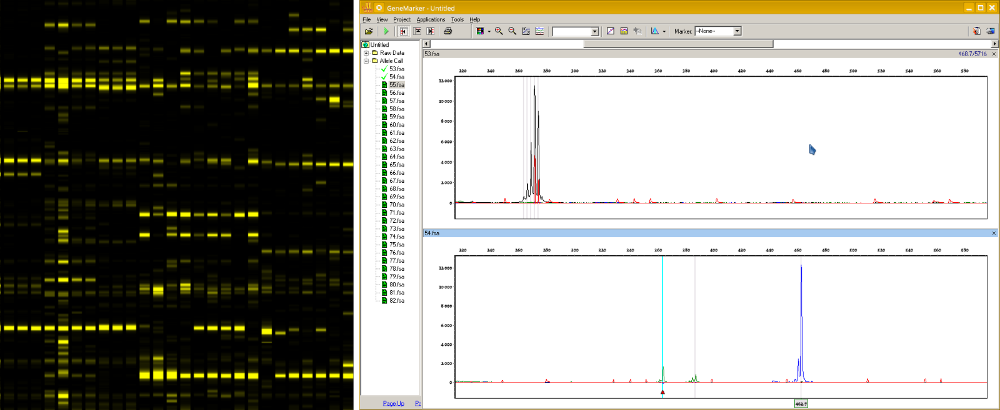 <!-- MERGE-REVIEW: no counterpart section found in QMD; content from TEX kept as-is. -->

### Examples of data and formats II - Aligned DNA sequences displayed in Geneious

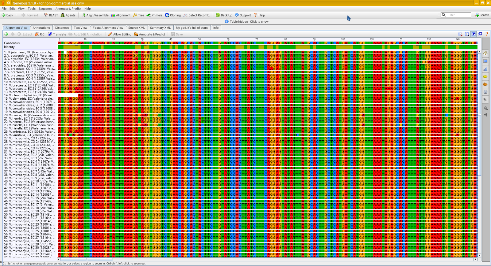 <!-- MERGE-REVIEW: no counterpart section found in QMD; content from TEX kept as-is. -->

### Examples of data and formats III - FASTA and FASTQ sequences, text view

```{r}
> CY013200
atgaagactatcattgctttgagctacattttatgtctggttttcgctcaaaaacttcccctagtgaaaaca
ggaaatgacaacagcacagcaacgctgtgcctgggacaccatgcagtgccaaacggaacgatcacgaatgat
> CY013781
atgaagactatcattgctttgagctacattttatgtctggttttcgctcaaaaacttccccaaattgaagtg
... # FASTA continues...
```

```{r}
@7001425F:141:CAV4JANXX:3:1104:1496:1976 1:N:0:GTGTCC
NCGATTCATTTTAGCAATTAGACGTGAAGGTCTCTTGATGAAAGACACTAACGAACTCTTTCCTTGGACACC
+
#<<BBFFFFFFFFFFFFFFFFFFFFFFFFFFFFFFFFFFFFFFFFFFFFFFFFFFFFFFFFFFFFFFFFFFF
@7001425F:141:CAV4JANXX:3:1104:1250:1987 1:N:0:GTGTCC
TCGATTCACTGAACTGAATGTCCGACAAACTTTAGTTTGTCGTTTCTACCTCACCAAAGTTCGGAGCTTCGA
+
#<<BBFFFFFFFFFFFFFFFFFFFFFFFFFFFFFFFFFFFFFFFFFFFFFFFFFFFFFFFFFFFFFFFFFFF
... # FASTQ continues...
```

<!-- MERGE-REVIEW: no counterpart section found in QMD; code below comes from the old TEX version. -->

### Examples of data and formats IV - BAM displayed in IGV

**It contains Illumina short reads mapped to reference**

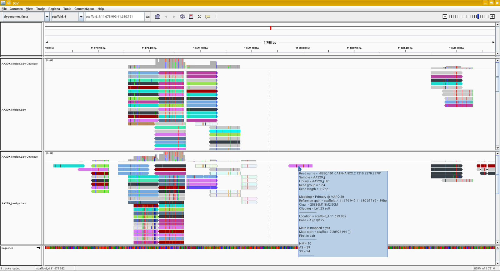 <!-- MERGE-REVIEW: no counterpart section found in QMD; content from TEX kept as-is. -->

### Examples of data and formats V - VCF with 5 samples displayed in IGV

**Variants of alleles and depth of coverage for each sample, mapped to reference**

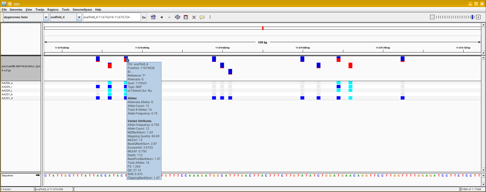 <!-- MERGE-REVIEW: no counterpart section found in QMD; content from TEX kept as-is. -->

### Examples of data and formats VI - Parts of VCF in text view

```{r}
... # Header
##ALT=<ID=NON_REF,Description="Represents any possible alternative al...
##FILTER=<ID=DP_4,Description="DP < 4">
... # Information about data stored
##INFO=<ID=AC,Number=A,Type=Integer,Description="Allele count in geno...
##INFO=<ID=AF,Number=A,Type=Float,Description="Allele Frequency, for ...
... # Information about chromosomes etc.
##contig=<ID=scaffold_1,length=33132539>
##contig=<ID=scaffold_2,length=19320864>
... # The data (variants of nucleotides)
#CHROM  POS     ID      REF     ALT     QUAL    FILTER  INFO    FORMA...
scaffold_4      22846289        .       C       A       91.52   PASS ...
scaffold_4      22846291        .       C       T       325.58  PASS ...
...AC=1;AF=1.057e-03;AN=946;BaseQRankSum=0.825;ClippingRankSum=0.118;...
...DP=4046;ExcessHet=3.0302;FS=0.000;InbreedingCoeff=-0.0096;MQ=79.24...
... # More data...
```

<!-- MERGE-REVIEW: no counterpart section found in QMD; code below comes from the old TEX version. -->

### Input/output data formats

**Representative selection**

- [\*\*BAM](https://en.wikipedia.org/wiki/BAM_(file_format))\*\* (Binary Alignment Map)/[\*\*SAM](https://en.wikipedia.org/wiki/SAM_(file_format))\*\* (Sequence Alignment Map)

  - Not used during the course
  - Sequences (usually short reads from Illumina) mapped to reference
  - Each file contains data for single sample
  - Structure is relatively complex
  - Contains also information about mapping quality etc., complex structure
  - Used by applications like [bamtools](https://github.com/pezmaster31/bamtools/wiki) or [SAMtools](https://www.htslib.org/)
  - BAM is "just" a compressed version of SAM
  - Special applications are needed to work with BAM files
  - Multiple BAM files are used to construct VCF containing multiple samples
  - Extension `*.bam`/`*.sam`

- [\*\*CSV](https://en.wikipedia.org/wiki/Comma-separated_values)\*\* (Comma Separated Values)/[\*\*TSV](https://en.wikipedia.org/wiki/Tab-separated_values)\*\* (TAB separated values)

  - "One sheet of Excel"
  - Common plain text format to store data (traits, coordinates, ...), etc.
  - Columns (cells) are separated by commas, cells are commonly bordered by quotation marks (`csv`), or by tabs (`t`) (`tsv`) - it is important to check structure before import into R (and verify it after import)
  - Extension usually `*.csv`, `*.tsv`, `*.tab` or so
  - Can have many formatting forms - carefully set parameter of import function

- [\*\*FASTA](https://en.wikipedia.org/wiki/FASTA_format)\*\*

  - Simple and popular text format to store genetic sequences (DNA, RNA, proteins)
  - Each file contains one or more sequences
  - **Line 1** of every records starts with `>` and contain name/description of the sequence (e.g. `> Seq 1`), **line 2+** contain(s) the sequence (`ATCG...`) - until end of file or next line starting with `>`
  - Each sequence can be on single line, or on multiple lines
  - Can store also alignments (practically sequences of same length, with marked gaps and missing data)
  - Larger sequences are sometimes compressed (mostly by gzip - `*.gz`)
  - Extension usually `*.fasta` (generic, also `*.fas`, `*.fa`, `*.seq`, `*.fsa`), `*.fna` (nucleic acid), `*.ffn` (nucleotides, coding regions), `*.faa` (amino acids), `*.frn` (non-coding RNA), ...

- [\*\*FASTQ](https://en.wikipedia.org/wiki/FASTQ_format)\*\*

  - Not used during the course
  - Text based format to store sequences (mainly nucleotides)
  - Every record consists of **4 lines**: (**1**) sequence ID (with possible description) starting with `@`, (**2**) the sequence (`ATCG...`), (**3**) `+` optionally followed by the same ID as line 1, and (**4**) quality values for nucleotides from line 2
  - Probably the most common format for output of modern high throughput sequencing machines (e.g. Illumina), each file contains huge number of sequences
  - Commonly compressed by `gzip` (`*.gz`), sometimes by other compression methods
  - Extension usually `*.fastq`, `*.fq`, `*.fastq.gz`, `*.fq.gz`, ...

- [\*\*NEWICK](https://en.wikipedia.org/wiki/Newick_format)\*\*

  - Every line contains one tree represented by brackets, optionally with numbers (separated by `:`) labeling nodes and/or branches (bootstrap supports, likelihoods, branch lengths, ages, ...)
  - File can contain one or more trees
  - E.g. `(A,B,(C,D)E)F;` or `(A:0.1,B:0.2,(C:0.3,D:0.4):0.5);`
  - Simple logic, but very hard to read by human
  - Extension usually `*.newick`, `*.nwk`, `*.tre`, ...

- [\*\*NEXUS](https://en.wikipedia.org/wiki/Nexus_file)\*\*

  - Popular plain text format used by software like [Mesquite](https://www.mesquiteproject.org/), [MrBayes](https://nbisweden.github.io/MrBayes/), [PAUP\*](https://paup.phylosolutions.com/), [SplitsTree](https://uni-tuebingen.de/en/fakultaeten/mathematisch-naturwissenschaftliche-fakultaet/fachbereiche/informatik/lehrstuehle/algorithms-in-bioinformatics/software/splitstree/), ...
  - Structure can be complex, is divided into blocks containing e.g. sequences, trees (in NEWICK format), distance matrix, fragmentation data, networks (e.g. for SplitsTree), MrBayes commands, traits, ...
  - Several variants, sometimes problems with interoperability
  - Extension usually `*.nexus`, `*.nex`, `*.nxs`

- [\*\*TXT](https://en.wikipedia.org/wiki/Text_file)\*\*

  - Plain text file can contain content of all listed file formats (except binary BAM) - extension (`*.txt`) is not really reliable...
  - Technically, all listed plain text formats belong also to this category

- [\*\*VCF](https://en.wikipedia.org/wiki/Variant_Call_Format)\*\* (Variant Call Format)

  - Do not confuse with [vCard](https://en.wikipedia.org/wiki/VCard) (`*.vcf`, `*.vcard`) storing virtual business cards and address books
  - Bioinformatics plain text format storing gene variants, annotations, quality data and more information
  - Used by software like [Bcftools](https://samtools.github.io/bcftools/), [GATK](https://gatk.broadinstitute.org/hc/en-us), [Picard](https://broadinstitute.github.io/picard/), [VCFtools](https://vcftools.github.io/), ...
  - Complex structure, sequences are not stored as in FASTA, but as SNP variants on respective positions - useful to store processed NGS/HTS data (e.g. from Illumina machines)
  - Commonly compressed by `gzip` (`*.gz`), sometimes by other compression methods
  - Several versions and variants (including binary BCF, `*.bcf`), sometimes there are problems with interoperability
  - Extension usually `*.vcf` or `*.vcf.gz` <!-- MERGE-REVIEW: no counterpart section found in QMD; content from TEX kept as-is. -->

### R training data

- R packages commonly contain training data to illustrate its abilities
- We will use some of them during the course (we already used `iris`)
- We will also use data provided by the teacher and/or his colleagues

```{r}
data() # List data available in currently loaded packages
# List data available in all installed packages (can be very long)
data(package=rownames(installed.packages()))
# Load selected data set; for example phylogeny and species traits
# of shorebirds from package caper (we will use it much later)
data(shorebird, package="caper")
# Optional method (load respective library and then data)
library(caper) # Library containing (among others) desired data
data(shorebird) # Loading the data
?shorebird # See content of the dataset # or ?caper::shorebird
?adegenet::microbov
?adegenet::rupica
?ape::carnivora
```

<!-- MERGE-REVIEW: 1 old code block(s) in TEX frame were dropped in favor of the .qmd section 'Exporting data'. -->

<!-- MERGE-REVIEW: content of the .qmd section 'Exporting data' was inserted at 5 frames; remove the unwanted duplicates. -->

Convert genind into DF using genind2df()

Save microsatellites to disk - check settings of write.table

Export of DNA sequences into FASTA format

Export DNA sequnces as NEXUS

Export VCF

Export trees (objects of class phylo) - will be introduced later

```{r}
hauss_df <- genind2df(x = hauss_genind, pop = NULL, sep = "/", usepop = TRUE, oneColPerAll = FALSE)
```

```{r}
write.table(x = hauss_df, file = "haussdata.txt", quote = FALSE, sep = "\t", na = "NA", dec = ".", row.names = TRUE, col.names = TRUE)
```

```{r}
write.dna(x = usflu_dna, file = "usflu.fasta", format = "fasta", append = FALSE, nbcol = 6)
seqinr::write.fasta(sequences = as.character.DNAbin(gunnera_dna), names = names(gunnera_dna), file.out = "gunnera.fasta", open = "w")
```

```{r}
write.nexus.data(x = gunnera_dna, file = "gunnera.nexus", format = "dna")
```

```{r}
vcfR::write.vcf(x = arabidopsis_vcf, file = "arabidopsis.vcf.gz")
```

```{r}
write.tree(phy = hauss_nj_bruvo, file = "haussknechtii.nwk") # Writes tree(s) in NEWICK format
write.nexus(hauss_nj_bruvo, file = "haussknechtii.nexus") # Writes tree(s) in NEXUS format
```

### Our data...

**We will use...**

- Modified subset of diploid microsatellite data of *Taraxacum haussknechtii* (Asteraceae) from Macedonia by [Zeisek et al 2015](https://trapa.cz/en/taraxacum-section-dioszegia)

  - Population genetics - genetic structure, characteristics and comparisons of sampled populations
  - Spatial genetics - genetic relationships in spatial context - relationships among populations regarding their spatial position

- Modified subset of triploid microsatellite data of several species of *Taraxacum* sect. *Taraxacum* (Asteraceae) - *T. alatum*, *T. ekmanii*, *T. hemicyclum* and *T. hepaticum* from central and northern Europe by [Kirschner et al 2016](https://trapa.cz/en/identif-oligoclonal-agamospermous-microsp)

  - Population genetics
  - Species delimitation (genotyping, identification and assignment of species)

- Small subset of population AFLP data of *Cardamine amara* (Brassicaceae) from Europe by [Karol Marhold](https://web.natur.cuni.cz/botanika/brassiploidy/marholdcv/) and his team

  - Population genetics

- Small subset of non-synonymous SNPs from [ASY3](https://www.arabidopsis.org/servlets/TairObject?type=locus&name=At2g46980) gene (required for meiosis) from diploids and tetraploids of *Arabidopsis arenosa* (Brassicaceae) from central and northern Europe by [Magdalena Bohutínská](https://scholar.google.com/citations?user=kSnTudAAAAAJ) and her colleagues

  - Population genomics
  - Associations of various traits (physiological, ...) with particular genetic loci/alleles

- Small subset of trees and taxa from phylogeny of *Oxalis* spp. (Oxalidaceae) from South Africa (the Cape region) by [Schmickl et al. 2016](https://onlinelibrary.wiley.com/doi/full/10.1111/1755-0998.12487)

  - Phylogenomics, target enrichment (HybSeq) sequencing of multiple genes - construction of individual gene trees, their evaluation (identification of trees with significantly different topology - genes with different evolutionary pathway) and construction of species trees and networks

- Internal transcribed spacer sequences of *Gunnera* spp. (Gunneraceae) from [Wanntorp et al 2014](https://doi.org/10.1046/j.1365-2699.2003.00895.x) downloaded from GenBank

  - Phylogenetic relationships among species with "Gondwana" distribution (south of South America, South Africa, Australia, New Zealand, ...)

- Maturase K (matK) plastid sequences of *Nothofagus* (Nothofagaceae) downloaded from [EMBL-EBI](https://www.ebi.ac.uk/) and/or [NCBI](https://www.ncbi.nlm.nih.gov/) (various authors; mainly from phylogenetic studies)

- Training data from packages

  - Sequence of influenza from USA sampled in several years (package adegenet, part of its vignette)
  - SSRs genotypes of cattle breeds, `?adegenet::microbov` - population genetics (genetic structure)
  - *Rupicapra rupicapra* (Bovidae) SSRs genotypes from French Bauges mountains, `?adegenet::rupica` - spatial genetics (spatial distribution of genotypes and their relationships)
  - Morphological traits and phylogeny of 17 *Acer* species, `?adephylo::maples` - phylogeny and correlated evolution of characters
  - Morphological traits of Carnivora, `?ape::carnivora` - life history patterns: allometric, phylogenetic and ecological associations
  - Measurements of *Iris setosa*, *I. versicolor* and *I. virginica*, `?iris` - measurements of morphological characters, their correlations and differences among species
  - Phylogeny and morphological traits of shorebirds, `?caper::shorebird` - comparative evolution of characters

- Work with microsatellites is in most cases (except some methods taking advance from microsatellite mutational nature) same as with presence-absence data and methods can handle both data types in nearly same fashion

  - Examples are shown mainly with microsatellites, but another (sequencing, presence/absence, ...) data are used in same way - try it

- Distance-based methods are same regardless input data on the beginning (microsatellites, AFLP, DNA sequences, ...)

- Extraction of SNP from DNA is useful in case of huge data sets - for smaller data sets it is not necessary

- Many methods can process (nearly) any input data type

  **We will use data objects during whole course - all the time save your workspace!** Use possibilities of your GUI or `save`/`load` functions.

R training data List data available in currently loaded packages

List data available in all installed packages (can be very long)

Load selected data set For example phylogeny and species traits of shorebirds from package caper (we will use it much later)

Optional method (load respective library and then data)

See content of the data set

R training data we will use during the course

```{r}
data()
```

```{r}
data(package = rownames(installed.packages()))
```

```{r}
data(shorebird, package = "caper")
```

```{r}
library("caper") # Library containing (among others) desired data
data(shorebird) # Loading the data
```

```{r}
?shorebird # Or
?caper::shorebird
```

```{r}
?adegenet::microbov
?adegenet::rupica
?ape::carnivora
?caper::shorebird
```

### Notes about paths to import the data

- Generally, R can accept nearly any local or web location

- If unsure where you are, open any file manager, go to the R working directory (verify with `getwd()` and `dir()`) and verify where everything is

- Web locations start with `https://`, `http://` or `ftp://`, e.g. `FileParameter="https://server.cz/directory/file.txt"`

- Local paths (within one computer) can be absolute or relative

  - Absolute paths start from the top of files hierarchy: on UNIX (Linux, macOS, ...) it use to look like `/home/USER/...`, on Windows like `C:/...` (e.g. `FileParameter="/path/to/some/file.txt"`)

  - Relative paths start in current directory (so **no** with `/` or `C:`)

    - In the easiest case the input file is in same directory as is R's working directory - verify by `getwd()` and `dir()` - you then need to specify only the filename (e.g. `FileParameter="SomeFile.txt"`)
    - For subdirectory start with its name (**no** with `/` or `C:`), e.g. `FileParameter="subdirectory/another/directory/file.txt"`
    - When going directory up, use one `..` for each level, e.g. `FileParameter="../upper/directory/file.txt"`
    - On UNIX (macOS, Linux, ...) tilde \``means user's home directory (e.g.`/home/USER/`), so`FileParameter="/some/file.txt"`is same as`FileParameter="/home/USER/some/file.txt"\`

  - If loading data from computer, carefully check the paths or \*\*use function `file.choose()** to interactively pick up the file anywhere in the computer` - it can replace nearly any filename parameter (e.g. `FileParameter=file.choose()`)

- Some R functions have problems with spaces and special (non-alphanumeric and accented) characters - Avoid them!

- One of the most common source of errors - **when the command fails, double check paths** (and Internet connection, if applicable) - for another common problems see slide

  **R** always work in some directory (see by `getwd()`) and by default load input files from there (see them by `dir()`) and save output there - relative paths starts there. This is common source of confusion and errors for beginners. <!-- MERGE-REVIEW: no counterpart section found in QMD; content from TEX kept as-is. -->

### Population genetics and phylogenetics in R

**Microsatellites, AFLP, SNP & sequences**

- Now we will use mainly packages [adegenet](https://adegenet.r-forge.r-project.org/) and [poppr](https://grunwaldlab.github.io/poppr/)
- Other important genetic packages: [ape](https://emmanuelparadis.r-universe.dev/ape), [ade4](https://sdray.github.io/software/) and [pegas](https://emmanuelparadis.github.io/pegas.html)
- Dominant/co-dominant marker data of any ploidy level including SSRs, SNP, and AFLP are analyzed in same way
- Most of methods are available for polyploids (although not all)
- Some methods are unavailable for dominant (presence/absence) data
- Mixing of ploidy levels is tricky (but possible) - it doesn't matter when data are encoded as PA, otherwise it is mathematically problematic
- Import, basic checking, manipulation, conversion, and export of basic common data types
- Analyses are in further chapters...

```{r}
# Load needed libraries
library(ape)
library(ade4)
library(adegenet)
library(pegas)
library(poppr)
# Now let's start to work...
```

<!-- MERGE-REVIEW: no counterpart section found in QMD; code below comes from the old TEX version. -->

## Microsatellites

### Microsatellites

- Microsatellites are short (1--3 bp) tandem repeats (in plants typically AT) very commonly occurring in Eucaryotic genomes
- Defined by number of repeats (ca. 25--250\$\$), usually recorded as length of whole region
- On the beginning and end of microsatellite region there is unique primer sequence (ca. 20 bp) - unique primers must be designed for each species
- Generally considered as evolutionary neutral, but sometimes associated with gene expression regulations or diseases
- Commonly used in population genetics due to their very high mutation rate (high diversity) and possibility to distinguish heterozygots from dominant homozygots
- Suitable for fine-scale population genetics, relationships among closely related species, not for phylogeny
- Cheap, easy to sequence, but species-specific primers are required
- Stored mostly as `loci` (package pegas) or `genind` (package adegenet) objects <!-- MERGE-REVIEW: no counterpart section found in QMD; content from TEX kept as-is. -->

### Load microsatellite data into loci object

```{r}
# Source data
    pop  msta93 msta101 msta102 msta103 msta105 msta131 ...
H01  He 269/269 198/198 221/223 419/419 197/197 196/196 ...
H02  He 275/283 198/198 221/223 419/419 193/193 168/190 ...
... ...     ...     ...     ...     ...     ...     ... ...
# Loading the data
# Load training data (Taraxacum haussknechtii from Macedonia)
hauss.loci <- read.loci(file="https://soubory.trapa.cz/rcourse/
  haussknechtii_ssrs.txt", header=TRUE, loci.sep="\t", allele.sep="/",
  col.pop=2, col.loci=3:14, row.names=1) # \t means TAB key
hauss.loci # Data control
print(hauss.loci, details=TRUE)
```

First line starts with empty cell (if `header` is presented), there can be any extra column, take care about `col.loci`. `row.names` are individual names (first column). Take care about `loci.sep` (here TAB `t`) and `allele.sep` (here `/`) - **according to data formatting**. <!-- MERGE-REVIEW: no counterpart section found in QMD; code below comes from the old TEX version. -->

### Prepare genind object for analysis and load coordinates

```{r}
# Conversion of loci to genind - used for many analysis
hauss.genind <- loci2genind(hauss.loci)
pop(hauss.genind) # See population names
hauss.genind$pop # "$" separates extra slots within object
```

```{r}
# Source data
Ind      lon   lat
H01  21.3333  41.1
...      ...   ...
# Read coordinates
hauss.coord <- read.csv("https://soubory.trapa.cz/rcourse/haussknechtii_
  coordinates.csv", header=TRUE, sep="\t", quote="", dec=".", row.names=1)
hauss.coord
```

- Coordinates can be in any projection or scale - according to aim
- Take care about parameters of `read.csv()`! See `?read.csv`
- `pegas::geod` calculates geodesic distances (on Earth surface) <!-- MERGE-REVIEW: no counterpart section found in QMD; code below comes from the old TEX version. -->

### Add coordinates to genind and create genpop object

```{r}
# Add coordinates - note identification of slots within object
hauss.genind$other$xy <- hauss.coord
hauss.genind$other$xy # See result - the coordinates
hauss.genind # See result - whole object
# Conversion to genpop - for population-level analysis
hauss.genpop <- genind2genpop(hauss.genind, process.other=TRUE)
hauss.genpop # See result
# Removes missing data - see ?missingno for types of dealing them
# Use with caution! It modifies original data!
hauss.genind.cor <- missingno(pop=hauss.genind, type="mean", cutoff=0.1,
  quiet=FALSE)
?missingno # See other options of handling missing data
# Convert corrected genind to loci
hauss.loci.cor <- genind2loci(hauss.genind.cor)
# Writes loci file to the disk
write.loci(hauss.loci.cor, file="hauss.loci.cor.txt", loci.sep="\t",
  allele.sep="/")
```

<!-- MERGE-REVIEW: no counterpart section found in QMD; code below comes from the old TEX version. -->

### Import of polyploid microsatellites

- `adegenet`, `poppr` and related packages can for most of functions handle any ploidy level (including mixing of ploidy levels, but not for all analysis)
- `polysat` package can handle mixed ploidy levels for microsatellites, but range of methods is limited
- As for AFLP, we need two files: the data matrix and individual's populations (it can be combined in one file - next slide)

**Triploid microsatellite data:**

```{r}
          msat58      msat31      msat78      msat61 ...
ala1 124/124/124 237/237/237 164/164/172 136/136/138 ...
ala2 124/124/124 237/237/237 164/164/172 136/136/138 ...
ala4 124/124/124 237/237/237 164/164/172 136/136/138 ...
 ...         ...         ...         ...         ... ...
```

Triploid species of *Taraxacum* sect. *Taraxacum* <!-- MERGE-REVIEW: no counterpart section found in QMD; code below comes from the old TEX version. -->

### How to import polyploid microsatellites

```{r}
# Import of table is as usual. Last column contains populations
tarax3n.table <- read.table("https://soubory.trapa.cz/rcourse/
  tarax3n.txt", header=TRUE, sep="\t", quote="", row.names=1)
# Check the data
tarax3n.table
class(tarax3n.table)
dim(tarax3n.table)
# See parameter "X" - we don't import whole tarax3n.table as last column
# contains populations - this column we use for "pop" parameter (note
# different style of calling the column - just to show the possibility).
# Check "ploidy" and "ncode" (how many digits code one allele - must be
# same everywhere). See ?df2genind for more details.
tarax3n.genind <- df2genind(X=tarax3n.table[,1:6], sep="/", ncode=3,
  pop=tarax3n.table[["pop"]], ploidy=3, type="codom")
# See resulting genind object
tarax3n.genind
summary(tarax3n.genind)
```

<!-- MERGE-REVIEW: no counterpart section found in QMD; code below comes from the old TEX version. -->

## AFLP/PA

### Amplified Fragment Length Polymorphism

1.  Whole genomic DNA is split by few restriction enzymes into huge number of fragments of various length
2.  Adaptors are ligated to each fragment
3.  Pre-amplification - only fragments with "selection" nucleotide, 1/16 of all fragments are amplified
4.  Selective amplification - like previous step, 2 more "selection" nucleotides, 1/256 of all fragments are amplified

- Resulting fragments are visualized and recorded as presence/absence (1/0) matrix of fragment of particular length
- Highly variable, no prior knowledge of target genome required, suitable for fine-scale population genetics, relationships among closely related species (not for phylogeny)
- Technically relatively demanding, nowadays people use to prefer RAD-Seq or similar
- **Same methods are used also for another presence/absence data** <!-- MERGE-REVIEW: no counterpart section found in QMD; content from TEX kept as-is. -->

### Import of presence/absence (e.g. AFLP) data - background

Two files - AFLP data with individual names, and populations

**AFLP or any other presence/absence data:**

```{r}
    L1 L2 L3 L4 L5 L6 L7 L8 L9 ...
Ind1 0  0  1  1  1  0  0  0  1 ...
IndG 0  0  1  1  0  0  0  0  0 ...
 ...  ...                      ...
```

AFLP data of *Cardamine amara* group

**Individual's populations:**

```{r}
POP
pop1
popZ
...
```

Just list of populations for respective individuals...

- Use any names, just keep one word (no spaces) and don't use special characters
- Keep names of loci as simple as possible, there are some issues when they contain dots
- As soon as one line of data = one individual, ploidies and their mixing doesn't matter
- Not all methods introduced later are available/meaningful for PA
- Basically `matrix`/`DF` is imported, usually converted into `genind` <!-- MERGE-REVIEW: no counterpart section found in QMD; code below comes from the old TEX version. -->

### Import of AFLP data - the code

```{r}
amara.aflp <- read.table(file="https://soubory.trapa.cz/rcourse/
  amara_aflp.txt", header=TRUE, sep="\t", quote="")
amara.aflp
dim(amara.aflp)
class(amara.aflp) # Must be matrix or data frame
# Populations - just one column with population names for all inds
amara.pop <- read.table(file="https://soubory.trapa.cz/rcourse/
  amara_pop.txt", header=TRUE, sep="\t", quote="")
amara.pop
# You can use just one file, where populations are in last column and
# in df2genind() use for example X=aflp[,1:XXX] and pop=aflp[,YYY]
# Create genind object - ind.names and loc.names are taken from X
aflp.genind <- df2genind(X=amara.aflp, sep="", ind.names=NULL,
  loc.names=NULL, pop=amara.pop[,1], type="PA")
indNames(aflp.genind) <- amara.aflp[,1] # Add individual names
aflp.genind
# You can add any other variables into genind$other$XXX
```

<!-- MERGE-REVIEW: no counterpart section found in QMD; code below comes from the old TEX version. -->

## Notes about data

### Import existing data set from popular software

```{r}
?read.genalex # poppr - reads *.csv file
?read.fstat # adegenet - reads *.dat files, only haploid/diploid data
?read.genetix # adegenet - reads *.gtx files, only ha/diploid data
?read.genepop # adegenet - reads *.gen files, only ha/diploid data
?read.structure # adegenet - reads *.str files, only ha/diploids
?import2genind # adegenet - more automated version of above functions
```

All these functions (including e.g. `read.loci()` and `read.csv()`) are only modifications of `read.table()`. You can use it directly to import any data. Look at `?read.table` and play with it. Take care about parameters. Does the table use quotes to mark cell (e.g. `quote=" ""`)? How are columns separated (e.g. `sep=" t"`)? Is there a header with names of populations/loci/whatever (`header=T/F`)? What is decimal separator (e.g. `dec="."`)? Are there row names (used typically as names of individuals; e.g. `row.names=1`)? **Always check data after import!** <!-- MERGE-REVIEW: no counterpart section found in QMD; code below comes from the old TEX version. -->

### Another data manipulation

```{r}
?genind2df # adegenet - export into data frame
?genind2genalex # poppr - export for genalex
?popsub # poppr - extracts only selected population(s)
?clonecorrect # poppr - corrects for clones
?informloci # poppr - removes uninformative loci
?seppop # adegenet - separates populations from genind or genlight
?seploc # adegenet - splits genind, genpop or genlight by markers
?alleles2loci # pegas - transforms a matrix of alleles into "loci"
# seppop and seploc return lists of genind objects - for further
# analysis using special functions to work on lists (see further)
# read manuals (?...) of the functions before usage
```

- SNPs can be into genind imported in same way as AFLP (PA)
- `alleles2loci()` is very useful when each allele is in separated columns (not like in our case where one column contains one loci with all alleles) - saves time needed to change input file formatting <!-- MERGE-REVIEW: no counterpart section found in QMD; code below comes from the old TEX version. -->

### Notes about getting data into R

- When importing fragmentation, character, etc. data, we somehow use function `read.table()` - it is important to understand it
- I recommend to use TAB (TSV - tab separated values; encoded as `t` in R) to separate columns (no quotation marks, no commas)
- When importing microsatellites, all alleles **must** have same number of digits (use trailing zeros). Separate alleles by "`/`", "`|`" or something similar and correctly specify it in `read.loci()` or `df2genind()` (or read the data with `read.table()`, convert into matrix and use `alleles2loci()`)
- **Do not use** dashes (minuses) ("`-`") to name objects in R (sometimes there are problems with underscores ("`_`")) - only numbers, Latin letters or dots
- `read.loci()` sometimes doesn't work correctly on AFLP or polyploid microsatellites - try `read.table()` instead...
- Genind object is able to store mixed ploidy data, but not all analysis are able to handle it <!-- MERGE-REVIEW: no counterpart section found in QMD; content from TEX kept as-is. -->

## DNA sequences, SNP

### Nucleotide sequences

- DNA/RNA sequences from "traditional" Sanger sequencing
- Probably most common genetic data
- Genes of various lengths and mutation rate - from variable introns suitable for population genetics to conservative genes suitable for phylogenies
- Examples are shown for DNA, but same apply for RNA and mostly also for protein sequences (use class `AAbin` instead of `DNAbin`)
- Same methods are used for single nucleotide polymorphism extracted from larger-scale sequencing, including from modern sequencing methods (Illumina etc.)
- Data use to be stored in FASTA or NEXUS format - can contain any sequences of any origin
- Outputs of modern high-throughput sequencing use to be stored in FASTQ and later BAM and VCF (see next chapter) <!-- MERGE-REVIEW: no counterpart section found in QMD; content from TEX kept as-is. -->

### Import of DNA sequence data I

```{r}
# Reading FASTA (read.dna() reads also another formats, see ?read.dna)
# Sequences of flu viruses from various years from USA (Adegenet toy data)
usflu.dna <- read.dna(file="https://adegenet.r-forge.r-project.org/
  files/usflu.fasta", format="fasta")
class(usflu.dna) # Check the object
usflu.dna # Check the object
# Another possibility (only for FASTA alignments, same result):
usflu.dna2 <- fasta2DNAbin(file="https://adegenet.r-forge.r-project.org
  /files/usflu.fasta") # Normally keeps only SNP - see ?fasta2DNAbin
class(usflu.dna2) # Check the object
usflu.dna2 # Check the object
as.character(usflu.dna2)[1:5,1:10] # Check the object
dim(usflu.dna2) # Does it have correct size?
# Read annotations
usflu.annot <- read.csv("https://adegenet.r-forge.r-project.org/files/
  usflu.annot.csv", header=TRUE, row.names=1)
head(usflu.annot) # See result
```

<!-- MERGE-REVIEW: no counterpart section found in QMD; code below comes from the old TEX version. -->

### Import of DNA sequence data II

```{r}
# Convert DNAbin to genind - only polymorphic loci (SNPs) are retained
# When converting DNAbin to genind, the sequences must be aligned!
usflu.genind <- DNAbin2genind(x=usflu.dna, pop=usflu.annot[["year"]])
usflu.genind # Check it
# Read sequence data in NEXUS (similar to reading FASTA)
?read.nexus.data
```

- RNA or protein sequences can be handed in same way - see `?read.dna` and `?read.FASTA`
- For nucleic acid sequences there is R class `DNAbin`, for protein sequences `AAbin` - they are handled in same way
- Do not confuse `read.nexus.data` (reads sequences) and `read.nexus` (reads trees) <!-- MERGE-REVIEW: no counterpart section found in QMD; code below comes from the old TEX version. -->

### Import sequences from GenBank

- Data from [GenBank](https://www.ncbi.nlm.nih.gov/nuccore?term=popset+representative+uid+22854787%5Bword%5D), *Gunnera* spp., phylogenetic study of [Wanntorp et al. 2002](https://doi.org/10.1046/j.1365-2699.2003.00895.x)

```{r}
# Importing sequences according to sequence ID
gunnera.dna <- read.GenBank(c("AF447749.1", "AF447748.1", "AF447747.1",
  "AF447746.1", "AF447745.1", "AF447744.1", "AF447743.1", "AF447742.1",
  "AF447741.1", "AF447740.1", "AF447739.1", "AF447738.1", "AF447737.1",
  "AF447736.1", "AF447735.1", "AF447734.1", "AF447733.1", "AF447732.1",
  "AF447731.1", "AF447730.1", "AF447729.1", "AF447728.1"))
gunnera.dna
class(gunnera.dna)
```

- To be converted into `genind` (useful for many population genetic analysis), sequences in `DNAbin` must be aligned (from slide )
- To query on-line database as through web we use [seqinr](https://CRAN.R-project.org/package=seqinr) (next slide) or [rentrez](https://CRAN.R-project.org/package=rentrez) (slide after) <!-- MERGE-REVIEW: no counterpart section found in QMD; code below comes from the old TEX version. -->

### Query on-line sequence databases

```{r}
library(seqinr)
choosebank() # List genetic banks available for seqinr
choosebank("embl", timeout=20) # Choose some bank
?query # See how to construct the query
# Query selected database - there are a lot of possibilities
nothofagus <- query(listname="nothofagus",
  query="SP=Nothofagus AND K=rbcl", verbose=TRUE)
nothofagus$req # See the sequences information
# Get the sequences as a list
nothofagus.sequences <- getSequence(nothofagus$req)
nothofagus.sequences # See sequences - just a plain list
nothofagus.annot <- getAnnot(nothofagus[["req"]]) # Get annotations
nothofagus.annot
closebank() # Close the bank when work is over
# Convert sequences from a list to DNAbin (functions as.DNAbin*)
nothofagus.dna <- as.DNAbin.list(nothofagus.sequences)
nothofagus.dna # See it
```

<!-- MERGE-REVIEW: no counterpart section found in QMD; code below comes from the old TEX version. -->

### Query NCBI databases

```{r}
library(rentrez)
entrez_dbs() # Genetic banks available for rentrez
entrez_db_summary("nucleotide") # Brief description of the selected database
# Set of search terms that can used with this database
entrez_db_searchable("nucleotide")
# Search the database and get IDs of matched records
nothofagus.search <- entrez_search(db="nucleotide",
  term="Nothofagus[ORGN] AND rbcL[GENE]")
nothofagus.search
# Fetch desired records according to their IDs
nothofagus.fasta <- entrez_fetch(db="nucleotide",
  id=nothofagus.search[["ids"]], rettype="fasta")
nothofagus.fasta
# Conversion into DNAbin requires saving to disk as FASTA and then loading
write(x=nothofagus.fasta, file="nothofagus.fasta")
nothofagus.dna <- read.dna(file="nothofagus.fasta", format="fasta")
nothofagus.dna
```

<!-- MERGE-REVIEW: no counterpart section found in QMD; code below comes from the old TEX version. -->

### Importing large SNP

- Import from [PLINK](https://zzz.bwh.harvard.edu/plink/index.shtml) requires saving of data with option ["--](https://zzz.bwh.harvard.edu/plink/dataman.shtml)recodeA"

```{r}
?read.PLINK # How to read PLINK files
```

- Extracting SNP from alignments reads FASTA alignments and keep only SNPs. The method is relatively efficient even for large data sets with several genomes:

```{r}
usflu.genlight <- fasta2genlight
  (file="https://adegenet.r-forge.r-project.org/files/usflu.fasta",
  quiet=FALSE, saveNbAlleles=TRUE)
usflu.genlight # See genlight
?fasta2genlight # Function has several options to speed up reading
# If it crashes (on Windows), try to add parameter "parallel=FALSE"
```

- For small data sets, keep data as DNAbin or genind as they are more information-rich - genlight is more efficient for large data (\> \$\$100,000 SNPs)
- Adegenet has custom format to store SNP as plain text file and function `read.snp` to import it into `genlight` object - check [Adegenet tutorial](https://github.com/thibautjombart/adegenet/wiki/Tutorials) **genomics**, `?read.snp` <!-- MERGE-REVIEW: no counterpart section found in QMD; code below comes from the old TEX version. -->

### Checking SNPs

```{r}
# Position of polymorphism within
# alignment - snpposi.plot requi-
# res input data in form of matrix
snpposi.plot(x=as.matrix(
  usflu.dna), codon=FALSE)
# Position of polymorphism within
# alignment-differentiating codons
snpposi.plot(as.matrix(usflu.dna))
# When converting DNAbin to genind
# only polymorphic loci are kept -
# threshold for polymorphism can
# be arbitrary (polyThres=...)
usflu.genind2 <- DNAbin2genind(x=
  usflu.dna, polyThres=0.01)
usflu.genind2 # See it
```

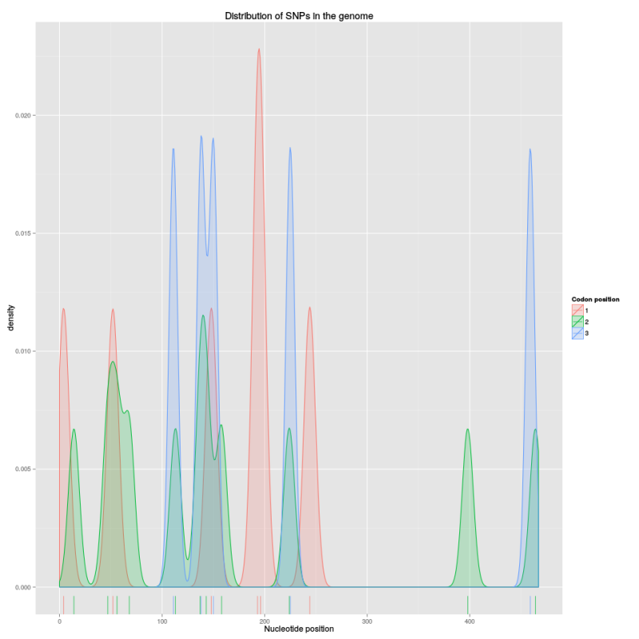 <!-- MERGE-REVIEW: no counterpart section found in QMD; code below comes from the old TEX version. -->

### Checking sequences

```{r}
# Test if distribution of SNPs is random (1000 permutations)
snpposi.test(as.matrix(usflu.dna))
pegas::nuc.div(x=usflu.dna) # Nucleotide diversity
ape::base.freq(x=usflu.dna) # Base frequencies
ape::GC.content(x=usflu.dna) # GC content
# Number of times any dimer/trimer/etc oligomers occur in a sequence
# Note: count() requires single sequence as DNAbin/character
seqinr::count(seq=as.character.DNAbin(gunnera.dna[["AF447749.1"]]),
  wordsize=3)
# View sequences - all must be of the same length
# Function "image.DNAbine" requires as input matrix, so that sequences
# must be of same length (aligned) - stored as DNAbin.matrix
image.DNAbin(x=usflu.dna)
# Sequences must be of same length - as.matrix.DNAbin() can help
image.DNAbin(x=as.matrix.DNAbin(usflu.dna))
```

<!-- MERGE-REVIEW: no counterpart section found in QMD; code below comes from the old TEX version. -->

### U.S. flu sequences

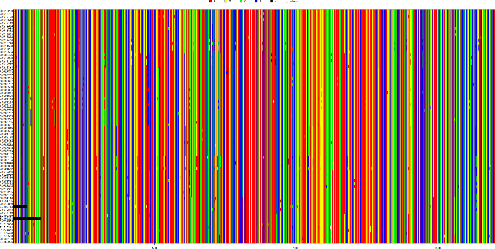 <!-- MERGE-REVIEW: no counterpart section found in QMD; content from TEX kept as-is. -->

### Notes about using genlight (vs. genind)

- Genlight is "just" version of more common genind object to store large data sets with (nearly) complete multiple genomes

- "Large" is tricky - there is no easy criterion (roughly, genind is inefficient since dozens or hundreds thousands of SNPs) - try genind and when work fails because of not enough computer resources, go on with genlight

  - Genlight is much more memory efficient, large genind can consume a lot of resources

- Use is basically same as when working with genind - but not all functions are able to deal with it (on the other hand, others are optimized to work well on large data sets)

- SNPbin is version of genind/genlight to store one large genome - serves basically as storage, no need to deal with it

- Genlight as well as genind allow varying ploidy level

- Functions working with genlight use to use parallelization to speed up operations - this commonly doesn't work properly on MS Windows <!-- MERGE-REVIEW: no counterpart section found in QMD; content from TEX kept as-is. -->

## VCF

### Variant Call Format

- Raw sequencing data from modern HTS (Illumina, Pacific Biosciences, ...) are stored in FASTQ format and pre-processed via BAM (FASTQ reads aligned to reference sequence) into VCF

  - This is usually done with special SW and/or pipelines
  - Raw VCF can be large, requires quality filtering etc.

- VCF is most common format for storing pre-processed data for various downstream analysis from HTS

- Can effectively store large WGS data

- Keeps only SNPs - differences of particular sample to reference

- Contains plenty of "meta information" - depth of coverage (ow many times was each site sequenced), mapping quality, ... used for quality filtering of SNPs

- Can handle any ploidy level, including mixing of ploidy levels, but not every application can work with that - this can easily lead into issues <!-- MERGE-REVIEW: no counterpart section found in QMD; content from TEX kept as-is. -->

### Reading VCF using vcfR

- Download into working directory input file <https://soubory.trapa.cz/rcourse/arabidopsis.vcf.gz> and reference sequence <https://soubory.trapa.cz/rcourse/alygenomes.fasta>
- Non-synonymous SNPs from [ASY3](https://www.arabidopsis.org/servlets/TairObject?type=locus&name=At2g46980) gene (required for meiosis) from diploids and tetraploids of *Arabidopsis arenosa* from central and northern Europe
- Package **vcfR** has functions to manipulate and explore VCF (class `vcfR`); other option is usage of [VariantAnnotation](https://bioconductor.org/packages/release/bioc/html/VariantAnnotation.html) (uses different classes)

```{r}
library(vcfR) # Required library
# Pick up downloaded file 'arabidopsis.vcf.gz' from the disk
arabidopsis.vcf <- read.vcfR(file=file.choose())
# File choose dialog can open in background - search for it :-)
# Or directly load remote file
arabidopsis.vcf <- read.vcfR
  (file="https://soubory.trapa.cz/rcourse/arabidopsis.vcf.gz")
```

<!-- MERGE-REVIEW: no counterpart section found in QMD; code below comes from the old TEX version. -->

### Checking VCF

```{r}
# It returns object of class vcfR-class
?read.vcfR # See more import options
?pegas::read.vcf # This one returns list of objects loci and data.frame
arabidopsis.vcf
head(arabidopsis.vcf)
arabidopsis.vcf@fix[1:10,1:5]
strwrap(arabidopsis.vcf@meta[1:21])
queryMETA(x=arabidopsis.vcf)
queryMETA(x=arabidopsis.vcf, element="DP")
queryMETA(x=arabidopsis.vcf, element="FORMAT.+DP")
queryMETA(x=arabidopsis.vcf, element="FORMAT=<ID=DP")
head(x=getFIX(x=arabidopsis.vcf))
head(x=is.polymorphic(x=arabidopsis.vcf, na.omit=TRUE))
head(x=is.biallelic(x=arabidopsis.vcf))
arabidopsis.vcf@gt[1:10, 1:4]
# See description of depth of coverage (DP) slot
strwrap(x=grep(pattern="ID=DP,", x=arabidopsis.vcf@meta, value=TRUE))
```

<!-- MERGE-REVIEW: no counterpart section found in QMD; code below comes from the old TEX version. -->

### Checking depth of coverage (DP)

```{r}
arabidopsis.vcf.dp <- extract.gt(x=arabidopsis.vcf, element="DP",
  as.numeric=TRUE) # GT:GQ:DP:HQ
dim(arabidopsis.vcf.dp) # See it
head(arabidopsis.vcf.dp)
# Boxplot of DP
boxplot(x=arabidopsis.vcf.dp, col="#808080", ylab="Depth of coverage",
  las=3)
title("DP per specimen")
abline(h=seq(from=0, to=90, by=10), col="#b3b3b3")
# Bar plot of mean DP
barplot(apply(X=arabidopsis.vcf.dp, MARGIN=2, FUN=mean, na.rm=TRUE), las=3)
title("Mean DP per specimen")
abline(h=seq(from=0, to=60, by=10), col="#b3b3b3")
# Heatmap of DP (subset)
heatmap.bp(x=arabidopsis.vcf.dp[1:100,1:100], col.ramp=rainbow(n=100,
  start=0.1)) # Subset - only first 100 loci and individuals
title("DP per specimens and loci")
```

<!-- MERGE-REVIEW: no counterpart section found in QMD; code below comes from the old TEX version. -->

### DP per specimen

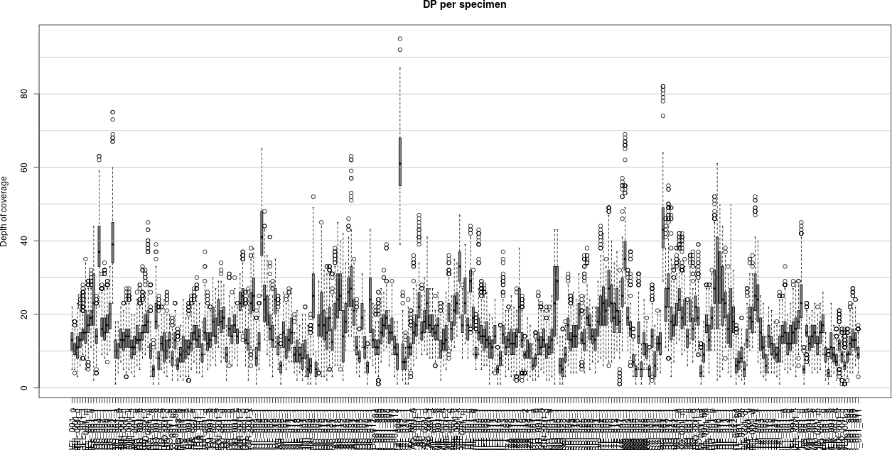 <!-- MERGE-REVIEW: no counterpart section found in QMD; content from TEX kept as-is. -->

### Bar plot of mean DP

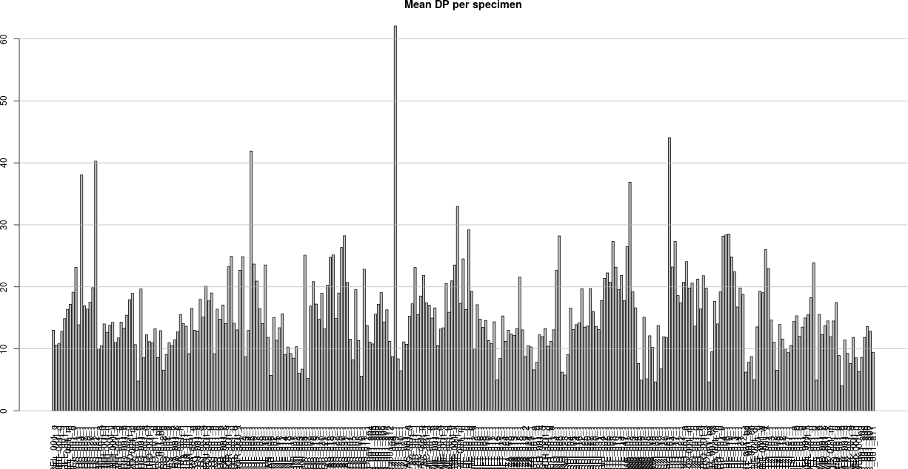 <!-- MERGE-REVIEW: no counterpart section found in QMD; content from TEX kept as-is. -->

### Heat map of DP

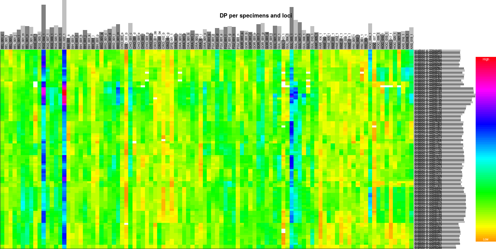 <!-- MERGE-REVIEW: no counterpart section found in QMD; content from TEX kept as-is. -->

### Extract the genotype quality (GQ)

```{r}
# Extract the GQ
arabidopsis.vcf.gq <- extract.gt(x=arabidopsis.vcf, element="GQ",
  as.numeric=TRUE)
dim(arabidopsis.vcf.gq)
arabidopsis.vcf.gq[1:10,1:10]
# Heatmap of GQ (subset)
heatmap.bp(x=arabidopsis.vcf.gq[1:100,1:100])
# Bar plot of mean GQ
barplot(apply(X=arabidopsis.vcf.gq, MARGIN=2, FUN=mean, na.rm=TRUE),
  las=3)
abline(h=seq(from=0, to=90, by=5), col="grey")
# Boxplot of GQ
boxplot(arabidopsis.vcf.gq, las=2, main="Genotype Quality (GQ)")
abline(h=seq(from=0, to=100, by=5), col="grey")
# Basically same as work with DP...
```

<!-- MERGE-REVIEW: no counterpart section found in QMD; code below comes from the old TEX version. -->

### Missing data

```{r}
# Extract information about missing data
arabidopsis.vcf.miss <- apply(X=arabidopsis.vcf.dp, MARGIN=2,
  FUN=function(x){sum(is.na(x))})
arabidopsis.vcf.miss <- arabidopsis.vcf.miss/nrow(arabidopsis.vcf)
# Bar plot of missing data
barplot(height=arabidopsis.vcf.miss, ylab="Percentage of missing data",
  las=2)
abline(h=seq(from=0, to=1, by=0.05), col="grey")
# Histogram of frequencies of missing data
arabidopsis.vcf.missg <- apply(X=arabidopsis.vcf.dp, MARGIN=1,
  FUN=function(x){sum(is.na(x))})
arabidopsis.vcf.missg <-
  arabidopsis.vcf.miss/ncol(arabidopsis.vcf@gt[,-1])
hist(x=arabidopsis.vcf.missg, xlab="Missingness (%)")
# Set abline parameters according to your data
abline(h=seq(from=0, to=350, by=25), col="grey")
```

<!-- MERGE-REVIEW: 1 old code block(s) in TEX frame were dropped in favor of the .qmd section 'Exporting data'. -->

<!-- MERGE-REVIEW: content of the .qmd section 'Exporting data' was inserted at 5 frames; remove the unwanted duplicates. -->

Convert genind into DF using genind2df()

Save microsatellites to disk - check settings of write.table

Export of DNA sequences into FASTA format

Export DNA sequnces as NEXUS

Export VCF

Export trees (objects of class phylo) - will be introduced later

```{r}
hauss_df <- genind2df(x = hauss_genind, pop = NULL, sep = "/", usepop = TRUE, oneColPerAll = FALSE)
```

```{r}
write.table(x = hauss_df, file = "haussdata.txt", quote = FALSE, sep = "\t", na = "NA", dec = ".", row.names = TRUE, col.names = TRUE)
```

```{r}
write.dna(x = usflu_dna, file = "usflu.fasta", format = "fasta", append = FALSE, nbcol = 6)
seqinr::write.fasta(sequences = as.character.DNAbin(gunnera_dna), names = names(gunnera_dna), file.out = "gunnera.fasta", open = "w")
```

```{r}
write.nexus.data(x = gunnera_dna, file = "gunnera.nexus", format = "dna")
```

```{r}
vcfR::write.vcf(x = arabidopsis_vcf, file = "arabidopsis.vcf.gz")
```

```{r}
write.tree(phy = hauss_nj_bruvo, file = "haussknechtii.nwk") # Writes tree(s) in NEWICK format
write.nexus(hauss_nj_bruvo, file = "haussknechtii.nexus") # Writes tree(s) in NEXUS format
```

### Remove non-biallelic loci and indels

- This is commonly done with SNPs as many downstream analysis are well defined only for biallelic loci (and do not work well with other loci)
- Other than biallelic loci are often suspicious of being laboratory/computational artifact

```{r}
# Remove indels
arabidopsis.vcf <- extract.indels(x=arabidopsis.vcf)
# Remove non-biallelic loci
arabidopsis.vcf <- arabidopsis.vcf[is.biallelic(x=arabidopsis.vcf),]
# See result
arabidopsis.vcf
```

- vcfR has relatively limited possibilities to filter VCF when comparing to specialized software like [GATK](https://gatk.broadinstitute.org/)
- More options are in [VariantAnnotation](https://bioconductor.org/packages/release/bioc/html/VariantAnnotation.html), but it uses different R class, so it's not handy for future work in this workflow <!-- MERGE-REVIEW: no counterpart section found in QMD; code below comes from the old TEX version. -->

### ChromR - filtration of VCF I

```{r}
# Loading reference sequence - download
# https://soubory.trapa.cz/rcourse/alygenomes.fasta into working directory
arabidopsis.dna <- read.dna(file="alygenomes.fasta", format="fasta")
arabidopsis.dna
# Conversion into chromosome object (ChromR)
arabidopsis.chrom <- create.chromR(vcf=arabidopsis.vcf,
  name="Arabidopsis arenosa", seq=arabidopsis.dna)
arabidopsis.chrom
plot(arabidopsis.chrom)
# Masking sites with too low/high DP and/or MQ (sites are not removed yet)
arabidopsis.chrom.mask <- masker(x=arabidopsis.chrom, min_QUAL=1,
  min_DP=8, max_DP=5000, min_MQ=40, max_MQ=200)
arabidopsis.chrom.mask
plot(arabidopsis.chrom.mask)
variant.table(arabidopsis.chrom.mask)
# Saving mask into new object (actually removing masked sites)
arabidopsis.chrom.fin <- proc.chromR(x=arabidopsis.chrom.mask)
```

<!-- MERGE-REVIEW: no counterpart section found in QMD; code below comes from the old TEX version. -->

### ChromR - filtration of VCF II

```{r}
# See results from the previous slide
arabidopsis.chrom.fin
chromoqc(chrom=arabidopsis.chrom.fin)
# The plot is bit empty as we have only single gene
```

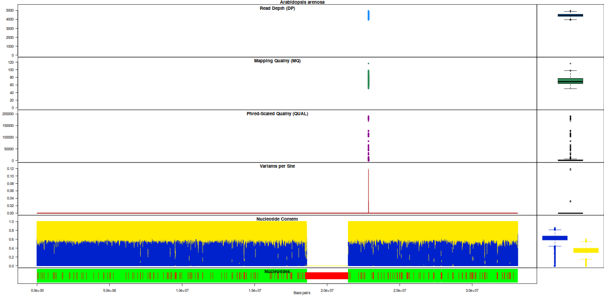 <!-- MERGE-REVIEW: no counterpart section found in QMD; code below comes from the old TEX version. -->

### Convert VCF into various objects for later processing

```{r}
# Genind - convert chromR or vcfR objects
arabidopsis.genind <- vcfR2genind(x=arabidopsis.chrom.fin@vcf, ploidy=4)
arabidopsis.genind # Check it
nInd(arabidopsis.genind)
indNames(arabidopsis.genind)
nLoc(arabidopsis.genind)
locNames(arabidopsis.genind)
# Genlight (suitable for huge data, not required now)
# Note that it introduces a lot of missing data due to variable ploidies
arabidopsis.genlight <- vcfR2genlight(x=arabidopsis.chrom.fin@vcf,
  n.cores=1) # On Linux/macOS and with large data use higher n.cores
warnings() # See errors - due to missing data when handling 4N vs. 2N
arabidopsis.genlight # Check it
arabidopsis.loci <- vcfR2loci(x=arabidopsis.chrom.fin) # Loci
arabidopsis.loci # Check it
print(x=arabidopsis.loci, details=TRUE)
```

<!-- MERGE-REVIEW: no counterpart section found in QMD; code below comes from the old TEX version. -->

### Convert vcfR into DNAbin

```{r}
# There are various options how
# to process variants in VCF
?vcfR2DNAbin
arabidopsis.dnabin <- vcfR2DNAbin
  (x=arabidopsis.chrom.fin,
  consensus=FALSE, extract.haps=
  TRUE, unphased_as_NA=FALSE,
  asterisk_as_del=FALSE)
arabidopsis.dnabin # Check it
dim(arabidopsis.dnabin)
as.character.DNAbin
  (arabidopsis.dnabin[1:15,1:12])
image.DNAbin(arabidopsis.dnabin)
snpposi.plot.DNAbin
  (arabidopsis.dnabin)
snpposi.test.DNAbin
  (arabidopsis.dnabin)
```

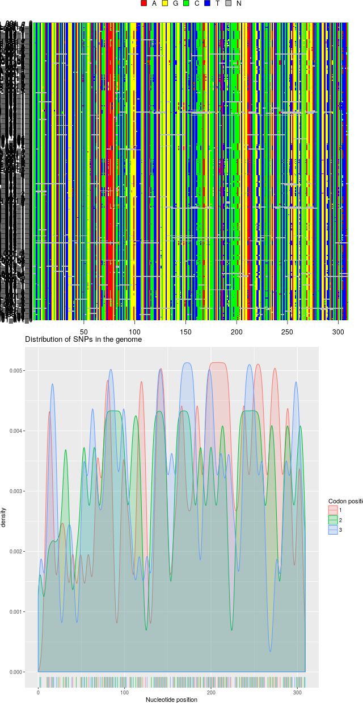 <!-- MERGE-REVIEW: no counterpart section found in QMD; code below comes from the old TEX version. -->

## Export

### Export data

```{r}
# Convert genind into DF using genind2df()
hauss.df <- genind2df(x=hauss.genind, pop=NULL, sep="/",
  usepop=TRUE, oneColPerAll=FALSE)
# Save microsatellites to disk - check settings of write.table
write.table(x=hauss.df, file="haussdata.txt", quote=FALSE,
  sep="\t", na="NA", dec=".", row.names=TRUE, col.names=TRUE)
# Export of DNA sequences into FASTA format
write.dna(x=usflu.dna, file="usflu.fasta", format="fasta",
  append=FALSE, nbcol=6)
seqinr::write.fasta(sequences=as.character.DNAbin(gunnera.dna),
  names=names(gunnera.dna), file.out="gunnera.fasta", open="w")
# Export DNA sequences as NEXUS
write.nexus.data(x=gunnera.dna, file="gunnera.nexus", format="dna")
write.vcf(x=arabidopsis.vcf, file="arabidopsis.vcf.gz") # Export VCF
# Export tree(s) (objects of class phylo) - will be introduced later
write.tree(phy=hauss.nj.bruvo, file="haussknechtii.nwk") # In NEWICK
write.nexus(hauss.nj.bruvo, file="haussknechtii.nexus") # In NEXUS
```

<!-- MERGE-REVIEW: 1 old code block(s) in TEX frame were dropped in favor of the .qmd section 'Exporting data'. -->

<!-- MERGE-REVIEW: content of the .qmd section 'Exporting data' was inserted at 5 frames; remove the unwanted duplicates. -->

Convert genind into DF using genind2df()

Save microsatellites to disk - check settings of write.table

Export of DNA sequences into FASTA format

Export DNA sequnces as NEXUS

Export VCF

Export trees (objects of class phylo) - will be introduced later

```{r}
hauss_df <- genind2df(x = hauss_genind, pop = NULL, sep = "/", usepop = TRUE, oneColPerAll = FALSE)
```

```{r}
write.table(x = hauss_df, file = "haussdata.txt", quote = FALSE, sep = "\t", na = "NA", dec = ".", row.names = TRUE, col.names = TRUE)
```

```{r}
write.dna(x = usflu_dna, file = "usflu.fasta", format = "fasta", append = FALSE, nbcol = 6)
seqinr::write.fasta(sequences = as.character.DNAbin(gunnera_dna), names = names(gunnera_dna), file.out = "gunnera.fasta", open = "w")
```

```{r}
write.nexus.data(x = gunnera_dna, file = "gunnera.nexus", format = "dna")
```

```{r}
vcfR::write.vcf(x = arabidopsis_vcf, file = "arabidopsis.vcf.gz")
```

```{r}
write.tree(phy = hauss_nj_bruvo, file = "haussknechtii.nwk") # Writes tree(s) in NEWICK format
write.nexus(hauss_nj_bruvo, file = "haussknechtii.nexus") # Writes tree(s) in NEXUS format
```

## Tasks

### Import your own data

1.  Prior to import into R, **ensure your data are correct** - same decimal separator everywhere, consistent structure of CSV/TSV, no syntactic problems in FASTA/NEXUS/NEWICK/...
2.  Import some of your data into R

- Be inspired by previous slides - edit commands to fit your needs and process your data
- R is extremely flexible, but not everything is figured out within one minute...
- Import preferably your data - you'll later use them to perform selected analysis

3.  **Check your data after import** to ensure they were correctly read

- Upcoming chapters can serve like inspiration (not exhaustive) how to process your data in R, what is possible to do with them...
- Previous examples are not covering all possibilities... <!-- MERGE-REVIEW: no counterpart section found in QMD; content from TEX kept as-is. -->

