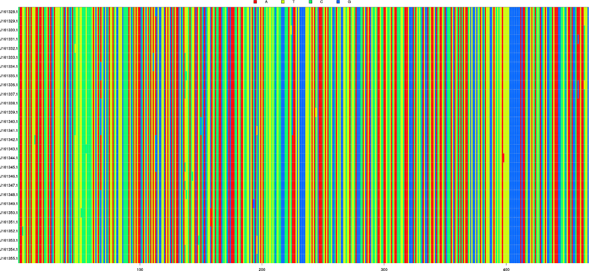
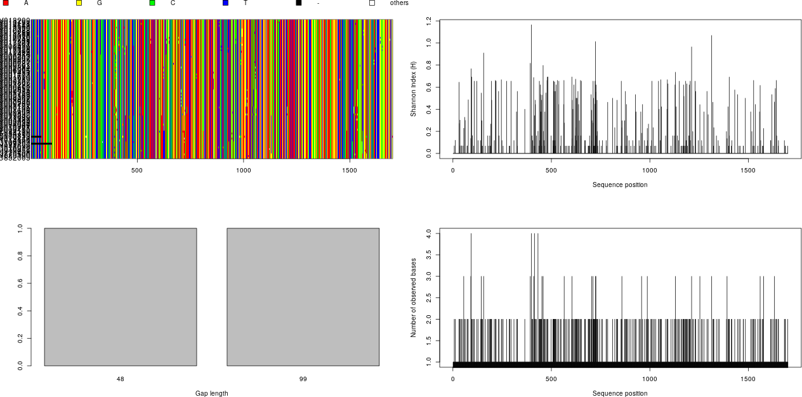

# Alignment

### Multiple sequence alignment

- Good alignment is basic condition for any analysis of DNA sequences

- DNA/RNA and protein sequences must be aligned prior any subsequent analysis (tree building, ...)

- R doesn't have any possibility for visual editing of alignments (use rather software like [Unipro UGENE](https://ugene.net/), [Geneious](https://www.geneious.com/) or [CLC Genomics Workbench](https://digitalinsights.qiagen.com/products-overview/analysis-and-visualization/qiagen-clc-genomics-workbench/))

- R can automatically (in batch) run multiple sequence alignments of multiple genes (there are several possibilities)

  - Simple scripts for this task can be written in any scripting language like BASH, Perl or Python - only matters what user likes, knows and wish to do with the results...
  - See e.g. <https://github.com/V-Z/hybseq-scripts/blob/master/bin/hybseq_4_alignment_3_run.r> from my [HybSeq scripts](https://github.com/V-Z/hybseq-scripts)

- R packages use common alignment software: [MAFFT](https://mafft.cbrc.jp/alignment/software/), [MUSCLE](https://www.drive5.com/muscle/), [Clustal](http://clustal.org/), ...

  - User must install this software manually - R is just using external applications (in the examples shown)

<!-- MERGE-REVIEW: content of the .qmd section 'Multiple sequence alignment' was inserted at 4 frames; remove the unwanted duplicates. -->

Libraries

Requires path to MAFFT binary - set it according to your installation Read ?mafft and mafft's documentation

Multiple sequence alignments using clustal, muscle and t-coffee are available in package ape Read "?clustal"and documentation of Clustal and Muscle to set correct parameters

See options in muscle package

Remove gaps from alignment - destroy it (not aligned anymore)

Align multiple genes Create a list of DNAbin objects to process

See it

Do the alignment

See result

Do the same in parallel (mclapply do the tasks in parallel, not one-by-one like lapply)

mclapply() relies on forking and hence is not available on Windows unless "mc.cores = 1" See result

Plotting alignment

Check the alignment

DNAbin can be technically list or matrix - some functions require list, some matrix, some can handle both - check manual and if needed, use

Matrix makes sense only for alignments, list for any import (sequences do no have to have same lengths)

Delete all columns/rows containing only gaps or missing data (N, ?, -)

Delete all columns containing at least 25% of gaps

Do not confuse with function delete.gaps() from phyloch package Delete every line (sample) containing at least 50% of missing data

Delete every alignment position having at least 20% of missing data

Display the result

See of settings of "nmax"value - threshold for gap deletion

```{r}
library("ape")
library("ips")
```

```{r}
gunnera_mafft <- ips::mafft(x = gunnera_dna, method = "localpair", maxiterate = 100, options = "--adjustdirection", exec = "/usr/bin/mafft") # Change "exec"to fit your path to mafft (on Windows point to mafft.bat)!
gunnera_mafft # See results, compare with 'gunnera'
class(gunnera_mafft)
image.DNAbin(gunnera_mafft) # Plot the alignment
```

```{r}
gunnera_clustal <- ape::clustal(x = gunnera_dna, pw.gapopen = 10, pw.gapext = 0.1, gapopen = 10, gapext = 0.2, exec = "/usr/bin/clustalw2", quiet = FALSE, original.ordering = TRUE) # Change "exec"to fit your path to clustal!
gunnera_clustal # See results
class(gunnera_clustal)
image.DNAbin(gunnera_clustal) # Plot the alignment
gunnera_muscle <- ape::muscle(x = gunnera_dna, exec = "muscle", quiet = FALSE, original.ordering = TRUE) # Change "exec"to fit your path to muscle!
gunnera_muscle # See results
class(gunnera_muscle)
image.DNAbin(gunnera_muscle) # Plot the alignment
```

```{r}
?muscle::muscle
```

```{r}
gunnera_nogaps <- del.gaps(gunnera_muscle)
?del.gaps # See for details
```

```{r}
multialign <- list(gunnera_dna, usflu_dna, usflu_dna2)
```

```{r}
multialign
class(multialign)
lapply(X = multialign, FUN = class)
```

```{r}
multialign_aln <- lapply(X = multialign, FUN = ips::mafft, method = "localpair", maxiterate = 100, exec = "/usr/bin/mafft") # Change "exec"to fit your path to mafft (on Windows point to mafft.bat)!
```

```{r}
multialign_aln
multialign_aln[[1]]
lapply(X = multialign_aln, FUN = class)
```

```{r}
library("parallel")
multialign_aln2 <- mclapply(X = multialign, FUN = ape::muscle, exec = "muscle", quiet = FALSE, original.ordering = TRUE) # Change "path"to fit your path to muscle!
```

```{r}
multialign_aln2
lapply(X = multialign_aln2, FUN = class)
?mclapply # See more options
?clusterApply # See more options (parLapply should work on Windows)
```

```{r}
image.DNAbin(x = gunnera_mafft)
```

```{r}
checkAlignment(x = usflu_dna, check.gaps = TRUE, plot = TRUE, what = 1:4)
checkAlignment(x = as.matrix.DNAbin(x = gunnera_clustal), check.gaps = TRUE, plot = TRUE, what = 1:4) # If it is saved as DNAbin list, not matrix
?checkAlignment # See details
```

```{r}
as.matrix.DNAbin() # or
as.list.DNAbin()
```

```{r}
```

```{r}
gunnera_mafft <- deleteEmptyCells(DNAbin = gunnera_mafft)
?ips::deleteEmptyCells # See help page for details
?phyloch::delete.empty.cells # See help page for details
```

```{r}
gunnera_mafft_ng <- deleteGaps(x = gunnera_mafft, gap.max = nrow(gunnera_mafft) / 4)
gunnera_mafft_ng
```

```{r}
gunnera_mafft_ng <- del.rowgapsonly(x = gunnera_mafft_ng, threshold = 0.5, freq.only = FALSE)
gunnera_mafft_ng
?ape::del.rowgapsonly # See help page for details
```

```{r}
gunnera_mafft_ng <- del.colgapsonly(x = gunnera_mafft_ng, threshold = 0.2, freq.only = FALSE)
gunnera_mafft_ng
?ape::del.colgapsonly # See help page for details
```

```{r}
image.DNAbin(x = gunnera_mafft_ng)
```

```{r}
?deleteGaps # "nmax = 0"deletes all columns with any gap
multialign_aln_ng <- lapply(X = multialign_aln, FUN = deleteGaps, gap.max = 5)
multialign_aln_ng
lapply(X = multialign_aln_ng, FUN = image.DNAbin)
```

## MAFFT

### Multiple sequence alignment with MAFFT

- MAFFT is available from (same author) in packages [ips](https://CRAN.R-project.org/package=ips) and [phyloch](http://www.christophheibl.de/Rpackages.html) - both read and write `DNAbin`

  - Phyloch is missing in CRAN, while ips is there and has generally more features, so we can use it

```{r}
library(ape)
library(ips)
# Requires path to MAFFT binary - set it according to your installation
# read ?mafft and mafft's documentation
# Change "exec" to fit your path to mafft (on Windows point to mafft.bat)!
gunnera.mafft <- mafft(x=gunnera.dna, method="localpair", maxiterate=100,
  options="--adjustdirection", exec="/usr/bin/mafft")
gunnera.mafft # See results, compare with 'gunnera'
class(gunnera.mafft)
image.DNAbin(gunnera.mafft)
```

<!-- MERGE-REVIEW: 1 old code block(s) in TEX frame were dropped in favor of the .qmd section 'Multiple sequence alignment'. -->

<!-- MERGE-REVIEW: content of the .qmd section 'Multiple sequence alignment' was inserted at 4 frames; remove the unwanted duplicates. -->

Libraries

Requires path to MAFFT binary - set it according to your installation Read ?mafft and mafft's documentation

Multiple sequence alignments using clustal, muscle and t-coffee are available in package ape Read "?clustal"and documentation of Clustal and Muscle to set correct parameters

See options in muscle package

Remove gaps from alignment - destroy it (not aligned anymore)

Align multiple genes Create a list of DNAbin objects to process

See it

Do the alignment

See result

Do the same in parallel (mclapply do the tasks in parallel, not one-by-one like lapply)

mclapply() relies on forking and hence is not available on Windows unless "mc.cores = 1" See result

Plotting alignment

Check the alignment

DNAbin can be technically list or matrix - some functions require list, some matrix, some can handle both - check manual and if needed, use

Matrix makes sense only for alignments, list for any import (sequences do no have to have same lengths)

Delete all columns/rows containing only gaps or missing data (N, ?, -)

Delete all columns containing at least 25% of gaps

Do not confuse with function delete.gaps() from phyloch package Delete every line (sample) containing at least 50% of missing data

Delete every alignment position having at least 20% of missing data

Display the result

See of settings of "nmax"value - threshold for gap deletion

```{r}
library("ape")
library("ips")
```

```{r}
gunnera_mafft <- ips::mafft(x = gunnera_dna, method = "localpair", maxiterate = 100, options = "--adjustdirection", exec = "/usr/bin/mafft") # Change "exec"to fit your path to mafft (on Windows point to mafft.bat)!
gunnera_mafft # See results, compare with 'gunnera'
class(gunnera_mafft)
image.DNAbin(gunnera_mafft) # Plot the alignment
```

```{r}
gunnera_clustal <- ape::clustal(x = gunnera_dna, pw.gapopen = 10, pw.gapext = 0.1, gapopen = 10, gapext = 0.2, exec = "/usr/bin/clustalw2", quiet = FALSE, original.ordering = TRUE) # Change "exec"to fit your path to clustal!
gunnera_clustal # See results
class(gunnera_clustal)
image.DNAbin(gunnera_clustal) # Plot the alignment
gunnera_muscle <- ape::muscle(x = gunnera_dna, exec = "muscle", quiet = FALSE, original.ordering = TRUE) # Change "exec"to fit your path to muscle!
gunnera_muscle # See results
class(gunnera_muscle)
image.DNAbin(gunnera_muscle) # Plot the alignment
```

```{r}
?muscle::muscle
```

```{r}
gunnera_nogaps <- del.gaps(gunnera_muscle)
?del.gaps # See for details
```

```{r}
multialign <- list(gunnera_dna, usflu_dna, usflu_dna2)
```

```{r}
multialign
class(multialign)
lapply(X = multialign, FUN = class)
```

```{r}
multialign_aln <- lapply(X = multialign, FUN = ips::mafft, method = "localpair", maxiterate = 100, exec = "/usr/bin/mafft") # Change "exec"to fit your path to mafft (on Windows point to mafft.bat)!
```

```{r}
multialign_aln
multialign_aln[[1]]
lapply(X = multialign_aln, FUN = class)
```

```{r}
library("parallel")
multialign_aln2 <- mclapply(X = multialign, FUN = ape::muscle, exec = "muscle", quiet = FALSE, original.ordering = TRUE) # Change "path"to fit your path to muscle!
```

```{r}
multialign_aln2
lapply(X = multialign_aln2, FUN = class)
?mclapply # See more options
?clusterApply # See more options (parLapply should work on Windows)
```

```{r}
image.DNAbin(x = gunnera_mafft)
```

```{r}
checkAlignment(x = usflu_dna, check.gaps = TRUE, plot = TRUE, what = 1:4)
checkAlignment(x = as.matrix.DNAbin(x = gunnera_clustal), check.gaps = TRUE, plot = TRUE, what = 1:4) # If it is saved as DNAbin list, not matrix
?checkAlignment # See details
```

```{r}
as.matrix.DNAbin() # or
as.list.DNAbin()
```

```{r}
```

```{r}
gunnera_mafft <- deleteEmptyCells(DNAbin = gunnera_mafft)
?ips::deleteEmptyCells # See help page for details
?phyloch::delete.empty.cells # See help page for details
```

```{r}
gunnera_mafft_ng <- deleteGaps(x = gunnera_mafft, gap.max = nrow(gunnera_mafft) / 4)
gunnera_mafft_ng
```

```{r}
gunnera_mafft_ng <- del.rowgapsonly(x = gunnera_mafft_ng, threshold = 0.5, freq.only = FALSE)
gunnera_mafft_ng
?ape::del.rowgapsonly # See help page for details
```

```{r}
gunnera_mafft_ng <- del.colgapsonly(x = gunnera_mafft_ng, threshold = 0.2, freq.only = FALSE)
gunnera_mafft_ng
?ape::del.colgapsonly # See help page for details
```

```{r}
image.DNAbin(x = gunnera_mafft_ng)
```

```{r}
?deleteGaps # "nmax = 0"deletes all columns with any gap
multialign_aln_ng <- lapply(X = multialign_aln, FUN = deleteGaps, gap.max = 5)
multialign_aln_ng
lapply(X = multialign_aln_ng, FUN = image.DNAbin)
```

## Clustal, MUSCLE and T-Coffee

### Clustal, MUSCLE and T-Coffee from ape

- MUSCLE is available in packages `muscle` and `ape` - first one reads classes "`*StringSet`" and writes classes "`*MultipleAlignment`" (see `?muscle::muscle`); the latter reads and writes object of class "`DNAbin`"
- `ape` also contains functions to use Clustal and T-Coffee - both read and write `DNAbin`

```{r}
# Read "?clustal" and documentation of Clustal, Muscle and T-Coffee
# when using them to set correct parameters
gunnera.clustal <- ape::clustal(x=gunnera.dna, pw.gapopen=10, pw.gapext=
  0.1, gapopen=10, gapext=0.2, exec="/usr/bin/clustalw2", quiet=FALSE,
  original.ordering=TRUE) # Change "exec" to fit your path to clustal!
gunnera.clustal
class(gunnera.clustal)
image.DNAbin(gunnera.clustal)
gunnera.muscle <- muscle(x=gunnera.dna, exec="muscle", quiet=FALSE,
  original.ordering=TRUE) # Change "exec" to fit your path to muscle!
gunnera.muscle # And "class(gunnera.muscle)"
```

<!-- MERGE-REVIEW: no counterpart section found in QMD; code below comes from the old TEX version. -->

### Multiple sequence alignment with MUSCLE

```{r}
image.DNAbin(gunnera.muscle)
```



```{r}
# Remove gaps from alignment - destroy it (not aligned anymore)
gunnera.nogaps <- del.gaps(gunnera.muscle)
?del.gaps # See for details
```

<!-- MERGE-REVIEW: 2 old code block(s) in TEX frame were dropped in favor of the .qmd section 'Multiple sequence alignment'. -->

<!-- MERGE-REVIEW: content of the .qmd section 'Multiple sequence alignment' was inserted at 4 frames; remove the unwanted duplicates. -->

Libraries

Requires path to MAFFT binary - set it according to your installation Read ?mafft and mafft's documentation

Multiple sequence alignments using clustal, muscle and t-coffee are available in package ape Read "?clustal"and documentation of Clustal and Muscle to set correct parameters

See options in muscle package

Remove gaps from alignment - destroy it (not aligned anymore)

Align multiple genes Create a list of DNAbin objects to process

See it

Do the alignment

See result

Do the same in parallel (mclapply do the tasks in parallel, not one-by-one like lapply)

mclapply() relies on forking and hence is not available on Windows unless "mc.cores = 1" See result

Plotting alignment

Check the alignment

DNAbin can be technically list or matrix - some functions require list, some matrix, some can handle both - check manual and if needed, use

Matrix makes sense only for alignments, list for any import (sequences do no have to have same lengths)

Delete all columns/rows containing only gaps or missing data (N, ?, -)

Delete all columns containing at least 25% of gaps

Do not confuse with function delete.gaps() from phyloch package Delete every line (sample) containing at least 50% of missing data

Delete every alignment position having at least 20% of missing data

Display the result

See of settings of "nmax"value - threshold for gap deletion

```{r}
library("ape")
library("ips")
```

```{r}
gunnera_mafft <- ips::mafft(x = gunnera_dna, method = "localpair", maxiterate = 100, options = "--adjustdirection", exec = "/usr/bin/mafft") # Change "exec"to fit your path to mafft (on Windows point to mafft.bat)!
gunnera_mafft # See results, compare with 'gunnera'
class(gunnera_mafft)
image.DNAbin(gunnera_mafft) # Plot the alignment
```

```{r}
gunnera_clustal <- ape::clustal(x = gunnera_dna, pw.gapopen = 10, pw.gapext = 0.1, gapopen = 10, gapext = 0.2, exec = "/usr/bin/clustalw2", quiet = FALSE, original.ordering = TRUE) # Change "exec"to fit your path to clustal!
gunnera_clustal # See results
class(gunnera_clustal)
image.DNAbin(gunnera_clustal) # Plot the alignment
gunnera_muscle <- ape::muscle(x = gunnera_dna, exec = "muscle", quiet = FALSE, original.ordering = TRUE) # Change "exec"to fit your path to muscle!
gunnera_muscle # See results
class(gunnera_muscle)
image.DNAbin(gunnera_muscle) # Plot the alignment
```

```{r}
?muscle::muscle
```

```{r}
gunnera_nogaps <- del.gaps(gunnera_muscle)
?del.gaps # See for details
```

```{r}
multialign <- list(gunnera_dna, usflu_dna, usflu_dna2)
```

```{r}
multialign
class(multialign)
lapply(X = multialign, FUN = class)
```

```{r}
multialign_aln <- lapply(X = multialign, FUN = ips::mafft, method = "localpair", maxiterate = 100, exec = "/usr/bin/mafft") # Change "exec"to fit your path to mafft (on Windows point to mafft.bat)!
```

```{r}
multialign_aln
multialign_aln[[1]]
lapply(X = multialign_aln, FUN = class)
```

```{r}
library("parallel")
multialign_aln2 <- mclapply(X = multialign, FUN = ape::muscle, exec = "muscle", quiet = FALSE, original.ordering = TRUE) # Change "path"to fit your path to muscle!
```

```{r}
multialign_aln2
lapply(X = multialign_aln2, FUN = class)
?mclapply # See more options
?clusterApply # See more options (parLapply should work on Windows)
```

```{r}
image.DNAbin(x = gunnera_mafft)
```

```{r}
checkAlignment(x = usflu_dna, check.gaps = TRUE, plot = TRUE, what = 1:4)
checkAlignment(x = as.matrix.DNAbin(x = gunnera_clustal), check.gaps = TRUE, plot = TRUE, what = 1:4) # If it is saved as DNAbin list, not matrix
?checkAlignment # See details
```

```{r}
as.matrix.DNAbin() # or
as.list.DNAbin()
```

```{r}
```

```{r}
gunnera_mafft <- deleteEmptyCells(DNAbin = gunnera_mafft)
?ips::deleteEmptyCells # See help page for details
?phyloch::delete.empty.cells # See help page for details
```

```{r}
gunnera_mafft_ng <- deleteGaps(x = gunnera_mafft, gap.max = nrow(gunnera_mafft) / 4)
gunnera_mafft_ng
```

```{r}
gunnera_mafft_ng <- del.rowgapsonly(x = gunnera_mafft_ng, threshold = 0.5, freq.only = FALSE)
gunnera_mafft_ng
?ape::del.rowgapsonly # See help page for details
```

```{r}
gunnera_mafft_ng <- del.colgapsonly(x = gunnera_mafft_ng, threshold = 0.2, freq.only = FALSE)
gunnera_mafft_ng
?ape::del.colgapsonly # See help page for details
```

```{r}
image.DNAbin(x = gunnera_mafft_ng)
```

```{r}
?deleteGaps # "nmax = 0"deletes all columns with any gap
multialign_aln_ng <- lapply(X = multialign_aln, FUN = deleteGaps, gap.max = 5)
multialign_aln_ng
lapply(X = multialign_aln_ng, FUN = image.DNAbin)
```

## Multiple genes

### Align multiple genes

- NGS/HTS introduced work with hundreds and thousands of genes, it makes sense to process them in batch and not manually one-by-one

```{r}
# Create a list of DNAbin objects to process
multialign <- list(gunnera.dna, usflu.dna, usflu.dna2)
# See it
multialign
class(multialign)
lapply(X=multialign, FUN=class)
# Do the alignment
# Change "exec" to fit your path to mafft (on Windows point to mafft.bat)!
multialign.aln <- lapply(X=multialign, FUN=ips::mafft, method="localpair",
  maxiterate=100, exec="/usr/bin/mafft")
# See result
multialign.aln
multialign.aln[[1]]
lapply(X=multialign.aln, FUN=class)
```

<!-- MERGE-REVIEW: no counterpart section found in QMD; code below comes from the old TEX version. -->

### Align multiple genes in parallel

- There are plenty of implementations of parallelization and using of computer clusters, see <https://CRAN.R-project.org/web/views/HighPerformanceComputing.html>

```{r}
library(parallel)
# Do the same in parallel (mclapply do the tasks in parallel, not
# one-by-one like lapply)
multialign.aln2 <- mclapply(X=multialign, FUN=ape::muscle,
  exec="muscle", quiet=FALSE, original.ordering=TRUE)
# Change "path" to fit your path to muscle!
# mclapply() relies on forking and hence is not available on Windows
# unless "mc.cores=1"
# See result
multialign.aln2
lapply(X=multialign.aln2, FUN=class)
?mclapply # See more options
?clusterApply # See more options (parLapply should work on Windows)
```

<!-- MERGE-REVIEW: no counterpart section found in QMD; code below comes from the old TEX version. -->

## Checking

### Checking the alignment

```{r}
# Plotting alignment
image.DNAbin(x=gunnera.mafft)
# Check the alignment
checkAlignment(x=usflu.dna, check.gaps=TRUE, plot=TRUE, what=1:4)
checkAlignment(x=as.matrix.DNAbin(x=gunnera.clustal), check.gaps=TRUE,
  plot=TRUE, what=1:4) # If it is saved as DNAbin list, not matrix
?checkAlignment # See details
# DNAbin can be technically list or matrix - some functions require
# list, some matrix, some can handle both - check manual and if needed,
# use:
as.matrix.DNAbin() # or
as.list.DNAbin()
# Matrix makes sense only for alignments, list for any import
# (sequences do no have to have same lengths)
```

<!-- MERGE-REVIEW: no counterpart section found in QMD; code below comes from the old TEX version. -->

### Checking the alignment

 <!-- MERGE-REVIEW: no counterpart section found in QMD; content from TEX kept as-is. -->

## Cleanup

### Cleaning the alignment

```{r}
# Delete all columns/rows containing only gaps or missing data (N, ?, -)
gunnera.mafft <- deleteEmptyCells(DNAbin=gunnera.mafft)
?ips::deleteEmptyCells # See help page for details
?phyloch::delete.empty.cells # See help page for details
# Delete all columns containing at least 25% of gaps
gunnera.mafft.ng<-deleteGaps(x=gunnera.mafft,gap.max=nrow(gunnera.mafft)/4)
gunnera.mafft.ng
# Do not confuse with function delete.gaps() from phyloch package
# Delete every line (sample) containing at least 50% of missing data
gunnera.mafft.ng <- del.rowgapsonly(x=gunnera.mafft.ng, threshold=0.5,
  freq.only=FALSE)
gunnera.mafft.ng
?ape::del.rowgapsonly # See help page for details
# Delete every alignment position having at least 20% of missing data
gunnera.mafft.ng <- del.colgapsonly(x=gunnera.mafft.ng, threshold=0.2,
  freq.only=FALSE)
gunnera.mafft.ng
```

<!-- MERGE-REVIEW: no counterpart section found in QMD; code below comes from the old TEX version. -->

### Cleaning the alignment

```{r}
?ape::del.colgapsonly # See help page for details
# Display the result
image.DNAbin(x=gunnera.mafft.ng)
# See of settings of "nmax" value - threshold for gap deletion
?deleteGaps # "nmax=0" deletes all columns with any gap
multialign.aln.ng <- lapply(X=multialign.aln, FUN=deleteGaps, gap.max=5)
multialign.aln.ng
lapply(X=multialign.aln.ng, FUN=image.DNAbin)
```

- "Strictness" of alignment cleaning depends on following steps - NJ (and another distance-based methods) doesn't like more than \$\$10--15% of missing data, but some tree builders (MrBayes, IQ-TREE, ...) are able to work with gaps - check their documentation...
- Automated cleanup is useful especially if batch processing plenty of genes
- `lapply` or `mclapply` can be used in the same way for any batch processing of alignments <!-- MERGE-REVIEW: no counterpart section found in QMD; code below comes from the old TEX version. -->

## Tasks

### Practice alignment

1.  Download (import from on-line database or your file from disk) sequences of ITS (or other variable gene if you prefer) of your favorite organism.
2.  Check the imported data.
3.  Align sequences with your preferred aligner.
4.  Check the resulting alignment.
5.  Trim the alignment - delete columns/rows with too much missing data. Think about various thresholds and their implications.
6.  Compare outputs of several aligners and/or different parameters (gap penalty etc.).
7.  Obtain nice alignment suitable for any subsequent analysis.

<!-- MERGE-REVIEW: content of the .qmd section 'Multiple sequence alignment' was inserted at 4 frames; remove the unwanted duplicates. -->

Libraries

Requires path to MAFFT binary - set it according to your installation Read ?mafft and mafft's documentation

Multiple sequence alignments using clustal, muscle and t-coffee are available in package ape Read "?clustal"and documentation of Clustal and Muscle to set correct parameters

See options in muscle package

Remove gaps from alignment - destroy it (not aligned anymore)

Align multiple genes Create a list of DNAbin objects to process

See it

Do the alignment

See result

Do the same in parallel (mclapply do the tasks in parallel, not one-by-one like lapply)

mclapply() relies on forking and hence is not available on Windows unless "mc.cores = 1" See result

Plotting alignment

Check the alignment

DNAbin can be technically list or matrix - some functions require list, some matrix, some can handle both - check manual and if needed, use

Matrix makes sense only for alignments, list for any import (sequences do no have to have same lengths)

Delete all columns/rows containing only gaps or missing data (N, ?, -)

Delete all columns containing at least 25% of gaps

Do not confuse with function delete.gaps() from phyloch package Delete every line (sample) containing at least 50% of missing data

Delete every alignment position having at least 20% of missing data

Display the result

See of settings of "nmax"value - threshold for gap deletion

```{r}
library("ape")
library("ips")
```

```{r}
gunnera_mafft <- ips::mafft(x = gunnera_dna, method = "localpair", maxiterate = 100, options = "--adjustdirection", exec = "/usr/bin/mafft") # Change "exec"to fit your path to mafft (on Windows point to mafft.bat)!
gunnera_mafft # See results, compare with 'gunnera'
class(gunnera_mafft)
image.DNAbin(gunnera_mafft) # Plot the alignment
```

```{r}
gunnera_clustal <- ape::clustal(x = gunnera_dna, pw.gapopen = 10, pw.gapext = 0.1, gapopen = 10, gapext = 0.2, exec = "/usr/bin/clustalw2", quiet = FALSE, original.ordering = TRUE) # Change "exec"to fit your path to clustal!
gunnera_clustal # See results
class(gunnera_clustal)
image.DNAbin(gunnera_clustal) # Plot the alignment
gunnera_muscle <- ape::muscle(x = gunnera_dna, exec = "muscle", quiet = FALSE, original.ordering = TRUE) # Change "exec"to fit your path to muscle!
gunnera_muscle # See results
class(gunnera_muscle)
image.DNAbin(gunnera_muscle) # Plot the alignment
```

```{r}
?muscle::muscle
```

```{r}
gunnera_nogaps <- del.gaps(gunnera_muscle)
?del.gaps # See for details
```

```{r}
multialign <- list(gunnera_dna, usflu_dna, usflu_dna2)
```

```{r}
multialign
class(multialign)
lapply(X = multialign, FUN = class)
```

```{r}
multialign_aln <- lapply(X = multialign, FUN = ips::mafft, method = "localpair", maxiterate = 100, exec = "/usr/bin/mafft") # Change "exec"to fit your path to mafft (on Windows point to mafft.bat)!
```

```{r}
multialign_aln
multialign_aln[[1]]
lapply(X = multialign_aln, FUN = class)
```

```{r}
library("parallel")
multialign_aln2 <- mclapply(X = multialign, FUN = ape::muscle, exec = "muscle", quiet = FALSE, original.ordering = TRUE) # Change "path"to fit your path to muscle!
```

```{r}
multialign_aln2
lapply(X = multialign_aln2, FUN = class)
?mclapply # See more options
?clusterApply # See more options (parLapply should work on Windows)
```

```{r}
image.DNAbin(x = gunnera_mafft)
```

```{r}
checkAlignment(x = usflu_dna, check.gaps = TRUE, plot = TRUE, what = 1:4)
checkAlignment(x = as.matrix.DNAbin(x = gunnera_clustal), check.gaps = TRUE, plot = TRUE, what = 1:4) # If it is saved as DNAbin list, not matrix
?checkAlignment # See details
```

```{r}
as.matrix.DNAbin() # or
as.list.DNAbin()
```

```{r}
```

```{r}
gunnera_mafft <- deleteEmptyCells(DNAbin = gunnera_mafft)
?ips::deleteEmptyCells # See help page for details
?phyloch::delete.empty.cells # See help page for details
```

```{r}
gunnera_mafft_ng <- deleteGaps(x = gunnera_mafft, gap.max = nrow(gunnera_mafft) / 4)
gunnera_mafft_ng
```

```{r}
gunnera_mafft_ng <- del.rowgapsonly(x = gunnera_mafft_ng, threshold = 0.5, freq.only = FALSE)
gunnera_mafft_ng
?ape::del.rowgapsonly # See help page for details
```

```{r}
gunnera_mafft_ng <- del.colgapsonly(x = gunnera_mafft_ng, threshold = 0.2, freq.only = FALSE)
gunnera_mafft_ng
?ape::del.colgapsonly # See help page for details
```

```{r}
image.DNAbin(x = gunnera_mafft_ng)
```

```{r}
?deleteGaps # "nmax = 0"deletes all columns with any gap
multialign_aln_ng <- lapply(X = multialign_aln, FUN = deleteGaps, gap.max = 5)
multialign_aln_ng
lapply(X = multialign_aln_ng, FUN = image.DNAbin)
```

