# Basic analysis

### Introductory overview of statistics and methods

- **Selected method depends on data type, question to answer, ...** - see further chapters

  - Check assumptions and requirements of the methods before usage
  - Think if the method answers your question
  - Always be opened for new possibilities coming with new methods and packages developed...

- [**Population-genetic**](https://en.wikipedia.org/wiki/Population_genetics) **indices** - from slide

  - Huge number...
  - Characterize differences among individuals/groups or genetic variability on various levels (within/among individuals/populations, ...)
  - One number tries to describe whole situation - always very rough
  - Description of heterozygosity, allelic richness, distribution of multi locus genotypes among populations, level of inbreeding, ...

- [**Distance**](https://en.wikipedia.org/wiki/Genetic_distance)**-based methods** - from slide

  - **It is crucial to select appropriate distance method for given data type**

  - Usually require the distance matrix to be Euclidean

  - Distance matrix has one single number (index) for each pair of comparisons (individuals, populations) - rough

  - Generally, the matrices describe pairwise similarities among the individuals/populations

  - Distance-based methods are phenetic

    - Based on similarity (described by the matrix), not on any (evolutionary) model
    - The matrix based on genetic data is supposed to well reflect the genetic similarity, thus real relationships among individuals/populations

  - [**Hierarchical clustering**](https://en.wikipedia.org/wiki/Hierarchical_clustering) - from slide

    - Several methods clustering individuals according to their (dis)similarity from top (i.e. starts by division into 2 groups etc.) or down (starts by grouping of the closest pair of samples) into clusters
    - (Un)weighted per-group mean average (**U/WPGMA**) and others
    - Used more in ecology, for genetic data not so much anymore (following methods use to produce better results)

  - [**Neighbor-Joining (NJ)**](https://en.wikipedia.org/wiki/Neighbor_joining) - from slide

    - A tree starting from the two most similar individuals and connecting in the next steps next and next the most similar individuals
    - In some cases artificially chains individuals
    - Several methods try to improve it - slide

  - **Principal Coordinates Analysis (PCoA)** - from slide

    - The most common method of [multivariate statistics](https://en.wikipedia.org/wiki/Multidimensional_scaling) for genetic data
    - Shows individuals in 2D scatter plot to retain maximum variability (starts with matrix of similarity indices)

- [**Minimum Spanning Network (MSN)**](https://en.wikipedia.org/wiki/Minimum_spanning_tree) - slide

  - Simple network connecting the most similar genotypes/haplotypes
  - Useful for clones, cpDNA, mtDNA, ...

- [**Multivariate statistics**](https://en.wikipedia.org/wiki/Multivariate_statistics)

  - Two variables are easily displayable in 2D xy-scatter plot (we can calculate correlation, whatever)

  - In molecular data, each locus is more or less independent variable - 1000 bp alignment has 1000 variables: How to display plot with 1000 axes to be able to really see something?

  - Methods like Principal Component Analysis (**PCA**), Non-Metric Multidimensional Scaling (**NMDS**) or **PCoA** look for correlations between pairs of variables to reduce them into new variables - after many steps new uncorrelated variables retaining maximum of original variability are constructed

    - PCoA requires as input distance matrix; PCA, NMDS and others source data matrix

  - New variables are sorted according amount of variability they show (the decrease is very steep - first 1--4 axes are usually enough) - it is possible to display xy-scatter plot showing most of variability of the data

  - Good for data display and creation of hypotheses - not to verify them (there is no statistical test) - researchers use to use them as *proof*, which is incorrect

  - Data are commonly scaled - all variables are in same scale

- [**Maximum Parsimony (MP)**](https://en.wikipedia.org/wiki/Maximum_parsimony) - from slide

  - Generally, the methods are looking for the most simple solution under given model, e.g. to construct phylogenetic tree requiring the lowest number of evolutionary changes (DNA mutations) under given alignment
  - It is easy to score how good the solution is (comparing to another solution), but computationally demanding to find the best one

- [**Maximum Likelihood (ML)**](https://en.wikipedia.org/wiki/Maximum_likelihood_estimation)

  - Methods look for the most likely (probable) solution of the data under given model, e.g. the most likely phylogenetic tree under given mutational model (and alignment)
  - It is easy to score how good the solution is (comparing to another solution), but computationally demanding to find the best one

- [**Bayesian statistics**](https://en.wikipedia.org/wiki/Bayesian_statistics)

  - Based on [Bayesian theorem](https://en.wikipedia.org/wiki/Bayes_theorem) - probability of model under given data

  - Methods are looking for the best (e.g. evolutionary) **model** (e.g. phylogenetic tree) **explaining the data** (e.g. DNA sequences) - reversed logic comparing to MP and ML

  - Algorithm exploring possible models, scoring them and approaching the best runs in steps (iterative generations)

    - After some time it converges to find optimal solution (usually described by logarithms of likelihood of given model)
    - Usually, \$\$millions (or even more) of generations (iterative steps) are required
    - Beginning use to be very unstable - it is discarded as burn-in ("heating" of [Markov Chain Monte Carlo (MCMC)](https://en.wikipedia.org/wiki/Markov_chain_Monte_Carlo) doing the exploration and optimization of models), usually \$\$10--25% of steps

- MP, ML and Bayesian statistics contain (evolutionary) **models** - they are not based on similarity (as matrix-based methods), so that they are supposed to reveal real structure in the data, on the other hand they are computationally demanding

- **Permutations**, **bootstraps** and another [tests](https://en.wikipedia.org/wiki/Resampling_(statistics))

  - It is necessary to test statistical significance of the obtained results
  - Most common methods somehow shuffle the data (drop one column, ...) and repeat the calculation to see how stable is the result (it might be driven by one or few loci, ...)
  - Whole process is repeated \$\$100--1000 times and output is shown as histogram of simulations vs. the observed value, in how many percents the same result was obtained (e.g. bootstrap) or as p-value (what is probability that the pattern was created by random process)
  - p = 0.05 means 95% probability that the data are non-random <!-- MERGE-REVIEW: no counterpart section found in QMD; content from TEX kept as-is. -->

### Questions and data

- Methods in this section answer questions about genetic characteristics of individuals/populations

  - Overall genetic similarity of individuals/populations (without spatial or another context) - various population-genetic indices, PCoA, ...
  - Distribution of genotypes within/among populations
  - Description of genetic characteristics of populations - heterozygosity, Hardy-Weinberg equilibrium, F-statistics, ...
  - Hierarchical relationships among individuals/populations (UPGMA, NJ, ...)

- Any data can be used

  - Population genetic studies use to use as variable genetic markers as possible (depending on scale, e.g. SSRs, AFLP, RAD-Seq, highly variable introns like ITS, ...)

- Nearly all data types are processed in similar/same way

  - It's important to select correct genetic index, distance method, etc. for particular data types and/or question
  - Only some examples are shown, try more yourselves <!-- MERGE-REVIEW: no counterpart section found in QMD; content from TEX kept as-is. -->

## First look at the data

### Load needed libraries

```{r}
library(ape) # Analysis of phylogenetics and evolution
library(ade4) # Analysis of ecological data, multivariate methods
library(adegenet) # Exploratory analysis of genetic and genomic data
library(pegas) # Population and evolutionary genetics
# Population genetic analysis, including populations with mixed
# reproduction
library(poppr)
library(hierfstat) # Hierarchical F-statistics
library(corrplot) # Visualization of correlation matrix
library(StAMPP) # Statistical analysis of mixed ploidy populations
library(philentropy) # Various genetic distances
```

- Of course, there are plenty of another options...

  - Representative, but not exhaustive examples are shown - **try more yourselves, adjust shown methods for your data** <!-- MERGE-REVIEW: no counterpart section found in QMD; code below comes from the old TEX version. -->

### Descriptive statistics I

- We will now work mainly with diploid SSRs of *Taraxacum haussknechtii*, you can **try with other data** examples by **yourselves**

```{r}
# Get summary - names and sizes of populations, heterozygosity, some info
# about loci
hauss.summ <- summary(hauss.genind)
# Plot expected vs. observed heterozygosity it looks like big difference
plot(x=hauss.summ$Hexp, y=hauss.summ$Hobs,
  main="Observed vs expected heterozygosity",
  xlab="Expected heterozygosity", ylab="Observed heterozygosity")
abline(0, 1, col="red")
# Bartlett's K-squared test of difference between observed and expected
# heterozygosity - not significant
bartlett.test(list(hauss.summ$Hexp, hauss.summ$Hobs))
              Bartlett test of homogeneity of variances
data:  list(hauss.summ$Hexp, hauss.summ$Hobs)
Bartlett's K-squared = 0.069894, df = 1, p-value = 0.7915
```

<!-- MERGE-REVIEW: 1 old code block(s) in TEX frame were dropped in favor of the .qmd section 'Descriptive statistics'. -->

<!-- MERGE-REVIEW: content of the .qmd section 'Descriptive statistics' was inserted at 5 frames; remove the unwanted duplicates. -->

Load needed libraries

Get summary - names and sizes of populations, heterozygosity, some info about loci

Plot expected vs. observed heterozygosity - it looks like big difference

Test normality of the vector - can we use bartlett.test() or t.test(), or do we have to use weaker kruskal.test() or wilcox.test()?

Bartlett's K-squared test of difference between observed and expected heterozygosity - not significant

T-test of difference between observed and expected heterozygosity - strongly significant

Create pane with some information

Plot alleles number vs. population sizes

Add text description to the point

Barplots of various data

poppr returns various population statistics for populations

Algorithms and equations utilized in poppr

Departure from HWE According to loci

Results per-locus

Summary across all loci

According to populations Separate genind object into list of genind objects for individual populations

Convert genind back to loci (list of loci objects according to populations)

Calculate the results per populations

FST Fit, Fst and Fis for each locus For Fst, fstat and theta.msat the loci object must contain population column

Nei's pairwise Fst between all pairs of populations - most common usage

For mixed ploidy data sets stamppFst requires population factor in genlight (here, population code consists of first three letters of individual's name)

Population code consists of first three letters of individual's name - extract the population name part

For large data use higher nclusters to parallelize calculations

Matrix of Fst among populations

Matrix of P values

Save results - open in spreadsheet (e.g. LibreOffice Calc)

Correlation plot of pairwise Fst

Display in similar way also another Fst tables

TODO Estimates of population theta according to Kimmel et al. 1998 theta.msat(hauss_loci)

```{r}
library("ape") # Analysis of phylogenetics and evolution
library("ade4") # Analysis of ecological data, multivariate methods
library("adegenet") # Exploratory analysis of genetic and genomic data
library("pegas") # Population and evolutionary genetics
library("poppr") # Population genetic analysis, including populations with mixed reproduction
library("hierfstat") # Hierarchical F-statistics
library("corrplot") # Visualization of correlation matrix
library("StAMPP") # Statistical analysis of mixed ploidy populations
library("philentropy") # Various genetic distances
```

```{r}
hauss_summ <- summary(hauss_genind)
hauss_summ
```

```{r}
plot(x = hauss_summ$Hexp, y = hauss_summ$Hobs, main = "Observed vs expected heterozygosity", xlab = "Expected heterozygosity", ylab = "Observed heterozygosity")
abline(0, 1, col = "red")
```

```{r}
shapiro.test(hauss_summ$Hexp)
```

```{r}
bartlett.test(list(hauss_summ$Hexp, hauss_summ$Hobs))
```

```{r}
t.test(x = hauss_summ$Hexp, y = hauss_summ$Hobs, paired = TRUE, var.equal = TRUE)
```

```{r}
par(mfrow = c(2, 2)) # Divide graphical devices into 4 smaller spaces
```

```{r}
plot(x = hauss_summ$n.by.pop, y = hauss_summ$pop.nall, xlab = "Populations sample size", ylab = "Number of alleles", main = "Alleles numbers and sample sizes", col = "red", pch = 20)
```

```{r}
text(x = hauss_summ$n.by.pop, y = hauss_summ$pop.nall, lab = names(hauss_summ$n.by.pop), cex = 1.5)
```

```{r}
barplot(height = hauss_summ$loc.n.all, ylab = "Number of alleles", main = "Number of alleles per locus", las = 3)
barplot(height = hauss_summ$Hexp - hauss_summ$Hobs, main = "Heterozygosity: expected-observed", ylab = "Hexp - Hobs", las = 3)
barplot(height = hauss_summ[["n.by.pop"]], main = "Sample sizes per population", ylab = "Number of genotypes", las = 3)
dev.off() # Closes graphical device - otherwise following graphs would still be divided into 4 parts
```

```{r}
?poppr # See details
poppr(dat = hauss_genind, total = TRUE, sample = 1000, method = 4, missing = "geno", cutoff = 0.15, quiet = FALSE, clonecorrect = FALSE, plot = TRUE, index = "rbarD", minsamp = 1, legend = TRUE)
```

```{r}
vignette("algo", package = "poppr")
```

```{r}
hauss_hwe_test <- hw.test(x = hauss_loci, B = 1000)
```

```{r}
hauss_hwe_test
```

```{r}
summary(hauss_hwe_test)
```

```{r}
hauss_pops <- seppop(hauss_genind)
hauss_pops
```

```{r}
hauss_pops_loci <- lapply(X = hauss_pops, FUN = genind2loci)
```

```{r}
lapply(X = hauss_pops_loci, FUN = hw.test, B = 1000)
```

```{r}
Fst(x = hauss_loci, pop = 1) # Calculation per locus
summary(Fst(x = hauss_loci, pop = 1)) # Summary across loci
```

```{r}
pairwise.neifst(dat = genind2hierfstat(dat = hauss_genind))
heatmap(x = pairwise.neifst(dat = genind2hierfstat(dat = hauss_genind)), Rowv = NA, Colv = NA) # Simple visualization
```

```{r}
indNames(arabidopsis_genlight)
```

```{r}
substr(x = indNames(arabidopsis_genlight), start = 1, stop = 3)
pop(arabidopsis_genlight) <- substr(x = indNames(arabidopsis_genlight), start = 1, stop = 3)
pop(arabidopsis_genlight) # Check it
popNames(arabidopsis_genlight)
arabidopsis_fst <- StAMPP::stamppFst(geno = arabidopsis_genlight, nboots = 100, percent = 95, nclusters = 8) # On Windows maybe "nclusters = 1"
```

```{r}
?StAMPP::stamppFst # See details
```

```{r}
arabidopsis_fst[["Fsts"]]
```

```{r}
arabidopsis_fst[["Pvalues"]]
```

```{r}
write.table(x = arabidopsis_fst[["Fsts"]], file = "arabidopsis_fst.tsv", quote = FALSE, sep = "\t")
```

```{r}
corrplot(corr = arabidopsis_fst[["Fsts"]], method = "circle", type = "lower", col = funky(15), title = "Correlation matrix of Fst among populations", is.corr = FALSE, diag = FALSE, outline = TRUE, order = "alphabet", tl.pos = "lt", tl.col = "black")
?corrplot # See for more options
```

### Descriptive statistics II

- `t.test` and `bartlett.test` require data to have normal distribution - if the condition is not met, it is necessary to use some weaker non-parametric test (`kruskal.test`, `wilcox.test`, ...)
- See respective manual pages for details
- `shapiro.test()` tests the normality of given vector

```{r}
# T-test of difference between observed and expected heterozygosity
t.test(x=hauss.summ$Hexp, y=hauss.summ$Hobs, paired=TRUE, var.equal=T)
             Paired t-test
data:  hauss.summ$Hexp and hauss.summ$Hobs
t = 3.5622, df = 11, p-value = 0.004456 # strongly significant
alternative hypothesis: true difference in means is not equal to 0
95 percent confidence interval:
 0.06114303 0.25887357
sample estimates:
mean of the differences
              0.1600083
```

<!-- MERGE-REVIEW: 1 old code block(s) in TEX frame were dropped in favor of the .qmd section 'Descriptive statistics'. -->

<!-- MERGE-REVIEW: content of the .qmd section 'Descriptive statistics' was inserted at 5 frames; remove the unwanted duplicates. -->

Load needed libraries

Get summary - names and sizes of populations, heterozygosity, some info about loci

Plot expected vs. observed heterozygosity - it looks like big difference

Test normality of the vector - can we use bartlett.test() or t.test(), or do we have to use weaker kruskal.test() or wilcox.test()?

Bartlett's K-squared test of difference between observed and expected heterozygosity - not significant

T-test of difference between observed and expected heterozygosity - strongly significant

Create pane with some information

Plot alleles number vs. population sizes

Add text description to the point

Barplots of various data

poppr returns various population statistics for populations

Algorithms and equations utilized in poppr

Departure from HWE According to loci

Results per-locus

Summary across all loci

According to populations Separate genind object into list of genind objects for individual populations

Convert genind back to loci (list of loci objects according to populations)

Calculate the results per populations

FST Fit, Fst and Fis for each locus For Fst, fstat and theta.msat the loci object must contain population column

Nei's pairwise Fst between all pairs of populations - most common usage

For mixed ploidy data sets stamppFst requires population factor in genlight (here, population code consists of first three letters of individual's name)

Population code consists of first three letters of individual's name - extract the population name part

For large data use higher nclusters to parallelize calculations

Matrix of Fst among populations

Matrix of P values

Save results - open in spreadsheet (e.g. LibreOffice Calc)

Correlation plot of pairwise Fst

Display in similar way also another Fst tables

TODO Estimates of population theta according to Kimmel et al. 1998 theta.msat(hauss_loci)

```{r}
library("ape") # Analysis of phylogenetics and evolution
library("ade4") # Analysis of ecological data, multivariate methods
library("adegenet") # Exploratory analysis of genetic and genomic data
library("pegas") # Population and evolutionary genetics
library("poppr") # Population genetic analysis, including populations with mixed reproduction
library("hierfstat") # Hierarchical F-statistics
library("corrplot") # Visualization of correlation matrix
library("StAMPP") # Statistical analysis of mixed ploidy populations
library("philentropy") # Various genetic distances
```

```{r}
hauss_summ <- summary(hauss_genind)
hauss_summ
```

```{r}
plot(x = hauss_summ$Hexp, y = hauss_summ$Hobs, main = "Observed vs expected heterozygosity", xlab = "Expected heterozygosity", ylab = "Observed heterozygosity")
abline(0, 1, col = "red")
```

```{r}
shapiro.test(hauss_summ$Hexp)
```

```{r}
bartlett.test(list(hauss_summ$Hexp, hauss_summ$Hobs))
```

```{r}
t.test(x = hauss_summ$Hexp, y = hauss_summ$Hobs, paired = TRUE, var.equal = TRUE)
```

```{r}
par(mfrow = c(2, 2)) # Divide graphical devices into 4 smaller spaces
```

```{r}
plot(x = hauss_summ$n.by.pop, y = hauss_summ$pop.nall, xlab = "Populations sample size", ylab = "Number of alleles", main = "Alleles numbers and sample sizes", col = "red", pch = 20)
```

```{r}
text(x = hauss_summ$n.by.pop, y = hauss_summ$pop.nall, lab = names(hauss_summ$n.by.pop), cex = 1.5)
```

```{r}
barplot(height = hauss_summ$loc.n.all, ylab = "Number of alleles", main = "Number of alleles per locus", las = 3)
barplot(height = hauss_summ$Hexp - hauss_summ$Hobs, main = "Heterozygosity: expected-observed", ylab = "Hexp - Hobs", las = 3)
barplot(height = hauss_summ[["n.by.pop"]], main = "Sample sizes per population", ylab = "Number of genotypes", las = 3)
dev.off() # Closes graphical device - otherwise following graphs would still be divided into 4 parts
```

```{r}
?poppr # See details
poppr(dat = hauss_genind, total = TRUE, sample = 1000, method = 4, missing = "geno", cutoff = 0.15, quiet = FALSE, clonecorrect = FALSE, plot = TRUE, index = "rbarD", minsamp = 1, legend = TRUE)
```

```{r}
vignette("algo", package = "poppr")
```

```{r}
hauss_hwe_test <- hw.test(x = hauss_loci, B = 1000)
```

```{r}
hauss_hwe_test
```

```{r}
summary(hauss_hwe_test)
```

```{r}
hauss_pops <- seppop(hauss_genind)
hauss_pops
```

```{r}
hauss_pops_loci <- lapply(X = hauss_pops, FUN = genind2loci)
```

```{r}
lapply(X = hauss_pops_loci, FUN = hw.test, B = 1000)
```

```{r}
Fst(x = hauss_loci, pop = 1) # Calculation per locus
summary(Fst(x = hauss_loci, pop = 1)) # Summary across loci
```

```{r}
pairwise.neifst(dat = genind2hierfstat(dat = hauss_genind))
heatmap(x = pairwise.neifst(dat = genind2hierfstat(dat = hauss_genind)), Rowv = NA, Colv = NA) # Simple visualization
```

```{r}
indNames(arabidopsis_genlight)
```

```{r}
substr(x = indNames(arabidopsis_genlight), start = 1, stop = 3)
pop(arabidopsis_genlight) <- substr(x = indNames(arabidopsis_genlight), start = 1, stop = 3)
pop(arabidopsis_genlight) # Check it
popNames(arabidopsis_genlight)
arabidopsis_fst <- StAMPP::stamppFst(geno = arabidopsis_genlight, nboots = 100, percent = 95, nclusters = 8) # On Windows maybe "nclusters = 1"
```

```{r}
?StAMPP::stamppFst # See details
```

```{r}
arabidopsis_fst[["Fsts"]]
```

```{r}
arabidopsis_fst[["Pvalues"]]
```

```{r}
write.table(x = arabidopsis_fst[["Fsts"]], file = "arabidopsis_fst.tsv", quote = FALSE, sep = "\t")
```

```{r}
corrplot(corr = arabidopsis_fst[["Fsts"]], method = "circle", type = "lower", col = funky(15), title = "Correlation matrix of Fst among populations", is.corr = FALSE, diag = FALSE, outline = TRUE, order = "alphabet", tl.pos = "lt", tl.col = "black")
?corrplot # See for more options
```

### Descriptive statistics III

```{r}
# Create pane with some information
par(mfrow=c(2, 2)) # Divide graphical devices into 4 smaller spaces
# Plot alleles number vs. population sizes
plot(x=hauss.summ$n.by.pop, y=hauss.summ$pop.nall, xlab="Populations
  sample size", ylab="Number of alleles", main="Alleles numbers and
  sample sizes", col="red", pch=20)
# Add text description to the point
text(x=hauss.summ$n.by.pop, y=hauss.summ$pop.nall,
  lab=names(hauss.summ$n.by.pop), cex=1.5)
# Barplots of various data
barplot(height=hauss.summ$loc.n.all, ylab="Number of alleles",
  main="Number of alleles per locus", las=3)
barplot(height=hauss.summ$Hexp-hauss.summ$Hobs, main="Heterozygosity:
  expected-observed", ylab="Hexp - Hobs", las=3)
barplot(height=hauss.summ[["n.by.pop"]], main="Sample sizes per
  population", ylab="Number of genotypes", las=3)
dev.off() # Closes graphical device to reset graphical settings
```

<!-- MERGE-REVIEW: 1 old code block(s) in TEX frame were dropped in favor of the .qmd section 'Descriptive statistics'. -->

<!-- MERGE-REVIEW: content of the .qmd section 'Descriptive statistics' was inserted at 5 frames; remove the unwanted duplicates. -->

Load needed libraries

Get summary - names and sizes of populations, heterozygosity, some info about loci

Plot expected vs. observed heterozygosity - it looks like big difference

Test normality of the vector - can we use bartlett.test() or t.test(), or do we have to use weaker kruskal.test() or wilcox.test()?

Bartlett's K-squared test of difference between observed and expected heterozygosity - not significant

T-test of difference between observed and expected heterozygosity - strongly significant

Create pane with some information

Plot alleles number vs. population sizes

Add text description to the point

Barplots of various data

poppr returns various population statistics for populations

Algorithms and equations utilized in poppr

Departure from HWE According to loci

Results per-locus

Summary across all loci

According to populations Separate genind object into list of genind objects for individual populations

Convert genind back to loci (list of loci objects according to populations)

Calculate the results per populations

FST Fit, Fst and Fis for each locus For Fst, fstat and theta.msat the loci object must contain population column

Nei's pairwise Fst between all pairs of populations - most common usage

For mixed ploidy data sets stamppFst requires population factor in genlight (here, population code consists of first three letters of individual's name)

Population code consists of first three letters of individual's name - extract the population name part

For large data use higher nclusters to parallelize calculations

Matrix of Fst among populations

Matrix of P values

Save results - open in spreadsheet (e.g. LibreOffice Calc)

Correlation plot of pairwise Fst

Display in similar way also another Fst tables

TODO Estimates of population theta according to Kimmel et al. 1998 theta.msat(hauss_loci)

```{r}
library("ape") # Analysis of phylogenetics and evolution
library("ade4") # Analysis of ecological data, multivariate methods
library("adegenet") # Exploratory analysis of genetic and genomic data
library("pegas") # Population and evolutionary genetics
library("poppr") # Population genetic analysis, including populations with mixed reproduction
library("hierfstat") # Hierarchical F-statistics
library("corrplot") # Visualization of correlation matrix
library("StAMPP") # Statistical analysis of mixed ploidy populations
library("philentropy") # Various genetic distances
```

```{r}
hauss_summ <- summary(hauss_genind)
hauss_summ
```

```{r}
plot(x = hauss_summ$Hexp, y = hauss_summ$Hobs, main = "Observed vs expected heterozygosity", xlab = "Expected heterozygosity", ylab = "Observed heterozygosity")
abline(0, 1, col = "red")
```

```{r}
shapiro.test(hauss_summ$Hexp)
```

```{r}
bartlett.test(list(hauss_summ$Hexp, hauss_summ$Hobs))
```

```{r}
t.test(x = hauss_summ$Hexp, y = hauss_summ$Hobs, paired = TRUE, var.equal = TRUE)
```

```{r}
par(mfrow = c(2, 2)) # Divide graphical devices into 4 smaller spaces
```

```{r}
plot(x = hauss_summ$n.by.pop, y = hauss_summ$pop.nall, xlab = "Populations sample size", ylab = "Number of alleles", main = "Alleles numbers and sample sizes", col = "red", pch = 20)
```

```{r}
text(x = hauss_summ$n.by.pop, y = hauss_summ$pop.nall, lab = names(hauss_summ$n.by.pop), cex = 1.5)
```

```{r}
barplot(height = hauss_summ$loc.n.all, ylab = "Number of alleles", main = "Number of alleles per locus", las = 3)
barplot(height = hauss_summ$Hexp - hauss_summ$Hobs, main = "Heterozygosity: expected-observed", ylab = "Hexp - Hobs", las = 3)
barplot(height = hauss_summ[["n.by.pop"]], main = "Sample sizes per population", ylab = "Number of genotypes", las = 3)
dev.off() # Closes graphical device - otherwise following graphs would still be divided into 4 parts
```

```{r}
?poppr # See details
poppr(dat = hauss_genind, total = TRUE, sample = 1000, method = 4, missing = "geno", cutoff = 0.15, quiet = FALSE, clonecorrect = FALSE, plot = TRUE, index = "rbarD", minsamp = 1, legend = TRUE)
```

```{r}
vignette("algo", package = "poppr")
```

```{r}
hauss_hwe_test <- hw.test(x = hauss_loci, B = 1000)
```

```{r}
hauss_hwe_test
```

```{r}
summary(hauss_hwe_test)
```

```{r}
hauss_pops <- seppop(hauss_genind)
hauss_pops
```

```{r}
hauss_pops_loci <- lapply(X = hauss_pops, FUN = genind2loci)
```

```{r}
lapply(X = hauss_pops_loci, FUN = hw.test, B = 1000)
```

```{r}
Fst(x = hauss_loci, pop = 1) # Calculation per locus
summary(Fst(x = hauss_loci, pop = 1)) # Summary across loci
```

```{r}
pairwise.neifst(dat = genind2hierfstat(dat = hauss_genind))
heatmap(x = pairwise.neifst(dat = genind2hierfstat(dat = hauss_genind)), Rowv = NA, Colv = NA) # Simple visualization
```

```{r}
indNames(arabidopsis_genlight)
```

```{r}
substr(x = indNames(arabidopsis_genlight), start = 1, stop = 3)
pop(arabidopsis_genlight) <- substr(x = indNames(arabidopsis_genlight), start = 1, stop = 3)
pop(arabidopsis_genlight) # Check it
popNames(arabidopsis_genlight)
arabidopsis_fst <- StAMPP::stamppFst(geno = arabidopsis_genlight, nboots = 100, percent = 95, nclusters = 8) # On Windows maybe "nclusters = 1"
```

```{r}
?StAMPP::stamppFst # See details
```

```{r}
arabidopsis_fst[["Fsts"]]
```

```{r}
arabidopsis_fst[["Pvalues"]]
```

```{r}
write.table(x = arabidopsis_fst[["Fsts"]], file = "arabidopsis_fst.tsv", quote = FALSE, sep = "\t")
```

```{r}
corrplot(corr = arabidopsis_fst[["Fsts"]], method = "circle", type = "lower", col = funky(15), title = "Correlation matrix of Fst among populations", is.corr = FALSE, diag = FALSE, outline = TRUE, order = "alphabet", tl.pos = "lt", tl.col = "black")
?corrplot # See for more options
```

### Graphs from previous slides

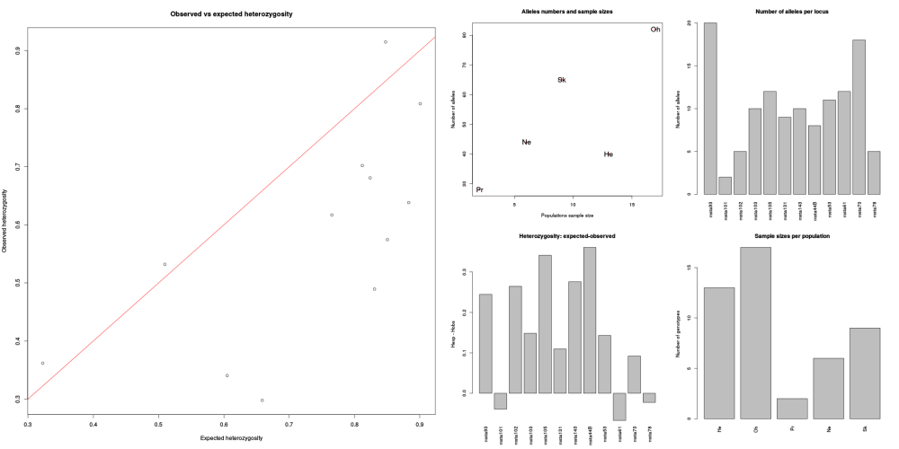 <!-- MERGE-REVIEW: no counterpart section found in QMD; content from TEX kept as-is. -->

## Statistics

### Population statistics returned by poppr()

- Package poppr has central function returning plenty of statistics

- See [poppr's manual](https://grunwaldlab.github.io/Population_Genetics_in_R/) and `vignette("algo", package="poppr")` for details

- `Pop` - Population analyzed

  - If `total=TRUE`, there are also statistics for whole dataset

- `N` - Number of individuals/isolates in the specified population

- `MLG` - Number of multilocus genotypes found in the specified population (see `?mlg`)

- `eMLG` - The expected number of MLG at the lowest common sample size (set by `minsamp`)

- `SE` - The standard error for the rarefaction analysis (assets species richness - how it grows with growing sample size)

  - Big difference between `MLG` and `eMLG` indicate some process lowering/increasing genetic diversity

- `H` - [Shannon-Wiener Diversity index](https://en.wikipedia.org/wiki/Diversity_index#Shannon_index) - evaluates number of genotypes and their distribution, takes entropy into account, grows with higher richness and diversity, sensitive to uneven sample size (is population sizes are very different, indices are not comparable)

  - One of the most common diversity indices (used elsewhere, not only in biology)

- `G` - [Stoddard and Taylor's Index](https://doi.org/10.1093/genetics/118.4.705) - roughly, similar approach as the previous one, highly enhanced

- `lambda` - [Simpson's index](https://en.wikipedia.org/wiki/Diversity_index#Simpson_index) \$\$ = 1 minus the sum of squared genotype frequencies - estimation of the probability that two randomly selected genotypes are different and scales from 0 (no genotypes are different) to 1 (all genotypes are different)

  - Commonly used in ecology to compare sites, communities, etc.

- `E.5` - Evenness - measure of the distribution of genotype abundances, wherein a population with equally abundant genotypes yields a value equal to 1 and a population dominated by a single genotype is closer to 0

- `Hexp` - [Nei's gene diversity](https://doi.org/10.1093/genetics/89.3.583) (expected heterozygosity) - unbiased gene diversity (from 0 = no diversity to 1 = highest diversity)

- `Ia` - Index of Association (`?ia`) - widely used to detect clonal reproduction within populations

  - Populations whose members are undergoing sexual reproduction will produce gametes via meiosis, and thus have a chance to shuffle alleles in the next generation
  - Populations whose members are undergoing clonal reproduction generally do so via mitosis - most likely mechanism for a change in genotype is via mutation - the rate of mutation varies from species to species, but it is rarely sufficiently high to approximate a random shuffling of alleles
  - The index of association is a calculation based on the ratio of the variance of the raw number of differences between individuals and the sum of those variances over each locus
  - It as the observed variance over the expected variance - if they are the same, then the index is zero (=prevailing clonal reproduction) after subtracting one - it rises with with increasing differences

- `p.Ia` - P-value for `Ia` from the number of reshuffling indicated in `sample`

- `rbarD` - Standardized Index of Association for each population (see `?ia`) - corrected for higher number of loci not to rise so steeply

- `p.rD` - P-value for `rbarD` from the number of reshuffles indicated in `sample`

  Generally, there are plenty of different population indices (and distances and another statistics) with different assumptions and usage in many packages - it can be complicated to pick the best one... The course shows many examples, but the list is far from being exhaustive... <!-- MERGE-REVIEW: no counterpart section found in QMD; content from TEX kept as-is. -->

### Population statistics by poppr()

- `poppr()` is central function of `poppr` package calculating plenty of population genetic indices

```{r}
?poppr # See details
poppr(dat=hauss.genind, total=TRUE, sample=1000, method=4,
  missing="geno", cutoff=0.15, quiet=FALSE, clonecorrect=FALSE,
  plot=TRUE, index="rbarD", minsamp=1, legend=TRUE)
# Output table with indices:
  Pop  N MLG eMLG       SE     H     G lambda   E.5  Hexp   Ia # More...
   He 13  11 1.97 1.58e-01 2.352  9.94  0.899 0.941 0.503 1.42 ...
   Ne  6   5 1.93 2.49e-01 1.561  4.50  0.778 0.930 0.604 3.44 ...
  ...... ...  ...      ...   ...   ...    ...   ...   ...  ... ...
Total 47  43 2.00 6.07e-02 3.732 40.16  0.975 0.961 0.742 1.88 ...
```

- If `plot=TRUE`, histogram of simulations (`sample` must be \> 1) is plotted for each population for `rbarD` or `Ia` (according to selected `index` - see following slides for details) <!-- MERGE-REVIEW: no counterpart section found in QMD; code below comes from the old TEX version. -->

### Histograms of simulations of rbarD for each population

**The populations are significantly far from being clonal**

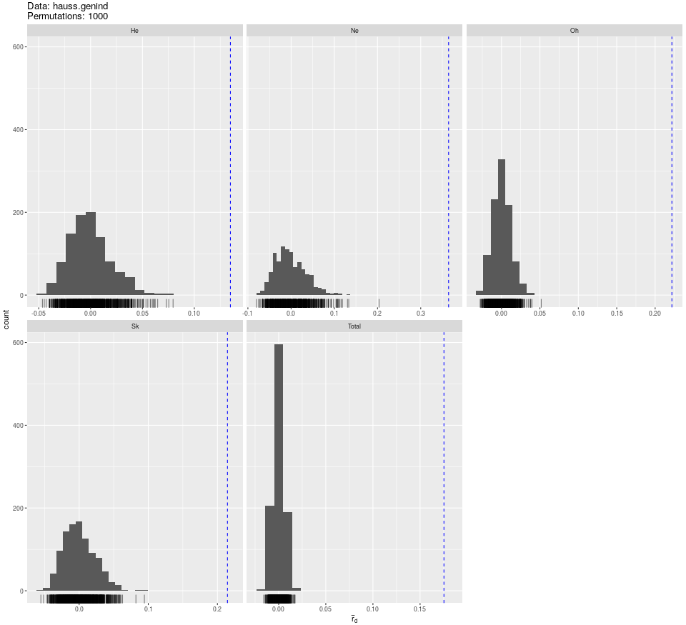 <!-- MERGE-REVIEW: no counterpart section found in QMD; content from TEX kept as-is. -->

### Departure from Hardy-Weinberg equilibrium

- [In theory](https://en.wikipedia.org/wiki/Hardy%E2%80%93Weinberg_principle), in large panmictic population without evolutionary influence everyone can mate with everyone (it is in equilibrium) and allele frequencies remain stable - in reality, environment, behavior, mutations, genetic drift, etc. are structuring the population

```{r}
# According to loci
hauss.hwe.test <- hw.test(x=hauss.loci, B=1000)
hauss.hwe.test # See results per locus
               chi^2   df   Pr(chi^2 >)  Pr.exact
 msta93  383.5519728  190  3.552714e-15     0.000
msta101    0.6927242    1  4.052393e-01     0.657
msta102   83.0741964   10  1.250111e-13     0.000
msta103   77.1819098   45  1.998865e-03     0.000
    ...          ...  ...           ...       ... # Another loci...
```

- Pr.exact shows significance of the departure (i.e. non-equilibrium distribution of alleles within population - calculated per loci)
- $^2$ [test](https://en.wikipedia.org/wiki/Pearson%27s_chi-squared_test) (without or with the permutations) test the departure - if it is significant or not - not how much it is departing <!-- MERGE-REVIEW: no counterpart section found in QMD; code below comes from the old TEX version. -->

### Departure from HWE

- Calculation is always done per-locus - see differences, possibly do statistics like `summary(hauss.hwe.test)` or so

```{r}
# According to populations
# Separate genind object into list of genind objects for individual
# populations
hauss.pops <- seppop(hauss.genind)
hauss.pops
# Convert genind back to loci (list of loci objects according to
# populations)
hauss.pops.loci <- lapply(X=hauss.pops, FUN=genind2loci)
# Calculate the results per populations
lapply(X=hauss.pops.loci, FUN=hw.test, B=1000)
```

- If there is significant departure from HWE, think about biological process (with respect to life traits of species studied) which could cause such structuring <!-- MERGE-REVIEW: no counterpart section found in QMD; code below comes from the old TEX version. -->

### F-statistics I

- Functions return tables of F-statistics values for populations/loci (roughly 0 - no structure, 1 - fully structured)

- The different [F-statistics](https://en.wikipedia.org/wiki/F-statistics) look at different levels of population structure:

  - F$_IT$ is the inbreeding coefficient of an individual relative to the total population (all samples)
  - F$_IS$ is the inbreeding coefficient of an individual relative to the subpopulation ("population" in common terminology) and averaging them
  - F$_ST$ is the effect of subpopulations ("populations") compared to the total population (all samples across all populations)

- For `Fst`, `theta.msat` and another similar functions the data object **must** contain population column (see manual of respective function)

```{r}
# Fit, Fst and Fis for each locus
Fst(x=hauss.loci, pop=1) # Calculation per locus
                Fit        Fst         Fis
msta93   0.31835291 0.17867087  0.17006829
   ...          ...        ...         ...
summary(Fst(x=hauss.loci, pop=1)) # Summary across loci
```

<!-- MERGE-REVIEW: 1 old code block(s) in TEX frame were dropped in favor of the .qmd section 'Descriptive statistics'. -->

<!-- MERGE-REVIEW: content of the .qmd section 'Descriptive statistics' was inserted at 5 frames; remove the unwanted duplicates. -->

Load needed libraries

Get summary - names and sizes of populations, heterozygosity, some info about loci

Plot expected vs. observed heterozygosity - it looks like big difference

Test normality of the vector - can we use bartlett.test() or t.test(), or do we have to use weaker kruskal.test() or wilcox.test()?

Bartlett's K-squared test of difference between observed and expected heterozygosity - not significant

T-test of difference between observed and expected heterozygosity - strongly significant

Create pane with some information

Plot alleles number vs. population sizes

Add text description to the point

Barplots of various data

poppr returns various population statistics for populations

Algorithms and equations utilized in poppr

Departure from HWE According to loci

Results per-locus

Summary across all loci

According to populations Separate genind object into list of genind objects for individual populations

Convert genind back to loci (list of loci objects according to populations)

Calculate the results per populations

FST Fit, Fst and Fis for each locus For Fst, fstat and theta.msat the loci object must contain population column

Nei's pairwise Fst between all pairs of populations - most common usage

For mixed ploidy data sets stamppFst requires population factor in genlight (here, population code consists of first three letters of individual's name)

Population code consists of first three letters of individual's name - extract the population name part

For large data use higher nclusters to parallelize calculations

Matrix of Fst among populations

Matrix of P values

Save results - open in spreadsheet (e.g. LibreOffice Calc)

Correlation plot of pairwise Fst

Display in similar way also another Fst tables

TODO Estimates of population theta according to Kimmel et al. 1998 theta.msat(hauss_loci)

```{r}
library("ape") # Analysis of phylogenetics and evolution
library("ade4") # Analysis of ecological data, multivariate methods
library("adegenet") # Exploratory analysis of genetic and genomic data
library("pegas") # Population and evolutionary genetics
library("poppr") # Population genetic analysis, including populations with mixed reproduction
library("hierfstat") # Hierarchical F-statistics
library("corrplot") # Visualization of correlation matrix
library("StAMPP") # Statistical analysis of mixed ploidy populations
library("philentropy") # Various genetic distances
```

```{r}
hauss_summ <- summary(hauss_genind)
hauss_summ
```

```{r}
plot(x = hauss_summ$Hexp, y = hauss_summ$Hobs, main = "Observed vs expected heterozygosity", xlab = "Expected heterozygosity", ylab = "Observed heterozygosity")
abline(0, 1, col = "red")
```

```{r}
shapiro.test(hauss_summ$Hexp)
```

```{r}
bartlett.test(list(hauss_summ$Hexp, hauss_summ$Hobs))
```

```{r}
t.test(x = hauss_summ$Hexp, y = hauss_summ$Hobs, paired = TRUE, var.equal = TRUE)
```

```{r}
par(mfrow = c(2, 2)) # Divide graphical devices into 4 smaller spaces
```

```{r}
plot(x = hauss_summ$n.by.pop, y = hauss_summ$pop.nall, xlab = "Populations sample size", ylab = "Number of alleles", main = "Alleles numbers and sample sizes", col = "red", pch = 20)
```

```{r}
text(x = hauss_summ$n.by.pop, y = hauss_summ$pop.nall, lab = names(hauss_summ$n.by.pop), cex = 1.5)
```

```{r}
barplot(height = hauss_summ$loc.n.all, ylab = "Number of alleles", main = "Number of alleles per locus", las = 3)
barplot(height = hauss_summ$Hexp - hauss_summ$Hobs, main = "Heterozygosity: expected-observed", ylab = "Hexp - Hobs", las = 3)
barplot(height = hauss_summ[["n.by.pop"]], main = "Sample sizes per population", ylab = "Number of genotypes", las = 3)
dev.off() # Closes graphical device - otherwise following graphs would still be divided into 4 parts
```

```{r}
?poppr # See details
poppr(dat = hauss_genind, total = TRUE, sample = 1000, method = 4, missing = "geno", cutoff = 0.15, quiet = FALSE, clonecorrect = FALSE, plot = TRUE, index = "rbarD", minsamp = 1, legend = TRUE)
```

```{r}
vignette("algo", package = "poppr")
```

```{r}
hauss_hwe_test <- hw.test(x = hauss_loci, B = 1000)
```

```{r}
hauss_hwe_test
```

```{r}
summary(hauss_hwe_test)
```

```{r}
hauss_pops <- seppop(hauss_genind)
hauss_pops
```

```{r}
hauss_pops_loci <- lapply(X = hauss_pops, FUN = genind2loci)
```

```{r}
lapply(X = hauss_pops_loci, FUN = hw.test, B = 1000)
```

```{r}
Fst(x = hauss_loci, pop = 1) # Calculation per locus
summary(Fst(x = hauss_loci, pop = 1)) # Summary across loci
```

```{r}
pairwise.neifst(dat = genind2hierfstat(dat = hauss_genind))
heatmap(x = pairwise.neifst(dat = genind2hierfstat(dat = hauss_genind)), Rowv = NA, Colv = NA) # Simple visualization
```

```{r}
indNames(arabidopsis_genlight)
```

```{r}
substr(x = indNames(arabidopsis_genlight), start = 1, stop = 3)
pop(arabidopsis_genlight) <- substr(x = indNames(arabidopsis_genlight), start = 1, stop = 3)
pop(arabidopsis_genlight) # Check it
popNames(arabidopsis_genlight)
arabidopsis_fst <- StAMPP::stamppFst(geno = arabidopsis_genlight, nboots = 100, percent = 95, nclusters = 8) # On Windows maybe "nclusters = 1"
```

```{r}
?StAMPP::stamppFst # See details
```

```{r}
arabidopsis_fst[["Fsts"]]
```

```{r}
arabidopsis_fst[["Pvalues"]]
```

```{r}
write.table(x = arabidopsis_fst[["Fsts"]], file = "arabidopsis_fst.tsv", quote = FALSE, sep = "\t")
```

```{r}
corrplot(corr = arabidopsis_fst[["Fsts"]], method = "circle", type = "lower", col = funky(15), title = "Correlation matrix of Fst among populations", is.corr = FALSE, diag = FALSE, outline = TRUE, order = "alphabet", tl.pos = "lt", tl.col = "black")
?corrplot # See for more options
```

### F-statistics II

```{r}
# Pairwise Fst comparing populations
# Convert Adegent's genind to format of hierfstat package
?genind2hierfstat
# Nei's pairwise Fst between all pairs of populations - most common usage
pairwise.neifst(dat=genind2hierfstat(dat=hauss.genind))
       He     Ne     Oh     Pr     Sk
He     NA 0.3204 0.1824 0.1942 0.1599 # 0 = no structure
Ne 0.3204     NA 0.1210 0.2548 0.1229 # 1 = maximal difference
Oh 0.1824 0.1210     NA 0.1038 0.0833
Pr 0.1942 0.2548 0.1038     NA 0.1407
Sk 0.1599 0.1229 0.0833 0.1407     NA
heatmap(x=pairwise.neifst(dat=genind2hierfstat(dat=hauss.genind)),
  Rowv=NA, Colv=NA) # Simple visualization
```

- Check also another functions of [hierfstat](https://CRAN.R-project.org/package=hierfstat) package, there are more options
- Hierfstat package implements F$_ST$ only for haploid and diploid populations, [StAMPP](https://CRAN.R-project.org/package=StAMPP) (next slide) also for another ploidies and mixed ploidy data <!-- MERGE-REVIEW: 1 old code block(s) in TEX frame were dropped in favor of the .qmd section 'Descriptive statistics'. -->

<!-- MERGE-REVIEW: content of the .qmd section 'Descriptive statistics' was inserted at 5 frames; remove the unwanted duplicates. -->

Load needed libraries

Get summary - names and sizes of populations, heterozygosity, some info about loci

Plot expected vs. observed heterozygosity - it looks like big difference

Test normality of the vector - can we use bartlett.test() or t.test(), or do we have to use weaker kruskal.test() or wilcox.test()?

Bartlett's K-squared test of difference between observed and expected heterozygosity - not significant

T-test of difference between observed and expected heterozygosity - strongly significant

Create pane with some information

Plot alleles number vs. population sizes

Add text description to the point

Barplots of various data

poppr returns various population statistics for populations

Algorithms and equations utilized in poppr

Departure from HWE According to loci

Results per-locus

Summary across all loci

According to populations Separate genind object into list of genind objects for individual populations

Convert genind back to loci (list of loci objects according to populations)

Calculate the results per populations

FST Fit, Fst and Fis for each locus For Fst, fstat and theta.msat the loci object must contain population column

Nei's pairwise Fst between all pairs of populations - most common usage

For mixed ploidy data sets stamppFst requires population factor in genlight (here, population code consists of first three letters of individual's name)

Population code consists of first three letters of individual's name - extract the population name part

For large data use higher nclusters to parallelize calculations

Matrix of Fst among populations

Matrix of P values

Save results - open in spreadsheet (e.g. LibreOffice Calc)

Correlation plot of pairwise Fst

Display in similar way also another Fst tables

TODO Estimates of population theta according to Kimmel et al. 1998 theta.msat(hauss_loci)

```{r}
library("ape") # Analysis of phylogenetics and evolution
library("ade4") # Analysis of ecological data, multivariate methods
library("adegenet") # Exploratory analysis of genetic and genomic data
library("pegas") # Population and evolutionary genetics
library("poppr") # Population genetic analysis, including populations with mixed reproduction
library("hierfstat") # Hierarchical F-statistics
library("corrplot") # Visualization of correlation matrix
library("StAMPP") # Statistical analysis of mixed ploidy populations
library("philentropy") # Various genetic distances
```

```{r}
hauss_summ <- summary(hauss_genind)
hauss_summ
```

```{r}
plot(x = hauss_summ$Hexp, y = hauss_summ$Hobs, main = "Observed vs expected heterozygosity", xlab = "Expected heterozygosity", ylab = "Observed heterozygosity")
abline(0, 1, col = "red")
```

```{r}
shapiro.test(hauss_summ$Hexp)
```

```{r}
bartlett.test(list(hauss_summ$Hexp, hauss_summ$Hobs))
```

```{r}
t.test(x = hauss_summ$Hexp, y = hauss_summ$Hobs, paired = TRUE, var.equal = TRUE)
```

```{r}
par(mfrow = c(2, 2)) # Divide graphical devices into 4 smaller spaces
```

```{r}
plot(x = hauss_summ$n.by.pop, y = hauss_summ$pop.nall, xlab = "Populations sample size", ylab = "Number of alleles", main = "Alleles numbers and sample sizes", col = "red", pch = 20)
```

```{r}
text(x = hauss_summ$n.by.pop, y = hauss_summ$pop.nall, lab = names(hauss_summ$n.by.pop), cex = 1.5)
```

```{r}
barplot(height = hauss_summ$loc.n.all, ylab = "Number of alleles", main = "Number of alleles per locus", las = 3)
barplot(height = hauss_summ$Hexp - hauss_summ$Hobs, main = "Heterozygosity: expected-observed", ylab = "Hexp - Hobs", las = 3)
barplot(height = hauss_summ[["n.by.pop"]], main = "Sample sizes per population", ylab = "Number of genotypes", las = 3)
dev.off() # Closes graphical device - otherwise following graphs would still be divided into 4 parts
```

```{r}
?poppr # See details
poppr(dat = hauss_genind, total = TRUE, sample = 1000, method = 4, missing = "geno", cutoff = 0.15, quiet = FALSE, clonecorrect = FALSE, plot = TRUE, index = "rbarD", minsamp = 1, legend = TRUE)
```

```{r}
vignette("algo", package = "poppr")
```

```{r}
hauss_hwe_test <- hw.test(x = hauss_loci, B = 1000)
```

```{r}
hauss_hwe_test
```

```{r}
summary(hauss_hwe_test)
```

```{r}
hauss_pops <- seppop(hauss_genind)
hauss_pops
```

```{r}
hauss_pops_loci <- lapply(X = hauss_pops, FUN = genind2loci)
```

```{r}
lapply(X = hauss_pops_loci, FUN = hw.test, B = 1000)
```

```{r}
Fst(x = hauss_loci, pop = 1) # Calculation per locus
summary(Fst(x = hauss_loci, pop = 1)) # Summary across loci
```

```{r}
pairwise.neifst(dat = genind2hierfstat(dat = hauss_genind))
heatmap(x = pairwise.neifst(dat = genind2hierfstat(dat = hauss_genind)), Rowv = NA, Colv = NA) # Simple visualization
```

```{r}
indNames(arabidopsis_genlight)
```

```{r}
substr(x = indNames(arabidopsis_genlight), start = 1, stop = 3)
pop(arabidopsis_genlight) <- substr(x = indNames(arabidopsis_genlight), start = 1, stop = 3)
pop(arabidopsis_genlight) # Check it
popNames(arabidopsis_genlight)
arabidopsis_fst <- StAMPP::stamppFst(geno = arabidopsis_genlight, nboots = 100, percent = 95, nclusters = 8) # On Windows maybe "nclusters = 1"
```

```{r}
?StAMPP::stamppFst # See details
```

```{r}
arabidopsis_fst[["Fsts"]]
```

```{r}
arabidopsis_fst[["Pvalues"]]
```

```{r}
write.table(x = arabidopsis_fst[["Fsts"]], file = "arabidopsis_fst.tsv", quote = FALSE, sep = "\t")
```

```{r}
corrplot(corr = arabidopsis_fst[["Fsts"]], method = "circle", type = "lower", col = funky(15), title = "Correlation matrix of Fst among populations", is.corr = FALSE, diag = FALSE, outline = TRUE, order = "alphabet", tl.pos = "lt", tl.col = "black")
?corrplot # See for more options
```

### F-statistics for mixed ploidy data I

- Methods from [StAMPP](https://CRAN.R-project.org/package=StAMPP) package (the same is the case for any method working somehow with distances) are sensitive to missing data...

  - Carefully filter the VCF before doing any analysis

- Populations must be already defined in the genlight object

```{r}
# stamppFst requires population factor in genlight (here, population
# code consists of first three letters of individual's name)
indNames(arabidopsis.genlight)
# Population code consists of first three letters of individual's name -
# extract the population name part
substr(x=indNames(arabidopsis.genlight), start=1, stop=3)
pop(arabidopsis.genlight) <- substr(x=indNames(arabidopsis.genlight),
  start=1, stop=3)
pop(arabidopsis.genlight) # Check it
popNames(arabidopsis.genlight)
?StAMPP::stamppFst # See method details
```

<!-- MERGE-REVIEW: no counterpart section found in QMD; code below comes from the old TEX version. -->

### F-statistics for mixed ploidy data II

```{r}
# Calcultaing the Fst
arabidopsis.fst <- StAMPP::stamppFst(geno=arabidopsis.genlight,
  nboots=100, percent=95, nclusters=8) # On Windows maybe "nclusters=1"
# For large data use higher nclusters to parallelize calculations
arabidopsis.fst[["Fsts"]] # Matrix of Fst among populations
arabidopsis.fst[["Pvalues"]] # Matrix of P values
# Save results - open in spreadsheet (e.g. LibreOffice Calc)
write.table(x=arabidopsis.fst[["Fsts"]], file="arabidopsis_fst.tsv",
  quote=FALSE, sep="\t")
# Correlation plot of pairwise Fst
corrplot(corr=arabidopsis.fst[["Fsts"]], method="circle", type="lower",
  col=funky(15), title="Correlation matrix of Fst among populations",
  is.corr=FALSE, diag=FALSE, outline=TRUE, order="alphabet", tl.pos="lt",
  tl.col="black")
?corrplot # See for more options
# Display in similar way also another Fst tables
```

<!-- MERGE-REVIEW: no counterpart section found in QMD; code below comes from the old TEX version. -->

### Multi locus genotypes and inbreeding coefficient

- Especially when working with clonal species or species with low genetic structure it is beneficial to know how many unique genotypes there are and how they are distributed across populations

- Inbreeding coefficient estimates level of mating among individuals with (nearly) identical genotypes - important e.g. for conservation studies or work with agricultural species

- Such studies require sufficiently variable marker (e.g. SSRs) so that results show real genetic structuring and not "just" low variability of selected marker

- Reliable estimation of such parameters also require high number of individuals from each population

  - 10 is usually considered as minimum, but more is recommended

<!-- MERGE-REVIEW: content of the .qmd section 'Multi locus genotypes' was inserted at 2 frames; remove the unwanted duplicates. -->

Total number of MLGs (simple value)

MLGs shared among populations (a list)

Detailed view on distribution of MLGs into populations (table and/or plot)

Which individual belong to which vector (two ways of display)

```{r}
mlg(gid = hauss_genind, quiet = FALSE)
```

```{r}
mlg.crosspop(gid = hauss_genind, df = TRUE, quiet = FALSE)
```

```{r}
mlg.table(gid = hauss_genind, plot = TRUE, total = TRUE, quiet = FALSE)
```

```{r}
mlg.vector(hauss_genind)
mlg.id(hauss_genind)
```

### Multi locus genotypes

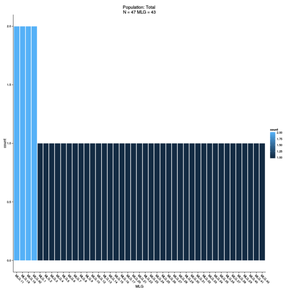

```{r}
# Total number of MLGs
# (simple value)
mlg(gid=hauss.genind, quiet=FALSE)
# MLGs shared among populations
mlg.crosspop(gid=hauss.genind,
  df=TRUE, quiet=FALSE)
# Detailed view on distribution
# of MLGs into populations
# (table and/or plot)
mlg.table(gid=hauss.genind,
  plot=TRUE, total=TRUE,
  quiet=FALSE)
mlg.vector(hauss.genind)
mlg.id(hauss.genind)
```

Functions from poppr package - the best for microsatellites, although available also for another data types <!-- MERGE-REVIEW: 1 old code block(s) in TEX frame were dropped in favor of the .qmd section 'Multi locus genotypes'. -->

<!-- MERGE-REVIEW: content of the .qmd section 'Multi locus genotypes' was inserted at 2 frames; remove the unwanted duplicates. -->

Total number of MLGs (simple value)

MLGs shared among populations (a list)

Detailed view on distribution of MLGs into populations (table and/or plot)

Which individual belong to which vector (two ways of display)

```{r}
mlg(gid = hauss_genind, quiet = FALSE)
```

```{r}
mlg.crosspop(gid = hauss_genind, df = TRUE, quiet = FALSE)
```

```{r}
mlg.table(gid = hauss_genind, plot = TRUE, total = TRUE, quiet = FALSE)
```

```{r}
mlg.vector(hauss_genind)
mlg.id(hauss_genind)
```

### Inbreeding

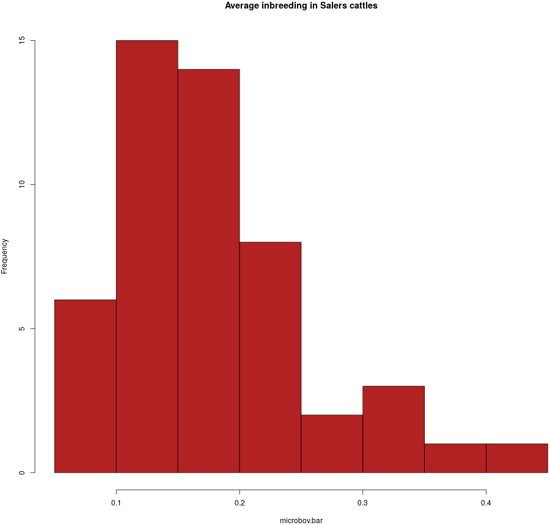

```{r}
# Load training data (cattle)
data(microbov)
# Separate populations of Salers
microbov.pops <- seppop(microbov)
  [["Salers"]]
microbov.pops # See it
# Calculate the inbreeding
microbov.inbr <- inbreeding(x=
  microbov.pops, N=100)
?inbreeding # Check for settings
# population means for plotting
microbov.bar <- sapply(X=
  microbov.inbr, FUN=mean)
# Plot it
hist(x=microbov.bar, col=
  "firebrick", main="Average
  inbreeding in Salers cattle")
```

<!-- MERGE-REVIEW: 1 old code block(s) in TEX frame were dropped in favor of the .qmd section 'Inbreeding'. -->

Load training data

Separate populations of Salers cattle

Calculate the inbreeding

Prepare population means for plotting

Plot it

```{r}
data(microbov)
```

```{r}
microbov_pops <- seppop(microbov)[["Salers"]]
microbov_pops # See it
```

```{r}
?inbreeding # Check for more settings
microbov_inbr <- inbreeding(x = microbov_pops, N = 100)
```

```{r}
microbov_bar <- sapply(X = microbov_inbr, FUN = mean)
```

```{r}
hist(x = microbov_bar, col = "firebrick", main = "Average inbreeding in Salers cattle")
```

## MSN

### Minimum Spanning Network (MSN)

- Package poppr, for SSRs based on Bruvo's distance, can handle any data type (requires `genind` objects)

- Shows relationships among haplotypes (unique genotypes), can be labeled by population, haplotype, ...

  - Size of pie is proportional to number of individuals assigned
  - Lines connect haplotypes according to their similarity

- Suitable for less variable datasets, e.g. some mitochondrial or plastide genes (or SSRs for less variable species) - otherwise the figure is messy

  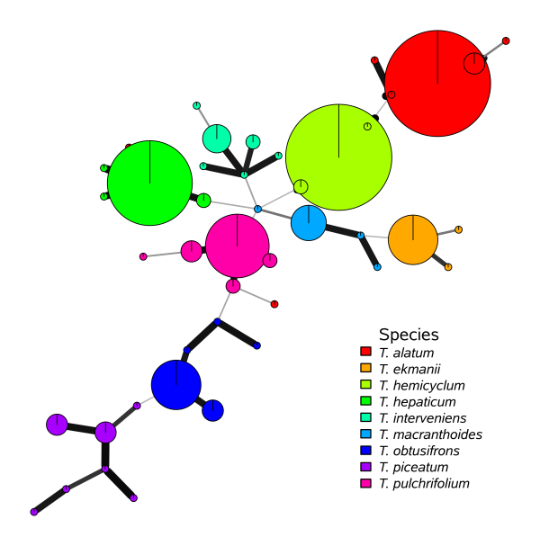 <!-- MERGE-REVIEW: no counterpart section found in QMD; content from TEX kept as-is. -->

### Minimum Spanning Network

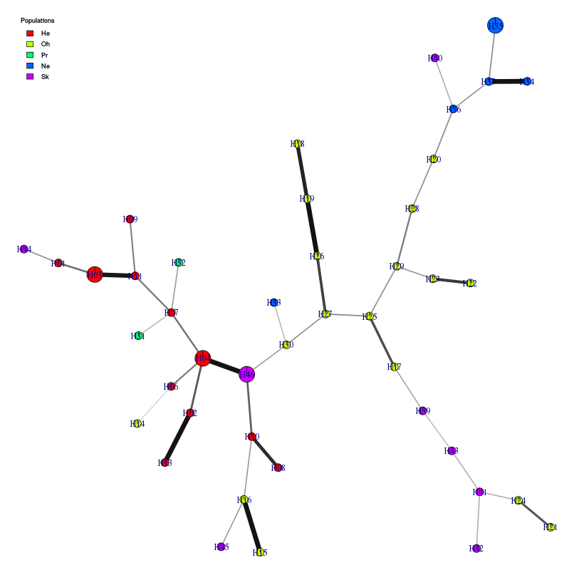

```{r}
# See details and options...
?bruvo.msn
# Get the MSN
# Note SSRs repeats 'rep(2, 12)' -
# change according to your data
# Here 12 SSRS loci of length 2 bp
bruvo.msn(gid=hauss.genind,
  replen=rep(x=2, times=12),
  loss=TRUE, palette=rainbow,
  vertex.label="inds", gscale=TRUE,
  wscale=TRUE, showplot=TRUE)
# For another data types
# (not only microsatellites)
?msn.poppr
# Interactive creation of MSN
?imsn
```

<!-- MERGE-REVIEW: no counterpart section found in QMD; code below comes from the old TEX version. -->

## Genetic distances

### Distances

- Distance-based methods are among the most popular in biology

- Huge number of applications

- A lot of different distances - it is crucial to select correct distance matrix for particular task

  - Which input data?
  - Which purpose?
  - Selecting wrong distance method can lead in misleading results in PCoA, NJ, ...

- All method have lots of assumptions and limits - check them prior usage

  - Genetic drift, infinite alleles, ...

- If resulting distance matrix is not [Euclidean](https://en.wikipedia.org/wiki/Euclidean_distance_matrix) (see also further), following analysis can be misleading

- For DNA sequences use `phangorn::modelTest` to select appropriate mutational model for particular sequence

<!-- MERGE-REVIEW: content of the .qmd section 'Genetic distances' was inserted at 3 frames; remove the unwanted duplicates. -->

Simple dissimilarity distance matrix

Nei's distance (not Euclidean) for populations (other methods are available, see ?dist.genpop)

Test if it is Euclidean

Turns to be Euclidean

Test if it is Euclidean

Show it

Bruvo's distances weighting SSRs repeats - take care about replen parameter - requires repetition length for every SSRs locus E.g. if having 5 SSRs with repeat lengths 2, 2, 3, 3 and 2 bp use: bruvo.dist(pop = ... replen = c(2, 2, 3, 3, 2)...)

Test if it is Euclidean

Turn to be Euclidean

Test if it is Euclidean

Show it

Nei's distance (very popular, but not Euclidean) for individuals (other methods are available, see "?poppr::nei.dist")

Test if it is Euclidean

Show it

Dissimilarity matrix returns a distance reflecting the number of allelic differences between two individuals

Test if it is Euclidean

Show it

Import custom distance matrix - distances.txt must exist of the disk

See details of distance methods in package poppr

Compare different distance matrices List of functions to be parsed to respective dist.\* function

Calculate the distance matrices

Add names for the distance names

Add Bruvo distance

Split graphical device into 2 lines, 3 panes each

Calculate NJ and plot all trees

Selecting model for calculating distances among DNA sequences

Sort results according to AIC or BIC - the lower the better fit

Same for Gunnera dataset

DNA distances - there are various models available

Distances and genlight object. Pairwise genetic distances for each data block (genlight objects with whole genome data) - sensitive to missing data

It is possible to use just basic dist function on whole genlight object (might require a lot of RAM)

Distances in mixed-ploidy data sets stamppNeisD requires population factor in genlight Nei's 1972 distance between individuals (use pop = TRUE to calculate among populations)

Check it

The same on population level

Check it

Export the distance matrix as Phylip format for usage in external software (e.g. SplitsTree)

Genomic relationship matrix

Check it

Over 40 distances from philentropy package

Calculate e.g. Jaccard index for AFLP data

See result

Make it distance matrix

Visualize pairwise genetic similarities table.paint() requires data frame, dist can't be directly converted to DF

Same visualization, colored heatmap() reorders values

Another possibility is to use function corrplot() from package corrplot

```{r}
?dist.gene # Details about methods of this distance constructions
hauss_dist <- dist.gene(x = hauss_genind@tab, method = "pairwise")
hauss_dist
```

```{r}
hauss_dist_pop <- dist.genpop(x = hauss_genpop, method = 1, diag = TRUE, upper = TRUE)
hauss_dist_pop
```

```{r}
is.euclid(hauss_dist_pop, plot = TRUE, print = TRUE, tol = 1e-10)
```

```{r}
hauss_dist_pop <- cailliez(distmat = hauss_dist_pop, print = FALSE, tol = 1e-07, cor.zero = TRUE)
```

```{r}
is.euclid(hauss_dist_pop, plot = TRUE, print = TRUE, tol = 1e-10)
```

```{r}
hauss_dist_pop
```

```{r}
hauss_dist_bruvo <- bruvo.dist(pop = hauss_genind, replen = rep(x = 2, times = 12), loss = TRUE)
```

```{r}
is.euclid(hauss_dist_bruvo, plot = TRUE, print = TRUE, tol = 1e-10)
```

```{r}
hauss_dist_bruvo <- cailliez(distmat = hauss_dist_bruvo, print = FALSE, tol = 1e-07, cor.zero = TRUE)
```

```{r}
is.euclid(hauss_dist_bruvo, plot = TRUE, print = TRUE, tol = 1e-10)
```

```{r}
hauss_dist_bruvo
```

```{r}
hauss_dist_nei <- poppr::nei.dist(x = hauss_genind, warning = TRUE)
```

```{r}
is.euclid(distmat = hauss_dist_nei, plot = TRUE, print = TRUE, tol = 1e-10)
```

```{r}
hauss_dist_nei

```

```{r}
hauss_dist_diss <- diss.dist(x = hauss_genind, percent = FALSE, mat = TRUE)
```

```{r}
is.euclid(distmat = as.dist(m = hauss_dist_diss), plot = TRUE, print = TRUE, tol = 1e-10)
```

```{r}
hauss_dist_diss
```

```{r}
my_dist <- read.csv("distances.txt", header = TRUE, sep = "\t", dec = ".", row.names = 1) # Or so...
my_dist <- as.dist(my_dist)
class(my_dist)
is.euclid(my_dist, plot = TRUE, print = TRUE, tol = 1e-10)
dim(my_dist)
my_dist
my_dist <- cailliez(my_dist, print = TRUE, tol = 1e-10, cor.zero = TRUE)
is.euclid(my_dist, plot = TRUE, print = TRUE, tol = 1e-10)
my_dist
```

```{r}
vignette("algo", package = "poppr")
```

```{r}
distances <- c("Nei", "Rogers", "Edwards", "Reynolds", "Prevosti")
```

```{r}
dists <- lapply(distances, function(x) {
  DISTFUN <- match.fun(paste(tolower(x), "dist", sep = "."))
  DISTFUN(hauss_genind_cor)
})
```

```{r}
names(dists) <- distances
```

```{r}
dists[["Bruvo"]] <- hauss_dist_bruvo
dists
```

```{r}
par(mfrow = c(2, 3))
```

```{r}
x <- lapply(names(dists), function(x) {
  plot(njs(dists[[x]]), main = x, type = "unrooted")
  add.scale.bar(lcol = "red", length = 0.1)
})
dev.off() # Close graphical device to reset settings
```

```{r}
library("phangorn") # Load needed library
?modelTest # Plenty of options, including possible parallelization
usflu_models <- modelTest(object = as.phyDat(usflu_dna)) # Test models
```

```{r}
head(usflu_models[order(usflu_models[["AIC"]]), ], n = 15L)
```

```{r}
gunnera_models <- modelTest(object = as.phyDat(gunnera_mafft_ng))
head(gunnera_models[order(gunnera_models[["AIC"]]), ], n = 15L)
```

```{r}
?dist.dna
usflu_dist <- dist.dna(x = usflu_dna, model = "F84")
usflu_dist
class(usflu_dist)
dim(as.matrix(usflu_dist))
gunnera_dist <- dist.dna(x = gunnera_mafft_ng, model = "TN93")
gunnera_dist
class(gunnera_dist)
dim(as.matrix(gunnera_dist))
```

```{r}
usflu_dists_l <- seploc(usflu_genlight, n.block = 10, parallel = FALSE)
class(usflu_dists_l)
usflu_dists <- lapply(X = usflu_dists_l, FUN = function(DDD) dist(as.matrix(DDD)))
class(usflu_dists)
names(usflu_dists)
class(usflu_dists[[1]])
usflu_distr <- Reduce(f = "+", x = usflu_dists)
class(usflu_distr)
usflu_distr
```

```{r}
usflu_distg <- dist.gene(as.matrix(usflu_genlight))
```

```{r}
arabidopsis_dist <- stamppNeisD(geno = arabidopsis_genlight, pop = FALSE)
```

```{r}
head(arabidopsis_dist)
dim(arabidopsis_dist)
class(arabidopsis_dist)
```

```{r}
arabidopsis_dist_pop <- stamppNeisD(geno = arabidopsis_genlight, pop = TRUE)
```

```{r}
head(arabidopsis_dist_pop)
dim(arabidopsis_dist_pop)
class(arabidopsis_dist_pop)
```

```{r}
stamppPhylip(distance.mat = arabidopsis_dist, file = "arabidopsis_dist.txt")
```

```{r}
?stamppGmatrix # Method details
arabidopsis_genomat <- stamppGmatrix(geno = arabidopsis_genlight)
```

```{r}
head(arabidopsis_genomat)
dim(arabidopsis_genomat)
class(arabidopsis_genomat)
```

```{r}
getDistMethods() # See available distances
?distance # See details of distances
```

```{r}
amara_jac <- distance(x = amara_aflp[, 2:30], method = "jaccard") # amara_aflp has 30 columns (see dim(amara_aflp), column 1 contains names (head(amara_aflp)))
```

```{r}
class(amara_jac)
amara_jac
```

```{r}
amara_jac <- as.dist(m = amara_jac, diag = TRUE, upper = TRUE)
amara_jac
```

```{r}
table.paint(df = as.data.frame(as.matrix(usflu_dist)), clegend = 0, clabel.row = 0.5, clabel.col = 0.5)
```

```{r}
heatmap(x = as.matrix(usflu_dist), Rowv = NA, Colv = NA, symm = TRUE)
```

```{r}
?corrplot::corrplot
```

### Basic distances

```{r}
# Simple dissimilarity distance matrix
?dist.gene # Details about methods of this distance constructions
hauss.dist <- dist.gene(x=hauss.genind@tab, method="pairwise")
# Nei's distance (not Euclidean) for populations (other methods are
# available, see ?dist.genpop)
hauss.dist.pop <- dist.genpop(x=hauss.genpop, method=1, diag=T, upper=T)
# Test if it is Euclidean
is.euclid(hauss.dist.pop, plot=TRUE, print=TRUE, tol=1e-10) # FALSE = No
# Turn to be Euclidean
hauss.dist.pop <- cailliez(distmat=hauss.dist.pop, print=FALSE, tol=1e-07,
  cor.zero=TRUE)
is.euclid(hauss.dist.pop, plot=TRUE, print=TRUE, tol=1e-10) # TRUE = OK
```

Most of analysis based on distances more or less require [Euclidean distances](https://en.wikipedia.org/wiki/Euclidean_distance_matrix) (non-negative vales only, Pythagorean theorem is valid, etc.). If the distance matrix contains non-Euclidean distances, the result can be misleading... <!-- MERGE-REVIEW: 1 old code block(s) in TEX frame were dropped in favor of the .qmd section 'Genetic distances'. -->

<!-- MERGE-REVIEW: content of the .qmd section 'Genetic distances' was inserted at 3 frames; remove the unwanted duplicates. -->

Simple dissimilarity distance matrix

Nei's distance (not Euclidean) for populations (other methods are available, see ?dist.genpop)

Test if it is Euclidean

Turns to be Euclidean

Test if it is Euclidean

Show it

Bruvo's distances weighting SSRs repeats - take care about replen parameter - requires repetition length for every SSRs locus E.g. if having 5 SSRs with repeat lengths 2, 2, 3, 3 and 2 bp use: bruvo.dist(pop = ... replen = c(2, 2, 3, 3, 2)...)

Test if it is Euclidean

Turn to be Euclidean

Test if it is Euclidean

Show it

Nei's distance (very popular, but not Euclidean) for individuals (other methods are available, see "?poppr::nei.dist")

Test if it is Euclidean

Show it

Dissimilarity matrix returns a distance reflecting the number of allelic differences between two individuals

Test if it is Euclidean

Show it

Import custom distance matrix - distances.txt must exist of the disk

See details of distance methods in package poppr

Compare different distance matrices List of functions to be parsed to respective dist.\* function

Calculate the distance matrices

Add names for the distance names

Add Bruvo distance

Split graphical device into 2 lines, 3 panes each

Calculate NJ and plot all trees

Selecting model for calculating distances among DNA sequences

Sort results according to AIC or BIC - the lower the better fit

Same for Gunnera dataset

DNA distances - there are various models available

Distances and genlight object. Pairwise genetic distances for each data block (genlight objects with whole genome data) - sensitive to missing data

It is possible to use just basic dist function on whole genlight object (might require a lot of RAM)

Distances in mixed-ploidy data sets stamppNeisD requires population factor in genlight Nei's 1972 distance between individuals (use pop = TRUE to calculate among populations)

Check it

The same on population level

Check it

Export the distance matrix as Phylip format for usage in external software (e.g. SplitsTree)

Genomic relationship matrix

Check it

Over 40 distances from philentropy package

Calculate e.g. Jaccard index for AFLP data

See result

Make it distance matrix

Visualize pairwise genetic similarities table.paint() requires data frame, dist can't be directly converted to DF

Same visualization, colored heatmap() reorders values

Another possibility is to use function corrplot() from package corrplot

```{r}
?dist.gene # Details about methods of this distance constructions
hauss_dist <- dist.gene(x = hauss_genind@tab, method = "pairwise")
hauss_dist
```

```{r}
hauss_dist_pop <- dist.genpop(x = hauss_genpop, method = 1, diag = TRUE, upper = TRUE)
hauss_dist_pop
```

```{r}
is.euclid(hauss_dist_pop, plot = TRUE, print = TRUE, tol = 1e-10)
```

```{r}
hauss_dist_pop <- cailliez(distmat = hauss_dist_pop, print = FALSE, tol = 1e-07, cor.zero = TRUE)
```

```{r}
is.euclid(hauss_dist_pop, plot = TRUE, print = TRUE, tol = 1e-10)
```

```{r}
hauss_dist_pop
```

```{r}
hauss_dist_bruvo <- bruvo.dist(pop = hauss_genind, replen = rep(x = 2, times = 12), loss = TRUE)
```

```{r}
is.euclid(hauss_dist_bruvo, plot = TRUE, print = TRUE, tol = 1e-10)
```

```{r}
hauss_dist_bruvo <- cailliez(distmat = hauss_dist_bruvo, print = FALSE, tol = 1e-07, cor.zero = TRUE)
```

```{r}
is.euclid(hauss_dist_bruvo, plot = TRUE, print = TRUE, tol = 1e-10)
```

```{r}
hauss_dist_bruvo
```

```{r}
hauss_dist_nei <- poppr::nei.dist(x = hauss_genind, warning = TRUE)
```

```{r}
is.euclid(distmat = hauss_dist_nei, plot = TRUE, print = TRUE, tol = 1e-10)
```

```{r}
hauss_dist_nei

```

```{r}
hauss_dist_diss <- diss.dist(x = hauss_genind, percent = FALSE, mat = TRUE)
```

```{r}
is.euclid(distmat = as.dist(m = hauss_dist_diss), plot = TRUE, print = TRUE, tol = 1e-10)
```

```{r}
hauss_dist_diss
```

```{r}
my_dist <- read.csv("distances.txt", header = TRUE, sep = "\t", dec = ".", row.names = 1) # Or so...
my_dist <- as.dist(my_dist)
class(my_dist)
is.euclid(my_dist, plot = TRUE, print = TRUE, tol = 1e-10)
dim(my_dist)
my_dist
my_dist <- cailliez(my_dist, print = TRUE, tol = 1e-10, cor.zero = TRUE)
is.euclid(my_dist, plot = TRUE, print = TRUE, tol = 1e-10)
my_dist
```

```{r}
vignette("algo", package = "poppr")
```

```{r}
distances <- c("Nei", "Rogers", "Edwards", "Reynolds", "Prevosti")
```

```{r}
dists <- lapply(distances, function(x) {
  DISTFUN <- match.fun(paste(tolower(x), "dist", sep = "."))
  DISTFUN(hauss_genind_cor)
})
```

```{r}
names(dists) <- distances
```

```{r}
dists[["Bruvo"]] <- hauss_dist_bruvo
dists
```

```{r}
par(mfrow = c(2, 3))
```

```{r}
x <- lapply(names(dists), function(x) {
  plot(njs(dists[[x]]), main = x, type = "unrooted")
  add.scale.bar(lcol = "red", length = 0.1)
})
dev.off() # Close graphical device to reset settings
```

```{r}
library("phangorn") # Load needed library
?modelTest # Plenty of options, including possible parallelization
usflu_models <- modelTest(object = as.phyDat(usflu_dna)) # Test models
```

```{r}
head(usflu_models[order(usflu_models[["AIC"]]), ], n = 15L)
```

```{r}
gunnera_models <- modelTest(object = as.phyDat(gunnera_mafft_ng))
head(gunnera_models[order(gunnera_models[["AIC"]]), ], n = 15L)
```

```{r}
?dist.dna
usflu_dist <- dist.dna(x = usflu_dna, model = "F84")
usflu_dist
class(usflu_dist)
dim(as.matrix(usflu_dist))
gunnera_dist <- dist.dna(x = gunnera_mafft_ng, model = "TN93")
gunnera_dist
class(gunnera_dist)
dim(as.matrix(gunnera_dist))
```

```{r}
usflu_dists_l <- seploc(usflu_genlight, n.block = 10, parallel = FALSE)
class(usflu_dists_l)
usflu_dists <- lapply(X = usflu_dists_l, FUN = function(DDD) dist(as.matrix(DDD)))
class(usflu_dists)
names(usflu_dists)
class(usflu_dists[[1]])
usflu_distr <- Reduce(f = "+", x = usflu_dists)
class(usflu_distr)
usflu_distr
```

```{r}
usflu_distg <- dist.gene(as.matrix(usflu_genlight))
```

```{r}
arabidopsis_dist <- stamppNeisD(geno = arabidopsis_genlight, pop = FALSE)
```

```{r}
head(arabidopsis_dist)
dim(arabidopsis_dist)
class(arabidopsis_dist)
```

```{r}
arabidopsis_dist_pop <- stamppNeisD(geno = arabidopsis_genlight, pop = TRUE)
```

```{r}
head(arabidopsis_dist_pop)
dim(arabidopsis_dist_pop)
class(arabidopsis_dist_pop)
```

```{r}
stamppPhylip(distance.mat = arabidopsis_dist, file = "arabidopsis_dist.txt")
```

```{r}
?stamppGmatrix # Method details
arabidopsis_genomat <- stamppGmatrix(geno = arabidopsis_genlight)
```

```{r}
head(arabidopsis_genomat)
dim(arabidopsis_genomat)
class(arabidopsis_genomat)
```

```{r}
getDistMethods() # See available distances
?distance # See details of distances
```

```{r}
amara_jac <- distance(x = amara_aflp[, 2:30], method = "jaccard") # amara_aflp has 30 columns (see dim(amara_aflp), column 1 contains names (head(amara_aflp)))
```

```{r}
class(amara_jac)
amara_jac
```

```{r}
amara_jac <- as.dist(m = amara_jac, diag = TRUE, upper = TRUE)
amara_jac
```

```{r}
table.paint(df = as.data.frame(as.matrix(usflu_dist)), clegend = 0, clabel.row = 0.5, clabel.col = 0.5)
```

```{r}
heatmap(x = as.matrix(usflu_dist), Rowv = NA, Colv = NA, symm = TRUE)
```

```{r}
?corrplot::corrplot
```

### Distances reflecting microsatellite repeats

```{r}
# Bruvo's distances weighting SSRs repeats - take care about replen
# parameter - requires repetition length for every SSRs locus
# E.g. if having 5 SSRs with repeat lengths 2, 2, 3, 3 and 2 bp use:
# bruvo.dist(pop=... replen=c(2, 2, 3, 3, 2)...)
hauss.dist.bruvo <- bruvo.dist(pop=hauss.genind, replen=rep(x=2, times=12),
  loss=TRUE)
# Test if it is Euclidean
is.euclid(hauss.dist.bruvo, plot=TRUE, print=TRUE, tol=1e-10)
hauss.dist.bruvo <- cailliez(distmat=hauss.dist.bruvo, print=FALSE,
  tol=1e-07, cor.zero=TRUE) # Turn to be Euclidean and verify below
is.euclid(hauss.dist.bruvo, plot=TRUE, print=TRUE, tol=1e-10)
hauss.dist.bruvo  # Show it
```

- See poppr's manual and manual pages of the functions for details and different possibilities of settings
- Be careful when changing non-Euclidean distances to Euclidean - **the transformation more or less changes meaning of the distances!** <!-- MERGE-REVIEW: no counterpart section found in QMD; code below comes from the old TEX version. -->

### Turning distance matrix into Euclidean is controversial...

**Histograms of Bruvo distance before and after transformation**

- How to deal with zero distances in original matrix? There is no really good solution...

  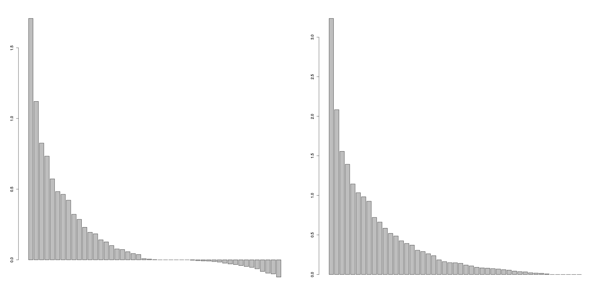 <!-- MERGE-REVIEW: no counterpart section found in QMD; content from TEX kept as-is. -->

### More distances...

```{r}
# Nei's distance (very popular, but not Euclidean) for individuals
# (other methods are available, see "?poppr::nei.dist")
hauss.dist.nei <- nei.dist(x=hauss.genind, warning=TRUE)
is.euclid(distmat=hauss.dist.nei, plot=TRUE, print=TRUE, tol=1e-10)
# Dissimilarity matrix returns a distance reflecting the number of
# allelic differences between two individuals
hauss.dist.diss <- diss.dist(x=hauss.genind, percent=FALSE, mat=TRUE)
is.euclid(as.dist(hauss.dist.diss), plot=TRUE, print=TRUE, tol=1e-10)
```

**Import own distance matrix from another software:**

```{r}
          Fe      He      Oh ...
Fe  0.000000 132.019 109.159 ...
He  132.0191 0.00000 9.89111 ...
Oh  109.1590 9.89111 0.00000 ...
Pr  139.5669 8.55312 4.40562 ...
Ne  156.7619 9.96143 16.6927 ...
...      ...     ...     ... ...
```

```{r}
MyDistance <- read.csv("distances.
  txt", header=TRUE, sep="\t",
  dec=".", row.names=1) # Or so...
MyDistance <- as.dist(MyDistance)
class(MyDistance)
dim(MyDistance)
MyDistance
```

<!-- MERGE-REVIEW: 3 old code block(s) in TEX frame were dropped in favor of the .qmd section 'Genetic distances'. -->

<!-- MERGE-REVIEW: content of the .qmd section 'Genetic distances' was inserted at 3 frames; remove the unwanted duplicates. -->

Simple dissimilarity distance matrix

Nei's distance (not Euclidean) for populations (other methods are available, see ?dist.genpop)

Test if it is Euclidean

Turns to be Euclidean

Test if it is Euclidean

Show it

Bruvo's distances weighting SSRs repeats - take care about replen parameter - requires repetition length for every SSRs locus E.g. if having 5 SSRs with repeat lengths 2, 2, 3, 3 and 2 bp use: bruvo.dist(pop = ... replen = c(2, 2, 3, 3, 2)...)

Test if it is Euclidean

Turn to be Euclidean

Test if it is Euclidean

Show it

Nei's distance (very popular, but not Euclidean) for individuals (other methods are available, see "?poppr::nei.dist")

Test if it is Euclidean

Show it

Dissimilarity matrix returns a distance reflecting the number of allelic differences between two individuals

Test if it is Euclidean

Show it

Import custom distance matrix - distances.txt must exist of the disk

See details of distance methods in package poppr

Compare different distance matrices List of functions to be parsed to respective dist.\* function

Calculate the distance matrices

Add names for the distance names

Add Bruvo distance

Split graphical device into 2 lines, 3 panes each

Calculate NJ and plot all trees

Selecting model for calculating distances among DNA sequences

Sort results according to AIC or BIC - the lower the better fit

Same for Gunnera dataset

DNA distances - there are various models available

Distances and genlight object. Pairwise genetic distances for each data block (genlight objects with whole genome data) - sensitive to missing data

It is possible to use just basic dist function on whole genlight object (might require a lot of RAM)

Distances in mixed-ploidy data sets stamppNeisD requires population factor in genlight Nei's 1972 distance between individuals (use pop = TRUE to calculate among populations)

Check it

The same on population level

Check it

Export the distance matrix as Phylip format for usage in external software (e.g. SplitsTree)

Genomic relationship matrix

Check it

Over 40 distances from philentropy package

Calculate e.g. Jaccard index for AFLP data

See result

Make it distance matrix

Visualize pairwise genetic similarities table.paint() requires data frame, dist can't be directly converted to DF

Same visualization, colored heatmap() reorders values

Another possibility is to use function corrplot() from package corrplot

```{r}
?dist.gene # Details about methods of this distance constructions
hauss_dist <- dist.gene(x = hauss_genind@tab, method = "pairwise")
hauss_dist
```

```{r}
hauss_dist_pop <- dist.genpop(x = hauss_genpop, method = 1, diag = TRUE, upper = TRUE)
hauss_dist_pop
```

```{r}
is.euclid(hauss_dist_pop, plot = TRUE, print = TRUE, tol = 1e-10)
```

```{r}
hauss_dist_pop <- cailliez(distmat = hauss_dist_pop, print = FALSE, tol = 1e-07, cor.zero = TRUE)
```

```{r}
is.euclid(hauss_dist_pop, plot = TRUE, print = TRUE, tol = 1e-10)
```

```{r}
hauss_dist_pop
```

```{r}
hauss_dist_bruvo <- bruvo.dist(pop = hauss_genind, replen = rep(x = 2, times = 12), loss = TRUE)
```

```{r}
is.euclid(hauss_dist_bruvo, plot = TRUE, print = TRUE, tol = 1e-10)
```

```{r}
hauss_dist_bruvo <- cailliez(distmat = hauss_dist_bruvo, print = FALSE, tol = 1e-07, cor.zero = TRUE)
```

```{r}
is.euclid(hauss_dist_bruvo, plot = TRUE, print = TRUE, tol = 1e-10)
```

```{r}
hauss_dist_bruvo
```

```{r}
hauss_dist_nei <- poppr::nei.dist(x = hauss_genind, warning = TRUE)
```

```{r}
is.euclid(distmat = hauss_dist_nei, plot = TRUE, print = TRUE, tol = 1e-10)
```

```{r}
hauss_dist_nei

```

```{r}
hauss_dist_diss <- diss.dist(x = hauss_genind, percent = FALSE, mat = TRUE)
```

```{r}
is.euclid(distmat = as.dist(m = hauss_dist_diss), plot = TRUE, print = TRUE, tol = 1e-10)
```

```{r}
hauss_dist_diss
```

```{r}
my_dist <- read.csv("distances.txt", header = TRUE, sep = "\t", dec = ".", row.names = 1) # Or so...
my_dist <- as.dist(my_dist)
class(my_dist)
is.euclid(my_dist, plot = TRUE, print = TRUE, tol = 1e-10)
dim(my_dist)
my_dist
my_dist <- cailliez(my_dist, print = TRUE, tol = 1e-10, cor.zero = TRUE)
is.euclid(my_dist, plot = TRUE, print = TRUE, tol = 1e-10)
my_dist
```

```{r}
vignette("algo", package = "poppr")
```

```{r}
distances <- c("Nei", "Rogers", "Edwards", "Reynolds", "Prevosti")
```

```{r}
dists <- lapply(distances, function(x) {
  DISTFUN <- match.fun(paste(tolower(x), "dist", sep = "."))
  DISTFUN(hauss_genind_cor)
})
```

```{r}
names(dists) <- distances
```

```{r}
dists[["Bruvo"]] <- hauss_dist_bruvo
dists
```

```{r}
par(mfrow = c(2, 3))
```

```{r}
x <- lapply(names(dists), function(x) {
  plot(njs(dists[[x]]), main = x, type = "unrooted")
  add.scale.bar(lcol = "red", length = 0.1)
})
dev.off() # Close graphical device to reset settings
```

```{r}
library("phangorn") # Load needed library
?modelTest # Plenty of options, including possible parallelization
usflu_models <- modelTest(object = as.phyDat(usflu_dna)) # Test models
```

```{r}
head(usflu_models[order(usflu_models[["AIC"]]), ], n = 15L)
```

```{r}
gunnera_models <- modelTest(object = as.phyDat(gunnera_mafft_ng))
head(gunnera_models[order(gunnera_models[["AIC"]]), ], n = 15L)
```

```{r}
?dist.dna
usflu_dist <- dist.dna(x = usflu_dna, model = "F84")
usflu_dist
class(usflu_dist)
dim(as.matrix(usflu_dist))
gunnera_dist <- dist.dna(x = gunnera_mafft_ng, model = "TN93")
gunnera_dist
class(gunnera_dist)
dim(as.matrix(gunnera_dist))
```

```{r}
usflu_dists_l <- seploc(usflu_genlight, n.block = 10, parallel = FALSE)
class(usflu_dists_l)
usflu_dists <- lapply(X = usflu_dists_l, FUN = function(DDD) dist(as.matrix(DDD)))
class(usflu_dists)
names(usflu_dists)
class(usflu_dists[[1]])
usflu_distr <- Reduce(f = "+", x = usflu_dists)
class(usflu_distr)
usflu_distr
```

```{r}
usflu_distg <- dist.gene(as.matrix(usflu_genlight))
```

```{r}
arabidopsis_dist <- stamppNeisD(geno = arabidopsis_genlight, pop = FALSE)
```

```{r}
head(arabidopsis_dist)
dim(arabidopsis_dist)
class(arabidopsis_dist)
```

```{r}
arabidopsis_dist_pop <- stamppNeisD(geno = arabidopsis_genlight, pop = TRUE)
```

```{r}
head(arabidopsis_dist_pop)
dim(arabidopsis_dist_pop)
class(arabidopsis_dist_pop)
```

```{r}
stamppPhylip(distance.mat = arabidopsis_dist, file = "arabidopsis_dist.txt")
```

```{r}
?stamppGmatrix # Method details
arabidopsis_genomat <- stamppGmatrix(geno = arabidopsis_genlight)
```

```{r}
head(arabidopsis_genomat)
dim(arabidopsis_genomat)
class(arabidopsis_genomat)
```

```{r}
getDistMethods() # See available distances
?distance # See details of distances
```

```{r}
amara_jac <- distance(x = amara_aflp[, 2:30], method = "jaccard") # amara_aflp has 30 columns (see dim(amara_aflp), column 1 contains names (head(amara_aflp)))
```

```{r}
class(amara_jac)
amara_jac
```

```{r}
amara_jac <- as.dist(m = amara_jac, diag = TRUE, upper = TRUE)
amara_jac
```

```{r}
table.paint(df = as.data.frame(as.matrix(usflu_dist)), clegend = 0, clabel.row = 0.5, clabel.col = 0.5)
```

```{r}
heatmap(x = as.matrix(usflu_dist), Rowv = NA, Colv = NA, symm = TRUE)
```

```{r}
?corrplot::corrplot
```

### Different distances have different use case and outputs...

**Different distances available in package poppr**

| **Method** | **Function** | **Assumption** | **Euclidean** |
|------------------|------------------|------------------|------------------|
| [Prevosti 1975](https://link.springer.com/article/10.1007/BF00831894) | `prevosti.dist`, | \- | **No** |
|  | `diss.dist` |  |  |
| [Nei 1972](https://www.jstor.org/stable/2459777), [1978](https://doi.org/10.1093/genetics/89.3.583) | `nei.dist` | Infinite Alleles, | **No** |
|  |  | Genetic Drift |  |
| [Edwards 1971](https://doi.org/10.2307/2528824) | `edwards.dist` | Genetic Drift | Yes |
| [Reynolds 1983](https://doi.org/10.1093/genetics/106.3.575) | `reynolds.dist` | Genetic Drift | Yes |
| Rogers 1972 *(Rogers (1972): Measures of genetic similarity and genetic distances. Pp. 145-153 of Studies in Genetics. University of Texas Publishers)* | `rogers.dist` | \- | Yes |
| [Bruvo 2004](https://doi.org/10.1111/j.1365-294X.2004.02209.x) | `bruvo.dist` | Step-wise Mutation | **No** |

```{r}
# See details of distance methods in package poppr
vignette("algo", package="poppr")
```

<!-- MERGE-REVIEW: no counterpart section found in QMD; code below comes from the old TEX version. -->

### Comparison of different matrices

```{r}
# Compare different distance matrices
# List of functions to be parsed to respective dist.* function
distances <- c("Nei", "Rogers", "Edwards", "Reynolds", "Prevosti")
# Calculate the distance matrices
dists <- lapply(distances, function(x) {
  DISTFUN <- match.fun(paste(tolower(x), "dist", sep="."))
  DISTFUN(hauss.genind.cor) })
# Add names for the distance names
names(dists) <- distances
dists[["Bruvo"]] <- hauss.dist.bruvo # Add Bruvo distance
dists # Check list of distances
par(mfrow=c(2, 3)) # Split graphical device into 2 lines, 3 panes each
# Calculate NJ and plot all trees
x <- lapply(names(dists), function(x) { plot(njs(dists[[x]]), main=x,
  type="unrooted")
  add.scale.bar(lcol="red", length=0.1) })
dev.off() # Close graphical device to reset settings
```

<!-- MERGE-REVIEW: no counterpart section found in QMD; code below comes from the old TEX version. -->

### Neighbor-Joining of same dataset under different matrices

**The results are very different...**

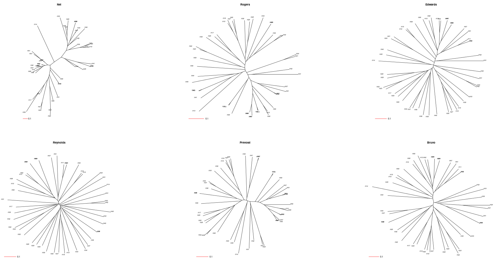 <!-- MERGE-REVIEW: no counterpart section found in QMD; content from TEX kept as-is. -->

### Selecting model for calculating distances among DNA sequences

- `phangorn::modelTest` has plenty of options

  - Only selected models can be tested
  - On Linux and macOS it's possible to speed up calculations with parallelization
  - Names of models are not exactly same as names of models in `ape::dist.dna`...

```{r}
library(phangorn) # Load needed library
?modelTest # Plenty of options, including possible parallelization
usflu.models <- modelTest(object=as.phyDat(usflu.dna)) # Test models
# Sort results according to AIC or BIC - the lower the better fit
head(usflu.models[order(usflu.models[["AIC"]]),], n=15L)
      Model  df    logLik      AIC       AICw     AICc      AICcw      BIC
91 GTR+G(4) 166 -5338.506'11009.01'0.24200823 11045.16 0.22990390 11911.88
83 TVM+G(4) 165 -5339.523 11009.05 0.23798173 11044.73 0.28399121 11906.48
...
gunnera.models <- modelTest(object=as.phyDat(gunnera.mafft.ng)) # Same for
head(gunnera.models[order(gunnera.models[["AIC"]]),], n=15L)    # Gunnera
```

<!-- MERGE-REVIEW: no counterpart section found in QMD; code below comes from the old TEX version. -->

### Distances among DNA sequences

- **The sequences must be aligned before calculating distances among them!**
- Selection of mutational model has significant impact to results...

```{r}
# There are various models available
?dist.dna
# Create the distance matrix
usflu.dist <- dist.dna(x=usflu.dna, model="F84")
# Check the resulting distance matrix
usflu.dist
class(usflu.dist)
dim(as.matrix(usflu.dist))
# Create another distance matrix
gunnera.dist <- dist.dna(x=gunnera.mafft.ng, model="TN93")
# Check it
gunnera.dist
class(gunnera.dist)
dim(as.matrix(gunnera.dist))
```

<!-- MERGE-REVIEW: 1 old code block(s) in TEX frame were dropped in favor of the .qmd section 'Topographical distances among trees'. -->

<!-- MERGE-REVIEW: content of the .qmd section 'Topographical distances among trees' was inserted at 7 frames; remove the unwanted duplicates. -->

Compute matrix of topological distances among phylogenetic trees

Basic information about the distance matrix

Create heatmaps using heatmap.2 function from gplots package

Robinsons-Foulds distance

Add names of columns and rows

Create heatmap using corrplot function from corrplot package

PCoA from distance matrices of topographical differences among trees Test if the distance matrix is Euclidean or not

Calculate the PCoA

Plot PCoA

Add kernel densities

Add histogram of eigenvalues

Add title to the plot

Alternative function to plot PCA plot

See current state

Remove outlying trees

See after removal

```{r}
library("gplots")
library("corrplot")
library("phytools")
```

```{r}
?dist.topo # See details of available computing methods
oxalis_trees_d <- dist.topo(x = oxalis_trees, method = "score")
```

```{r}
dim(as.matrix(oxalis_trees_d))
head.matrix(as.matrix(oxalis_trees_d))
```

```{r}
heatmap.2(x = as.matrix(x = oxalis_trees_d), Rowv = FALSE, Colv = "Rowv", dendrogram = "none", symm = TRUE, scale = "none", na.rm = TRUE, revC = FALSE, col = rainbow(15), cellnote = round(x = as.matrix(x = oxalis_trees_d), digits = 2), notecex = 1, notecol = "white", trace = "row", linecol = "black", labRow = names(oxalis_trees), labCol = names(oxalis_trees), key = TRUE, keysize = 2, density.info = "density", symkey = FALSE, main = "Correlation matrix of topographical distances", xlab = "Trees", ylab = "Trees")
```

```{r}
?multiRF # See help first...
oxalis_trees_d_rf <- multiRF(oxalis_trees)
```

```{r}
colnames(oxalis_trees_d_rf) <- names(oxalis_trees)
rownames(oxalis_trees_d_rf) <- names(oxalis_trees)
```

```{r}
corrplot(corr = oxalis_trees_d_rf, method = "circle", type = "upper", col = rainbow(15), title = "Correlation matrix of topographical distances", is.corr = FALSE, diag = FALSE, outline = TRUE, order = "alphabet", tl.pos = "lt", tl.col = "black")
corrplot(corr = oxalis_trees_d_rf, method = "number", type = "lower", add = TRUE, col = rainbow(15), title = "Correlation matrix of topographical distances", is.corr = FALSE, diag = FALSE, outline = FALSE, order = "alphabet", tl.pos = "ld", cl.pos = "n")
```

```{r}
library("ade4")
is.euclid(distmat = oxalis_trees_d, plot = TRUE)
```

```{r}
oxalis_trees_pcoa <- dudi.pco(d = oxalis_trees_d, scannf = TRUE, full = TRUE)
```

```{r}
s.label(dfxy = oxalis_trees_pcoa$li)
```

```{r}
s.kde2d(dfxy = oxalis_trees_pcoa$li, cpoint = 0, add.plot = TRUE)
```

```{r}
add.scatter.eig(oxalis_trees_pcoa[["eig"]], 3, 1, 2, posi = "topleft")
```

```{r}
title("PCoA of matrix of pairwise trees distances")
```

```{r}
scatter(x = oxalis_trees_pcoa, posieig = "topleft")
```

```{r}
oxalis_trees
```

```{r}
oxalis_trees[c("T471", "T639", "T654")] <- NULL
```

```{r}
oxalis_trees
```

### Distances and genlight object

Pairwise genetic distances for each data block (genlight objects with whole genome data) - sensitive to missing data (not useful in every case):

```{r}
usflu.dists.l <- seploc(usflu.genlight, n.block=10, parallel=FALSE)
class(usflu.dists.l)
usflu.dists <- lapply(X=usflu.dists.l, FUN=function(D) dist(as.matrix(D)))
class(usflu.dists)
names(usflu.dists)
class(usflu.dists[[1]])
usflu.distr <- Reduce(f="+", x=usflu.dists)
class(usflu.distr)
usflu.distr
# It is possible to use just basic dist function on whole genlight object
# (might require a lot of RAM)
usflu.distg <- dist.gene(as.matrix(usflu.genlight))
```

Rationale of this approach is to save resources when dividing whole data set into smaller blocks - useful for huge data, not for all of the cases <!-- MERGE-REVIEW: no counterpart section found in QMD; code below comes from the old TEX version. -->

### Distances in mixed-ploidy data sets I

**Nei's distance**

- Package [StAMPP](https://CRAN.R-project.org/package=StAMPP) implements Nei's distance and F$_ST$ for mixed-ploidy data
- It is highly sensitive to missing data

```{r}
# stamppNeisD requires population factor in genlight Nei's 1972 distance
# between individuals (use pop=TRUE to calculate among populations)
arabidopsis.dist <- stamppNeisD(geno=arabidopsis.genlight, pop=FALSE)
# Check it
head(arabidopsis.dist)
dim(arabidopsis.dist)
class(arabidopsis.dist)
# The same on population level
arabidopsis.dist.pop <- stamppNeisD(geno=arabidopsis.genlight, pop=TRUE)
# Check it
head(arabidopsis.dist.pop)
dim(arabidopsis.dist.pop)
class(arabidopsis.dist.pop)
```

<!-- MERGE-REVIEW: no counterpart section found in QMD; code below comes from the old TEX version. -->

### Distances in mixed-ploidy data sets II

```{r}
# Export the distance matrix as Phylip format for usage in external
# software (e.g. SplitsTree)
stamppPhylip(distance.mat=arabidopsis.dist, file="arabidopsis_dist.txt")
# Genomic relationship matrix
?stamppGmatrix # Method details
arabidopsis.genomat <- stamppGmatrix(geno=arabidopsis.genlight)
# Check it
head(arabidopsis.genomat)
dim(arabidopsis.genomat)
class(arabidopsis.genomat)
```

- If there are plenty of missing data and/or the distance is far from being Euclidean, it will not work very well... - sanitize missing data prior calculating distance (e.g. using `poppr::missingno`)
- Always check created distances <!-- MERGE-REVIEW: no counterpart section found in QMD; code below comes from the old TEX version. -->

### Over 40 distances from philentropy package

- There is enormous number of various distance measures...
- For example [Jaccard index](https://en.wikipedia.org/wiki/Jaccard_index) is used to compare binary (presence/absence) data like [AFLP](https://en.wikipedia.org/wiki/Amplified_fragment_length_polymorphism)

```{r}
getDistMethods() # See available distances
?distance # See details of distances
# Calculate e.g. Jaccard index for AFLP data
# amara.aflp has 30 columns, see dim(amara.aflp)
# column 1 contains names, see head(amara.aflp)
amara.jac <- distance(x=amara.aflp[,2:30], method="jaccard")
# See result
class(amara.jac)
amara.jac
# Make it distance matrix
amara.jac <- as.dist(m=amara.jac, diag=TRUE, upper=TRUE)
amara.jac
```

<!-- MERGE-REVIEW: no counterpart section found in QMD; code below comes from the old TEX version. -->

### Visualize pairwise genetic similarities

```{r}
# table.paint() requires data
# frame, dist can't be directly
# converted to DF
table.paint(df=as.data.frame(
  as.matrix(usflu.dist)), cleg=0,
  clabel.row=0.5, clabel.col=0.5)
# Same visualization, colored
# heatmap() reorders values
# because by default it plots
# also dendrograms on the edges
heatmap(x=as.matrix(usflu.dist),
  Rowv=NA, Colv=NA, symm=TRUE)
```

- Colored according to value

- Another possibility is to use `corrplot::corrplot()` for correlation plots

  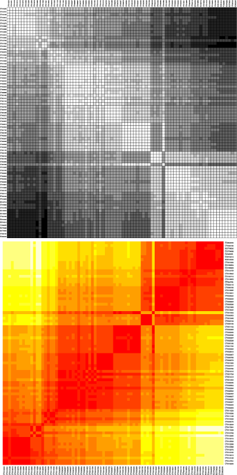 <!-- MERGE-REVIEW: no counterpart section found in QMD; code below comes from the old TEX version. -->

## Hierarchical clustering

### Heat maps

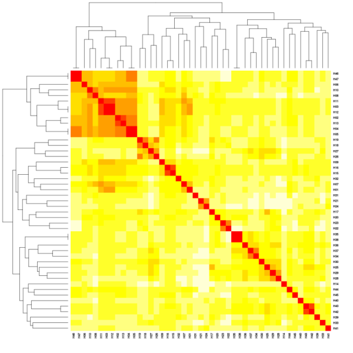

```{r}
# Based on various distances
heatmap(as.matrix(hauss.dist),
  symm=TRUE, labRow=rownames(
  as.matrix(hauss.dist.bruvo)),
  labCol=colnames(as.matrix(
  hauss.dist.bruvo)))
  # hauss.dist doesn't contain
  # names of individuals - add here
heatmap(as.matrix(hauss.dist.pop),
  symm=TRUE)
heatmap(as.matrix(hauss.dist.
  bruvo), symm=TRUE)
heatmap(as.matrix(hauss.dist.
  diss), symm=TRUE)
# See settings like colors,
# dendrogram, etc.
?heatmap
```

<!-- MERGE-REVIEW: 1 old code block(s) in TEX frame were dropped in favor of the .qmd section 'Maps'. -->

Load libraries

Plot basic map with state boundaries within selected range

Plot location points

Add text descriptions for points. Text is aside and with background

Insert legend

Pie charts on a map Prepare matrix with some data (exemplary distribution of haplotypes)

Plot basic map with state boundaries within selected range

Plot the pie charts

Add population labels

Google map is produced into a file Google recently started to require API key, see https://developers.google.com/maps/documentation/maps-static/overview

Download map

Plot saved map, with extra data

Google maps have their own internal scaling, adding of points by standard functions will not work correctly

Pie charts on Google map Prepare list to store recalculated coordinates

Calcualtion of coordinates to form required by Google Maps

Plot plain map

Plot pie charts

Alternative option to plot pie charts

Add population text labels

Plot a map, check parameters, among others projection and ?mapproject for its details

If you'd use projection, use - mapproject() to convert also coordinates! See ?mapproject for details

```{r}
library("sp")
library("rworldmap") # Basic world maps
library("TeachingDemos") # To be able to move text little bit
library("RgoogleMaps") # Google maps
library("mapplots") # Plot pie charts
library("adegenet")
```

```{r}
plot(x = getMap(resolution = "high"), xlim = c(19, 24), ylim = c(39, 44), asp = 1, lwd = 1.5)
box() # Add frame around the map
```

```{r}
points(x = hauss_genpop@other$xy[["lon"]], y = hauss_genpop@other$xy[["lat"]], pch = 15:19, col = "red", cex = 4)
```

```{r}
shadowtext(x = hauss_genpop@other$xy[["lon"]], y = hauss_genpop@other$xy[["lat"]], labels = as.vector(popNames(hauss_genind)), col = "black", bg = "white", theta = seq(pi / 4, 2 * pi, length.out = 8), r = 0.15, pos = c(1, 3, 2, 4, 4), offset = 0.75, cex = 1.5)
```

```{r}
legend(x = "topright", inset = 1 / 50, legend = c("He", "Oh", "Pr", "Ne", "Sk"), col = "red", border = "black", pch = 15:19, pt.cex = 2, bty = "o", bg = "lightgrey", box.lwd = 1.5, cex = 1.5, title = "Populations")
```

```{r}
hauss_pie <- cbind(c(20, 30, 15, 40, 10), c(30, 10, 25, 5, 45), c(10, 20, 20, 15, 5))
rownames(hauss_pie) <- popNames(hauss_genpop) # Add row names according to populations
colnames(hauss_pie) <- c("HapA", "HapB", "HapC") # Add column names according to data displayed
class(hauss_pie) # Check it is matrix
hauss_pie # See resulting matrix
```

```{r}
plot(x = getMap(resolution = "high"), xlim = c(20, 23), ylim = c(41, 42), asp = 1, lwd = 1.5)
box() # Add frame around the map
```

```{r}
for (pc in 1:5) {
  add.pie(z = hauss_pie[pc, ], x = as.vector(hauss_genpop@other$xy[["lon"]])[pc], y = as.vector(hauss_genpop@other$xy[["lat"]])[pc], labels = names(hauss_pie[pc, ]), radius = 0.1, col = topo.colors(3))
}
?add.pie # See more options
```

```{r}
text(x = hauss_genpop@other$xy[["lon"]], y = hauss_genpop@other$xy[["lat"]], labels = as.vector(popNames(hauss_genind)), col = "red", cex = 2)
```

```{r}
?GetMap # See all options
?PlotOnStaticMap # See all options
```

```{r}
hauss_gmap <- GetMap(center = c(lat = 41, lon = 21), size = c(640, 640), destfile = "gmap.png", zoom = 8, maptype = "satellite")
```

```{r}
PlotOnStaticMap(MyMap = hauss_gmap, lat = hauss_genpop@other$xy[["lat"]], lon = hauss_genpop@other$xy[["lon"]], FUN = points, pch = 19, col = "blue", cex = 5)
PlotOnStaticMap(MyMap = hauss_gmap, lat = hauss_genpop@other$xy[["lat"]], lon = hauss_genpop@other$xy[["lon"]], add = TRUE, FUN = points, pch = 19, col = "red", cex = 3)
PlotOnStaticMap(MyMap = hauss_gmap, lat = hauss_genpop@other$xy[["lat"]], lon = hauss_genpop@other$xy[["lon"]], add = TRUE, FUN = text, labels = as.vector(popNames(hauss_genind)), pos = 4, cex = 3, col = "white")
```

```{r}
hauss_gmap_coord <- list()
```

```{r}
for (lc in 1:5) {
  hauss_gmap_coord[[lc]] <- LatLon2XY.centered(MyMap = hauss_gmap, lat = as.vector(hauss_genpop@other$xy[["lat"]])[lc], lon = as.vector(hauss_genpop@other$xy[["lon"]])[lc], zoom = 8)
}
hauss_gmap_coord # See result
```

```{r}
PlotOnStaticMap(MyMap = hauss_gmap)
```

```{r}
for (lp in 1:5) {
  add.pie(z = hauss_pie[lp, ], x = hauss_gmap_coord[[lp]]$newX, y = hauss_gmap_coord[[lp]]$newY, labels = names(hauss_pie[lp, ]), radius = 25, col = topo.colors(n = 3, alpha = 0.7))
}
```

```{r}
for (lf in 1:5) {
  plotrix::floating.pie(xpos = hauss_gmap_coord[[lf]]$newX, ypos = hauss_gmap_coord[[lf]]$newY, x = hauss_pie[lf, ], radius = 30, col = heat.colors(n = 3, alpha = 0.5))
}
```

```{r}
PlotOnStaticMap(MyMap = hauss_gmap, lat = hauss_genpop@other$xy[["lat"]], lon = hauss_genpop@other$xy[["lon"]], add = TRUE, FUN = text, labels = as.vector(popNames(hauss_genind)), cex = 2.5, col = "white")

library("maps") # Various mapping tools (plotting, ...)
library("mapdata") # More detailed maps, but political boundaries often outdated, see https://CRAN.R-project.org/package = mapdata
library("mapproj") # Converts latitude/longitude into projected coordinates
```

```{r}
map(database = "world", boundary = TRUE, interior = TRUE, fill = TRUE, col = "lightgrey", plot = TRUE, xlim = c(16, 27), ylim = c(37, 46))
```

```{r}
points(x = hauss_genpop@other$xy[["lon"]], y = hauss_genpop@other$xy[["lat"]], pch = 15:19, col = "red", cex = 3)
```

```{=html}
<!--
# FIXME Plotting on SHP files
library("maptools")
library("rgdal")
# Load SHP file
# Data from https://download.geofabrik.de/europe/macedonia.html
# R working directory has to contain also respective DBF and SHX files (same name, only different suffix)
dir() # Verify required files are unpacked in the working directory
# Get from https://soubory.trapa.cz/rcourse/macedonia.zip
# Check correct import by plotting all layers
macedonia_building <- readOGR(dsn = "macedonia_buildings.shp")
plot(macedonia_building)
macedonia_landuse <- readOGR(dsn = "macedonia_landuse.shp")
plot(macedonia_landuse)
macedonia_natural <- readOGR(dsn = "macedonia_natural.shp")
plot(macedonia_natural)
macedonia_railways <- readOGR(dsn = "macedonia_railways.shp")
plot(macedonia_railways)
macedonia_roads <- readOGR(dsn = "macedonia_roads.shp")
plot(macedonia_roads)
macedonia_waterways <- readOGR(dsn = "macedonia_waterways.shp")
plot(macedonia_waterways)
# Plot all layers into single image, add more information
plot(macedonia_building)
plot(macedonia_landuse, add = TRUE, col = "darkgreen", fill = TRUE)
plot(macedonia_natural, add = TRUE, col = "green", fill = TRUE)
plot(macedonia_railways, add = TRUE, col = "brown", lty = "dotted")
plot(macedonia_roads, add = TRUE, col = "orange")
plot(macedonia_waterways, add = TRUE, col = "blue", lwd = 2)
# Add state boundaries
plot(x = getMap(resolution = "high"), xlim = c(19, 24), ylim = c(39, 44), asp = 1, lwd = 5, add = TRUE) # Or e.g.
map(database = "world", boundary = TRUE, interior = TRUE, fill = FALSE, col = "red", add = TRUE, plot = TRUE, xlim = c(16, 27), ylim = c(37, 46), lwd = 5)
# Add sampling points
points(x = hauss_genpop@other$xy[["lon"]], y = hauss_genpop@other$xy[["lat"]], pch = 15:19, col = "red", cex = 4)
# Add description of psampling points
shadowtext(x = hauss_genpop@other$xy[["lon"]], y = hauss_genpop@other$xy[["lat"]], labels = as.vector(popNames(hauss_genind)), col = "black", bg = "white", theta = seq(pi/4, 2*pi, length.out = 8), r = 0.15, pos = c(1, 3, 2, 4, 4), offset = 0.75, cex = 1.5)
# Add legend
legend(x = "topright", inset = 1/50, legend = c("He", "Oh", "Pr", "Ne", "Sk"), col = "red", border = "black", pch = 15:19, pt.cex = 2, bty = "o", bg = "lightgrey", box.lwd = 1.5, cex = 1.5, title = "Populations")
-->
```

### Hierarchical clustering - UPGMA and others

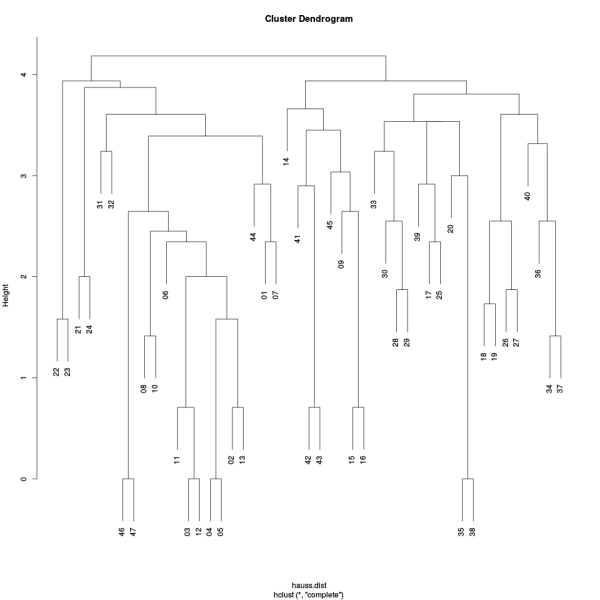

```{r}
# According to distance used
# How to use hierarchical
# clustering
?hclust
plot(hclust(d=hauss.dist,
  method="complete"))
plot(hclust(d=hauss.dist.pop,
  method="complete"))
plot(hclust(d=hauss.dist.bruvo,
  method="complete"))
```

- This is very basic function to make clustering dendrogram
- There are better possibilities (NJ etc - see slide and onward)
- More popular in ecology than in genetics <!-- MERGE-REVIEW: 1 old code block(s) in TEX frame were dropped in favor of the .qmd section 'Hierarchical clustering'. -->

According to distance used

```{r}
?hclust # How to use hierarchical clustering
plot(hclust(d = hauss_dist, method = "complete"))
plot(hclust(d = hauss_dist_pop, method = "complete"))
plot(hclust(d = hauss_dist_bruvo, method = "complete"))
```

### UPGMA and its test

```{r}
# Calculate it
# Saving as phylo object (and not hclust) gives more possibilities for
# further plotting and manipulations
usflu.upgma <- as.phylo(hclust(d=usflu.dist, method="average"))
plot.phylo(x=usflu.upgma, cex=0.75)
title("UPGMA tree")
# Test quality - tests correlation of original distance in the matrix and
# reconstructed distance from hclust object
plot(x=as.vector(usflu.dist), y=as.vector(as.dist(
  cophenetic(usflu.upgma))), xlab="Original pairwise distances",
  ylab="Pairwise distances on the tree", main="Is UPGMA
  appropriate?", pch=20, col=transp(col="black",
  alpha=0.1), cex=2)
# Add correlation line
abline(lm(as.vector(as.dist(cophenetic(usflu.upgma)))~
  as.vector(usflu.dist)), col="red")
# See NJ chapter for testing of this correlation
```

<!-- MERGE-REVIEW: no counterpart section found in QMD; code below comes from the old TEX version. -->

### UPGMA is not the best choice here...

**All points in the right graph should be clustered along the red line...**

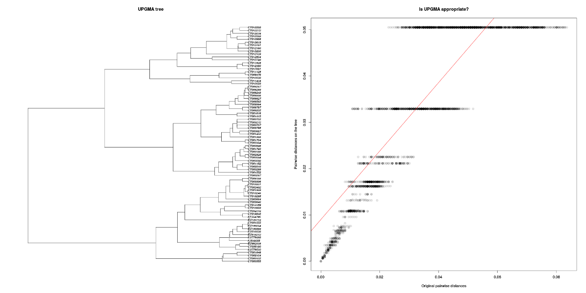 <!-- MERGE-REVIEW: no counterpart section found in QMD; content from TEX kept as-is. -->

## NJ (and UPGMA) tree

### Neighbor-Joining tree

- One of the oldest methods to reconstruct tree-like relationships among samples/populations, still commonly used
- Quality relies on good distance matrix (must be Euclidean etc.) - choose it well according to your data
- Relatively sensitive to amount of missing data - keep under ca. 10--15% missingness in input data
- Usually much better than hierarchical clustering (UPGMA and similar), can be constructed from any data (this universality is big advantage)
- Super fast to compute, easy to do bootstrap test, but usually not so accurate as MP, ML or Bayesian methods
- Suffers of some issues like chaining of individuals in case of low signal in data
- Several method try to reimplement and improve it (see slide ) <!-- MERGE-REVIEW: no counterpart section found in QMD; content from TEX kept as-is. -->

### Calculate and test NJ tree

```{r}
hauss.nj <- nj(hauss.dist) # Calculates the tree (try various distances)
# Test tree quality - plot original vs. reconstructed distance
plot(as.vector(hauss.dist), as.vector(as.dist(cophenetic(hauss.nj))),
  xlab="Original distance", ylab="Reconstructed distance")
abline(lm(as.vector(hauss.dist) ~
  as.vector(as.dist(cophenetic(hauss.nj)))), col="red")
cor.test(x=as.vector(hauss.dist), y=as.vector(as.dist(cophenetic
  (hauss.nj))), alternative="two.sided") # Testing the correlation
# Linear model for above graph
summary(lm(as.vector(hauss.dist) ~
  as.vector(as.dist(cophenetic(hauss.nj))))) # Prints summary text
# Plot a basic tree - see ?plot.phylo for details
plot.phylo(x=hauss.nj, type="phylogram")
plot.phylo(x=hauss.nj, type="cladogram", edge.width=2)
plot.phylo(x=hauss.nj, type="fan", edge.width=2, edge.lty=2)
plot.phylo(x=hauss.nj, type="radial", edge.color="red", edge.width=2,
  edge.lty=3, cex=2) # There are enormous graphical possibilities...
```

<!-- MERGE-REVIEW: no counterpart section found in QMD; code below comes from the old TEX version. -->

### Choose your tree...

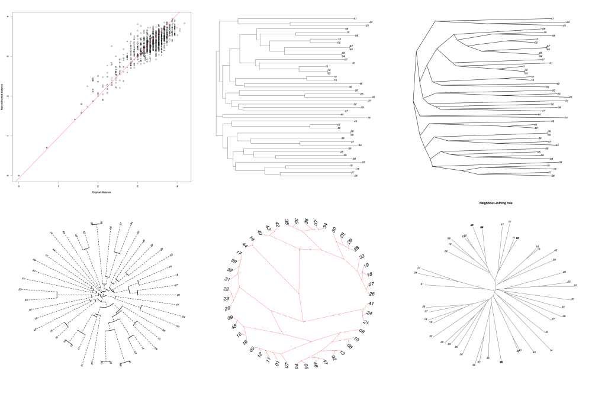 <!-- MERGE-REVIEW: no counterpart section found in QMD; content from TEX kept as-is. -->

### Bootstrap

**Test of reliability of estimated branching pattern**

```{r}
# boot.phylo() re-samples all columns - remove population column first
hauss.loci.nopop <- hauss.loci
hauss.loci.nopop[["population"]] <- NULL
# Calculate the bootstrap - repeat EXACTLY ALL STEPS from data to tree
hauss.boot <- boot.phylo(phy=hauss.nj, x=hauss.loci.nopop, FUN=function
  (XXX) nj(dist.gene(loci2genind(XXX)@tab, method="pairwise")), B=1000)
# boot.phylo returns NUMBER of replicates - NO PERCENTAGE
# Plot the tree
plot.phylo(x=hauss.nj, type="unrooted", main="Neighbor-Joining tree")
# Labels for nodes - bootstrap - see ?nodelabels for graphical settings
nodelabels(text=round(hauss.boot/10))
?boot.phylo # See details
# Another possibility
hauss.aboot <- aboot(x=hauss.genind, tree="nj", distance=nei.dist,
  sample=100) # Bootstrap values are in slot node.label
?aboot # Package poppr
```

<!-- MERGE-REVIEW: no counterpart section found in QMD; code below comes from the old TEX version. -->

### Plotting bootstrap and nicer trees

```{r}
# Plot the tree, explicitly display node labels
plot.phylo(x=hauss.aboot, show.node.label=TRUE)
?plot.phylo # See details...
## Plot a nice tree with colored tips
plot.phylo(x=hauss.nj, type="unr", show.tip=F, edge.width=3, main="NJ")
# Labels for nodes - bootstrap - see ?nodelabels for graphical settings
nodelabels(text=round(hauss.boot/10))
# Colored labels - creates vector of colors according to populations
nj.rainbow <- colorRampPalette(rainbow(length(popNames(hauss.genind))))
tiplabels(text=indNames(hauss.genind), bg=fac2col(x=pop(hauss.genind),
  col.pal=nj.rainbow)) # Colored tips
## Plot BW tree with tip symbols and legend
plot.phylo(x=hauss.nj, type="clad", show.tip=F, edge.width=3, main="NJ")
axisPhylo() # Add axis with distances
# From node labels let's remove unneeded frame
nodelabels(text=round(hauss.boot/10), frame="none", bg="white")
```

<!-- MERGE-REVIEW: no counterpart section found in QMD; code below comes from the old TEX version. -->

### Nicer trees

```{r}
# As tip label we use only symbols - see ?points for graphical details
tiplabels(frame="none", pch=rep(0:4, times=c(13, 17, 2, 6, 9)), lwd=2,
  cex=2)
# Plot a legend explaining symbols
legend(x="topleft", legend=c("He", "Oh", "Pr", "Ne", "Sk"),
  border="black", pch=0:4, pt.lwd=2, pt.cex=2, bty="o", bg="lightgrey",
  box.lwd=2, cex=1.2, title="Populations")
# See more options...
?plot.phylo
?nodelabels
?legend
?axisPhylo
```

- Functions in [ape](https://CRAN.R-project.org/package=ape) (`plot.phylo` and others), [adegenet](https://CRAN.R-project.org/package=adegenet) and another packages provide plenty of options to manipulate and display trees, for users of [ggplot2](https://CRAN.R-project.org/package=ggplot2), [ggtree](https://bioconductor.org/packages/release/bioc/html/ggtree.html) is an interesting alternative <!-- MERGE-REVIEW: no counterpart section found in QMD; code below comes from the old TEX version. -->

### Choose your tree...

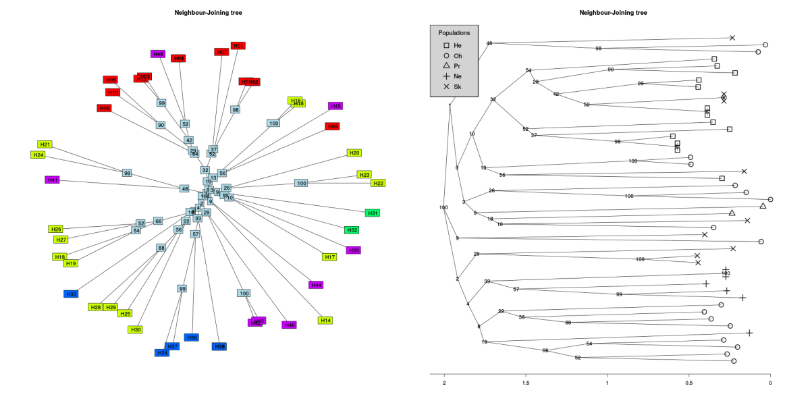 <!-- MERGE-REVIEW: no counterpart section found in QMD; content from TEX kept as-is. -->

### Trees based on Bruvo's distance

**Package poppr (bootstrap is incorporated within the function)**

```{r}
# NJ
hauss.nj.bruvo <- bruvo.boot(pop=hauss.genind, replen=rep(2, 12),
  sample=1000, tree="nj", showtree=TRUE, cutoff=1, quiet=FALSE)
plot.phylo(x=hauss.nj.bruvo, type="unrooted", show.tip=FALSE,
  edge.width=3, main="Neighbor-Joining tree")
# Call node labels as phylo$node.labels or phylo[["node.labels"]]
nodelabels(hauss.nj.bruvo[["node.labels"]]) tiplabels(hauss.nj.bruvo
  [["tip.label"]], bg=fac2col(x=hauss.genind$pop, col.pal=nj.rainbow))
# UPGMA
hauss.upgma <- bruvo.boot(pop=hauss.genind, replen=rep(2, 12),
  sample=1000, tree="upgma", showtree=TRUE, cutoff=1, quiet=FALSE)
plot.phylo(hauss.upgma, type="unrooted", show.tip=FALSE, edge.width=3,
  main="UPGMA tree")
nodelabels(hauss.upgma[["node.labels"]])
tiplabels(hauss.upgma[["tip.label"]], bg=fac2col(x=hauss.genind@pop,
  col.pal=nj.rainbow))
```

<!-- MERGE-REVIEW: 1 old code block(s) in TEX frame were dropped in favor of the .qmd section 'MSN based on Bruvo's distance'. -->

See details and options...

Get the MSN Note SSRs repeats 'rep(2, 12)' - change according to your data Here 12 SSRS loci of length 2 bp

For another data types

Interactive creation of MSN

```{r}
?bruvo.msn
```

```{r}
bruvo.msn(gid = hauss_genind, replen = rep(x = 2, times = 12), loss = TRUE, palette = rainbow, vertex.label = "inds", gscale = TRUE, wscale = TRUE, showplot = TRUE)
```

```{r}
?poppr.msn
```

```{r}
?imsn
```

### Choose your tree...

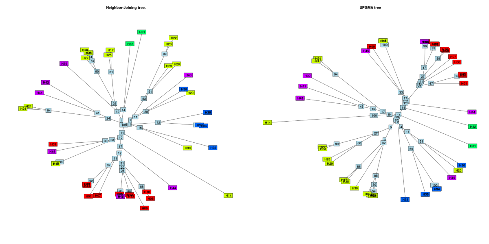 <!-- MERGE-REVIEW: no counterpart section found in QMD; content from TEX kept as-is. -->

### NJ tree of populations

```{r}
?poppr::aboot # aboot() can use distances implemented in poppr:
?poppr::nei.dist
# Calculations
hauss.nj.pop <- aboot(x=hauss.genpop, tree="nj", distance="nei.dist",
  sample=1000, showtree=FALSE)
print.phylo(hauss.nj.pop) # Information about result
# Plot a tree
plot.phylo(x=hauss.nj.pop, type="radial", show.node.label=TRUE,
  cex=1.2, edge.width=3, main="Neighbor-Joining tree of populations")
```

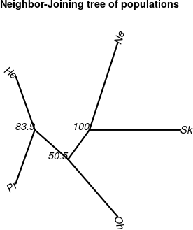 <!-- MERGE-REVIEW: 1 old code block(s) in TEX frame were dropped in favor of the .qmd section 'Tree manipulations'. -->

Library

Root the tree

root.phylo accepts either tip number or tip label resolve.root = TRUE ensures root will be bifurcating (without this parameter it sometimes doesn't work) outgroup can be single value or vector of multiple tips

root.multiPhylo() is an alias for root.phylo() for class multiPhylo

Check if it is rooted - returns TRUE/FALSE

Root the tree interactively

Unroot the tree

root(), unroot() and is.rooted() works with single or multiple trees (class phylo or multiPhylo)

Rotate (swap) clade plot.phylo plots tree in exact order as it is in the phylo object

Ladderize the tree - step-wise rotation of nodes

Drop "extinct"tips - those who don't reach end the tree tolerance is respective to the used metrics

See details

Extract clade, part of tree Plot source tree

See node labels (numbers) - needed for some tasks

Non-interactively extract clade

See new extracted tree

Interactive extraction

Select clade to extract by clicking on it

See new extracted tree

See more options

Bind two trees into one Bind donor "y"tree to a given position of the "x"tree

Bind two trees interactively Plot tree receiving the new one

Select where to bind new tree to

Work with multiple trees Read tree(s) in NEWICK format - single or multiple tree(s)

Export trees in NEWICK format

Export trees in NEXUS format

Root all trees

Drop a tip

Drop a tip from multiPhylo

See tip labels

Check if the tree is ultrametric - is variance of distances of all tips to node 0? It is required for some analysis

Fitting a chronogram to a phylogenetic tree whose branch lengths are in number of substitution per sites - force tree to be ultrametric

Compute branch lengths for trees without branch lengths

Computes the branch lengths of a tree giving its branching times (aka node ages or heights)

Function to calculate number of possible topologies for rooted fully bifurcating phylogenetic trees

See how many possible topologies are there...

```{r}
library("ape")
```

```{r}
plot.phylo(hauss_nj)
print.phylo(hauss_nj)
tiplabels() # Shows tip numbers
```

```{r}
hauss_nj_rooted <- root.phylo(phy = hauss_nj, resolve.root = TRUE, outgroup = 16) # Or
hauss_nj_rooted <- root.phylo(phy = hauss_nj, resolve.root = TRUE, outgroup = "H16") # Or
hauss_nj_rooted <- root.phylo(phy = hauss_nj, resolve.root = TRUE, outgroup = c("H42", "H43"))
```

```{r}
print.phylo(hauss_nj_rooted)
plot.phylo(hauss_nj_rooted)
```

```{r}
is.rooted(hauss_nj_rooted)
is.rooted(hauss_nj)
```

```{r}
plot.phylo(hauss_nj)
hauss_nj_rooted <- root.phylo(phy = hauss_nj, interactive = TRUE) # Click to selected tip
plot.phylo(hauss_nj_rooted)
```

```{r}
?unroot.phylo
```

```{r}
plot.phylo(hauss_nj)
nodelabels()
hauss_nj_rotated <- ape::rotate(phy = hauss_nj, node = 74)
plot.phylo(hauss_nj_rotated)
nodelabels()
```

```{r}
plot.phylo(hauss_nj)
hauss_nj_ladderized <- ladderize(hauss_nj)
plot.phylo(hauss_nj_ladderized)
```

```{r}
plot.phylo(hauss_nj)
axisPhylo()
hauss_nj_fossil <- drop.fossil(phy = hauss_nj, tol = 0.4)
plot.phylo(hauss_nj_fossil)
```

```{r}
?drop.fossil
```

```{r}
plot.phylo(hauss_nj)
```

```{r}
nodelabels()
```

```{r}
hauss_nj_extracted <- extract.clade(phy = hauss_nj, node = 60)
```

```{r}
plot.phylo(hauss_nj_extracted)
```

```{r}
plot.phylo(hauss_nj)
```

```{r}
hauss_nj_extracted <- extract.clade(phy = hauss_nj, interactive = TRUE)
```

```{r}
plot.phylo(hauss_nj_extracted)
```

```{r}
?extract.clade
?keep.tip # Does the opposite - keeps only selected tip(s)
```

```{r}
?bind.tree # See options
plot.phylo(hauss_nj_fossil)
nodelabels()
plot.phylo(hauss_nj_extracted)
nodelabels()
hauss_nj_bind <- bind.tree(x = hauss_nj_fossil, y = hauss_nj_extracted, where = "root", position = 0, interactive = FALSE)
plot.phylo(hauss_nj_bind)
```

```{r}
plot.phylo(hauss_nj_fossil)
```

```{r}
hauss_nj_bind <- bind.tree(x = hauss_nj_fossil, y = hauss_nj_extracted, interactive = TRUE)
plot.phylo(hauss_nj_bind)
```

```{r}
oxalis_trees <- read.tree(file = "https://soubory.trapa.cz/rcourse/oxalis.nwk")
oxalis_trees
lapply(X = oxalis_trees, FUN = print.phylo)
plot(x = oxalis_trees) # See all trees
summary(oxalis_trees)
length(oxalis_trees)
names(oxalis_trees)
```

```{r}
write.tree(phy = oxalis_trees, file = "trees.nwk")
```

```{r}
write.nexus(oxalis_trees, file = "trees.nexus")
```

```{r}
oxalis_trees_rooted <- root(phy = oxalis_trees, outgroup = "O._fibrosa_S159", resolve.root = TRUE)
lapply(X = oxalis_trees_rooted, FUN = print.phylo)
plot(x = oxalis_trees) # See all trees
```

```{r}
plot.phylo(hauss_nj)
hauss_nj[["tip.label"]]
tiplabels()
hauss_nj_drop <- drop.tip(phy = hauss_nj, tip = 47) # Or
hauss_nj_drop <- drop.tip(phy = hauss_nj, tip = "H31") # Or
hauss_nj_drop <- drop.tip(phy = hauss_nj, tip = c("H18", "H29", "H31"))
plot.phylo(hauss_nj_drop)
```

```{r}
plot(x = oxalis_trees)
```

```{r}
oxalis_trees[[1]][["tip.label"]]
oxalis_trees_drop <- lapply(X = oxalis_trees, FUN = drop.tip, tip = "O._callosa_S15")
class(oxalis_trees_drop) <- "multiPhylo"
plot(x = oxalis_trees_drop)
lapply(X = oxalis_trees_drop, FUN = print.phylo)
```

```{r}
is.ultrametric(oxalis_trees)
```

```{r}
?chronos
```

```{r}
?compute.brlen
```

```{r}
?compute.brtime
```

```{r}
nt <- function(n) {
  (factorial(2 * n - 3)) / (2^(n - 2) * factorial(n - 2))
}
```

```{r}
for (i in seq(from = 5, to = 90, by = 5)) {
  cat("Tips:", i, "topologies:", nt(i), "\n")
}
```

### NJ tree based on DNA sequences

**Commonly used as first look at the data**

```{r}
# Calculate the tree
usflu.tree <- nj(X=usflu.dist)
# Plot it
plot.phylo(x=usflu.tree, type="unrooted", show.tip=FALSE)
title("Unrooted NJ tree")
# Colored tips
usflu.pal <- colorRampPalette(topo.colors(length(levels(as.factor(
  usflu.annot[["year"]])))))
# Tip labels
tiplabels(text=usflu.annot$year, bg=num2col(usflu.annot$year,
  col.pal=usflu.pal), cex=0.75)
# Legend - describing years - pretty() automatically shows best
# values from given range, num2col() selects colors from color scale
legend(x="bottomright", fill=num2col(x=pretty(x=1993:2008, n=8),
  col.pal=usflu.pal), leg=pretty(x=1993:2008, n=8), ncol=1)
```

<!-- MERGE-REVIEW: no counterpart section found in QMD; code below comes from the old TEX version. -->

### Root the tree

```{r}
# Root the tree - "outgroup" is name of accession (in quotation marks)
# or number (position within phy object). Here, outgroup is the oldes
# (first) sample as viruses were sampled continuously during seveal years
usflu.tree.rooted <- root.phylo(phy=usflu.tree, outgroup=1)
# Plot it
plot.phylo(x=usflu.tree.rooted, show.tip=FALSE, edge.width=2)
title("Rooted NJ tree")
# Labeling of tips
tiplabels(text=usflu.annot$year, bg=transp(num2col(x=usflu.annot$year,
  col.pal=usflu.pal), alpha=0.7), cex=0.75, fg="transparent")
# Add axis with phylogenetic distance
axisPhylo()
# Legend - describing years - pretty() automatically shows best values
# from given range, num2col() selects colors from color scale
legend(x="topright", fill=num2col(x=pretty(x=1993:2008, n=8),
  col.pal=usflu.pal), leg=pretty(x=1993:2008, n=8), ncol=1)
```

<!-- MERGE-REVIEW: no counterpart section found in QMD; code below comes from the old TEX version. -->

### Bootstrap rooted tree

```{r}
# Calculate it
usflu.boot <- boot.phylo(phy=usflu.tree.rooted, x=usflu.dna, FUN=
  function(EEE) root.phylo(nj(dist.dna(EEE, model="TN93")), outgroup=1),
  B=1000)
# Plot the tree
plot.phylo(x=usflu.tree.rooted, show.tip=FALSE, edge.width=2)
title("NJ tree + bootstrap values")
tiplabels(frame="none", pch=20, col=transp(num2col(x=usflu.annot[["year"]],
  col.pal=usflu.pal), alpha=0.7), cex=3.5, fg="transparent")
axisPhylo()
# Legend - describing years - pretty() automatically shows best values
# from given range, num2col() selects colors from color scale
legend(x="topright", fill=num2col(x=pretty(x=1993:2008, n=8),
  col.pal=usflu.pal), leg=pretty(x=1993:2008, n=8), ncol=1)
# Plots bootstrap support - note usflu.boot contains raw numbers transform
# it into percent
nodelabels(text=round(usflu.boot/10), cex=0.75)
```

<!-- MERGE-REVIEW: no counterpart section found in QMD; code below comes from the old TEX version. -->

### Collapse branches with low bootstrap support

```{r}
usflu.tree.usflu.na.density <- usflu.tree.rooted
# Determine branches with low support - note BS values are in raw
# numbers - use desired percentage with respect to number of bootstraps
usflu.tocollapse <- match(x=which(usflu.boot < 700)+length(
  usflu.tree.rooted$tip.label),table=usflu.tree.usflu.na.density$edge[,2])
# Set length of bad branches to zero
usflu.tree.usflu.na.density$edge.length[usflu.tocollapse] <- 0
# Create new tree
usflu.tree.collapsed <- di2multi(usflu.tree.usflu.na.density, tol=0.00001)
# Plot the consensus tree
plot.phylo(x=usflu.tree.collapsed, show.tip=FALSE, edge.width=2)
title("NJ tree after collapsing weak nodes")
tiplabels(text=usflu.annot$year, bg=transp(num2col(x=usflu.annot
  [["year"]], col.pal=usflu.pal), alpha=0.7), cex=0.5, fg="transparent")
axisPhylo()
legend(x="topright", fill=num2col(x=pretty(x=1993:2008, n=8),
  col.pal=usflu.pal), leg=pretty(x=1993:2008, n=8), ncol=1)
```

<!-- MERGE-REVIEW: no counterpart section found in QMD; code below comes from the old TEX version. -->

### The trees

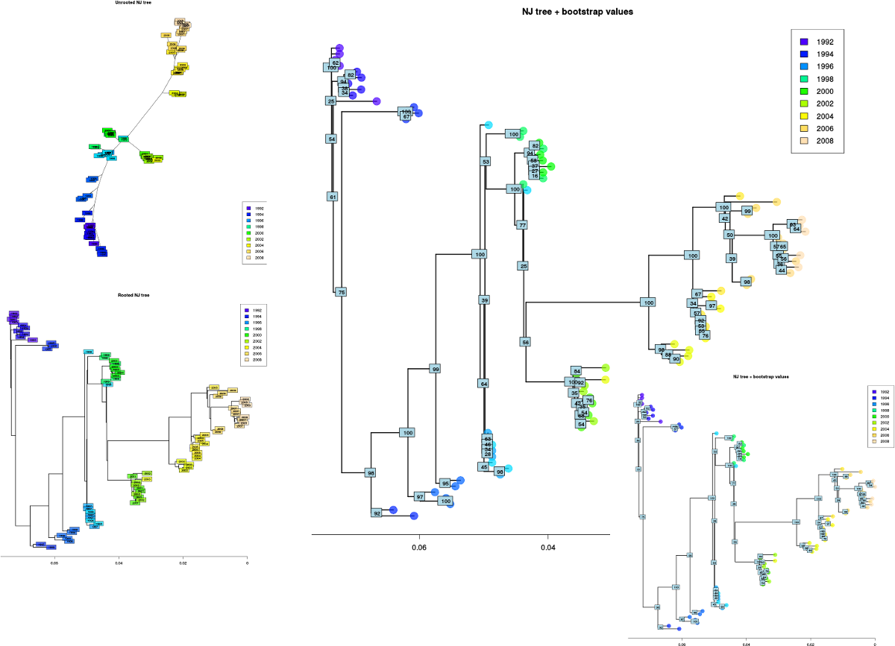 <!-- MERGE-REVIEW: no counterpart section found in QMD; content from TEX kept as-is. -->

### NJ is death. Long live NJ!

- "Basic" NJ has many limitations (problems with missing data, chaining of individuals, ...) - there are several tries to overcome them
- Package `phangorn` has functions `NJ()` and unweighted version `UNJ()`
- Package `ape` has functions `njs()` and `bionjs()` which are designed to perform well on distances with (more) missing values
- Function `bionj()` from `ape` implements BIONJ algorithm
- FastME functions (package `ape`) perform the minimum evolution algorithm and aim to be replacement of NJ - read `?fastme` before use
- All those functions read distance matrix and their usage is same as with "classical" `nj()` (read manual pages before using them) - it is also from package `ape` <!-- MERGE-REVIEW: no counterpart section found in QMD; content from TEX kept as-is. -->

## PCoA

### Principal Coordinate Analysis (PCoA), Principal Component Analysis (PCA) and relatives

- Create 2-D scatter plot (mostly) showing relationships among samples and their grouping

- PCoA is variant of PCA using distance matrix as input (not primary data as PCA)

  - It's crucial to select correct Euclidean distance matrix

- PCA is using as input data frame with any data type, but results are unstable for large number of variables (typical case for molecular data - each locus is one variable)

  - In genetic data, each locus (position in alignment, SSRs locus, ...) is separate variable from technical point of view
  - PCA is unstable if there are more variables than samples

- These methods are exploratory

  - For creating hypothesis, **not testing** them
  - There are no tests involved, no bootstraps, nothing like that

- There are variants of PCA for spatial data, for analysis of traits, etc.

- More such multivariate methods are used in another fields, like NMDS in ecology, ... <!-- MERGE-REVIEW: no counterpart section found in QMD; content from TEX kept as-is. -->

### PCoA I

```{r}
hauss.pcoa <- dudi.pco(d=dist.gene(x=scaleGen(x=hauss.genind, center=TRUE,
  scale=FALSE, truenames=TRUE), method="pairwise"), scannf=FALSE, nf=3)
s.label(dfxy=hauss.pcoa$li, clabel=0.75) # Basic display
# To plot different axes use for example dfxy=hauss.pcoa$li[c(2, 3)]
s.kde2d(dfxy=hauss.pcoa$li, cpoint=0, add.plot=TRUE) # Add kernel density
# Add histogram of Eigenvalues
add.scatter.eig(w=hauss.pcoa$eig, nf=3, xax=1, yax=2, posi="topleft",
  sub="Eigenvalues")
# Percentage of variance explained by each PC axis
100*hauss.pcoa$eig/sum(hauss.pcoa$eig)
# Colored display according to populations
# Creates vector of colors according to populations
hauss.pcoa.col <- rainbow(length(popNames(hauss.genind)))
s.class(dfxy=hauss.pcoa$li, fac=pop(hauss.genind), col=hauss.pcoa.col)
add.scatter.eig(w=hauss.pcoa$eig, nf=3, xax=1, yax=2, posi="bottomleft",
  sub="Eigenvalues")
title("Principal Coordinates Analysis") # Adds title to the graph
```

<!-- MERGE-REVIEW: 1 old code block(s) in TEX frame were dropped in favor of the .qmd section 'PCoA'. -->

<!-- MERGE-REVIEW: content of the .qmd section 'PCoA' was inserted at 2 frames; remove the unwanted duplicates. -->

Calculate it - based on various distance matrix

Basic display

To plot different axes use for example "...dfxy = hauss_pcoa\$li\[c(2, 3)\]..." Add kernel density

Add histogram of Eigenvalues

Percentage of variance explained by each PC axis

Colored display according to populations

Based on Bruvo's distance

Another possibility for colored plot (see ?colorplot for details)

```{r}
hauss_pcoa <- dudi.pco(d = dist.gene(x = scaleGen(x = hauss_genind, center = TRUE, scale = FALSE, truenames = TRUE), method = "pairwise"), scannf = FALSE, nf = 3)
```

```{r}
s.label(dfxy = hauss_pcoa$li, clabel = 0.75)
```

```{r}
s.kde2d(dfxy = hauss_pcoa$li, cpoint = 0, add.plot = TRUE)
```

```{r}
add.scatter.eig(w = hauss_pcoa$eig, nf = 3, xax = 1, yax = 2, posi = "topleft", sub = "Eigenvalues")
```

```{r}
100 * hauss_pcoa$eig / sum(hauss_pcoa$eig)
```

```{r}
hauss_pcoa_col <- rainbow(length(popNames(hauss_genind))) # Creates vector of colors according to populations
s.class(dfxy = hauss_pcoa$li, fac = pop(hauss_genind), col = hauss_pcoa_col)
add.scatter.eig(w = hauss_pcoa$eig, nf = 3, xax = 1, yax = 2, posi = "bottomleft", sub = "Eigenvalues")
title("Principal Coordinates Analysis") # Adds title to the graph
```

```{r}
hauss_pcoa_bruvo <- dudi.pco(d = bruvo.dist(pop = hauss_genind, replen = rep(2, 12)), scannf = FALSE, nf = 3)
s.class(dfxy = hauss_pcoa_bruvo$li, fac = pop(hauss_genind), col = hauss_pcoa_col)
add.scatter.eig(hauss_pcoa_bruvo$eig, posi = "bottomright", 3, 1, 2)
```

```{r}
colorplot(xy = hauss_pcoa$li[c(1, 2)], X = hauss_pcoa$li, transp = TRUE, cex = 3, xlab = "PC 1", ylab = "PC 2")
title(main = "PCoA, axes 1 and 2")
abline(v = 0, h = 0, col = "grey", lty = 2)
```

### PCoA II

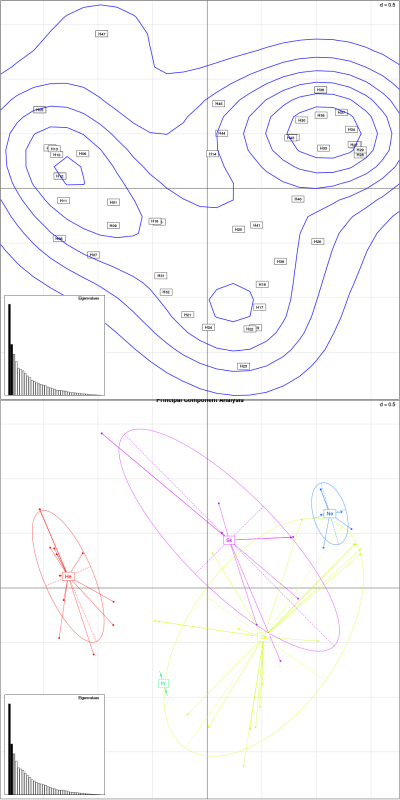

```{r}
# Based on Bruvo's distance
hauss.pcoa.bruvo <- dudi.pco(d=
  bruvo.dist(pop=hauss.genind,
  replen=rep(2, 12)),
  scannf=FALSE, nf=3)
s.class(dfxy=hauss.pcoa.bruvo$li,
  fac=pop(hauss.genind),
  col=hauss.pcoa.col)
add.scatter.eig(hauss.pcoa.bruvo$
  eig, posi="bottomright", 3,1,2)
# Another possibility for colored
# plot (see ?colorplot for details)
colorplot(xy=hauss.pcoa$li[c(1,2)],
  X=hauss.pcoa$li, transp=TRUE,
  cex=3, xlab="PC 1", ylab="PC 2")
title(main="PCoA, axes 1 and 2")
abline(v=0, h=0, col="gray", lty=2)
```

<!-- MERGE-REVIEW: 1 old code block(s) in TEX frame were dropped in favor of the .qmd section 'PCoA'. -->

<!-- MERGE-REVIEW: content of the .qmd section 'PCoA' was inserted at 2 frames; remove the unwanted duplicates. -->

Calculate it - based on various distance matrix

Basic display

To plot different axes use for example "...dfxy = hauss_pcoa\$li\[c(2, 3)\]..." Add kernel density

Add histogram of Eigenvalues

Percentage of variance explained by each PC axis

Colored display according to populations

Based on Bruvo's distance

Another possibility for colored plot (see ?colorplot for details)

```{r}
hauss_pcoa <- dudi.pco(d = dist.gene(x = scaleGen(x = hauss_genind, center = TRUE, scale = FALSE, truenames = TRUE), method = "pairwise"), scannf = FALSE, nf = 3)
```

```{r}
s.label(dfxy = hauss_pcoa$li, clabel = 0.75)
```

```{r}
s.kde2d(dfxy = hauss_pcoa$li, cpoint = 0, add.plot = TRUE)
```

```{r}
add.scatter.eig(w = hauss_pcoa$eig, nf = 3, xax = 1, yax = 2, posi = "topleft", sub = "Eigenvalues")
```

```{r}
100 * hauss_pcoa$eig / sum(hauss_pcoa$eig)
```

```{r}
hauss_pcoa_col <- rainbow(length(popNames(hauss_genind))) # Creates vector of colors according to populations
s.class(dfxy = hauss_pcoa$li, fac = pop(hauss_genind), col = hauss_pcoa_col)
add.scatter.eig(w = hauss_pcoa$eig, nf = 3, xax = 1, yax = 2, posi = "bottomleft", sub = "Eigenvalues")
title("Principal Coordinates Analysis") # Adds title to the graph
```

```{r}
hauss_pcoa_bruvo <- dudi.pco(d = bruvo.dist(pop = hauss_genind, replen = rep(2, 12)), scannf = FALSE, nf = 3)
s.class(dfxy = hauss_pcoa_bruvo$li, fac = pop(hauss_genind), col = hauss_pcoa_col)
add.scatter.eig(hauss_pcoa_bruvo$eig, posi = "bottomright", 3, 1, 2)
```

```{r}
colorplot(xy = hauss_pcoa$li[c(1, 2)], X = hauss_pcoa$li, transp = TRUE, cex = 3, xlab = "PC 1", ylab = "PC 2")
title(main = "PCoA, axes 1 and 2")
abline(v = 0, h = 0, col = "grey", lty = 2)
```

### PCoA - Bruvo and colorplot

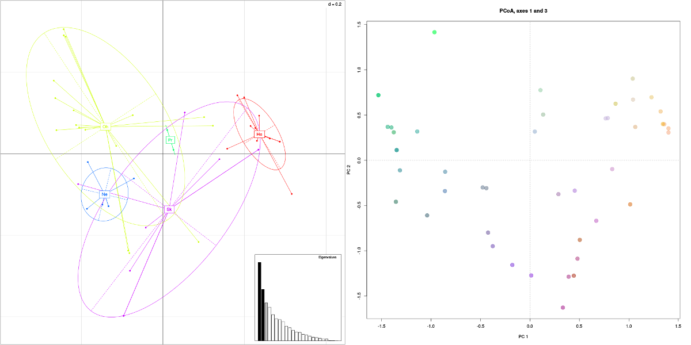 <!-- MERGE-REVIEW: no counterpart section found in QMD; content from TEX kept as-is. -->

## AMOVA

### AMOVA I

- Analysis of molecular variance tests if there are significant differences among populations (and/or another levels)
- Some implementations can partition variance into various levels
- `pegas::amova` returns a table of sums of square deviations (`SSD`), mean square deviations (`MSD`), and the number of degrees of freedom (`df`), and a vector of variance components (`sigma2`)
- See `sigma2` column for how much of the variance is on which level - percentage can be calculated as percentage of each level from total
- For more complicated hierarchy see `?poppr::poppr.amova`
- For mixed-ploidy dat sets see `?StAMPP::stamppAmova`

<!-- MERGE-REVIEW: content of the .qmd section 'AMOVA' was inserted at 2 frames; remove the unwanted duplicates. -->

From package pegas (doesn't directly show percentage of variance)

See results

For more complicated hierarchy

For mixed-ploidy dat sets

```{r}
hauss_pop <- pop(hauss_genind)
hauss_amova <- pegas::amova(hauss_dist ~ hauss_pop, data = NULL, nperm = 1000, is.squared = FALSE)
```

```{r}
hauss_amova
```

```{r}
?poppr::poppr.amova
```

```{r}
?StAMPP::stamppAmova
```

### AMOVA II

```{r}
hauss.pop <- pop(hauss.genind)
hauss.amova <- pegas::amova(hauss.dist~hauss.pop, data=NULL,
  nperm=1000, is.squared=FALSE)
# See results
hauss.amova
...
                SSD       MSD df
hauss.pop  5770.446 1442.6116  4
Error     12022.022  286.2386 42
Total     17792.468  386.7928 46
...
Variance components:
          sigma2 P.value
hauss.pop 133.37       0 # From here we can calculate the percentage
Error     286.24         # 100 * 133.37 / (133.37 + 286.24) = 31.78 %
...
```

<!-- MERGE-REVIEW: 1 old code block(s) in TEX frame were dropped in favor of the .qmd section 'AMOVA'. -->

<!-- MERGE-REVIEW: content of the .qmd section 'AMOVA' was inserted at 2 frames; remove the unwanted duplicates. -->

From package pegas (doesn't directly show percentage of variance)

See results

For more complicated hierarchy

For mixed-ploidy dat sets

```{r}
hauss_pop <- pop(hauss_genind)
hauss_amova <- pegas::amova(hauss_dist ~ hauss_pop, data = NULL, nperm = 1000, is.squared = FALSE)
```

```{r}
hauss_amova
```

```{r}
?poppr::poppr.amova
```

```{r}
?StAMPP::stamppAmova
```

## Tasks

### Process more data

**Not all combinations and possibilities were shown...**

1.  Most of examples of basic analysis were shown with the *Taraxacum haussknechtii* microsatellite dataset - try to do some analysis with another imported data
2.  Try some of the introduced analysis with your own custom imported data
3.  Try at least 2--3 analysis according to your interests

- Of course, following chapters will show more possible analysis...
- Previous examples are not covering all possibilities...
- It is crucial to be able to edit the introduced commands to be able to handle your data
- Check help pages of the functions for more options what to do with your data <!-- MERGE-REVIEW: no counterpart section found in QMD; content from TEX kept as-is. -->

