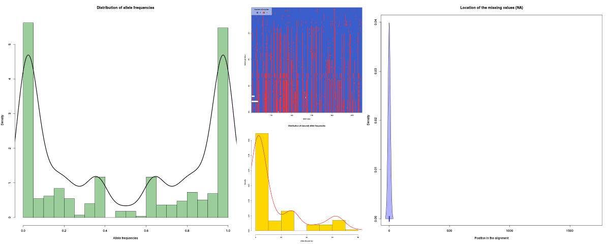
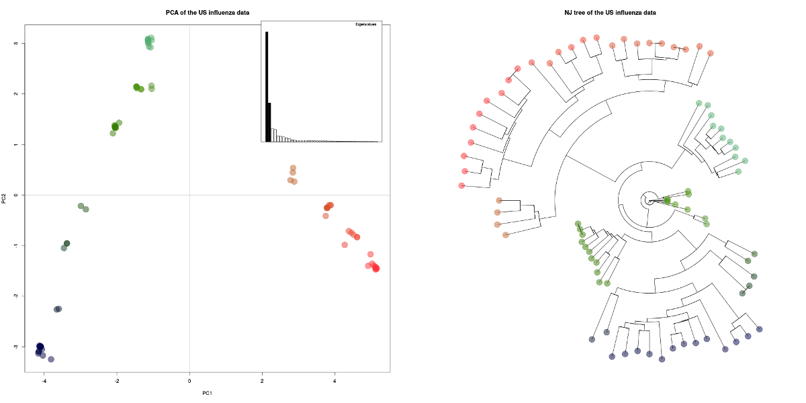

# SNP

### Special functions to work with huge SNP data sets

- Those tools are designed mainly for situation when having multiple (nearly) complete genomes - not needed for smaller data sets
- Lets keep hoping in fast development of computers...
- **Windows users:** To speed up the processing, `gl*` functions use parallelization library **unavailable on Windows** - add parameter `parallel=FALSE` to be able to use them

```{r}
# Plot of missing data (white) and number of 2nd alleles
glPlot(x=usflu.genlight, legend=TRUE, posi="topleft")
# Sum of the number of second allele in each SNP
usflu.freq <- glSum(usflu.genlight)
# Plot distribution of (second) allele frequencies
hist(x=usflu.freq, proba=TRUE, col="gold", xlab="Allele frequencies",
  main="Distribution of (second) allele frequencies")
lines(x=density(usflu.freq)$x, y=density(usflu.freq)$y*1.5, col="red",
  lwd=3 )
```

<!-- MERGE-REVIEW: no counterpart section found in QMD; code below comes from the old TEX version. -->

### Number of missing values in each locus

```{r}
usflu.mean <- glMean(usflu.genlight)      # Mean number of second
usflu.mean <- c(usflu.mean, 1-usflu.mean) # allele in each SNP
# Plot distribution of allele frequencies
hist(x=usflu.mean, proba=TRUE, col="darkseagreen3", xlab="Allele
  frequencies", main="Distribution of allele frequencies", nclass=20)
lines(x=density(usflu.mean, bw=0.05)$x, y=density(usflu.mean, bw=0.05)$y*2,
  lwd=3)
# Play with bw parameter to get optimal image
usflu.na.density <- density(glNA(usflu.genlight), bw=10)
# Set range of xlim parameter from 0 to the length of original alignment
plot(x=usflu.na.density, type="n", xlab="Position in the alignment",
  main="Location of the missing values (NA)", xlim=c(0, 1701))
polygon(c(usflu.na.density$x, rev(usflu.na.density$x)),
  c(usflu.na.density$y, rep(0, length(usflu.na.density$x))),
  col=transp("blue", alpha=0.3))
points(glNA(usflu.genlight), rep(0, nLoc(usflu.genlight)), pch="|", cex=2,
  col="blue")
```

<!-- MERGE-REVIEW: no counterpart section found in QMD; code below comes from the old TEX version. -->

### Basic information about SNP: distribution of 2$^{nd}$ allele frequencies, missing data and number of 2$^{nd}$ allele, distribution of allele frequencies, and number of missing values in each locus

 <!-- MERGE-REVIEW: no counterpart section found in QMD; content from TEX kept as-is. -->

## PCA and NJ

### PCA, NJ and genlight objects

```{r}
usflu.pca <- glPca(x=usflu.genlight, center=TRUE, scale=FALSE,
  loadings=TRUE) # Select number of retained PC axes, about 10 here
scatter.glPca(x=usflu.pca, posi="topright") # Plot PCA
title("PCA of the US influenza data")
# Loading plot - contribution of variables to the pattern observed
loadingplot.glPca(x=usflu.pca)
colorplot(usflu.pca$scores, usflu.pca$scores, transp=TRUE, cex=4) # Cols
title("PCA of the US influenza data")
abline(h=0, v=0, col="gray")
add.scatter.eig(usflu.pca[["eig"]][1:40], 2, 1, 2, posi="topright",
  inset=0.05, ratio=0.3)
usflu.tree.genlight <- nj(dist.gene(as.matrix(usflu.genlight))) # Get tree
# Plot colored phylogenetic tree
plot.phylo(x=usflu.tree.genlight, type="fan", show.tip=FALSE)
tiplabels(pch=20, col=num2col(usflu.annot[["year"]], col.pal=usflu.pal),
  cex=4)
title("NJ tree of the US influenza data")
```

<!-- MERGE-REVIEW: no counterpart section found in QMD; code below comes from the old TEX version. -->

### PCA, NJ and genlight objects

```{r}
legend(x="topright", fill=num2col(x=pretty(x=1993:2008, n=8),
  col.pal=usflu.pal), leg=pretty(x=1993:2008, n=8), ncol=1)
```

 <!-- MERGE-REVIEW: no counterpart section found in QMD; code below comes from the old TEX version. -->

