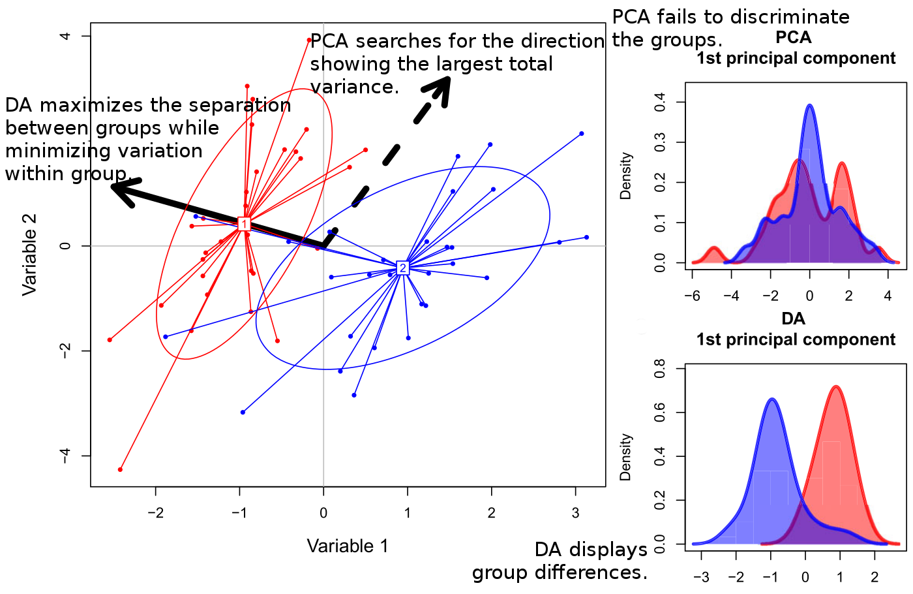
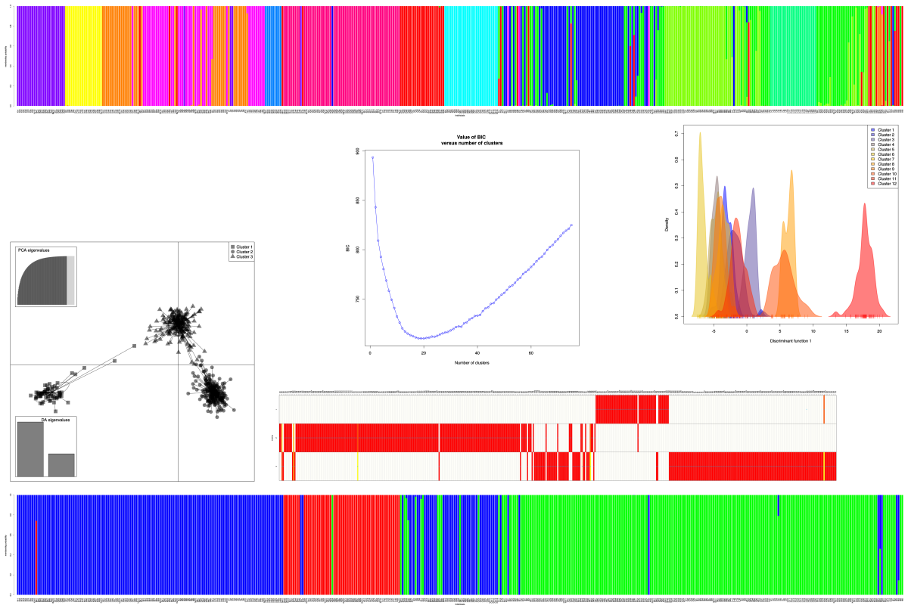
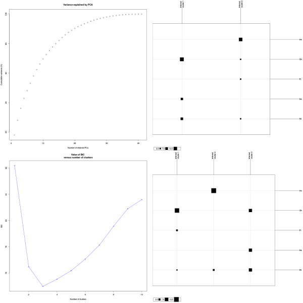
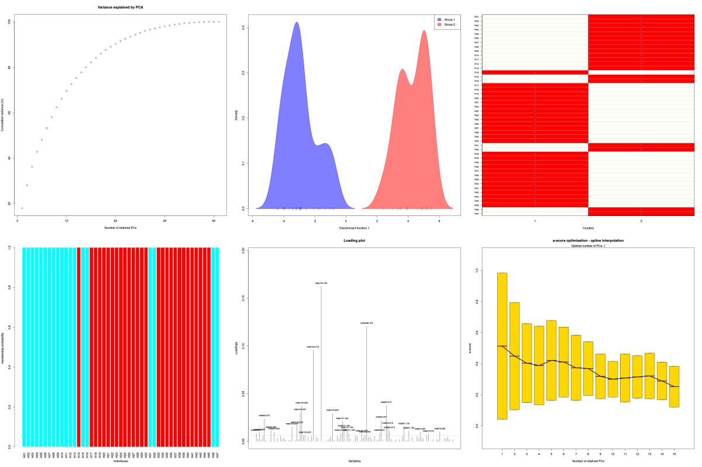
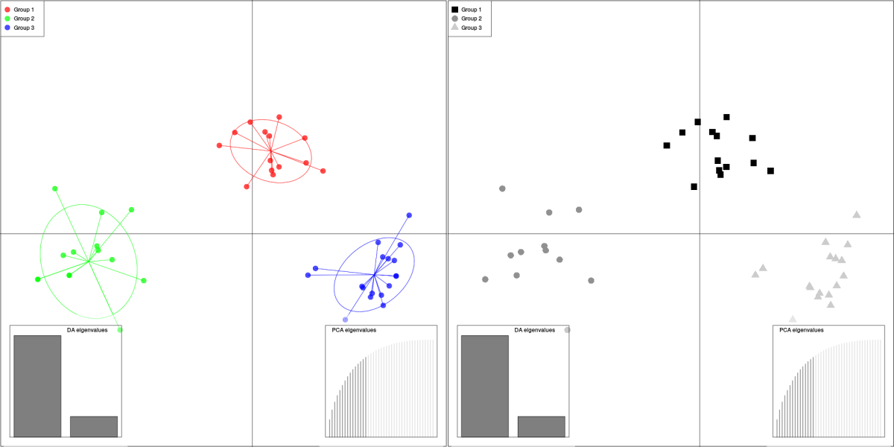
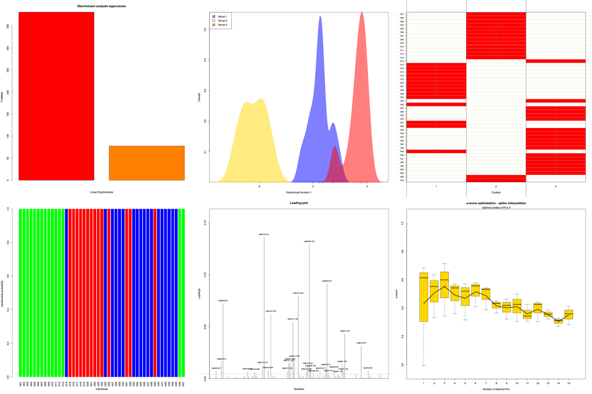

# DAPC

### DAPC

- Discriminant Analysis of Principal components ([Jombart et al. 2010](https://bmcgenet.biomedcentral.com/articles/10.1186/1471-2156-11-94))
- Runs K-means Bayesian clustering on data transformed with PCA (reduces number of variables, speeds up process)
- User selects best **K** - number of clusters; according to scores shown
- Finally it runs discriminant analysis (DA) to maximize differences among groups
- Various modes of displaying of results - "Structure-like", "PCA-like" and more
- More information at <https://adegenet.r-forge.r-project.org/>
- If following commands would seem too complicated, try web interface

```{r}
library(adegenet)
adegenetServer("DAPC") # Recommended to open in Google Chrome/Chromium
adegenetTutorial("dapc") # Tutorial, more information about DAPC
```

<!-- MERGE-REVIEW: 1 old code block(s) in TEX frame were dropped in favor of the .qmd section 'DAPC'. -->

<!-- MERGE-REVIEW: content of the .qmd section 'DAPC' was inserted at 3 frames; remove the unwanted duplicates. -->

K = 2 Create DAPC Number of informative PC (Here 15, adegenet recommends \< N/3). Select number of informative DA (here 1 - only one is available - it won't produce PCA graph).

Information

Density functions

Assignment of individuals to clusters

Structure-like plot

Loadingplot - alleles the most adding to separation of individuals

alfa-score - according to number of PC axis

K = 3 Create DAPC Number of informative PC (Here 15, adegenet recommends \< N/3). Select number of informative DA (here 2).

Information

A la PCA graph

Same in BW

Density functions - only for first axis here!

Assignment of individuals to clusters

Structure-like plot

Loadingplot - alleles the most adding to separation of individuals

alfa-score - according to number of PC axis

```{r}
hauss_dapc <- dapc(x = hauss_genind, pop = hauss_kfind$grp, center = TRUE, scale = FALSE, var.contrib = TRUE, pca.info = TRUE, truenames = TRUE)
```

```{r}
hauss_dapc
```

```{r}
scatter(x = hauss_dapc, xax = 1, yax = 1, main = "DAPC", bg = "white", solid = 0.5, leg = TRUE, txt.leg = c("Group 1", "Group 2"), posi.leg = "topright")
```

```{r}
assignplot(x = hauss_dapc)
```

```{r}
compoplot(x = hauss_dapc, xlab = "Individuals", leg = FALSE)
```

```{r}
loadingplot(x = hauss_dapc$var.contr)
```

```{r}
optim.a.score(x = hauss_dapc)

```

```{r}
hauss_dapc3 <- dapc(x = hauss_genind, pop = hauss_kfind3$grp, center = TRUE, scale = FALSE, var.contrib = TRUE, pca.info = TRUE, truenames = TRUE)
```

```{r}
hauss_dapc
```

```{r}
scatter(x = hauss_dapc3, main = "DAPC, Taraxacum haussknechtii", bg = "white", cex = 3, clab = 0, col = rainbow(3), posi.da = "bottomleft", scree.pca = TRUE, posi.pca = "bottomright", leg = TRUE, txt.leg = c("Group 1", "Group 2", "Group 3"), posi.leg = "topleft")
```

```{r}
scatter(x = hauss_dapc3, main = "DAPC, Taraxacum haussknechtii", bg = "white", pch = c(15:17), cell = 0, cstar = 0, solid = 1, cex = 2.5, clab = 0, col = gray.colors(3, start = 0, end = 0.8, gamma = 2, alpha = 0), posi.da = "bottomleft", scree.pca = TRUE, posi.pca = "bottomright", leg = TRUE, txt.leg = c("Group 1", "Group 2", "Group 3"), posi.leg = "topleft")
```

```{r}
scatter(x = hauss_dapc3, xax = 1, yax = 1, main = "DAPC", bg = "white", solid = 0.5, leg = TRUE, txt.leg = c("Group 1", "Group 2", "Group 3"), posi.leg = "topleft")
```

```{r}
assignplot(hauss_dapc3)
```

```{r}
compoplot(hauss_dapc3, xlab = "Individuals", leg = FALSE)
```

```{r}
loadingplot(hauss_dapc3$var.contr)
```

```{r}
optim.a.score(hauss_dapc3)

```

### Principal difference between PCA and DA

 <!-- MERGE-REVIEW: no counterpart section found in QMD; content from TEX kept as-is. -->

### DAPC example of almost 500 samples of *Nuphar lutea*

 <!-- MERGE-REVIEW: no counterpart section found in QMD; content from TEX kept as-is. -->

## Bayesian clustering

### K-find - Bayesian K-means clustering

```{r}
# Retain all informative PC (here about 35)
# According to second graph select best K (here 2 or 3)
# Now we select K=2 and later rerun the analysis for K=3 (lines 14-18)
hauss.kfind <- find.clusters(x=hauss.genind, stat="BIC",
  choose.n.clust=TRUE, max.n.clust=10, n.iter=100000, n.start=100,
  scale=FALSE, truenames=TRUE)
table(pop(hauss.genind), hauss.kfind$grp) # See results as text
hauss.kfind
# Graph showing table of original and inferred populations and
# assignment of individuals
table.value(df=table(pop(hauss.genind), hauss.kfind$grp), col.lab=
  paste("Inferred\ncluster", 1:length(hauss.kfind$size)), grid=TRUE)
# For K=3 - note parameters n.pca and n.clust - we just rerun the
# analysis and when results are stable, no problem here
hauss.kfind3 <- find.clusters(x=hauss.genind, n.pca=35, n.clust=3,
  stat="BIC", choose.n.clust=FALSE, n.iter=100000, n.start=100,
  scale=FALSE, truenames=TRUE)
```

<!-- MERGE-REVIEW: no counterpart section found in QMD; code below comes from the old TEX version. -->

### K-find outputs

- Cumulative variance of axis

- BIC helps to select the best K

- Original and inferred groups

  

```{r}
# See results as text
table(pop(hauss.genind),
  hauss.kfind3$grp)
hauss.kfind3
# Graph showing table of original
# and inferred populations and
# assignment of individuals
table.value(
  df=table(pop(hauss.genind),
  hauss.kfind3$grp), col.lab=
  paste("Inferred\ncluster",
  1:length(hauss.kfind3$size)),
  grid=TRUE)
# If needed, use custom text for
# parameter col.lab=c("...", "...")
# as many labels as inferred groups
```

<!-- MERGE-REVIEW: 1 old code block(s) in TEX frame were dropped in favor of the .qmd section 'K-find'. -->

Bayesian K-means clustering Retain all informative PC (here about 35). According to second graph select best K (here 2 or 3).

See results as text

Graph showing table of original and inferred populations and assignment of individuals

For K = 3 - note parameters n.pca and n.clust - we just rerun the analysis and when results are stable, no problem here

See results as text

Graph showing table of original and inferred populations and assignment of individuals

```{r}
hauss_kfind <- find.clusters(x = hauss_genind, stat = "BIC", choose.n.clust = TRUE, max.n.clust = 10, n.iter = 100000, n.start = 100, scale = FALSE, truenames = TRUE)
```

```{r}
table(pop(hauss_genind), hauss_kfind$grp)
hauss_kfind
```

```{r}
table.value(df = table(pop(hauss_genind), hauss_kfind$grp), col.labels = paste("Inferred\ncluster", seq_along(hauss_kfind$size)), grid = TRUE)
```

```{r}
hauss_kfind3 <- find.clusters(x = hauss_genind, n.pca = 35, n.clust = 3, stat = "BIC", choose.n.clust = FALSE, n.iter = 100000, n.start = 100, scale = FALSE, truenames = TRUE)
```

```{r}
table(pop(hauss_genind), hauss_kfind3$grp)
hauss_kfind3
```

```{r}
table.value(df = table(pop(hauss_genind), hauss_kfind3$grp), col.labels = paste("Inferred\ncluster", seq_along(hauss_kfind3$size)), grid = TRUE)
```

## Discriminant analysis and visualization

### DAPC code I

```{r}
## K=2
# Create DAPC
# Number of informative PC (Here 15, adegenet recommends < N/3). Select
# number of informative DA (here only one is available - no PCA graph)
hauss.dapc <- dapc(x=hauss.genind, pop=hauss.kfind$grp, center=TRUE,
  scale=FALSE, var.contrib=TRUE, pca.info=TRUE, truenames=TRUE)
# Information
hauss.dapc
# Density function - only for first axis here!
scatter(x=hauss.dapc, xax=1, yax=1, main="DAPC", bg="white", solid=0.5,
  leg=TRUE, txt.leg=c("Group 1", "Group 2"), posi.leg="topright")
# Assignment of individuals to clusters
assignplot(x=hauss.dapc)
# Structure-like plot
compoplot(x=hauss.dapc, xlab="Individuals", leg=FALSE)
# Loadingplot - alleles the most adding to separation of individuals
loadingplot(x=hauss.dapc$var.contr)
```

<!-- MERGE-REVIEW: 1 old code block(s) in TEX frame were dropped in favor of the .qmd section 'DAPC'. -->

<!-- MERGE-REVIEW: content of the .qmd section 'DAPC' was inserted at 3 frames; remove the unwanted duplicates. -->

K = 2 Create DAPC Number of informative PC (Here 15, adegenet recommends \< N/3). Select number of informative DA (here 1 - only one is available - it won't produce PCA graph).

Information

Density functions

Assignment of individuals to clusters

Structure-like plot

Loadingplot - alleles the most adding to separation of individuals

alfa-score - according to number of PC axis

K = 3 Create DAPC Number of informative PC (Here 15, adegenet recommends \< N/3). Select number of informative DA (here 2).

Information

A la PCA graph

Same in BW

Density functions - only for first axis here!

Assignment of individuals to clusters

Structure-like plot

Loadingplot - alleles the most adding to separation of individuals

alfa-score - according to number of PC axis

```{r}
hauss_dapc <- dapc(x = hauss_genind, pop = hauss_kfind$grp, center = TRUE, scale = FALSE, var.contrib = TRUE, pca.info = TRUE, truenames = TRUE)
```

```{r}
hauss_dapc
```

```{r}
scatter(x = hauss_dapc, xax = 1, yax = 1, main = "DAPC", bg = "white", solid = 0.5, leg = TRUE, txt.leg = c("Group 1", "Group 2"), posi.leg = "topright")
```

```{r}
assignplot(x = hauss_dapc)
```

```{r}
compoplot(x = hauss_dapc, xlab = "Individuals", leg = FALSE)
```

```{r}
loadingplot(x = hauss_dapc$var.contr)
```

```{r}
optim.a.score(x = hauss_dapc)

```

```{r}
hauss_dapc3 <- dapc(x = hauss_genind, pop = hauss_kfind3$grp, center = TRUE, scale = FALSE, var.contrib = TRUE, pca.info = TRUE, truenames = TRUE)
```

```{r}
hauss_dapc
```

```{r}
scatter(x = hauss_dapc3, main = "DAPC, Taraxacum haussknechtii", bg = "white", cex = 3, clab = 0, col = rainbow(3), posi.da = "bottomleft", scree.pca = TRUE, posi.pca = "bottomright", leg = TRUE, txt.leg = c("Group 1", "Group 2", "Group 3"), posi.leg = "topleft")
```

```{r}
scatter(x = hauss_dapc3, main = "DAPC, Taraxacum haussknechtii", bg = "white", pch = c(15:17), cell = 0, cstar = 0, solid = 1, cex = 2.5, clab = 0, col = gray.colors(3, start = 0, end = 0.8, gamma = 2, alpha = 0), posi.da = "bottomleft", scree.pca = TRUE, posi.pca = "bottomright", leg = TRUE, txt.leg = c("Group 1", "Group 2", "Group 3"), posi.leg = "topleft")
```

```{r}
scatter(x = hauss_dapc3, xax = 1, yax = 1, main = "DAPC", bg = "white", solid = 0.5, leg = TRUE, txt.leg = c("Group 1", "Group 2", "Group 3"), posi.leg = "topleft")
```

```{r}
assignplot(hauss_dapc3)
```

```{r}
compoplot(hauss_dapc3, xlab = "Individuals", leg = FALSE)
```

```{r}
loadingplot(hauss_dapc3$var.contr)
```

```{r}
optim.a.score(hauss_dapc3)

```

### DAPC for K=2

 <!-- MERGE-REVIEW: no counterpart section found in QMD; content from TEX kept as-is. -->

### DAPC code II

```{r}
# alfa-score - according to number of PC axis
optim.a.score(x=hauss.dapc)
## K=3
# Create DAPC
# Number of informative PC (Here 15, adegenet recommends < N/3)
# Select number of informative DA (here 2 - usually keep all of them)
hauss.dapc3 <- dapc(x=hauss.genind, pop=hauss.kfind3$grp, center=TRUE,
  scale=FALSE, var.contrib=TRUE, pca.info=TRUE, truenames=TRUE)
hauss.dapc # Information
# A la PCA graph
scatter(x=hauss.dapc3, main="DAPC, Taraxacum haussknechtii",
  bg="white", cex=3, clab=0, col=rainbow(3), posi.da="bottomleft",
  scree.pca=TRUE, posi.pca="bottomright", leg=TRUE,
  txt.leg=c("Group 1", "Group 2", "Group 3"), posi.leg="topleft")
```

- Especially graphical parameters have huge possibilities...
- See `?scatter` and play with it... <!-- MERGE-REVIEW: no counterpart section found in QMD; code below comes from the old TEX version. -->

### DAPC for K=3

 <!-- MERGE-REVIEW: no counterpart section found in QMD; content from TEX kept as-is. -->

### DAPC code III

```{r}
# Same in BW
scatter(x=hauss.dapc3, main="DAPC, Taraxacum haussknechtii",
  bg="white", pch=c(15:17), cell=0, cstar=0, solid=1, cex=2.5, clab=0,
  col=gray.colors(3, start=0, end=0.8, gamma=2, alpha=0), posi.da=
  "bottomleft", scree.pca=TRUE, posi.pca="bottomright", leg=TRUE,
  txt.leg=c("Group 1", "Group 2", "Group 3"), posi.leg="topleft")
# Density function - only for first axis here!
scatter(x=hauss.dapc3, xax=1, yax=1, main="DAPC", bg="white", solid=0.5,
  leg=T, txt.leg=c("Group 1", "Group 2", "Group 3"), posi.leg="topleft")
# Assignment of individuals to clusters
assignplot(hauss.dapc3)
# Structure-like plot
compoplot(hauss.dapc3, xlab="Individuals", leg=FALSE)
# Loadingplot - alleles the most adding to separation of individuals
loadingplot(hauss.dapc3$var.contr)
# alfa-score - according to number of PC axis
optim.a.score(hauss.dapc3)
```

<!-- MERGE-REVIEW: no counterpart section found in QMD; code below comes from the old TEX version. -->

### DAPC for K=3, extra information

 <!-- MERGE-REVIEW: no counterpart section found in QMD; content from TEX kept as-is. -->

## Tasks

### Try DAPC

1.  Try DAPC with `microbov` dataset (`data(microbov)`, see `?microbov`), the U.S. flu dataset (the `usflu.genind` object), or some other data according to your choice.

2.  Try K-means clustering as well as DAPC itself (think which highest `max.n.clust` to use - check data size and number of populations).

3.  Try various Ks (if appropriate).

4.  Try various displays.

5.  Interpret the results.

6.  When is DAPC good tool and when should you avoid it?

7.  Which data can you cluster using K-means clustering?

<!-- MERGE-REVIEW: content of the .qmd section 'DAPC' was inserted at 3 frames; remove the unwanted duplicates. -->

K = 2 Create DAPC Number of informative PC (Here 15, adegenet recommends \< N/3). Select number of informative DA (here 1 - only one is available - it won't produce PCA graph).

Information

Density functions

Assignment of individuals to clusters

Structure-like plot

Loadingplot - alleles the most adding to separation of individuals

alfa-score - according to number of PC axis

K = 3 Create DAPC Number of informative PC (Here 15, adegenet recommends \< N/3). Select number of informative DA (here 2).

Information

A la PCA graph

Same in BW

Density functions - only for first axis here!

Assignment of individuals to clusters

Structure-like plot

Loadingplot - alleles the most adding to separation of individuals

alfa-score - according to number of PC axis

```{r}
hauss_dapc <- dapc(x = hauss_genind, pop = hauss_kfind$grp, center = TRUE, scale = FALSE, var.contrib = TRUE, pca.info = TRUE, truenames = TRUE)
```

```{r}
hauss_dapc
```

```{r}
scatter(x = hauss_dapc, xax = 1, yax = 1, main = "DAPC", bg = "white", solid = 0.5, leg = TRUE, txt.leg = c("Group 1", "Group 2"), posi.leg = "topright")
```

```{r}
assignplot(x = hauss_dapc)
```

```{r}
compoplot(x = hauss_dapc, xlab = "Individuals", leg = FALSE)
```

```{r}
loadingplot(x = hauss_dapc$var.contr)
```

```{r}
optim.a.score(x = hauss_dapc)

```

```{r}
hauss_dapc3 <- dapc(x = hauss_genind, pop = hauss_kfind3$grp, center = TRUE, scale = FALSE, var.contrib = TRUE, pca.info = TRUE, truenames = TRUE)
```

```{r}
hauss_dapc
```

```{r}
scatter(x = hauss_dapc3, main = "DAPC, Taraxacum haussknechtii", bg = "white", cex = 3, clab = 0, col = rainbow(3), posi.da = "bottomleft", scree.pca = TRUE, posi.pca = "bottomright", leg = TRUE, txt.leg = c("Group 1", "Group 2", "Group 3"), posi.leg = "topleft")
```

```{r}
scatter(x = hauss_dapc3, main = "DAPC, Taraxacum haussknechtii", bg = "white", pch = c(15:17), cell = 0, cstar = 0, solid = 1, cex = 2.5, clab = 0, col = gray.colors(3, start = 0, end = 0.8, gamma = 2, alpha = 0), posi.da = "bottomleft", scree.pca = TRUE, posi.pca = "bottomright", leg = TRUE, txt.leg = c("Group 1", "Group 2", "Group 3"), posi.leg = "topleft")
```

```{r}
scatter(x = hauss_dapc3, xax = 1, yax = 1, main = "DAPC", bg = "white", solid = 0.5, leg = TRUE, txt.leg = c("Group 1", "Group 2", "Group 3"), posi.leg = "topleft")
```

```{r}
assignplot(hauss_dapc3)
```

```{r}
compoplot(hauss_dapc3, xlab = "Individuals", leg = FALSE)
```

```{r}
loadingplot(hauss_dapc3$var.contr)
```

```{r}
optim.a.score(hauss_dapc3)

```

