# Spatial analysis

### Short overview of spatial genetics (in R)

**Basic approaches**

- [Moran's \*I](https://en.wikipedia.org/wiki/Moran%27s_I)\* - several implementations, generally it is autocorrelation coefficient with broader use (also in evolutionary studies)

  - As "classical" correlation index, spatial PCA, Monmonier's algorithm searching for genetic boundaries, ...

- [Mantel test](https://en.wikipedia.org/wiki/Mantel_test) - several implementations, popular, although recently criticized as biologically irrelevant, generally correlation of two matrices (here genetic and geographical)

- Bayesian clustering using geographical information as a proxy and showing results in geographical context (here as implemented in Geneland)

- Plenty of options with plotting maps, including interactive maps (e.g. with [R Leaflet](https://rstudio.github.io/leaflet/))

- There are unlimited possibilities with connections with GIS software - check specialized courses and literature... <!-- MERGE-REVIEW: no counterpart section found in QMD; content from TEX kept as-is. -->

## Moran's\~I

### Moran's *I*

- "Only" autocorrelation index - no genetic/evolutionary model involved - sometimes criticized as biologically irrelevant mechanism

- Used in many variants for plenty of applications

- This (or similar) approach can be used to test correlation between another characteristics (typically used in ecology or evolutionary studies)

- Calculations are done according to matrix of geographic distances, or connectivity network connecting individuals/populations (created by `chooseCN`) - carefully check its options and try several parameters

- Pay attention which hypothesis is tested (i.e. if lower, greater or two-sided) - similar to T-test

  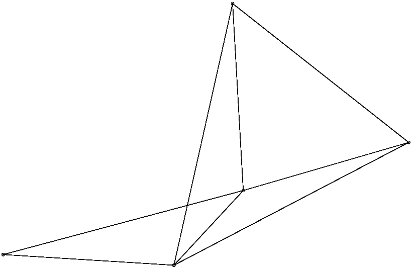

<!-- MERGE-REVIEW: content of the .qmd section 'Moran's I' was inserted at 4 frames; remove the unwanted duplicates. -->

Load required libraries

Creates connection network

Test of Moran's I for 1st PCoA axis

Plot the results

Test of Moran's I for 2nd PCoA axis

```{r}
library("adegenet")
library("spdep")
```

```{r}
hauss_connectivity <- chooseCN(xy = hauss_genind$other$xy, type = 5, d1 = 0, d2 = 1, plot.nb = TRUE, result.type = "listw", edit.nb = FALSE)
hauss_connectivity
```

```{r}
moran.test(x = hauss_pcoa$li[, 1], listw = hauss_connectivity, alternative = "greater", randomisation = TRUE)
hauss_pcoa1_mctest <- moran.mc(x = hauss_pcoa[["li"]][, 1], listw = hauss_connectivity, alternative = "greater", nsim = 1000)
hauss_pcoa1_mctest
```

```{r}
plot(hauss_pcoa1_mctest) # Plot of densitiy of permutations
moran.plot(x = hauss_pcoa$li[, 1], listw = hauss_connectivity) # PC plot
```

```{r}
moran.test(x = hauss_pcoa$li[, 2], listw = hauss_connectivity, alternative = "greater", randomisation = TRUE)
hauss_pcoa2_mctest <- moran.mc(x = hauss_pcoa$li[, 2], listw = hauss_connectivity, alternative = "greater", nsim = 1000)
hauss_pcoa2_mctest
plot(hauss_pcoa2_mctest) # Plot of densitiy of permutations
moran.plot(x = hauss_pcoa[["li"]][, 2], listw = hauss_connectivity) # PC plot
```

### Calculation of Moran's *I* I

```{r}
library(adegenet) # Load required libraries
library(spdep)
# Creates connection network
hauss.connectivity <- chooseCN(xy=hauss.genind$other$xy, type=5, d1=0,
  d2=1, plot.nb=TRUE, result.type="listw", edit.nb=FALSE)
hauss.connectivity
# Test of Moran's I for 1st PCoA axis
# Results can be checked against permuted values of moran.mc()
moran.test(x=hauss.pcoa[["li"]][,1], listw=hauss.connectivity,
  alternative="greater", randomisation=TRUE)
Moran's I test under randomisation
data:  hauss.pcoa$li[, 1]
Moran I statistic standard deviate = -18.514, p-value = 1
alternative hypothesis: greater
sample estimates:
Moran I statistic       Expectation          Variance
    -0.5232003724     -0.0217391304      0.0007336276
```

<!-- MERGE-REVIEW: 1 old code block(s) in TEX frame were dropped in favor of the .qmd section 'Moran's I'. -->

<!-- MERGE-REVIEW: content of the .qmd section 'Moran's I' was inserted at 4 frames; remove the unwanted duplicates. -->

Load required libraries

Creates connection network

Test of Moran's I for 1st PCoA axis

Plot the results

Test of Moran's I for 2nd PCoA axis

```{r}
library("adegenet")
library("spdep")
```

```{r}
hauss_connectivity <- chooseCN(xy = hauss_genind$other$xy, type = 5, d1 = 0, d2 = 1, plot.nb = TRUE, result.type = "listw", edit.nb = FALSE)
hauss_connectivity
```

```{r}
moran.test(x = hauss_pcoa$li[, 1], listw = hauss_connectivity, alternative = "greater", randomisation = TRUE)
hauss_pcoa1_mctest <- moran.mc(x = hauss_pcoa[["li"]][, 1], listw = hauss_connectivity, alternative = "greater", nsim = 1000)
hauss_pcoa1_mctest
```

```{r}
plot(hauss_pcoa1_mctest) # Plot of densitiy of permutations
moran.plot(x = hauss_pcoa$li[, 1], listw = hauss_connectivity) # PC plot
```

```{r}
moran.test(x = hauss_pcoa$li[, 2], listw = hauss_connectivity, alternative = "greater", randomisation = TRUE)
hauss_pcoa2_mctest <- moran.mc(x = hauss_pcoa$li[, 2], listw = hauss_connectivity, alternative = "greater", nsim = 1000)
hauss_pcoa2_mctest
plot(hauss_pcoa2_mctest) # Plot of densitiy of permutations
moran.plot(x = hauss_pcoa[["li"]][, 2], listw = hauss_connectivity) # PC plot
```

### Calculation of Moran's *I* II

```{r}
# Test of Moran's I for 1st PCoA axis
hauss.pcoa1.mctest <- moran.mc(x=hauss.pcoa$li[,1],
  listw=hauss.connectivity, alternative="greater", nsim=1000)
hauss.pcoa1.mctest
# Output:
  Monte-Carlo simulation of Moran I
data:  hauss.pcoa$li[, 1]
weights: hauss.connectivity
number of simulations + 1: 1001
statistic = -0.5163, observed rank = 1, p-value = 0.999
alternative hypothesis: greater
# Plot the results
plot(hauss.pcoa1.mctest) # Plot of densitiy of permutations
moran.plot(x=hauss.pcoa$li[,1], listw=hauss.connectivity) # PC plot
```

<!-- MERGE-REVIEW: 1 old code block(s) in TEX frame were dropped in favor of the .qmd section 'Moran's I'. -->

<!-- MERGE-REVIEW: content of the .qmd section 'Moran's I' was inserted at 4 frames; remove the unwanted duplicates. -->

Load required libraries

Creates connection network

Test of Moran's I for 1st PCoA axis

Plot the results

Test of Moran's I for 2nd PCoA axis

```{r}
library("adegenet")
library("spdep")
```

```{r}
hauss_connectivity <- chooseCN(xy = hauss_genind$other$xy, type = 5, d1 = 0, d2 = 1, plot.nb = TRUE, result.type = "listw", edit.nb = FALSE)
hauss_connectivity
```

```{r}
moran.test(x = hauss_pcoa$li[, 1], listw = hauss_connectivity, alternative = "greater", randomisation = TRUE)
hauss_pcoa1_mctest <- moran.mc(x = hauss_pcoa[["li"]][, 1], listw = hauss_connectivity, alternative = "greater", nsim = 1000)
hauss_pcoa1_mctest
```

```{r}
plot(hauss_pcoa1_mctest) # Plot of densitiy of permutations
moran.plot(x = hauss_pcoa$li[, 1], listw = hauss_connectivity) # PC plot
```

```{r}
moran.test(x = hauss_pcoa$li[, 2], listw = hauss_connectivity, alternative = "greater", randomisation = TRUE)
hauss_pcoa2_mctest <- moran.mc(x = hauss_pcoa$li[, 2], listw = hauss_connectivity, alternative = "greater", nsim = 1000)
hauss_pcoa2_mctest
plot(hauss_pcoa2_mctest) # Plot of densitiy of permutations
moran.plot(x = hauss_pcoa[["li"]][, 2], listw = hauss_connectivity) # PC plot
```

### Moran's *I* for our 1$^{st}$ axis isn't significant

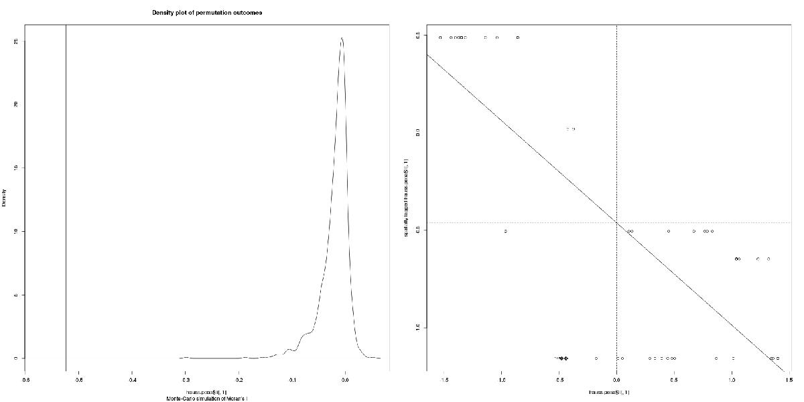

- Tested hypothesis "greater" - **no** significant **positive** autocorrelation
- If testing for hypothesis "less" - significant **negative** autocorrelation - individuals are significantly different <!-- MERGE-REVIEW: no counterpart section found in QMD; content from TEX kept as-is. -->

### Calculation of Moran's *I* (2$^{nd}$ axis)

```{r}
# Test of Moran's I for 2nd PCoA axis
moran.test(x=hauss.pcoa$li[,2], listw=hauss.connectivity,
  alternative="greater", randomisation=TRUE)
hauss.pcoa2.mctest <- moran.mc(x=hauss.pcoa$li[,2],
  listw=hauss.connectivity, alternative="greater", nsim=1000)
hauss.pcoa2.mctest
# Output
Monte-Carlo simulation of Moran's I
data:  hauss.pcoa$li[, 2]
weights: hauss.connectivity
number of simulations + 1: 1001
statistic = 0.0545, observed rank = 1001, p-value = 0.000999
alternative hypothesis: greater
# Plot the results
plot(hauss.pcoa2.mctest) # Plot of densitiy of permutations
moran.plot(x=hauss.pcoa$[,2], listw=hauss.connectivity) # PC plot
```

<!-- MERGE-REVIEW: no counterpart section found in QMD; code below comes from the old TEX version. -->

### Second axis is surprisingly significant

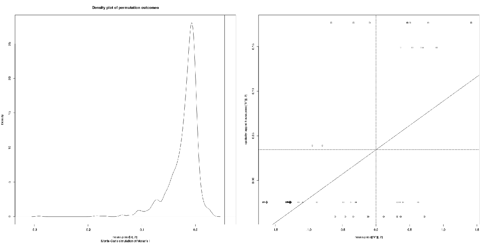

- Tested hypothesis "greater" - there **is** significant positive autocorrelation - individuals are genetically similar over space <!-- MERGE-REVIEW: no counterpart section found in QMD; content from TEX kept as-is. -->

### Reading and limits of Moran's *I*

- 1$^st$ and 2$^nd$ PC axes are orthogonal to each other, so they show different patterns
- Moran's *I* shows single index over all data (whole space), but different processes might be ongoing on large or small scale - commonly negative autocorrelation on large scale (distant individuals are significantly dissimilar) and positive autocorrelation on small scale (individuals, which are close to each other are significantly similar)
- Single number isn't always the best description of complex biological situation...
- Calculations using `moran.test` are done in connectivity network created by `chooseCN` - it's crucial to select connectivity network reflecting biological features of studied species and its geographic situation - different networks lead into different results... <!-- MERGE-REVIEW: no counterpart section found in QMD; content from TEX kept as-is. -->

## sPCA

### Spatial Analysis of Principal Components (sPCA)

- Implemented in adegenet, see `adegenetTutorial("spca")`
- Analyzes matrix of relative allele frequencies of genotypes/populations and spatial weighting matrix
- The geographical matrix is usually (as for Moran's *I*) created by `chooseCN()` - creates connectivity network among entities (genotypes/populations) - spatial coordinates are not directly used
- When using `chooseCN()`, look at the documentation and try various methods with changing settings to see differences

```{r}
data(rupica) # adegenet's toy dataset, Rupicapra rupicapra from French Alps
library(adespatial) # Part of sPCA calculations are in adespatial
# Try various settings for chooseCN (type=X) - type 1-4 as there
# are identical coordinates (multiple sampling from same locality)
?chooseCN # See for more details - select the best "type" for your data
chooseCN(xy=rupica$other$xy, ask=TRUE, type=5/6/7, plot.nb=TRUE,
  edit.nb=FALSE, ...) # Task: play with settings little bit...
```

<!-- MERGE-REVIEW: no counterpart section found in QMD; code below comes from the old TEX version. -->

### Calculations of sPCA

```{r}
hauss.spca <- spca(obj=hauss.genind, cn=hauss.connectivity,
  scale=TRUE, scannf=TRUE)
# Plot eigenvalues of sPCA - global vs. local structure
barplot(height=hauss.spca$eig, main="Eigenvalues of sPCA",
  col=spectral(length(hauss.spca$eig)))
legend("topright", fill=spectral(2), leg=c("Global structures",
  "Local structures")) # Add legend
abline(h=0, col="gray") # Add line showing zero
print.spca(hauss.spca) # Information about sPCA
summary.spca(hauss.spca) # Summary of sPCA results
# Shows connectivity network, 3 different scores
# barplot of eigenvalues and eigenvalues decomposition
plot.spca(hauss.spca)
colorplot.spca(hauss.spca, cex=3) # Display of scores in color canals
title("sPCA - colorplot of PC 1 and 2 (lagged scores)", line=1, cex=1.5)
# Spatial and variance components of the eigenvalues
screeplot.spca(x=hauss.spca, main=NULL)
```

<!-- MERGE-REVIEW: no counterpart section found in QMD; code below comes from the old TEX version. -->

### sPCA outputs

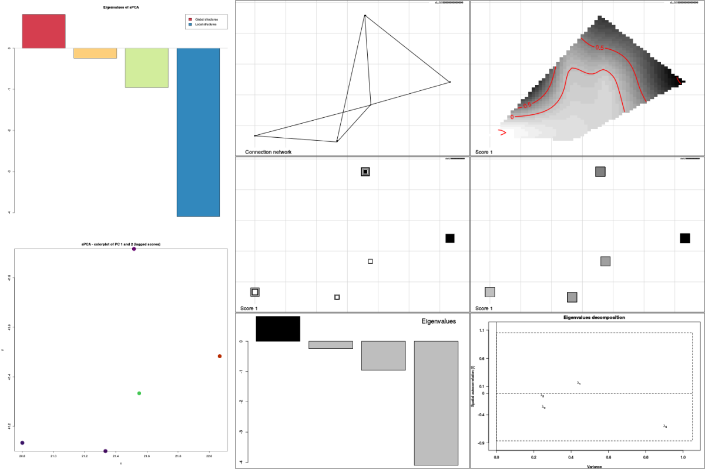

Explore various networks

Part of sPCA calculations are in adespatial package, load it

Try various settings for chooseCN (type = X) - type 1-4 as there are identical coordinates (multiple sampling from same locality)

Calculates sPCA - here is only 1 positive and 3 negative factors

Plot eigenvalues of sPCA - gobal vs. local structure

Information about sPCA

Summary of sPCA results

Shows connectivity network, 3 different scores, barplot of eigenvalues and eigenvalues decomposition

Display of scores in color canals (two analogous variants)

Spatial and variance components of the eigenvalues

Test if global/local structure is significant

```{r}
data(rupica)
```

```{r}
library("adespatial")
```

```{r}
?chooseCN # See for more details - select the best "type"for your data
chooseCN(xy = rupica$other$xy, ask = TRUE, type = 5 / 6 / 7, plot.nb = TRUE, edit.nb = FALSE, ...) # Task: play with settings little bit...
```

```{r}
hauss_spca <- spca(obj = hauss_genind, cn = hauss_connectivity, scale = TRUE, scannf = TRUE)
```

```{r}
barplot(height = hauss_spca$eig, main = "Eigenvalues of sPCA", col = spectral(length(hauss_spca[["eig"]])))
legend("topright", fill = spectral(2), legend = c("Global structures", "Local structures")) # Add legend
abline(h = 0, col = "grey") # Add line showing zero
```

```{r}
print.spca(hauss_spca)
```

```{r}
summary.spca(hauss_spca)
```

```{r}
plot.spca(hauss_spca)
```

```{r}
colorplot.spca(hauss_spca, cex = 3)
title("sPCA - colorplot of PC 1 and 2 (lagged scores)", line = 1, cex = 1.5)
colorplot(x = hauss_genind$other$xy, hauss_spca$ls, axes = seq_along(hauss_spca$li), cex = 3)
title("sPCA - colorplot of PC 1 and 2 (lagged scores)", line = 1, cex = 1.5)
```

```{r}
screeplot.spca(x = hauss_spca, main = NULL)
```

```{r}
hauss_spca_glo <- global.rtest(X = hauss_genind$tab, listw = hauss_spca$lw, nperm = 999)
hauss_spca_glo
plot(hauss_spca_glo)
hauss_spca_loc <- local.rtest(X = hauss_genind$tab, listw = hauss_spca$lw, nperm = 999)
hauss_spca_loc
plot(hauss_spca_loc)

```

```{=html}
<!--
# TODO Map of genetic clines
library("akima") # This library is needed for some manipulation with coordinates
hauss_spca_temp <- interp(other(hauss_genind)$xy[, 1], other(hauss_genind)$xy[, 2], hauss_spca$ls[, 1], xo = seq(min(other(hauss_genind)$xy[, 1]), max(other(hauss_genind)$xy[, 1]), le = 200), yo = seq(min(other(hauss_genind)$xy[, 2]), max(other(hauss_genind)$xy[, 2]), le = 200), duplicate = "median")
# For 1st axis
image(x = hauss_spca_temp, col = spectral(100))
s.value(dfxy = hauss_genind$other$xy, z = hauss_pcoa$li[, 1], add.p = TRUE, csize = 0.5, sub = "PCoA - first PC", csub = 2, possub = "topleft")
# For 2nd axis
image(x = hauss_spca_temp, col = spectral(100))
s.value(dfxy = hauss_genind$other$xy, z = hauss_pcoa[["li"]][, 2], add.p = TRUE, csize = 0.5, sub = "PCoA - second PC", csub = 2, possub = "topleft")
# Interpolated lagged score on a map
hauss_spca_annot <- function() {
    title("sPCA - interpolated map of individual scores")
    points(other(hauss_genind)$xy[, 1], other(hauss_genind)$xy[, 2])
    }
filled.contour(hauss_spca_temp, color.pal = colorRampPalette(lightseasun(100)), pch = 20, nlevels = 100, key.title = title("Lagged\nscore 1"), plot.title = hauss_spca_annot())

Loading plots - which alleles contribute the most?
-->
```

```{r}
hauss_spca_loadings <- hauss_spca$c1[, 1]^2
names(hauss_spca_loadings) <- rownames(hauss_spca$c1)
loadingplot(x = hauss_spca_loadings, xlab = "Alleles", ylab = "Weight of the alleles", main = "Contribution of alleles to the first sPCA axis")
boxplot(formula = hauss_spca_loadings ~ hauss_genind$loc.fac, las = 3, ylab = "Contribution", xlab = "Marker", main = "Contribution by markers into the first global score", col = "gray")
```

### Test if global/local structure is significant

```{r}
hauss.spca.glo <- global.rtest(X=hauss.genind$tab, listw=hauss.spca$lw,
  nperm=999)
hauss.spca.glo
plot(hauss.spca.glo)
hauss.spca.loc <- local.rtest(X=hauss.genind$tab, listw=hauss.spca$lw,
  nperm=999)
hauss.spca.loc
plot(hauss.spca.loc)
```

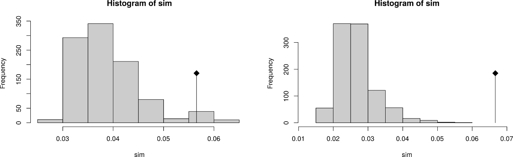 <!-- MERGE-REVIEW: no counterpart section found in QMD; code below comes from the old TEX version. -->

### Map of genetic clines

```{=html}
<!--
TODO Genetic clines
    @@TOKEN0@@

-->
```

<!-- MERGE-REVIEW: no counterpart section found in QMD; content from TEX kept as-is. -->

### sPCA outputs II

```{=html}
<!--
    @@TOKEN0@@
    \begin{center}
        \includegraphics[width=\textwidth-6cm]{spca-pc.png}
    \end{center}

-->
```

<!-- MERGE-REVIEW: no counterpart section found in QMD; content from TEX kept as-is. -->

### Loading plots - which alleles contribute the most?

```{r}
hauss.spca.loadings <- hauss.spca[["c1"]][,1]^2
names(hauss.spca.loadings) <- rownames(hauss.spca$c1)
loadingplot(x=hauss.spca.loadings, xlab="Alleles", ylab="Weight of the
  alleles", main="Contribution of alleles to the first sPCA axis")
boxplot(formula=hauss.spca.loadings~hauss.genind$loc.fac, las=3,
  ylab="Contribution", xlab="Marker", main="Contribution by markers into
  the first global score", col="gray")
```

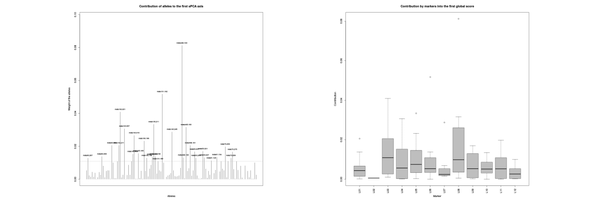 <!-- MERGE-REVIEW: no counterpart section found in QMD; code below comes from the old TEX version. -->

## Mantel test

### Mantel test

- Originally created for biomedicine to test correlation between treatment and diseases
- It is universal method usable for plenty of tasks
- "Only" correlation of two matrices - no biologically relevant underlying model - because of that it is heavily criticized (mainly in ecology)
- Test of spatial and genetic relationships is probably one of few biologically relevant applications
- Package [vegan](https://CRAN.R-project.org/package=vegan) (set of ecological tools) has implementation to test genetic similarity in various distance classes - not only overall result - very useful
- Distance matrix can be calculated as simple Euclidean geometric distance by `dist()`, or for larger areas by geodesic distance along Earth surface (e.g. `pegas::geod()`), or using special package like [geosphere](https://CRAN.R-project.org/package=geosphere)

```{r}
library(pegas) # Geodesic distance
```

<!-- MERGE-REVIEW: no counterpart section found in QMD; code below comes from the old TEX version. -->

### Mantel test - isolation by distance

```{r}
# Geographical distance
hauss.gdist <- as.dist(m=geod(lon=hauss.genind$other$xy$lon,
  lat=hauss.genind$other$xy$lat), diag=TRUE, upper=TRUE)
# Mantel test
hauss.mantel <- mantel.randtest(m1=hauss.dist,m2=hauss.gdist, nrepet=1000)
hauss.mantel # See text output
plot(hauss.mantel, nclass=30)
# Libraries required by mantel.correlog:
library(permute)
library(lattice)
library(vegan)
# Different implementation of Mantel test testing distance classes
hauss.mantel.cor <- mantel.correlog(D.eco=hauss.dist, D.geo=hauss.gdist,
  XY=NULL, n.class=0, break.pts=NULL, cutoff=FALSE, r.type="pearson",
  nperm=1000, mult="holm", progressive=TRUE)
hauss.mantel.cor # See results for respective classes
summary(hauss.mantel.cor)
```

<!-- MERGE-REVIEW: 1 old code block(s) in TEX frame were dropped in favor of the .qmd section 'Mantel test - isolation by distance'. -->

Geodesic distance

Geographical distance

Mantel test

Libraries required by mantel.correlog:

Different implementation of Mantel test testing distance classes

See results for respective classes

Plot it

```{r}
library("pegas")
```

```{r}
hauss_gdist <- as.dist(m = geod(lon = hauss_genind$other$xy$lon, lat = hauss_genind$other$xy$lat), diag = TRUE, upper = TRUE)
```

```{r}
hauss_mantel <- mantel.randtest(m1 = hauss_dist, m2 = hauss_gdist, nrepet = 1000)
hauss_mantel # See text output
plot(hauss_mantel, nclass = 30)
```

```{r}
library("permute")
library("lattice")
library("vegan")
```

```{r}
hauss_mantel_cor <- mantel.correlog(D.eco = hauss_dist, D.geo = hauss_gdist, XY = NULL, n.class = 0, break.pts = NULL, cutoff = FALSE, r.type = "pearson", nperm = 1000, mult = "holm", progressive = TRUE)
```

```{r}
hauss_mantel_cor
summary(hauss_mantel_cor)
```

```{r}
plot(hauss_mantel_cor)
```

### Mantel test outputs - strongly significant

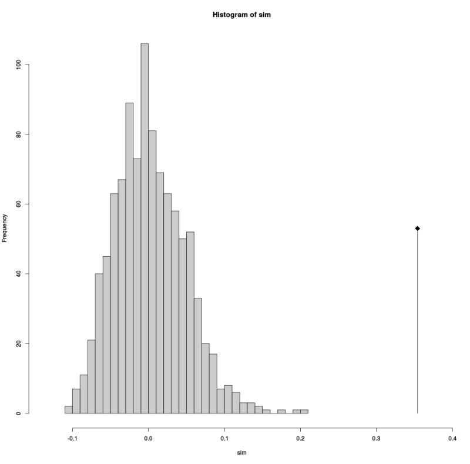

```{r}
hauss.mantel # See output
Monte-Carlo test
Call: mantel.randtest(m1 =
  hauss.dist, m2 =
  hauss.gdist, nrepet = 1000)
Observation: 0.35409
Based on 1000 replicates
Simulated p-value: 0.000999001
Alternative hypothesis: greater
   Std.Obs Expectation  Variance
7.61967545 0.001687140 0.0021389
```

```{r}
# Plot correlogram (next slide)
plot(hauss.mantel.cor)
```

<!-- MERGE-REVIEW: no counterpart section found in QMD; code below comes from the old TEX version. -->

### Plot of Mantel Correlogram Analysis

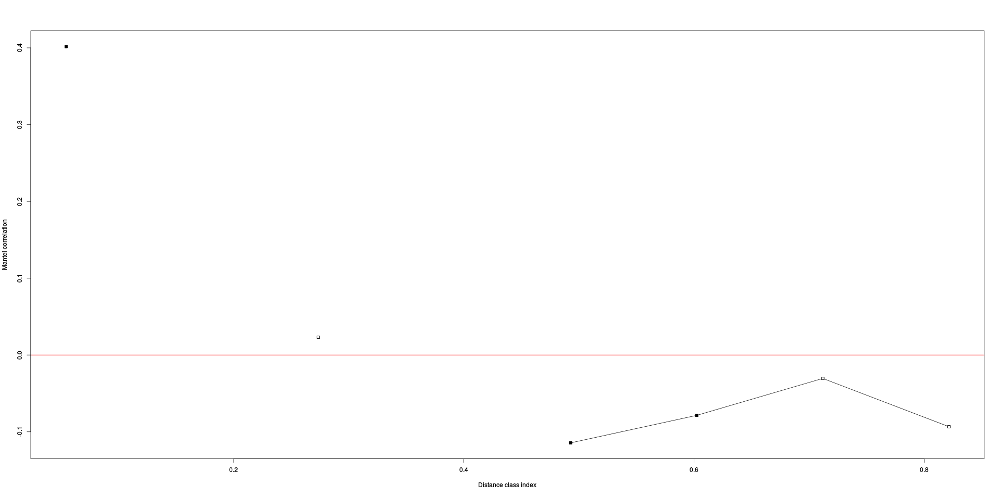

Correlation (genetic similarity) in several distance classes (positive **\[up\]** in short distance **\[left\]**, negative **\[down\]** in long **\[right\]**; **\[full\]** - significant, **\[empty\]** - not significant) - see `?mantel.correlog` for details <!-- MERGE-REVIEW: no counterpart section found in QMD; content from TEX kept as-is. -->

### Mantel correlogram - text output

```{r}
hauss.mantel.cor # See the text output:
Mantel Correlogram Analysis
Call:
mantel.correlog(D.eco = hauss.dist, D.geo = hauss.gdist, XY = NULL,
  n.class = 0, break.pts = NULL, cutoff = FALSE, r.type = "pearson",
  nperm = 1000, mult = "holm", progressive = TRUE)
        class.index     n.dist Mantel.cor Pr(Mantel) Pr(corrected)
D.cl.1     4.697165 532.000000   0.400101     0.0010      0.000999 ***
D.cl.2    14.091494   0.000000         NA         NA            NA
D.cl.3    23.485823   0.000000         NA         NA            NA
D.cl.4    32.880153  52.000000   0.079433     0.0490      0.048951 *
D.cl.5    42.274482 466.000000  -0.128236     0.0010      0.002997 **
D.cl.6    51.668811   0.000000         NA         NA            NA
D.cl.7    61.063140  36.000000  -0.027890     0.2547      0.254745
   ...          ...        ...        ...        ...           ...
---
Signif. codes:  0 ‘***’ 0.001 ‘**’ 0.01 ‘*’ 0.05 ‘.’ 0.1 ‘ ’ 1
```

<!-- MERGE-REVIEW: no counterpart section found in QMD; code below comes from the old TEX version. -->

## Monmonier

### Monmonier's algorithm - genetic boundaries

- Finds boundaries of maximum differences between contiguous polygons of a tessellation
- Detects genetic boundaries among georeferenced genotypes (or populations)
- For more information see `adegenetTutorial("basics")`
- Requires every point to have unique coordinates - in case of population data it is better to work with populations, not individuals (but it is not ideal)
- It uses [Voronoi tessellation](https://en.wikipedia.org/wiki/Voronoi_diagram) - it is used by a lot of spatial analysis, especially by tools relying on Bayesian statistics (like Geneland, slide )

```{r}
# Calculates Monmonier's function (for threshold use 'd')
hauss.monmonier <- monmonier(xy=hauss.genpop$other$xy, dist=rogers.dist
  (x=hauss.genpop), cn=chooseCN(hauss.genpop$other$xy, ask=FALSE, type=6,
  k=2, plot.nb=FALSE, edit.nb=FALSE), nrun=1)
coords.monmonier(hauss.monmonier) # See result as text
```

<!-- MERGE-REVIEW: 1 old code block(s) in TEX frame were dropped in favor of the .qmd section 'Monmonier - genetic boundaries'. -->

<!-- MERGE-REVIEW: content of the .qmd section 'Monmonier - genetic boundaries' was inserted at 3 frames; remove the unwanted duplicates. -->

It requires every point to have unique coordinates (one can use jitter() or difference in scale of meters). Example here is on population level, which is not ideal. Calculates Monmonier's function (for threshold use 'd')

Plot genetic boundaries

For plotting see

```{r}
hauss_monmonier <- monmonier(xy = hauss_genpop$other$xy, dist = rogers.dist(x = hauss_genpop), cn = chooseCN(hauss_genpop$other$xy, ask = FALSE, type = 6, k = 2, plot.nb = FALSE, edit.nb = FALSE), nrun = 1)
coords.monmonier(hauss_monmonier) # See result as text
```

```{r}
plot.monmonier(hauss_monmonier, add.arrows = FALSE, bwd = 10, sub = "Monmonier plot", csub = 2)
points(hauss_genpop$other$xy, cex = 2.5, pch = 20, col = "red")
text(x = hauss_genpop$other$xy$lon, y = hauss_genpop$other$xy$lat, labels = popNames(hauss_genpop), cex = 3)
legend("bottomright", legend = "Genetic boundaries\namong populations")
```

```{r}
?points
?text
?legend
```

### Voronoi tessellation

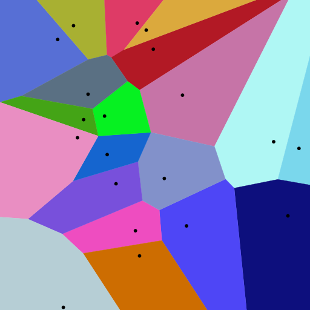

- In simplest case, all points have certain area and all points within this area are closer to the respective "main" point than to any other "neighbor" point
- Extreme differences among size of areas make computational problems and results are unstable - this typically occurs when calculations are done on individual level and there are large distances among populations
- The more similar sizes of polygons and the more even distribution of samples, the more stable and reliable results we get <!-- MERGE-REVIEW: no counterpart section found in QMD; content from TEX kept as-is. -->

### Plot genetic boundaries

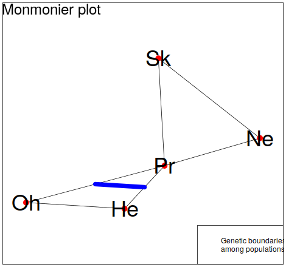

```{r}
plot.monmonier(hauss.monmonier,
  add.arrows=FALSE, bwd=10,
  sub="Monmonier plot", csub=2)
points(hauss.genpop$other$xy,
  cex=2.5, pch=20, col="red")
text(x=hauss.genpop$other$xy$lon,
  y=hauss.genpop$other$xy$lat,
  labels=popNames(hauss.genpop),
  cex=3)
legend("bottomright",
  leg="Genetic boundaries\n
  among populations")
# For plotting see
?points
?text
?legend
```

<!-- MERGE-REVIEW: 1 old code block(s) in TEX frame were dropped in favor of the .qmd section 'Monmonier - genetic boundaries'. -->

<!-- MERGE-REVIEW: content of the .qmd section 'Monmonier - genetic boundaries' was inserted at 3 frames; remove the unwanted duplicates. -->

It requires every point to have unique coordinates (one can use jitter() or difference in scale of meters). Example here is on population level, which is not ideal. Calculates Monmonier's function (for threshold use 'd')

Plot genetic boundaries

For plotting see

```{r}
hauss_monmonier <- monmonier(xy = hauss_genpop$other$xy, dist = rogers.dist(x = hauss_genpop), cn = chooseCN(hauss_genpop$other$xy, ask = FALSE, type = 6, k = 2, plot.nb = FALSE, edit.nb = FALSE), nrun = 1)
coords.monmonier(hauss_monmonier) # See result as text
```

```{r}
plot.monmonier(hauss_monmonier, add.arrows = FALSE, bwd = 10, sub = "Monmonier plot", csub = 2)
points(hauss_genpop$other$xy, cex = 2.5, pch = 20, col = "red")
text(x = hauss_genpop$other$xy$lon, y = hauss_genpop$other$xy$lat, labels = popNames(hauss_genpop), cex = 3)
legend("bottomright", legend = "Genetic boundaries\namong populations")
```

```{r}
?points
?text
?legend
```

### Monmonier notes

- Sometimes it is needed to get rid of (random) noise in data. To do so use as parameter `dist` of `monmonier()` table from PCA (`pcaObject$li`) by something like:

```{r}
monmonier(..., dist=dudi.pco(d=dist.gene(x=GenindObject$tab),
  scannf=FALSE, nf=1)$li, ...)
```

- Generally (when dataset is bigger and more diverse) it is recommended to run it several times (parameter `nrun`) - there will be several iterations
- When running `monmonier(...)` when it asks for threshold of sorted local distances, try several values and see differences in output
- See `?plot.monmonier` for various graphical parameters to customize the plot
- Use `points()` to add for example colored symbols of samples and/or `text()` to add text labels <!-- MERGE-REVIEW: 1 old code block(s) in TEX frame were dropped in favor of the .qmd section 'Monmonier - genetic boundaries'. -->

<!-- MERGE-REVIEW: content of the .qmd section 'Monmonier - genetic boundaries' was inserted at 3 frames; remove the unwanted duplicates. -->

It requires every point to have unique coordinates (one can use jitter() or difference in scale of meters). Example here is on population level, which is not ideal. Calculates Monmonier's function (for threshold use 'd')

Plot genetic boundaries

For plotting see

```{r}
hauss_monmonier <- monmonier(xy = hauss_genpop$other$xy, dist = rogers.dist(x = hauss_genpop), cn = chooseCN(hauss_genpop$other$xy, ask = FALSE, type = 6, k = 2, plot.nb = FALSE, edit.nb = FALSE), nrun = 1)
coords.monmonier(hauss_monmonier) # See result as text
```

```{r}
plot.monmonier(hauss_monmonier, add.arrows = FALSE, bwd = 10, sub = "Monmonier plot", csub = 2)
points(hauss_genpop$other$xy, cex = 2.5, pch = 20, col = "red")
text(x = hauss_genpop$other$xy$lon, y = hauss_genpop$other$xy$lat, labels = popNames(hauss_genpop), cex = 3)
legend("bottomright", legend = "Genetic boundaries\namong populations")
```

```{r}
?points
?text
?legend
```

## Geneland

### About Geneland

- For installation see slide
- Works with haploid and diploid co-dominant markers (microsatellites or SNPs)
- Spatially explicit Bayesian clustering
- Produces maps of distribution of inferred genetic clusters
- Relative complicated tool with various modeling options
- For more information see <https://github.com/gilles-guillot/Geneland>

```{r}
# Load needed libraries
library(PBSmapping) # Required to transform coordinates
library(Geneland)
# Graphical interface is available, we will use only command line...
Geneland.GUI()
```

<!-- MERGE-REVIEW: 1 old code block(s) in TEX frame were dropped in favor of the .qmd section 'Geneland'. -->

<!-- MERGE-REVIEW: content of the .qmd section 'Geneland' was inserted at 2 frames; remove the unwanted duplicates. -->

Haploid and diploid codominant markers (microsattelites or SNPs) Load needed libraries

Graphical interface available for Geneland - we will use only command line

Loading and conversions of coordinates - Geneland requires specific coordinate space

Load data (only haploid or diploid data are supported) - only plain table with alleles

Set number of independent runs For real data use rather 10 or more

Set length of burnin chain For real data use ca. 20-25% of hauss_geneland_nit - is it is e.g. 5000000, set here at least 1000000

Set maximal K (number of populations) Use some value relevant from point of view of number of sampling sites etc.

In practice set much higher number of iterations (nit, millions), appropriate sampling (thinning, thousands) and longer burnin Number of iterations (MCMC steps) For real data use millions

Sampling (thinning) For real data, if hauss_geneland_nit is e.g. 5000000, use ca. 1000-10000

FOR loop will run several independent runs and produce output maps of genetic clusters - outputs are written into subdirectory within geneland directory

Prepare list to record values of Fst for all runs

Estimate Fst

Print Fst output

Estimate frequencies of null alleles

See output

Calculate average posterior probability

Sorts runs according to decreasing posterior probability - the first one is the best

```{r}
library("PBSmapping") # Required to transform coordinates
library("Geneland")
```

```{r}
Geneland.GUI()
```

```{r}
hauss_geneland_coord <- as.matrix(hauss_coord) # hauss_cord is DF, we need just plain matrix
colnames(hauss_geneland_coord) <- c("X", "Y")
attr(hauss_geneland_coord, "projection") <- "LL"
attr(hauss_geneland_coord, "zone") <- NA
hauss_geneland_coord_utm <- convUL(hauss_geneland_coord)
dim(hauss_geneland_coord)
hauss_geneland_coord
dim(hauss_geneland_coord_utm)
hauss_geneland_coord_utm # Final coordinates
```

```{r}
hauss_geneland_data <- read.table(file = "https://soubory.trapa.cz/rcourse/haussknechtii_geneland.txt", na.strings = "-999", header = FALSE, sep = "\t")
dim(hauss_geneland_data)
hauss_geneland_data
```

```{r}
hauss_geneland_nrun <- 5
```

```{r}
hauss_geneland_burnin <- 100
```

```{r}
hauss_geneland_maxpop <- 10
```

```{r}
hauss_geneland_nit <- 10000
```

```{r}
hauss_geneland_thinning <- 10
```

```{r}
for (hauss_geneland_irun in 1:hauss_geneland_nrun) {
  hauss_geneland_path_mcmc <- paste("geneland/", hauss_geneland_irun, "/", sep = "") # paste is good especially for joining several text chains into one
  # On Windows, remove following line and create subdirectories from 1 to max K manually (creating subdirs in Windows in R is complicated)
  system(paste("mkdir ", hauss_geneland_path_mcmc)) # Creates subdirectory
  # Inferrence - MCMC chain - see ?MCMC for details
  MCMC(coordinates = hauss_geneland_coord_utm, geno.dip.codom = hauss_geneland_data, path.mcmc = hauss_geneland_path_mcmc, delta.coord = 0.001, varnpop = TRUE, npopmin = 1, npopmax = hauss_geneland_maxpop, nit = hauss_geneland_nit, thinning = hauss_geneland_thinning, freq.model = "Uncorrelated", spatial = TRUE)
  # Post-process chains
  PostProcessChain(coordinates = hauss_geneland_coord_utm, path.mcmc = hauss_geneland_path_mcmc, nxdom = 500,    # Output
  # Simulated number of populations
  Plotnpop(path.mcmc = hauss_geneland_path_mcmc, printit = TRUE, file = paste(hauss_geneland_path_mcmc, "/geneland-number_of_clusters.pdf", sep = ""), format = "pdf", burnin = hauss_geneland_burnin)
  dev.off() # We must close graphical device manually
  # Map of estimated population membership
  PosteriorMode(coordinates = hauss_geneland_coord_utm, path.mcmc = hauss_geneland_path_mcmc, printit = TRUE, format = "pdf", file = paste(hauss_geneland_path_mcmc, "/geneland-map.pdf", sep = ""))
  dev.off() # We must close graphical device manually
}
```

```{r}
hauss_geneland_fstat <- list()
```

```{r}
for (hauss_geneland_irun in 1:hauss_geneland_nrun) {
  hauss_geneland_path_mcmc <- paste("geneland/", hauss_geneland_irun, "/", sep = "")
  # F-statistics - Fis and Fst
  hauss_geneland_fstat[[hauss_geneland_irun]] <- Fstat.output(coordinates = hauss_geneland_coord_utm, genotypes = hauss_geneland_data, burnin = hauss_geneland_burnin, ploidy = 2, path.mcmc = hauss_geneland_path_mcmc)
}
```

```{r}
hauss_geneland_fstat
```

```{=html}
<!--
# TODO MCMC inference under the admixture model
for (hauss_geneland_irun in 1:hauss_geneland_nrun) {
    hauss_geneland_path_mcmc <- paste("geneland/", hauss_geneland_irun, "/", sep = "")
    hauss_geneland_path_mcmc.adm <- paste(hauss_geneland_path_mcmc, "admixture", "/", sep = "")
    # On Windows, remove following line of code and create in each result directory (from 1 to max K) new subdirectory "admixture"(creating subdirs in Windows in R is complicated)
    system(paste("mkdir ", hauss_geneland_path_mcmc.adm))
    HZ(coordinates = hauss_geneland_coord_utm, geno.dip.codom = hauss_geneland_data, path.mcmc.noadm = hauss_geneland_path_mcmc, nit = hauss_geneland_nit, thinning = hauss_geneland_thinning, path.mcmc.adm = hauss_geneland_path_mcmc.adm)
    }
Produce maps of respective inferred clusters
-->
```

```{r}
for (hauss_geneland_irun in 1:hauss_geneland_nrun) {
  hauss_geneland_path_mcmc <- paste("geneland/", hauss_geneland_irun, "/", sep = "")
  # Maps - tesselations
  PlotTessellation(coordinates = hauss_geneland_coord_utm, path.mcmc = hauss_geneland_path_mcmc, printit = TRUE, path = hauss_geneland_path_mcmc)
  for (hauss_geneland_irun_img in 1:hauss_geneland_maxpop) {
    dev.off()
  } # We must close graphical device manually
}
```

```{r}
hauss_geneland_fna <- list()
for (hauss_geneland_irun in 1:hauss_geneland_nrun) {
  hauss_geneland_path_mcmc <- paste("geneland/", hauss_geneland_irun, "/", sep = "")
  # Estimation
  hauss_geneland_fna[[hauss_geneland_irun]] <- EstimateFreqNA(path.mcmc = hauss_geneland_path_mcmc)
}
```

```{r}
hauss_geneland_fna
```

```{r}
hauss_geneland_lpd <- rep(NA, hauss_geneland_nrun)
for (hauss_geneland_irun in 1:hauss_geneland_nrun) {
  hauss_geneland_path_mcmc <- paste("geneland/", hauss_geneland_irun, "/", sep = "")
  hauss_geneland_path_lpd <- paste(hauss_geneland_path_mcmc, "log.posterior.density.txt", sep = "")
  hauss_geneland_lpd[hauss_geneland_irun] <- mean(scan(hauss_geneland_path_lpd)[-(1:hauss_geneland_burnin)])
}
```

```{r}
order(hauss_geneland_lpd, decreasing = TRUE)
hauss_geneland_lpd
```

### Geneland GUI

- Some tasks are easier in GUI, some in command line...

- Command line is great for its repeatability...

- Always read manual! It is not the simplest tool...

  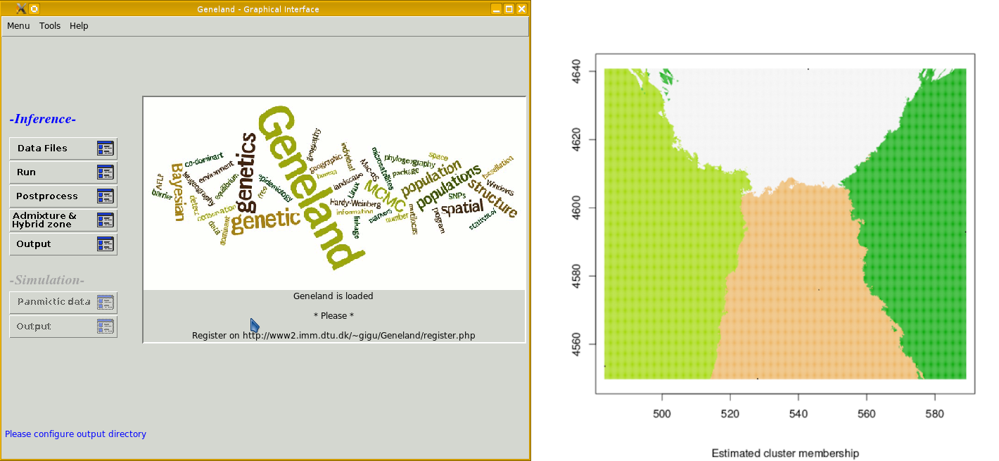

<!-- MERGE-REVIEW: content of the .qmd section 'Geneland' was inserted at 2 frames; remove the unwanted duplicates. -->

Haploid and diploid codominant markers (microsattelites or SNPs) Load needed libraries

Graphical interface available for Geneland - we will use only command line

Loading and conversions of coordinates - Geneland requires specific coordinate space

Load data (only haploid or diploid data are supported) - only plain table with alleles

Set number of independent runs For real data use rather 10 or more

Set length of burnin chain For real data use ca. 20-25% of hauss_geneland_nit - is it is e.g. 5000000, set here at least 1000000

Set maximal K (number of populations) Use some value relevant from point of view of number of sampling sites etc.

In practice set much higher number of iterations (nit, millions), appropriate sampling (thinning, thousands) and longer burnin Number of iterations (MCMC steps) For real data use millions

Sampling (thinning) For real data, if hauss_geneland_nit is e.g. 5000000, use ca. 1000-10000

FOR loop will run several independent runs and produce output maps of genetic clusters - outputs are written into subdirectory within geneland directory

Prepare list to record values of Fst for all runs

Estimate Fst

Print Fst output

Estimate frequencies of null alleles

See output

Calculate average posterior probability

Sorts runs according to decreasing posterior probability - the first one is the best

```{r}
library("PBSmapping") # Required to transform coordinates
library("Geneland")
```

```{r}
Geneland.GUI()
```

```{r}
hauss_geneland_coord <- as.matrix(hauss_coord) # hauss_cord is DF, we need just plain matrix
colnames(hauss_geneland_coord) <- c("X", "Y")
attr(hauss_geneland_coord, "projection") <- "LL"
attr(hauss_geneland_coord, "zone") <- NA
hauss_geneland_coord_utm <- convUL(hauss_geneland_coord)
dim(hauss_geneland_coord)
hauss_geneland_coord
dim(hauss_geneland_coord_utm)
hauss_geneland_coord_utm # Final coordinates
```

```{r}
hauss_geneland_data <- read.table(file = "https://soubory.trapa.cz/rcourse/haussknechtii_geneland.txt", na.strings = "-999", header = FALSE, sep = "\t")
dim(hauss_geneland_data)
hauss_geneland_data
```

```{r}
hauss_geneland_nrun <- 5
```

```{r}
hauss_geneland_burnin <- 100
```

```{r}
hauss_geneland_maxpop <- 10
```

```{r}
hauss_geneland_nit <- 10000
```

```{r}
hauss_geneland_thinning <- 10
```

```{r}
for (hauss_geneland_irun in 1:hauss_geneland_nrun) {
  hauss_geneland_path_mcmc <- paste("geneland/", hauss_geneland_irun, "/", sep = "") # paste is good especially for joining several text chains into one
  # On Windows, remove following line and create subdirectories from 1 to max K manually (creating subdirs in Windows in R is complicated)
  system(paste("mkdir ", hauss_geneland_path_mcmc)) # Creates subdirectory
  # Inferrence - MCMC chain - see ?MCMC for details
  MCMC(coordinates = hauss_geneland_coord_utm, geno.dip.codom = hauss_geneland_data, path.mcmc = hauss_geneland_path_mcmc, delta.coord = 0.001, varnpop = TRUE, npopmin = 1, npopmax = hauss_geneland_maxpop, nit = hauss_geneland_nit, thinning = hauss_geneland_thinning, freq.model = "Uncorrelated", spatial = TRUE)
  # Post-process chains
  PostProcessChain(coordinates = hauss_geneland_coord_utm, path.mcmc = hauss_geneland_path_mcmc, nxdom = 500,    # Output
  # Simulated number of populations
  Plotnpop(path.mcmc = hauss_geneland_path_mcmc, printit = TRUE, file = paste(hauss_geneland_path_mcmc, "/geneland-number_of_clusters.pdf", sep = ""), format = "pdf", burnin = hauss_geneland_burnin)
  dev.off() # We must close graphical device manually
  # Map of estimated population membership
  PosteriorMode(coordinates = hauss_geneland_coord_utm, path.mcmc = hauss_geneland_path_mcmc, printit = TRUE, format = "pdf", file = paste(hauss_geneland_path_mcmc, "/geneland-map.pdf", sep = ""))
  dev.off() # We must close graphical device manually
}
```

```{r}
hauss_geneland_fstat <- list()
```

```{r}
for (hauss_geneland_irun in 1:hauss_geneland_nrun) {
  hauss_geneland_path_mcmc <- paste("geneland/", hauss_geneland_irun, "/", sep = "")
  # F-statistics - Fis and Fst
  hauss_geneland_fstat[[hauss_geneland_irun]] <- Fstat.output(coordinates = hauss_geneland_coord_utm, genotypes = hauss_geneland_data, burnin = hauss_geneland_burnin, ploidy = 2, path.mcmc = hauss_geneland_path_mcmc)
}
```

```{r}
hauss_geneland_fstat
```

```{=html}
<!--
# TODO MCMC inference under the admixture model
for (hauss_geneland_irun in 1:hauss_geneland_nrun) {
    hauss_geneland_path_mcmc <- paste("geneland/", hauss_geneland_irun, "/", sep = "")
    hauss_geneland_path_mcmc.adm <- paste(hauss_geneland_path_mcmc, "admixture", "/", sep = "")
    # On Windows, remove following line of code and create in each result directory (from 1 to max K) new subdirectory "admixture"(creating subdirs in Windows in R is complicated)
    system(paste("mkdir ", hauss_geneland_path_mcmc.adm))
    HZ(coordinates = hauss_geneland_coord_utm, geno.dip.codom = hauss_geneland_data, path.mcmc.noadm = hauss_geneland_path_mcmc, nit = hauss_geneland_nit, thinning = hauss_geneland_thinning, path.mcmc.adm = hauss_geneland_path_mcmc.adm)
    }
Produce maps of respective inferred clusters
-->
```

```{r}
for (hauss_geneland_irun in 1:hauss_geneland_nrun) {
  hauss_geneland_path_mcmc <- paste("geneland/", hauss_geneland_irun, "/", sep = "")
  # Maps - tesselations
  PlotTessellation(coordinates = hauss_geneland_coord_utm, path.mcmc = hauss_geneland_path_mcmc, printit = TRUE, path = hauss_geneland_path_mcmc)
  for (hauss_geneland_irun_img in 1:hauss_geneland_maxpop) {
    dev.off()
  } # We must close graphical device manually
}
```

```{r}
hauss_geneland_fna <- list()
for (hauss_geneland_irun in 1:hauss_geneland_nrun) {
  hauss_geneland_path_mcmc <- paste("geneland/", hauss_geneland_irun, "/", sep = "")
  # Estimation
  hauss_geneland_fna[[hauss_geneland_irun]] <- EstimateFreqNA(path.mcmc = hauss_geneland_path_mcmc)
}
```

```{r}
hauss_geneland_fna
```

```{r}
hauss_geneland_lpd <- rep(NA, hauss_geneland_nrun)
for (hauss_geneland_irun in 1:hauss_geneland_nrun) {
  hauss_geneland_path_mcmc <- paste("geneland/", hauss_geneland_irun, "/", sep = "")
  hauss_geneland_path_lpd <- paste(hauss_geneland_path_mcmc, "log.posterior.density.txt", sep = "")
  hauss_geneland_lpd[hauss_geneland_irun] <- mean(scan(hauss_geneland_path_lpd)[-(1:hauss_geneland_burnin)])
}
```

```{r}
order(hauss_geneland_lpd, decreasing = TRUE)
hauss_geneland_lpd
```

### Loading and conversions of coordinates

```{r}
# Geneland requires specific coordinate space
# hauss.cord is DF, we need just plain matrix
hauss.geneland.coord <- as.matrix(hauss.coord)
colnames(hauss.geneland.coord) <- c("X", "Y")
attr(hauss.geneland.coord, "projection") <- "LL"
attr(hauss.geneland.coord, "zone") <- NA
hauss.geneland.coord.utm <- convUL(hauss.geneland.coord)
dim(hauss.geneland.coord)
hauss.geneland.coord
dim(hauss.geneland.coord.utm)
hauss.geneland.coord.utm # Final coordinates
# Load data (only haploid or diploid data are supported)
# only plain table with alleles
hauss.geneland.data <- read.table(file= "https://soubory.trapa.cz/rcourse/
  haussknechtii_geneland.txt", na.string="-999", header=FALSE, sep="\t")
dim(hauss.geneland.data)
hauss.geneland.data
```

<!-- MERGE-REVIEW: no counterpart section found in QMD; code below comes from the old TEX version. -->

### Before running MCMC

- Monte Carlo Markov Chains (MCMC) require usually **millions** of generations (iterations, `nit)` to find optimal solution

- Beginning (\$\$10--25%) of the steps (`burnin`) use to be very unstable and useless for following analysis and it is discarded

- Geneland allows to set density of sampling among generations (`thinning`) - it is not necessary to sample (save) every generation

- Within millions of generations we can sample every 1000--10000$^th$ generation

- Denser sampling produces smoother data, but can consume too much disk space...

  Directory structure for Geneland:

  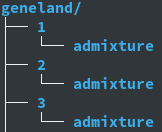 <!-- MERGE-REVIEW: no counterpart section found in QMD; content from TEX kept as-is. -->

### Settings MCMC

- For real analysis, Baysian tools require millions of MCMC steps (generations, iterations) - Here we use only 10000 to speed up processing
- Not every generation (step) is sampled, in case of millions of iterations, sampling (thinning) can be \$\$thousands
- Whole MCMC step is repeated several (usually \$\$10 times) using `for` loop (following 2 slides) to select the best run and compare them (MCMC process is by it's nature random)

```{r}
hauss.geneland.nrun <- 5 # Set number of independent runs
hauss.geneland.burnin <- 100 # Set length of burnin chain
hauss.geneland.maxpop <- 10 # Set maximal K (number of populations)
# In practice set much higher number of iterations (nit, millions),
# appropriate sampling (thinning, thousands) and longer burnin
hauss.geneland.nit <- 10000 # Number of iterations (MCMC steps)
hauss.geneland.thinning <- 10 # Sampling (thinning)
```

<!-- MERGE-REVIEW: no counterpart section found in QMD; code below comes from the old TEX version. -->

### Running MCMC I

```{r}
# FOR loop will run several independent runs and produce output maps
# of genetic clusters - outputs are written into subdirectory within
# geneland directory (this has to exist prior launching analysis)
for (hauss.geneland.irun in 1:hauss.geneland.nrun) {
  hauss.geneland.path.mcmc <- paste("geneland/", hauss.geneland.irun, "/",
  sep="") # paste is good especially for joining several texts
  # On Windows, remove following line and create subdirectories from
  # 1 to max K manually (creating subdirs in Windows in R is complicated)
  system(paste("mkdir ", hauss.geneland.path.mcmc)) # Creates subdirs
  # Inference - MCMC chain - see ?MCMC for details
  MCMC(coordinates=hauss.geneland.coord.utm, geno.dip.codom=
    hauss.geneland.data, path.mcmc=hauss.geneland.path.mcmc,
    delta.coord=0.001, varnpop=TRUE, npopmin=1,
    npopmax=hauss.geneland.maxpop, nit=hauss.geneland.nit,
    thinning=hauss.geneland.thinning, freq.model="Uncorrelated",
    spatial=TRUE) # Loop continues on next slide...
```

<!-- MERGE-REVIEW: no counterpart section found in QMD; code below comes from the old TEX version. -->

### Running MCMC II

```{r}
  # ...Start of FOR loop is on previous slide
  PostProcessChain(coordinates=hauss.geneland.coord.utm, path.mcmc=hauss.
    geneland.path.mcmc, nxdom=500, nydom=500,burnin=hauss.geneland.burnin)
  # Output
  # Simulated number of populations
  Plotnpop(path.mcmc=hauss.geneland.path.mcmc, printit=TRUE,
    file=paste(hauss.geneland.path.mcmc, "/geneland-number_of_clusters
    .pdf", sep=""), format="pdf", burnin=hauss.geneland.burnin)
  dev.off() # We must close graphical device manually
  # Map of estimated population membership
  PosteriorMode(coordinates=hauss.geneland.coord.utm,
    path.mcmc=hauss.geneland.path.mcmc, printit=TRUE, format="pdf",
    file=paste(hauss.geneland.path.mcmc,"/geneland-map.pdf", sep=""))
  dev.off() # We must close graphical device manually
  } # End of FOR loop from previous slide
```

<!-- MERGE-REVIEW: no counterpart section found in QMD; code below comes from the old TEX version. -->

### Estimate F$_{ST}$

```{r}
# Prepare list to record values of Fst for all runs
hauss.geneland.fstat <- list()
# Estimate Fst
for (hauss.geneland.irun in 1:hauss.geneland.nrun) {
  hauss.geneland.path.mcmc <- paste("geneland/",
  hauss.geneland.irun, "/", sep="")
  # F-statistics - Fis and Fst
  hauss.geneland.fstat[[hauss.geneland.irun]] <- Fstat.output(
    coordinates=hauss.geneland.coord.utm,
    genotypes=hauss.geneland.data,
    burnin=hauss.geneland.burnin, ploidy=2,
    path.mcmc=hauss.geneland.path.mcmc)
  }
hauss.geneland.fstat # Print Fst output
```

- Probably one of few implementations of F$_ST$ using Bayesian statistics (and geographically explicit model) <!-- MERGE-REVIEW: no counterpart section found in QMD; code below comes from the old TEX version. -->

### MCMC inference under the admixture model

```{=html}
<!--
TODO Admixture
    @@TOKEN0@@
    \begin{itemize}
        \item Currently, there is no much use for admixture results, at lest not without extra work\ldots
    \end{itemize}

-->
```

<!-- MERGE-REVIEW: no counterpart section found in QMD; content from TEX kept as-is. -->

### Produce maps of respective inferred clusters

```{r}
for (hauss.geneland.irun in 1:hauss.geneland.nrun) {
  hauss.geneland.path.mcmc <- paste("geneland/",
    hauss.geneland.irun, "/", sep="")
  # Maps - tessellations
  PlotTessellation(coordinates=hauss.geneland.coord.utm,
    path.mcmc=hauss.geneland.path.mcmc, printit=TRUE,
    path=hauss.geneland.path.mcmc)
  for (hauss.geneland.irun.img in 1:hauss.geneland.maxpop) {
    dev.off() } # We must close graphical device manually
  }
```

- Maps are produced as PS (PostScript) files in output directories
- Not every graphical software can handle PS (try for example [GIMP](https://www.gimp.org/))
- There are as many plots as was maximal K, but only those up to inferred number of clusters have some content (the others are empty) <!-- MERGE-REVIEW: no counterpart section found in QMD; code below comes from the old TEX version. -->

### Estimate frequencies of null alleles

```{r}
hauss.geneland.fna <- list()
for (hauss.geneland.irun in 1:hauss.geneland.nrun) {
  hauss.geneland.path.mcmc <- paste("geneland/", hauss.geneland.irun,
    "/", sep="")
  # Estimation
  hauss.geneland.fna[[hauss.geneland.irun]] <-
    EstimateFreqNA(path.mcmc=hauss.geneland.path.mcmc)
  }
# See output
hauss.geneland.fna
```

- Each item of the `list` object `hauss.geneland.fna` (from 1 to number of runs) contains vector of estimated frequencies of null alleles for every locus
- Estimation on null alleles (one from two alleles is missing, behaving like homozygote - `A-` instead of `AA`) is generally difficult, so this is nice and unique feature <!-- MERGE-REVIEW: no counterpart section found in QMD; code below comes from the old TEX version. -->

### Determine which run is the best

```{r}
# Calculate average posterior probability
hauss.geneland.lpd <- rep(NA, hauss.geneland.nrun)
for (hauss.geneland.irun in 1:hauss.geneland.nrun) {
  hauss.geneland.path.mcmc <- paste("geneland/", hauss.geneland.irun, "/",
    sep="")
  hauss.geneland.path.lpd <- paste(hauss.geneland.path.mcmc,
    "log.posterior.density.txt", sep="")
  hauss.geneland.lpd[hauss.geneland.irun] <-
    mean(scan(hauss.geneland.path.lpd)[-(1:hauss.geneland.burnin)]) }
order(hauss.geneland.lpd, decreasing=TRUE) # Sorts runs according to decre-
[1] 5 1 4 3 2 # Run 5 is the best here     # asing posterior probability
hauss.geneland.lpd # Here the runs are unsorted
[1] -645.0238 -782.7912 -676.9559 -664.9947 -601.7902 # Run 5 wins
```

- We will use figures and F$_ST$ outputs only from the best run
- It is useful to keep all runs especially for comparison if there are different solutions with similar posterior probability <!-- MERGE-REVIEW: no counterpart section found in QMD; code below comes from the old TEX version. -->

### MCMC chain, number of clusters and their map

**MCMC did not converge yet - too few generations, the most likely solution is K=4 followed by K=5. Final product is map of distribution of genetic clusters.**

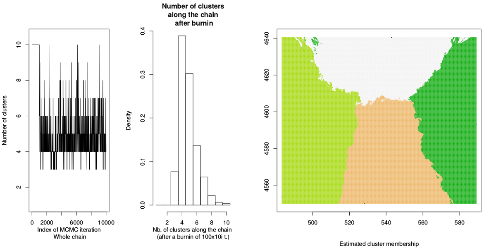 <!-- MERGE-REVIEW: no counterpart section found in QMD; content from TEX kept as-is. -->

### Map of posterior probability of belonging into cluster 1

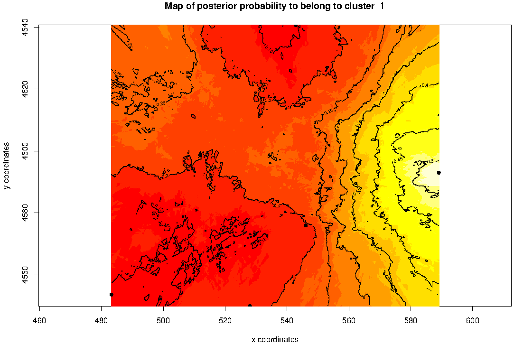 <!-- MERGE-REVIEW: no counterpart section found in QMD; content from TEX kept as-is. -->

### When using Geneland, remember...

- Within `MCMC()`, there must be at least hundreds thousands or millions of generations (`nit`) and appropriate sampling (thousands or higher, `thinning` - not to fill whole disk)
- To analyze geo-referenced data with a non-spatial prior set in `MCMC()` `spatial=FALSE`
- To analyze non-spatial data remove parameter `coordinates` from `MCMC()` function
- To obtain structure-like plots, file `proba.pop.membership.indiv.txt` in Geneland output directory can be used as input file for [distruct](https://web.stanford.edu/group/rosenberglab/distruct.html)
- To use SNPs, ATCG bases must be recoded as `1, 2, 3, 4`, fixed alleles must be removed
- Geneland can handle only haploids and diploids (no ploidy mixing)
- When unsure, consult [manual](https://github.com/gilles-guillot/Geneland/blob/master/vignettes/Geneland.pdf) <!-- MERGE-REVIEW: no counterpart section found in QMD; content from TEX kept as-is. -->

## Plotting maps

### Mapping overview

- There are plenty of options, only some basic options are shown...
- Some packages offer basic (state) maps
- It is possible to use various on-line maps
- [Shapefiles](https://en.wikipedia.org/wiki/Shapefile) (SHP) used in specialized GIS software can be used as base layer to plot points etc. to that map
- Interactive maps can be created with libraries like [leaflet](https://CRAN.R-project.org/package=leaflet)
- It is possible to plot to maps not only point and/or text labels, but also pie charts, bar charts, or e.g. [plot phylogeny to the map](https://blog.phytools.org/2019/03/projecting-phylogenetic-tree-onto-map.html)
- Much more options are available in specialized mapping packages, especially with connections with GIS (e.g. [QGIS](https://qgis.org/) or [GRASS GIS](https://grass.osgeo.org/)) <!-- MERGE-REVIEW: no counterpart section found in QMD; content from TEX kept as-is. -->

### Very basic mapping in R

```{r}
library(sp) # Load libraries
library(rworldmap) # Basic world maps
library(TeachingDemos) # To be able to move text little bit
library(RgoogleMaps) # Google and OpenStreetMaps
library(mapplots) # Plot pie charts
library(adegenet)
# Plot basic map with state boundaries within selected range
plot(x=getMap(resolution="high"),xlim=c(19,24),ylim=c(39,44),asp=1,lwd=1.5)
box() # Add frame around the map
# Plot location points
points(x=hauss.genpop@other$xy[["lon"]], y=hauss.genpop@other$xy[["lat"]],
  pch=15:19, col="red", cex=4)
# Add text descriptions for points. Text is aside and with background
shadowtext(x=hauss.genpop@other$xy[["lon"]], y=hauss.genpop@other$xy
  [["lat"]], labels=as.vector(popNames(hauss.genind)), col="black",
  bg="white", theta=seq(pi/4, 2*pi, length.out=8), r=0.15, pos=c(1,
  3, 2, 4, 4), offset=0.75, cex=1.5)
```

<!-- MERGE-REVIEW: no counterpart section found in QMD; code below comes from the old TEX version. -->

### Basic map

```{r}
# Insert legend
legend(x="topright", inset=1/50, legend=c("He", "Oh", "Pr", "Ne", "Sk"),
  col="red", border="black", pch=15:19, pt.cex=2, bty="o", bg="lightgrey",
  box.lwd=1.5, cex=1.5, title="Populations")
```

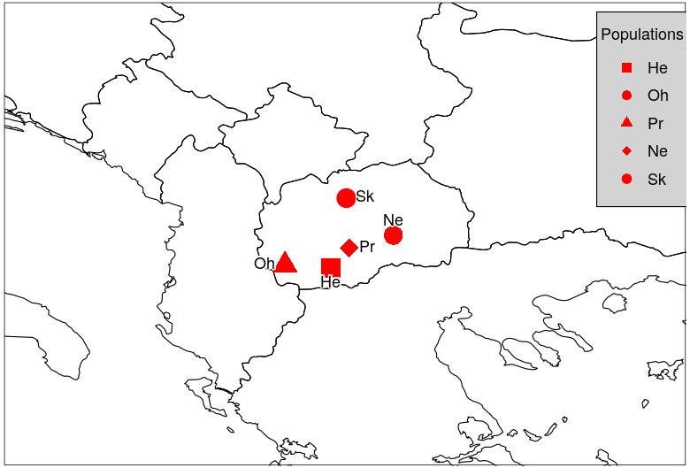 <!-- MERGE-REVIEW: 1 old code block(s) in TEX frame were dropped in favor of the .qmd section 'Basic operations'. -->

<!-- MERGE-REVIEW: content of the .qmd section 'Basic operations' was inserted at 6 frames; remove the unwanted duplicates. -->

When loading saved project, you have to load again libraries and scripts (see further), data objects are restored This can be conveniently done in RStudio/RKWard

When loading saved project, you have to load again libraries and scripts (see further), data objects are restored

```{r}
x <- c(5, 6, 7, 8, 9) # Creates vector (see also ?rep)
x # Print "x" content
c() # Is generic function to concatenate objects into new one
length(x) # Length of the object - for matrices and DF use dim()
str(x) # Information about structure of the object
mode(x) # Gets type of storage mode of the object
class(x) # Shows class of the object
x[2] # Shows second element of the object
x <- x[-5] # Removes fifth element
x # See modified object
y <- matrix(data = 5:20, nrow = 4, ncol = 4) # Creates a matrix
is.matrix(y) # Is it matrix? Try is.<TAB><TAB> TAB key shows available functions and objects starting by typed text
y # Prints the matrix
dim(y) # Dimensions of "y"
y[, 2] # Prints second column
y[3, ] # Prints third row
y[4, 3] # Prints element from fourth row and third column
c(x, y[4, ]) # Concatenate "x"and 4th row of "y"
x2 <- c(x, 3, 2, 1) # Concatenate "x"and values "3", "2"and "1"
x <- y[2, ] # Replaces "x"by second row of "y"(no warning) - R doesn't ask neither notifies when overwriting objects! Be careful!
x # See modified object
rm(x) # Deletes x (no warning)
y[, 1:3] # Prints first through third column of the matrix
y[3, ] <- rep(x = 20, each = 4) # Replaces third line by value of 20
y # See modified object
y[y == 20] <- 10 # If value of y's element is 20, replace it by 10
y # See modified object
summary(y) # Basic statistics - according to columns
colnames(y) <- c("A", "B", "C", "D") # Set column names - Objects and functions are without quotation marks; files, text with
colnames(y) # Prints column names, use rownames() in same way
y # See modified object
y[, "C"] # Prints column C (R is case sensitive!)
y[, c("C", "B")] # Extract columns "C"and "B"
t(y) # Transposes the matrix
diag(y) # Get diagonal of the matrix
diag(y) <- rep(x = c(50, 100), times = 2) # Replace diagonal by repetition of values 50 and 100
y # See modified object
y <- as.data.frame(y) # Turns into DF (see other functions as.*)
class(y) # Is it data frame now?
y[y == 17] <- "NA"# Removes values of 17
y # See modified object
y$B # Gets variable B of data frame y ($ works similarly in S3 objects)
```

```{r}
save(list = ls(), file = "test.RData") # Saves all objects during the work
load("test.RData") # Loads saved R environment with all objects
```

```{r}
fix(y) # Use to edit matrices, data frames, functions, ...
rm(y) # Removing...
```

### Adding pie charts to map I

```{r}
# Prepare matrix with some data (exemplary distribution of haplotypes)
hauss.pie <- cbind(c(20, 30, 15, 40, 10), c(30, 10, 25, 5, 45),
  c(10, 20, 20, 15, 5))
# Add row names according to populations
rownames(hauss.pie) <- popNames(hauss.genpop)
# Add column names according to data displayed
colnames(hauss.pie) <- c("HapA", "HapB", "HapC")
class(hauss.pie) # Check it is matrix
hauss.pie # See resulting matrix
# Plot basic map with state boundaries within selected range
plot(x=getMap(resolution="high"),xlim=c(20,23),ylim=c(41,42),asp=1,lwd=1.5)
box() # Add frame around the map
# Plot the pie charts
for (L in 1:5) { add.pie(z=hauss.pie[L,], x=as.vector(
  hauss.genpop@other$xy[["lon"]])[L], y=as.vector(
  hauss.genpop@other$xy[["lat"]])[L], labels=names(hauss.pie[L,]),
  radius=0.1, col=topo.colors(3)) }
```

<!-- MERGE-REVIEW: no counterpart section found in QMD; code below comes from the old TEX version. -->

### Adding pie charts to map II

```{r}
?add.pie # See more options
# Add population labels
text(
  x=hauss.genpop@other$xy[["lon"]],
  y=hauss.genpop@other$xy[["lat"]],
  labels=
  as.vector(popNames(hauss.genind)),
  col="red", cex=2)
```

- As usually, play with colors and display options...

  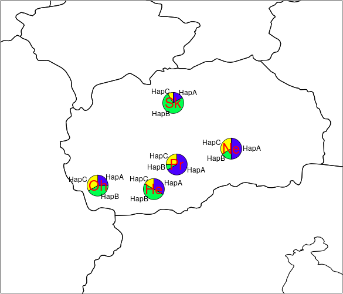 <!-- MERGE-REVIEW: no counterpart section found in QMD; code below comes from the old TEX version. -->

### Google map basics

```{r}
# Basic help for Google maps
?GetMap
?PlotOnStaticMap
```

- For larger/complex maps Google requires [API key](https://developers.google.com/maps/documentation/maps-static/overview)

- See [documentation](https://rgooglemaps.r-forge.r-project.org/) and more options, it can use plenty of map resources (Bing maps, ...)

- Map is first downloaded with `GetMap()` into R object, and then plotted with `PlotOnStaticMap()` or with another function

- Many on-line map services do require (paid) API key...

  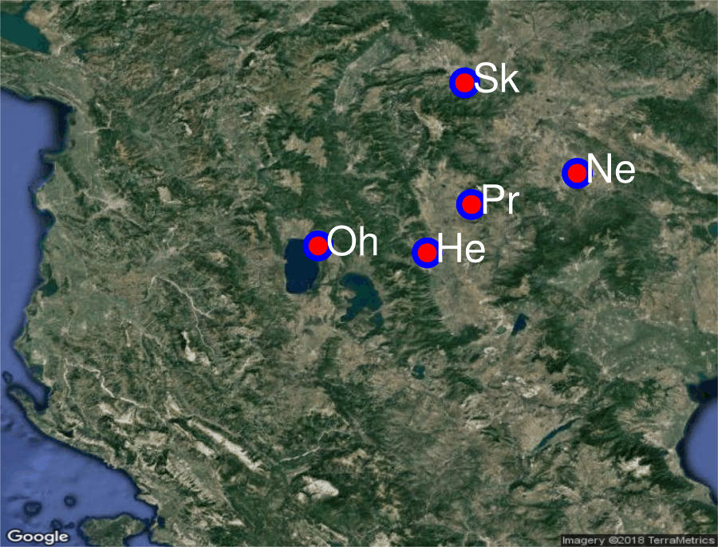 <!-- MERGE-REVIEW: no counterpart section found in QMD; code below comes from the old TEX version. -->

### Plotting Google map

```{r}
# Download map
hauss.gmap <- GetMap(center=c(lat=41, lon=21), size=c(640, 640),
  destfile="gmap.png", zoom=8, maptype="satellite")
# Plot saved map, with extra data
PlotOnStaticMap(MyMap=hauss.gmap, lat=hauss.genpop@other$xy[["lat"]],
  lon=hauss.genpop@other$xy[["lon"]], FUN=points, pch=19, col="blue",
  cex=5)
PlotOnStaticMap(MyMap=hauss.gmap, lat=hauss.genpop@other$xy[["lat"]],
  lon=hauss.genpop@other$xy[["lon"]], add=TRUE, FUN=points, pch=19,
  col="red", cex=3)
PlotOnStaticMap(MyMap=hauss.gmap, lat=hauss.genpop@other$xy[["lat"]],
  lon=hauss.genpop@other$xy[["lon"]], add=TRUE, FUN=text,
  labels=as.vector(popNames(hauss.genind)), pos=4, cex=3, col="white")
# Google maps have their own internal scaling, adding of points by
# standard functions will not work correctly
```

<!-- MERGE-REVIEW: no counterpart section found in QMD; code below comes from the old TEX version. -->

### Pie charts on Google map I

```{r}
# Prepare list to store recalculated coordinates
hauss.gmap.coord <- list()
# Calculation of coordinates to form required by Google Maps
for (LC in 1:5) { hauss.gmap.coord[[LC]] <- LatLon2XY.centered(MyMap=
  hauss.gmap, lat=as.vector(hauss.genpop@other$xy[["lat"]])[LC],
  lon=as.vector(hauss.genpop@other$xy[["lon"]])[LC], zoom=8) }
hauss.gmap.coord # See result
# Plot plain map
PlotOnStaticMap(MyMap=hauss.gmap)
# Plot pie charts
for (LP in 1:5) { add.pie(z=hauss.pie[LP,], x=hauss.gmap.coord[[LP]]
  $newX, y=hauss.gmap.coord[[LP]]$newY, labels=names(hauss.pie[LP,]),
  radius=25, col=topo.colors(n=3, alpha=0.7)) }
# Alternative option to plot pie charts
for (LF in 1:5) { plotrix::floating.pie(xpos=hauss.gmap.coord[[LF]]
  $newX, ypos=hauss.gmap.coord[[LF]]$newY, x=hauss.pie[LF,], radius=30,
  col=heat.colors(n=3, alpha=0.5) ) }
```

<!-- MERGE-REVIEW: no counterpart section found in QMD; code below comes from the old TEX version. -->

### Pie charts on Google map II

```{r}
# Add population text labels
PlotOnStaticMap(MyMap=hauss.gmap, lat=hauss.genpop@other$xy[["lat"]],
  lon=hauss.genpop@other$xy[["lon"]], add=TRUE, FUN=text,
  labels=as.vector(popNames(hauss.genind)), cex=2.5, col="white")
```

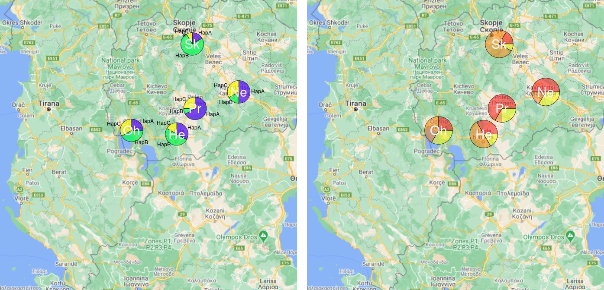 <!-- MERGE-REVIEW: no counterpart section found in QMD; code below comes from the old TEX version. -->

### Datasets from mapproj

```{r}
# Plot on data sets from mapproj package
library(maps) # Various mapping tools (plotting, ...)
# More detailed maps, but political boundaries often outdated, see
# https://CRAN.R-project.org/package=mapdata
library(mapdata)
library(mapproj)
# Convert latitude/longitude into projected coordinates
# Plot a map, check parameters
# Check among others "projection" and ?mapproject for its details
map(database="world", boundary=TRUE, interior=TRUE, fill=TRUE,
  col="lightgrey", plot=TRUE, xlim=c(16, 27), ylim=c(37, 46))
# If you'd use projection, use mapproject to convert also coordinates!
?mapproject # See for details
points(x=hauss.genpop@other$xy[["lon"]], y=hauss.genpop@other$xy[["lat"]],
  pch=15:19, col="red", cex=3)
```

<!-- MERGE-REVIEW: no counterpart section found in QMD; code below comes from the old TEX version. -->

### Plotting on SHP files I

```{=html}
<!--
FIXME Plot SHP map
    \begin{itemize}
        \item \href{https://en.wikipedia.org/wiki/Shapefile}{Shapefile} (SHP) is common format for geographical data
        \item Get SHP files from \url{https://soubory.trapa.cz/rcourse/macedonia.zip} (originally from \href{https://download.geofabrik.de/europe/macedonia.html}{Geofabrik}) and unpack them into R working directory
        \item R working directory has to contain also respective DBF and SHX files (same name, only different extension)
    \end{itemize}
    @@TOKEN0@@

-->
```

<!-- MERGE-REVIEW: no counterpart section found in QMD; content from TEX kept as-is. -->

### Plotting on SHP files II

```{=html}
<!--
    @@TOKEN0@@

-->
```

<!-- MERGE-REVIEW: no counterpart section found in QMD; content from TEX kept as-is. -->

### Plotting on SHP files III

```{=html}
<!--
    @@TOKEN0@@

-->
```

<!-- MERGE-REVIEW: no counterpart section found in QMD; content from TEX kept as-is. -->

### Plotting on SHP files IV and maps from mapproj

```{=html}
<!--
    \begin{center}
        \includegraphics[height=6.5cm]{mapy.png}
    \end{center}

-->
```

<!-- MERGE-REVIEW: no counterpart section found in QMD; content from TEX kept as-is. -->

## Tasks

### Practicing work with spatial data

1.  Try some spatial analysis with adegenet's alpine *Rupicapra* dataset (see `?adegenet::rupica`), or cats from Nancy (see `?adegenet::nancycats` *(Note it has coordinates only for populations, not for individuals.)*), or with any other (your) data.
2.  Plot some of the above dataset, or some your data to map. Try several mapping options.
3.  Which problems can you encounter when doing spatial analysis or plotting maps over large spatial scale (level of continents and above), close to equator or in polar regions?
4.  What are possible problems when computing distances among sampling sites?
5.  Search the Internet for another options how to plot maps in R which could be suitable for your data.

<!-- MERGE-REVIEW: content of the .qmd section 'Work with data' was inserted at 2 frames; remove the unwanted duplicates. -->

Load training data

Data control

Conversion of loci to genind - used for many analysis

See population names

Read coordinates

Add coordinates - note identification of slots within object

See result

Conversion to genpop - for population-level analysis

See result

Removes missing data - see ?missingno for types of dealing with them

Convert corrected genind to loci

Writes loci file to the disk

Import of triploid (polyploid) microsattelites

Check the data

Convert to genind

See resulting genind object

Import of AFLP data

Populations - just one column with population names for all inds

Create genind object - ind.names and loc.names are taken from X

Read data sets from various software

Some useful functions for data manipulations

seppop and seploc return lists of objects - for further analysis read manuals (?...) of the functions before usage

Reading FASTA (reads also another formats, see ?read.dna), sequences of flu viruses from various years from USA (Adegenet toy data)

Check the object

Another possibility (only for FASTA alignments, same result):

Check the object

Read anotations

Convert DNAbin to genind - only polymorphic loci are retained

Read sequence data in NEXUS (similar to reading FASTA)

Importing DNA sequences from GeneBank - according to sequence ID, data from https://www.ncbi.nlm.nih.gov/popset/22854787

Query on-line sequence databases

Query selected database - there are much possibilities

See the sequences information

Get the sequences as a list

See sequences - just a plain list - must be converted into DNAbin

Get annotations

Close the bank when work is over

Convert sequences from a list to DNAbin (functions as.DNAbin\*)

Query NCBI databases

Search the database and get IDs of matched records

Fetch desired records according to their IDs

Conversion into DNAbin requires saving to disk as FASTA and then loading it

Importing large SNP

Extract SNP from FASTA alignment

See result

If it crashes (on Windows), try to add parameter "parallel = FALSE" Function has several options to speed up reading

Read SNP in Adegent format - check Adegenet tutorial first

Checking SNPs Position of polymorphism within alignment - snpposi.plot() requires input data in form of matrix

Position of polymorphism within alignment - differentiating codons

When converting to genind object, only polymorphic loci are kept - threshold for polymorphism can be arbitrary (polyThres = ...)

Test if distribution of SNP is random (1000 permutations)

Check sequences Nucleotide diversity

Base frequencies

GC content

Number of times any dimer/trimer/etc oligomers occur in a sequence

View sequences - all must be of the same length Function "image.DNAbin"requires as input matrix, so that sequences must be of same length (aligned) - stored as DNAbin.matrix

Sequences must be of same length - as.matrix.DNAbin() can help

VCF Required library

Read input file Download input file from https://soubory.trapa.cz/rcourse/arabidopsis.vcf.gz

Or directly load remote file

It returns object of class vcfR-class

Another option from package pegas returns list of objects loci and data.frame

Explore VCF

See description of depth of coverage (DP) slot

Extract the depth of coverage (DP)

See it

Boxplot of DP

Bar plot of mean DP

Heatmap of DP (subset)

Extract the genotype quality (GQ)

Heatmap of GQ (subset)

Bar plot of mean GQ

Boxplot of GQ

Basically same as work with DP...

Missing data Extract information about missing data

Bar plot of missing data

Histogram of frequencies of missing data

Remove indels

Remove non-biallelic loci

See result

ChromR - filtration of VCF Loading reference sequence Download https://soubory.trapa.cz/rcourse/alygenomes.fasta into working directory

Conversion into chromosome object (ChromR)

Masking sites with too low/high DP and/or MQ (sites are not removed yet)

Saving mask into new object (actually removing masked sites)

Convert VCF into various objects for later processing Genind

Check it

Genlight (suitable for huge data, not required now) Note that it introduces a lot of missing data due to variable ploidies

Check it

Loci

Check it

DNAbin

Check it

```{r}
hauss_loci <- read.loci("https://soubory.trapa.cz/rcourse/haussknechtii_ssrs.txt", header = TRUE, loci.sep = "\t", allele.sep = "/", col.pop = 2, col.loci = 3:14, row.names = 1)
```

```{r}
hauss_loci
print(hauss_loci, details = TRUE)
```

```{r}
hauss_genind <- loci2genind(hauss_loci)
```

```{r}
pop(hauss_genind)
hauss_genind$pop
```

```{r}
hauss_coord <- read.csv("https://soubory.trapa.cz/rcourse/haussknechtii_coordinates.csv", header = TRUE, sep = "\t", quote = "", dec = ".", row.names = 1)
hauss_coord
```

```{r}
hauss_genind$other$xy <- hauss_coord
```

```{r}
hauss_genind$other$xy
hauss_genind
```

```{r}
hauss_genpop <- genind2genpop(hauss_genind, process.other = TRUE)
```

```{r}
hauss_genpop
```

```{r}
hauss_genind_cor <- missingno(pop = hauss_genind, type = "mean", cutoff = 0.1, quiet = FALSE) # Use with caution! It modifies original data!
?missingno # See other options of handling missing data
```

```{r}
hauss_loci_cor <- genind2loci(hauss_genind_cor)
```

```{r}
write.loci(hauss_loci_cor, file = "hauss_loci_cor.txt", loci.sep = "\t", allele.sep = "/")
```

```{r}
tarax3n_table <- read.table("https://soubory.trapa.cz/rcourse/tarax3n.txt", header = TRUE, sep = "\t", quote = "", row.names = 1)
```

```{r}
tarax3n_table
class(tarax3n_table)
dim(tarax3n_table)
```

```{r}
tarax3n_genind <- df2genind(X = tarax3n_table[, 1:6], sep = "/", ncode = 3, pop = tarax3n_table[["pop"]], ploidy = 3, type = "codom")
```

```{r}
tarax3n_genind
summary(tarax3n_genind)
```

```{r}
amara_aflp <- read.table(file = "https://soubory.trapa.cz/rcourse/amara_aflp.txt", header = TRUE, sep = "\t", quote = "")
amara_aflp
dim(amara_aflp)
class(amara_aflp) # Must be matrix or data frame
```

```{r}
amara_pop <- read.table(file = "https://soubory.trapa.cz/rcourse/amara_pop.txt", header = TRUE, sep = "\t", quote = "")
amara_pop
dim(amara_pop)
```

```{r}
aflp_genind <- df2genind(X = amara_aflp, sep = "", ind.names = NULL, loc.names = NULL, pop = amara_pop[, 1], type = "PA")
indNames(aflp_genind) <- amara_aflp[, 1] # Add individual names
aflp_genind
summary(amara_aflp)
```

```{r}
?read.genalex # poppr - reads *.csv file
?read.fstat # adegenet - reads *.dat files, only haploid/diploid data
?read.genetix # adegenet - reads *.gtx files, only haploid/diploid data
?read.genepop # adegenet - reads *.gen files, only haploid/diploid data
?read.structure # adegenet - reads *.str files, only haploid/diploid data
?import2genind # adegenet - more automated version of above functions
```

```{r}
?genind2df # adegenet - export into data frame
?genind2genalex # poppr - export for genalex
?popsub # poppr - extracts only selected population(s)
?clonecorrect # poppr - corrects for clones
?informloci # poppr - removes uninformative loci
?seppop # adegenet - separates populations from genind or genlight object
?seploc # adegenet - splits genind, genpop or genlight by markers
?alleles2loci # pegas - transforms a matrix of alleles into "loci"
```

```{r}
usflu_dna <- read.dna(file = "https://adegenet.r-forge.r-project.org/files/usflu.fasta", format = "fasta")
```

```{r}
class(usflu_dna)
usflu_dna
```

```{r}
usflu_dna2 <- fasta2DNAbin(file = "https://adegenet.r-forge.r-project.org/files/usflu.fasta") # Normally keeps only SNP - see ?fasta2DNAbin
```

```{r}
class(usflu_dna2)
usflu_dna2
as.character(usflu_dna2)[1:5, 1:10]
dim(usflu_dna2) # Does it have correct size?
```

```{r}
usflu_annot <- read.csv("https://adegenet.r-forge.r-project.org/files/usflu.annot.csv", header = TRUE, row.names = 1)
head(usflu_annot)
```

```{r}
usflu_genind <- DNAbin2genind(x = usflu_dna, pop = usflu_annot[["year"]])
usflu_genind # Check it
```

```{r}
?read.nexus.data
```

```{r}
gunnera_dna <- read.GenBank(access.nb = c("AF447749.1", "AF447748.1", "AF447747.1", "AF447746.1", "AF447745.1", "AF447744.1", "AF447743.1", "AF447742.1", "AF447741.1", "AF447740.1", "AF447739.1", "AF447738.1", "AF447737.1", "AF447736.1", "AF447735.1", "AF447734.1", "AF447733.1", "AF447732.1", "AF447731.1", "AF447730.1", "AF447729.1", "AF447728.1"))
gunnera_dna
class(gunnera_dna)
```

```{r}
library("seqinr")
choosebank() # Genetic banks available for seqinr
choosebank("embl", timeout = 20) # Choose some bank
```

```{r}
?query # See how to construct the query
nothofagus <- query(listname = "nothofagus", query = "SP=Nothofagus AND K=rbcL", verbose = TRUE)
```

```{r}
nothofagus$req
```

```{r}
nothofagus_sequences <- getSequence(nothofagus$req)
```

```{r}
nothofagus_sequences
```

```{r}
nothofagus_annot <- getAnnot(nothofagus$req)
nothofagus_annot
```

```{r}
closebank()
```

```{r}
nothofagus_dna <- as.DNAbin.list(nothofagus_sequences)
nothofagus_dna # See it
```

```{r}
library("rentrez")
entrez_dbs() # Genetic banks available for rentrez
entrez_db_summary("nucleotide") # Brief description of the selected database
entrez_db_searchable("nucleotide") # Set of search terms that can used with this database
```

```{r}
nothofagus_search <- entrez_search(db = "nucleotide", term = "Nothofagus[ORGN] AND rbcL[GENE]")
nothofagus_search
```

```{r}
nothofagus_fasta <- entrez_fetch(db = "nucleotide", id = nothofagus_search[["ids"]], rettype = "fasta")
nothofagus_fasta
```

```{r}
write(x = nothofagus_fasta, file = "nothofagus.fasta")
nothofagus_dna <- read.dna(file = "nothofagus.fasta", format = "fasta")
nothofagus_dna
```

```{r}
?read.PLINK # See it for available options
```

```{r}
usflu_genlight <- fasta2genlight(file = "https://adegenet.r-forge.r-project.org/files/usflu.fasta", quiet = FALSE, saveNbAlleles = TRUE)
```

```{r}
usflu_genlight
```

```{r}
?fasta2genlight
```

```{r}
?read.snp
```

```{r}
snpposi.plot(x = as.matrix(usflu_dna), codon = FALSE)
```

```{r}
snpposi.plot(as.matrix(usflu_dna))
```

```{r}
usflu_genind2 <- DNAbin2genind(x = usflu_dna, polyThres = 0.01)
usflu_genind2 # See it
```

```{r}
snpposi.test(x = as.matrix(usflu_dna))
```

```{r}
pegas::nuc.div(x = usflu_dna)
```

```{r}
ape::base.freq(x = usflu_dna)
```

```{r}
ape::GC.content(x = usflu_dna)
```

```{r}
seqinr::count(seq = as.character.DNAbin(gunnera_dna[["AF447749.1"]]), wordsize = 3)
```

```{r}
image.DNAbin(x = usflu_dna)
```

```{r}
image.DNAbin(x = as.matrix.DNAbin(usflu_dna))
```

```{r}
library("vcfR")
```

```{r}
arabidopsis_vcf <- read.vcfR(file = file.choose()) # Pick up downloaded file 'arabidopsis.vcf.gz' from the disc
```

```{r}
arabidopsis_vcf <- read.vcfR(file = "https://soubory.trapa.cz/rcourse/arabidopsis.vcf.gz")
```

```{r}
?read.vcfR # See more import options
```

```{r}
?pegas::read.vcf
```

```{r}
arabidopsis_vcf
head(arabidopsis_vcf)
arabidopsis_vcf@fix[1:10, 1:5]
strwrap(arabidopsis_vcf@meta[1:21])
queryMETA(x = arabidopsis_vcf)
queryMETA(x = arabidopsis_vcf, element = "DP")
queryMETA(x = arabidopsis_vcf, element = "FORMAT.+DP")
queryMETA(x = arabidopsis_vcf, element = "FORMAT = <ID = DP")
head(x = getFIX(x = arabidopsis_vcf))
head(x = is.polymorphic(x = arabidopsis_vcf, na.omit = TRUE))
head(x = is.biallelic(x = arabidopsis_vcf))
arabidopsis_vcf@gt[1:10, 1:4]
```

```{r}
strwrap(x = grep(pattern = "ID = DP, ", x = arabidopsis_vcf@meta, value = TRUE))
```

```{r}
arabidopsis_vcf_dp <- extract.gt(x = arabidopsis_vcf, element = "DP", as.numeric = TRUE) # GT:GQ:DP:HQ
```

```{r}
dim(arabidopsis_vcf_dp)
head(arabidopsis_vcf_dp)
```

```{r}
boxplot(x = arabidopsis_vcf_dp, col = "#808080", ylab = "Depth of coverage", las = 3)
title("DP per specimen")
abline(h = seq(from = 0, to = 90, by = 10), col = "#b3b3b3")
```

```{r}
barplot(apply(X = arabidopsis_vcf_dp, MARGIN = 2, FUN = mean, na.rm = TRUE), las = 3)
title("Mean DP per specimen")
abline(h = seq(from = 0, to = 60, by = 10), col = "#b3b3b3")
```

```{r}
heatmap.bp(x = arabidopsis_vcf_dp[1:100, 1:100], col.ramp = rainbow(n = 100, start = 0.1)) # Subset - only first 100 loci and individuals
title("DP per specimens and loci")
```

```{r}
arabidopsis_vcf_gq <- extract.gt(x = arabidopsis_vcf, element = "GQ", as.numeric = TRUE)
dim(arabidopsis_vcf_gq)
arabidopsis_vcf_gq[1:10, 1:10]
```

```{r}
heatmap.bp(x = arabidopsis_vcf_gq[1:100, 1:100])
```

```{r}
barplot(apply(X = arabidopsis_vcf_gq, MARGIN = 2, FUN = mean, na.rm = TRUE), las = 3)
abline(h = seq(from = 0, to = 90, by = 5), col = "grey")
```

```{r}
boxplot(arabidopsis_vcf_gq, las = 2, main = "Genotype Quality (GQ)")
abline(h = seq(from = 0, to = 100, by = 5), col = "grey")
```

```{r}
arabidopsis_vcf_miss <- apply(X = arabidopsis_vcf_dp, MARGIN = 2, FUN = function(x) {
  sum(is.na(x))
})
arabidopsis_vcf_miss <- arabidopsis_vcf_miss / nrow(arabidopsis_vcf)
```

```{r}
barplot(height = arabidopsis_vcf_miss, ylab = "Percentage of missing data", las = 2)
abline(h = seq(from = 0, to = 1, by = 0.05), col = "grey")
```

```{r}
arabidopsis_vcf_missg <- apply(X = arabidopsis_vcf_dp, MARGIN = 1, FUN = function(x) {
  sum(is.na(x))
})
arabidopsis_vcf_missg <- arabidopsis_vcf_miss / ncol(arabidopsis_vcf@gt[, -1])
hist(x = arabidopsis_vcf_missg, xlab = "Missingness (%)")
abline(h = seq(from = 0, to = 350, by = 25), col = "grey") # Set abline parameters according to your data
```

```{r}
arabidopsis_vcf <- extract.indels(x = arabidopsis_vcf)
```

```{r}
arabidopsis_vcf <- arabidopsis_vcf[is.biallelic(x = arabidopsis_vcf), ]
```

```{r}
arabidopsis_vcf
```

```{r}
arabidopsis_dna <- read.dna(file = "alygenomes.fasta", format = "fasta")
arabidopsis_dna
```

```{r}
arabidopsis_chrom <- create.chromR(vcf = arabidopsis_vcf, name = "Arabidopsis arenosa", seq = arabidopsis_dna)
arabidopsis_chrom
plot(arabidopsis_chrom)
```

```{r}
arabidopsis_chrom_mask <- masker(x = arabidopsis_chrom, min_QUAL = 1, min_DP = 8, max_DP = 5000, min_MQ = 40, max_MQ = 200)
arabidopsis_chrom_mask
plot(arabidopsis_chrom_mask)
variant.table(arabidopsis_chrom_mask)
```

```{r}
arabidopsis_chrom_fin <- proc.chromR(x = arabidopsis_chrom_mask)
arabidopsis_chrom_fin
chromoqc(chrom = arabidopsis_chrom_fin) # The plot is bit empty as we have only single gene
```

```{r}
arabidopsis_genind <- vcfR2genind(x = arabidopsis_chrom_fin@vcf, ploidy = 4)
```

```{r}
arabidopsis_genind
nInd(arabidopsis_genind)
indNames(arabidopsis_genind)
nLoc(arabidopsis_genind)
locNames(arabidopsis_genind)
```

```{r}
arabidopsis_genlight <- vcfR2genlight(x = arabidopsis_chrom_fin@vcf, n.cores = 1) # On Linux/macOS and with large data use higher n.cores
```

```{r}
warnings() # See errors - due to missing data when handling tetraploids together with diploids
arabidopsis_genlight
```

```{r}
arabidopsis_loci <- vcfR2loci(x = arabidopsis_chrom_fin)
```

```{r}
arabidopsis_loci
print(x = arabidopsis_loci, details = TRUE)
```

```{r}
?vcfR2DNAbin # There are various options how to process variants in VCF
arabidopsis_dnabin <- vcfR2DNAbin(x = arabidopsis_chrom_fin, consensus = FALSE, extract.haps = TRUE, unphased_as_NA = FALSE, asterisk_as_del = FALSE)
```

```{r}
arabidopsis_dnabin
dim(arabidopsis_dnabin)
as.character.DNAbin(arabidopsis_dnabin[1:15, 1:12])
image.DNAbin(arabidopsis_dnabin)
snpposi.plot.DNAbin(arabidopsis_dnabin)
snpposi.test.DNAbin(arabidopsis_dnabin)
```

