# Trees

### Working with phylogenetic trees in R

- To import one or more tree(s) in [NEWICK](https://en.wikipedia.org/wiki/Newick_format) (`*.tre`, `*.nwk`, ...) use `read.tree()`, for trees in [NEXUS](https://en.wikipedia.org/wiki/Nexus_file) (`*.nex`, `*.nexus`, ...) use `read.nexus()`

- To export tree(s) in NEWICK use `write.tree()`, in NEXUS use `write.nexus()`

- Another tree (ape's class `phylo`) formats can be imported/exported/manipulated with e.g. functions from [treeio](https://bioconductor.org/packages/release/bioc/html/treeio.html) package

- Some functions manipulating trees can work only with single tree (class `phylo`), some can work with multiple trees (class `multiPhylo`)

- [ape](https://CRAN.R-project.org/package=ape) has plenty of `*.multiPhylo` functions to handle tree sets (e.g. `root.phylo` vs. `root.multiPhylo`)

- If the function needed does not work with multiple trees, use `lapply()` (see further examples)

- Typical operations with trees in R

  - Calculation of individual phylogenetic trees - NJ, MP, ML, ...
  - Plotting, including various highlights and information on tips, nodes, labels, ...
  - Plotting two or more trees together to compare topologies (trees from various methods/genes, tree of plants vs. pollinators, ...)
  - Preparing trees for subsequent analysis (e.g. character evolution) - removal of outgroup(s), binding of trees (e.g. crown group from one gene and and stem lineages from another), removal of certain taxa, ...
  - Comparison and evaluation of multiple gene trees, identification of trees with outlying topology
  - Construction of species tree or network from set of multiple gene trees
  - And more...

- Plenty of packages available...

- Users of [ggplot2](https://ggplot2.tidyverse.org/) can e.g. use [ggtree](https://bioconductor.org/packages/release/bioc/html/ggtree.html) <!-- MERGE-REVIEW: no counterpart section found in QMD; content from TEX kept as-is. -->

## Manipulations

### Rooting and unrooting trees I

```{r}
plot.phylo(hauss.nj)
print.phylo(hauss.nj)
tiplabels() # Shows tip numbers
# root.phylo accepts either tip number or tip label
# resolve.root=TRUE ensures root will be bifurcating
# (without this parameter it sometimes doesn't work)
# outgroup can be single value or vector of multiple tips
hauss.nj.rooted <- root.phylo(phy=hauss.nj, resolve.root=TRUE,
  outgroup=16) # Or
hauss.nj.rooted <- root.phylo(phy=hauss.nj, resolve.root=TRUE,
  outgroup="H16") # Or
hauss.nj.rooted <- root.phylo(phy=hauss.nj, resolve.root=TRUE,
  outgroup=c("H42", "H43"))
# root.multiPhylo() is an alias for root.phylo() for class multiPhylo
print.phylo(hauss.nj.rooted)
plot.phylo(hauss.nj.rooted)
```

<!-- MERGE-REVIEW: no counterpart section found in QMD; code below comes from the old TEX version. -->

### Rooting and unrooting trees II & swap clade

```{r}
# Check if it is rooted - returns TRUE/FALSE
is.rooted(hauss.nj.rooted)
is.rooted(hauss.nj)
# Root the tree interactively - click to selected tip
plot.phylo(hauss.nj)
hauss.nj.rooted <- root.phylo(phy=hauss.nj, interactive=TRUE)
plot.phylo(hauss.nj.rooted)
?unroot.phylo # Unroot the tree
# root(), unroot() and is.rooted() works with single or multiple trees
# (class phylo or multiPhylo)
# Rotate (swap) clade
# plot.phylo plots tree in exact order as it is in the phylo object
plot.phylo(hauss.nj)
nodelabels()
hauss.nj.rotated <- ape::rotate(phy=hauss.nj, node=74)
plot.phylo(hauss.nj.rotated)
nodelabels()
```

<!-- MERGE-REVIEW: no counterpart section found in QMD; code below comes from the old TEX version. -->

### Ladderize tree, drop fossil (extinct) tips

- Trees are printed in exactly same order of tips as is written in source file - common tasks are various rearrangements for better display

```{r}
plot.phylo(hauss.nj)
# Ladderize the tree - step-wise rotation of nodes
hauss.nj.ladderized <- ladderize(hauss.nj)
# Topology is unchanged, nodes are only rotated
plot.phylo(hauss.nj.ladderized)
# Drop "extinct" tips - those who don't reach end the tree
# tolerance is respective to the used metrics
plot.phylo(hauss.nj)
axisPhylo()
hauss.nj.fossil <- drop.fossil(phy=hauss.nj, tol=0.4)
plot.phylo(hauss.nj.fossil)
# See details
?drop.fossil
```

<!-- MERGE-REVIEW: no counterpart section found in QMD; code below comes from the old TEX version. -->

### Extract clade, part of tree

```{r}
# Plot source tree
plot.phylo(hauss.nj)
# See node labels (numbers) - needed for some tasks
nodelabels()
# Non-interactively extract clade
hauss.nj.extracted <- extract.clade(phy=hauss.nj, node=60)
# See new extracted tree
plot.phylo(hauss.nj.extracted)
# Interactive extraction
plot.phylo(hauss.nj)
# Select clade to extract by clicking on it
hauss.nj.extracted <- extract.clade(phy=hauss.nj, interactive=TRUE)
# See new extracted tree
plot.phylo(hauss.nj.extracted)
# See more options
?extract.clade
?keep.tip # Does the opposite - keeps only selected tip(s)
```

<!-- MERGE-REVIEW: no counterpart section found in QMD; code below comes from the old TEX version. -->

### Bind two trees into one

```{r}
# Bind donor "y" tree to a given position of the "x" tree
?bind.tree # See options
plot.phylo(hauss.nj.fossil)
nodelabels()
plot.phylo(hauss.nj.extracted)
nodelabels()
hauss.nj.bind <- bind.tree(x=hauss.nj.fossil, y=hauss.nj.extracted,
  where="root", position=0, interactive=FALSE)
plot.phylo(hauss.nj.bind)
# Bind two trees interactively
# Plot tree receiving the new one
plot.phylo(hauss.nj.fossil)
# Select where to bind new tree to
hauss.nj.bind <- bind.tree(x=hauss.nj.fossil, y=hauss.nj.extracted,
  interactive=TRUE)
plot.phylo(hauss.nj.bind)
```

<!-- MERGE-REVIEW: no counterpart section found in QMD; code below comes from the old TEX version. -->

### Work with multiple trees

```{r}
# Read tree(s) in NEWICK format - single or multiple tree(s)
oxalis.trees <- read.tree("https://soubory.trapa.cz/rcourse/oxalis.nwk")
oxalis.trees
lapply(X=oxalis.trees, FUN=print.phylo)
plot(x=oxalis.trees) # See all trees
summary(oxalis.trees)
length(oxalis.trees)
names(oxalis.trees)
# Export trees in NEWICK format
write.tree(phy=oxalis.trees, file="trees.nwk")
# Export trees in NEXUS format
write.nexus(oxalis.trees, file="trees.nexus")
# Root all trees
oxalis.trees.rooted <- root(phy=oxalis.trees, outgroup="O._fibrosa_S159",
  resolve.root=TRUE)
lapply(X=oxalis.trees.rooted, FUN=print.phylo)
plot(x=oxalis.trees) # See all trees
```

<!-- MERGE-REVIEW: 1 old code block(s) in TEX frame were dropped in favor of the .qmd section 'Work with data'. -->

<!-- MERGE-REVIEW: content of the .qmd section 'Work with data' was inserted at 2 frames; remove the unwanted duplicates. -->

Load training data

Data control

Conversion of loci to genind - used for many analysis

See population names

Read coordinates

Add coordinates - note identification of slots within object

See result

Conversion to genpop - for population-level analysis

See result

Removes missing data - see ?missingno for types of dealing with them

Convert corrected genind to loci

Writes loci file to the disk

Import of triploid (polyploid) microsattelites

Check the data

Convert to genind

See resulting genind object

Import of AFLP data

Populations - just one column with population names for all inds

Create genind object - ind.names and loc.names are taken from X

Read data sets from various software

Some useful functions for data manipulations

seppop and seploc return lists of objects - for further analysis read manuals (?...) of the functions before usage

Reading FASTA (reads also another formats, see ?read.dna), sequences of flu viruses from various years from USA (Adegenet toy data)

Check the object

Another possibility (only for FASTA alignments, same result):

Check the object

Read anotations

Convert DNAbin to genind - only polymorphic loci are retained

Read sequence data in NEXUS (similar to reading FASTA)

Importing DNA sequences from GeneBank - according to sequence ID, data from https://www.ncbi.nlm.nih.gov/popset/22854787

Query on-line sequence databases

Query selected database - there are much possibilities

See the sequences information

Get the sequences as a list

See sequences - just a plain list - must be converted into DNAbin

Get annotations

Close the bank when work is over

Convert sequences from a list to DNAbin (functions as.DNAbin\*)

Query NCBI databases

Search the database and get IDs of matched records

Fetch desired records according to their IDs

Conversion into DNAbin requires saving to disk as FASTA and then loading it

Importing large SNP

Extract SNP from FASTA alignment

See result

If it crashes (on Windows), try to add parameter "parallel = FALSE" Function has several options to speed up reading

Read SNP in Adegent format - check Adegenet tutorial first

Checking SNPs Position of polymorphism within alignment - snpposi.plot() requires input data in form of matrix

Position of polymorphism within alignment - differentiating codons

When converting to genind object, only polymorphic loci are kept - threshold for polymorphism can be arbitrary (polyThres = ...)

Test if distribution of SNP is random (1000 permutations)

Check sequences Nucleotide diversity

Base frequencies

GC content

Number of times any dimer/trimer/etc oligomers occur in a sequence

View sequences - all must be of the same length Function "image.DNAbin"requires as input matrix, so that sequences must be of same length (aligned) - stored as DNAbin.matrix

Sequences must be of same length - as.matrix.DNAbin() can help

VCF Required library

Read input file Download input file from https://soubory.trapa.cz/rcourse/arabidopsis.vcf.gz

Or directly load remote file

It returns object of class vcfR-class

Another option from package pegas returns list of objects loci and data.frame

Explore VCF

See description of depth of coverage (DP) slot

Extract the depth of coverage (DP)

See it

Boxplot of DP

Bar plot of mean DP

Heatmap of DP (subset)

Extract the genotype quality (GQ)

Heatmap of GQ (subset)

Bar plot of mean GQ

Boxplot of GQ

Basically same as work with DP...

Missing data Extract information about missing data

Bar plot of missing data

Histogram of frequencies of missing data

Remove indels

Remove non-biallelic loci

See result

ChromR - filtration of VCF Loading reference sequence Download https://soubory.trapa.cz/rcourse/alygenomes.fasta into working directory

Conversion into chromosome object (ChromR)

Masking sites with too low/high DP and/or MQ (sites are not removed yet)

Saving mask into new object (actually removing masked sites)

Convert VCF into various objects for later processing Genind

Check it

Genlight (suitable for huge data, not required now) Note that it introduces a lot of missing data due to variable ploidies

Check it

Loci

Check it

DNAbin

Check it

```{r}
hauss_loci <- read.loci("https://soubory.trapa.cz/rcourse/haussknechtii_ssrs.txt", header = TRUE, loci.sep = "\t", allele.sep = "/", col.pop = 2, col.loci = 3:14, row.names = 1)
```

```{r}
hauss_loci
print(hauss_loci, details = TRUE)
```

```{r}
hauss_genind <- loci2genind(hauss_loci)
```

```{r}
pop(hauss_genind)
hauss_genind$pop
```

```{r}
hauss_coord <- read.csv("https://soubory.trapa.cz/rcourse/haussknechtii_coordinates.csv", header = TRUE, sep = "\t", quote = "", dec = ".", row.names = 1)
hauss_coord
```

```{r}
hauss_genind$other$xy <- hauss_coord
```

```{r}
hauss_genind$other$xy
hauss_genind
```

```{r}
hauss_genpop <- genind2genpop(hauss_genind, process.other = TRUE)
```

```{r}
hauss_genpop
```

```{r}
hauss_genind_cor <- missingno(pop = hauss_genind, type = "mean", cutoff = 0.1, quiet = FALSE) # Use with caution! It modifies original data!
?missingno # See other options of handling missing data
```

```{r}
hauss_loci_cor <- genind2loci(hauss_genind_cor)
```

```{r}
write.loci(hauss_loci_cor, file = "hauss_loci_cor.txt", loci.sep = "\t", allele.sep = "/")
```

```{r}
tarax3n_table <- read.table("https://soubory.trapa.cz/rcourse/tarax3n.txt", header = TRUE, sep = "\t", quote = "", row.names = 1)
```

```{r}
tarax3n_table
class(tarax3n_table)
dim(tarax3n_table)
```

```{r}
tarax3n_genind <- df2genind(X = tarax3n_table[, 1:6], sep = "/", ncode = 3, pop = tarax3n_table[["pop"]], ploidy = 3, type = "codom")
```

```{r}
tarax3n_genind
summary(tarax3n_genind)
```

```{r}
amara_aflp <- read.table(file = "https://soubory.trapa.cz/rcourse/amara_aflp.txt", header = TRUE, sep = "\t", quote = "")
amara_aflp
dim(amara_aflp)
class(amara_aflp) # Must be matrix or data frame
```

```{r}
amara_pop <- read.table(file = "https://soubory.trapa.cz/rcourse/amara_pop.txt", header = TRUE, sep = "\t", quote = "")
amara_pop
dim(amara_pop)
```

```{r}
aflp_genind <- df2genind(X = amara_aflp, sep = "", ind.names = NULL, loc.names = NULL, pop = amara_pop[, 1], type = "PA")
indNames(aflp_genind) <- amara_aflp[, 1] # Add individual names
aflp_genind
summary(amara_aflp)
```

```{r}
?read.genalex # poppr - reads *.csv file
?read.fstat # adegenet - reads *.dat files, only haploid/diploid data
?read.genetix # adegenet - reads *.gtx files, only haploid/diploid data
?read.genepop # adegenet - reads *.gen files, only haploid/diploid data
?read.structure # adegenet - reads *.str files, only haploid/diploid data
?import2genind # adegenet - more automated version of above functions
```

```{r}
?genind2df # adegenet - export into data frame
?genind2genalex # poppr - export for genalex
?popsub # poppr - extracts only selected population(s)
?clonecorrect # poppr - corrects for clones
?informloci # poppr - removes uninformative loci
?seppop # adegenet - separates populations from genind or genlight object
?seploc # adegenet - splits genind, genpop or genlight by markers
?alleles2loci # pegas - transforms a matrix of alleles into "loci"
```

```{r}
usflu_dna <- read.dna(file = "https://adegenet.r-forge.r-project.org/files/usflu.fasta", format = "fasta")
```

```{r}
class(usflu_dna)
usflu_dna
```

```{r}
usflu_dna2 <- fasta2DNAbin(file = "https://adegenet.r-forge.r-project.org/files/usflu.fasta") # Normally keeps only SNP - see ?fasta2DNAbin
```

```{r}
class(usflu_dna2)
usflu_dna2
as.character(usflu_dna2)[1:5, 1:10]
dim(usflu_dna2) # Does it have correct size?
```

```{r}
usflu_annot <- read.csv("https://adegenet.r-forge.r-project.org/files/usflu.annot.csv", header = TRUE, row.names = 1)
head(usflu_annot)
```

```{r}
usflu_genind <- DNAbin2genind(x = usflu_dna, pop = usflu_annot[["year"]])
usflu_genind # Check it
```

```{r}
?read.nexus.data
```

```{r}
gunnera_dna <- read.GenBank(access.nb = c("AF447749.1", "AF447748.1", "AF447747.1", "AF447746.1", "AF447745.1", "AF447744.1", "AF447743.1", "AF447742.1", "AF447741.1", "AF447740.1", "AF447739.1", "AF447738.1", "AF447737.1", "AF447736.1", "AF447735.1", "AF447734.1", "AF447733.1", "AF447732.1", "AF447731.1", "AF447730.1", "AF447729.1", "AF447728.1"))
gunnera_dna
class(gunnera_dna)
```

```{r}
library("seqinr")
choosebank() # Genetic banks available for seqinr
choosebank("embl", timeout = 20) # Choose some bank
```

```{r}
?query # See how to construct the query
nothofagus <- query(listname = "nothofagus", query = "SP=Nothofagus AND K=rbcL", verbose = TRUE)
```

```{r}
nothofagus$req
```

```{r}
nothofagus_sequences <- getSequence(nothofagus$req)
```

```{r}
nothofagus_sequences
```

```{r}
nothofagus_annot <- getAnnot(nothofagus$req)
nothofagus_annot
```

```{r}
closebank()
```

```{r}
nothofagus_dna <- as.DNAbin.list(nothofagus_sequences)
nothofagus_dna # See it
```

```{r}
library("rentrez")
entrez_dbs() # Genetic banks available for rentrez
entrez_db_summary("nucleotide") # Brief description of the selected database
entrez_db_searchable("nucleotide") # Set of search terms that can used with this database
```

```{r}
nothofagus_search <- entrez_search(db = "nucleotide", term = "Nothofagus[ORGN] AND rbcL[GENE]")
nothofagus_search
```

```{r}
nothofagus_fasta <- entrez_fetch(db = "nucleotide", id = nothofagus_search[["ids"]], rettype = "fasta")
nothofagus_fasta
```

```{r}
write(x = nothofagus_fasta, file = "nothofagus.fasta")
nothofagus_dna <- read.dna(file = "nothofagus.fasta", format = "fasta")
nothofagus_dna
```

```{r}
?read.PLINK # See it for available options
```

```{r}
usflu_genlight <- fasta2genlight(file = "https://adegenet.r-forge.r-project.org/files/usflu.fasta", quiet = FALSE, saveNbAlleles = TRUE)
```

```{r}
usflu_genlight
```

```{r}
?fasta2genlight
```

```{r}
?read.snp
```

```{r}
snpposi.plot(x = as.matrix(usflu_dna), codon = FALSE)
```

```{r}
snpposi.plot(as.matrix(usflu_dna))
```

```{r}
usflu_genind2 <- DNAbin2genind(x = usflu_dna, polyThres = 0.01)
usflu_genind2 # See it
```

```{r}
snpposi.test(x = as.matrix(usflu_dna))
```

```{r}
pegas::nuc.div(x = usflu_dna)
```

```{r}
ape::base.freq(x = usflu_dna)
```

```{r}
ape::GC.content(x = usflu_dna)
```

```{r}
seqinr::count(seq = as.character.DNAbin(gunnera_dna[["AF447749.1"]]), wordsize = 3)
```

```{r}
image.DNAbin(x = usflu_dna)
```

```{r}
image.DNAbin(x = as.matrix.DNAbin(usflu_dna))
```

```{r}
library("vcfR")
```

```{r}
arabidopsis_vcf <- read.vcfR(file = file.choose()) # Pick up downloaded file 'arabidopsis.vcf.gz' from the disc
```

```{r}
arabidopsis_vcf <- read.vcfR(file = "https://soubory.trapa.cz/rcourse/arabidopsis.vcf.gz")
```

```{r}
?read.vcfR # See more import options
```

```{r}
?pegas::read.vcf
```

```{r}
arabidopsis_vcf
head(arabidopsis_vcf)
arabidopsis_vcf@fix[1:10, 1:5]
strwrap(arabidopsis_vcf@meta[1:21])
queryMETA(x = arabidopsis_vcf)
queryMETA(x = arabidopsis_vcf, element = "DP")
queryMETA(x = arabidopsis_vcf, element = "FORMAT.+DP")
queryMETA(x = arabidopsis_vcf, element = "FORMAT = <ID = DP")
head(x = getFIX(x = arabidopsis_vcf))
head(x = is.polymorphic(x = arabidopsis_vcf, na.omit = TRUE))
head(x = is.biallelic(x = arabidopsis_vcf))
arabidopsis_vcf@gt[1:10, 1:4]
```

```{r}
strwrap(x = grep(pattern = "ID = DP, ", x = arabidopsis_vcf@meta, value = TRUE))
```

```{r}
arabidopsis_vcf_dp <- extract.gt(x = arabidopsis_vcf, element = "DP", as.numeric = TRUE) # GT:GQ:DP:HQ
```

```{r}
dim(arabidopsis_vcf_dp)
head(arabidopsis_vcf_dp)
```

```{r}
boxplot(x = arabidopsis_vcf_dp, col = "#808080", ylab = "Depth of coverage", las = 3)
title("DP per specimen")
abline(h = seq(from = 0, to = 90, by = 10), col = "#b3b3b3")
```

```{r}
barplot(apply(X = arabidopsis_vcf_dp, MARGIN = 2, FUN = mean, na.rm = TRUE), las = 3)
title("Mean DP per specimen")
abline(h = seq(from = 0, to = 60, by = 10), col = "#b3b3b3")
```

```{r}
heatmap.bp(x = arabidopsis_vcf_dp[1:100, 1:100], col.ramp = rainbow(n = 100, start = 0.1)) # Subset - only first 100 loci and individuals
title("DP per specimens and loci")
```

```{r}
arabidopsis_vcf_gq <- extract.gt(x = arabidopsis_vcf, element = "GQ", as.numeric = TRUE)
dim(arabidopsis_vcf_gq)
arabidopsis_vcf_gq[1:10, 1:10]
```

```{r}
heatmap.bp(x = arabidopsis_vcf_gq[1:100, 1:100])
```

```{r}
barplot(apply(X = arabidopsis_vcf_gq, MARGIN = 2, FUN = mean, na.rm = TRUE), las = 3)
abline(h = seq(from = 0, to = 90, by = 5), col = "grey")
```

```{r}
boxplot(arabidopsis_vcf_gq, las = 2, main = "Genotype Quality (GQ)")
abline(h = seq(from = 0, to = 100, by = 5), col = "grey")
```

```{r}
arabidopsis_vcf_miss <- apply(X = arabidopsis_vcf_dp, MARGIN = 2, FUN = function(x) {
  sum(is.na(x))
})
arabidopsis_vcf_miss <- arabidopsis_vcf_miss / nrow(arabidopsis_vcf)
```

```{r}
barplot(height = arabidopsis_vcf_miss, ylab = "Percentage of missing data", las = 2)
abline(h = seq(from = 0, to = 1, by = 0.05), col = "grey")
```

```{r}
arabidopsis_vcf_missg <- apply(X = arabidopsis_vcf_dp, MARGIN = 1, FUN = function(x) {
  sum(is.na(x))
})
arabidopsis_vcf_missg <- arabidopsis_vcf_miss / ncol(arabidopsis_vcf@gt[, -1])
hist(x = arabidopsis_vcf_missg, xlab = "Missingness (%)")
abline(h = seq(from = 0, to = 350, by = 25), col = "grey") # Set abline parameters according to your data
```

```{r}
arabidopsis_vcf <- extract.indels(x = arabidopsis_vcf)
```

```{r}
arabidopsis_vcf <- arabidopsis_vcf[is.biallelic(x = arabidopsis_vcf), ]
```

```{r}
arabidopsis_vcf
```

```{r}
arabidopsis_dna <- read.dna(file = "alygenomes.fasta", format = "fasta")
arabidopsis_dna
```

```{r}
arabidopsis_chrom <- create.chromR(vcf = arabidopsis_vcf, name = "Arabidopsis arenosa", seq = arabidopsis_dna)
arabidopsis_chrom
plot(arabidopsis_chrom)
```

```{r}
arabidopsis_chrom_mask <- masker(x = arabidopsis_chrom, min_QUAL = 1, min_DP = 8, max_DP = 5000, min_MQ = 40, max_MQ = 200)
arabidopsis_chrom_mask
plot(arabidopsis_chrom_mask)
variant.table(arabidopsis_chrom_mask)
```

```{r}
arabidopsis_chrom_fin <- proc.chromR(x = arabidopsis_chrom_mask)
arabidopsis_chrom_fin
chromoqc(chrom = arabidopsis_chrom_fin) # The plot is bit empty as we have only single gene
```

```{r}
arabidopsis_genind <- vcfR2genind(x = arabidopsis_chrom_fin@vcf, ploidy = 4)
```

```{r}
arabidopsis_genind
nInd(arabidopsis_genind)
indNames(arabidopsis_genind)
nLoc(arabidopsis_genind)
locNames(arabidopsis_genind)
```

```{r}
arabidopsis_genlight <- vcfR2genlight(x = arabidopsis_chrom_fin@vcf, n.cores = 1) # On Linux/macOS and with large data use higher n.cores
```

```{r}
warnings() # See errors - due to missing data when handling tetraploids together with diploids
arabidopsis_genlight
```

```{r}
arabidopsis_loci <- vcfR2loci(x = arabidopsis_chrom_fin)
```

```{r}
arabidopsis_loci
print(x = arabidopsis_loci, details = TRUE)
```

```{r}
?vcfR2DNAbin # There are various options how to process variants in VCF
arabidopsis_dnabin <- vcfR2DNAbin(x = arabidopsis_chrom_fin, consensus = FALSE, extract.haps = TRUE, unphased_as_NA = FALSE, asterisk_as_del = FALSE)
```

```{r}
arabidopsis_dnabin
dim(arabidopsis_dnabin)
as.character.DNAbin(arabidopsis_dnabin[1:15, 1:12])
image.DNAbin(arabidopsis_dnabin)
snpposi.plot.DNAbin(arabidopsis_dnabin)
snpposi.test.DNAbin(arabidopsis_dnabin)
```

### Drop a tip

```{r}
plot.phylo(hauss.nj)
hauss.nj[["tip.label"]]
tiplabels()
hauss.nj.drop <- drop.tip(phy=hauss.nj, tip=47) # Or
hauss.nj.drop <- drop.tip(phy=hauss.nj, tip="H31") # Or
hauss.nj.drop <- drop.tip(phy=hauss.nj, tip=c("H18", "H29", "H31"))
plot.phylo(hauss.nj.drop)
# Drop a tip from multiPhylo
plot(x=oxalis.trees)
# See tip labels
oxalis.trees[[1]][["tip.label"]]
oxalis.trees.drop <- lapply(X=oxalis.trees, FUN=drop.tip,
  tip="O._callosa_S15")
class(oxalis.trees.drop) <- "multiPhylo"
plot(x=oxalis.trees.drop)
lapply(X=oxalis.trees.drop, FUN=print.phylo)
```

<!-- MERGE-REVIEW: no counterpart section found in QMD; code below comes from the old TEX version. -->

### Branch lengths and ultrametricity of the tree

```{r}
# Check if the tree is ultrametric - is variance of distances of all
# tips to node 0? It is required for some analysis
is.ultrametric(oxalis.trees)
# Fitting a chronogram to a phylogenetic tree whose branch lengths are
# in number of substitution per sites - force tree to be ultrametric
?chronos
# Compute branch lengths for trees without branch lengths
?compute.brlen
# Computes the branch lengths of a tree giving its branching times
# (aka node ages or heights)
?compute.brtime
```

- Class `multiPhylo` is just a `list` of `phylo` objects to store multiple trees - you can perform most of analysis on it as on `phylo`, commonly using `lapply` (afterward use `class(x) <- "multiPhylo"`) <!-- MERGE-REVIEW: no counterpart section found in QMD; code below comes from the old TEX version. -->

## MP

### Maximum parsimony - theory

- [Maximum parsimony](https://en.wikipedia.org/wiki/Maximum_parsimony) finds optimal topology of the phylogenetic tree by minimizing of the total number of character-state changes
- It minimizes homoplasy (convergent evolution, parallel evolution, evolutionary reversals)
- Very simple criterion, easy to score the tree, but not to find it - exhaustive search to explore all possible trees is realistic until $$9 taxa, branch-and-bound swapping (guaranteeing finding the best tree) until $$`<!-- -->`{=html}20 taxa, for more taxa heuristic search is needed - it doesn't always guarantee to find the most probable (parsimonious) tree
- To speed up calculations, initial tree (usually NJ - slide ) is used to start the search
- With rising performance of computers, it uses to be replaced maximum likelihood or Bayesian methods
- Still underlying plenty of analysis, not only reconstruction of phylogeny

<!-- MERGE-REVIEW: content of the .qmd section 'Maximum parsimony' was inserted at 2 frames; remove the unwanted duplicates. -->

Conversion to phyDat for phangorn

Prepare starting tree

Parsimony details

Returns maximum parsimony score

Optimisation - returns maximum parsimony tree

Draw a tree

```{r}
library("phangorn")
```

```{r}
gunnera_phydat <- as.phyDat(gunnera_mafft_ng)
```

```{r}
gunnera_tre_ini <- nj(dist.dna(x = gunnera_mafft_ng, model = "raw"))
```

```{r}
?parsimony
```

```{r}
parsimony(tree = gunnera_tre_ini, data = gunnera_phydat)
```

```{r}
gunnera_tre_pars <- optim.parsimony(tree = gunnera_tre_ini, data = gunnera_phydat)
```

```{r}
plot.phylo(x = gunnera_tre_pars, type = "cladogram", edge.width = 2)
title("Maximum-parsimony tree of Gunnera spp.")

```

### Number of possible tree topologies

Number of possible rooted topologies for bifurcating tree with *n* tips:

f(n) = 2\^(n-2)(n-2)!

```{r}
# Function to calculate number of possible topologies for rooted fully
# bifurcating phylogenetic trees
nt <- function(n) { return((factorial(2*n-3))/(2^(n-2)*factorial(n-2))) }
# See how many possible topologies are there...
for (i in seq(from=5, to=90, by=5)) {
  cat("Tips:", i, "topologies:", nt(i), "\n")
  }
```

- You can find different variants of the above equation depending which cases are taken into account <!-- MERGE-REVIEW: no counterpart section found in QMD; code below comes from the old TEX version. -->

### Maximum parsimony - code and result

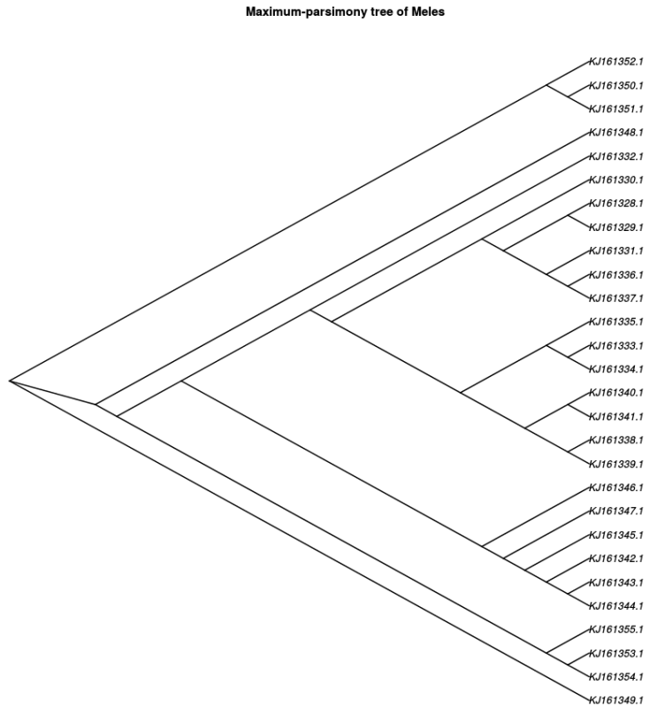

```{r}
library(phangorn)
# Conversion to phyDat for phangorn
gunnera.phydat <-
  as.phyDat(gunnera.mafft.ng)
# Prepare starting tree
gunnera.tre.ini <- nj(dist.dna(
  x=gunnera.mafft.ng, model="raw"))
?parsimony # Parsimony details
# Returns maximum parsimony score
parsimony(tree=gunnera.tre.ini,
  data=gunnera.phydat)
# Optimisation - returns MP tree
gunnera.tre.pars <- optim.parsimony
  (tree=gunnera.tre.ini,
  data=gunnera.phydat)
plot.phylo(x=gunnera.tre.pars,
  type="cladogram", edge.width=2)
```

<!-- MERGE-REVIEW: 1 old code block(s) in TEX frame were dropped in favor of the .qmd section 'Maximum parsimony'. -->

<!-- MERGE-REVIEW: content of the .qmd section 'Maximum parsimony' was inserted at 2 frames; remove the unwanted duplicates. -->

Conversion to phyDat for phangorn

Prepare starting tree

Parsimony details

Returns maximum parsimony score

Optimisation - returns maximum parsimony tree

Draw a tree

```{r}
library("phangorn")
```

```{r}
gunnera_phydat <- as.phyDat(gunnera_mafft_ng)
```

```{r}
gunnera_tre_ini <- nj(dist.dna(x = gunnera_mafft_ng, model = "raw"))
```

```{r}
?parsimony
```

```{r}
parsimony(tree = gunnera_tre_ini, data = gunnera_phydat)
```

```{r}
gunnera_tre_pars <- optim.parsimony(tree = gunnera_tre_ini, data = gunnera_phydat)
```

```{r}
plot.phylo(x = gunnera_tre_pars, type = "cladogram", edge.width = 2)
title("Maximum-parsimony tree of Gunnera spp.")

```

## Seeing trees in the forest

### Topographical distances among trees I - implementations

- Comparing plenty of individual gene trees, finding different topologies, construction of consensual species tree topology

- Robinsons-Foulds distance in `phytools::multiRF`

  - The index adds 1 for each difference between pair of trees
  - Well defined only for fully bifurcating trees - if not fulfilled, some results might be misleading
  - Allow comparison of trees created by different methods
  - If the difference is very close to root, RF value can be large, even there are not much differences in the tree at all - `dist.multiPhylo` from package [distory](https://CRAN.R-project.org/package=distory) can be an alternative, although interpretation of that geodesic distance is sometimes not so straightforward as simple logic of RF

- Methods implemented in `ape::dist.topo` allow comparison of trees with polytomies (`method="PH85"`) or use of squared lengths of internal branches (`method="score"`)

- Final matrices are commonly not [Euclidean](https://en.wikipedia.org/wiki/Euclidean_distance_matrix) - may be problematic for usage in methods like PCoA

  - Test it with `ade4::is.euclid`, can be scaled (forced to became Euclidean) by functions like `quasieuclid` or `cailliez` in `ade4` - carefully, it can damage meaning of the data
  - We get matrix of pairwise differences among trees (from multiple genes), we need display and analyze it

- Set of tools for identifying discordant phylogenetic trees are e.g. in package [kdetrees](https://github.com/V-Z/kdetrees)

- Filtered trees (with removed outlying topologies) are input for further species tree reconstruction method

- Other approach are phylogenetic networks searching consensus among phylogenetic trees

- In any case, there are plenty of options how to display the differences among the trees

<!-- MERGE-REVIEW: content of the .qmd section 'Topographical distances among trees' was inserted at 7 frames; remove the unwanted duplicates. -->

Compute matrix of topological distances among phylogenetic trees

Basic information about the distance matrix

Create heatmaps using heatmap.2 function from gplots package

Robinsons-Foulds distance

Add names of columns and rows

Create heatmap using corrplot function from corrplot package

PCoA from distance matrices of topographical differences among trees Test if the distance matrix is Euclidean or not

Calculate the PCoA

Plot PCoA

Add kernel densities

Add histogram of eigenvalues

Add title to the plot

Alternative function to plot PCA plot

See current state

Remove outlying trees

See after removal

```{r}
library("gplots")
library("corrplot")
library("phytools")
```

```{r}
?dist.topo # See details of available computing methods
oxalis_trees_d <- dist.topo(x = oxalis_trees, method = "score")
```

```{r}
dim(as.matrix(oxalis_trees_d))
head.matrix(as.matrix(oxalis_trees_d))
```

```{r}
heatmap.2(x = as.matrix(x = oxalis_trees_d), Rowv = FALSE, Colv = "Rowv", dendrogram = "none", symm = TRUE, scale = "none", na.rm = TRUE, revC = FALSE, col = rainbow(15), cellnote = round(x = as.matrix(x = oxalis_trees_d), digits = 2), notecex = 1, notecol = "white", trace = "row", linecol = "black", labRow = names(oxalis_trees), labCol = names(oxalis_trees), key = TRUE, keysize = 2, density.info = "density", symkey = FALSE, main = "Correlation matrix of topographical distances", xlab = "Trees", ylab = "Trees")
```

```{r}
?multiRF # See help first...
oxalis_trees_d_rf <- multiRF(oxalis_trees)
```

```{r}
colnames(oxalis_trees_d_rf) <- names(oxalis_trees)
rownames(oxalis_trees_d_rf) <- names(oxalis_trees)
```

```{r}
corrplot(corr = oxalis_trees_d_rf, method = "circle", type = "upper", col = rainbow(15), title = "Correlation matrix of topographical distances", is.corr = FALSE, diag = FALSE, outline = TRUE, order = "alphabet", tl.pos = "lt", tl.col = "black")
corrplot(corr = oxalis_trees_d_rf, method = "number", type = "lower", add = TRUE, col = rainbow(15), title = "Correlation matrix of topographical distances", is.corr = FALSE, diag = FALSE, outline = FALSE, order = "alphabet", tl.pos = "ld", cl.pos = "n")
```

```{r}
library("ade4")
is.euclid(distmat = oxalis_trees_d, plot = TRUE)
```

```{r}
oxalis_trees_pcoa <- dudi.pco(d = oxalis_trees_d, scannf = TRUE, full = TRUE)
```

```{r}
s.label(dfxy = oxalis_trees_pcoa$li)
```

```{r}
s.kde2d(dfxy = oxalis_trees_pcoa$li, cpoint = 0, add.plot = TRUE)
```

```{r}
add.scatter.eig(oxalis_trees_pcoa[["eig"]], 3, 1, 2, posi = "topleft")
```

```{r}
title("PCoA of matrix of pairwise trees distances")
```

```{r}
scatter(x = oxalis_trees_pcoa, posieig = "topleft")
```

```{r}
oxalis_trees
```

```{r}
oxalis_trees[c("T471", "T639", "T654")] <- NULL
```

```{r}
oxalis_trees
```

### Topographical distances among trees II

**We have plenty of trees. How much are their topologies different?**

```{r}
library(gplots)
library(corrplot)
library(phytools)
# Compute matrix of topological distances among phylogenetic trees
?dist.topo # See details of available computing methods
oxalis.trees.d <- dist.topo(x=oxalis.trees, method="score")
# Basic information about the distance matrix
dim(as.matrix(oxalis.trees.d))
head.matrix(as.matrix(oxalis.trees.d))
```

- There are more options how to display the differences and identify (and possibly exclude) outlying trees - heatmap, PCoA, hierarchical clustering (e.g. package [dbscan](https://CRAN.R-project.org/package=dbscan)), ...
- Sources of incongruencies among trees: low-quality DNA/laboratory mistake, problem with alignment/gene tree reconstruction, gene duplication and [paralogy](https://en.wikipedia.org/wiki/Sequence_homology) (e.g. in polyploids), [ILS](https://en.wikipedia.org/wiki/Incomplete_lineage_sorting), [HGT](https://en.wikipedia.org/wiki/Horizontal_gene_transfer), ... - such problems must be inspected <!-- MERGE-REVIEW: 1 old code block(s) in TEX frame were dropped in favor of the .qmd section 'Topographical distances among trees'. -->

<!-- MERGE-REVIEW: content of the .qmd section 'Topographical distances among trees' was inserted at 7 frames; remove the unwanted duplicates. -->

Compute matrix of topological distances among phylogenetic trees

Basic information about the distance matrix

Create heatmaps using heatmap.2 function from gplots package

Robinsons-Foulds distance

Add names of columns and rows

Create heatmap using corrplot function from corrplot package

PCoA from distance matrices of topographical differences among trees Test if the distance matrix is Euclidean or not

Calculate the PCoA

Plot PCoA

Add kernel densities

Add histogram of eigenvalues

Add title to the plot

Alternative function to plot PCA plot

See current state

Remove outlying trees

See after removal

```{r}
library("gplots")
library("corrplot")
library("phytools")
```

```{r}
?dist.topo # See details of available computing methods
oxalis_trees_d <- dist.topo(x = oxalis_trees, method = "score")
```

```{r}
dim(as.matrix(oxalis_trees_d))
head.matrix(as.matrix(oxalis_trees_d))
```

```{r}
heatmap.2(x = as.matrix(x = oxalis_trees_d), Rowv = FALSE, Colv = "Rowv", dendrogram = "none", symm = TRUE, scale = "none", na.rm = TRUE, revC = FALSE, col = rainbow(15), cellnote = round(x = as.matrix(x = oxalis_trees_d), digits = 2), notecex = 1, notecol = "white", trace = "row", linecol = "black", labRow = names(oxalis_trees), labCol = names(oxalis_trees), key = TRUE, keysize = 2, density.info = "density", symkey = FALSE, main = "Correlation matrix of topographical distances", xlab = "Trees", ylab = "Trees")
```

```{r}
?multiRF # See help first...
oxalis_trees_d_rf <- multiRF(oxalis_trees)
```

```{r}
colnames(oxalis_trees_d_rf) <- names(oxalis_trees)
rownames(oxalis_trees_d_rf) <- names(oxalis_trees)
```

```{r}
corrplot(corr = oxalis_trees_d_rf, method = "circle", type = "upper", col = rainbow(15), title = "Correlation matrix of topographical distances", is.corr = FALSE, diag = FALSE, outline = TRUE, order = "alphabet", tl.pos = "lt", tl.col = "black")
corrplot(corr = oxalis_trees_d_rf, method = "number", type = "lower", add = TRUE, col = rainbow(15), title = "Correlation matrix of topographical distances", is.corr = FALSE, diag = FALSE, outline = FALSE, order = "alphabet", tl.pos = "ld", cl.pos = "n")
```

```{r}
library("ade4")
is.euclid(distmat = oxalis_trees_d, plot = TRUE)
```

```{r}
oxalis_trees_pcoa <- dudi.pco(d = oxalis_trees_d, scannf = TRUE, full = TRUE)
```

```{r}
s.label(dfxy = oxalis_trees_pcoa$li)
```

```{r}
s.kde2d(dfxy = oxalis_trees_pcoa$li, cpoint = 0, add.plot = TRUE)
```

```{r}
add.scatter.eig(oxalis_trees_pcoa[["eig"]], 3, 1, 2, posi = "topleft")
```

```{r}
title("PCoA of matrix of pairwise trees distances")
```

```{r}
scatter(x = oxalis_trees_pcoa, posieig = "topleft")
```

```{r}
oxalis_trees
```

```{r}
oxalis_trees[c("T471", "T639", "T654")] <- NULL
```

```{r}
oxalis_trees
```

### Topographical distances among trees III

**Post process the matrix and plot it**

- There are several methods for calculating distance matrices among the trees - some take branch lengths into account, some only topology
- There are plenty of heatmap functions, like `heatmap`, `heatmap2` (from [gplots](https://cran.r-project.org/package=gplots)), `heatmap.plus` ([archived](https://cran.r-project.org/package=heatmap.plus)), and more...

```{r}
# Create heat maps using heatmap.2 function from gplots package
heatmap.2(x=as.matrix(x=oxalis.trees.d), Rowv=FALSE, Colv="Rowv",
  dendrogram="none", symm=TRUE, scale="none", na.rm=TRUE, revC=FALSE,
  col=rainbow(15), cellnote=round(x=as.matrix(x=oxalis.trees.d), digits=2),
  notecex=1, notecol="white", trace="row", linecol="black",
  labRow=names(oxalis.trees), labCol=names(oxalis.trees), key=TRUE,
  keysize=2, density.info="density", symkey=FALSE, main="Correlation
  matrix of topographical distances", xlab="Trees", ylab="Trees")
```

<!-- MERGE-REVIEW: 1 old code block(s) in TEX frame were dropped in favor of the .qmd section 'Topographical distances among trees'. -->

<!-- MERGE-REVIEW: content of the .qmd section 'Topographical distances among trees' was inserted at 7 frames; remove the unwanted duplicates. -->

Compute matrix of topological distances among phylogenetic trees

Basic information about the distance matrix

Create heatmaps using heatmap.2 function from gplots package

Robinsons-Foulds distance

Add names of columns and rows

Create heatmap using corrplot function from corrplot package

PCoA from distance matrices of topographical differences among trees Test if the distance matrix is Euclidean or not

Calculate the PCoA

Plot PCoA

Add kernel densities

Add histogram of eigenvalues

Add title to the plot

Alternative function to plot PCA plot

See current state

Remove outlying trees

See after removal

```{r}
library("gplots")
library("corrplot")
library("phytools")
```

```{r}
?dist.topo # See details of available computing methods
oxalis_trees_d <- dist.topo(x = oxalis_trees, method = "score")
```

```{r}
dim(as.matrix(oxalis_trees_d))
head.matrix(as.matrix(oxalis_trees_d))
```

```{r}
heatmap.2(x = as.matrix(x = oxalis_trees_d), Rowv = FALSE, Colv = "Rowv", dendrogram = "none", symm = TRUE, scale = "none", na.rm = TRUE, revC = FALSE, col = rainbow(15), cellnote = round(x = as.matrix(x = oxalis_trees_d), digits = 2), notecex = 1, notecol = "white", trace = "row", linecol = "black", labRow = names(oxalis_trees), labCol = names(oxalis_trees), key = TRUE, keysize = 2, density.info = "density", symkey = FALSE, main = "Correlation matrix of topographical distances", xlab = "Trees", ylab = "Trees")
```

```{r}
?multiRF # See help first...
oxalis_trees_d_rf <- multiRF(oxalis_trees)
```

```{r}
colnames(oxalis_trees_d_rf) <- names(oxalis_trees)
rownames(oxalis_trees_d_rf) <- names(oxalis_trees)
```

```{r}
corrplot(corr = oxalis_trees_d_rf, method = "circle", type = "upper", col = rainbow(15), title = "Correlation matrix of topographical distances", is.corr = FALSE, diag = FALSE, outline = TRUE, order = "alphabet", tl.pos = "lt", tl.col = "black")
corrplot(corr = oxalis_trees_d_rf, method = "number", type = "lower", add = TRUE, col = rainbow(15), title = "Correlation matrix of topographical distances", is.corr = FALSE, diag = FALSE, outline = FALSE, order = "alphabet", tl.pos = "ld", cl.pos = "n")
```

```{r}
library("ade4")
is.euclid(distmat = oxalis_trees_d, plot = TRUE)
```

```{r}
oxalis_trees_pcoa <- dudi.pco(d = oxalis_trees_d, scannf = TRUE, full = TRUE)
```

```{r}
s.label(dfxy = oxalis_trees_pcoa$li)
```

```{r}
s.kde2d(dfxy = oxalis_trees_pcoa$li, cpoint = 0, add.plot = TRUE)
```

```{r}
add.scatter.eig(oxalis_trees_pcoa[["eig"]], 3, 1, 2, posi = "topleft")
```

```{r}
title("PCoA of matrix of pairwise trees distances")
```

```{r}
scatter(x = oxalis_trees_pcoa, posieig = "topleft")
```

```{r}
oxalis_trees
```

```{r}
oxalis_trees[c("T471", "T639", "T654")] <- NULL
```

```{r}
oxalis_trees
```

### Topographical distances among trees IV

**Calculate Robinsons-Foulds distance matrix among trees and plot it**

```{r}
# Robinsons-Foulds distance
?multiRF # See help first...
oxalis.trees.d.rf <- multiRF(oxalis.trees)
# Add names of columns and rows
colnames(oxalis.trees.d.rf) <- names(oxalis.trees)
rownames(oxalis.trees.d.rf) <- names(oxalis.trees)
# Create heatmap using corrplot function from corrplot package
corrplot(corr=oxalis.trees.d.rf, method="circle", type="upper",
  col=rainbow(15), title="Correlation matrix of topographical
  distances", is.corr=FALSE, diag=FALSE, outline=TRUE,
  order="alphabet", tl.pos="lt", tl.col="black")
corrplot(corr=oxalis.trees.d.rf, method="number", type="lower",
  add=TRUE, col=rainbow(15), title="Correlation matrix of
  topographical distances", is.corr=FALSE, diag=FALSE,
  outline=FALSE, order="alphabet", tl.pos="ld", cl.pos="n")
```

<!-- MERGE-REVIEW: 1 old code block(s) in TEX frame were dropped in favor of the .qmd section 'Topographical distances among trees'. -->

<!-- MERGE-REVIEW: content of the .qmd section 'Topographical distances among trees' was inserted at 7 frames; remove the unwanted duplicates. -->

Compute matrix of topological distances among phylogenetic trees

Basic information about the distance matrix

Create heatmaps using heatmap.2 function from gplots package

Robinsons-Foulds distance

Add names of columns and rows

Create heatmap using corrplot function from corrplot package

PCoA from distance matrices of topographical differences among trees Test if the distance matrix is Euclidean or not

Calculate the PCoA

Plot PCoA

Add kernel densities

Add histogram of eigenvalues

Add title to the plot

Alternative function to plot PCA plot

See current state

Remove outlying trees

See after removal

```{r}
library("gplots")
library("corrplot")
library("phytools")
```

```{r}
?dist.topo # See details of available computing methods
oxalis_trees_d <- dist.topo(x = oxalis_trees, method = "score")
```

```{r}
dim(as.matrix(oxalis_trees_d))
head.matrix(as.matrix(oxalis_trees_d))
```

```{r}
heatmap.2(x = as.matrix(x = oxalis_trees_d), Rowv = FALSE, Colv = "Rowv", dendrogram = "none", symm = TRUE, scale = "none", na.rm = TRUE, revC = FALSE, col = rainbow(15), cellnote = round(x = as.matrix(x = oxalis_trees_d), digits = 2), notecex = 1, notecol = "white", trace = "row", linecol = "black", labRow = names(oxalis_trees), labCol = names(oxalis_trees), key = TRUE, keysize = 2, density.info = "density", symkey = FALSE, main = "Correlation matrix of topographical distances", xlab = "Trees", ylab = "Trees")
```

```{r}
?multiRF # See help first...
oxalis_trees_d_rf <- multiRF(oxalis_trees)
```

```{r}
colnames(oxalis_trees_d_rf) <- names(oxalis_trees)
rownames(oxalis_trees_d_rf) <- names(oxalis_trees)
```

```{r}
corrplot(corr = oxalis_trees_d_rf, method = "circle", type = "upper", col = rainbow(15), title = "Correlation matrix of topographical distances", is.corr = FALSE, diag = FALSE, outline = TRUE, order = "alphabet", tl.pos = "lt", tl.col = "black")
corrplot(corr = oxalis_trees_d_rf, method = "number", type = "lower", add = TRUE, col = rainbow(15), title = "Correlation matrix of topographical distances", is.corr = FALSE, diag = FALSE, outline = FALSE, order = "alphabet", tl.pos = "ld", cl.pos = "n")
```

```{r}
library("ade4")
is.euclid(distmat = oxalis_trees_d, plot = TRUE)
```

```{r}
oxalis_trees_pcoa <- dudi.pco(d = oxalis_trees_d, scannf = TRUE, full = TRUE)
```

```{r}
s.label(dfxy = oxalis_trees_pcoa$li)
```

```{r}
s.kde2d(dfxy = oxalis_trees_pcoa$li, cpoint = 0, add.plot = TRUE)
```

```{r}
add.scatter.eig(oxalis_trees_pcoa[["eig"]], 3, 1, 2, posi = "topleft")
```

```{r}
title("PCoA of matrix of pairwise trees distances")
```

```{r}
scatter(x = oxalis_trees_pcoa, posieig = "topleft")
```

```{r}
oxalis_trees
```

```{r}
oxalis_trees[c("T471", "T639", "T654")] <- NULL
```

```{r}
oxalis_trees
```

### Topographical distances among trees V - the matrices

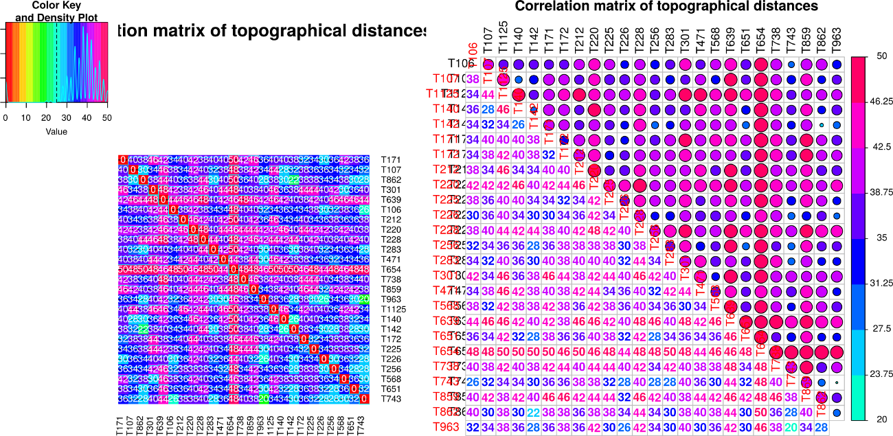

<!-- MERGE-REVIEW: content of the .qmd section 'Topographical distances among trees' was inserted at 7 frames; remove the unwanted duplicates. -->

Compute matrix of topological distances among phylogenetic trees

Basic information about the distance matrix

Create heatmaps using heatmap.2 function from gplots package

Robinsons-Foulds distance

Add names of columns and rows

Create heatmap using corrplot function from corrplot package

PCoA from distance matrices of topographical differences among trees Test if the distance matrix is Euclidean or not

Calculate the PCoA

Plot PCoA

Add kernel densities

Add histogram of eigenvalues

Add title to the plot

Alternative function to plot PCA plot

See current state

Remove outlying trees

See after removal

```{r}
library("gplots")
library("corrplot")
library("phytools")
```

```{r}
?dist.topo # See details of available computing methods
oxalis_trees_d <- dist.topo(x = oxalis_trees, method = "score")
```

```{r}
dim(as.matrix(oxalis_trees_d))
head.matrix(as.matrix(oxalis_trees_d))
```

```{r}
heatmap.2(x = as.matrix(x = oxalis_trees_d), Rowv = FALSE, Colv = "Rowv", dendrogram = "none", symm = TRUE, scale = "none", na.rm = TRUE, revC = FALSE, col = rainbow(15), cellnote = round(x = as.matrix(x = oxalis_trees_d), digits = 2), notecex = 1, notecol = "white", trace = "row", linecol = "black", labRow = names(oxalis_trees), labCol = names(oxalis_trees), key = TRUE, keysize = 2, density.info = "density", symkey = FALSE, main = "Correlation matrix of topographical distances", xlab = "Trees", ylab = "Trees")
```

```{r}
?multiRF # See help first...
oxalis_trees_d_rf <- multiRF(oxalis_trees)
```

```{r}
colnames(oxalis_trees_d_rf) <- names(oxalis_trees)
rownames(oxalis_trees_d_rf) <- names(oxalis_trees)
```

```{r}
corrplot(corr = oxalis_trees_d_rf, method = "circle", type = "upper", col = rainbow(15), title = "Correlation matrix of topographical distances", is.corr = FALSE, diag = FALSE, outline = TRUE, order = "alphabet", tl.pos = "lt", tl.col = "black")
corrplot(corr = oxalis_trees_d_rf, method = "number", type = "lower", add = TRUE, col = rainbow(15), title = "Correlation matrix of topographical distances", is.corr = FALSE, diag = FALSE, outline = FALSE, order = "alphabet", tl.pos = "ld", cl.pos = "n")
```

```{r}
library("ade4")
is.euclid(distmat = oxalis_trees_d, plot = TRUE)
```

```{r}
oxalis_trees_pcoa <- dudi.pco(d = oxalis_trees_d, scannf = TRUE, full = TRUE)
```

```{r}
s.label(dfxy = oxalis_trees_pcoa$li)
```

```{r}
s.kde2d(dfxy = oxalis_trees_pcoa$li, cpoint = 0, add.plot = TRUE)
```

```{r}
add.scatter.eig(oxalis_trees_pcoa[["eig"]], 3, 1, 2, posi = "topleft")
```

```{r}
title("PCoA of matrix of pairwise trees distances")
```

```{r}
scatter(x = oxalis_trees_pcoa, posieig = "topleft")
```

```{r}
oxalis_trees
```

```{r}
oxalis_trees[c("T471", "T639", "T654")] <- NULL
```

```{r}
oxalis_trees
```

### PCoA from distance matrices of topographical differences among trees - the code

**PC plots help to identify outliers - trees with noticeably different topology**

```{r}
library(ade4) # Test if the distance matrix is Euclidean or not
is.euclid(distmat=oxalis.trees.d, plot=TRUE)
[1] TRUE # If FALSE, we can use e.g. quasieuclid() to make it Euclidean
# Calculate the PCoA
oxalis.trees.pcoa <- dudi.pco(d=oxalis.trees.d, scannf=TRUE, full=TRUE)
# Plot PCoA and add kernel densities
s.label(dfxy=oxalis.trees.pcoa$li)
s.kde2d(dfxy=oxalis.trees.pcoa$li, cpoint=0, add.plot=TRUE)
# Add histogram of eigenvalues
add.scatter.eig(oxalis.trees.pcoa[["eig"]], 3,1,2, posi="topleft")
# Add title to the plot
title("PCoA of matrix of pairwise trees distances")
scatter(x=oxalis.trees.pcoa, posieig="topleft") # Alternative plotting PCA
```

<!-- MERGE-REVIEW: no counterpart section found in QMD; code below comes from the old TEX version. -->

### PCoA from distance matrices of topographical differences among trees - the plot

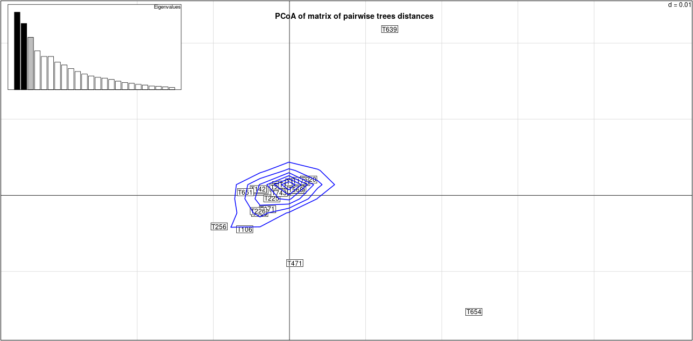

```{r}
# See current state
oxalis.trees
# Remove outlying trees
oxalis.trees[c("T471", "T639",
  "T654")] <- NULL
# See after removal
oxalis.trees
```

- Of course, think what could cause observed difference...

  - Problem in lab?
  - Paralog? ILS? HGT? ... ?
  - Try to BLAST the gene <!-- MERGE-REVIEW: no counterpart section found in QMD; code below comes from the old TEX version. -->

### kdetrees - identification of outlying trees I

- See slide for installation
- Distance-based method of identification of trees with significantly different topology
- Function `kdetrees` has plenty of options...
- Parameter `k` sets threshold for trees to be removed - it requires repeated running with different `k` (and plotting the figures) to decide which trees to remove and which to keep

```{r}
# Load library
library(kdetrees)
?kdetrees # See options
# Run main function - play with parameter k
oxalis.kde <- kdetrees(trees=oxalis.trees, k=0.4,
  distance="dissimilarity", topo.only=FALSE, greedy=TRUE)
# See results
oxalis.kde
plot(oxalis.kde)
hist(oxalis.kde)
```

<!-- MERGE-REVIEW: no counterpart section found in QMD; code below comes from the old TEX version. -->

### kdetrees - identification of outlying trees II

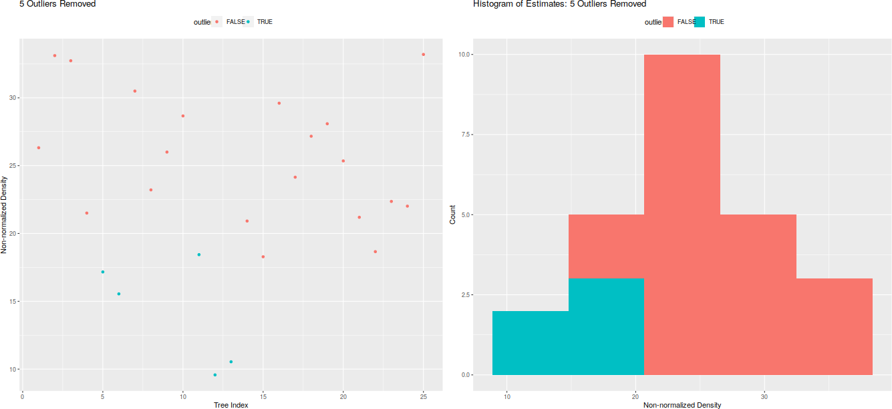 <!-- MERGE-REVIEW: no counterpart section found in QMD; content from TEX kept as-is. -->

### kdetrees - identification of outlying trees III

- Value of `k` is multiplication index: 1 is default, below 1 is more strict (more trees removed), above 1 more permissive (more trees kept)

```{r}
# See removed trees
plot(oxalis.kde[["outliers"]])
# Save removed trees
write.tree(phy=oxalis.kde[["outliers"]], file="oxalis_trees_outliers.nwk")
# Save kdetrees report
write.table(x=as.data.frame(x=oxalis.kde), file="oxalis_trees_scores.tsv",
  quote=FALSE, sep="\t")
# Extract passing trees
oxalis.trees.good <- oxalis.trees[names(oxalis.trees) %in%
  names(oxalis.kde[["outliers"]]) == FALSE]
oxalis.trees.good
# Save passing trees
write.tree(phy=oxalis.trees.good, file="trees_good.nwk")
```

<!-- MERGE-REVIEW: no counterpart section found in QMD; code below comes from the old TEX version. -->

### Consensus tree

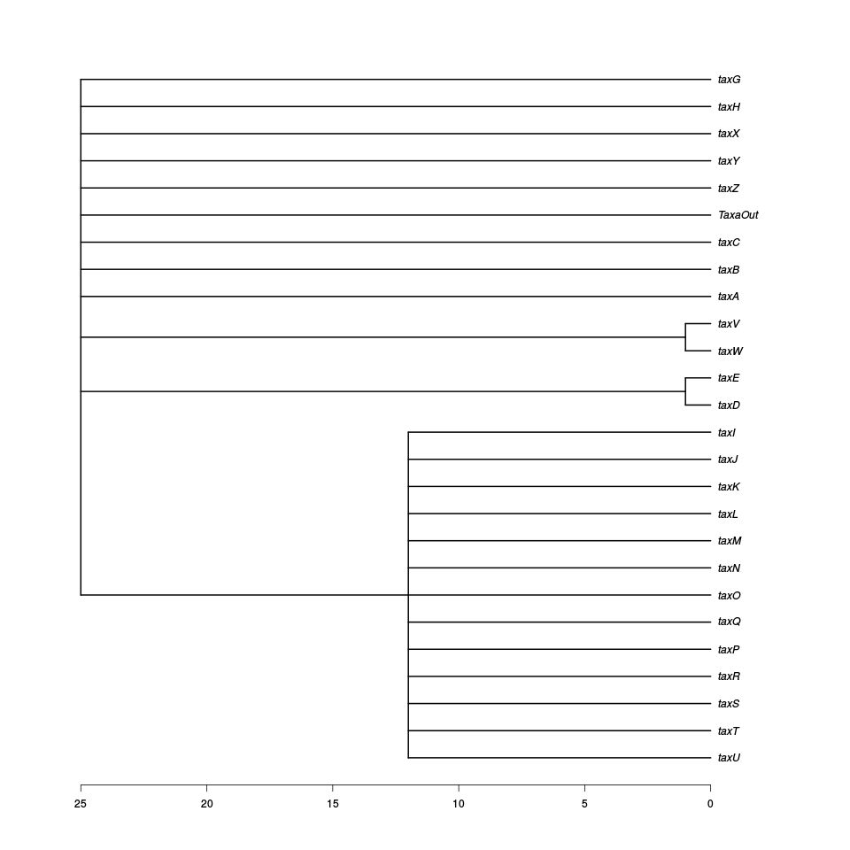

- Very basic method simply collapsing all nodes with lower than required (typically 50--75%) identity
- There is no underlying model, only comparison of topologies

```{r}
# Consensus tree (50% rule)
oxalis.tree.con <- consensus
  (oxalis.trees.rooted, p=0.5,
  check.labels=TRUE)
print.phylo(oxalis.tree.con)
# Plot the tree
plot.phylo(oxalis.tree.con,
  edge.width=2, label.offset=0.3)
axisPhylo(side=1)
# What a nice tree... :-P
```

<!-- MERGE-REVIEW: no counterpart section found in QMD; code below comes from the old TEX version. -->

### Species tree - all trees must be ultrametric

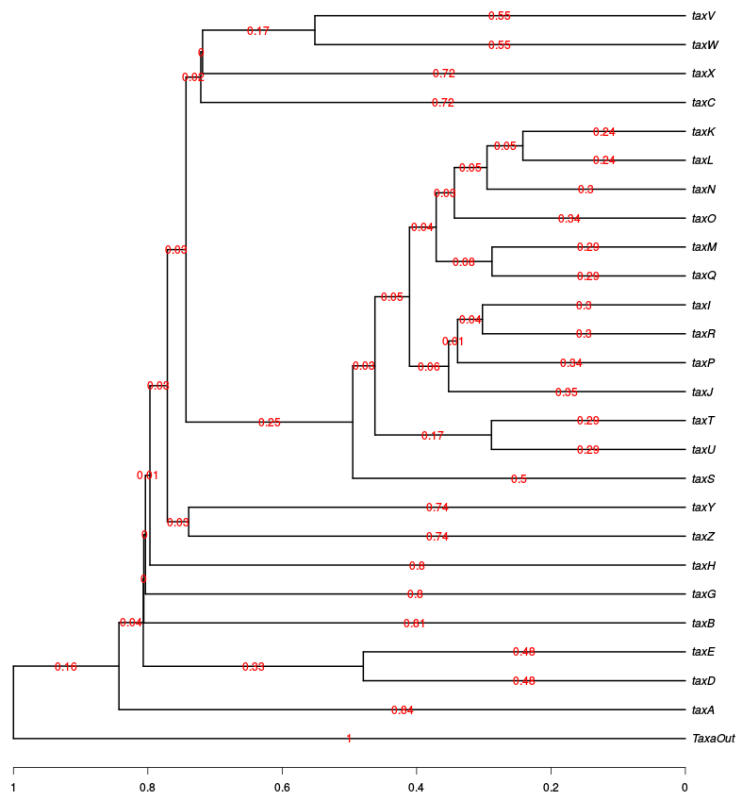

```{r}
# Chronos scale trees
oxalis.trees.ultra <- lapply
  (X=oxalis.trees.rooted,
  FUN=chronos, model="correlated")
class(oxalis.trees.ultra) <-
  "multiPhylo"
?speciesTree # Mean distances
oxalis.tree.sp.mean <- speciesTree
  (x=oxalis.trees.ultra, FUN=mean)
# Plot the tree
plot.phylo(oxalis.tree.sp.mean,
  edge.width=2, label.offset=0.01)
edgelabels(text=round(oxalis.
  tree.sp.mean[["edge.length"]],
  digits=2), frame="none",
  col="red", bg="none")
axisPhylo(side=1)
```

<!-- MERGE-REVIEW: no counterpart section found in QMD; code below comes from the old TEX version. -->

### Parsimony super tree

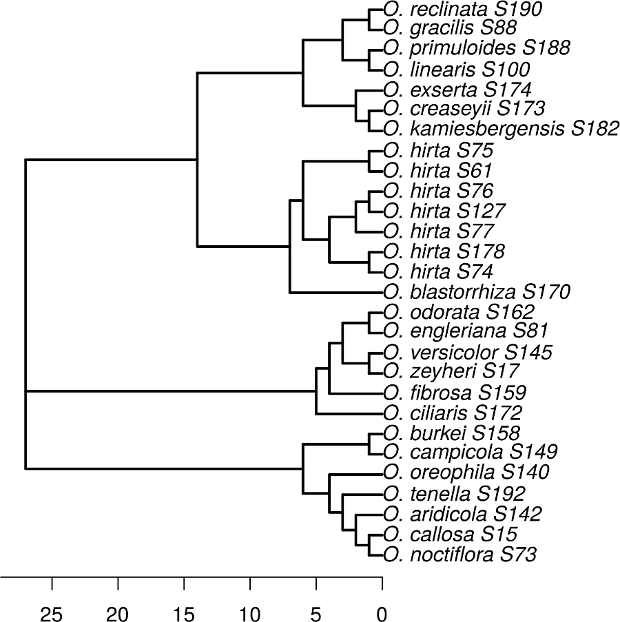

```{r}
library(phytools)
?mrp.supertree # See details
oxalis.tree.sp <- mrp.supertree
  (tree=oxalis.trees.rooted,
  method="optim.parsimony",
  rooted=TRUE)
print.phylo(oxalis.tree.sp)
plot.phylo(oxalis.tree.sp,
  edge.width=2, label.offset=0.01)
axisPhylo(side=1)
# Similar function
?phangorn::superTree
# Coalescence model to handle
# multiple individuals per species
?phangorn::coalSpeciesTree
```

<!-- MERGE-REVIEW: no counterpart section found in QMD; code below comes from the old TEX version. -->

### Species trees from phybase

```{=html}
<!--
TODO phybase, STAR, STEAC
    \begin{itemize}
        \item Package \href{https://github.com/lliu1871/phybase}{phybase} (\href{https://academic.oup.com/bioinformatics/article/26/7/962/212978}{citation}) implements several methods of building of species tree ouf of list of gene trees (and some functions to manipulate trees, data, etc.) --- we try \href{https://www.liebertpub.com/doi/abs/10.1089/cmb.2012.0101}{STAR} and \href{https://academic.oup.com/sysbio/article/58/5/468/1635625}{STEAC}
    \end{itemize}
    @@TOKEN0@@

-->
```

<!-- MERGE-REVIEW: no counterpart section found in QMD; content from TEX kept as-is. -->

### Networks

```{r}
library(phangorn) # All tips must be in all trees
oxalis.tree.net <- consensusNet(oxalis.trees.rooted, prob=0.25)
plot(x=oxalis.tree.net, planar=FALSE, type="2D", use.edge.length=TRUE,
  show.tip.label=TRUE, show.edge.label=TRUE, show.node.label=TRUE,
  show.nodes=TRUE, edge.color="black", tip.color="blue") # 2D
plot(x=oxalis.tree.net, planar=FALSE, type="3D", use.edge.length=TRUE,
  show.tip.label=TRUE, show.edge.label=TRUE, show.node.label=TRUE,
  show.nodes=TRUE, edge.color= "black", tip.color="blue") # 3D
```

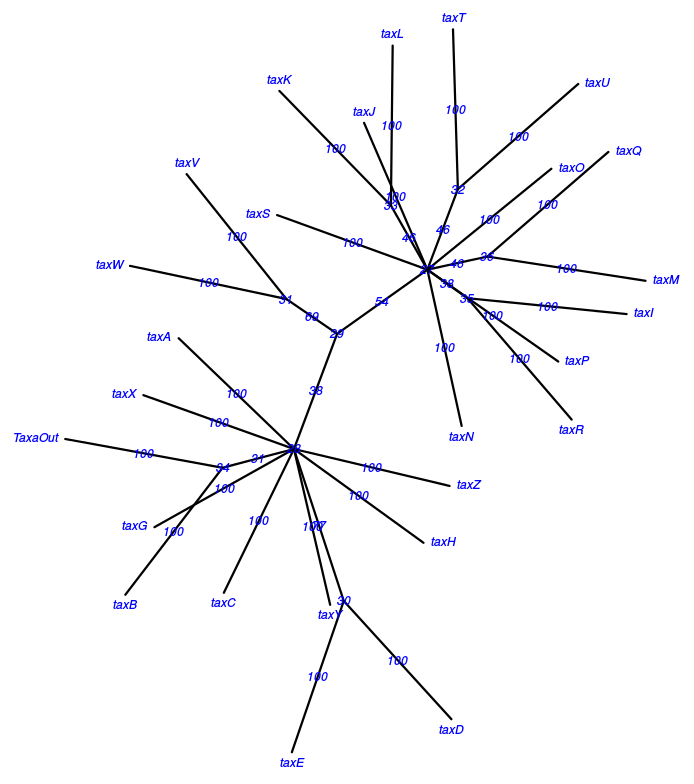 <!-- MERGE-REVIEW: no counterpart section found in QMD; code below comes from the old TEX version. -->

## Comparisons

### Density tree I

```{r}
# Prepare list of trees to show
hauss.nj.trees <- list(hauss.nj, hauss.nj.bruvo, hauss.nj.rooted)
hauss.nj.trees <- lapply(X=hauss.nj.trees, FUN=compute.brlen)
hauss.nj.trees <- lapply(X=hauss.nj.trees, FUN=chronos)
class(hauss.nj.trees) <- "multiPhylo"
# The trees should be (otherwise plotting works, but may be ugly)...
is.rooted(hauss.nj.trees) # rooted,
is.ultrametric(hauss.nj.trees) # ultrametric and
is.binary(hauss.nj.trees) # binary bifurcating.
# Plotting has various options, play with it
phangorn::densiTree(x=hauss.nj.trees, direction="downwards",
  scaleX=TRUE, col=rainbow(3), width=5, cex=1.5) # See next slide
densiTree(x=hauss.nj.trees, direction="upwards", scaleX=TRUE, width=5)
densiTree(x=hauss.nj.trees, scaleX=TRUE, width=5, cex=1.5)
# Compare this option with similar on following slide
?phangorn::densiTree
?phytools::densityTree
```

<!-- MERGE-REVIEW: no counterpart section found in QMD; code below comes from the old TEX version. -->

### Density tree II

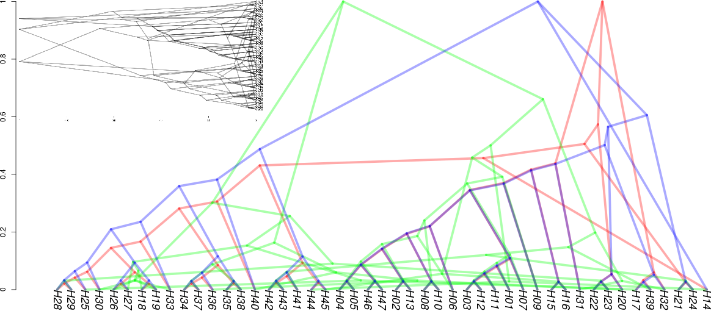 <!-- MERGE-REVIEW: no counterpart section found in QMD; content from TEX kept as-is. -->

### Density tree III

```{r}
phytools::densityTree(trees=oxalis.trees.ultra, fix.depth=TRUE,
  use.gradient=TRUE, alpha=0.5, lwd=4) # Probably to much noise... :-?
phytools::densityTree(trees=oxalis.trees.ultra[1:3], fix.depth=TRUE,
  use.gradient=TRUE, alpha=0.5, lwd=4) # Nice selection
phytools::densityTree(trees=oxalis.trees.ultra[c(2,4,6,7)],
  fix.depth=TRUE, use.gradient=TRUE, alpha=0.5, lwd=4) # Nice selection
```

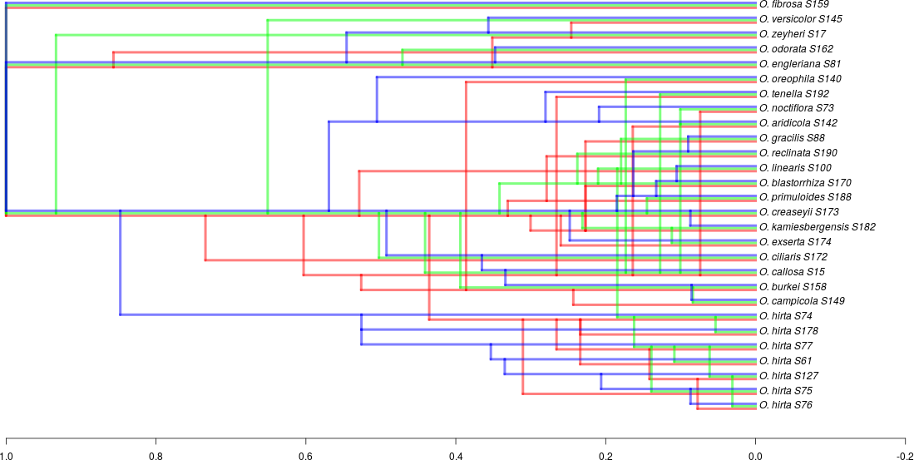 <!-- MERGE-REVIEW: no counterpart section found in QMD; code below comes from the old TEX version. -->

### Kronoviz - see all trees on same scale

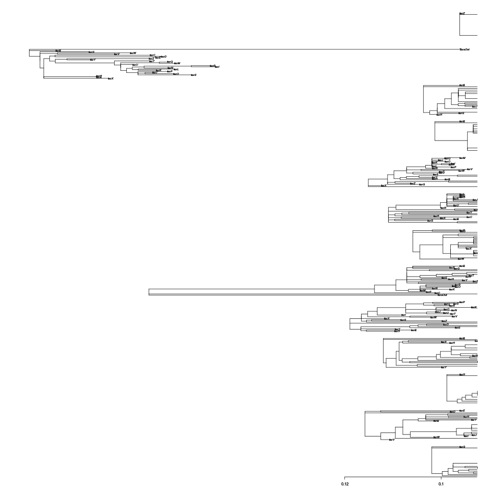

```{r}
kronoviz(x=oxalis.trees.rooted,
  layout=length(
  oxalis.trees.rooted),
  horiz=TRUE)
# Close graphical device to
# cancel division of plotting
# device
dev.off()
```

- The plot can be very long and it can be hard to see details
- But one can get impression if all trees are more or less in same scale (have comparable length) or not <!-- MERGE-REVIEW: no counterpart section found in QMD; code below comes from the old TEX version. -->

### Compare two trees

```{r}
# Compare topology of the species trees - basically outputs TRUE/FALSE
all.equal.phylo(oxalis.tree.sp, oxalis.tree.sp.mean, use.edge.length=FALSE)
?all.equal.phylo # Use to see comparison possibilities
# Plot two trees with connecting lines
# We need 2 column matrix with tip labels
tips.labels <- matrix(data=c(sort(oxalis.tree.sp[["tip.label"]]),
  sort(oxalis.tree.sp.mean[["tip.label"]])), nrow=length
  (oxalis.tree.sp[["tip.label"]]), ncol=2)
# Draw a tree - play with graphical parameters and use rotate=TRUE
# to be able to adjust fit manually
cophyloplot(x=ladderize(oxalis.tree.sp), y=ladderize(oxalis.tree.sp.mean),
  assoc=tips.labels, use.edge.length=FALSE, space=60, length.line=1, gap=2,
  type="phylogram", rotate=TRUE, col="red", lwd=1.5, lty=2)
title("Comparing the trees\nParsimony super tree\tSpecies tree")
legend("topleft", legend="Red lines\nconnect tips", text.col="red",
  cex=0.75, bty="n", x.intersp=-2, y.intersp=-2)
```

<!-- MERGE-REVIEW: 1 old code block(s) in TEX frame were dropped in favor of the .qmd section 'Compare two trees'. -->

<!-- MERGE-REVIEW: content of the .qmd section 'Compare two trees' was inserted at 2 frames; remove the unwanted duplicates. -->

Compare topology of the species trees - basically outputs TRUE/FALSE

Plot two trees with connecting lines We need 2 column matrix with tip labels

Draw a tree - play with graphical parameters and use rotate = TRUE to be able to adjust fit manually

Alternative implementation

```{r}
all.equal.phylo(oxalis_tree_sp, oxalis_tree_sp_mean, use.edge.length = FALSE)
?all.equal.phylo # Use to see comparison possibilities
```

```{r}
tips_labels <- matrix(data = c(sort(oxalis_tree_sp[["tip.label"]]), sort(oxalis_tree_sp_mean[["tip.label"]])), nrow = length(oxalis_tree_sp[["tip.label"]]), ncol = 2)
tips_labels
```

```{r}
cophyloplot(x = ladderize(oxalis_tree_sp), y = ladderize(oxalis_tree_sp_mean), assoc = tips_labels, use.edge.length = FALSE, space = 60, length.line = 1, gap = 2, type = "phylogram", rotate = TRUE, col = "red", lwd = 1.5, lty = 2)
title("Comparing the trees\nParsimony super tree\tSpecies tree")
legend("topleft", legend = "Red lines\nconnect tips", text.col = "red", cex = 0.75, bty = "n", x.intersp = -2, y.intersp = -2)
```

```{r}
oxalis_cophylo <- cophylo(tr1 = oxalis_tree_sp, tr2 = oxalis_tree_sp_mean, assoc = (cbind(sort(oxalis_tree_sp$tip.label), sort(oxalis_tree_sp$tip.label))), rotate = TRUE)
plot.cophylo(x = oxalis_cophylo, lwd = 2, link.type = "curved")
title("Comparisson of species tree (left) and parsimony supertree (right)")
```

### Cophyloplot comparing two trees

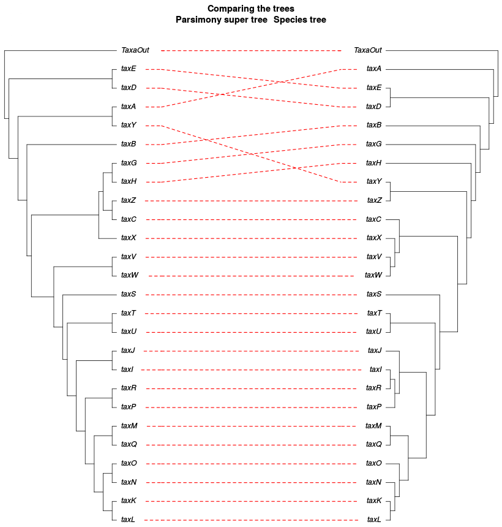

- `ladderize()` pre-sorts tips in the tree - it can help to `cophyloplot()` to reduce crossings
- `cophyloplot()` has not any optimization to plot the lines
- Automatic plot is usually not perfect - there use to be unneeded crossing lines - `rotate=TRUE` is recommended to can fix this manually by clicking to the nodes
- `cophyloplot()` has similar parameters like `plot.phylo()` - play with it and/or adjust in graphical editor
- Other options are in package [dendextend](https://CRAN.R-project.org/package=dendextend)

<!-- MERGE-REVIEW: content of the .qmd section 'Compare two trees' was inserted at 2 frames; remove the unwanted duplicates. -->

Compare topology of the species trees - basically outputs TRUE/FALSE

Plot two trees with connecting lines We need 2 column matrix with tip labels

Draw a tree - play with graphical parameters and use rotate = TRUE to be able to adjust fit manually

Alternative implementation

```{r}
all.equal.phylo(oxalis_tree_sp, oxalis_tree_sp_mean, use.edge.length = FALSE)
?all.equal.phylo # Use to see comparison possibilities
```

```{r}
tips_labels <- matrix(data = c(sort(oxalis_tree_sp[["tip.label"]]), sort(oxalis_tree_sp_mean[["tip.label"]])), nrow = length(oxalis_tree_sp[["tip.label"]]), ncol = 2)
tips_labels
```

```{r}
cophyloplot(x = ladderize(oxalis_tree_sp), y = ladderize(oxalis_tree_sp_mean), assoc = tips_labels, use.edge.length = FALSE, space = 60, length.line = 1, gap = 2, type = "phylogram", rotate = TRUE, col = "red", lwd = 1.5, lty = 2)
title("Comparing the trees\nParsimony super tree\tSpecies tree")
legend("topleft", legend = "Red lines\nconnect tips", text.col = "red", cex = 0.75, bty = "n", x.intersp = -2, y.intersp = -2)
```

```{r}
oxalis_cophylo <- cophylo(tr1 = oxalis_tree_sp, tr2 = oxalis_tree_sp_mean, assoc = (cbind(sort(oxalis_tree_sp$tip.label), sort(oxalis_tree_sp$tip.label))), rotate = TRUE)
plot.cophylo(x = oxalis_cophylo, lwd = 2, link.type = "curved")
title("Comparisson of species tree (left) and parsimony supertree (right)")
```

### Alternative implementation - phytools::cophylo

```{r}
?cophylo # See options
# Prepare the object for plotting
oxalis.cophylo <- cophylo(tr1=oxalis.tree.sp, tr2=oxalis.tree.sp.mean,
  assoc=(cbind(sort(oxalis.tree.sp$tip.label),
  sort(oxalis.tree.sp$tip.label))), rotate=TRUE)
plot.cophylo(x=oxalis.cophylo, lwd=2, link.type="curved") # Plot it
title("Comparison of species tree (left) and parsimony supertree (right)")
```

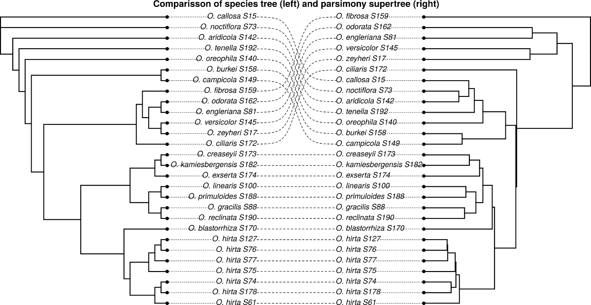 <!-- MERGE-REVIEW: no counterpart section found in QMD; code below comes from the old TEX version. -->

## Notes about plotting the trees

### Change orientation of plots

- `plot.phylo()` has plenty of possibilities to influence - check `?plot.phylo`, `?par`, `?points`, ...\*\*

```{r}
?plot.phylo # check it for various possibilities what to influence
par(mfrow=c(1, 2)) # Plot two plots in one row
plot.phylo(x=hauss.nj, type="cladogram", use.edge.length=FALSE,
  direction="rightwards")
plot.phylo(x=hauss.nj, type="cladogram", use.edge.length=FALSE,
  direction="leftwards")
dev.off() # Close graphical device to cancel par() settings
```

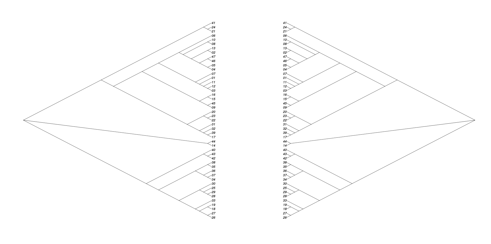 <!-- MERGE-REVIEW: no counterpart section found in QMD; code below comes from the old TEX version. -->

### Highlighted labels

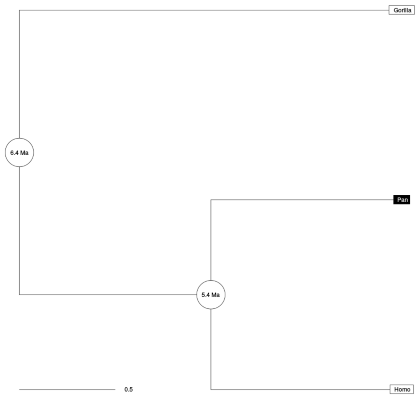

```{r}
# Load tree in text format
trape <- read.tree(text=
  "((Homo, Pan), Gorilla);")
# Plot the tree
plot.phylo(x=trape,
  show.tip.label=FALSE)
# Add colored tip labels
tiplabels(trape[["tip.label"]],
  bg=c("white", "black",
  "white"), col=c("black",
  "white", "black"), cex=2)
# Add colored node labels
nodelabels(text=c("6.4 Ma",
  "5.4 Ma"), frame="circle",
  bg="yellow")
add.scale.bar() # Add scale bar
# Note vectors for tip/node labels
```

<!-- MERGE-REVIEW: no counterpart section found in QMD; code below comes from the old TEX version. -->

## Tasks

### Trees tasks

1.  Import/export some tree(s), preferably your data you are working with. Try various plotting options.
2.  Try various displays of some tree(s) from phytools dataset (see `data(package="phytools")`).
3.  Use some method to analyze Apicomplexa trees (see `?kdetrees::apicomplexa`) or some your data. Find discordant trees and try to construct species tree from the set of gene trees.
4.  Browse <https://blog.phytools.org/> for a while. Do you find there some interesting/useful display? Try something with your or test data. <!-- MERGE-REVIEW: no counterpart section found in QMD; content from TEX kept as-is. -->

