# Evolution

### Overview of methods and questions of reconstruction of evolution of traits

- Testing if there is correlation between evolution of two or more characters (if they evolve together)

- Testing if there is correlation between one character and phylogenetic history (if trait changes follow evolution)

- Reconstruction of ancestral states of character

- For some methods, taxonomic level can be taken into account (if there is significant evolutionary signal on the trait evolution on e.g. level of genus or family)

- Generally available for continuous as well as discrete characters (not all methods)

- Some methods can handle more observations per accession

- There are various methods how to display everything

- Methods and models are highly debated in the literature

  - Different experts commonly disagree what is the best method...
  - General methods are not usable everywhere (e.g. evolution of genome size must take into account polyploidization - [chromEvol](https://chromevol.evolseq.net/))
  - Usage is better to be consulted with some relevant expert
  - This is very difficult chapter by meaning of how to find the best method to analyze particular data...

- Always read manual and original papers explaining the methods

  - Some methods match values and tips according to labels, some according to order (**!**)
  - Functions often require input in specific form <!-- MERGE-REVIEW: no counterpart section found in QMD; content from TEX kept as-is. -->

## PIC

### Phylogenetic independent contrast

- When analyzing comparative data takes phylogeny into account
- If we assume that a continuous trait evolves randomly in any direction (i.e. following [Brownian motion](https://en.wikipedia.org/wiki/Brownian_motion) model), then the "[contrast](https://en.wikipedia.org/wiki/Contrast_(statistics))" between two species is expected to have a normal distribution with mean zero, and variance proportional to the time since divergence

```{r}
data(shorebird, package="caper") # Load training data
?caper::shorebird # See it
head(shorebird.data) # See the data part
shorebird.tree # See the phylogeny
plot.phylo(shorebird.tree)
# The tree must be fully bifurcating for most of methods
# multi2di randomly splits polytomies into bifurcating topology
shorebird.tree <- multi2di(phy=shorebird.tree)
plot.phylo(shorebird.tree) # See result
```

<!-- MERGE-REVIEW: 1 old code block(s) in TEX frame were dropped in favor of the .qmd section 'Phylogenetic PCA'. -->

Calculate pPCA

Print results

See summary information

See PCA scores for variables on phylogenetic tree

See decomposition of pPCA eigenvalues

Plot pPCA results - global vs. local structure, decomposition of pPCA eigenvalues, PCA plot of variables and PCA scores for variables on phylogenetic tree

Implementation in caper package

See the plot of observer and fitted values

```{r}
library("adephylo") # Library needed to create phylo4d object required by ppca
library("phylobase")
```

```{r}
shorebird_ppca <- ppca(x = phylo4d(x = shorebird_tree, shorebird.data[, 2:5]), method = "patristic", center = TRUE, scale = TRUE, scannf = TRUE, nfposi = 1, nfnega = 0)
```

```{r}
print(shorebird_ppca)
```

```{r}
summary(shorebird_ppca)
```

```{r}
scatter(shorebird_ppca)
```

```{r}
screeplot(shorebird_ppca)
```

```{r}
plot(shorebird_ppca)
```

```{=html}
<!--
## TODO Orthonormal Decomposition - phylogenetic eigenvector regression
#
# Decomposition of topographical distances (right plot)
library("phylobase")
table.phylo4d(x = phylo4d(x = shorebird_tree, tip.data = treePart(x = shorebird_tree, result = "orthobasis")), treetype = "cladogram")
#
# Generate some random variable
library("geiger")
shorebird_eco <- sim.char(phy = shorebird_tree, par = 0.1, nsim = 1, model = "BM")[, , 1]
?sim.char # See it for another possibilities to simulate data
# Names for the values
names(shorebird_eco) <- shorebird_tree[["tip.label"]]
shorebird_eco # See it
#
# significant result - significant phylogenetic inertia (phylogenetic effect) - the tendency for traits to resist evolutionary change despite environmental perturbations
anova(lm(shorebird_eco ~ as.matrix(orthobasis.phylo(x = shorebird_tree, method = "patristic")[, 1:2])))
anova(lm(shorebird.data[["M.Mass"]] ~ as.matrix(orthobasis.phylo(x = shorebird_tree, method = "patristic")[, 1:2])))
orthogram(x = shorebird_eco, tre = shorebird_tree, nrepet = 1000, alter = "two-sided")
?orthogram # See another calculation possibilities
orthogram(x = shorebird.data[["M.Mass"]], tre = shorebird_tree, nrepet = 1000, alter = "two-sided")

## Phylogenetic Generalized Least Squares

Functions corBlomberg, corBrownian, corMartins and corPagel from ape package create correlation matrix of evolution of continuous character according to the given tree - same parameters (except 'value')
Fitting an Ornstein-Uhlenbeck Motion model in PGLS
-->
```

```{r}
library("nlme")
summary(gls(model = F.Mass ~ Egg.Mass, data = shorebird.data, correlation = corBrownian(value = 1, phy = shorebird_tree)))
```

```{r}
library("caper") # Load needed library
shorebird_pgls <- pgls(formula = shorebird.data[["F.Mass"]] ~ shorebird.data[["Egg.Mass"]], data = comparative.data(phy = shorebird_tree, data = as.data.frame(cbind(shorebird.data[["F.Mass"]], shorebird.data[["Egg.Mass"]], shorebird.data[["Species"]])), names.col = V3, vcv = TRUE))
summary(shorebird_pgls) # See the result
```

```{r}
plot(shorebird_pgls)
abline(a = 0, b = 1, col = "red")
anova(shorebird_pgls) # ANOVA view of the model
AIC(shorebird_pgls) # Akaike's information criterion (smaller = better)
```

### PIC and its plotting

```{r}
shorebird.pic.fmass <- pic(x=shorebird.data[["F.Mass"]], phy=
  shorebird.tree, scaled=TRUE, var.contrasts=FALSE, rescaled.tree=FALSE)
shorebird.pic.eggmass <- pic(x=shorebird.data[["Egg.Mass"]], phy=
  shorebird.tree, scaled=TRUE, var.contrasts=FALSE, rescaled.tree=FALSE)
# Plot a tree with PIC values
plot.phylo(x=shorebird.tree, edge.width=2)
nodelabels(round(shorebird.pic.fmass, digits=3), adj=c(0, -0.5),
  frame="none", col="red")
nodelabels(round(shorebird.pic.eggmass, digits=3), adj=c(0, 1),
  frame="none", col="red")
add.scale.bar()
# Plot PIC
plot(x=shorebird.pic.fmass, y=shorebird.pic.eggmass, pch=16, cex=1.5)
abline(a=0, b=1, lty=2) # x=y line
# Correlation of PIC of body mass and longevity
cor(x=shorebird.pic.fmass, y=shorebird.pic.eggmass, method="pearson")
[1] 0.879019
```

<!-- MERGE-REVIEW: no counterpart section found in QMD; code below comes from the old TEX version. -->

### Plot of PIC (on the tree) and test the correlation

```{r}
# Correlation test
cor.test(x=shorebird.pic.fmass, y=shorebird.pic.eggmass,
  alternative="greater", method="pearson")
```

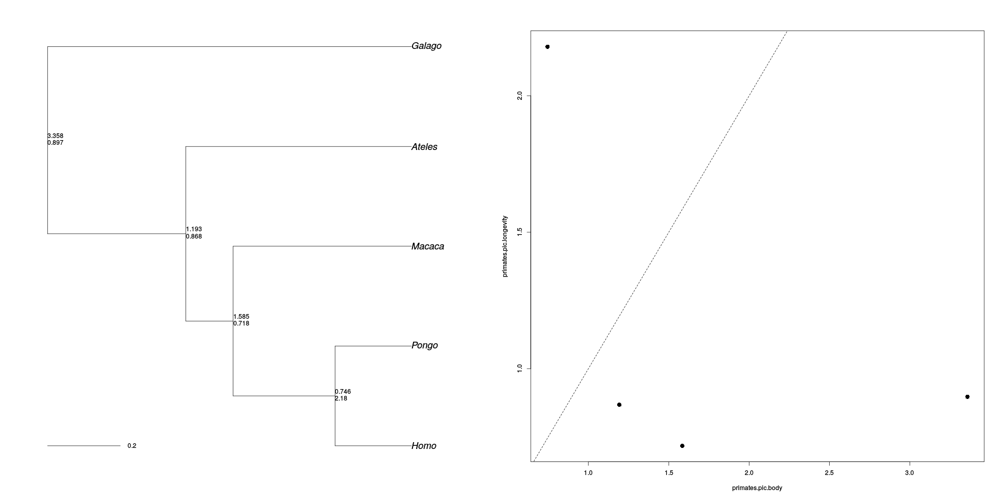 <!-- MERGE-REVIEW: no counterpart section found in QMD; code below comes from the old TEX version. -->

### Test it

```{r}
# Linear model of both PICs
lm(formula=shorebird.pic.fmass~shorebird.pic.eggmass)
Coefficients:
      (Intercept)  shorebird.pic.eggmass
            2.636                  9.110
# Because PICs have expected mean zero - such linear regressions should
# be done through the origin (i.e. the intercept is set to zero)
lm(formula=shorebird.pic.fmass~shorebird.pic.eggmass-1)
Coefficients:
      (Intercept)  shorebird.pic.eggmass
            2.636                  9.110
# Permutation procedure to test PIC
lmorigin(formula=shorebird.pic.fmass~shorebird.pic.eggmass, nperm=1000)
Coefficients and parametric test results
                      Coefficient Std_error t-value  Pr(>|t|)
shorebird.pic.eggmass     9.14518   0.60274  15.173 < 2.2e-16 ***
```

<!-- MERGE-REVIEW: no counterpart section found in QMD; code below comes from the old TEX version. -->

### Intraspecific variation

- `pic.ortho()` requires list of measurements (numeric vectors) for all taxa - their lengths can differ
- We must for each `list` item provide numeric vector (construct by something like `values <- list(taxon1, taxon2, taxon3, ...)`), otherwise usage is same as with `pic()` - plotting, tests, etc.
- Transforming data into required form can require considerable work...

```{r}
# See help
?pic.ortho
```

<!-- MERGE-REVIEW: no counterpart section found in QMD; code below comes from the old TEX version. -->

## Autocorrelation

### Phylogenetic autocorrelation

- Autocorrelation coefficient to quantify whether the distribution of a trait among a set of species is affected or not by their phylogenetic relationships
- In the absence of phylogenetic autocorrelation, the mean expected value of *I* and its variance are known - it is thus possible to test the null hypothesis of the absence of dependence among observations

```{r}
# Let's choose weights as wij = 1/dij, where the d’s is the distances
# measured on the tree - cophenetic() calculates cophenetic distances
# can be just cophenetic(shorebird.tree) or some other transformation
shorebird.weights <- 1/cophenetic(shorebird.tree)
# See it
class(shorebird.weights)
head(shorebird.weights)
# Set diagonal to 0
diag(shorebird.weights) <- 0
```

<!-- MERGE-REVIEW: 1 old code block(s) in TEX frame were dropped in favor of the .qmd section 'Phylogenetic autocorrelation'. -->

Autocorrelation coefficient to quantify whether the distribution of a trait among a set of species is affected or not by their phylogenetic relationships In the absence of phylogenetic autocorrelation, the mean expected value of I and its variance are known - it is thus possible to test the null hypothesis of the absence of dependence among observations Let's choose weights as wij = 1/dij, where the d’s is the distances measured on the tree - cophenetic() calculates cophenetic distances

See it

Set diagonal to 0

Calculate Moran's I

Test of Moran's with randomisation procedure

Test of Abouheif designed to detect phylogenetic autocorrelation in a quantitative trait - in fact Moran's I test using a particular phylogenetic proximity between tips

correlogram can be used to visualize the results of phylogenetic autocorrelative analysis Loads training data set

Look at the data

Calculate the correlogram

See results

Calculate the correlogram - test for both body masses

See results

Plot it

Plot it - test for both body masses Two graphs

Only one graph

```{r}
```

```{r}
shorebird_weights <- 1 / cophenetic(shorebird_tree) # can be just cophenetic(shorebird_tree) or some other transformation
```

```{r}
class(shorebird_weights)
head(shorebird_weights)
```

```{r}
diag(shorebird_weights) <- 0
```

```{r}
Moran.I(x = shorebird.data[["M.Mass"]], weight = shorebird_weights, alternative = "greater") # Significant, but super small, positive phylogenetic correlation among body mass
Moran.I(x = shorebird.data[["F.Mass"]], weight = shorebird_weights, alternative = "greater") # Significant, but super small, positive phylogenetic correlation among body mass
```

```{r}
library("ade4")
?gearymoran
gearymoran(bilis = shorebird_weights, X = shorebird.data[, 2:5], nrepet = 1000) # For all characters significant, but very small
```

```{r}
library("adephylo")
abouheif.moran(x = shorebird.data[, 2:5], W = shorebird_weights, method = "oriAbouheif", nrepet = 1000, alter = "greater")
```

```{r}
data(carnivora)
```

```{r}
head(carnivora)
```

```{r}
?correlogram.formula
carnivora_correlogram <- correlogram.formula(formula = SW ~ Order / SuperFamily / Family / Genus, data = carnivora)
```

```{r}
carnivora_correlogram
```

```{r}
carnivora_correlogram2 <- correlogram.formula(formula = SW + FW ~ Order / SuperFamily / Family / Genus, data = carnivora)
```

```{r}
carnivora_correlogram2
```

```{r}
plot(x = carnivora_correlogram, legend = TRUE, test.level = 0.05, col = c("white", "black"))
```

```{r}
plot(x = carnivora_correlogram2, lattice = TRUE, legend = TRUE, test.level = 0.05)
```

```{r}
plot(x = carnivora_correlogram2, lattice = FALSE, legend = TRUE, test.level = 0.05)
```

### Testing of Moran's *I*

```{r}
# Calculate Moran's I
# Significant, but super small, positive phylogenetic correlation
Moran.I(x=shorebird.data[["M.Mass"]], weight=shorebird.weights,
  alternative="greater")
Moran.I(x=shorebird.data[["F.Mass"]], weight=shorebird.weights,
  alternative="greater")
# Test of Moran's with randomisation procedure
library(ade4)
?gearymoran
# For all characters significant, but very small
gearymoran(bilis=shorebird.weights, X=shorebird.data[,2:5], nrepet=1000)
# Test of Abouheif designed to detect phylogenetic autocorrelation
# in a quantitative trait - in fact Moran's I test using a particular
# phylogenetic proximity between tips
library(adephylo)
abouheif.moran(x=shorebird.data[,2:5], W=shorebird.weights,
  method="oriAbouheif", nrepet=1000, alter="greater")
```

<!-- MERGE-REVIEW: 1 old code block(s) in TEX frame were dropped in favor of the .qmd section 'Moran's I'. -->

<!-- MERGE-REVIEW: content of the .qmd section 'Moran's I' was inserted at 4 frames; remove the unwanted duplicates. -->

Load required libraries

Creates connection network

Test of Moran's I for 1st PCoA axis

Plot the results

Test of Moran's I for 2nd PCoA axis

```{r}
library("adegenet")
library("spdep")
```

```{r}
hauss_connectivity <- chooseCN(xy = hauss_genind$other$xy, type = 5, d1 = 0, d2 = 1, plot.nb = TRUE, result.type = "listw", edit.nb = FALSE)
hauss_connectivity
```

```{r}
moran.test(x = hauss_pcoa$li[, 1], listw = hauss_connectivity, alternative = "greater", randomisation = TRUE)
hauss_pcoa1_mctest <- moran.mc(x = hauss_pcoa[["li"]][, 1], listw = hauss_connectivity, alternative = "greater", nsim = 1000)
hauss_pcoa1_mctest
```

```{r}
plot(hauss_pcoa1_mctest) # Plot of densitiy of permutations
moran.plot(x = hauss_pcoa$li[, 1], listw = hauss_connectivity) # PC plot
```

```{r}
moran.test(x = hauss_pcoa$li[, 2], listw = hauss_connectivity, alternative = "greater", randomisation = TRUE)
hauss_pcoa2_mctest <- moran.mc(x = hauss_pcoa$li[, 2], listw = hauss_connectivity, alternative = "greater", nsim = 1000)
hauss_pcoa2_mctest
plot(hauss_pcoa2_mctest) # Plot of densitiy of permutations
moran.plot(x = hauss_pcoa[["li"]][, 2], listw = hauss_connectivity) # PC plot
```

### Correlogram to visualize results of phylogenetic autocorrelation analysis

```{r}
data(carnivora) # Loads training data set
head(carnivora) # Look at the data
# Calculate the correlogram
?correlogram.formula
carnivora.correlogram <- correlogram.formula
  (formula=SW~Order/SuperFamily/Family/Genus, data=carnivora)
carnivora.correlogram # See results
# Calculate the correlogram - test for both body masses
carnivora.correlogram2 <- correlogram.formula
  (formula=SW+FW~Order/SuperFamily/Family/Genus, data=carnivora)
carnivora.correlogram2 # See results
plot(x=carnivora.correlogram, legend=TRUE, test.level=0.05, col=c("white",
  "black")) # Plot it
# Plot it - test for both body masses - two or one graph(s)
plot(x=carnivora.correlogram2, lattice=TRUE, legend=TRUE, test.level=0.05)
plot(x=carnivora.correlogram2, lattice=FALSE, legend=TRUE, test.level=0.05)
```

<!-- MERGE-REVIEW: no counterpart section found in QMD; code below comes from the old TEX version. -->

### Correlograms of SW and SW+FW (in one or two graphs) depending on taxonomic level with marked significance

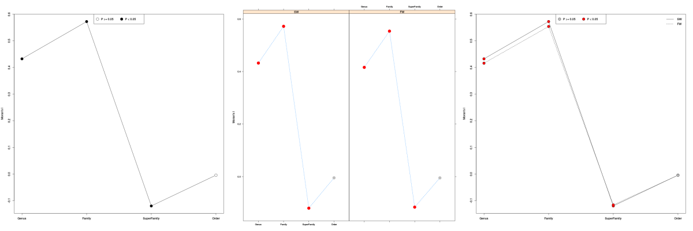 <!-- MERGE-REVIEW: no counterpart section found in QMD; content from TEX kept as-is. -->

## pPCA

### Phylogenetic principal component analysis

**PCA corrected for phylogeny**

- It requires as input phylogenetic tree and respective comparative data
- Phylogenetic component is removed from the data, then classical PCA is calculated
- Very useful for comparison of plenty of characters
- Together with nodes (taxa), PCA scores for PC axes are plotted - **not** the characters - it shows trends of character evolution on the tree, not positions of taxa in PC space
- Other graphs show global vs. local structure, eigenvalues decomposition and positions of characters in virtual space (if they correlate or not)
- From package [adephylo](https://doi.org/10.1093/bioinformatics/btq292) by [Jombart et al. 2010](https://doi.org/10.1016/j.jtbi.2010.03.038)
- It doesn't contain any test, it is more method of data exploration or dealing with big data sets, it is not for verifying hypothesis <!-- MERGE-REVIEW: no counterpart section found in QMD; content from TEX kept as-is. -->

### Phylogenetic principal component analysis - the code

```{r}
# Library needed to create phylo4d object required by ppca
library(adephylo)
library(phylobase)
# Calculate pPCA
shorebird.ppca <- ppca(x=phylo4d(x=shorebird.tree, shorebird.data[,2:5]),
  method="patristic", center=TRUE, scale=TRUE, scannf=TRUE, nfposi=1,
  nfnega=0)
print(shorebird.ppca) # Print results
summary(shorebird.ppca) # See summary information
# See PCA scores for variables on phylogenetic tree
scatter(shorebird.ppca)
# See decomposition of pPCA eigenvalues
screeplot(shorebird.ppca)
# Plot pPCA results - global vs. local structure, decomposition of pPCA
# eigenvalues, PCA plot of variables and PCA scores for variables on
# phylogenetic tree
plot(shorebird.ppca)
```

<!-- MERGE-REVIEW: no counterpart section found in QMD; code below comes from the old TEX version. -->

### Plot pPCA results - global vs. local structure, decomposition of pPCA eigenvalues, PCA plot of variables and PCA scores for variables on phylogenetic tree

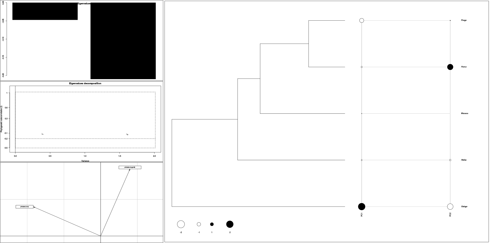 <!-- MERGE-REVIEW: no counterpart section found in QMD; content from TEX kept as-is. -->

## Decomposition

### Decomposition of topographical distances

```{=html}
<!--
    @@TOKEN0@@
    \begin{center}
        \includegraphics[height=5.5cm]{shorebird_tree_decomp.png}
    \end{center}

-->
```

<!-- MERGE-REVIEW: content of the .qmd section 'Topographical distances among trees' was inserted at 7 frames; remove the unwanted duplicates. -->

Compute matrix of topological distances among phylogenetic trees

Basic information about the distance matrix

Create heatmaps using heatmap.2 function from gplots package

Robinsons-Foulds distance

Add names of columns and rows

Create heatmap using corrplot function from corrplot package

PCoA from distance matrices of topographical differences among trees Test if the distance matrix is Euclidean or not

Calculate the PCoA

Plot PCoA

Add kernel densities

Add histogram of eigenvalues

Add title to the plot

Alternative function to plot PCA plot

See current state

Remove outlying trees

See after removal

```{r}
library("gplots")
library("corrplot")
library("phytools")
```

```{r}
?dist.topo # See details of available computing methods
oxalis_trees_d <- dist.topo(x = oxalis_trees, method = "score")
```

```{r}
dim(as.matrix(oxalis_trees_d))
head.matrix(as.matrix(oxalis_trees_d))
```

```{r}
heatmap.2(x = as.matrix(x = oxalis_trees_d), Rowv = FALSE, Colv = "Rowv", dendrogram = "none", symm = TRUE, scale = "none", na.rm = TRUE, revC = FALSE, col = rainbow(15), cellnote = round(x = as.matrix(x = oxalis_trees_d), digits = 2), notecex = 1, notecol = "white", trace = "row", linecol = "black", labRow = names(oxalis_trees), labCol = names(oxalis_trees), key = TRUE, keysize = 2, density.info = "density", symkey = FALSE, main = "Correlation matrix of topographical distances", xlab = "Trees", ylab = "Trees")
```

```{r}
?multiRF # See help first...
oxalis_trees_d_rf <- multiRF(oxalis_trees)
```

```{r}
colnames(oxalis_trees_d_rf) <- names(oxalis_trees)
rownames(oxalis_trees_d_rf) <- names(oxalis_trees)
```

```{r}
corrplot(corr = oxalis_trees_d_rf, method = "circle", type = "upper", col = rainbow(15), title = "Correlation matrix of topographical distances", is.corr = FALSE, diag = FALSE, outline = TRUE, order = "alphabet", tl.pos = "lt", tl.col = "black")
corrplot(corr = oxalis_trees_d_rf, method = "number", type = "lower", add = TRUE, col = rainbow(15), title = "Correlation matrix of topographical distances", is.corr = FALSE, diag = FALSE, outline = FALSE, order = "alphabet", tl.pos = "ld", cl.pos = "n")
```

```{r}
library("ade4")
is.euclid(distmat = oxalis_trees_d, plot = TRUE)
```

```{r}
oxalis_trees_pcoa <- dudi.pco(d = oxalis_trees_d, scannf = TRUE, full = TRUE)
```

```{r}
s.label(dfxy = oxalis_trees_pcoa$li)
```

```{r}
s.kde2d(dfxy = oxalis_trees_pcoa$li, cpoint = 0, add.plot = TRUE)
```

```{r}
add.scatter.eig(oxalis_trees_pcoa[["eig"]], 3, 1, 2, posi = "topleft")
```

```{r}
title("PCoA of matrix of pairwise trees distances")
```

```{r}
scatter(x = oxalis_trees_pcoa, posieig = "topleft")
```

```{r}
oxalis_trees
```

```{r}
oxalis_trees[c("T471", "T639", "T654")] <- NULL
```

```{r}
oxalis_trees
```

### Prepare toy data set (the variable)

```{=html}
<!--
    @@TOKEN0@@
    \begin{itemize}
        \item \texttt{sim.char()} creates an array (we keep only numeric vector of 1$^{st}$ simulation --- \texttt{[,,1]}) of simulated characters, with \texttt{model="BM"} under \href{https://en.wikipedia.org/wiki/Brownian_motion}{Brownian motion}
        \item Many methods compare \textbf{names} of character values with \texttt{tip.label} slot of the tree to pair character values with correct taxa
        \begin{itemize}
            \item Otherwise values must be ordered in same way as in \texttt{tip.label} slot
            \item \alert{Always check manual for respective function and all data!}
        \end{itemize}
    \end{itemize}

-->
```

<!-- MERGE-REVIEW: no counterpart section found in QMD; content from TEX kept as-is. -->

### Orthonormal decomposition - phylogenetic eigenvector regression

```{=html}
<!--
    @@TOKEN0@@
    \begin{itemize}
        \item Significant result --- significant phylogenetic inertia (phylogenetic effect) --- the tendency for traits to resist evolutionary change despite environmental perturbations
        \item \texttt{orthobasis.phylo()} return matrix, which is linear transformation of cophenetic distances --- columns 1~and 2~can be used to calculate phylogenetic variance --- it can be used to calculate linear regression
    \end{itemize}

-->
```

<!-- MERGE-REVIEW: no counterpart section found in QMD; content from TEX kept as-is. -->

### Orthonormal decomposition of variance of a quantitative variable on an orthonormal basis

```{=html}
<!--
    @@TOKEN0@@
    \begin{itemize}
        \item Analyses one quantitative trait
        \item Do not confuse with \texttt{ade4::orthogram} --- similar, but require data in little bit different form, marked as deprecated and replaced by the \texttt{adephylo} version
        \item It returns results of 5~non-parametric tests associated to the variance decomposition
        \item Procedure decomposes data matrix to separate phylogeny and phenotype to see if there is significant signal
    \end{itemize}

-->
```

<!-- MERGE-REVIEW: no counterpart section found in QMD; content from TEX kept as-is. -->

### Orthogram

```{=html}
<!--
    \begin{center}
        \includegraphics[height=6cm]{orthogram.png}
    \end{center}
    \begin{itemize}
        \item Observed value is out of permutations --- significant \href{https://en.wikipedia.org/wiki/Phylogenetic_inertia}{inertia of the trait to phylogeny}
    \end{itemize}

-->
```

<!-- MERGE-REVIEW: no counterpart section found in QMD; content from TEX kept as-is. -->

## PGLS

### Phylogenetic Generalized Least Squares

- Model-based testing if there is significant correlation between two traits (after removing the phylogenetic component)
- `nlme::gls` fits a linear model using [generalized least squares](https://en.wikipedia.org/wiki/Generalized_least_squares)
- Functions `corBlomberg`, `corBrownian`, `corMartins` and `corPagel` from `ape` package create correlation matrix of evolution of continuous character according to the given tree

```{r}
library(nlme)
summary(gls(model=F.Mass ~ Egg.Mass, data=shorebird.data,
  correlation=corBrownian(value=1, phy=shorebird.tree)))
  Generalized least squares fit by REML
      AIC      BIC    logLik
  798.813 805.5154 -396.4065
                Value Std.Error   t-value p-value
(Intercept) -2.384233  73.54508 -0.032419  0.9742
Egg.Mass     9.145185   0.60274 15.172606  0.0000
```

<!-- MERGE-REVIEW: no counterpart section found in QMD; code below comes from the old TEX version. -->

### Implementation in caper package

```{r}
library(caper) # Load needed library
data(shorebird) # Load training data, see ?shorebird.data
# Calculate the model
shorebird.pgls <- pgls(formula=shorebird.data[["F.Mass"]] ~
  shorebird.data[["Egg.Mass"]], data=comparative.data(phy=
  shorebird.tree, data=as.data.frame(cbind(shorebird.data[["F.Mass"]],
  shorebird.data[["Egg.Mass"]], shorebird.data[["Species"]])),
  names.col=V3, vcv=TRUE))
# See the result
summary(shorebird.pgls)
# See the plot of observer and fitted values
plot(shorebird.pgls)
abline(a=0, b=1, col="red")
# ANOVA view of the model
anova(shorebird.pgls)
# Akaike's information criterion (smaller = better)
AIC(shorebird.pgls)
```

<!-- MERGE-REVIEW: no counterpart section found in QMD; code below comes from the old TEX version. -->

### Results of PGLS

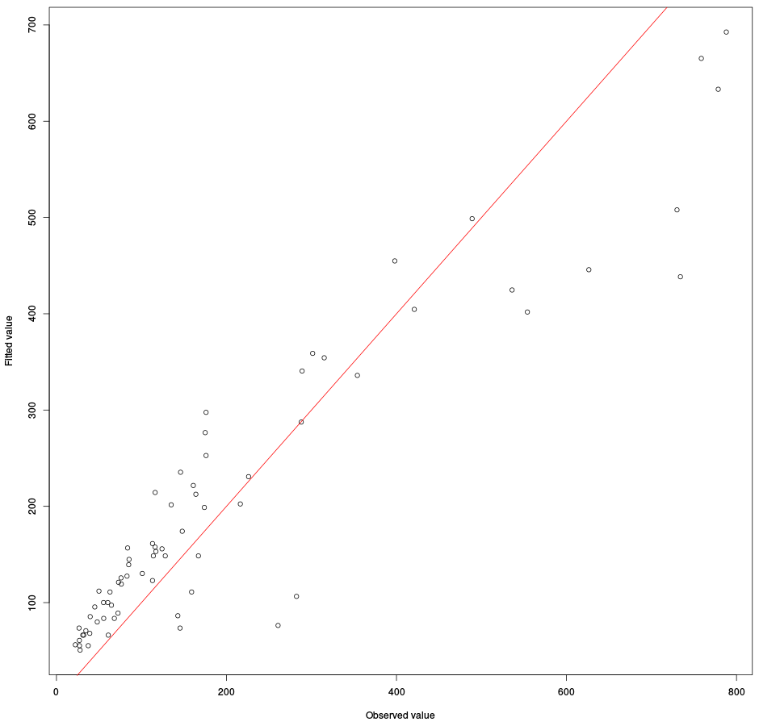

- `pgls()` uses maximum likelihood to test for phylogenetic signal
- The signal is clearly presented
- Usually, tuning the model (possible data transformations and/or changing model parameters) is necessary to find the best model - AIC helps (lower is better)
- See [caper manual](https://CRAN.R-project.org/package=caper) for details <!-- MERGE-REVIEW: no counterpart section found in QMD; content from TEX kept as-is. -->

## GEE

### Generalized Estimating Equations

- Extension of GLM for correlated data, usage is similar
- It is possible to use phylogeny or correlation matrix (typically based on phylogeny)

```{r}
# Calculate the model
compar.gee(formula=shorebird.data[["F.Mass"]] ~
  shorebird.data[["Egg.Mass"]], phy=shorebird.tree)
# or with correlation matrix
compar.gee(formula=shorebird.data[["F.Mass"]] ~
  shorebird.data[["Egg.Mass"]], corStruct=corMartins(value=1,
  phy=shorebird.tree, fixed=TRUE))
# for corStruct there are similar functions corBlomberg, corMartins,
# corPagel, corBrownian - see manuals for differences
```

<!-- MERGE-REVIEW: 1 old code block(s) in TEX frame were dropped in favor of the .qmd section 'Generalized Estimating Equations'. -->

Calculate the model

or with correlation matrix

for corStruct there are similar functions corBlomberg, corMartins, corPagel, corBrownian - see manuals for differences

```{r}
compar.gee(formula = shorebird.data[["F.Mass"]] ~ shorebird.data[["Egg.Mass"]], phy = shorebird_tree)
```

```{r}
compar.gee(formula = shorebird.data[["F.Mass"]] ~ shorebird.data[["Egg.Mass"]], corStruct = corMartins(value = 1, phy = shorebird_tree, fixed = TRUE))
```

```{=html}
<!--
# TODO multiple phylogenetic regressions and residuals
# x can be matrix of data
phyl.resid(tree = shorebird_tree, x = primates.body, Y = primates.longevity, method = "BM")
phyl.resid(tree = shorebird_tree, x = primates.body, Y = primates.longevity, method = "lambda")

# TODO Ornstein-Uhlenbeck Model
# Simulation of evolution on phylogenetic tree
compar.ou(x = shorebird_eco, phy = shorebird_tree, alpha = 100)

## TODO Variance Partitioning
# vare: the estimated residual variance–covariance matrix;
# vara: the estimated additive effect variance–covariance matrix;
# u: the estimates of the phylogeny wide means;
# A: the additive value estimates;
# E: the residual value estimates;
# lik: the log-likelihood.
# x can be vector, matric or df
apiaceae.lynch <- compar.lynch(x = shorebird_eco, G = vcv.phylo(phy = shorebird_tree, model = "Brownian", corr = TRUE))
mantel.test(m1 = apiaceae.lynch$vara, m2 = apiaceae.lynch$vare, nperm = 1000, graph = TRUE, alternative = "two.sided")
-->
```

### Not significant in this case...

```{r}
Call: compar.gee(formula = shorebird.data[["F.Mass"]] ~
  shorebird.data[["Egg.Mass"]], phy = shorebird.tree)
Number of observations:  71
Model:
                      Link: identity
 Variance to Mean Relation: gaussian
QIC: 449593.7
Summary of Residuals:
        Min          1Q      Median          3Q         Max
-121.577831  -48.195170  -32.598282   -2.168055  295.586322
Coefficients:
                              Estimate       S.E.           t  Pr(T > |t|)
(Intercept)                  -2.384233 41.1202553 -0.05798195 9.545638e-01
shorebird.data[["Egg.Mass"]]  9.145185  0.3370035 27.13676219 1.003642e-13
Estimated Scale Parameter:  6515.203
"Phylogenetic" df (dfP):  16.3298
```

<!-- MERGE-REVIEW: no counterpart section found in QMD; code below comes from the old TEX version. -->

## Partitioning

### Variance partitioning

```{=html}
<!--
    @@TOKEN0@@

-->
```

<!-- MERGE-REVIEW: no counterpart section found in QMD; content from TEX kept as-is. -->

## Phylosignal

### Phylogenetic signal

**Blomberg's K statistic of phylogenetic signal**

- Direct consequence of the evolution of trait depends on evolution - if trait variation is driven by environment, phylogenetic signal is 0
- Blomberg's values of 1 correspond to a Brownian motion process, which implies some degree of phylogenetic signal or conservatism
- K values closer to zero correspond to a random or convergent pattern of evolution, while K values greater than 1 indicate strong phylogenetic signal and conservatism of traits

```{r}
library(picante)
# It requires named vector of trait values
shorebird.mmass <- shorebird.data[["M.Mass"]]
names(shorebird.mmass) <- rownames(shorebird.data)
shorebird.mmass
```

<!-- MERGE-REVIEW: 1 old code block(s) in TEX frame were dropped in favor of the .qmd section 'Phylogenetic Signal'. -->

If Blomberg's values of 1 correspond to a Brownian motion process, which implies some degree of phylogenetic signal or conservatism. K values closer to zero correspond to a random or convergent pattern of evolution, while K values greater than 1 indicate strong phylogenetic signal and conservatism of traits. It requires named vector of trait values

Bloomberg's K statistics

Test with permutations

Analyze multiple traits in once with multiPhylosignal, it requires data frame of numerical values

When there are vectors with standard errors of measurements

Test for phylogenetic signal (here without SE)

phylosig() can be used as an alternative to phylosignal() - the functions are similar in basic usage

Examples of usage of GLS for testing of phylogenetic signal

```{r}
library("picante")
```

```{r}
shorebird_mmass <- shorebird.data[["M.Mass"]]
names(shorebird_mmass) <- rownames(shorebird.data)
shorebird_mmass
```

```{r}
Kcalc(x = shorebird_mmass, phy = shorebird_tree, checkdata = TRUE)
```

```{r}
phylosignal(x = shorebird_mmass, phy = shorebird_tree, reps = 1000, checkdata = TRUE)
```

```{r}
multiPhylosignal(x = shorebird.data[, 2:5], phy = shorebird_tree, reps = 1000)
```

```{r}
library("phytools")
?phylosig # See for details
```

```{r}
phylosig(tree = shorebird_tree, x = shorebird_mmass, method = "K", test = TRUE, nsim = 1000)
plot(phylosig(tree = shorebird_tree, x = shorebird_mmass, method = "K", test = TRUE, nsim = 1000))
phylosig(tree = shorebird_tree, x = shorebird_mmass, method = "lambda", test = TRUE)
```

```{r}
summary(gls(model = shorebird_mmass ~ 1, correlation = corBrownian(value = 1, phy = shorebird_tree)))
summary(pgls(formula = shorebird_mmass ~ 1, data = comparative.data(phy = shorebird_tree, data = as.data.frame(cbind(shorebird.data[["M.Mass"]], shorebird.data[["Species"]])), names.col = V2, vcv = TRUE)))
```

### Analyze, including multiple traits in once

```{r}
# Bloomberg's K statistics
Kcalc(x=shorebird.mmass, phy=shorebird.tree, checkdata=TRUE)
# Test with permutations
phylosignal(x=shorebird.mmass, phy=shorebird.tree, reps=1000, checkdata=T)
# Analyze multiple traits in once with multiPhylosignal,
# it requires data frame of numerical values
multiPhylosignal(x=shorebird.data[,2:5], phy=shorebird.tree, reps=1000)
                K PIC.variance.obs PIC.variance.rnd.mean PIC.variance.P...
M.Mass   1.089419     5.139489e+02          3.278559e+03    0.000999001...
F.Mass   1.092474     6.316701e+02          3.993696e+03    0.000999001...
Egg.Mass 1.139078     4.160653e+00          2.783029e+01    0.000999001...
Cl.size  0.673523     8.397776e-03          3.323744e-02    0.000999001...
# See help
?phylosignal
?multiPhylosignal
```

<!-- MERGE-REVIEW: no counterpart section found in QMD; code below comes from the old TEX version. -->

### When there are vectors with standard errors of measurements

- Functions for testing of phylogenetic signal do not work with more measurements per taxon

  - Currently, the only possibility is `phylosig()` which is able to work with SE (user must prepare this vector from the data manually; from e.g. `plotrix::std.error`)

- `phylosig()` can be used as an alternative to `phylosignal()` - the functions are similar in basic usage

```{r}
library(phytools)
?phylosig # See for details
# Test for phylogenetic signal (here without SE)
phylosig(tree=shorebird.tree, x=shorebird.mmass, method="K", test=TRUE,
  nsim=1000)
plot(phylosig(tree=shorebird.tree, x=shorebird.mmass, method="K",
  test=TRUE, nsim=1000))
phylosig(tree=shorebird.tree, x=shorebird.mmass, method="lambda",
  test=TRUE)
```

<!-- MERGE-REVIEW: no counterpart section found in QMD; code below comes from the old TEX version. -->

### Alternative testing for phylogenetic signal with GLM

- It is possible to use intercept-only (`model/formula` will be something like `variable $$ 1` instead of `variable1 $$ variable2`) GLM to quantify phylogenetic signal in trait
- It is tricky to select the best correlation structure - AIC can help with selections (`AIC(pgls(...))`)

```{r}
# Examples of usage of GLS for testing of phylogenetic signal
summary(gls(model=shorebird.mmass ~ 1,
  correlation=corBrownian(value=1, phy=shorebird.tree)))
summary(pgls(formula=shorebird.mmass ~ 1,
  data=comparative.data(phy=shorebird.tree,
  data=as.data.frame(cbind(shorebird.data[["M.Mass"]],
  shorebird.data[["Species"]])), names.col=V2, vcv=TRUE)))
```

<!-- MERGE-REVIEW: no counterpart section found in QMD; code below comes from the old TEX version. -->

## Ancestral state

### Training data I

```{r}
# Load library
library(ape)
# Loading data - morphological characteristics of Acer species
# Ackerly & Donoghue (1998) https://doi.org/10.1086/286208
data(maples, package="adephylo")
?adephylo::maples
# Process the phylogenetic tree
# maples data provide tree as plain text in NEWICK, must be imported
# into the phylo object
maples.tree <- read.tree(text=maples[["tre"]])
maples.tree
plot.phylo(maples.tree)
# For plenty of analysis it must be fully resolved (bifurcating),
# rooting and ultrametricity often helps
is.binary.phylo(maples.tree)
is.rooted.phylo(maples.tree)
is.ultrametric.phylo(maples.tree)
```

<!-- MERGE-REVIEW: 1 old code block(s) in TEX frame were dropped in favor of the .qmd section 'Exporting data'. -->

<!-- MERGE-REVIEW: content of the .qmd section 'Exporting data' was inserted at 5 frames; remove the unwanted duplicates. -->

Convert genind into DF using genind2df()

Save microsatellites to disk - check settings of write.table

Export of DNA sequences into FASTA format

Export DNA sequnces as NEXUS

Export VCF

Export trees (objects of class phylo) - will be introduced later

```{r}
hauss_df <- genind2df(x = hauss_genind, pop = NULL, sep = "/", usepop = TRUE, oneColPerAll = FALSE)
```

```{r}
write.table(x = hauss_df, file = "haussdata.txt", quote = FALSE, sep = "\t", na = "NA", dec = ".", row.names = TRUE, col.names = TRUE)
```

```{r}
write.dna(x = usflu_dna, file = "usflu.fasta", format = "fasta", append = FALSE, nbcol = 6)
seqinr::write.fasta(sequences = as.character.DNAbin(gunnera_dna), names = names(gunnera_dna), file.out = "gunnera.fasta", open = "w")
```

```{r}
write.nexus.data(x = gunnera_dna, file = "gunnera.nexus", format = "dna")
```

```{r}
vcfR::write.vcf(x = arabidopsis_vcf, file = "arabidopsis.vcf.gz")
```

```{r}
write.tree(phy = hauss_nj_bruvo, file = "haussknechtii.nwk") # Writes tree(s) in NEWICK format
write.nexus(hauss_nj_bruvo, file = "haussknechtii.nexus") # Writes tree(s) in NEXUS format
```

### Training data II

```{r}
# See the character matrix
head(maples[["tab"]])
maples.data <- maples[["tab"]][,1:30]
head(maples.data)
summary(maples.data)
# Maples mature height (m)
maples.height <- maples[["tab"]][["MatHt"]]
names(maples.height) <- rownames(maples[["tab"]])
maples.height
# Maples seed size (mg)
maples.sdsz  <- maples[["tab"]][["SdSz"]]
names(maples.sdsz) <- rownames(maples[["tab"]])
maples.sdsz
# Maples leaf + petiole length (mm)
maples.lfpt <- maples[["tab"]][["LfPt"]]
names(maples.lfpt) <- rownames(maples[["tab"]])
maples.lfpt
```

<!-- MERGE-REVIEW: 1 old code block(s) in TEX frame were dropped in favor of the .qmd section 'Exporting data'. -->

<!-- MERGE-REVIEW: content of the .qmd section 'Exporting data' was inserted at 5 frames; remove the unwanted duplicates. -->

Convert genind into DF using genind2df()

Save microsatellites to disk - check settings of write.table

Export of DNA sequences into FASTA format

Export DNA sequnces as NEXUS

Export VCF

Export trees (objects of class phylo) - will be introduced later

```{r}
hauss_df <- genind2df(x = hauss_genind, pop = NULL, sep = "/", usepop = TRUE, oneColPerAll = FALSE)
```

```{r}
write.table(x = hauss_df, file = "haussdata.txt", quote = FALSE, sep = "\t", na = "NA", dec = ".", row.names = TRUE, col.names = TRUE)
```

```{r}
write.dna(x = usflu_dna, file = "usflu.fasta", format = "fasta", append = FALSE, nbcol = 6)
seqinr::write.fasta(sequences = as.character.DNAbin(gunnera_dna), names = names(gunnera_dna), file.out = "gunnera.fasta", open = "w")
```

```{r}
write.nexus.data(x = gunnera_dna, file = "gunnera.nexus", format = "dna")
```

```{r}
vcfR::write.vcf(x = arabidopsis_vcf, file = "arabidopsis.vcf.gz")
```

```{r}
write.tree(phy = hauss_nj_bruvo, file = "haussknechtii.nwk") # Writes tree(s) in NEWICK format
write.nexus(hauss_nj_bruvo, file = "haussknechtii.nexus") # Writes tree(s) in NEXUS format
```

### Ancestral state reconstruction

- By default `ape::ace()` performs estimation for continuous characters assuming a Brownian motion model fit by maximum likelihood
- `ace()` can handle continuous as well as discrete data

```{r}
library(ape)
?ace # See for possible settings
maples.height.ace <- ace(x=maples.height, phy=maples.tree,
  type="continuous", method="REML", corStruct=corBrownian(value=1,
  phy=maples.tree))
# See result - reconstructions are in ace slot - to be plotted on
# nodes - 1st column are node numbers
maples.height.ace
# Plot it
plot.phylo(x=maples.tree, lwd=2, cex=0.75)
tiplabels(maples.height, adj=c(1, 0), frame="none", col="blue", cex=0.75)
nodelabels(round(maples.height.ace[["ace"]], digits=1), frame="none",
  col="red", cex=0.75)
```

<!-- MERGE-REVIEW: 1 old code block(s) in TEX frame were dropped in favor of the .qmd section 'Ancestral state reconstruction'. -->

<!-- MERGE-REVIEW: content of the .qmd section 'Ancestral state reconstruction' was inserted at 3 frames; remove the unwanted duplicates. -->

Loading data - morphological characteristics of Acer species Ackerly & Donoghue (1998) https://doi.org/10.1086/286208

Process the phylogenetic tree maples data provide tree as plain text in NEWICK, must be imported into the phylo object

For plenty of analysis it must be fully resolved (bifurcating), rooting and ultrametricity often helps

See the character matrix

Maples mature height (m)

Maples seed size (mg)

Maples leaf + petiole length (mm)

By default performs estimation for continuous characters assuming a Brownian motion model fit by maximum likelihood

See result - reconstructions are in \$ace slot - to be plotted on nodes - 1st column are node numbers

Plot it

ACE returns long numbers - truncate them by e.g.

Other implementations are available in packages geiger, phangorn, ape, phytools, ... Parsimony based method

For continuous characters using Maximum Likelihood

For continuous characters using Markov Chain Monte Carlo

For discrete characters, various models available

Marginal reconstruction of the ancestral character states

ML estimation of a continuous trait

ACE for Brownian evolution with directional trend

ACE for Brownian evolution using likelihood

Bayesian ancestral character estimation

Get end (discard ca. first 20%) of ancestral states from Bayesian posterior distribution (it should converge to certain values)

Get means of ancestral states from Bayesian posterior distribution

Statistics of reconstructed values

Plot the ancestral states from posterior distribution (it should converge to certain values)

Plot the tree and reconstructed ancestral states

Continuous map

Change colors with setMap()

See ?par for more settings

```{r}
data(maples, package = "adephylo")
?adephylo::maples
```

```{r}
maples_tree <- read.tree(text = maples[["tre"]])
maples_tree
plot.phylo(maples_tree)
```

```{r}
is.binary.phylo(maples_tree)
is.rooted.phylo(maples_tree)
is.ultrametric.phylo(maples_tree)
```

```{r}
head(maples[["tab"]])
maples_data <- maples[["tab"]][, 1:30]
head(maples_data)
summary(maples_data)
```

```{r}
maples_height <- maples[["tab"]][["MatHt"]]
names(maples_height) <- rownames(maples[["tab"]])
maples_height
```

```{r}
maples_sdsz <- maples[["tab"]][["SdSz"]]
names(maples_sdsz) <- rownames(maples[["tab"]])
maples_sdsz
```

```{r}
maples_lfpt <- maples[["tab"]][["LfPt"]]
names(maples_lfpt) <- rownames(maples[["tab"]])
maples_lfpt
```

```{r}
library("ape")
?ace # See for possible settings
maples_height_ace <- ace(x = maples_height, phy = maples_tree, type = "continuous", method = "REML", corStruct = corBrownian(value = 1, phy = maples_tree))
```

```{r}
maples_height_ace
```

```{r}
plot.phylo(x = maples_tree, lwd = 2, cex = 0.75)
tiplabels(maples_height, adj = c(1, 0), frame = "none", col = "blue", cex = 0.75)
nodelabels(round(maples_height_ace[["ace"]], digits = 2), frame = "none", col = "red", cex = 0.75)
```

```{r}
round(x = ..., digits = 3) # "x"is vector with ACE values
```

```{r}
?ape::MPR
```

```{r}
?geiger::fitContinuous
```

```{r}
?geiger::fitContinuousMCMC
```

```{r}
?geiger::fitDiscrete
```

```{r}
?phangorn::ancestral.pml
library("phytools")
```

```{r}
?fastAnc
maples_height_fa <- fastAnc(tree = maples_tree, x = maples_height, vars = FALSE, CI = TRUE)
maples_height_fa
plot.phylo(x = maples_tree, edge.width = 2, cex = 0.75)
tiplabels(maples_height, adj = c(1, 0), frame = "none", col = "blue", cex = 0.75)
nodelabels(round(maples_height_fa[["ace"]], digits = 2), frame = "none", col = "red", cex = 0.75)
```

```{r}
?anc.trend
maples_height_ac <- anc.trend(tree = maples_tree, x = maples_height, maxit = 1000000)
maples_height_ac
```

```{r}
?anc.ML
maples_height_ml <- anc.ML(tree = maples_tree, x = maples_height, maxit = 1000000, model = "BM")
maples_height_ml
```

```{r}
?anc.Bayes
maples_height_bayes <- anc.Bayes(tree = maples_tree, x = maples_height, ngen = 1000000) # Use more MCMC generations
maples_height_bayes
```

```{r}
tail(maples_height_bayes[["mcmc"]])
dim(maples_height_bayes[["mcmc"]])
```

```{r}
maples_height_bayes_anc <- colMeans(maples_height_bayes[["mcmc"]][2001:nrow(maples_height_bayes[["mcmc"]]), as.character(1:maples_tree$Nnode + length(maples_tree$tip.label))])
maples_height_bayes_anc
```

```{r}
summary(maples_height_bayes[["mcmc"]][2001:nrow(maples_height_bayes[["mcmc"]]), as.character(1:maples_tree$Nnode + length(maples_tree$tip.label))])
```

```{r}
plot(maples_height_bayes)
```

```{r}
plot.phylo(x = maples_tree, edge.width = 2, cex = 2)
tiplabels(maples_height, adj = c(1, 0), col = "blue", bg = "yellow", cex = 1.5)
nodelabels(round(x = maples_height_bayes_anc, digits = 2), cex = 1.5)
```

```{r}
?contMap
contMap(tree = maples_tree, x = maples_height)
```

```{r}
maples_contmap <- setMap(x = contMap(tree = maples_tree, x = maples_height), colors = c("white", "black"))
plot(maples_contmap)
```

### Ancestral state reconstructions of primates body weights

- ACE returns long numbers - truncate them by e.g. `round(x=..., digits=3)` (`x` is vector with ACE values)

  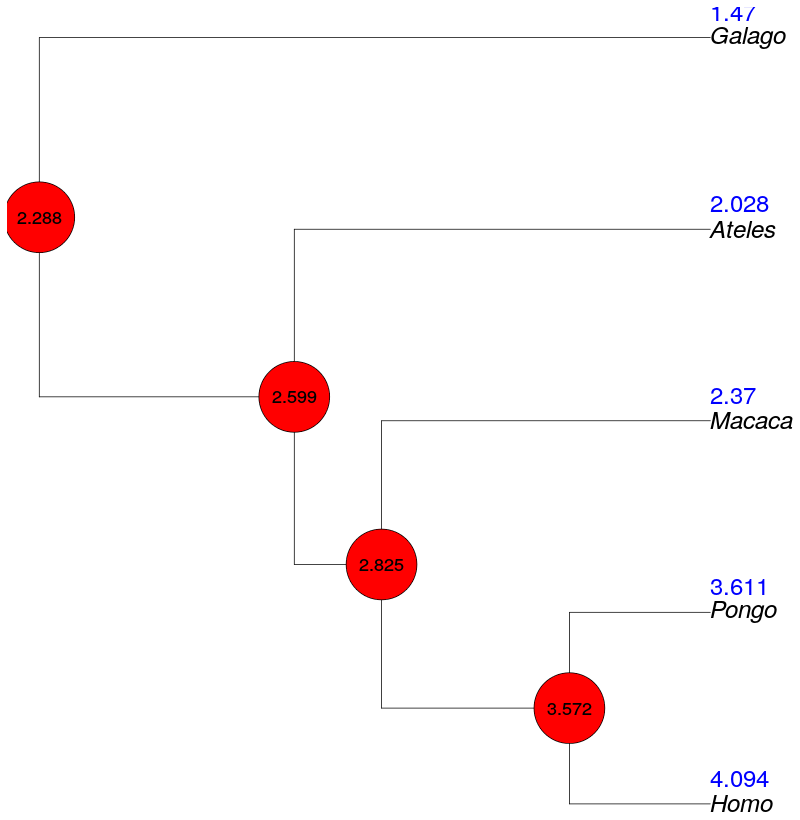

```{r}
# Other implementations are
# available in packages geiger,
# phangorn, ape, phytools, ...
# Parsimony based method
?ape::MPR
# For continuous characters using
# Maximum Likelihood
?geiger::fitContinuous
# For continuous characters using
# Markov Chain Monte Carlo
?geiger::fitContinuousMCMC
# For discrete characters, various
# models available
?geiger::fitDiscrete
# Marginal reconstruction of the
# ancestral character states
?phangorn::ancestral.pml
```

<!-- MERGE-REVIEW: 1 old code block(s) in TEX frame were dropped in favor of the .qmd section 'Ancestral state reconstruction'. -->

<!-- MERGE-REVIEW: content of the .qmd section 'Ancestral state reconstruction' was inserted at 3 frames; remove the unwanted duplicates. -->

Loading data - morphological characteristics of Acer species Ackerly & Donoghue (1998) https://doi.org/10.1086/286208

Process the phylogenetic tree maples data provide tree as plain text in NEWICK, must be imported into the phylo object

For plenty of analysis it must be fully resolved (bifurcating), rooting and ultrametricity often helps

See the character matrix

Maples mature height (m)

Maples seed size (mg)

Maples leaf + petiole length (mm)

By default performs estimation for continuous characters assuming a Brownian motion model fit by maximum likelihood

See result - reconstructions are in \$ace slot - to be plotted on nodes - 1st column are node numbers

Plot it

ACE returns long numbers - truncate them by e.g.

Other implementations are available in packages geiger, phangorn, ape, phytools, ... Parsimony based method

For continuous characters using Maximum Likelihood

For continuous characters using Markov Chain Monte Carlo

For discrete characters, various models available

Marginal reconstruction of the ancestral character states

ML estimation of a continuous trait

ACE for Brownian evolution with directional trend

ACE for Brownian evolution using likelihood

Bayesian ancestral character estimation

Get end (discard ca. first 20%) of ancestral states from Bayesian posterior distribution (it should converge to certain values)

Get means of ancestral states from Bayesian posterior distribution

Statistics of reconstructed values

Plot the ancestral states from posterior distribution (it should converge to certain values)

Plot the tree and reconstructed ancestral states

Continuous map

Change colors with setMap()

See ?par for more settings

```{r}
data(maples, package = "adephylo")
?adephylo::maples
```

```{r}
maples_tree <- read.tree(text = maples[["tre"]])
maples_tree
plot.phylo(maples_tree)
```

```{r}
is.binary.phylo(maples_tree)
is.rooted.phylo(maples_tree)
is.ultrametric.phylo(maples_tree)
```

```{r}
head(maples[["tab"]])
maples_data <- maples[["tab"]][, 1:30]
head(maples_data)
summary(maples_data)
```

```{r}
maples_height <- maples[["tab"]][["MatHt"]]
names(maples_height) <- rownames(maples[["tab"]])
maples_height
```

```{r}
maples_sdsz <- maples[["tab"]][["SdSz"]]
names(maples_sdsz) <- rownames(maples[["tab"]])
maples_sdsz
```

```{r}
maples_lfpt <- maples[["tab"]][["LfPt"]]
names(maples_lfpt) <- rownames(maples[["tab"]])
maples_lfpt
```

```{r}
library("ape")
?ace # See for possible settings
maples_height_ace <- ace(x = maples_height, phy = maples_tree, type = "continuous", method = "REML", corStruct = corBrownian(value = 1, phy = maples_tree))
```

```{r}
maples_height_ace
```

```{r}
plot.phylo(x = maples_tree, lwd = 2, cex = 0.75)
tiplabels(maples_height, adj = c(1, 0), frame = "none", col = "blue", cex = 0.75)
nodelabels(round(maples_height_ace[["ace"]], digits = 2), frame = "none", col = "red", cex = 0.75)
```

```{r}
round(x = ..., digits = 3) # "x"is vector with ACE values
```

```{r}
?ape::MPR
```

```{r}
?geiger::fitContinuous
```

```{r}
?geiger::fitContinuousMCMC
```

```{r}
?geiger::fitDiscrete
```

```{r}
?phangorn::ancestral.pml
library("phytools")
```

```{r}
?fastAnc
maples_height_fa <- fastAnc(tree = maples_tree, x = maples_height, vars = FALSE, CI = TRUE)
maples_height_fa
plot.phylo(x = maples_tree, edge.width = 2, cex = 0.75)
tiplabels(maples_height, adj = c(1, 0), frame = "none", col = "blue", cex = 0.75)
nodelabels(round(maples_height_fa[["ace"]], digits = 2), frame = "none", col = "red", cex = 0.75)
```

```{r}
?anc.trend
maples_height_ac <- anc.trend(tree = maples_tree, x = maples_height, maxit = 1000000)
maples_height_ac
```

```{r}
?anc.ML
maples_height_ml <- anc.ML(tree = maples_tree, x = maples_height, maxit = 1000000, model = "BM")
maples_height_ml
```

```{r}
?anc.Bayes
maples_height_bayes <- anc.Bayes(tree = maples_tree, x = maples_height, ngen = 1000000) # Use more MCMC generations
maples_height_bayes
```

```{r}
tail(maples_height_bayes[["mcmc"]])
dim(maples_height_bayes[["mcmc"]])
```

```{r}
maples_height_bayes_anc <- colMeans(maples_height_bayes[["mcmc"]][2001:nrow(maples_height_bayes[["mcmc"]]), as.character(1:maples_tree$Nnode + length(maples_tree$tip.label))])
maples_height_bayes_anc
```

```{r}
summary(maples_height_bayes[["mcmc"]][2001:nrow(maples_height_bayes[["mcmc"]]), as.character(1:maples_tree$Nnode + length(maples_tree$tip.label))])
```

```{r}
plot(maples_height_bayes)
```

```{r}
plot.phylo(x = maples_tree, edge.width = 2, cex = 2)
tiplabels(maples_height, adj = c(1, 0), col = "blue", bg = "yellow", cex = 1.5)
nodelabels(round(x = maples_height_bayes_anc, digits = 2), cex = 1.5)
```

```{r}
?contMap
contMap(tree = maples_tree, x = maples_height)
```

```{r}
maples_contmap <- setMap(x = contMap(tree = maples_tree, x = maples_height), colors = c("white", "black"))
plot(maples_contmap)
```

### Implementation in phytools

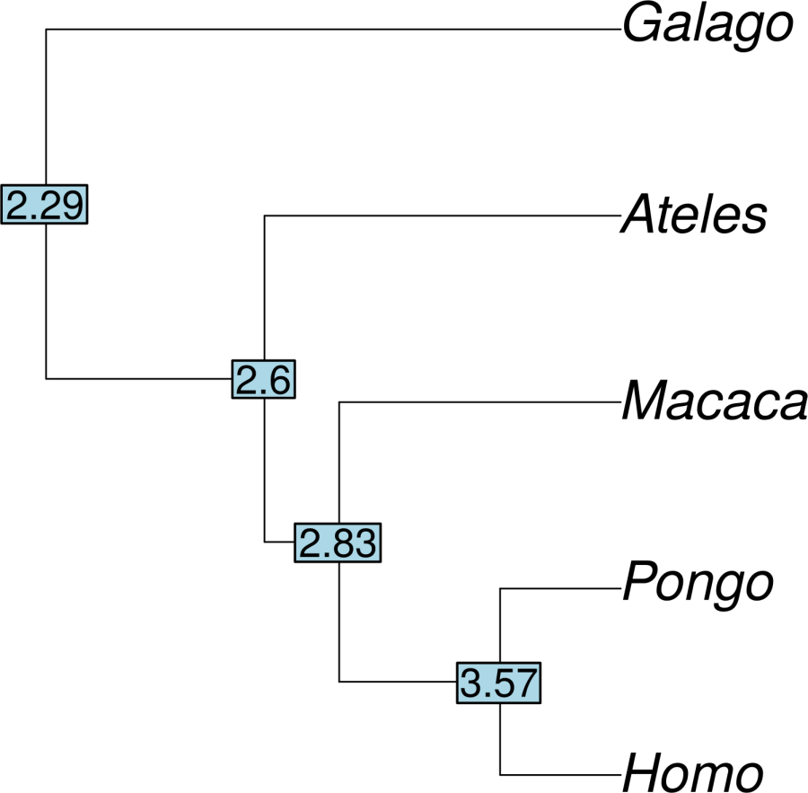

```{r}
# ML estimation of continuous trait
?fastAnc
maples.height.fa <- fastAnc(tree=
  maples.tree, x=maples.height,
  vars=FALSE, CI=TRUE)
maples.height.fa
plot.phylo(x=maples.tree,
  edge.width=2, cex=0.75)
tiplabels(maples.height,
  adj=c(1, 0), frame="none",
  col="blue", cex=0.75)
```

```{r}
nodelabels(round(
  maples.height.fa[["ace"]],
  digits=2), frame="none",
  col="red", cex=0.75)
# ACE for Brownian evolution
# with directional trend
?anc.trend
maples.height.ac <- anc.trend(
  tree=maples.tree,
  x=maples.height, maxit=1000000)
maples.height.ac
# ACE for Brownian evolution
# using likelihood
?anc.ML
maples.height.ml <- anc.ML(tree=
  maples.tree, x=maples.height,
  maxit=1000000, model="BM")
```

<!-- MERGE-REVIEW: no counterpart section found in QMD; code below comes from the old TEX version. -->

### Bayesian ancestral character estimation I

```{r}
?anc.Bayes
maples.height.bayes <- anc.Bayes(tree=maples.tree, x=maples.height,
  ngen=1000000) # Use more MCMC generations
maples.height.bayes
# Get end (discard ca. first 20%) of ancestral states from Bayesian
# posterior distribution (it should converge to certain values)
tail(maples.height.bayes[["mcmc"]])
dim(maples.height.bayes[["mcmc"]])
# Get means of ancestral states from Bayesian posterior distribution
maples.height.bayes.anc <- colMeans(maples.height.bayes[["mcmc"]][2001:
  nrow(maples.height.bayes[["mcmc"]]),as.character(1:
  maples.tree$Nnode+length(maples.tree$tip.label))])
# Plot the ancestral states from posterior distribution
# (it should converge to certain values)
plot(maples.height.bayes)
```

<!-- MERGE-REVIEW: no counterpart section found in QMD; code below comes from the old TEX version. -->

### Bayesian ancestral character estimation II

```{r}
# Mean ancestral states from posterior distribution
maples.height.bayes.anc
      18       19       20       21       22       23       24       25
2.722285 2.646832 2.927672 2.482144 2.449808 2.507120 2.767445 2.922756
      26       27       28       29       30       31       32       33
2.755663 2.723439 2.621110 2.560384 2.437797 2.285165 2.406589 2.527682
# Statistics of reconstructed values
summary(maples.height.bayes[["mcmc"]][2001:nrow(maples.height.bayes
  [["mcmc"]]),as.character(1:maples.tree$Nnode+length(
  maples.tree$tip.label))])
# Plot the tree and reconstructed ancestral states
plot.phylo(x=maples.tree, edge.width=2, cex=2)
tiplabels(maples.height, adj=c(1, 0), col="blue", bg="yellow", cex=1.5)
nodelabels(round(x=maples.height.bayes.anc, digits=2), cex=1.5)
```

<!-- MERGE-REVIEW: no counterpart section found in QMD; code below comes from the old TEX version. -->

### Bayesian ancestral character estimation III

**Likelihood of Bayesian posterior probability and the tree with reconstructions**

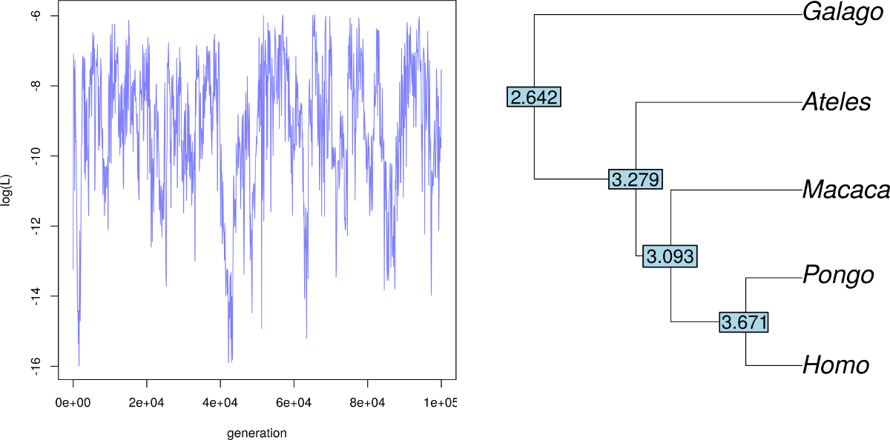 <!-- MERGE-REVIEW: no counterpart section found in QMD; content from TEX kept as-is. -->

### Continuous map

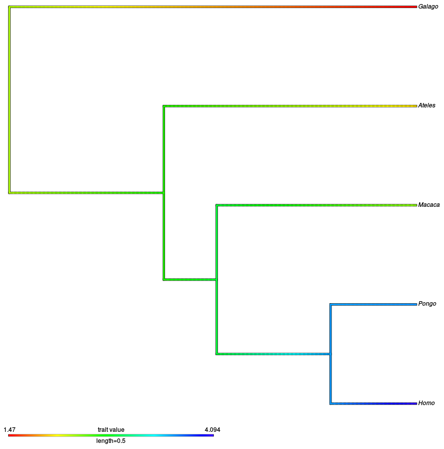

```{r}
?contMap
contMap(tree=maples.tree,
  x=maples.height)
# Change colors with setMap()
maples.contmap <- setMap(
  x=contMap(tree=maples.tree,
  x=maples.height),
  colors=c("white", "black"))
plot(maples.contmap)
# See ?par for more settings
```

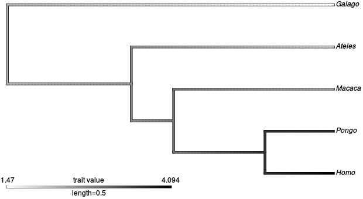 <!-- MERGE-REVIEW: no counterpart section found in QMD; code below comes from the old TEX version. -->

## Phenogram

### Display more characters on a tree in a table

```{r}
library(adephylo)
table.phylo4d(x=phylo4d(x=maples.tree, tip.data=maples.data),
  treetype="cladogram", symbol="circles", scale=FALSE, ratio.tree=0.5)
table.phylo4d(x=phylo4d(x=maples.tree, tip.data=maples.data),
  treetype="cladogram", symbol="circles", scale=TRUE, ratio.tree=0.5)
```

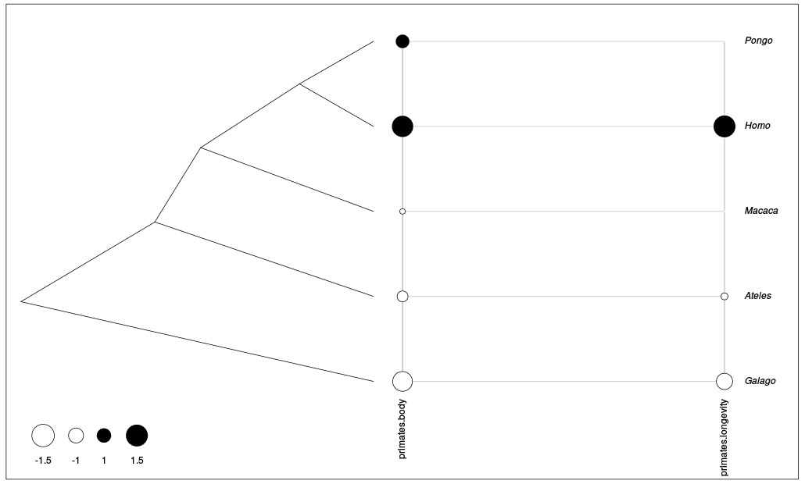 <!-- MERGE-REVIEW: no counterpart section found in QMD; code below comes from the old TEX version. -->

### Phenogram

**Vertical axis shows character values**

```{r}
phenogram(tree=maples.tree, x=maples.height, ftype="i", colors="red",
  main="Maples adult heights")
fancyTree(tree=maples.tree, type="phenogram95", x=maples.height,
  ftype="i", main="95-percentile of Maples adult heights")
```

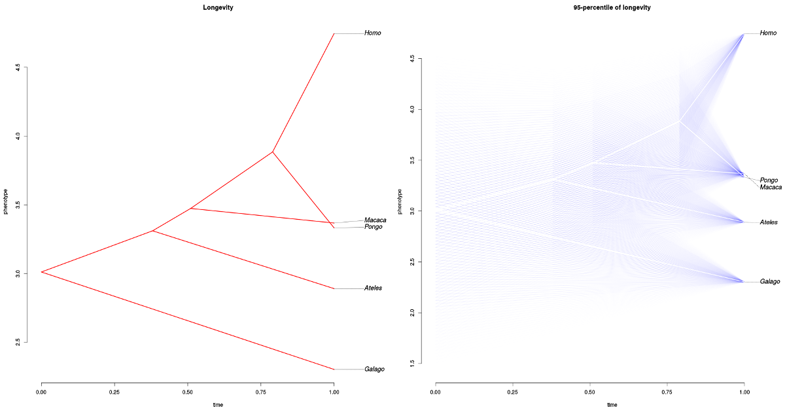 <!-- MERGE-REVIEW: 1 old code block(s) in TEX frame were dropped in favor of the .qmd section 'Phenogram'. -->

2 characters on 2 axis

3D - 3 characters it a rotating cube

3 characters on 2 axis and ancestral state reconstruction for all of them

See manuals for more settings

Plotting traits on trees

See options for plotting functions

Plot the trees Tip labels with bars with length proportional to character values

Tip labels with dots with size proportional to character values

```{r}
library("adephylo")
table.phylo4d(x = phylo4d(x = maples_tree, tip.data = maples_data), treetype = "cladogram", symbol = "circles", scale = FALSE, ratio.tree = 0.5)
table.phylo4d(x = phylo4d(x = maples_tree, tip.data = maples_data), treetype = "cladogram", symbol = "circles", scale = TRUE, ratio.tree = 0.5)
phenogram(tree = maples_tree, x = maples_height, ftype = "i", colors = "red", main = "Maples adult heights")
fancyTree(tree = maples_tree, type = "phenogram95", x = maples_height, ftype = "i", main = "95-percentile of Maples adult heights")
```

```{r}
phylomorphospace(tree = shorebird_tree, X = shorebird.data[, 2:3], label = "horizontal", lwd = 2)
```

```{r}
phylomorphospace3d(tree = shorebird_tree, X = shorebird.data[, 2:4], label = TRUE)
```

```{r}
fancyTree(tree = shorebird_tree, type = "scattergram", X = shorebird.data[, 2:4], res = 500, ftype = "i")
```

```{r}
?fancyTree
?phenogram
?phylomorphospace
?phylomorphospace3d
?contMap
?setMap
?par
?plot
```

```{r}
?plotTree.wBars # There are more variants available
?dotTree
?plotSimmap
```

```{r}
plotTree.wBars(tree = shorebird_tree, x = shorebird_mmass, tip.labels = TRUE)
```

```{r}
dotTree(tree = shorebird_tree, x = shorebird_mmass, tip.labels = TRUE, type = "cladogram")
```

```{=html}
<!--
## TODO Disparity-through-time
disparity(phy = shorebird_tree, data = primates.body)
dtt(phy = shorebird_tree, data = primates.body, nsim = 1000)
# lineage-through-time plot
ltt(tree = shorebird_tree, plot = TRUE, drop.extinct = FALSE, log.lineages = TRUE, gamma = TRUE)
-->
```

### Display 2 continuous characters in space and 3D tree connecting them

```{r}
# 2 characters on 2 axis
phylomorphospace(
  tree=shorebird.tree,
  X=shorebird.data[,2:3],
  label="horizontal", lwd=2)
# 3D - 3 characters in a
# rotating cube
phylomorphospace3d(
  tree=shorebird.tree,
  X=shorebird.data[,2:4],
  label=TRUE)
```

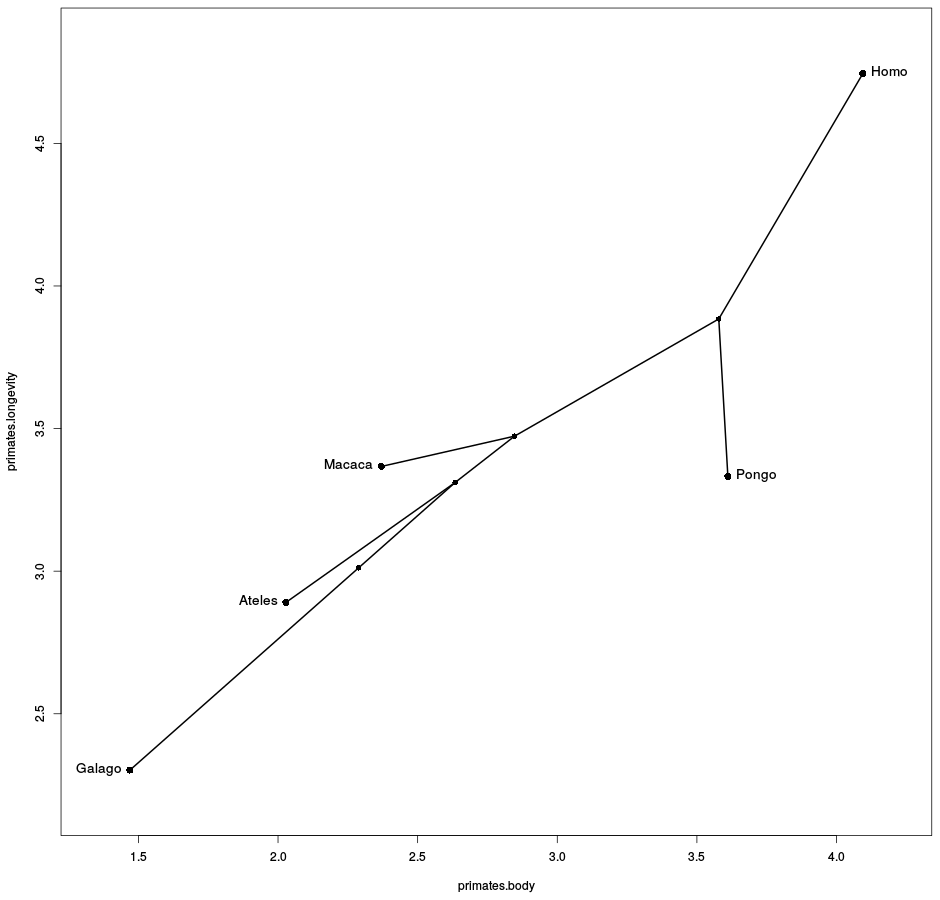 <!-- MERGE-REVIEW: no counterpart section found in QMD; code below comes from the old TEX version. -->

### Combine phenograms and ancestral state reconstructions

```{r}
# 3 characters on 2 axis and
# ancestral state reconstruction
# for all of them
fancyTree(tree=shorebird.tree,
  type="scattergram",
  X=shorebird.data[,2:4],
  res=500, ftype="i")
# See manuals for more settings
?fancyTree
?phenogram
?phylomorphospace
?phylomorphospace3d
?contMap
?setMap
?par
?plot
```

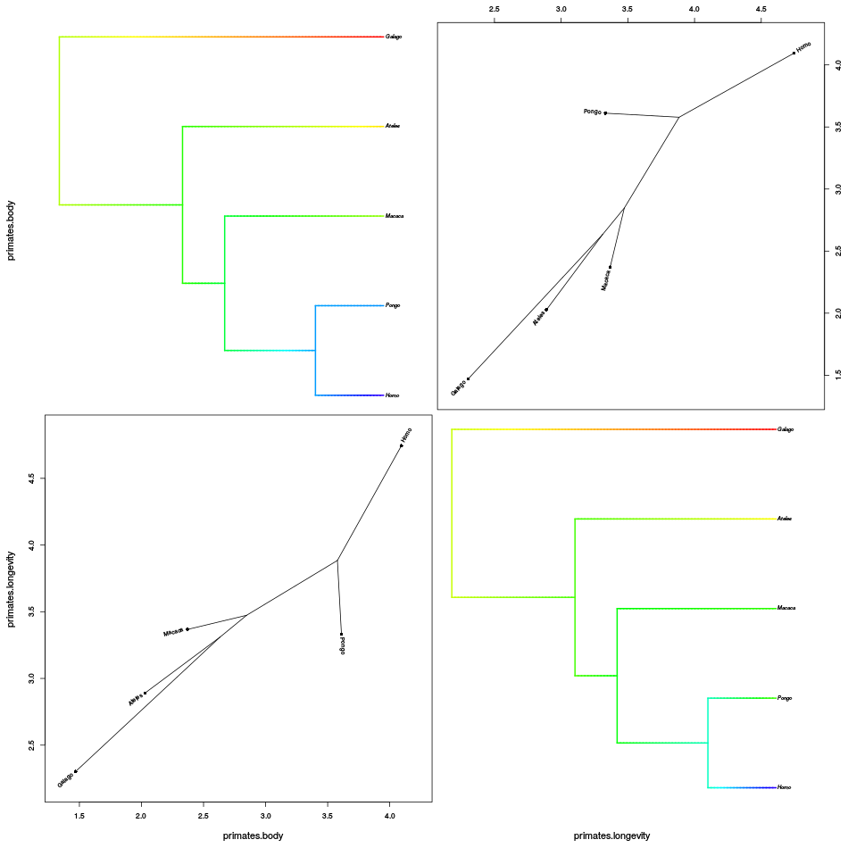 <!-- MERGE-REVIEW: 1 old code block(s) in TEX frame were dropped in favor of the .qmd section 'Ancestral state reconstruction'. -->

<!-- MERGE-REVIEW: content of the .qmd section 'Ancestral state reconstruction' was inserted at 3 frames; remove the unwanted duplicates. -->

Loading data - morphological characteristics of Acer species Ackerly & Donoghue (1998) https://doi.org/10.1086/286208

Process the phylogenetic tree maples data provide tree as plain text in NEWICK, must be imported into the phylo object

For plenty of analysis it must be fully resolved (bifurcating), rooting and ultrametricity often helps

See the character matrix

Maples mature height (m)

Maples seed size (mg)

Maples leaf + petiole length (mm)

By default performs estimation for continuous characters assuming a Brownian motion model fit by maximum likelihood

See result - reconstructions are in \$ace slot - to be plotted on nodes - 1st column are node numbers

Plot it

ACE returns long numbers - truncate them by e.g.

Other implementations are available in packages geiger, phangorn, ape, phytools, ... Parsimony based method

For continuous characters using Maximum Likelihood

For continuous characters using Markov Chain Monte Carlo

For discrete characters, various models available

Marginal reconstruction of the ancestral character states

ML estimation of a continuous trait

ACE for Brownian evolution with directional trend

ACE for Brownian evolution using likelihood

Bayesian ancestral character estimation

Get end (discard ca. first 20%) of ancestral states from Bayesian posterior distribution (it should converge to certain values)

Get means of ancestral states from Bayesian posterior distribution

Statistics of reconstructed values

Plot the ancestral states from posterior distribution (it should converge to certain values)

Plot the tree and reconstructed ancestral states

Continuous map

Change colors with setMap()

See ?par for more settings

```{r}
data(maples, package = "adephylo")
?adephylo::maples
```

```{r}
maples_tree <- read.tree(text = maples[["tre"]])
maples_tree
plot.phylo(maples_tree)
```

```{r}
is.binary.phylo(maples_tree)
is.rooted.phylo(maples_tree)
is.ultrametric.phylo(maples_tree)
```

```{r}
head(maples[["tab"]])
maples_data <- maples[["tab"]][, 1:30]
head(maples_data)
summary(maples_data)
```

```{r}
maples_height <- maples[["tab"]][["MatHt"]]
names(maples_height) <- rownames(maples[["tab"]])
maples_height
```

```{r}
maples_sdsz <- maples[["tab"]][["SdSz"]]
names(maples_sdsz) <- rownames(maples[["tab"]])
maples_sdsz
```

```{r}
maples_lfpt <- maples[["tab"]][["LfPt"]]
names(maples_lfpt) <- rownames(maples[["tab"]])
maples_lfpt
```

```{r}
library("ape")
?ace # See for possible settings
maples_height_ace <- ace(x = maples_height, phy = maples_tree, type = "continuous", method = "REML", corStruct = corBrownian(value = 1, phy = maples_tree))
```

```{r}
maples_height_ace
```

```{r}
plot.phylo(x = maples_tree, lwd = 2, cex = 0.75)
tiplabels(maples_height, adj = c(1, 0), frame = "none", col = "blue", cex = 0.75)
nodelabels(round(maples_height_ace[["ace"]], digits = 2), frame = "none", col = "red", cex = 0.75)
```

```{r}
round(x = ..., digits = 3) # "x"is vector with ACE values
```

```{r}
?ape::MPR
```

```{r}
?geiger::fitContinuous
```

```{r}
?geiger::fitContinuousMCMC
```

```{r}
?geiger::fitDiscrete
```

```{r}
?phangorn::ancestral.pml
library("phytools")
```

```{r}
?fastAnc
maples_height_fa <- fastAnc(tree = maples_tree, x = maples_height, vars = FALSE, CI = TRUE)
maples_height_fa
plot.phylo(x = maples_tree, edge.width = 2, cex = 0.75)
tiplabels(maples_height, adj = c(1, 0), frame = "none", col = "blue", cex = 0.75)
nodelabels(round(maples_height_fa[["ace"]], digits = 2), frame = "none", col = "red", cex = 0.75)
```

```{r}
?anc.trend
maples_height_ac <- anc.trend(tree = maples_tree, x = maples_height, maxit = 1000000)
maples_height_ac
```

```{r}
?anc.ML
maples_height_ml <- anc.ML(tree = maples_tree, x = maples_height, maxit = 1000000, model = "BM")
maples_height_ml
```

```{r}
?anc.Bayes
maples_height_bayes <- anc.Bayes(tree = maples_tree, x = maples_height, ngen = 1000000) # Use more MCMC generations
maples_height_bayes
```

```{r}
tail(maples_height_bayes[["mcmc"]])
dim(maples_height_bayes[["mcmc"]])
```

```{r}
maples_height_bayes_anc <- colMeans(maples_height_bayes[["mcmc"]][2001:nrow(maples_height_bayes[["mcmc"]]), as.character(1:maples_tree$Nnode + length(maples_tree$tip.label))])
maples_height_bayes_anc
```

```{r}
summary(maples_height_bayes[["mcmc"]][2001:nrow(maples_height_bayes[["mcmc"]]), as.character(1:maples_tree$Nnode + length(maples_tree$tip.label))])
```

```{r}
plot(maples_height_bayes)
```

```{r}
plot.phylo(x = maples_tree, edge.width = 2, cex = 2)
tiplabels(maples_height, adj = c(1, 0), col = "blue", bg = "yellow", cex = 1.5)
nodelabels(round(x = maples_height_bayes_anc, digits = 2), cex = 1.5)
```

```{r}
?contMap
contMap(tree = maples_tree, x = maples_height)
```

```{r}
maples_contmap <- setMap(x = contMap(tree = maples_tree, x = maples_height), colors = c("white", "black"))
plot(maples_contmap)
```

### Plotting traits on trees - code

```{r}
# See options for plotting functions
?plotTree.wBars # There are more variants available
?dotTree
?plotSimmap
# Plot the trees
# Tip labels with bars with length proportional to character values
plotTree.wBars(tree=shorebird.tree, x=shorebird.mmass, tip.labels=TRUE)
# Tip labels with dots with size proportional to character values
dotTree(tree=shorebird.tree, x=shorebird.mmass, tip.labels=TRUE,
  type="cladogram")
```

<!-- MERGE-REVIEW: no counterpart section found in QMD; code below comes from the old TEX version. -->

### Plotting traits on trees - plots

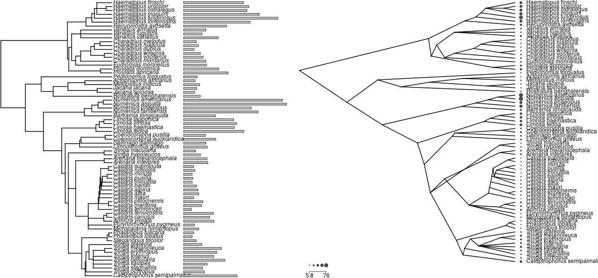 <!-- MERGE-REVIEW: no counterpart section found in QMD; content from TEX kept as-is. -->

## Disparity

### Disparity through time

```{=html}
<!--
    @@TOKEN0@@

-->
```

<!-- MERGE-REVIEW: no counterpart section found in QMD; content from TEX kept as-is. -->

## Tasks

### Evolutionary tasks

1.  Browse <https://blog.phytools.org/> and see if you find some interesting method to display your data. If so, try it with any suitable data.
2.  See relevant training datasets `data(package=c("adephylo", "caper", "geiger","phytools"))` and select some training data set (or use your own data) to try at least 1--2 of the above methods. <!-- MERGE-REVIEW: no counterpart section found in QMD; content from TEX kept as-is. -->

