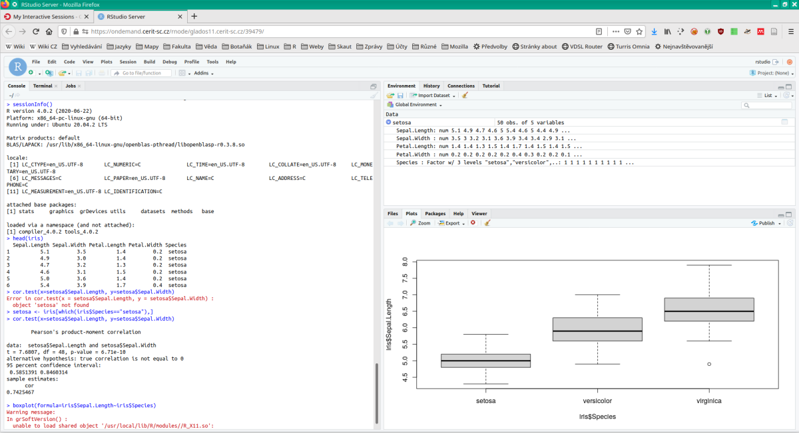
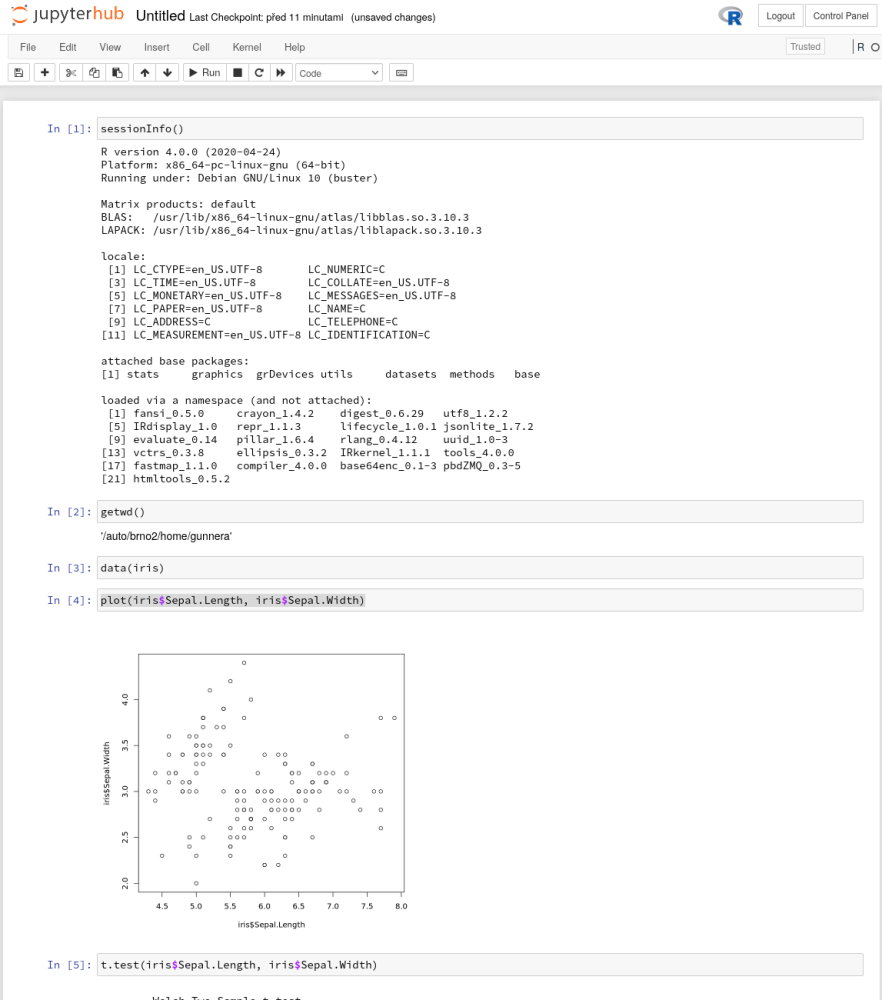
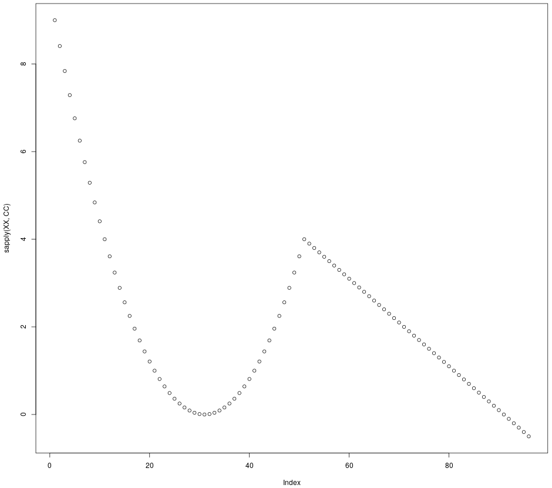

# The end

## Graphics

### Direct saving of plots to disk

**Useful e.g. if plot should be bigger than screen, requires special settings, if done in batch, script, etc.**

```{r}
# Output figure will be saved to the disk as OutputFile.png
png(filename="OutputFile.png", width=720, height=720, bg="white")
# Here can go any number of functions making plots...
plot(...) # Whatever...
# When using plotting commands, nothing is shown on the screen
# The final plot(s) will be saved by:
dev.off() # Closes graphical device - needed after use of plotting
          # functions png(), svg(), pdf(), ... followed by any
          # function like plot() to write the file(s) to the disk
filename="OutFiles_%03d.png" # Returns list of files named
                             # OutFiles_001.png, OutFiles_002.png, ...
                             # Useful for functions returning more
                             # graphs.
?png # These functions have various possibilities to set size, whatever.
?svg # Exact possibilities of all 3 functions vary from system to system
?pdf # according to graphical libraries available in the computer.
```

<!-- MERGE-REVIEW: no counterpart section found in QMD; code below comes from the old TEX version. -->

### Graphical packages

- Basic plotting functions in R are very limited...

  - The usage is simple, but anything more complicated requires extensive coding (plenty of examples were shown in the course)...
  - It can be tricky to get desired figure - some magic use to be needed (search the Internet)...

- There are plenty of graphical packages...

- Advanced functions we used internally by used packages are [lattice](https://CRAN.R-project.org/package=lattice) ([web](https://lattice.r-forge.r-project.org/)), [gplot](https://CRAN.R-project.org/package=gplots) and [ggplot2](https://CRAN.R-project.org/package=ggplot2) ([web](https://ggplot2.tidyverse.org/))

  - They have enormous possibilities, it is large topic for another long course...

- `par()` sets graphical parameters for following plots (splitting into panes, style of lines, points, text - see `pch`, `lwd`, `lty`, `cex`, `mai`, `mar`, `mfcol`, `mfrow`, ...) - see help pages...

- Most important low-level functions are `points`, `lines`, `text`, `abline`, `legend`, `axis`, `axes`, `arrows`, `box` - see help pages... <!-- MERGE-REVIEW: no counterpart section found in QMD; content from TEX kept as-is. -->

## GitHub

### Install package from GitHub

- [GitHub](https://github.com/) is currently probably the most popular platform to host development of open-source projects - plenty of R packages are there
- [Git](https://git-scm.com/book/en/v2) is version controlling system - it traces changes among all versions - absolutely crucial for any software development
- Normal stable version of package is installed from repository as usual, but sometimes it can be useful to get latest developmental version (e.g. when it fixes some bug and new release is not available yet)

```{r}
# Needed library
require(devtools)
dev_mode(on=TRUE)
# Install selected package from GitHub (user/project)
install_github("thibautjombart/adegenet")
# when finished go back to normal version
dev_mode(on=FALSE)
```

<!-- MERGE-REVIEW: 1 old code block(s) in TEX frame were dropped in favor of the .qmd section 'Install packages from GitHub'. -->

<!-- MERGE-REVIEW: content of the .qmd section 'Install packages from GitHub' was inserted at 3 frames; remove the unwanted duplicates. -->

Needed library

Install selected package from GitHub (user/project)

when finished go back to normal version

```{r}
require(devtools)
dev_mode(on = TRUE)
```

```{r}
install_github("thibautjombart/adegenet")
```

```{r}
dev_mode(on = FALSE)
```

## Scripts

### R script and its running from command line

- R script is just plain `TXT` file with `.r` (e.g. `myscript.r`) extension containing list of R commands

- Mark all user comments with `#` on the beginning

- In command line (Linux/macOS/Windows/...) use

  - `Rscript myscript.r` to work **interactively** - all output is written to the terminal (screen; as usual), user can be asked for some values, ...
  - `R CMD BATCH myscript.r` to let it run **non-interactively** - all output is written into file `myscript.Rout`, terminal (screen) is clean and user can not influence the script anyhow - e.g. on [MetaCentrum](https://www.metacentrum.cz/) - be sure the script doesn't require user input and works correctly

- Script ends when there is any error or on the end of the file

- When working on both Windows and macOS/Linux, take care about end of lines, and in case of usage of accented characters (e.g. for labels) also about encoding

  - Windows and UNIX (Linux, macOS, ...) have different internal symbol for [new line](https://en.wikipedia.org/wiki/Newline)
  - Use UNIX command line utilities `dos2unix myscript.r` or `unix2dos myscript.r` to get correct ends of lines for target system
  - Linux and macOS use to use UTF-8, Windows use regional encoding, e.g. Czech CP-1250 - use advanced text editor (slide ) to convert the encoding, or use some command line tool, like `iconv` <!-- MERGE-REVIEW: no counterpart section found in QMD; content from TEX kept as-is. -->

## MetaCentrum

### CESNET and MetaCentrum

- [CESNET](https://www.cesnet.cz/en) ([česky](https://www.cesnet.cz/)) is organization of Czech universities, Academy of Science and other organizations taking care about Czech backbone Internet, one of world leading institutions of this type

- CESNET provides various [services](https://www.cesnet.cz/en/services) ([česky](https://www.cesnet.cz/sluzby/))

  - Massive computations - [MetaCentrum](https://www.cesnet.cz/en/services/computing-2/metacentrum-10) ([česky](https://www.cesnet.cz/sluzby/vypocty-2/narocne-vypocty-metacentrum-10))
  - Large [data storage](https://www.cesnet.cz/en/services/data-storage-3) ([česky](https://www.cesnet.cz/sluzby/datova-uloziste-3/datova-uloziste-13))
  - [FileSender](https://www.cesnet.cz/en/services/data-storage-3/filesender-15) ([česky](https://www.cesnet.cz/sluzby/datova-uloziste-3/filesender-15)) to be able to send up to 1.9 TB file
  - [Cloud](https://www.metacentrum.cz/en/Sluzby/Cloud/) ([česky](https://www.metacentrum.cz/cs/Sluzby/Cloud/)) - computing (HPC) cloud similar to e.g. Amazon Elastic Compute Cloud (EC2), Google Compute Engine or Microsoft Azure
  - [ownCloud](https://www.cesnet.cz/en/services/data-storage-3/owncloud-16) ([česky](https://www.cesnet.cz/sluzby/datova-uloziste-3/owncloud-16)) to backup and/or sync data across devices (default capacity is 100 GB, user may ask for more) - similar to e.g. Dropbox, Google Drive or Microsoft OneDrive

- Information about MetaCentrum <https://www.metacentrum.cz/en/> ([česky](https://www.metacentrum.cz/cs/)) and documentation <https://docs.metacentrum.cz/> (main information for users containing all needed documentation)

- Check my special course <https://soubory.trapa.cz/linuxcourse/> <!-- MERGE-REVIEW: no counterpart section found in QMD; content from TEX kept as-is. -->

### Running R tasks on MetaCentrum

- There are only some R packages, to get more create own package library and use it in scripts (see e.g. `.libPaths()` within `R`)
- **Be careful about paths!**
- In the `metacentrum.sh` script load R, e.g. `module add r/4.1.3-gcc-10.2.1-6xt26dl` and start there R script as usually `R CMD BATCH script.r`

1.  Login to selected front node via SSH and load R module
2.  Create somewhere new directory for R packages `mkdir rpkgs` (or use default `$$/R/`)
3.  Start R `R` and install **all** R packages needed for the task - install them into the `rpkgs` directory `install.packages(pkgs=..., lib="rpkgs")`
4.  In the R script `*.r` load the packages from the `rpkgs` directory `library(package=..., lib.loc="/storage/.../rpkgs")`
5.  Ensure all needed outputs are saved from the R script <!-- MERGE-REVIEW: no counterpart section found in QMD; content from TEX kept as-is. -->

### OnDemand

**Applications in web browser**

- It allows to run selected interactive applications in web browser

- See <https://docs.metacentrum.cz/en/docs/graphical/ondemand> and <https://ondemand.grid.cesnet.cz/>

- Applications start in `/storage/brno3-cerit/home/$USER/` - ensure to have everything needed there

   <!-- MERGE-REVIEW: no counterpart section found in QMD; content from TEX kept as-is. -->

### Jupyter Notebook

- Web service allowing to record code as well as its output for languages like BASH, R, Python, ...

- Convenient for recording and sharing code, interactive work, ...

- Use [Jupyter Hub](https://docs.metacentrum.cz/en/docs/software/sw-list/jupyter) for MetaCentrum users

  - Data are typically in `/storage/brno2/home/USER/`

- Available also as part of OnDemand (previous slide), or bit experimental [CERIT hub](https://hub.cloud.e-infra.cz/), which allows to select custom storage and also custom docker image (see [documentation](https://docs.cerit.io/en/docs/web-apps/jupyterhub))

   <!-- MERGE-REVIEW: no counterpart section found in QMD; content from TEX kept as-is. -->

## Functions

### Simple function

- Functions pack sets of commands for more comfortable repeated usage
- People more interested in R programming need to check special courses and/or [documentation](https://CRAN.R-project.org/manuals.html)

```{r}
# General syntax:
MyFunction <- function (x, y) {
  # Any commands can be here...
  x + y
  }
# Use as usually:
MyFunction(5, 8)
MyFunction(1, 4)
MyFunction(x=4, y=7)
MF <- MyFunction(9, 15)
MF # See it works
```

<!-- MERGE-REVIEW: no counterpart section found in QMD; code below comes from the old TEX version. -->

## Loops

### Simple loop - for cycles

- Loops repeat one task given number of times
- Variable `i` has changing value for every repetition - useful for working with indexes (within lists, matrices, ...)
- It is possible to use variables or numeric output of functions in `from:to` expression - this is very variable
- In `for` loop we know in advance the number of repetitions (cycles), in `while` loop (next slide) we don't

```{r}
# Simplest loop - print value of "i" in each step
# "i" is commonly used for various indexing
for (i in 1:5) { print(i) }
[1] 1 # This is the value of "i"...
[1] 2
[1] 3
[1] 4
[1] 5
```

<!-- MERGE-REVIEW: no counterpart section found in QMD; code below comes from the old TEX version. -->

### For and while loops

```{r}
# In every step modify value of variable "X" (add 1 to previous value)
X <- 0 # Set initial value
for (i in 1:10) {
  # Any commands can be here...
  print("Loop turn") # Some message for user
  print(i) # Print number of turn - note how it is increasing
  X <- X+i # Rise value of "X" by current value of "i" (previous line)
  print(paste("Variable value:", X)) } # Print current value of "X"
for (i in 10:5) { print(i) } # Can be descending...
# Work on each item of a list object
# Print length of each sequence in gunnera.dna
for (L in 1:length(gunnera.dna)) {
  print(length(gunnera.dna[[L]])) }
# While loop - it is done while the condition is valid
# While value of "Q" is < 5 (starting from 0), print it and add 1
Q <- 0
while (Q < 5) { print(Q <- Q+1) }
```

<!-- MERGE-REVIEW: no counterpart section found in QMD; code below comes from the old TEX version. -->

## If-else branching

### If-else branching I

- Basic method of branching the code - **if** the condition is met, **then** one branch is followed, **else** - in any other case - the other branch of the code is executed
- `else` part can be missing - the code is executed **only if** the condition is met

```{r}
XX <- seq(from=-3, to=6.5, by=0.1)
XX
YY <- c()
for (II in 1:length(XX)) {
  if(XX[II] <= 2) { # Executed for XX <= 2
    YY[II] <- XX[II]^2
    } else { # if(XX[II] > 2) # Executed for XX > 2
      YY[II] <- 6-XX[II]
      }
  }
YY # See next two slides for the end of the example
```

<!-- MERGE-REVIEW: 1 old code block(s) in TEX frame were dropped in favor of the .qmd section 'If-else branching'. -->

<!-- MERGE-REVIEW: content of the .qmd section 'If-else branching' was inserted at 3 frames; remove the unwanted duplicates. -->

Or (different possibility to get very same result) Note "xx"is reused from the previous variant

gunnera_raxml \<- raxml(DNAbin = usflu_dna, N = "autoFC", exec = "\~/bin/") gunnera_raxml \<- phyloch::raxml(x = gunnera_nogaps, runs = 10, file = "gunnera_raxml", path = "\~/bin/") axisGeo() \# package phyloch - adds scale in geological time, has many options library("combinat") library("polysat") polysat_test \<- read.GeneMapper("https://soubory.trapa.cz/rcourse/GeneMapperExample.txt") summary(polysat_test) Loci(polysat_test) \# Information about loci class(polysat_test) Description(polysat_test) \<- "Dataset for the tutorial"\# Description of data set PopNames(polysat_test) \<- c("PopA", "PopB", "PopC") \# Population names PopInfo(polysat_test) \<- rep(x = 1:3, each = 100) \# Which individuals belong to which population PopInfo(polysat_test) \# Which individuals belong to which population Usatnts(polysat_test) \<- c(2, 3, 2) \# Ploidies Usatnts(polysat_test) \# Get information about ploidy levels for populations Samples(polysat_test) polysat_test2 \<- Samples(object = polysat_test, populations = "PopA") summary(polysat_test2) viewGenotypes(polysat_test, samples = paste("A", 1:20, sep = ""), loci = "loc1") find.missing.gen(polysat_test) summary(polysat_test) testmat \<- meandistance.matrix(polysat_test) pca \<- cmdscale(testmat) mycol \<- c("red", "green", "blue") plot(pca\[, 1\], pca\[, 2\], col = mycol\[PopInfo(polysat_test)\], + main = "PCA with Bruvo distance") testmat2 \<- meandistance.matrix(polysat_test, distmetric = Lynch.distance) pca2 \<- cmdscale(testmat2) plot(pca2\[, 1\], pca2\[, 2\], col = rep(c("red", "green", "blue"), each = 100), + main = "PCA with Lynch distance") polysat_test2 \<- deleteSamples(polysat_test, c("B59", "C30")) polysat_test2 \<- deleteLoci(polysat_test2, "loc2")

```{r}
xx <- seq(from = -3, to = 6.5, by = 0.1)
xx
yy <- c()
for (ii in seq_along(xx)) {
  if (xx[ii] <= 2) { # Executed for xx <= 2
    yy[ii] <- xx[ii]^2
  } else { # if(xx[ii] > 2) # Executed for xx > 2
    yy[ii] <- 6 - xx[ii]
  }
}
yy
plot(xx, yy) # See the result
```

```{r}
cc <- function(aa) {
  if (aa <= 2) { # Executed for xx <= 2
    bb <- aa^2
  } else { # Executed for xx > 2
    bb <- 6 - aa
  }
  bb # The output value
}
cc # Previously, "yy"contained values to plot made by the for loop, here "cc"contains function to by used by sapply() when plotting
plot(sapply(xx, cc)) # See the result

```

````{=html}
<!--
################################################################################
TODO more topics

## RAxML

```{r}

```

## Extra

```{r}

```

## Polysat - microsattelites and mixed ploidies

```{r}

```

Basic information

```{r}

```

Add information missing in input data file

```{r}

```

Show samples

```{r}

```

Subsetting of populations:

```{r}

```

View genotypes (for locus loc1) of samples A1-A20

```{r}

```

Show missing data

```{r}

```
-->
````

### If-else branching II

```{r}
# Plot from example from previous slide
plot(XX, YY) # See the result
# Or (different possibility to get very same result)
# Note "XX" is reused from the previous slide
CC <- function(AA) {
  if(AA <= 2) { # Executed for XX <= 2
  BB <- AA^2
  } else { # Executed for XX > 2
    BB <- 6-AA
    }
  return(BB) # The output value
  }
 CC # Previously, "YY" contained values to plot made by the for loop,
    # here "CC" contains function to by used by sapply() when plotting
 plot(sapply(XX, CC)) # See the result
# The plot (same for both ways how to do it) is on next slide
```

<!-- MERGE-REVIEW: 1 old code block(s) in TEX frame were dropped in favor of the .qmd section 'If-else branching'. -->

<!-- MERGE-REVIEW: content of the .qmd section 'If-else branching' was inserted at 3 frames; remove the unwanted duplicates. -->

Or (different possibility to get very same result) Note "xx"is reused from the previous variant

gunnera_raxml \<- raxml(DNAbin = usflu_dna, N = "autoFC", exec = "\~/bin/") gunnera_raxml \<- phyloch::raxml(x = gunnera_nogaps, runs = 10, file = "gunnera_raxml", path = "\~/bin/") axisGeo() \# package phyloch - adds scale in geological time, has many options library("combinat") library("polysat") polysat_test \<- read.GeneMapper("https://soubory.trapa.cz/rcourse/GeneMapperExample.txt") summary(polysat_test) Loci(polysat_test) \# Information about loci class(polysat_test) Description(polysat_test) \<- "Dataset for the tutorial"\# Description of data set PopNames(polysat_test) \<- c("PopA", "PopB", "PopC") \# Population names PopInfo(polysat_test) \<- rep(x = 1:3, each = 100) \# Which individuals belong to which population PopInfo(polysat_test) \# Which individuals belong to which population Usatnts(polysat_test) \<- c(2, 3, 2) \# Ploidies Usatnts(polysat_test) \# Get information about ploidy levels for populations Samples(polysat_test) polysat_test2 \<- Samples(object = polysat_test, populations = "PopA") summary(polysat_test2) viewGenotypes(polysat_test, samples = paste("A", 1:20, sep = ""), loci = "loc1") find.missing.gen(polysat_test) summary(polysat_test) testmat \<- meandistance.matrix(polysat_test) pca \<- cmdscale(testmat) mycol \<- c("red", "green", "blue") plot(pca\[, 1\], pca\[, 2\], col = mycol\[PopInfo(polysat_test)\], + main = "PCA with Bruvo distance") testmat2 \<- meandistance.matrix(polysat_test, distmetric = Lynch.distance) pca2 \<- cmdscale(testmat2) plot(pca2\[, 1\], pca2\[, 2\], col = rep(c("red", "green", "blue"), each = 100), + main = "PCA with Lynch distance") polysat_test2 \<- deleteSamples(polysat_test, c("B59", "C30")) polysat_test2 \<- deleteLoci(polysat_test2, "loc2")

```{r}
xx <- seq(from = -3, to = 6.5, by = 0.1)
xx
yy <- c()
for (ii in seq_along(xx)) {
  if (xx[ii] <= 2) { # Executed for xx <= 2
    yy[ii] <- xx[ii]^2
  } else { # if(xx[ii] > 2) # Executed for xx > 2
    yy[ii] <- 6 - xx[ii]
  }
}
yy
plot(xx, yy) # See the result
```

```{r}
cc <- function(aa) {
  if (aa <= 2) { # Executed for xx <= 2
    bb <- aa^2
  } else { # Executed for xx > 2
    bb <- 6 - aa
  }
  bb # The output value
}
cc # Previously, "yy"contained values to plot made by the for loop, here "cc"contains function to by used by sapply() when plotting
plot(sapply(xx, cc)) # See the result

```

````{=html}
<!--
################################################################################
TODO more topics

## RAxML

```{r}

```

## Extra

```{r}

```

## Polysat - microsattelites and mixed ploidies

```{r}

```

Basic information

```{r}

```

Add information missing in input data file

```{r}

```

Show samples

```{r}

```

Subsetting of populations:

```{r}

```

View genotypes (for locus loc1) of samples A1-A20

```{r}

```

Show missing data

```{r}

```
-->
````

### Output of the if-else branching example



<!-- MERGE-REVIEW: content of the .qmd section 'If-else branching' was inserted at 3 frames; remove the unwanted duplicates. -->

Or (different possibility to get very same result) Note "xx"is reused from the previous variant

gunnera_raxml \<- raxml(DNAbin = usflu_dna, N = "autoFC", exec = "\~/bin/") gunnera_raxml \<- phyloch::raxml(x = gunnera_nogaps, runs = 10, file = "gunnera_raxml", path = "\~/bin/") axisGeo() \# package phyloch - adds scale in geological time, has many options library("combinat") library("polysat") polysat_test \<- read.GeneMapper("https://soubory.trapa.cz/rcourse/GeneMapperExample.txt") summary(polysat_test) Loci(polysat_test) \# Information about loci class(polysat_test) Description(polysat_test) \<- "Dataset for the tutorial"\# Description of data set PopNames(polysat_test) \<- c("PopA", "PopB", "PopC") \# Population names PopInfo(polysat_test) \<- rep(x = 1:3, each = 100) \# Which individuals belong to which population PopInfo(polysat_test) \# Which individuals belong to which population Usatnts(polysat_test) \<- c(2, 3, 2) \# Ploidies Usatnts(polysat_test) \# Get information about ploidy levels for populations Samples(polysat_test) polysat_test2 \<- Samples(object = polysat_test, populations = "PopA") summary(polysat_test2) viewGenotypes(polysat_test, samples = paste("A", 1:20, sep = ""), loci = "loc1") find.missing.gen(polysat_test) summary(polysat_test) testmat \<- meandistance.matrix(polysat_test) pca \<- cmdscale(testmat) mycol \<- c("red", "green", "blue") plot(pca\[, 1\], pca\[, 2\], col = mycol\[PopInfo(polysat_test)\], + main = "PCA with Bruvo distance") testmat2 \<- meandistance.matrix(polysat_test, distmetric = Lynch.distance) pca2 \<- cmdscale(testmat2) plot(pca2\[, 1\], pca2\[, 2\], col = rep(c("red", "green", "blue"), each = 100), + main = "PCA with Lynch distance") polysat_test2 \<- deleteSamples(polysat_test, c("B59", "C30")) polysat_test2 \<- deleteLoci(polysat_test2, "loc2")

```{r}
xx <- seq(from = -3, to = 6.5, by = 0.1)
xx
yy <- c()
for (ii in seq_along(xx)) {
  if (xx[ii] <= 2) { # Executed for xx <= 2
    yy[ii] <- xx[ii]^2
  } else { # if(xx[ii] > 2) # Executed for xx > 2
    yy[ii] <- 6 - xx[ii]
  }
}
yy
plot(xx, yy) # See the result
```

```{r}
cc <- function(aa) {
  if (aa <= 2) { # Executed for xx <= 2
    bb <- aa^2
  } else { # Executed for xx > 2
    bb <- 6 - aa
  }
  bb # The output value
}
cc # Previously, "yy"contained values to plot made by the for loop, here "cc"contains function to by used by sapply() when plotting
plot(sapply(xx, cc)) # See the result

```

````{=html}
<!--
################################################################################
TODO more topics

## RAxML

```{r}

```

## Extra

```{r}

```

## Polysat - microsattelites and mixed ploidies

```{r}

```

Basic information

```{r}

```

Add information missing in input data file

```{r}

```

Show samples

```{r}

```

Subsetting of populations:

```{r}

```

View genotypes (for locus loc1) of samples A1-A20

```{r}

```

Show missing data

```{r}

```
-->
````

## Solving problems

### Most common problems and their solutions

- Something was not found (object, function, file, ...)

  - Check spelling of all methods, parameters, etc.
  - Check all paths (slide )
  - Check if all required objects were correctly created in previous steps
  - Check if all required libraries are loaded

- Unknown parameter, method, etc.

  - Check spelling of all parameters, consult manual pages
  - Check if all required libraries are loaded

- Graphics is not plotted correctly

  - Graphical window is too small (common problem with RStudio on screen with low resolution) - try to enlarge plotting window/pane
  - Reset graphical settings from some previous plot(s) by (repeated) calling of `dev.off()`

- R does nothing (but CPU is not extensively used)

  - R is waiting for some user input
  - If command line starts with `+`, previous line was not completed correctly (e.g. missing closing bracket `)`) - check syntax, add it and hit `Enter`
  - Some functions show plots and ask user for decision what to do (e.g DAPC, slide ) - write the answer into command line or special window and hit `Enter`

- Some functions are not (without extra work) usable on all operating systems, some don't work correctly in GUI

  - Check manual and/or some on-line forum (slide and onward)

- R and packages are more or less changing from version to version

  - Old methods can became outdated and not working anymore
  - Check release notes and change logs for new versions, manual pages and on-line forums (slide and onward)
  - Generally, follow news for your topic (appropriate mailing list, ...)
  - Unmaintained packages are archived, new created... <!-- MERGE-REVIEW: no counterpart section found in QMD; content from TEX kept as-is. -->

### How to ask for help

- **Never ever** ask simple silly lazy questions you can quickly find in manual or web

- People on mailing lists and forums respond voluntarily in their spare free time - do not waste it - be polite, brief and informative

- Be as specific and exact as possible

  - Write **exactly** what you did ("It doesn't work!" is useless...)
  - Copy/paste your commands and their output, especially error messages - they are keys to solve the problem
  - Try to search web for the error messages (or their parts)
  - Try to provide minimal working example - add at least part of your data (if applicable) so that the problem is reproducible
  - Specify version(s) of R/packages, operating system and/or another important details - authors will commonly insist on newest versions: add outputs of `sessionInfo()` and `packageVersion("PackageName")`
  - Try to find forum most appropriate for your question (does package have dedicate forum?)

- **R is free as freedom of speech - not as free beer!**

  - As soon as you don't pay for support, you can't blame anyone for lack of responses
  - There are plenty of reasons some package/function doesn't work - usage/data author didn't expect, unsupported operating system, author's mistake, user's mistake, ...
  - Authors wish their software to be useful - constructive feedback, reporting bugs and wishes is welcomed, but it must be provided in the way useful for the developer

- R functions commonly lack control of input data - error messages are returned by internal functions

  - They are not straightforward
  - It requires some training and experience to be quickly able to find what is going on
  - Always carefully read error messages and think about them

- Imagine you should answer - which information do you need? <!-- MERGE-REVIEW: no counterpart section found in QMD; content from TEX kept as-is. -->

### ChatGPT and others

- Usage of generative AI, large language models (LLM) like ChatGPT can help a lot
- Very good to improve code and fixing non-working code
- Can well explain existing code - good starting point
- Good for adaptation of existing code for user's needs
- Limited usage to generate new code - can misunderstand request, code can be technically wrong, but not well working, can be incomplete or limited in corner-cases
- Without at least basic understanding of subject it is hard to realize if ChatGPT solution is correct - user should be at least basically able to work without AI, otherwise there is high risk of failures
- One should never rely on tool with unclear functionality and problematic usage of of users' data and copyrighted content <!-- MERGE-REVIEW: no counterpart section found in QMD; content from TEX kept as-is. -->

### Where to look for the help

Before asking, **ensure your question is in answerable form** - slide .

- Sloppily asked question can't be answered at all...

- Check documentation, manuals and search the Internet before asking

- R homepage <https://www.r-project.org/> and packages <https://CRAN.R-project.org/web/packages/> (with documentation and links)

- R phylogeny mailing list <https://stat.ethz.ch/mailman/listinfo/r-sig-phylo>

- R genetics mailing list <https://stat.ethz.ch/mailman/listinfo/r-sig-genetics>

- Bioconductor home page <https://bioconductor.org/> and support forum <https://support.bioconductor.org/>

- Adegenet help mailing list <https://lists.r-forge.r-project.org/cgi-bin/mailman/listinfo/adegenet-forum> and GitHub page <https://github.com/thibautjombart/adegenet/wiki>

- Poppr forum <https://groups.google.com/g/poppr/about>

- R help mailing list <https://stat.ethz.ch/mailman/listinfo/r-help>

- R announce mailing list <https://stat.ethz.ch/mailman/listinfo/r-announce>

- R ecology mailing list <https://stat.ethz.ch/mailman/listinfo/r-sig-ecology>

- R at StackOverflow StackExchange (for programmers) <https://stackoverflow.com/questions/tagged/r>

- R at CrossValidated StackExchange (for statisticians, mathematicians, etc.) <https://stats.stackexchange.com/questions/tagged/r>

- Biostars - general bioinformatics forum <https://www.biostars.org/>

- Biology - general forum about biology at StackExchange <https://biology.stackexchange.com/>

- Bioinformatics at StackExchange <https://bioinformatics.stackexchange.com/>

- Do not hesitate to ask on the forum or contact author of package with which you have problem, preferably through some public forum or mailing list, they usually respond quickly and helpfully... - they wish their packages to be working and useful

- [Uncle Google](https://rseek.org/) is your friend here (*"how to XXX in R*")... <!-- MERGE-REVIEW: no counterpart section found in QMD; content from TEX kept as-is. -->

## Resources

### Citations

- To correctly cite R launch `citation()` and see information there - it is slightly different for every version of R
- Cite used packages - launch `citation("PackageName")` - if this information is missing, go to its manual page and/or homepage and find the information there
- Most of packages implementing methods are created by scientists - they like to be cited :-)
- Packages/functions commonly provide various methods to calculate desired task - check function's help page (`?**FunctionName`) and find references there and cite them accordingly
- Check original papers to fully understand respective method <!-- MERGE-REVIEW: no counterpart section found in QMD; content from TEX kept as-is. -->

### Further reading

**The most important books for our topics**

Emmanuel Paradis Analysis of Phylogenetics and Evolution with R, second edition Springer, 2012

```         
Michael J. Crawley
 The R Book, second edition
 Wiley, 2012

Paurush Praveen Sinha
 Bioinformatics with R Cookbook
 Packt Publishing, 2014

Anthony R. Ives
 Mixed and Phylogenetic Models: A Conceptual Introduction to Correlated Data
 Leanpub, 2018
 <https://leanpub.com/correlateddata> (free to read on-line)
```

<!-- MERGE-REVIEW: no counterpart section found in QMD; content from TEX kept as-is. -->

### Learning resources

- R homepage <https://www.r-project.org/> and packages <https://CRAN.R-project.org/web/packages/> (with documentation and links)
- Books about R <https://www.r-project.org/doc/bib/R-books.html>
- List of R documentation <https://CRAN.R-project.org/manuals.html>
- Bioconductor help pages <https://master.bioconductor.org/help/>
- R phylogenetics wiki <https://www.r-phylo.org/wiki/Main_Page>
- [R CRAN Views](https://cran.r-project.org/web/views/), especially Phylogenetics <https://CRAN.R-project.org/web/views/Phylogenetics.html>
- Integrated documentation search <https://www.rdocumentation.org/>
- Better interface to R and packages documentation and integrated search <https://rdrr.io/>
- RForge package repository <https://r-forge.r-project.org/> (with documentation)
- Little Book of R for Bioinformatics <https://a-little-book-of-r-for-bioinformatics.readthedocs.org/>
- Little Book of R for Multivariate Analysis <https://little-book-of-r-for-multivariate-analysis.readthedocs.org/>
- Little Book of R for Biomedical Statistics <https://a-little-book-of-r-for-biomedical-statistics.readthedocs.org/>
- Little Book of R for Time Series <https://a-little-book-of-r-for-time-series.readthedocs.org/>
- Adegenet web <https://adegenet.r-forge.r-project.org/> and GitHub page <https://github.com/thibautjombart/adegenet/wiki>
- APE home page <https://emmanuelparadis.r-universe.dev/ape>
- Information and manual about pegas <https://emmanuelparadis.github.io/pegas.html>
- Phytools <http://phytools.org/>, its blog <https://blog.phytools.org/> and GitHub page <https://github.com/liamrevell/phytools>
- Poppr documentation <https://grunwaldlab.github.io/poppr/reference/poppr-package.html>
- Population Genetics in R <https://popgen.nescent.org/> by [Kamvar et al](https://doi.org/10.1111/1755-0998.12558)
- ade4 documentation <https://adeverse.github.io/ade4/>
- Phangorn resources <https://CRAN.R-project.org/package=phangorn>
- The R journal <https://journal.r-project.org/>
- R Programming <https://en.wikibooks.org/wiki/R_Programming>
- Posit (RStudio) Cheat Sheets <https://posit.co/resources/cheatsheets/> and Online learning resources <https://education.rstudio.com/learn/>
- R-bloggers - aggregation of R blogs <https://www.r-bloggers.com/>
- R on The Molecular Ecologist <https://www.molecularecologist.com/category/software/r/>
- R tutorial <https://www.r-tutor.com/>
- Cookbook for R <http://www.cookbook-r.com/>
- R for open big data <https://ropensci.org/>
- Statistics with R <http://zoonek2.free.fr/UNIX/48_R/all.html>
- The R Inferno book <https://www.burns-stat.com/documents/books/the-r-inferno/> (Feeling like being in hell when using R?)
- Springer Use R! series <https://www.springer.com/series/6991/books>
- ggplot2 (the most powerful graphical library used by many packages) information <https://ggplot2.tidyverse.org/>
- plyr documentation <https://plyr.had.co.nz/> - manipulation with data (split-apply-combine)
- Leaflet for R <https://rstudio.github.io/leaflet/>
- Learning R blog <https://learnr.wordpress.com/>
- R datacamp <https://www.datacamp.com/doc/r/category/r-documentation>
- Visualizing and annotating phylogenetic trees with ggtree <https://4va.github.io/biodatasci/r-ggtree.html>
- [Uncle Google](https://rseek.org/) is your friend (*"how to XXX in R*")...
- R packages commonly contain vignettes (tutorials) - list them by `vignette()` and load selected by `vignette("VignetteName")`
- And finally: **Reading documentation is not wasting of time!** ;-) <!-- MERGE-REVIEW: no counterpart section found in QMD; content from TEX kept as-is. -->

## Summary

### Packages we used...

**We used following packages - but not all functions - explore them for more possibilities**

- [ade4](https://CRAN.R-project.org/package=ade4): multivariate data analysis and graphical display (enhancements: [ade4TkGUI](https://CRAN.R-project.org/package=ade4TkGUI) - GUI, [adegraphics](https://CRAN.R-project.org/package=adegraphics) - extra graphical functions, commonly used internally)
- [adegenet](https://CRAN.R-project.org/package=adegenet): exploration of genetic and genomic data
- [adephylo](https://CRAN.R-project.org/package=adephylo): multivariate tools to analyze comparative data
- [adespatial](https://CRAN.R-project.org/package=adespatial): multiscale spatial analysis of multivariate data
- [akima](https://CRAN.R-project.org/package=akima): cubic spline interpolation methods for irregular and regular grids data
- [ape](https://CRAN.R-project.org/package=ape): analysis of phylogenetics and evolution
- [BiocManager](https://CRAN.R-project.org/package=BiocManager): access the Bioconductor project package repository
- [caper](https://CRAN.R-project.org/package=caper): phylogenetic comparative analysis
- [corrplot](https://CRAN.R-project.org/package=corrplot): graphical display of a correlation or general matrix
- [devtools](https://CRAN.R-project.org/package=devtools): package development tools, access to GitHub
- [gee](https://CRAN.R-project.org/package=gee): generalized estimation equation solver
- [geiger](https://CRAN.R-project.org/package=geiger): fitting macroevolutionary models to phylogenetic trees
- [Geneland](https://github.com/gilles-guillot/Geneland): stochastic simulation and MCMC inference of structure from genetic data
- [ggplot2](https://CRAN.R-project.org/package=ggplot2): data visualizations using the Grammar of Graphics
- [gplots](https://CRAN.R-project.org/package=gplots): plotting data
- [hierfstat](https://CRAN.R-project.org/package=hierfstat): estimation and tests of hierarchical F-statistics
- [ips](https://CRAN.R-project.org/package=ips): interfaces to phylogenetic software
- [kdetrees](https://github.com/V-Z/kdetrees): non-parametric method for identifying potential outlying observations in a collection of phylogenetic trees
- [lattice](https://CRAN.R-project.org/package=lattice): Trellis graphics, with an emphasis on multivariate data
- [mapdata](https://CRAN.R-project.org/package=mapdata): supplement to maps, larger and/or higher-resolution databases
- [mapplots](https://CRAN.R-project.org/package=mapplots): extra map plotting, pie charts and more
- [mapproj](https://CRAN.R-project.org/package=mapproj): converts latitude/longitude into projected coordinates
- [maps](https://CRAN.R-project.org/package=maps): draws geographical maps
- [nlme](https://CRAN.R-project.org/package=nlme): fits and compares Gaussian linear and nonlinear mixed-effects models
- [PBSmapping](https://CRAN.R-project.org/package=PBSmapping): spatial analysis tools
- [pegas](https://CRAN.R-project.org/package=pegas): population and evolutionary genetics analysis
- [phangorn](https://CRAN.R-project.org/package=phangorn): phylogenetic analysis
- [philentropy](https://CRAN.R-project.org/package=philentropy): over 40 optimized distance and similarity measures for comparing probability functions
- [phylobase](https://CRAN.R-project.org/package=phylobase): phylogenetic structures and comparative data
- [phyloch](http://www.christophheibl.de/Rpackages.html): interfaces and graphic tools for phylogenetic data
- [phytools](https://CRAN.R-project.org/package=phytools): phylogenetic analysis, comparative biology, graphics
- [picante](https://CRAN.R-project.org/package=picante): integrates phylogeny and ecology
- [plotrix](https://CRAN.R-project.org/package=plotrix): various labeling, axis and color scaling functions
- [poppr](https://CRAN.R-project.org/package=poppr): genetic analysis of populations with mixed reproduction
- [raster](https://CRAN.R-project.org/package=raster): reading, writing, manipulating, analyzing and modeling of gridded spatial data
- [rentrez](https://CRAN.R-project.org/package=rentrez): interface to the NCBI, allowing to search databases like GenBank
- [rgl](https://CRAN.R-project.org/package=rgl): visualization using OpenGL
- [RgoogleMaps](https://CRAN.R-project.org/package=RgoogleMaps): interface to query the Google server for static maps and uses the map as a background image to overlay plots
- [Rmpi](https://CRAN.R-project.org/package=Rmpi): interface (wrapper) to MPI (used for parallel processing)
- [rworldmap](https://CRAN.R-project.org/package=rworldmap): mapping global data (and extra data in [rworldxtra](https://CRAN.R-project.org/package=rworldxtra))
- [seqinr](https://CRAN.R-project.org/package=seqinr): exploratory data analysis and data visualization for biological sequence
- [sf](https://CRAN.R-project.org/package=sf): standardized way to encode spatial vector data
- [shapefiles](https://CRAN.R-project.org/package=shapefiles): read and write ESRI shapefiles
- [snow](https://CRAN.R-project.org/package=snow): simple parallel computing
- [sp](https://CRAN.R-project.org/package=sp): classes and methods for spatial data
- [spdep](https://CRAN.R-project.org/package=spdep): spatial dependence: weighting schemes, statistics and models
- [splancs](https://CRAN.R-project.org/package=splancs): display and analysis of spatial point pattern data
- [StAMPP](https://CRAN.R-project.org/package=StAMPP): statistical analysis of mixed ploidy populations
- [TeachingDemos](https://CRAN.R-project.org/package=TeachingDemos): demonstrations for teaching and learning, enhanced plotting of text
- [tripack](https://CRAN.R-project.org/package=tripack): constrained two-dimensional Delaunay triangulation
- [vcfR](https://CRAN.R-project.org/package=vcfR): import/export, basic checking and manipulations of VCF
- [vegan](https://CRAN.R-project.org/package=vegan): community ecology <!-- MERGE-REVIEW: no counterpart section found in QMD; content from TEX kept as-is. -->

### Another interesting packages (we did not use)...

**For your own explorations...**

```{=html}
<!--
    \item \href{https://CRAN.R-project.org/package=adhoc}{adhoc}: ad hoc distance thresholds for DNA barcoding identification % FIXME Removed from CRAN
-->
```

- [addTaxa](https://github.com/eliotmiller/addTaxa): adding missing taxa to phylogenies
- [admixr](https://CRAN.R-project.org/package=admixr): interface for running [ADMIXTOOLS](https://doi.org/10.1534/genetics.112.145037)

```{=html}
<!--
        \item \href{https://CRAN.R-project.org/package=apex}{apex}: analysis of multiple gene data % FIXME Removed from CRAN
        \item \href{https://CRAN.R-project.org/package=apTreeshape}{apTreeshape}: analysis of phylogenetic tree topologies % FIXME Removed from CRAN
-->
```

- [BAMMtools](https://CRAN.R-project.org/package=BAMMtools): analyzing and visualizing complex macroevolutionary dynamics on phylogenetic trees
- [betapart](https://CRAN.R-project.org/package=betapart): partitioning beta diversity into turnover and nestedness components
- [Biodem](https://CRAN.R-project.org/package=Biodem): biodemography
- [Biostrings](https://www.bioconductor.org/packages/release/bioc/html/Biostrings.html): string matching algorithms, and other utilities, for fast manipulation of large biological sequences or sets of sequences
- [castor](https://CRAN.R-project.org/package=castor): phylogenetic analyses on massive phylogenies
- [convevol](https://CRAN.R-project.org/package=convevol): quantifies and assesses the significance of convergent evolution
- [corHMM](https://CRAN.R-project.org/package=corHMM): analysis of binary character evolution
- [DAMOCLES](https://CRAN.R-project.org/package=DAMOCLES): maximum likelihood of a dynamical model of community assembly
- [dbscan](https://CRAN.R-project.org/package=dbscan): implementation of several density-based algorithms ([DBSCAN](https://en.wikipedia.org/wiki/DBSCAN), [OPTICS](https://en.wikipedia.org/wiki/OPTICS_algorithm), etc.)
- [DDD](https://CRAN.R-project.org/package=DDD): diversity-dependent diversification
- [dendextend](https://CRAN.R-project.org/package=dendextend): extending dendrogram objects, comparing trees
- [distory](https://CRAN.R-project.org/package=distory): geodesic distance between phylogenetic trees
- [diversitree](https://CRAN.R-project.org/package=diversitree): comparative phylogenetic analysis of diversification

```{=html}
<!--
        \item \href{https://CRAN.R-project.org/package=diveRsity}{diveRsity}: calculation of both genetic diversity partition statistics, genetic differentiation statistics, and locus informativeness for ancestry assignment % FIXME Removed from CRAN
-->
```

- [dplyr](https://CRAN.R-project.org/package=dplyr): various manipulations with data frames
- [ecodist](https://CRAN.R-project.org/package=ecodist): dissimilarity-based functions for ecological analysis, spatial and community data
- [evobiR](https://CRAN.R-project.org/package=evobiR): comparative and population genetic analysis
- [factoextra](https://CRAN.R-project.org/package=factoextra): extract and visualize the results of multivariate data analyses
- [fields](https://CRAN.R-project.org/package=fields): tools for spatial data
- [genetics](https://CRAN.R-project.org/package=genetics): population genetics

```{=html}
<!--
        \item \href{https://CRAN.R-project.org/package=genotypeR}{genotypeR}: design of genotyping markers from VCF files, output of markers for multiplexing on various platforms, various QA/QC and analysis % FIXME Removed from CRAN
-->
```

- [geomorph](https://CRAN.R-project.org/package=geomorph): geometric morphometric analysis of 2D/3D landmark data
- [geosphere](https://CRAN.R-project.org/package=geosphere): spherical trigonometry for geographic applications - distances and related measures for angular (longitude/latitude) locations
- [ggtree](https://bioconductor.org/packages/release/bioc/html/ggtree.html): visualization and annotation of phylogenetic trees ([documentation](https://guangchuangyu.github.io/software/ggtree/documentation/))
- [HardyWeinberg](https://CRAN.R-project.org/package=HardyWeinberg): statistical tests and graphics for HWE
- [heatmaply](https://CRAN.R-project.org/package=heatmaply): interactive cluster heat maps
- [HMPTrees](https://CRAN.R-project.org/package=HMPTrees): models, compares, and visualizes populations of taxonomic tree objects
- [hwde](https://CRAN.R-project.org/package=hwde): models and tests for departure from HWE and independence between loci

```{=html}
<!--
        \item \href{https://CRAN.R-project.org/package=HyPhy}{HyPhy}: macroevolutionary phylogentic analysis of species trees and gene trees % FIXME Removed from CRAN
-->
```

- [IRanges](https://bioconductor.org/packages/release/bioc/html/IRanges.html): infrastructure for manipulating intervals on sequences

```{=html}
<!--
        \item \href{https://CRAN.R-project.org/package=iteRates}{iteRates}: iterates through a~phylogenetic tree to identify regions of rate variation % FIXME Removed from CRAN
-->
```

- [knitr](https://CRAN.R-project.org/package=knitr): general-purpose tool for dynamic report generation

```{=html}
<!--
        \item \href{https://CRAN.R-project.org/package=LDheatmap}{LDheatmap}: graphical display, as a~heat map, of measures of pairwise linkage disequilibrium between SNPs % FIXME Removed from CRAN
-->
```

- [LEA](https://www.bioconductor.org/packages/release/bioc/html/LEA.html): landscape and ecological association studies
- [leaflet](https://CRAN.R-project.org/package=leaflet): interactive web maps with the JavaScript Leaflet library
- [Linarius](https://github.com/giby/Linarius): dominant marker analysis with mixed ploidy levels
- [markophylo](https://CRAN.R-project.org/package=markophylo): Markov chain models for phylogenetic trees
- [MASS](https://CRAN.R-project.org/package=MASS): functions and data sets for Venables and Ripley's MASS
- [MCMCglmm](https://CRAN.R-project.org/package=MCMCglmm): MCMC generalized linear mixed models
- [microseq](https://CRAN.R-project.org/package=microseq): microbial sequence data analysis (using [tibble](https://CRAN.R-project.org/package=tibble))
- [MINOTAUR](https://github.com/NESCent/MINOTAUR): multivariate visualization and outlier analysis
- [MonoPhy](https://CRAN.R-project.org/package=MonoPhy): visualization and exploration of monophyletic clades on a tree

```{=html}
<!--
        \item \href{https://CRAN.R-project.org/package=motmot}{motmot}: fitting models of trait evolution on phylogenies for continuous traits % FIXME Removed from CRAN
-->
```

- [MPSEM](https://CRAN.R-project.org/package=MPSEM): modeling phylogenetic signals using eigenvector maps
- [muscle](https://bioconductor.org/packages/release/bioc/html/muscle.html): multiple sequence alignment with MUSCLE
- [mvMORPH](https://CRAN.R-project.org/package=mvMORPH): multivariate comparative tools for fitting evolutionary models to morphometric data
- [mvtnorm](https://CRAN.R-project.org/package=mvtnorm): multivariate normal and t probabilities
- [onemap](https://CRAN.R-project.org/package=onemap): molecular marker data from model (backcrosses, F2 and recombinant inbred lines) and non-model systems (outcrossing species), constructions of genetic maps
- [OpenStreetMap](https://CRAN.R-project.org/package=OpenStreetMap): plotting OpenStreetMap maps (various layers)
- [ouch](https://CRAN.R-project.org/package=ouch): Ornstein-Uhlenbeck models for evolution along a phylogenetic tree
- [OUwie](https://CRAN.R-project.org/package=OUwie): analysis of evolutionary rates in an OU framework
- [paleoPhylo](https://r-forge.r-project.org/projects/paleophylo/): assess how speciation, extinction and character change contribute to biodiversity
- [paleotree](https://CRAN.R-project.org/package=paleotree): paleontological and phylogenetic analysis of evolution
- [paleoTS](https://CRAN.R-project.org/package=paleoTS): analyze paleontological time-series
- [ParallelStructure](https://r-forge.r-project.org/projects/parallstructure/): running analysis in the population genetics software STRUCTURE

```{=html}
<!--
        \item \href{https://CRAN.R-project.org/package=pastis}{pastis}: phylogenetic assembly with soft taxonomic inferences % FIXME Removed from CRAN
        \item \href{https://CRAN.R-project.org/package=pirouette}{pirouette}: create a Bayesian posterior from a phylogeny % FIXME Removed from CRAN
-->
```

- [PBD](https://CRAN.R-project.org/package=PBD): protracted birth-death model of diversification
- [pcadapt](https://CRAN.R-project.org/package=pcadapt): PCA and search for loci responsible for the grouping (no support for mixing ploidy levels), uses VCF
- [PCPS](https://CRAN.R-project.org/package=PCPS): principal coordinates of phylogenetic structure
- [permute](https://CRAN.R-project.org/package=permute): restricted permutation designs
- [Phybase](https://github.com/lliu1871/phybase): read, write, manipulate, simulate, estimate, and summarize phylogenetic trees (gene trees and species trees)
- [phyclust](https://CRAN.R-project.org/package=phyclust): phylogenetic clustering

```{=html}
<!--
        \item \href{https://CRAN.R-project.org/package=phyloclim}{phyloclim}: integrating phylogenetics and climatic niche modeling % FIXME Removed from CRAN
-->
```

- [PHYLOGR](https://CRAN.R-project.org/package=PHYLOGR): manipulation and analysis of phylogenetically simulated data sets and phylogenetically based analysis using GLS

```{=html}
<!--
        \item \href{https://CRAN.R-project.org/package=phyloland}{phyloland}: models a~space colonization process mapped onto a~phylogeny % FIXME Removed from CRAN
-->
```

- [phylolm](https://CRAN.R-project.org/package=phylolm): phylogenetic linear models and phylogenetic generalized linear models
- [phyloTop](https://CRAN.R-project.org/package=phyloTop): calculating and viewing topological properties of phylogenetic trees

```{=html}
<!--
        \item \href{https://CRAN.R-project.org/package=phylotools}{phylotools}: supermatrix for DNA barcodes using different genes % FIXME Removed from CRAN
-->
```

- [plotly](https://CRAN.R-project.org/package=plotly): creates interactive web graphics
- [plyr](https://CRAN.R-project.org/package=plyr): splitting, applying and combining data
- [pmc](https://CRAN.R-project.org/package=pmc): phylogenetic Monte Carlo

```{=html}
<!--
        \item \href{https://CRAN.R-project.org/package=polyfreqs}{polyfreqs}: Gibbs sampling algorithm to perform Bayesian inference on biallelic SNP frequencies, genotypes and heterozygosity in a~population of autopolyploids % FIXME Removed from CRAN
-->
```

- [polysat](https://CRAN.R-project.org/package=polysat): polyploid microsatellite analysis

```{=html}
<!--
        \item \href{https://CRAN.R-project.org/package=RandomFields}{RandomFields}: simulation of Gaussian fields (+ \href{https://CRAN.R-project.org/package=RandomFieldsUtils}{RandomFieldsUtils}) % FIXME Removed from CRAN
-->
```

- [radiator](https://github.com/thierrygosselin/radiator): RADseq data exploration, manipulation and visualization
- [rCharts](https://github.com/ramnathv/rCharts): interactive JS charts
- [RColorBrewer](https://CRAN.R-project.org/package=RColorBrewer): ColorBrewer palettes
- [rdryad](https://CRAN.R-project.org/package=rdryad): access for Dryad web services
- [reshape2](https://CRAN.R-project.org/package=reshape2): restructure and aggregate data
- [rMaps](https://github.com/ramnathv/rMaps): interactive maps
- [RPHAST](https://github.com/CshlSiepelLab/RPHAST): interface to PHAST software for comparative genomics
- [RMesquite](https://r-forge.r-project.org/projects/rmesquite/): interoperability with Mesquite

```{=html}
<!--
        \item \href{https://CRAN.R-project.org/package=Rphylip}{Rphylip}: interface for PHYLIP % FIXME Removed from CRAN
-->
```

- [Rsamtools](https://bioconductor.org/packages/release/bioc/html/Rsamtools.html): BAM, FASTA, BCF and tabix file import and manipulations
- [rwty](https://CRAN.R-project.org/package=rwty): tests, visualizations, and metrics for diagnosing convergence of MCMC chains in phylogenetics
- [sangeranalyseR](https://bioconductor.org/packages/release/bioc/html/sangeranalyseR.html): analysis of Sanger sequence
- [sensiPhy](https://CRAN.R-project.org/package=sensiPhy): sensitivity analysis for phylogenetic comparative methods, statistical and graphical methods that estimate and report different types of uncertainty
- [seqLogo](https://www.bioconductor.org/packages/release/bioc/html/seqLogo.html): sequence logos for DNA sequence alignments

```{=html}
<!--
        \item \href{https://CRAN.R-project.org/package=SigTree}{SigTree}: identify and visualize significantly responsive branches in a~phylogenetic tree % FIXME Removed from CRAN
        \item \href{https://CRAN.R-project.org/package=SimRAD}{SimRAD}: simulate restriction enzyme digestion, library construction and fragments size selection to predict the number of loci expected from most of the RAD and GPS approaches % FIXME Removed from CRAN
-->
```

- [SNPassoc](https://CRAN.R-project.org/package=SNPassoc): SNPs-based whole genome association studies
- [SNPRelate](https://www.bioconductor.org/packages/release/bioc/html/SNPRelate.html): parallel computing toolset for relatedness and principal component analysis of SNP data
- [snpStats](https://bioconductor.org/packages/release/bioc/html/snpStats.html): classes and statistical methods for large SNP association studies
- [spatstat](https://CRAN.R-project.org/package=spatstat): spatial point pattern analysis
- [splits](https://r-forge.r-project.org/projects/splits/): delimiting species and automated taxonomy at many levels of biological organization
- [strap](https://CRAN.R-project.org/package=strap): stratigraphic analysis of phylogenetic trees, palaeontology
- [strataG](https://github.com/cran/strataG): analyzing stratified population genetic data by vast range of methods, very powerful
- [stringi](https://CRAN.R-project.org/package=stringi) and [stringr](https://CRAN.R-project.org/package=stringr): character string processing, internally used by many packages
- [SYNCSA](https://CRAN.R-project.org/package=SYNCSA): analysis of metacommunities based on functional traits and phylogeny of the community components

```{=html}
<!--
        \item \href{https://CRAN.R-project.org/package=taxize}{taxize}: taxonomic information from around the web % FIXME Removed from CRAN
        \item \href{https://CRAN.R-project.org/package=TESS}{TESS}: simulation of reconstructed phylogenetic trees under tree-wide time-heterogeneous birth-death processes and estimation of diversification parameters under the same model % FIXME Removed from CRAN
-->
```

- [tidysq](https://CRAN.R-project.org/package=tidysq): tidy approach to analysis of biological sequences
- [tmap](https://CRAN.R-project.org/package=tmap): various thematic maps
- [treebase](https://CRAN.R-project.org/package=treebase): discovery, access and manipulation of TreeBASE phylogeny
- [treeio](https://bioconductor.org/packages/release/bioc/html/treeio.html): read, parse and write various tree formats

```{=html}
<!--
        \item \href{https://CRAN.R-project.org/package=TreePar}{TreePar}: estimating birth and death rates based on phylogeny % FIXME Removed from CRAN
-->
```

- [TreeSearch](https://CRAN.R-project.org/package=TreeSearch): search for phylogenetic trees that are optimal using a user-defined criterion
- [TreeSim](https://CRAN.R-project.org/package=TreeSim): simulating phylogenetic trees
- [treespace](https://CRAN.R-project.org/package=treespace): exploration of distributions of phylogenetic trees
- [UpSetR](https://CRAN.R-project.org/package=UpSetR): visualizations of intersecting sets using a novel matrix design, along with visualizations of several common set, element and attribute related tasks
- [VariantAnnotation](https://bioconductor.org/packages/VariantAnnotation/): annotation of genetic variants (useful to filter VCF)
- [XVector](https://bioconductor.org/packages/release/bioc/html/XVector.html): representation and manipulation of external sequences

And more... R is continuously evolving and new packages are arising... <!-- MERGE-REVIEW: no counterpart section found in QMD; content from TEX kept as-is. -->

### Orientation in so many packages...

- ... is not easy...

- Many methods are implemented in more packages

  - Quality and richness of implementations may vary a lot...
  - Same methods in different packages may require data in different formats/R classes (conversion use to be simple - but always see respective documentation)

- Anyone can create and submit R package...

  - Plenty of packages to choose from...
  - No restrictions (apart basic technical requirements in repositories) - quality may be variable...

- Follow news on R sites, mailing lists, journal articles introducing new packages, etc.

- Be open for new tools, explore, try, share your experience <!-- MERGE-REVIEW: no counterpart section found in QMD; content from TEX kept as-is. -->

## The end

### The methods are over

- We went in more or less details through plenty of methods to work with molecular data to analyze phylogeny, population genetics, evolution and so on in R
- There are many more methods to try...
- It is nearly impossible to go in reasonable time through all relevant R tools - a lot of space for you <!-- MERGE-REVIEW: no counterpart section found in QMD; content from TEX kept as-is. -->

### The end

**Our course is over...**

... I hope it was helpful for You...\\

... any feedback is welcomed...

... happy ***R*** hacking...

... any final questions?

[Typesetting](https://en.wikipedia.org/wiki/XeTeX) using on [openSUSE](https://www.opensuse.org/) [GNU](https://en.wikipedia.org/wiki/GNU)/[Linux](https://en.wikipedia.org/wiki/Linux), . <!-- MERGE-REVIEW: no counterpart section found in QMD; content from TEX kept as-is. -->

