# Introduction

### The course information

- The course page: <https://trapa.cz/en/course-molecular-data-r-2026>
  - Česky: <https://trapa.cz/cs/kurz-molekularni-data-r-2026>
- Subject in SIS: <https://is.cuni.cz/studium/eng/predmety/index.php?do=predmet&kod=MB120C16>
  - Česky: <https://is.cuni.cz/studium/predmety/index.php?do=predmet&kod=MB120C16>
  - For students having subscribed the subject, requirements are on next slide

```{=html}
<!--
- In [IS STAG](https://wstag.jcu.cz/portal/studium/prohlizeni.html?pc_lang=en) as KBO/148 "Courses of work with molecular data in R"
-->
```

- Working version is available at <https://github.com/V-Z/course-r-mol-data> - feel free to contribute, request new parts or report bugs

### Requirements to exam ("zápočet")

1.  Active participation.
2.  Asking and answering on-topic questions during the course.
3.  Loading of any molecular data into R (own, exemplary data from some R package, or from on-line database) and doing several appropriate analysis (according to data type), it is possible to use Internet, documentation, etc. The script does not have to be completely error-free, but it must be functional. If a student uses AI (LLM), they must clearly describe how they used it, what their input was, and what the AI did. Furthermore, in such a case, the script must work with the student’s real data, and must be absolutely error-free.
4.  Write at least one standard page on Wikipedia on any topic related to the course material. This may include a translation, edits to existing articles, contributions to several shorter articles, etc. The page should be in the language version of Wikipedia corresponding to the student’s native language (typically non-English version). The page must comply with Wikipedia standards (style, sources, links and backlinks, categorization, etc.). Note that exact requirements vary among various language versions. AI (LLM) may be used to review the written article or,to translate from a foreign language. Afterward, manual review and the addition of all necessary elements, such as links, are always required.

### Materials to help you...

- Download the presentation from <https://soubory.trapa.cz/rcourse/r_mol_data_phylogen.pdf>
- Download the script from <https://soubory.trapa.cz/rcourse/course_commands.r>, use it and write your comments and notes to it during the course
  - **Note:** Open the R script in some **good** [text editor](https://texteditors.org/cgi-bin/wiki.pl?PickingATextEditor) (next slide) - showing syntax highlight, line numbers, etc. (**NO** Windows Notepad); the file is in UTF-8 encoding and with UNIX end of lines (so that too silly programs like Windows Notepad won't be able to open it correctly)
  - The best is to open the script (or copy-paste the text) in e.g. RStudio or any other R GUI (slide ) and directly work with it
  - \*\*Downloaded file must have extension `.r`, not `.txt`
  - **Never ever** open `R` script in software like MS Word - it destroys quotation marks and other things making script unusable

### Importance of good text editor

**Can your text editor... ?**

- Show syntax highlight

- Show line numbers

- Show space between brackets

- Open any encoding and EOL

- Fold source code

- Show line breaks

- Mark lines

- Open multiple files

- Advanced search and replace

- Use regular expressions

- Make projects, add notes

- Use command line

- Check spelling

- Debug source code

- [Kate](https://kate-editor.org/)

- [KWrite](https://apps.kde.org/kwrite/)

- [Vim](https://www.vim.org/)

- [GNU Emacs](https://en.wikipedia.org/wiki/Emacs)

- [Geany](https://www.geany.org/)

- [Bluefish](https://bluefish.openoffice.nl/)

- [Gedit](https://gedit-text-editor.org/)

- [Notepad++](https://notepad-plus-plus.org/)

- [Sublime](https://www.sublimetext.com/)

- [VS Code](https://code.visualstudio.com/)

- [Nano](https://www.nano-editor.org/)

- And [more](https://en.wikipedia.org/wiki/List_of_text_editors)...

- The best option is to use text editor of selected R GUI...

### Think before you type (and hit Enter)...

- Commands from file `course_commands.r` can be mostly directly launched without editing them, but before you do so...

  1.  **Read** the command and all comments around, **do not blindly launch** it
  2.  Ensure you understand, what is **aim** of the command (what it is supposed to do)
  3.  Ensure you understand all **limitations** of the method (when you can use it and when not)
  4.  Ensure you understand **syntax** of the command (its grammar and how it technically works)

  - ... and then you **learn** **R**...
  - Write there your own notes, so you can later use it for your data

- Some **commands** from `course_commands.r` **do require to be edited** according to particular user's computer - it is described in the comments around the command - **read also comments** around the command

- Learning R is effective only if you learn R syntax (language grammar), otherwise you only memorize commands without understanding them or blindly repeat someone's code - in such case, you wouldn't be able to solve any issue with your workflow

### What we will and what we will not do...

**We will go through...**

- Basic introduction into R

- Analyzing phylogeny and evolution, population genetics and basic theory

  - DNA sequences, SNP, SSRs, AFLP, VCF, ...
  - Alignments
  - NJ, UPGMA, PCoA, DAPC, Bayesian clustering, ML, maximum parsimony, ...
  - Character evolution, ancestral state reconstructions, ...
  - Manipulations and analysis with trees

- Plotting

- Maps, spatial analysis, ...

- Basic creation of scripts

- And more...

  **We will not go deep into...**

- Detailed theory behind used methods

- Programming in R

- Other software related to the methods used (with exceptions of applications called from R)

- Other areas of R usage (ecology, biomedicine, proteomics, ...)

# R

### About R

- Project for Statistical Computing
- Open-source - freely available with source code - anyone can use and modify it and contribute its development
- Development is organized by non-governmental non-profit organization from Vienna
- Thousands of packages extending its functionality are available - all fields of computations in any scientific discipline
- Provides only command line interface - full control over the analysis, easy to rerun and/or modify analysis in the future, easy creation of scripts for batch analysis etc.
- Several projects provide convenient graphical user interfaces (GUI, slide )
- More details: <https://www.r-project.org/> <!-- MERGE-REVIEW: no counterpart section found in QMD; content from TEX kept as-is. -->

### Graphical user interfaces (GUI)

- Most users use some GUI - it is more convenient than plain command line
- Provide more comfortable interface for work with scripts (source code highlight, ...), overview of loaded packages and variables, easier work with figures, ...
- RStudio <https://posit.co/products/open-source/rstudio/> - probably the most common, multi-platform, very powerful
  - For Linux it is commonly available in distribution repository
- RKWard <https://rkward.kde.org/> - feature very rich, developed mainly for Linux, available also for another operating systems
  - RKWard must be compiled for the same version of R as you use
  - If downloading for Windows or macOS, check your version of R and download respective version of RKWard
  - On Linux, do not mix package repositories, ensure RKWard is compiled for your R version (typically install both from same resource)
- R commander (Rcmdr) <https://www.john-fox.ca/RCommander/> - multi-platform, not so rich as previous
- Java GUI for R <https://rforge.net/JGR/> - Java (multi-platform, but with all Java issues like memory consumption)
- Tinn-R (Windows only) <https://sourceforge.net/projects/tinn-r/> and <https://tinn-r.org/en/>
- [Emacs speaks statistics](https://ess.r-project.org/), [R Tools for MS Visual Studio](https://code.visualstudio.com/docs/languages/r), [Rattle](https://rattle.togaware.com/), [Radiant](https://radiant-rstats.github.io/docs/), ...
- And more...
- Pick one you like (from above list or any else) and install it...

### RKWard

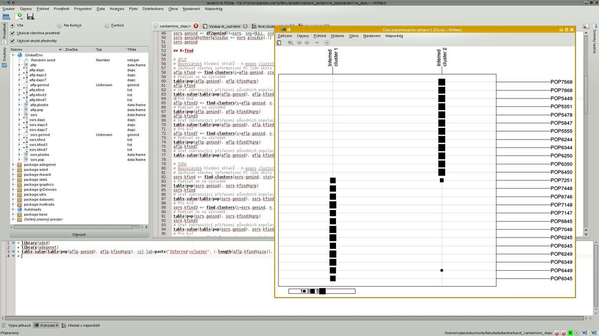

### When using RKWard, consider change of settings of text editor for more comfortable work

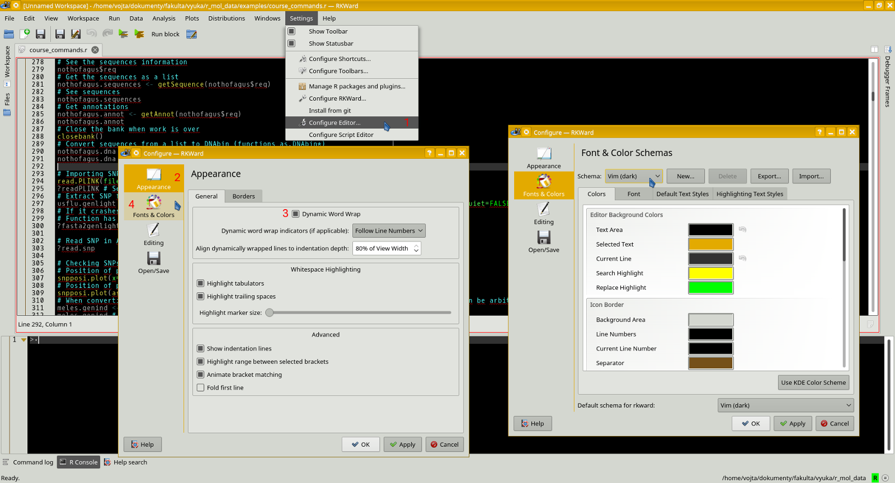

### RStudio

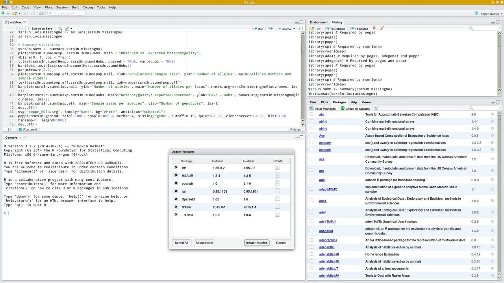

### When using RStudio, turn on soft line wrap, select Czech mirror to download packages and consider change of appearance for more comfortable work

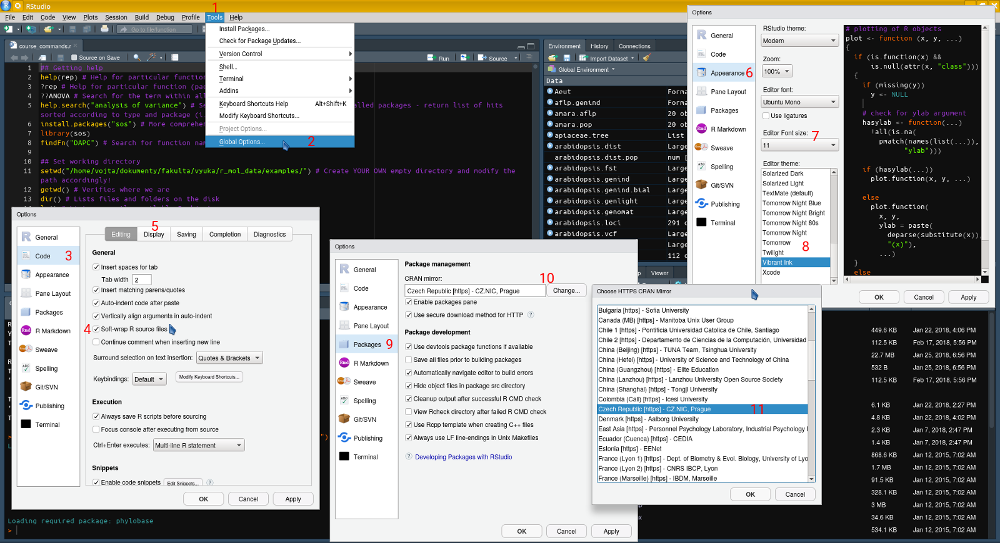

## Installation

### MS Windows & Apple macOS

- Go to <https://CRAN.R-project.org/>
- Download appropriate version and install as usual
- Download and install selected GUI (not required, but highly recommended)
- Most of packages are available as pre-compiled and can be immediately installed from R - it is convenient, but usually not tuned for particular computer architecture (type of CPU)
- Usually there are some problems every time new version of OS is released - it takes time to modify and recompile packages for new version of OS
- You have to check for new version of R manually
- RStudio is available from its [download page](https://posit.co/products/open-source/rstudio/)
- RKWard is also available for [Windows](https://rkward.kde.org/rkward-on-windows/) and [macOS](https://rkward.kde.org/rkward-on-mac/), but it requires some work to install it

### Linux - general

- R, and usually also GUI, is available in repositories - use standard package management according to distribution
- Linux repositories provide automatic updates
- Packages are also partially available in repositories and can be installed and updated as usual application or from R
- Packages commonly have to be compiled - R will do it automatically, but install basic Linux packages for building of C, C++, FORTRAN, ...
- Compilation takes longer time and there are sometimes issues with missing dependencies (tools required by particular packages), but it can then provide higher performance...

### Linux - Debian/Ubuntu and derivatives like Linux Mint or Kali Linux

- Install package `build-essential` (general tools to compile software, including R packages)
- Debian (and derivatives): follow instructions at <https://CRAN.R-project.org/bin/linux/debian/>
- Ubuntu (and derivatives): follow instructions at <https://CRAN.R-project.org/bin/linux/ubuntu/>
- Install packages `R-base` (the R), `R-base-dev` (required to compile additional R packages - only some are available in repositories) and optionally `rkward` and/or `rstudio`
- Various R packages can require their own build dependencies (packages `*XXX*-dev(el)`)
- RStudio is also available from its [download page](https://posit.co/products/open-source/rstudio/)

### Linux - openSUSE and SUSE Linux Enterprise

```{=html}
<!--
- See instructions at <https://CRAN.R-project.org/bin/linux/suse/>
-->
```

- Add repository/ies for appropriate version of your distribution
  - <https://download.opensuse.org/repositories/devel:/languages:/R:/patched/> (daily updated) or/and
  - <https://download.opensuse.org/repositories/devel:/languages:/R:/released/> (updated with new R release)
- Install packages `R-base` (the R), `R-base-devel` (required to compile additional R packages - only some are available in repositories) and optionally `rstudio` and/or `rkward`
- Install packages `patterns-openSUSE-devel_basis` and `gcc-fortran` for compilation of R packages when installing them from R (only some R packages are available in openSUSE repositories)
- Various R packages can require their own build dependencies (packages `*XXX*-dev(el)`)
- RStudio is also available from its [download page](https://posit.co/products/open-source/rstudio/)

### Linux - RedHat, Fedora and derivatives like CENTOS, Scientific Linux, etc.

- See instructions for Red Hat at <https://CRAN.R-project.org/bin/linux/redhat/> and Fedora at <https://cran.r-project.org/bin/linux/fedora/>
- Install packages `R-core` (the R), `R-core-devel` (required to compile additional R packages - only some are available in repositories) and optionally `rkward`
- Install group packages `"Development Tools"` and `"C Development Tools and Libraries"`
- Various R packages can require their own build dependencies (packages `*XXX*-dev(el)`)
- RStudio is available from its [download page](https://posit.co/products/open-source/rstudio/)

### Important note about names of directories

- **There must not be any spaces or accented characters in the path to R working directory or local R library**, otherwise some R functions can fail (and there is no other solution than creating new directory/user)
- If the user has e.g. on Windows (where the problem is the biggest) path like `C:/Documents and Settings/Šíleně úpějící kůoň/kurzíček`, change it to something like `C:/Users/username/rcourse`, otherwise user can experience a lot of problems...
- It might be required to make a new user on the computer...
- Similarly on macOS and Linux, avoid directory names with spaces and accented characters

### Sources of R packages

- R CRAN <https://CRAN.R-project.org/> - main and largest source of R packages (over 25,000 packages + many orphaned and archived - abandoned by developers, might be working)
- Bioconductor <https://bioconductor.org/> - mainly bioinformatics packages, genomic data (over 2,400 packages)
- R-Forge <https://r-forge.r-project.org/> (over 2,100 packages)
- RForge <https://www.rforge.net/> (much smaller)
- And more ([GitHub](https://github.com/)), custom webs, ...
- Some packages are available from more resources
- Same name for function can be used in different packages (there is no central index) - to distinguish them call functions like this: `muscle::read.fasta()` vs. `seqinr::read.fasta()` - call function `read.fasta()` from package `muscle` **or** `seqinr` (and their parameters can be different...) - see further

### CRAN keeps growing...

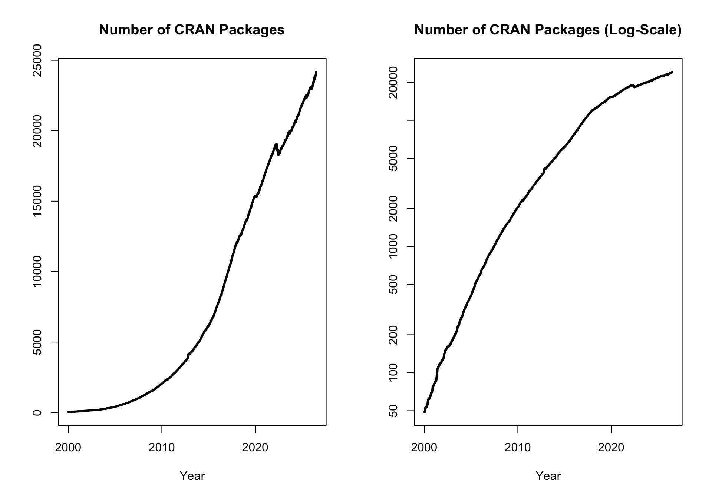

<https://journal.r-project.org/news/RJ-2026-2-cran/>

## Let's start with R

### First steps in R

**Recommended is usage of GUI (RKWard or RStudio)**

- Linux (UNIX): open any terminal, type `R` and hit Enter
- Windows and Mac: find it as normal application in menu
- Type commands to work...
- **Ever wished to be Harry Potter? Secret spells make magic operations :-)**
- Learning new language is always hard...
- Use arrows up and down to navigate in history
- `Ctrl+R` works as reverse search - searches text in history

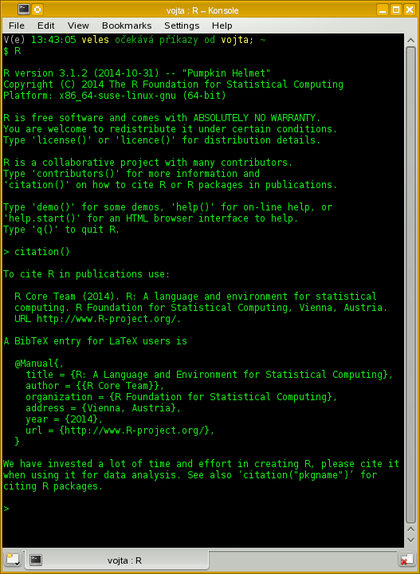

### How it works

- General look of R commands:

```{r}
function(argument1 = "SomeName", argument2 = SomeVariable, argument3 = 8)
ModifiedObject <- SomeFunction(argument1 = MyData, argument2 = TRUE)
```

- New/modified object (with data, ...) is on the left: "`<-`" says to insert result of the function `SomeFunction` on the right into the object `ModifiedObject` on the left
- Functions have various parameters/arguments (in brackets, separated by comas): `argument=ItsValue`
- Arguments are named - if you keep default order (as in help page), no need to name them:

```{r}
SomeFunction(MyData, TRUE, 123, "SomeName")
```

- When only some of the arguments are in use, use the names (order doesn't matter)

```{r}
SomeFunction(argument2 = TRUE, argument3 = 123, argument1 = MyData)
```

- Some arguments are required, some optional

### Get help in R

Get help for particular function (package must be loaded) by `help(function)` or `?function`

```{r}
# "#" marks comments - notes within code which are not executed
# Help for particular function (package must be loaded), two options
help(rep)
?rep
```

Search for the term within all installed packages - return list of hits sorted according to type and package (i.e. `package::function`)

```{r}
??"ANOVA" 
help.search("analysis of variance")
```

`?` shows help for questioned function (in console type `q` to close it):

- Name of the package (top left)
- Function name (headline)
- Description
- Usage
- Comments on arguments
- Details
- Output value(s)
- About author(s)
- Reference(s) to cite
- Related functions
- Example code

### Importance of working directory

- Very important point to get familiar with paths in R
- Default place to load/save, import/export data/results
  - It changes paths - one of the most common mistakes - something (input file, ...) is not found because of wrong path
  - Private folder for particular R project (task) prevents unwanted inferences with another tools/projects
- Without saving and loading the R data next time, it is not possible to do any longer work or to check the work in the future
- **Get used that R always work in some directory and by default saves/loads files there** (R usually starts in user's home directory)
- RStudio and RKWard also save session information (list of opened files, ...) - very convenient
- Regularly save your work to prevent looses in case of crash or any other accident
- **There must not be any space or accented characters in the path/directory name!**

NOTE Create YOUR OWN empty directory and modify the path accordingly!

```{r}
setwd("~/dokumenty/vyuka/r_mol_data/examples/")
getwd() # Verifies where we are
dir() # Lists files and folders on the disk
ls() # Lists currently available R objects
```

### Where we are?

- In Linux/UNIX, R starts in current directory (use `cd` to change it before launching R)
- **Set and check working directory** in R:

```{r}
setwd("/some/path/") # Or "~/...". In Windows "C:/..."
getwd() # Verifies where we are
dir() # Lists files and folders on the disk
ls() # Lists currently available R objects
```

- In Windows plain R (**File \| working directory**), in RStudio (**Session \| Set working directory**) or in RKWard (**Workspace \| Set Working Directory**) set it in menu or by the above command
- R saves history of commands into file `.Rhistory` file within working directory (by default hidden in Linux/macOS)
- When closing R by `q()` you can save all R data in `.RData` (and command history in `.Rhistory`) file(s) and it/they can be loaded next time (files can be renamed)
- **Task:** Create new empty directory for this course and set R working directory there! <!-- MERGE-REVIEW: no counterpart section found in QMD; code below comes from the old TEX version. -->

## Basic operations in R

### Types of objects

- As any programming language, R has plenty of types of objects (variables) with different features, usage and aims

- **Vectors** - numbers, characters, boolean

- **Matrices** - columns are of same type (numeric, character, etc.) and same length

- **Arrays** - like matrices, but with possibly more dimensions

- **Data frames** - more general - columns can be of different type ("sheet of Excel")

- **Lists** - ordered collections of objects (vectors, matrices, ...) - not necessarily of same type

- **Factors** - a vector of levels, e.g. populations, colors, etc.

- More "advanced" objects to store plots, genetic data, ...

  - Commonly called "**S3**" and "**S4**" objects in R terminology
  - Technically commonly just lists putting together various information
  - We will meet many of them...

- Functions require particular object types - take care about it <!-- MERGE-REVIEW: no counterpart section found in QMD; content from TEX kept as-is. -->

### Popular object classes (we are going to use)

- `AAbin` - stores amino acid sequences (aligned or not)

- `alignment` - aligned sequences (package seqinr)

- `dapc` - results of DAPC

- `dist` - distance matrices

- `DNAbin` - stores DNA sequences (aligned or not)

- `genind` - stores various genetic information for individuals

- `genlight` - variant of genind to store large multiple genomes

- `genpop` - like genind, but on population level

- `haplonet` - networks without reticulation

- `haplotype` - unique sequences from DNAbin

- `hclust` - output of hierarchical clustering, can be converted to phylo

- `loci` - extension of data frame (DF), stores information about loci

- `matching` - binary phylogenetic trees

- `matrix` - general matrix (numeric or not)

- `pco`; `dudi` - results of PCA, PCoA, ...

- `phyDat` - "preparation" of data for some phylogenetic analysis (usually sequences and characters)

- `phylo` - phylogenetic information, typically trees

- `phylo4` - derived from phylo (more data), S4 instead of S3

- `SNPbin` - stores large SNP data for single genome

- `spca` - results of sPCA

- `treeshape` - derived from hclust

- `vcfR` - imported (and possibly edited) VCF

- and more... common task is converting among formats...

- ... not all formats are (easily) convertible among each other...

- To get information about content of each data type see e.g. `getClassDef("data.frame")` (Or any other class name of loaded package) - there are information about slots within that classes you can access

- Common task is conversion among various formats - functions commonly require different input format

  - Wrong class as input is common error... <!-- MERGE-REVIEW: no counterpart section found in QMD; content from TEX kept as-is. -->

### Conversions among data types I

| **From** | **To**    | **Command**           | **Package** |
|----------|-----------|-----------------------|-------------|
| phylo    | phylo4    | `as(x, "phylo4")`     | phylobase   |
| phylo    | matching  | `as.matching(x)`      | ape         |
| phylo    | treeshape | `as.treeshape(x)`     | apTreeshape |
| phylo    | hclust    | `as.hclust(x)`        | ape         |
| phylo    | prop.part | `prop.part(x)`        | ape         |
| phylo    | splits    | `as.splits(x)`        | phangorn    |
| phylo    | evonet    | `evonet(x, from, to)` | ape         |
| phylo    | network   | `as.network(x)`       | ape         |
| phylo    | igraph    | `as.igraph(x)`        | ape         |
| phylo4   | phylo     | `as(x, "phylo")`      | phylobase   |
| matching | phylo     | `as.phylo(x)`         | ape         |

<!-- MERGE-REVIEW: no counterpart section found in QMD; content from TEX kept as-is. -->

### Conversions among data types II

| **From**  | **To**     | **Command**        | **Package** |
|-----------|------------|--------------------|-------------|
| treeshape | phylo      | `as.phylo(x)`      | apTreeshape |
| splits    | phylo      | `as.phylo(x)`      | phangorn    |
| splits    | networx    | `as.networx(x)`    | phangorn    |
| evonet    | phylo      | `as.phylo(x)`      | ape         |
| evonet    | networx    | `as.networx(x)`    | ape         |
| evonet    | network    | `as.network(x)`    | ape         |
| evonet    | igraph     | `as.igraph(x)`     | ape         |
| haploNet  | network    | `as.network(x)`    | pegas       |
| haploNet  | igraph     | `as.igraph(x)`     | pegas       |
| hclust    | phylo      | `as.phylo(x)`      | ape         |
| hclust    | dendrogram | `as.dendrogram(x)` | stats       |

<!-- MERGE-REVIEW: no counterpart section found in QMD; content from TEX kept as-is. -->

### Conversions among data types III

| **From**  | **To**    | **Command**           | **Package** |
|-----------|-----------|-----------------------|-------------|
| DNAbin    | character | `as.character(x)`     | ape         |
| DNAbin    | alignment | `as.alignment(x)`     | ape         |
| DNAbin    | phyDat    | `as.phyDat(x)`        | phangorn    |
| DNAbin    | genind    | `DNAbin2genind(x)`    | adegenet    |
| character | DNAbin    | `as.DNAbin(x)`        | ape         |
| character | loci      | `as.loci(x)`          | pegas       |
| alignment | DNAbin    | `as.DNAbin(x)`        | ape         |
| alignment | phyDat    | `as.phyDat(x)`        | phangorn    |
| alignment | character | `as.matrix(x)`        | seqinr      |
| alignment | genind    | `alignment2genind(x)` | adegenet    |

<!-- MERGE-REVIEW: no counterpart section found in QMD; content from TEX kept as-is. -->

### Conversions among data types IV

| **From**   | **To**     | **Command**                | **Package** |
|------------|------------|----------------------------|-------------|
| phyDat     | DNAbin     | `as.DNAbin(x)`             | phangorn    |
| phyDat     | character  | `as.character(x)`          | phangorn    |
| loci       | genind     | `loci2genind(x)`           | pegas       |
| loci       | data frame | `class(x) <- "data.frame"` | \-          |
| genind     | loci       | `genind2loci(x)`           | pegas       |
| genind     | genpop     | `genind2genpop(x)`         | adegenet    |
| genind     | df         | `genind2df(x)`             | adegenet    |
| data frame | phyDat     | `as.phyDat(x)`             | phangorn    |
| data frame | loci       | `as.loci(x)`               | pegas       |
| data frame | genind     | `df2genind(x)`             | adegenet    |
| matrix     | phyDat     | `as.phyDat(x)`             | phangorn    |

<!-- MERGE-REVIEW: no counterpart section found in QMD; content from TEX kept as-is. -->

### Conversions among data types V

| **From** | **To**   | **Command**        | **Package** |
|----------|----------|--------------------|-------------|
| vcfR     | chromR   | `vcfR2chromR(x)`   | vcfR        |
| vcfR     | genind   | `vcfR2genind(x)`   | vcfR        |
| vcfR     | migrate  | `vcfR2migrate(x)`  | vcfR        |
| vcfR     | loci     | `vcfR2loci(x)`     | vcfR        |
| vcfR     | tidy     | `vcfR2tidy(x)`     | vcfR        |
| vcfR     | DNAbin   | `vcfR2DNAbin(x)`   | vcfR        |
| vcfR     | genlight | `vcfR2genlight(x)` | vcfR        |

<!-- MERGE-REVIEW: no counterpart section found in QMD; content from TEX kept as-is. -->

### Basic operations with data I

**R doesn't ask neither notifies when overwriting objects! Be careful!**

```{r}
x <- c(5, 6, 7, 8, 9) # Creates vector (see also ?rep)
x # Print "x" content
c() # Is generic function to concatenate objects into new one
length(x) # Length of the object - for matrices and DF use dim()
str(x) # Information about structure of the object
mode(x) # Gets type of storage mode of the object
class(x) # Shows class of the object
x[2] # Shows second element of the object
x <- x[-5] # Removes fifth element
y <- matrix(data = 5:20, nrow = 4, ncol = 4) # Creates a matrix
is.matrix(y) # Is it matrix? Try is.<TAB><TAB>
# TAB key shows available functions and objects starting by typed text
y # Prints the matrix
dim(y) # Dimensions of "y"
y[, 2] # Prints second column
```

<!-- MERGE-REVIEW: 1 old code block(s) in TEX frame were dropped in favor of the .qmd section 'Basic operations'. -->

<!-- MERGE-REVIEW: content of the .qmd section 'Basic operations' was inserted at 6 frames; remove the unwanted duplicates. -->

When loading saved project, you have to load again libraries and scripts (see further), data objects are restored This can be conveniently done in RStudio/RKWard

When loading saved project, you have to load again libraries and scripts (see further), data objects are restored

```{r}
x <- c(5, 6, 7, 8, 9) # Creates vector (see also ?rep)
x # Print "x" content
c() # Is generic function to concatenate objects into new one
length(x) # Length of the object - for matrices and DF use dim()
str(x) # Information about structure of the object
mode(x) # Gets type of storage mode of the object
class(x) # Shows class of the object
x[2] # Shows second element of the object
x <- x[-5] # Removes fifth element
x # See modified object
y <- matrix(data = 5:20, nrow = 4, ncol = 4) # Creates a matrix
is.matrix(y) # Is it matrix? Try is.<TAB><TAB> TAB key shows available functions and objects starting by typed text
y # Prints the matrix
dim(y) # Dimensions of "y"
y[, 2] # Prints second column
y[3, ] # Prints third row
y[4, 3] # Prints element from fourth row and third column
c(x, y[4, ]) # Concatenate "x"and 4th row of "y"
x2 <- c(x, 3, 2, 1) # Concatenate "x"and values "3", "2"and "1"
x <- y[2, ] # Replaces "x"by second row of "y"(no warning) - R doesn't ask neither notifies when overwriting objects! Be careful!
x # See modified object
rm(x) # Deletes x (no warning)
y[, 1:3] # Prints first through third column of the matrix
y[3, ] <- rep(x = 20, each = 4) # Replaces third line by value of 20
y # See modified object
y[y == 20] <- 10 # If value of y's element is 20, replace it by 10
y # See modified object
summary(y) # Basic statistics - according to columns
colnames(y) <- c("A", "B", "C", "D") # Set column names - Objects and functions are without quotation marks; files, text with
colnames(y) # Prints column names, use rownames() in same way
y # See modified object
y[, "C"] # Prints column C (R is case sensitive!)
y[, c("C", "B")] # Extract columns "C"and "B"
t(y) # Transposes the matrix
diag(y) # Get diagonal of the matrix
diag(y) <- rep(x = c(50, 100), times = 2) # Replace diagonal by repetition of values 50 and 100
y # See modified object
y <- as.data.frame(y) # Turns into DF (see other functions as.*)
class(y) # Is it data frame now?
y[y == 17] <- "NA"# Removes values of 17
y # See modified object
y$B # Gets variable B of data frame y ($ works similarly in S3 objects)
```

```{r}
save(list = ls(), file = "test.RData") # Saves all objects during the work
load("test.RData") # Loads saved R environment with all objects
```

```{r}
fix(y) # Use to edit matrices, data frames, functions, ...
rm(y) # Removing...
```

### Basic operations with data II

```{r}
y[3,] # Prints third row
y[4, 3] # Prints element from fourth row and third column
c(x, y[4, ]) # Concatenate "x" and 4th row of "y"
x2 <- c(x, 3, 2, 1) # Concatenate "x" and values "3", "2" and "1"
x <- y[2, ] # Replaces "x" by second row of "y" (no warning)
rm(x) # Deletes x (no warning)
y[ ,1:3] # Prints first through third column of the matrix
y[3, ] <- rep(x = 20, each = 4) # Replaces third line by value of 20
y[y == 20] <- 10 # If value of y's element is 20, replace it by 10
summary(y) # Basic statistics - according to columns
colnames(y) <- c("A", "B", "C", "D") # Set column names
# Objects and functions are without quotation marks; files and text with
colnames(y) # Prints column names, use rownames() in very same way
y # See modified object
y[, "C"] # Prints column C (R is case sensitive!)
y[, c("C", "B")] # Extract columns "C" and "B"
```

<!-- MERGE-REVIEW: 1 old code block(s) in TEX frame were dropped in favor of the .qmd section 'Basic operations'. -->

<!-- MERGE-REVIEW: content of the .qmd section 'Basic operations' was inserted at 6 frames; remove the unwanted duplicates. -->

When loading saved project, you have to load again libraries and scripts (see further), data objects are restored This can be conveniently done in RStudio/RKWard

When loading saved project, you have to load again libraries and scripts (see further), data objects are restored

```{r}
x <- c(5, 6, 7, 8, 9) # Creates vector (see also ?rep)
x # Print "x" content
c() # Is generic function to concatenate objects into new one
length(x) # Length of the object - for matrices and DF use dim()
str(x) # Information about structure of the object
mode(x) # Gets type of storage mode of the object
class(x) # Shows class of the object
x[2] # Shows second element of the object
x <- x[-5] # Removes fifth element
x # See modified object
y <- matrix(data = 5:20, nrow = 4, ncol = 4) # Creates a matrix
is.matrix(y) # Is it matrix? Try is.<TAB><TAB> TAB key shows available functions and objects starting by typed text
y # Prints the matrix
dim(y) # Dimensions of "y"
y[, 2] # Prints second column
y[3, ] # Prints third row
y[4, 3] # Prints element from fourth row and third column
c(x, y[4, ]) # Concatenate "x"and 4th row of "y"
x2 <- c(x, 3, 2, 1) # Concatenate "x"and values "3", "2"and "1"
x <- y[2, ] # Replaces "x"by second row of "y"(no warning) - R doesn't ask neither notifies when overwriting objects! Be careful!
x # See modified object
rm(x) # Deletes x (no warning)
y[, 1:3] # Prints first through third column of the matrix
y[3, ] <- rep(x = 20, each = 4) # Replaces third line by value of 20
y # See modified object
y[y == 20] <- 10 # If value of y's element is 20, replace it by 10
y # See modified object
summary(y) # Basic statistics - according to columns
colnames(y) <- c("A", "B", "C", "D") # Set column names - Objects and functions are without quotation marks; files, text with
colnames(y) # Prints column names, use rownames() in same way
y # See modified object
y[, "C"] # Prints column C (R is case sensitive!)
y[, c("C", "B")] # Extract columns "C"and "B"
t(y) # Transposes the matrix
diag(y) # Get diagonal of the matrix
diag(y) <- rep(x = c(50, 100), times = 2) # Replace diagonal by repetition of values 50 and 100
y # See modified object
y <- as.data.frame(y) # Turns into DF (see other functions as.*)
class(y) # Is it data frame now?
y[y == 17] <- "NA"# Removes values of 17
y # See modified object
y$B # Gets variable B of data frame y ($ works similarly in S3 objects)
```

```{r}
save(list = ls(), file = "test.RData") # Saves all objects during the work
load("test.RData") # Loads saved R environment with all objects
```

```{r}
fix(y) # Use to edit matrices, data frames, functions, ...
rm(y) # Removing...
```

### Basic operations with data III

```{r}
t(y) # Transposes the matrix
diag(y) # Get diagonal of the matrix
# Replace diagonal by repetition of values 50 and 100
diag(y) <- rep(x = c(50, 100), times = 2)
y # See modified object
y <- as.data.frame(y) # Turns into DF (see other functions as.*)
class(y) # Is it data frame now?
y[y == 17] <- "NA" # Removes values of 17 (NA = not available = missing)
y$B # Gets variable B of data frame y ($ works similarly in S3 objects)
# When loading saved project, you have to load again libraries and
# scripts (see further), data objects are restored
# This can be conveniently done in RStudio/RKWard
save(list = ls(), file = "test.RData") # Saves all objects during the work
load("test.RData") # Loads saved R environment with all objects
fix(y) # Use to edit matrices, data frames, functions, ...
rm(y) # Removing...
?iris # Information about R test dataset with morphometry of Iris species
```

<!-- MERGE-REVIEW: 1 old code block(s) in TEX frame were dropped in favor of the .qmd section 'Basic operations'. -->

<!-- MERGE-REVIEW: content of the .qmd section 'Basic operations' was inserted at 6 frames; remove the unwanted duplicates. -->

When loading saved project, you have to load again libraries and scripts (see further), data objects are restored This can be conveniently done in RStudio/RKWard

When loading saved project, you have to load again libraries and scripts (see further), data objects are restored

```{r}
x <- c(5, 6, 7, 8, 9) # Creates vector (see also ?rep)
x # Print "x" content
c() # Is generic function to concatenate objects into new one
length(x) # Length of the object - for matrices and DF use dim()
str(x) # Information about structure of the object
mode(x) # Gets type of storage mode of the object
class(x) # Shows class of the object
x[2] # Shows second element of the object
x <- x[-5] # Removes fifth element
x # See modified object
y <- matrix(data = 5:20, nrow = 4, ncol = 4) # Creates a matrix
is.matrix(y) # Is it matrix? Try is.<TAB><TAB> TAB key shows available functions and objects starting by typed text
y # Prints the matrix
dim(y) # Dimensions of "y"
y[, 2] # Prints second column
y[3, ] # Prints third row
y[4, 3] # Prints element from fourth row and third column
c(x, y[4, ]) # Concatenate "x"and 4th row of "y"
x2 <- c(x, 3, 2, 1) # Concatenate "x"and values "3", "2"and "1"
x <- y[2, ] # Replaces "x"by second row of "y"(no warning) - R doesn't ask neither notifies when overwriting objects! Be careful!
x # See modified object
rm(x) # Deletes x (no warning)
y[, 1:3] # Prints first through third column of the matrix
y[3, ] <- rep(x = 20, each = 4) # Replaces third line by value of 20
y # See modified object
y[y == 20] <- 10 # If value of y's element is 20, replace it by 10
y # See modified object
summary(y) # Basic statistics - according to columns
colnames(y) <- c("A", "B", "C", "D") # Set column names - Objects and functions are without quotation marks; files, text with
colnames(y) # Prints column names, use rownames() in same way
y # See modified object
y[, "C"] # Prints column C (R is case sensitive!)
y[, c("C", "B")] # Extract columns "C"and "B"
t(y) # Transposes the matrix
diag(y) # Get diagonal of the matrix
diag(y) <- rep(x = c(50, 100), times = 2) # Replace diagonal by repetition of values 50 and 100
y # See modified object
y <- as.data.frame(y) # Turns into DF (see other functions as.*)
class(y) # Is it data frame now?
y[y == 17] <- "NA"# Removes values of 17
y # See modified object
y$B # Gets variable B of data frame y ($ works similarly in S3 objects)
```

```{r}
save(list = ls(), file = "test.RData") # Saves all objects during the work
load("test.RData") # Loads saved R environment with all objects
```

```{r}
fix(y) # Use to edit matrices, data frames, functions, ...
rm(y) # Removing...
```

### Some basic statistics

```{r}
summary(iris) # Basic summary statistics
# Boxplot comparing sepal lengths of the three species
boxplot(formula = iris$Sepal.Length ~ iris$Species)
setosa <- iris[which(iris$Species == "setosa"), ] # Extract only setosa
# Testing correlation between sepal length and width of setosa
cor.test(x = setosa$Sepal.Length, y = setosa$Sepal.Width)
# Plot correlation between sepal length and width of setosa
plot(x = setosa$Sepal.Length, y = setosa$Sepal.Width, main = "Sepals",
  xlab = "Length", ylab = "Width", pch = 16, cex = 1.5, col = "red")
# Add linear model line
abline(reg=lm(setosa$Sepal.Width~setosa$Sepal.Length), col='brown', lwd=3)
# Add sepal width mean and standard deviation
abline(h = mean(setosa$Sepal.Width), col = "green", lwd = 2, lty = 2)
abline(h = mean(setosa$Sepal.Width) + sd(setosa$Sepal.Width),
  col = "green", lwd = 2, lty = 3)
abline(h = mean(setosa$Sepal.Width) - sd(setosa$Sepal.Width),
  col = "green", lwd = 2, lty = 3)
```

<!-- MERGE-REVIEW: 1 old code block(s) in TEX frame were dropped in favor of the .qmd section 'Some basic statistics'. -->

<!-- MERGE-REVIEW: content of the .qmd section 'Some basic statistics' was inserted at 2 frames; remove the unwanted duplicates. -->

Information about R test dataset with morphometry of Iris species

Basic summary statistics

Boxplot comparing sepal lengths of the three species

Extract only setosa

Testing correlation between sepal length and width of setosa

Plot correlation between sepal length and width of setosa

Add linear model line

Add sepal width mean and standard deviation

ANOVA

Basic analysis of variance

Wrapping aov() by summary() gives output which is easier to read (this is common practice for plenty of outputs)

```{r}
?iris
```

```{r}
summary(iris)
```

```{r}
boxplot(formula = iris$Sepal.Length ~ iris$Species)
```

```{r}
setosa <- iris[which(iris$Species == "setosa"), ]
```

```{r}
cor.test(x = setosa$Sepal.Length, y = setosa$Sepal.Width)
```

```{r}
plot(x = setosa$Sepal.Length, y = setosa$Sepal.Width, main = "Sepals", xlab = "Length", ylab = "Width", pch = 16, cex = 1.5, col = "red")
```

```{r}
abline(reg = lm(formula = setosa$Sepal.Width ~ setosa$Sepal.Length), col = "brown", lwd = 3)
```

```{r}
abline(h = mean(setosa$Sepal.Width), col = "green", lwd = 2, lty = 2)
abline(h = mean(setosa$Sepal.Width) + sd(setosa$Sepal.Width), col = "green", lwd = 2, lty = 3)
abline(h = mean(setosa$Sepal.Width) - sd(setosa$Sepal.Width), col = "green", lwd = 2, lty = 3)

```

```{r}
aov(formula = iris[["Sepal.Length"]] ~ iris[["Species"]])
```

```{r}
summary(aov(formula = iris[["Sepal.Length"]] ~ iris[["Species"]]))
```

### Figures from previous basic statistics

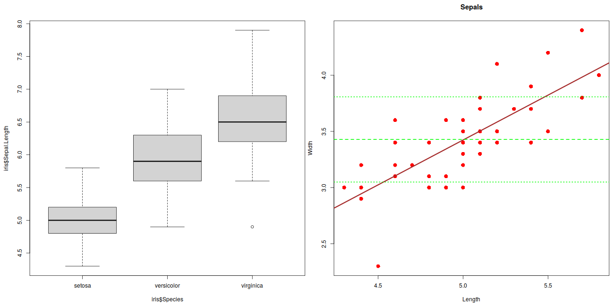

<!-- MERGE-REVIEW: content of the .qmd section 'Some basic statistics' was inserted at 2 frames; remove the unwanted duplicates. -->

Information about R test dataset with morphometry of Iris species

Basic summary statistics

Boxplot comparing sepal lengths of the three species

Extract only setosa

Testing correlation between sepal length and width of setosa

Plot correlation between sepal length and width of setosa

Add linear model line

Add sepal width mean and standard deviation

ANOVA

Basic analysis of variance

Wrapping aov() by summary() gives output which is easier to read (this is common practice for plenty of outputs)

```{r}
?iris
```

```{r}
summary(iris)
```

```{r}
boxplot(formula = iris$Sepal.Length ~ iris$Species)
```

```{r}
setosa <- iris[which(iris$Species == "setosa"), ]
```

```{r}
cor.test(x = setosa$Sepal.Length, y = setosa$Sepal.Width)
```

```{r}
plot(x = setosa$Sepal.Length, y = setosa$Sepal.Width, main = "Sepals", xlab = "Length", ylab = "Width", pch = 16, cex = 1.5, col = "red")
```

```{r}
abline(reg = lm(formula = setosa$Sepal.Width ~ setosa$Sepal.Length), col = "brown", lwd = 3)
```

```{r}
abline(h = mean(setosa$Sepal.Width), col = "green", lwd = 2, lty = 2)
abline(h = mean(setosa$Sepal.Width) + sd(setosa$Sepal.Width), col = "green", lwd = 2, lty = 3)
abline(h = mean(setosa$Sepal.Width) - sd(setosa$Sepal.Width), col = "green", lwd = 2, lty = 3)

```

```{r}
aov(formula = iris[["Sepal.Length"]] ~ iris[["Species"]])
```

```{r}
summary(aov(formula = iris[["Sepal.Length"]] ~ iris[["Species"]]))
```

### Analysis of Variance (ANOVA)

- [ANOVA](https://en.wikipedia.org/wiki/Analysis_of_variance) tells us if there is significant difference among means of samples (here sepal lengths among species)

```{r}
aov(formula = iris[["Sepal.Length"]] ~ iris[["Species"]]) # Output:
Call:
   aov(formula = iris[["Sepal.Length"]] ~ iris[["Species"]])
Terms:
                iris[["Species"]] Residuals
Sum of Squares           63.21213  38.95620
Deg. of Freedom                 2       147
Residual standard error: 0.5147894
Estimated effects may be unbalanced
summary(aov(formula = iris[["Sepal.Length"]] ~ iris[["Species"]])) # Output:
                   Df Sum Sq Mean Sq F value Pr(>F)
iris[["Species"]]   2  63.21  31.606   119.3 <2e-16 ***
Residuals         147  38.96   0.265
---
Signif. codes:  0 ‘***’ 0.001 ‘**’ 0.01 ‘*’ 0.05 ‘.’ 0.1 ‘ ’ 1
```

<!-- MERGE-REVIEW: no counterpart section found in QMD; code below comes from the old TEX version. -->

## Tasks

### Practice basic operations I

1.  Load R training dataset `iris` (`data(iris)`) and read about it (`?iris`).

2.  Explore it - print it, display only beginning of data (`head()`). How many rows and columns does it have (`dim()`)? Which variables? Which species (`levels()`)?

3.  Extract from `iris` dataset only sepal lengths and save it as new vector.

4.  Extract from `iris` dataset petal length and species and save it as new data frame.

5.  Extract from `iris` dataset lines 10--20.

6.  Read help of `rep` function and

7.  Create repetition of five times value of "A".

8.  Create repetition of five times vector of "1, 3".

<!-- MERGE-REVIEW: content of the .qmd section 'Basic operations' was inserted at 6 frames; remove the unwanted duplicates. -->

When loading saved project, you have to load again libraries and scripts (see further), data objects are restored This can be conveniently done in RStudio/RKWard

When loading saved project, you have to load again libraries and scripts (see further), data objects are restored

```{r}
x <- c(5, 6, 7, 8, 9) # Creates vector (see also ?rep)
x # Print "x" content
c() # Is generic function to concatenate objects into new one
length(x) # Length of the object - for matrices and DF use dim()
str(x) # Information about structure of the object
mode(x) # Gets type of storage mode of the object
class(x) # Shows class of the object
x[2] # Shows second element of the object
x <- x[-5] # Removes fifth element
x # See modified object
y <- matrix(data = 5:20, nrow = 4, ncol = 4) # Creates a matrix
is.matrix(y) # Is it matrix? Try is.<TAB><TAB> TAB key shows available functions and objects starting by typed text
y # Prints the matrix
dim(y) # Dimensions of "y"
y[, 2] # Prints second column
y[3, ] # Prints third row
y[4, 3] # Prints element from fourth row and third column
c(x, y[4, ]) # Concatenate "x"and 4th row of "y"
x2 <- c(x, 3, 2, 1) # Concatenate "x"and values "3", "2"and "1"
x <- y[2, ] # Replaces "x"by second row of "y"(no warning) - R doesn't ask neither notifies when overwriting objects! Be careful!
x # See modified object
rm(x) # Deletes x (no warning)
y[, 1:3] # Prints first through third column of the matrix
y[3, ] <- rep(x = 20, each = 4) # Replaces third line by value of 20
y # See modified object
y[y == 20] <- 10 # If value of y's element is 20, replace it by 10
y # See modified object
summary(y) # Basic statistics - according to columns
colnames(y) <- c("A", "B", "C", "D") # Set column names - Objects and functions are without quotation marks; files, text with
colnames(y) # Prints column names, use rownames() in same way
y # See modified object
y[, "C"] # Prints column C (R is case sensitive!)
y[, c("C", "B")] # Extract columns "C"and "B"
t(y) # Transposes the matrix
diag(y) # Get diagonal of the matrix
diag(y) <- rep(x = c(50, 100), times = 2) # Replace diagonal by repetition of values 50 and 100
y # See modified object
y <- as.data.frame(y) # Turns into DF (see other functions as.*)
class(y) # Is it data frame now?
y[y == 17] <- "NA"# Removes values of 17
y # See modified object
y$B # Gets variable B of data frame y ($ works similarly in S3 objects)
```

```{r}
save(list = ls(), file = "test.RData") # Saves all objects during the work
load("test.RData") # Loads saved R environment with all objects
```

```{r}
fix(y) # Use to edit matrices, data frames, functions, ...
rm(y) # Removing...
```

### Practice basic operations II

1.  Read help of `seq` function and create sequence from 5 to 20 with steps of 0.5 and save it as new vector.
2.  Extract from that vector $2^nd$, $4^th$ and $8^th$ position and save it as new vector.
3.  Remove from that vector $2^nd$ element.
4.  Concatenate previous two vectors into new vector.
5.  What is difference between `iris["Sepal.Width"]`, `iris[2]`, `iris[["Sepal.Width"]]` and `iris$Sepal.Width`? Compare. What are the different ways good for?
6.  Try similar tasks as on slide with another species and characters. Try to improve the plots.

<!-- MERGE-REVIEW: content of the .qmd section 'Basic operations' was inserted at 6 frames; remove the unwanted duplicates. -->

When loading saved project, you have to load again libraries and scripts (see further), data objects are restored This can be conveniently done in RStudio/RKWard

When loading saved project, you have to load again libraries and scripts (see further), data objects are restored

```{r}
x <- c(5, 6, 7, 8, 9) # Creates vector (see also ?rep)
x # Print "x" content
c() # Is generic function to concatenate objects into new one
length(x) # Length of the object - for matrices and DF use dim()
str(x) # Information about structure of the object
mode(x) # Gets type of storage mode of the object
class(x) # Shows class of the object
x[2] # Shows second element of the object
x <- x[-5] # Removes fifth element
x # See modified object
y <- matrix(data = 5:20, nrow = 4, ncol = 4) # Creates a matrix
is.matrix(y) # Is it matrix? Try is.<TAB><TAB> TAB key shows available functions and objects starting by typed text
y # Prints the matrix
dim(y) # Dimensions of "y"
y[, 2] # Prints second column
y[3, ] # Prints third row
y[4, 3] # Prints element from fourth row and third column
c(x, y[4, ]) # Concatenate "x"and 4th row of "y"
x2 <- c(x, 3, 2, 1) # Concatenate "x"and values "3", "2"and "1"
x <- y[2, ] # Replaces "x"by second row of "y"(no warning) - R doesn't ask neither notifies when overwriting objects! Be careful!
x # See modified object
rm(x) # Deletes x (no warning)
y[, 1:3] # Prints first through third column of the matrix
y[3, ] <- rep(x = 20, each = 4) # Replaces third line by value of 20
y # See modified object
y[y == 20] <- 10 # If value of y's element is 20, replace it by 10
y # See modified object
summary(y) # Basic statistics - according to columns
colnames(y) <- c("A", "B", "C", "D") # Set column names - Objects and functions are without quotation marks; files, text with
colnames(y) # Prints column names, use rownames() in same way
y # See modified object
y[, "C"] # Prints column C (R is case sensitive!)
y[, c("C", "B")] # Extract columns "C"and "B"
t(y) # Transposes the matrix
diag(y) # Get diagonal of the matrix
diag(y) <- rep(x = c(50, 100), times = 2) # Replace diagonal by repetition of values 50 and 100
y # See modified object
y <- as.data.frame(y) # Turns into DF (see other functions as.*)
class(y) # Is it data frame now?
y[y == 17] <- "NA"# Removes values of 17
y # See modified object
y$B # Gets variable B of data frame y ($ works similarly in S3 objects)
```

```{r}
save(list = ls(), file = "test.RData") # Saves all objects during the work
load("test.RData") # Loads saved R environment with all objects
```

```{r}
fix(y) # Use to edit matrices, data frames, functions, ...
rm(y) # Removing...
```

## Packages for our work

### Packages, repositories and their management

- Standalone plain R doesn't have enough tools for most of scientific disciplines - only basic methods and tools for programmers, including for package management

- Users/developers contribute by making extra packages extending computational possibilities - one of biggest R advantages - it then has unlimited possibilities

- R has infrastructure for maintaining (for developers) and installing (for users) packages - the [CRAN](https://CRAN.R-project.org/) repository (comprehensive R archive network)

- For various reasons, some people build their own infrastructures to maintain and install R packages - compatible with R, bud separated (not in CRAN)

- User has basically 3 options

  1.  Set all repositories in R and use basic commands to install packages (slide )
  2.  Specify non-CRAN repository every time installing from it (e.g. slide )
  3.  Use special tools (e.g. for [Bioconductor](https://bioconductor.org/install/) - slide )

- Repositories work in similar way as various app stores in Android, iOS, ...

<!-- MERGE-REVIEW: content of the .qmd section 'Packages and repositories' was inserted at 4 frames; remove the unwanted duplicates. -->

Set repositories for the current R session We will need extra repositories

Install packages

Installation of multiple packages may sometimes fail - install then packages in smaller groups or one by one

Updates installed packages (by default from CRAN)

Install package Geneland (since version 4 not available in CRAN anymore) Other packages used when using Geneland Needed is PBSmapping or mapproj for conversion of coordinates GUI uses for parallelization snow and Rmpi RgoogleMaps can be used to plot output on top of Google map, sf and related tools on GIS layer

On Windows install Rtools from https://cran.r-project.org/bin/windows/Rtools/

Install Geneland from GitHub Devtools package is required to install from GitHub

Install Geneland itself

Install package phyloch not available in any repository If not done already, install required packages first

It is possible to specify direct path (local or web URL) to package source

Install kdetrees package (removed from CRAN) Ensure package 'devtools' is installed

Install 'kdetrees' from https://github.com/V-Z/kdetrees Git repository

When needed, the package can be loaded as "library("kdetrees")"

We will load packages by library("package") one by one when needed...

```{r}
getOption("repos") # Shows actual repositories
options(repos = c("https://cloud.r-project.org", "https://r-forge.r-project.org/", "https://rforge.net/"))
options() # Generic function to modify various settings
?options # Gives details
```

```{r}
install.packages(pkgs = c("ade4", "adegenet", "adegraphics", "adephylo", "adespatial", "ape", "BiocManager", "caper", "corrplot", "devtools", "gee", "geiger", "ggplot2", "gplots", "hierfstat", "ips", "kdetrees", "lattice", "mapdata", "mapplots", "mapproj", "maps", "nlme", "PBSmapping", "pegas", "permute", "phangorn", "philentropy", "phylobase", "phytools", "picante", "plotrix", "poppr", "raster", "rentrez", "rgl", "RgoogleMaps", "Rmpi", "rworldmap", "rworldxtra", "seqinr", "sf", "shapefiles", "snow", "sp", "spdep", "splancs", "StAMPP", "TeachingDemos", "tripack", "vcfR", "vegan"), repos = "https://cloud.r-project.org", dependencies = "Imports")
?install.packages # See for more options
```

```{r}
update.packages(ask = FALSE)
```

```{r}
install.packages(pkgs = c("PBSmapping", "mapproj", "rgdal", "RgoogleMaps", "Rmpi", "sf", "sp", "maptools", "shapefiles", "snow", "tripack"), repos = "https://cloud.r-project.org", dependencies = "Imports")
```

```{r}
if (!"devtools" %in% installed.packages()) {
  install.packages("devtools")
}
```

```{r}
devtools::install_github("gilles-guillot/Geneland")
```

```{r}
install.packages(pkgs = c("ape", "colorspace", "XML"), dependencies = "Imports")
```

```{r}
install.packages(pkgs = "http://www.christophheibl.de/phyloch_1.5-3.tar.gz", repos = NULL, type = "source")
```

```{r}
if (!"devtools" %in% installed.packages()) {
  install.packages("devtools")
}
```

```{r}
devtools::install_github("V-Z/kdetrees")
```

### Repositories

- Repositories (internet directories full of R packages - slide ) can be set via `options(repos=c(...))` (global) or (every relevant time) as `repos` parameter for each `install.packages(..., repos=c(...))` command (slide and onward)

- Repositories don't have to be set as global options, e.g. Bioconductor (slide ) has its own way to manage packages

- **RStudio:** set repositories by command from slide and in bottom right pane select **Packages** and click on **Install Packages...**

- **RKWard:** go to menu **Settings \| Configure 'RKWard'** and select **R-Packages**. Add URLs of repositories from slide . **OK**. Go to menu **Settings \| Manage R packages and plugins...**, click to **Install...**, select and install desired packages...

<!-- MERGE-REVIEW: content of the .qmd section 'Packages and repositories' was inserted at 4 frames; remove the unwanted duplicates. -->

Set repositories for the current R session We will need extra repositories

Install packages

Installation of multiple packages may sometimes fail - install then packages in smaller groups or one by one

Updates installed packages (by default from CRAN)

Install package Geneland (since version 4 not available in CRAN anymore) Other packages used when using Geneland Needed is PBSmapping or mapproj for conversion of coordinates GUI uses for parallelization snow and Rmpi RgoogleMaps can be used to plot output on top of Google map, sf and related tools on GIS layer

On Windows install Rtools from https://cran.r-project.org/bin/windows/Rtools/

Install Geneland from GitHub Devtools package is required to install from GitHub

Install Geneland itself

Install package phyloch not available in any repository If not done already, install required packages first

It is possible to specify direct path (local or web URL) to package source

Install kdetrees package (removed from CRAN) Ensure package 'devtools' is installed

Install 'kdetrees' from https://github.com/V-Z/kdetrees Git repository

When needed, the package can be loaded as "library("kdetrees")"

We will load packages by library("package") one by one when needed...

```{r}
getOption("repos") # Shows actual repositories
options(repos = c("https://cloud.r-project.org", "https://r-forge.r-project.org/", "https://rforge.net/"))
options() # Generic function to modify various settings
?options # Gives details
```

```{r}
install.packages(pkgs = c("ade4", "adegenet", "adegraphics", "adephylo", "adespatial", "ape", "BiocManager", "caper", "corrplot", "devtools", "gee", "geiger", "ggplot2", "gplots", "hierfstat", "ips", "kdetrees", "lattice", "mapdata", "mapplots", "mapproj", "maps", "nlme", "PBSmapping", "pegas", "permute", "phangorn", "philentropy", "phylobase", "phytools", "picante", "plotrix", "poppr", "raster", "rentrez", "rgl", "RgoogleMaps", "Rmpi", "rworldmap", "rworldxtra", "seqinr", "sf", "shapefiles", "snow", "sp", "spdep", "splancs", "StAMPP", "TeachingDemos", "tripack", "vcfR", "vegan"), repos = "https://cloud.r-project.org", dependencies = "Imports")
?install.packages # See for more options
```

```{r}
update.packages(ask = FALSE)
```

```{r}
install.packages(pkgs = c("PBSmapping", "mapproj", "rgdal", "RgoogleMaps", "Rmpi", "sf", "sp", "maptools", "shapefiles", "snow", "tripack"), repos = "https://cloud.r-project.org", dependencies = "Imports")
```

```{r}
if (!"devtools" %in% installed.packages()) {
  install.packages("devtools")
}
```

```{r}
devtools::install_github("gilles-guillot/Geneland")
```

```{r}
install.packages(pkgs = c("ape", "colorspace", "XML"), dependencies = "Imports")
```

```{r}
install.packages(pkgs = "http://www.christophheibl.de/phyloch_1.5-3.tar.gz", repos = NULL, type = "source")
```

```{r}
if (!"devtools" %in% installed.packages()) {
  install.packages("devtools")
}
```

```{r}
devtools::install_github("V-Z/kdetrees")
```

### Set repositories

```{r}
getOption("repos") # Shows actual repositories
# Set new repositories for the current R session
options(repos=c("https://cloud.r-project.org/",
  "https://r-forge.r-project.org/", "https://rforge.net/"))
options() # Generic function to modify various settings
?options # Gives details
```

- **Keep newest version of R and and newest versions of packages!**
- Installation of multiple packages may sometimes fail - install then packages in smaller groups or one by one - check output and examine why installation failed - commonly due to missing external dependency (read installation output and look for notes about missing libraries, etc.)
- Avoid mixing of several R versions
- After upgrade of R (e.g. from 4.5 to 4.6), user **must** reinstall all packages <!-- MERGE-REVIEW: 1 old code block(s) in TEX frame were dropped in favor of the .qmd section 'Packages and repositories'. -->

<!-- MERGE-REVIEW: content of the .qmd section 'Packages and repositories' was inserted at 4 frames; remove the unwanted duplicates. -->

Set repositories for the current R session We will need extra repositories

Install packages

Installation of multiple packages may sometimes fail - install then packages in smaller groups or one by one

Updates installed packages (by default from CRAN)

Install package Geneland (since version 4 not available in CRAN anymore) Other packages used when using Geneland Needed is PBSmapping or mapproj for conversion of coordinates GUI uses for parallelization snow and Rmpi RgoogleMaps can be used to plot output on top of Google map, sf and related tools on GIS layer

On Windows install Rtools from https://cran.r-project.org/bin/windows/Rtools/

Install Geneland from GitHub Devtools package is required to install from GitHub

Install Geneland itself

Install package phyloch not available in any repository If not done already, install required packages first

It is possible to specify direct path (local or web URL) to package source

Install kdetrees package (removed from CRAN) Ensure package 'devtools' is installed

Install 'kdetrees' from https://github.com/V-Z/kdetrees Git repository

When needed, the package can be loaded as "library("kdetrees")"

We will load packages by library("package") one by one when needed...

```{r}
getOption("repos") # Shows actual repositories
options(repos = c("https://cloud.r-project.org", "https://r-forge.r-project.org/", "https://rforge.net/"))
options() # Generic function to modify various settings
?options # Gives details
```

```{r}
install.packages(pkgs = c("ade4", "adegenet", "adegraphics", "adephylo", "adespatial", "ape", "BiocManager", "caper", "corrplot", "devtools", "gee", "geiger", "ggplot2", "gplots", "hierfstat", "ips", "kdetrees", "lattice", "mapdata", "mapplots", "mapproj", "maps", "nlme", "PBSmapping", "pegas", "permute", "phangorn", "philentropy", "phylobase", "phytools", "picante", "plotrix", "poppr", "raster", "rentrez", "rgl", "RgoogleMaps", "Rmpi", "rworldmap", "rworldxtra", "seqinr", "sf", "shapefiles", "snow", "sp", "spdep", "splancs", "StAMPP", "TeachingDemos", "tripack", "vcfR", "vegan"), repos = "https://cloud.r-project.org", dependencies = "Imports")
?install.packages # See for more options
```

```{r}
update.packages(ask = FALSE)
```

```{r}
install.packages(pkgs = c("PBSmapping", "mapproj", "rgdal", "RgoogleMaps", "Rmpi", "sf", "sp", "maptools", "shapefiles", "snow", "tripack"), repos = "https://cloud.r-project.org", dependencies = "Imports")
```

```{r}
if (!"devtools" %in% installed.packages()) {
  install.packages("devtools")
}
```

```{r}
devtools::install_github("gilles-guillot/Geneland")
```

```{r}
install.packages(pkgs = c("ape", "colorspace", "XML"), dependencies = "Imports")
```

```{r}
install.packages(pkgs = "http://www.christophheibl.de/phyloch_1.5-3.tar.gz", repos = NULL, type = "source")
```

```{r}
if (!"devtools" %in% installed.packages()) {
  install.packages("devtools")
}
```

```{r}
devtools::install_github("V-Z/kdetrees")
```

### Install packages

- If repositories from slide are not set, it is possible to install in several steps packages from main repository (CRAN) and from another sources (following slides)
- This is the basic and default the most common usage
- After upgrade of R (e.g. from 4.5 to 4.6), all packages must be reinstalled

```{r}
# Simplest usage
install.packages("PackageName") # Case sensitive!
?install.packages # See for more options
install.packages(pkgs = c("pkg1", "pkg2", "pkg3", ...),
  dependencies = "Imports")
# Installed packages are "inactive" - the must by loaded to use them:
library("PackageName") # Loads installed package (we will do it on the fly)
# Updates installed packages (by default from CRAN)
update.packages(ask = FALSE)
```

<!-- MERGE-REVIEW: 1 old code block(s) in TEX frame were dropped in favor of the .qmd section 'Install packages from GitHub'. -->

<!-- MERGE-REVIEW: content of the .qmd section 'Install packages from GitHub' was inserted at 3 frames; remove the unwanted duplicates. -->

Needed library

Install selected package from GitHub (user/project)

when finished go back to normal version

```{r}
require(devtools)
dev_mode(on = TRUE)
```

```{r}
install_github("thibautjombart/adegenet")
```

```{r}
dev_mode(on = FALSE)
```

### Install packages needed for the course

```{r}
# Install packages. Installation of multiple packages may sometimes
# fail - install then packages in smaller groups or one by one
install.packages(pkgs = c("ade4", "adegenet", "adegraphics", "adephylo",
  "ape", "BiocManager", "caper", "corrplot", "devtools", "adespatial",
  "gee", "geiger", "ggplot2", "gplots", "hierfstat", "ips",
  "lattice", "mapdata", "mapplots", "mapproj", "maps", "nlme",
  "PBSmapping", "pegas", "permute", "phangorn", "philentropy",
  "phylobase", "rentrez", "phytools", "picante", "plotrix", "poppr",
  "raster", "rgl", "RgoogleMaps", "Rmpi", "rworldmap", "rworldxtra",
  "seqinr", "sf", "shapefiles", "snow", "sp", "spdep", "splancs",
  "StAMPP", "TeachingDemos", "tripack", "vcfR", "vegan"),
  repos = "https://cloud.r-project.org/", dependencies = "Imports")
update.packages(ask = FALSE) # Regularly update installed packages
```

<!-- MERGE-REVIEW: 1 old code block(s) in TEX frame were dropped in favor of the .qmd section 'Install packages from GitHub'. -->

<!-- MERGE-REVIEW: content of the .qmd section 'Install packages from GitHub' was inserted at 3 frames; remove the unwanted duplicates. -->

Needed library

Install selected package from GitHub (user/project)

when finished go back to normal version

```{r}
require(devtools)
dev_mode(on = TRUE)
```

```{r}
install_github("thibautjombart/adegenet")
```

```{r}
dev_mode(on = FALSE)
```

### Install Geneland package

- Since version 4, not in CRAN anymore, check its [manual](https://github.com/gilles-guillot/Geneland/blob/master/vignettes/Geneland.pdf) and [homepage](https://github.com/gilles-guillot/Geneland)
- **On Windows** install [Rtools](https://cran.r-project.org/bin/windows/Rtools/) first to be able to compile source package on Windows

```{r}
# Other packages used when using Geneland
# Needed is PBSmapping or mapproj for conversion of coordinates
# GUI uses for parallelization snow and Rmpi
# RgoogleMaps can be used to plot output on top of Google map,
# sf and related tools on GIS layer
install.packages(pkgs = c("PBSmapping", "mapproj", "RgoogleMaps", "Rmpi",
  "sf", "sp", "shapefiles", "snow", "tripack"),
  repos = "https://cloud.r-project.org/", dependencies = "Imports")
# Install Geneland from GitHub
# Devtools package is required to install from GitHub
if (!"devtools" %in% installed.packages()) { install.packages("devtools") }
# Install Geneland itself
devtools::install_github("gilles-guillot/Geneland")
```

<!-- MERGE-REVIEW: no counterpart section found in QMD; code below comes from the old TEX version. -->

### Install packages phyloch and kdetrees

**Example of installation of package not available in any repository and simple installation from GitHub**

- [Phyloch](http://www.christophheibl.de/Rpackages.html) is similar to [ips](https://CRAN.R-project.org/package=ips) from same author - both are great for usage of external applications within R, ips seems to develop more and phyloch will probably be deprecated...

```{r}
# If not done already, install required packages first
install.packages(pkgs=c("ape", "colorspace", "XML"),
  dependencies="Imports")
# It is possible to specify direct path
# Local or web URL - be careful about correct path) to package source
install.packages(pkgs="http://www.christophheibl.de/phyloch_1.5-3.tar.gz",
  repos=NULL, type="source")
```

- Kdetrees was removed from CRAN, then forked on [GitHub](https://github.com/V-Z/kdetrees), usage at slide

```{r}
# Ensure package 'devtools' is installed
if( ! 'devtools' %in% installed.packages()) {install.packages('devtools')}
# Install 'kdetrees' from https://github.com/V-Z/kdetrees Git repository
devtools::install_github('V-Z/kdetrees')
```

<!-- MERGE-REVIEW: 2 old code block(s) in TEX frame were dropped in favor of the .qmd section 'Packages and repositories'. -->

<!-- MERGE-REVIEW: content of the .qmd section 'Packages and repositories' was inserted at 4 frames; remove the unwanted duplicates. -->

Set repositories for the current R session We will need extra repositories

Install packages

Installation of multiple packages may sometimes fail - install then packages in smaller groups or one by one

Updates installed packages (by default from CRAN)

Install package Geneland (since version 4 not available in CRAN anymore) Other packages used when using Geneland Needed is PBSmapping or mapproj for conversion of coordinates GUI uses for parallelization snow and Rmpi RgoogleMaps can be used to plot output on top of Google map, sf and related tools on GIS layer

On Windows install Rtools from https://cran.r-project.org/bin/windows/Rtools/

Install Geneland from GitHub Devtools package is required to install from GitHub

Install Geneland itself

Install package phyloch not available in any repository If not done already, install required packages first

It is possible to specify direct path (local or web URL) to package source

Install kdetrees package (removed from CRAN) Ensure package 'devtools' is installed

Install 'kdetrees' from https://github.com/V-Z/kdetrees Git repository

When needed, the package can be loaded as "library("kdetrees")"

We will load packages by library("package") one by one when needed...

```{r}
getOption("repos") # Shows actual repositories
options(repos = c("https://cloud.r-project.org", "https://r-forge.r-project.org/", "https://rforge.net/"))
options() # Generic function to modify various settings
?options # Gives details
```

```{r}
install.packages(pkgs = c("ade4", "adegenet", "adegraphics", "adephylo", "adespatial", "ape", "BiocManager", "caper", "corrplot", "devtools", "gee", "geiger", "ggplot2", "gplots", "hierfstat", "ips", "kdetrees", "lattice", "mapdata", "mapplots", "mapproj", "maps", "nlme", "PBSmapping", "pegas", "permute", "phangorn", "philentropy", "phylobase", "phytools", "picante", "plotrix", "poppr", "raster", "rentrez", "rgl", "RgoogleMaps", "Rmpi", "rworldmap", "rworldxtra", "seqinr", "sf", "shapefiles", "snow", "sp", "spdep", "splancs", "StAMPP", "TeachingDemos", "tripack", "vcfR", "vegan"), repos = "https://cloud.r-project.org", dependencies = "Imports")
?install.packages # See for more options
```

```{r}
update.packages(ask = FALSE)
```

```{r}
install.packages(pkgs = c("PBSmapping", "mapproj", "rgdal", "RgoogleMaps", "Rmpi", "sf", "sp", "maptools", "shapefiles", "snow", "tripack"), repos = "https://cloud.r-project.org", dependencies = "Imports")
```

```{r}
if (!"devtools" %in% installed.packages()) {
  install.packages("devtools")
}
```

```{r}
devtools::install_github("gilles-guillot/Geneland")
```

```{r}
install.packages(pkgs = c("ape", "colorspace", "XML"), dependencies = "Imports")
```

```{r}
install.packages(pkgs = "http://www.christophheibl.de/phyloch_1.5-3.tar.gz", repos = NULL, type = "source")
```

```{r}
if (!"devtools" %in% installed.packages()) {
  install.packages("devtools")
}
```

```{r}
devtools::install_github("V-Z/kdetrees")
```

### Bioconductor

- Tools for analysis of genomic data, see <https://bioconductor.org/>
- To install it **use Bioconductor's special helper package**
- Explore available packages: <https://bioconductor.org/packages/release/BiocViews.html>

```{r}
# Install CRAN package BiocManager used to manage Bioconductor packages
if (!requireNamespace("BiocManager")) install.packages("BiocManager")
?BiocManager::install # See options
# Install Bioconductor packages
BiocManager::install("muscle") # Simplest usage
BiocManager::install(pkgs = c("Biostrings", "muscle"))
# Update installed packages
BiocManager::install()
# Search for Bioconductor packages
BiocManager::available() # List everything
?BiocManager::available # See options
```

<!-- MERGE-REVIEW: 1 old code block(s) in TEX frame were dropped in favor of the .qmd section 'Bioconductor'. -->

Install CRAN package BiocManager used to manage Bioconductor packages

Install Bioconductor packages

Update installed packages

Search for Bioconductor packages

Standard installation

Installation from custom repository (ParallelStructure is not used in our course)

```{r}
if (!requireNamespace("BiocManager")) install.packages("BiocManager")
?BiocManager::install # See options
```

```{r}
BiocManager::install("muscle") # Simplest usage
BiocManager::install(pkgs = c("Biostrings", "muscle"))
```

```{r}
BiocManager::install()
```

```{r}
BiocManager::available() # List everything
?BiocManager::available # See options
```

```{r}
install.packages(c("adegenet", "poppr", "phytools"))
update.packages() # Update packages
```

```{r}
install.packages("ParallelStructure", repos = "https://r-forge.r-project.org/")
?install.packages # See help for details
```

### Bioconductor and others - differences from another repositories

**Bioconductor has its own installation method, little comparison**

```{r}
# Standard installation
install.packages(c("adegenet", "poppr", "phytools"))
update.packages() # Update packages
# Installation from custom repository (ParallelStructure is not used here)
install.packages(pkgs = "ParallelStructure",
  repos = "https://r-forge.r-project.org/")
?install.packages # See help for details
# Install CRAN package BiocManager used to manage Bioconductor packages
if (!requireNamespace("BiocManager")) install.packages("BiocManager")
# Install Bioconductor packages
BiocManager::install("muscle") # Simplest usage
BiocManager::install(pkgs=c("Biostrings", "muscle"))
?BiocManager::install # See more options
BiocManager::install() # Update installed packages
```

<!-- MERGE-REVIEW: no counterpart section found in QMD; code below comes from the old TEX version. -->

### Non-R software

- We use several software packages outside R

  - R functions can use this software
  - External software can be used (depending on R package) to create/modify R object, or just as different method for (batch) usage of the software (similarly to BASH, Python, etc.)
  - User must install this software manually

- Clustal (W/X; Omega is not used in the course) <http://clustal.org/>

  - Aligner of sequences (from slide )

```{=html}
<!--
        \item Gdal \url{https://gdal.org/}
        \begin{itemize}
            \item Recommended for conversion of coordinates for Geneland (from slide~\ref{GenelandUse}), loading of SHP files, etc.
            \item Optional for Windows users, Linux users should use \texttt{gdal} and respective development (\texttt{-dev(el)}) packages
        \end{itemize}
-->
```

- GIMP <https://www.gimp.org/> (optional)

  - Image manipulation, free open-source alternative to products of Adobe or Corel
  - Optional, one of possibilities to view and edit output graphics from R

- Inkscape <https://inkscape.org/> (optional)

  - Vector drawing, free open-source alternative to products of Adobe or Corel
  - Optional, one of possibilities to view and edit output graphics from R

- MAFFT <https://mafft.cbrc.jp/alignment/software/>

  - Aligner of sequences (from slide )

- MPI <http://fisher.stats.uwo.ca/faculty/yu/Rmpi/> (optional)

  - Library for parallelization used by [Rmpi](https://CRAN.R-project.org/package=Rmpi) package (optional, recommended especially on Windows; macOS and Linux have more options for parallelization)
  - If it is not available, respective function can sometimes use different parallelization backend or user can turn off parallelization for respective function

- MUSCLE <https://www.drive5.com/muscle/>

  - Aligner of sequences (from slide )
  - Use version 3.8 from <https://drive5.com/muscle/downloads_v3.htm>, not 5.X

```{=html}
<!--
        \item proj \url{https://proj.org/}
        \begin{itemize}
            \item Required for conversion of coordinates for Geneland (from slide~\ref{GenelandUse})
            \item Optional for Windows users, Linux users should use \texttt{proj} and respective development (\texttt{-dev(el)}) packages
        \end{itemize}
-->
```

- Rtools <https://cran.r-project.org/bin/windows/Rtools/>

  - **On Windows only** - to be able to compile source packages on Windows <!-- MERGE-REVIEW: no counterpart section found in QMD; content from TEX kept as-is. -->

# Data

### Brief overview of molecular data types

**Sorted with respect to usage in R**

- **Fragmentation data** - length polymorphism

  - Codominant data - e.g. [microsatellites](https://en.wikipedia.org/wiki/Microsatellite) (SSRs - Simple Sequence Repeats)

    - Variability in number of short (usually 1--3 bp) oligonucleotide repeats (ATAT vs. ATATAT, typically ca. 25--250 repeats) bordered by unique primer sequences
    - Very variable, fast evolving, species-specific primers needed
    - Mainly for population genetics (very popular), relationships among closely related species
    - Similarly ISSRs (Inter Simple Sequence Repeats)

- **Presence/absence (1/0) data**

  - The allele **is** or **is not** present - it is impossible to distinguish heterozygots from dominant homozygots
  - [AFLP](https://en.wikipedia.org/wiki/Amplified_fragment_length_polymorphism) (Amplified Fragment Length Polymorphism) - very variable, technically complicated, nowadays bit expensive and outdated
  - Datasets of various [repetitive DNA](https://en.wikipedia.org/wiki/Repeated_sequence_(DNA)), [transposable elements](https://en.wikipedia.org/wiki/Transposable_element), etc. are commonly coded as presence/absence
  - Practically any data can be recoded as `0/1` - commonly used as a "fallback" in case of any issues (e.g. polyploid microsatellites and unclear allele dosage)
  - Same mathematical tools are used regardless input data - universal, versatile

- **Protein sequences** - not used in the course

  - Apart similar usage as with DNA/RNA (sequence analysis) it is possible to work with the structure and conformation of the proteins
  - R (especially [Bioconductor](https://bioconductor.org/)) has plenty of packages for specialized protein analysis and more

- [**Nucleic acid sequences**](https://en.wikipedia.org/wiki/Nucleic_acid_sequence) (in nearly any form) - DNA or RNA

  - From "classical" Sanger sequencing - long individual reads (of single/few genes)

  - From "modern" [HTS (NGS)](https://en.wikipedia.org/wiki/DNA_sequencing#High-throughput_methods) - [454 pyrosequencing](https://en.wikipedia.org/wiki/Pyrosequencing), [Illumina](https://en.wikipedia.org/wiki/Illumina_dye_sequencing), ... methods

    - Probably most used are [RADseq](https://en.wikipedia.org/wiki/Restriction_site_associated_DNA_markers) scanning whole genome, [HybSeq](https://bsapubs.onlinelibrary.wiley.com/doi/abs/10.3732/apps.1400042) and other [target enrichment](https://en.wikipedia.org/wiki/Exome_sequencing) methods using specific probes to sequence only single/low-copy nuclear markers, [Genome Skimming](https://bsapubs.onlinelibrary.wiley.com/doi/abs/10.3732/ajb.1100335) getting the most abundant part of the genome (plastid and mitochondrial sequences and ITS1-5.8S rRNA-ITS2 region), [Genotyping by sequencing (GBS)](https://en.wikipedia.org/wiki/Genotyping_by_sequencing); and their variants
    - There are special tools to process raw data from the machines - not part of the course
    - Modern methods are quickly developing and able to produce \$$10$\^12\$ bp per run and multiplex many individuals

  - Whole sequences (probes/loci or longer assembled regions) or [SNPs](https://en.wikipedia.org/wiki/Single-nucleotide_polymorphism) ([Single Nucleotide Polymorphism](https://en.wikipedia.org/wiki/SNP_genotyping) - only polymorphic sites are retained)

- Most of methods are mathematically well defined for haploids and/or diploids, higher ploidies or mixing of ploidies is not always possible

- Most of methods shown in the course work with more data types - not every variant is shown

  - Explore more options yourselves

- For details about the molecular markers check specialized course like [Use of molecular markers in plant systematics and population biology](https://is.cuni.cz/studium/eng/predmety/index.php?do=predmet&kod=MB120P44) ([česky](https://is.cuni.cz/studium/predmety/index.php?do=predmet&kod=MB120P44)) <!-- MERGE-REVIEW: no counterpart section found in QMD; content from TEX kept as-is. -->

### Our data and R

**What we have as the input and which data type we use in R**

- Table of microsatellites, presence/absence data or similar $$ `loci` or `data.frame` $$ `genind` (population genetics)
- Single or few gene(s) in FASTA or NEXUS file(s) $$ `DNAbin` $$ `genind` (mainly population genetics) or `phyDat`/`phylo4d` (mainly phylogenetics)
- Large alignment in FASTA file \$\$ `genlight`
- SNPs in small VCF $$ `vcfR` $$ `genind`
- SNPs in large VCF $$ `vcfR` $$ `genlight`
- Phylogenetic tree(s) in NEWICK or NEXUS file(s) \$\$ `phylo` (phylogenomics, evolutionary studies, drawing trees with another data, ...)
- Any generic data (spatial coordinates, morphological, ecologial or physiological traits, ...) \$\$ `data.frame` (used together with any of the above) <!-- MERGE-REVIEW: no counterpart section found in QMD; content from TEX kept as-is. -->

### Examples of data and formats I - AFLP (presence/absence) gel and microsatellites from sequencing machine

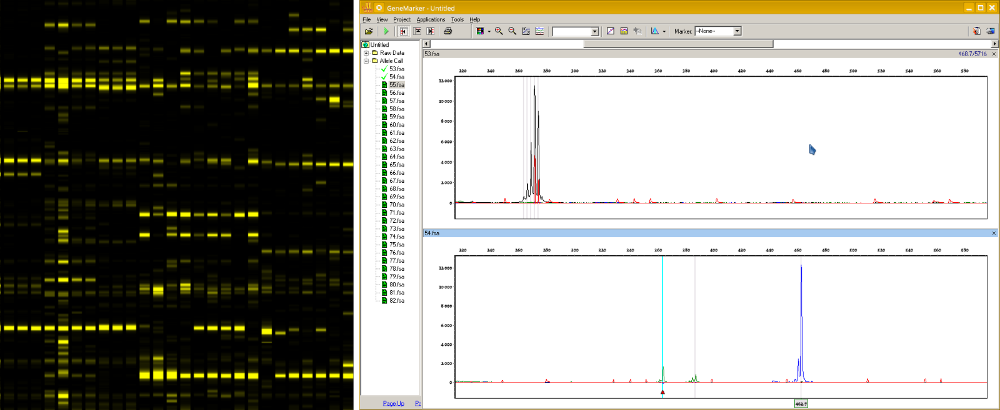 <!-- MERGE-REVIEW: no counterpart section found in QMD; content from TEX kept as-is. -->

### Examples of data and formats II - Aligned DNA sequences displayed in Geneious

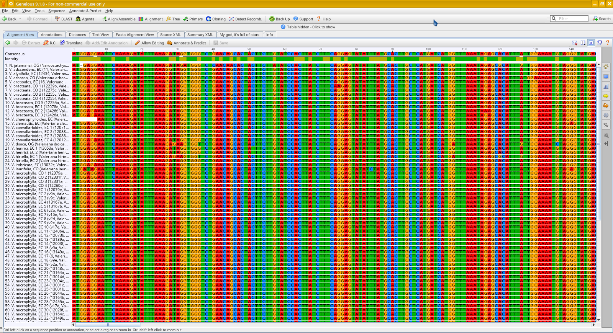 <!-- MERGE-REVIEW: no counterpart section found in QMD; content from TEX kept as-is. -->

### Examples of data and formats III - FASTA and FASTQ sequences, text view

```{r}
> CY013200
atgaagactatcattgctttgagctacattttatgtctggttttcgctcaaaaacttcccctagtgaaaaca
ggaaatgacaacagcacagcaacgctgtgcctgggacaccatgcagtgccaaacggaacgatcacgaatgat
> CY013781
atgaagactatcattgctttgagctacattttatgtctggttttcgctcaaaaacttccccaaattgaagtg
... # FASTA continues...
```

```{r}
@7001425F:141:CAV4JANXX:3:1104:1496:1976 1:N:0:GTGTCC
NCGATTCATTTTAGCAATTAGACGTGAAGGTCTCTTGATGAAAGACACTAACGAACTCTTTCCTTGGACACC
+
#<<BBFFFFFFFFFFFFFFFFFFFFFFFFFFFFFFFFFFFFFFFFFFFFFFFFFFFFFFFFFFFFFFFFFFF
@7001425F:141:CAV4JANXX:3:1104:1250:1987 1:N:0:GTGTCC
TCGATTCACTGAACTGAATGTCCGACAAACTTTAGTTTGTCGTTTCTACCTCACCAAAGTTCGGAGCTTCGA
+
#<<BBFFFFFFFFFFFFFFFFFFFFFFFFFFFFFFFFFFFFFFFFFFFFFFFFFFFFFFFFFFFFFFFFFFF
... # FASTQ continues...
```

<!-- MERGE-REVIEW: no counterpart section found in QMD; code below comes from the old TEX version. -->

### Examples of data and formats IV - BAM displayed in IGV

**It contains Illumina short reads mapped to reference**

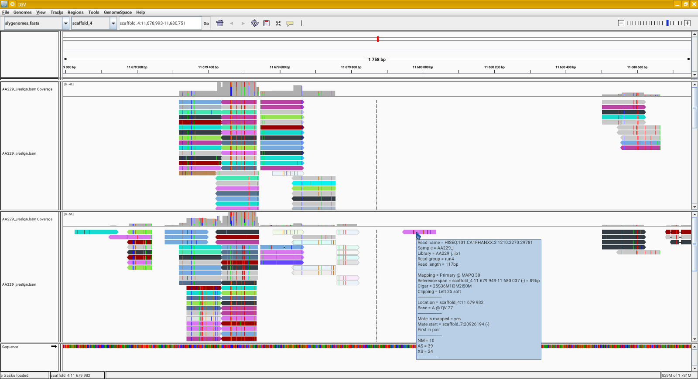 <!-- MERGE-REVIEW: no counterpart section found in QMD; content from TEX kept as-is. -->

### Examples of data and formats V - VCF with 5 samples displayed in IGV

**Variants of alleles and depth of coverage for each sample, mapped to reference**

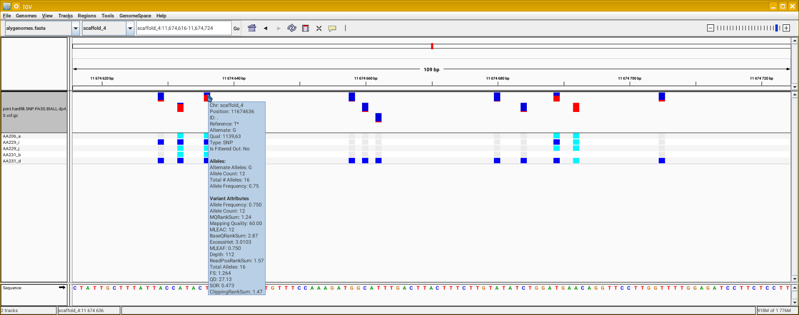 <!-- MERGE-REVIEW: no counterpart section found in QMD; content from TEX kept as-is. -->

### Examples of data and formats VI - Parts of VCF in text view

```{r}
... # Header
##ALT=<ID=NON_REF,Description="Represents any possible alternative al...
##FILTER=<ID=DP_4,Description="DP < 4">
... # Information about data stored
##INFO=<ID=AC,Number=A,Type=Integer,Description="Allele count in geno...
##INFO=<ID=AF,Number=A,Type=Float,Description="Allele Frequency, for ...
... # Information about chromosomes etc.
##contig=<ID=scaffold_1,length=33132539>
##contig=<ID=scaffold_2,length=19320864>
... # The data (variants of nucleotides)
#CHROM  POS     ID      REF     ALT     QUAL    FILTER  INFO    FORMA...
scaffold_4      22846289        .       C       A       91.52   PASS ...
scaffold_4      22846291        .       C       T       325.58  PASS ...
...AC=1;AF=1.057e-03;AN=946;BaseQRankSum=0.825;ClippingRankSum=0.118;...
...DP=4046;ExcessHet=3.0302;FS=0.000;InbreedingCoeff=-0.0096;MQ=79.24...
... # More data...
```

<!-- MERGE-REVIEW: no counterpart section found in QMD; code below comes from the old TEX version. -->

### Input/output data formats

**Representative selection**

- [\*\*BAM](https://en.wikipedia.org/wiki/BAM_(file_format))\*\* (Binary Alignment Map)/[\*\*SAM](https://en.wikipedia.org/wiki/SAM_(file_format))\*\* (Sequence Alignment Map)

  - Not used during the course
  - Sequences (usually short reads from Illumina) mapped to reference
  - Each file contains data for single sample
  - Structure is relatively complex
  - Contains also information about mapping quality etc., complex structure
  - Used by applications like [bamtools](https://github.com/pezmaster31/bamtools/wiki) or [SAMtools](https://www.htslib.org/)
  - BAM is "just" a compressed version of SAM
  - Special applications are needed to work with BAM files
  - Multiple BAM files are used to construct VCF containing multiple samples
  - Extension `*.bam`/`*.sam`

- [\*\*CSV](https://en.wikipedia.org/wiki/Comma-separated_values)\*\* (Comma Separated Values)/[\*\*TSV](https://en.wikipedia.org/wiki/Tab-separated_values)\*\* (TAB separated values)

  - "One sheet of Excel"
  - Common plain text format to store data (traits, coordinates, ...), etc.
  - Columns (cells) are separated by commas, cells are commonly bordered by quotation marks (`csv`), or by tabs (`t`) (`tsv`) - it is important to check structure before import into R (and verify it after import)
  - Extension usually `*.csv`, `*.tsv`, `*.tab` or so
  - Can have many formatting forms - carefully set parameter of import function

- [\*\*FASTA](https://en.wikipedia.org/wiki/FASTA_format)\*\*

  - Simple and popular text format to store genetic sequences (DNA, RNA, proteins)
  - Each file contains one or more sequences
  - **Line 1** of every records starts with `>` and contain name/description of the sequence (e.g. `> Seq 1`), **line 2+** contain(s) the sequence (`ATCG...`) - until end of file or next line starting with `>`
  - Each sequence can be on single line, or on multiple lines
  - Can store also alignments (practically sequences of same length, with marked gaps and missing data)
  - Larger sequences are sometimes compressed (mostly by gzip - `*.gz`)
  - Extension usually `*.fasta` (generic, also `*.fas`, `*.fa`, `*.seq`, `*.fsa`), `*.fna` (nucleic acid), `*.ffn` (nucleotides, coding regions), `*.faa` (amino acids), `*.frn` (non-coding RNA), ...

- [\*\*FASTQ](https://en.wikipedia.org/wiki/FASTQ_format)\*\*

  - Not used during the course
  - Text based format to store sequences (mainly nucleotides)
  - Every record consists of **4 lines**: (**1**) sequence ID (with possible description) starting with `@`, (**2**) the sequence (`ATCG...`), (**3**) `+` optionally followed by the same ID as line 1, and (**4**) quality values for nucleotides from line 2
  - Probably the most common format for output of modern high throughput sequencing machines (e.g. Illumina), each file contains huge number of sequences
  - Commonly compressed by `gzip` (`*.gz`), sometimes by other compression methods
  - Extension usually `*.fastq`, `*.fq`, `*.fastq.gz`, `*.fq.gz`, ...

- [\*\*NEWICK](https://en.wikipedia.org/wiki/Newick_format)\*\*

  - Every line contains one tree represented by brackets, optionally with numbers (separated by `:`) labeling nodes and/or branches (bootstrap supports, likelihoods, branch lengths, ages, ...)
  - File can contain one or more trees
  - E.g. `(A,B,(C,D)E)F;` or `(A:0.1,B:0.2,(C:0.3,D:0.4):0.5);`
  - Simple logic, but very hard to read by human
  - Extension usually `*.newick`, `*.nwk`, `*.tre`, ...

- [\*\*NEXUS](https://en.wikipedia.org/wiki/Nexus_file)\*\*

  - Popular plain text format used by software like [Mesquite](https://www.mesquiteproject.org/), [MrBayes](https://nbisweden.github.io/MrBayes/), [PAUP\*](https://paup.phylosolutions.com/), [SplitsTree](https://uni-tuebingen.de/en/fakultaeten/mathematisch-naturwissenschaftliche-fakultaet/fachbereiche/informatik/lehrstuehle/algorithms-in-bioinformatics/software/splitstree/), ...
  - Structure can be complex, is divided into blocks containing e.g. sequences, trees (in NEWICK format), distance matrix, fragmentation data, networks (e.g. for SplitsTree), MrBayes commands, traits, ...
  - Several variants, sometimes problems with interoperability
  - Extension usually `*.nexus`, `*.nex`, `*.nxs`

- [\*\*TXT](https://en.wikipedia.org/wiki/Text_file)\*\*

  - Plain text file can contain content of all listed file formats (except binary BAM) - extension (`*.txt`) is not really reliable...
  - Technically, all listed plain text formats belong also to this category

- [\*\*VCF](https://en.wikipedia.org/wiki/Variant_Call_Format)\*\* (Variant Call Format)

  - Do not confuse with [vCard](https://en.wikipedia.org/wiki/VCard) (`*.vcf`, `*.vcard`) storing virtual business cards and address books
  - Bioinformatics plain text format storing gene variants, annotations, quality data and more information
  - Used by software like [Bcftools](https://samtools.github.io/bcftools/), [GATK](https://gatk.broadinstitute.org/hc/en-us), [Picard](https://broadinstitute.github.io/picard/), [VCFtools](https://vcftools.github.io/), ...
  - Complex structure, sequences are not stored as in FASTA, but as SNP variants on respective positions - useful to store processed NGS/HTS data (e.g. from Illumina machines)
  - Commonly compressed by `gzip` (`*.gz`), sometimes by other compression methods
  - Several versions and variants (including binary BCF, `*.bcf`), sometimes there are problems with interoperability
  - Extension usually `*.vcf` or `*.vcf.gz` <!-- MERGE-REVIEW: no counterpart section found in QMD; content from TEX kept as-is. -->

### R training data

- R packages commonly contain training data to illustrate its abilities
- We will use some of them during the course (we already used `iris`)
- We will also use data provided by the teacher and/or his colleagues

```{r}
data() # List data available in currently loaded packages
# List data available in all installed packages (can be very long)
data(package=rownames(installed.packages()))
# Load selected data set; for example phylogeny and species traits
# of shorebirds from package caper (we will use it much later)
data(shorebird, package="caper")
# Optional method (load respective library and then data)
library(caper) # Library containing (among others) desired data
data(shorebird) # Loading the data
?shorebird # See content of the dataset # or ?caper::shorebird
?adegenet::microbov
?adegenet::rupica
?ape::carnivora
```

<!-- MERGE-REVIEW: 1 old code block(s) in TEX frame were dropped in favor of the .qmd section 'Exporting data'. -->

<!-- MERGE-REVIEW: content of the .qmd section 'Exporting data' was inserted at 5 frames; remove the unwanted duplicates. -->

Convert genind into DF using genind2df()

Save microsatellites to disk - check settings of write.table

Export of DNA sequences into FASTA format

Export DNA sequnces as NEXUS

Export VCF

Export trees (objects of class phylo) - will be introduced later

```{r}
hauss_df <- genind2df(x = hauss_genind, pop = NULL, sep = "/", usepop = TRUE, oneColPerAll = FALSE)
```

```{r}
write.table(x = hauss_df, file = "haussdata.txt", quote = FALSE, sep = "\t", na = "NA", dec = ".", row.names = TRUE, col.names = TRUE)
```

```{r}
write.dna(x = usflu_dna, file = "usflu.fasta", format = "fasta", append = FALSE, nbcol = 6)
seqinr::write.fasta(sequences = as.character.DNAbin(gunnera_dna), names = names(gunnera_dna), file.out = "gunnera.fasta", open = "w")
```

```{r}
write.nexus.data(x = gunnera_dna, file = "gunnera.nexus", format = "dna")
```

```{r}
vcfR::write.vcf(x = arabidopsis_vcf, file = "arabidopsis.vcf.gz")
```

```{r}
write.tree(phy = hauss_nj_bruvo, file = "haussknechtii.nwk") # Writes tree(s) in NEWICK format
write.nexus(hauss_nj_bruvo, file = "haussknechtii.nexus") # Writes tree(s) in NEXUS format
```

### Our data...

**We will use...**

- Modified subset of diploid microsatellite data of *Taraxacum haussknechtii* (Asteraceae) from Macedonia by [Zeisek et al 2015](https://trapa.cz/en/taraxacum-section-dioszegia)

  - Population genetics - genetic structure, characteristics and comparisons of sampled populations
  - Spatial genetics - genetic relationships in spatial context - relationships among populations regarding their spatial position

- Modified subset of triploid microsatellite data of several species of *Taraxacum* sect. *Taraxacum* (Asteraceae) - *T. alatum*, *T. ekmanii*, *T. hemicyclum* and *T. hepaticum* from central and northern Europe by [Kirschner et al 2016](https://trapa.cz/en/identif-oligoclonal-agamospermous-microsp)

  - Population genetics
  - Species delimitation (genotyping, identification and assignment of species)

- Small subset of population AFLP data of *Cardamine amara* (Brassicaceae) from Europe by [Karol Marhold](https://web.natur.cuni.cz/botanika/brassiploidy/marholdcv/) and his team

  - Population genetics

- Small subset of non-synonymous SNPs from [ASY3](https://www.arabidopsis.org/servlets/TairObject?type=locus&name=At2g46980) gene (required for meiosis) from diploids and tetraploids of *Arabidopsis arenosa* (Brassicaceae) from central and northern Europe by [Magdalena Bohutínská](https://scholar.google.com/citations?user=kSnTudAAAAAJ) and her colleagues

  - Population genomics
  - Associations of various traits (physiological, ...) with particular genetic loci/alleles

- Small subset of trees and taxa from phylogeny of *Oxalis* spp. (Oxalidaceae) from South Africa (the Cape region) by [Schmickl et al. 2016](https://onlinelibrary.wiley.com/doi/full/10.1111/1755-0998.12487)

  - Phylogenomics, target enrichment (HybSeq) sequencing of multiple genes - construction of individual gene trees, their evaluation (identification of trees with significantly different topology - genes with different evolutionary pathway) and construction of species trees and networks

- Internal transcribed spacer sequences of *Gunnera* spp. (Gunneraceae) from [Wanntorp et al 2014](https://doi.org/10.1046/j.1365-2699.2003.00895.x) downloaded from GenBank

  - Phylogenetic relationships among species with "Gondwana" distribution (south of South America, South Africa, Australia, New Zealand, ...)

- Maturase K (matK) plastid sequences of *Nothofagus* (Nothofagaceae) downloaded from [EMBL-EBI](https://www.ebi.ac.uk/) and/or [NCBI](https://www.ncbi.nlm.nih.gov/) (various authors; mainly from phylogenetic studies)

- Training data from packages

  - Sequence of influenza from USA sampled in several years (package adegenet, part of its vignette)
  - SSRs genotypes of cattle breeds, `?adegenet::microbov` - population genetics (genetic structure)
  - *Rupicapra rupicapra* (Bovidae) SSRs genotypes from French Bauges mountains, `?adegenet::rupica` - spatial genetics (spatial distribution of genotypes and their relationships)
  - Morphological traits and phylogeny of 17 *Acer* species, `?adephylo::maples` - phylogeny and correlated evolution of characters
  - Morphological traits of Carnivora, `?ape::carnivora` - life history patterns: allometric, phylogenetic and ecological associations
  - Measurements of *Iris setosa*, *I. versicolor* and *I. virginica*, `?iris` - measurements of morphological characters, their correlations and differences among species
  - Phylogeny and morphological traits of shorebirds, `?caper::shorebird` - comparative evolution of characters

- Work with microsatellites is in most cases (except some methods taking advance from microsatellite mutational nature) same as with presence-absence data and methods can handle both data types in nearly same fashion

  - Examples are shown mainly with microsatellites, but another (sequencing, presence/absence, ...) data are used in same way - try it

- Distance-based methods are same regardless input data on the beginning (microsatellites, AFLP, DNA sequences, ...)

- Extraction of SNP from DNA is useful in case of huge data sets - for smaller data sets it is not necessary

- Many methods can process (nearly) any input data type

  **We will use data objects during whole course - all the time save your workspace!** Use possibilities of your GUI or `save`/`load` functions.

R training data List data available in currently loaded packages

List data available in all installed packages (can be very long)

Load selected data set For example phylogeny and species traits of shorebirds from package caper (we will use it much later)

Optional method (load respective library and then data)

See content of the data set

R training data we will use during the course

```{r}
data()
```

```{r}
data(package = rownames(installed.packages()))
```

```{r}
data(shorebird, package = "caper")
```

```{r}
library("caper") # Library containing (among others) desired data
data(shorebird) # Loading the data
```

```{r}
?shorebird # Or
?caper::shorebird
```

```{r}
?adegenet::microbov
?adegenet::rupica
?ape::carnivora
?caper::shorebird
```

### Notes about paths to import the data

- Generally, R can accept nearly any local or web location

- If unsure where you are, open any file manager, go to the R working directory (verify with `getwd()` and `dir()`) and verify where everything is

- Web locations start with `https://`, `http://` or `ftp://`, e.g. `FileParameter="https://server.cz/directory/file.txt"`

- Local paths (within one computer) can be absolute or relative

  - Absolute paths start from the top of files hierarchy: on UNIX (Linux, macOS, ...) it use to look like `/home/USER/...`, on Windows like `C:/...` (e.g. `FileParameter="/path/to/some/file.txt"`)

  - Relative paths start in current directory (so **no** with `/` or `C:`)

    - In the easiest case the input file is in same directory as is R's working directory - verify by `getwd()` and `dir()` - you then need to specify only the filename (e.g. `FileParameter="SomeFile.txt"`)
    - For subdirectory start with its name (**no** with `/` or `C:`), e.g. `FileParameter="subdirectory/another/directory/file.txt"`
    - When going directory up, use one `..` for each level, e.g. `FileParameter="../upper/directory/file.txt"`
    - On UNIX (macOS, Linux, ...) tilde \``means user's home directory (e.g.`/home/USER/`), so`FileParameter="/some/file.txt"`is same as`FileParameter="/home/USER/some/file.txt"\`

  - If loading data from computer, carefully check the paths or \*\*use function `file.choose()** to interactively pick up the file anywhere in the computer` - it can replace nearly any filename parameter (e.g. `FileParameter=file.choose()`)

- Some R functions have problems with spaces and special (non-alphanumeric and accented) characters - Avoid them!

- One of the most common source of errors - **when the command fails, double check paths** (and Internet connection, if applicable) - for another common problems see slide

  **R** always work in some directory (see by `getwd()`) and by default load input files from there (see them by `dir()`) and save output there - relative paths starts there. This is common source of confusion and errors for beginners. <!-- MERGE-REVIEW: no counterpart section found in QMD; content from TEX kept as-is. -->

### Population genetics and phylogenetics in R

**Microsatellites, AFLP, SNP & sequences**

- Now we will use mainly packages [adegenet](https://adegenet.r-forge.r-project.org/) and [poppr](https://grunwaldlab.github.io/poppr/)
- Other important genetic packages: [ape](https://emmanuelparadis.r-universe.dev/ape), [ade4](https://sdray.github.io/software/) and [pegas](https://emmanuelparadis.github.io/pegas.html)
- Dominant/co-dominant marker data of any ploidy level including SSRs, SNP, and AFLP are analyzed in same way
- Most of methods are available for polyploids (although not all)
- Some methods are unavailable for dominant (presence/absence) data
- Mixing of ploidy levels is tricky (but possible) - it doesn't matter when data are encoded as PA, otherwise it is mathematically problematic
- Import, basic checking, manipulation, conversion, and export of basic common data types
- Analyses are in further chapters...

```{r}
# Load needed libraries
library(ape)
library(ade4)
library(adegenet)
library(pegas)
library(poppr)
# Now let's start to work...
```

<!-- MERGE-REVIEW: no counterpart section found in QMD; code below comes from the old TEX version. -->

## Microsatellites

### Microsatellites

- Microsatellites are short (1--3 bp) tandem repeats (in plants typically AT) very commonly occurring in Eucaryotic genomes
- Defined by number of repeats (ca. 25--250\$\$), usually recorded as length of whole region
- On the beginning and end of microsatellite region there is unique primer sequence (ca. 20 bp) - unique primers must be designed for each species
- Generally considered as evolutionary neutral, but sometimes associated with gene expression regulations or diseases
- Commonly used in population genetics due to their very high mutation rate (high diversity) and possibility to distinguish heterozygots from dominant homozygots
- Suitable for fine-scale population genetics, relationships among closely related species, not for phylogeny
- Cheap, easy to sequence, but species-specific primers are required
- Stored mostly as `loci` (package pegas) or `genind` (package adegenet) objects <!-- MERGE-REVIEW: no counterpart section found in QMD; content from TEX kept as-is. -->

### Load microsatellite data into loci object

```{r}
# Source data
    pop  msta93 msta101 msta102 msta103 msta105 msta131 ...
H01  He 269/269 198/198 221/223 419/419 197/197 196/196 ...
H02  He 275/283 198/198 221/223 419/419 193/193 168/190 ...
... ...     ...     ...     ...     ...     ...     ... ...
# Loading the data
# Load training data (Taraxacum haussknechtii from Macedonia)
hauss.loci <- read.loci(file="https://soubory.trapa.cz/rcourse/
  haussknechtii_ssrs.txt", header=TRUE, loci.sep="\t", allele.sep="/",
  col.pop=2, col.loci=3:14, row.names=1) # \t means TAB key
hauss.loci # Data control
print(hauss.loci, details=TRUE)
```

First line starts with empty cell (if `header` is presented), there can be any extra column, take care about `col.loci`. `row.names` are individual names (first column). Take care about `loci.sep` (here TAB `t`) and `allele.sep` (here `/`) - **according to data formatting**. <!-- MERGE-REVIEW: no counterpart section found in QMD; code below comes from the old TEX version. -->

### Prepare genind object for analysis and load coordinates

```{r}
# Conversion of loci to genind - used for many analysis
hauss.genind <- loci2genind(hauss.loci)
pop(hauss.genind) # See population names
hauss.genind$pop # "$" separates extra slots within object
```

```{r}
# Source data
Ind      lon   lat
H01  21.3333  41.1
...      ...   ...
# Read coordinates
hauss.coord <- read.csv("https://soubory.trapa.cz/rcourse/haussknechtii_
  coordinates.csv", header=TRUE, sep="\t", quote="", dec=".", row.names=1)
hauss.coord
```

- Coordinates can be in any projection or scale - according to aim
- Take care about parameters of `read.csv()`! See `?read.csv`
- `pegas::geod` calculates geodesic distances (on Earth surface) <!-- MERGE-REVIEW: no counterpart section found in QMD; code below comes from the old TEX version. -->

### Add coordinates to genind and create genpop object

```{r}
# Add coordinates - note identification of slots within object
hauss.genind$other$xy <- hauss.coord
hauss.genind$other$xy # See result - the coordinates
hauss.genind # See result - whole object
# Conversion to genpop - for population-level analysis
hauss.genpop <- genind2genpop(hauss.genind, process.other=TRUE)
hauss.genpop # See result
# Removes missing data - see ?missingno for types of dealing them
# Use with caution! It modifies original data!
hauss.genind.cor <- missingno(pop=hauss.genind, type="mean", cutoff=0.1,
  quiet=FALSE)
?missingno # See other options of handling missing data
# Convert corrected genind to loci
hauss.loci.cor <- genind2loci(hauss.genind.cor)
# Writes loci file to the disk
write.loci(hauss.loci.cor, file="hauss.loci.cor.txt", loci.sep="\t",
  allele.sep="/")
```

<!-- MERGE-REVIEW: no counterpart section found in QMD; code below comes from the old TEX version. -->

### Import of polyploid microsatellites

- `adegenet`, `poppr` and related packages can for most of functions handle any ploidy level (including mixing of ploidy levels, but not for all analysis)
- `polysat` package can handle mixed ploidy levels for microsatellites, but range of methods is limited
- As for AFLP, we need two files: the data matrix and individual's populations (it can be combined in one file - next slide)

**Triploid microsatellite data:**

```{r}
          msat58      msat31      msat78      msat61 ...
ala1 124/124/124 237/237/237 164/164/172 136/136/138 ...
ala2 124/124/124 237/237/237 164/164/172 136/136/138 ...
ala4 124/124/124 237/237/237 164/164/172 136/136/138 ...
 ...         ...         ...         ...         ... ...
```

Triploid species of *Taraxacum* sect. *Taraxacum* <!-- MERGE-REVIEW: no counterpart section found in QMD; code below comes from the old TEX version. -->

### How to import polyploid microsatellites

```{r}
# Import of table is as usual. Last column contains populations
tarax3n.table <- read.table("https://soubory.trapa.cz/rcourse/
  tarax3n.txt", header=TRUE, sep="\t", quote="", row.names=1)
# Check the data
tarax3n.table
class(tarax3n.table)
dim(tarax3n.table)
# See parameter "X" - we don't import whole tarax3n.table as last column
# contains populations - this column we use for "pop" parameter (note
# different style of calling the column - just to show the possibility).
# Check "ploidy" and "ncode" (how many digits code one allele - must be
# same everywhere). See ?df2genind for more details.
tarax3n.genind <- df2genind(X=tarax3n.table[,1:6], sep="/", ncode=3,
  pop=tarax3n.table[["pop"]], ploidy=3, type="codom")
# See resulting genind object
tarax3n.genind
summary(tarax3n.genind)
```

<!-- MERGE-REVIEW: no counterpart section found in QMD; code below comes from the old TEX version. -->

## AFLP/PA

### Amplified Fragment Length Polymorphism

1.  Whole genomic DNA is split by few restriction enzymes into huge number of fragments of various length
2.  Adaptors are ligated to each fragment
3.  Pre-amplification - only fragments with "selection" nucleotide, 1/16 of all fragments are amplified
4.  Selective amplification - like previous step, 2 more "selection" nucleotides, 1/256 of all fragments are amplified

- Resulting fragments are visualized and recorded as presence/absence (1/0) matrix of fragment of particular length
- Highly variable, no prior knowledge of target genome required, suitable for fine-scale population genetics, relationships among closely related species (not for phylogeny)
- Technically relatively demanding, nowadays people use to prefer RAD-Seq or similar
- **Same methods are used also for another presence/absence data** <!-- MERGE-REVIEW: no counterpart section found in QMD; content from TEX kept as-is. -->

### Import of presence/absence (e.g. AFLP) data - background

Two files - AFLP data with individual names, and populations

**AFLP or any other presence/absence data:**

```{r}
    L1 L2 L3 L4 L5 L6 L7 L8 L9 ...
Ind1 0  0  1  1  1  0  0  0  1 ...
IndG 0  0  1  1  0  0  0  0  0 ...
 ...  ...                      ...
```

AFLP data of *Cardamine amara* group

**Individual's populations:**

```{r}
POP
pop1
popZ
...
```

Just list of populations for respective individuals...

- Use any names, just keep one word (no spaces) and don't use special characters
- Keep names of loci as simple as possible, there are some issues when they contain dots
- As soon as one line of data = one individual, ploidies and their mixing doesn't matter
- Not all methods introduced later are available/meaningful for PA
- Basically `matrix`/`DF` is imported, usually converted into `genind` <!-- MERGE-REVIEW: no counterpart section found in QMD; code below comes from the old TEX version. -->

### Import of AFLP data - the code

```{r}
amara.aflp <- read.table(file="https://soubory.trapa.cz/rcourse/
  amara_aflp.txt", header=TRUE, sep="\t", quote="")
amara.aflp
dim(amara.aflp)
class(amara.aflp) # Must be matrix or data frame
# Populations - just one column with population names for all inds
amara.pop <- read.table(file="https://soubory.trapa.cz/rcourse/
  amara_pop.txt", header=TRUE, sep="\t", quote="")
amara.pop
# You can use just one file, where populations are in last column and
# in df2genind() use for example X=aflp[,1:XXX] and pop=aflp[,YYY]
# Create genind object - ind.names and loc.names are taken from X
aflp.genind <- df2genind(X=amara.aflp, sep="", ind.names=NULL,
  loc.names=NULL, pop=amara.pop[,1], type="PA")
indNames(aflp.genind) <- amara.aflp[,1] # Add individual names
aflp.genind
# You can add any other variables into genind$other$XXX
```

<!-- MERGE-REVIEW: no counterpart section found in QMD; code below comes from the old TEX version. -->

## Notes about data

### Import existing data set from popular software

```{r}
?read.genalex # poppr - reads *.csv file
?read.fstat # adegenet - reads *.dat files, only haploid/diploid data
?read.genetix # adegenet - reads *.gtx files, only ha/diploid data
?read.genepop # adegenet - reads *.gen files, only ha/diploid data
?read.structure # adegenet - reads *.str files, only ha/diploids
?import2genind # adegenet - more automated version of above functions
```

All these functions (including e.g. `read.loci()` and `read.csv()`) are only modifications of `read.table()`. You can use it directly to import any data. Look at `?read.table` and play with it. Take care about parameters. Does the table use quotes to mark cell (e.g. `quote=" ""`)? How are columns separated (e.g. `sep=" t"`)? Is there a header with names of populations/loci/whatever (`header=T/F`)? What is decimal separator (e.g. `dec="."`)? Are there row names (used typically as names of individuals; e.g. `row.names=1`)? **Always check data after import!** <!-- MERGE-REVIEW: no counterpart section found in QMD; code below comes from the old TEX version. -->

### Another data manipulation

```{r}
?genind2df # adegenet - export into data frame
?genind2genalex # poppr - export for genalex
?popsub # poppr - extracts only selected population(s)
?clonecorrect # poppr - corrects for clones
?informloci # poppr - removes uninformative loci
?seppop # adegenet - separates populations from genind or genlight
?seploc # adegenet - splits genind, genpop or genlight by markers
?alleles2loci # pegas - transforms a matrix of alleles into "loci"
# seppop and seploc return lists of genind objects - for further
# analysis using special functions to work on lists (see further)
# read manuals (?...) of the functions before usage
```

- SNPs can be into genind imported in same way as AFLP (PA)
- `alleles2loci()` is very useful when each allele is in separated columns (not like in our case where one column contains one loci with all alleles) - saves time needed to change input file formatting <!-- MERGE-REVIEW: no counterpart section found in QMD; code below comes from the old TEX version. -->

### Notes about getting data into R

- When importing fragmentation, character, etc. data, we somehow use function `read.table()` - it is important to understand it
- I recommend to use TAB (TSV - tab separated values; encoded as `t` in R) to separate columns (no quotation marks, no commas)
- When importing microsatellites, all alleles **must** have same number of digits (use trailing zeros). Separate alleles by "`/`", "`|`" or something similar and correctly specify it in `read.loci()` or `df2genind()` (or read the data with `read.table()`, convert into matrix and use `alleles2loci()`)
- **Do not use** dashes (minuses) ("`-`") to name objects in R (sometimes there are problems with underscores ("`_`")) - only numbers, Latin letters or dots
- `read.loci()` sometimes doesn't work correctly on AFLP or polyploid microsatellites - try `read.table()` instead...
- Genind object is able to store mixed ploidy data, but not all analysis are able to handle it <!-- MERGE-REVIEW: no counterpart section found in QMD; content from TEX kept as-is. -->

## DNA sequences, SNP

### Nucleotide sequences

- DNA/RNA sequences from "traditional" Sanger sequencing
- Probably most common genetic data
- Genes of various lengths and mutation rate - from variable introns suitable for population genetics to conservative genes suitable for phylogenies
- Examples are shown for DNA, but same apply for RNA and mostly also for protein sequences (use class `AAbin` instead of `DNAbin`)
- Same methods are used for single nucleotide polymorphism extracted from larger-scale sequencing, including from modern sequencing methods (Illumina etc.)
- Data use to be stored in FASTA or NEXUS format - can contain any sequences of any origin
- Outputs of modern high-throughput sequencing use to be stored in FASTQ and later BAM and VCF (see next chapter) <!-- MERGE-REVIEW: no counterpart section found in QMD; content from TEX kept as-is. -->

### Import of DNA sequence data I

```{r}
# Reading FASTA (read.dna() reads also another formats, see ?read.dna)
# Sequences of flu viruses from various years from USA (Adegenet toy data)
usflu.dna <- read.dna(file="https://adegenet.r-forge.r-project.org/
  files/usflu.fasta", format="fasta")
class(usflu.dna) # Check the object
usflu.dna # Check the object
# Another possibility (only for FASTA alignments, same result):
usflu.dna2 <- fasta2DNAbin(file="https://adegenet.r-forge.r-project.org
  /files/usflu.fasta") # Normally keeps only SNP - see ?fasta2DNAbin
class(usflu.dna2) # Check the object
usflu.dna2 # Check the object
as.character(usflu.dna2)[1:5,1:10] # Check the object
dim(usflu.dna2) # Does it have correct size?
# Read annotations
usflu.annot <- read.csv("https://adegenet.r-forge.r-project.org/files/
  usflu.annot.csv", header=TRUE, row.names=1)
head(usflu.annot) # See result
```

<!-- MERGE-REVIEW: no counterpart section found in QMD; code below comes from the old TEX version. -->

### Import of DNA sequence data II

```{r}
# Convert DNAbin to genind - only polymorphic loci (SNPs) are retained
# When converting DNAbin to genind, the sequences must be aligned!
usflu.genind <- DNAbin2genind(x=usflu.dna, pop=usflu.annot[["year"]])
usflu.genind # Check it
# Read sequence data in NEXUS (similar to reading FASTA)
?read.nexus.data
```

- RNA or protein sequences can be handed in same way - see `?read.dna` and `?read.FASTA`
- For nucleic acid sequences there is R class `DNAbin`, for protein sequences `AAbin` - they are handled in same way
- Do not confuse `read.nexus.data` (reads sequences) and `read.nexus` (reads trees) <!-- MERGE-REVIEW: no counterpart section found in QMD; code below comes from the old TEX version. -->

### Import sequences from GenBank

- Data from [GenBank](https://www.ncbi.nlm.nih.gov/nuccore?term=popset+representative+uid+22854787%5Bword%5D), *Gunnera* spp., phylogenetic study of [Wanntorp et al. 2002](https://doi.org/10.1046/j.1365-2699.2003.00895.x)

```{r}
# Importing sequences according to sequence ID
gunnera.dna <- read.GenBank(c("AF447749.1", "AF447748.1", "AF447747.1",
  "AF447746.1", "AF447745.1", "AF447744.1", "AF447743.1", "AF447742.1",
  "AF447741.1", "AF447740.1", "AF447739.1", "AF447738.1", "AF447737.1",
  "AF447736.1", "AF447735.1", "AF447734.1", "AF447733.1", "AF447732.1",
  "AF447731.1", "AF447730.1", "AF447729.1", "AF447728.1"))
gunnera.dna
class(gunnera.dna)
```

- To be converted into `genind` (useful for many population genetic analysis), sequences in `DNAbin` must be aligned (from slide )
- To query on-line database as through web we use [seqinr](https://CRAN.R-project.org/package=seqinr) (next slide) or [rentrez](https://CRAN.R-project.org/package=rentrez) (slide after) <!-- MERGE-REVIEW: no counterpart section found in QMD; code below comes from the old TEX version. -->

### Query on-line sequence databases

```{r}
library(seqinr)
choosebank() # List genetic banks available for seqinr
choosebank("embl", timeout=20) # Choose some bank
?query # See how to construct the query
# Query selected database - there are a lot of possibilities
nothofagus <- query(listname="nothofagus",
  query="SP=Nothofagus AND K=rbcl", verbose=TRUE)
nothofagus$req # See the sequences information
# Get the sequences as a list
nothofagus.sequences <- getSequence(nothofagus$req)
nothofagus.sequences # See sequences - just a plain list
nothofagus.annot <- getAnnot(nothofagus[["req"]]) # Get annotations
nothofagus.annot
closebank() # Close the bank when work is over
# Convert sequences from a list to DNAbin (functions as.DNAbin*)
nothofagus.dna <- as.DNAbin.list(nothofagus.sequences)
nothofagus.dna # See it
```

<!-- MERGE-REVIEW: no counterpart section found in QMD; code below comes from the old TEX version. -->

### Query NCBI databases

```{r}
library(rentrez)
entrez_dbs() # Genetic banks available for rentrez
entrez_db_summary("nucleotide") # Brief description of the selected database
# Set of search terms that can used with this database
entrez_db_searchable("nucleotide")
# Search the database and get IDs of matched records
nothofagus.search <- entrez_search(db="nucleotide",
  term="Nothofagus[ORGN] AND rbcL[GENE]")
nothofagus.search
# Fetch desired records according to their IDs
nothofagus.fasta <- entrez_fetch(db="nucleotide",
  id=nothofagus.search[["ids"]], rettype="fasta")
nothofagus.fasta
# Conversion into DNAbin requires saving to disk as FASTA and then loading
write(x=nothofagus.fasta, file="nothofagus.fasta")
nothofagus.dna <- read.dna(file="nothofagus.fasta", format="fasta")
nothofagus.dna
```

<!-- MERGE-REVIEW: no counterpart section found in QMD; code below comes from the old TEX version. -->

### Importing large SNP

- Import from [PLINK](https://zzz.bwh.harvard.edu/plink/index.shtml) requires saving of data with option ["--](https://zzz.bwh.harvard.edu/plink/dataman.shtml)recodeA"

```{r}
?read.PLINK # How to read PLINK files
```

- Extracting SNP from alignments reads FASTA alignments and keep only SNPs. The method is relatively efficient even for large data sets with several genomes:

```{r}
usflu.genlight <- fasta2genlight
  (file="https://adegenet.r-forge.r-project.org/files/usflu.fasta",
  quiet=FALSE, saveNbAlleles=TRUE)
usflu.genlight # See genlight
?fasta2genlight # Function has several options to speed up reading
# If it crashes (on Windows), try to add parameter "parallel=FALSE"
```

- For small data sets, keep data as DNAbin or genind as they are more information-rich - genlight is more efficient for large data (\> \$\$100,000 SNPs)
- Adegenet has custom format to store SNP as plain text file and function `read.snp` to import it into `genlight` object - check [Adegenet tutorial](https://github.com/thibautjombart/adegenet/wiki/Tutorials) **genomics**, `?read.snp` <!-- MERGE-REVIEW: no counterpart section found in QMD; code below comes from the old TEX version. -->

### Checking SNPs

```{r}
# Position of polymorphism within
# alignment - snpposi.plot requi-
# res input data in form of matrix
snpposi.plot(x=as.matrix(
  usflu.dna), codon=FALSE)
# Position of polymorphism within
# alignment-differentiating codons
snpposi.plot(as.matrix(usflu.dna))
# When converting DNAbin to genind
# only polymorphic loci are kept -
# threshold for polymorphism can
# be arbitrary (polyThres=...)
usflu.genind2 <- DNAbin2genind(x=
  usflu.dna, polyThres=0.01)
usflu.genind2 # See it
```

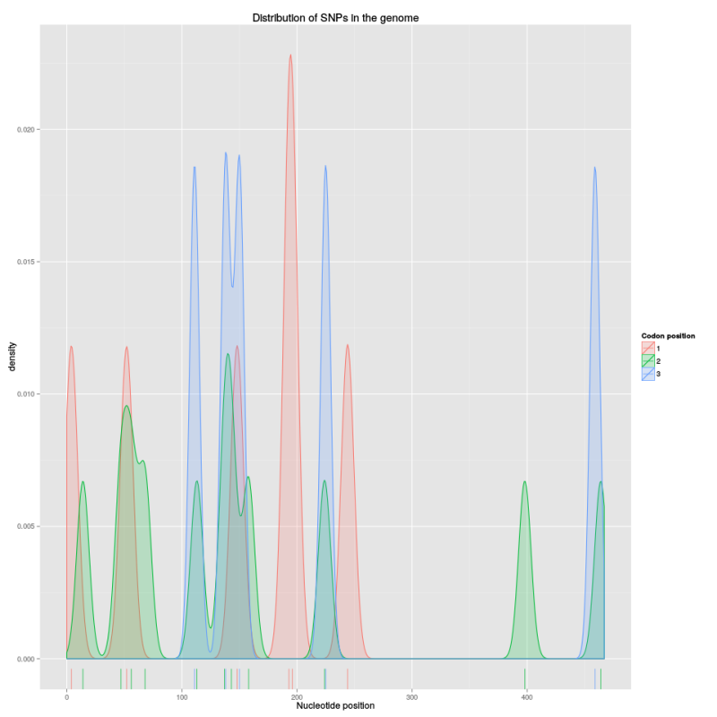 <!-- MERGE-REVIEW: no counterpart section found in QMD; code below comes from the old TEX version. -->

### Checking sequences

```{r}
# Test if distribution of SNPs is random (1000 permutations)
snpposi.test(as.matrix(usflu.dna))
pegas::nuc.div(x=usflu.dna) # Nucleotide diversity
ape::base.freq(x=usflu.dna) # Base frequencies
ape::GC.content(x=usflu.dna) # GC content
# Number of times any dimer/trimer/etc oligomers occur in a sequence
# Note: count() requires single sequence as DNAbin/character
seqinr::count(seq=as.character.DNAbin(gunnera.dna[["AF447749.1"]]),
  wordsize=3)
# View sequences - all must be of the same length
# Function "image.DNAbine" requires as input matrix, so that sequences
# must be of same length (aligned) - stored as DNAbin.matrix
image.DNAbin(x=usflu.dna)
# Sequences must be of same length - as.matrix.DNAbin() can help
image.DNAbin(x=as.matrix.DNAbin(usflu.dna))
```

<!-- MERGE-REVIEW: no counterpart section found in QMD; code below comes from the old TEX version. -->

### U.S. flu sequences

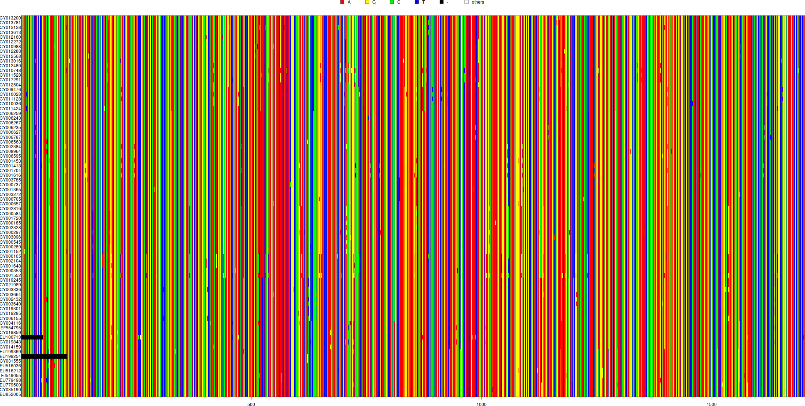 <!-- MERGE-REVIEW: no counterpart section found in QMD; content from TEX kept as-is. -->

### Notes about using genlight (vs. genind)

- Genlight is "just" version of more common genind object to store large data sets with (nearly) complete multiple genomes

- "Large" is tricky - there is no easy criterion (roughly, genind is inefficient since dozens or hundreds thousands of SNPs) - try genind and when work fails because of not enough computer resources, go on with genlight

  - Genlight is much more memory efficient, large genind can consume a lot of resources

- Use is basically same as when working with genind - but not all functions are able to deal with it (on the other hand, others are optimized to work well on large data sets)

- SNPbin is version of genind/genlight to store one large genome - serves basically as storage, no need to deal with it

- Genlight as well as genind allow varying ploidy level

- Functions working with genlight use to use parallelization to speed up operations - this commonly doesn't work properly on MS Windows <!-- MERGE-REVIEW: no counterpart section found in QMD; content from TEX kept as-is. -->

## VCF

### Variant Call Format

- Raw sequencing data from modern HTS (Illumina, Pacific Biosciences, ...) are stored in FASTQ format and pre-processed via BAM (FASTQ reads aligned to reference sequence) into VCF

  - This is usually done with special SW and/or pipelines
  - Raw VCF can be large, requires quality filtering etc.

- VCF is most common format for storing pre-processed data for various downstream analysis from HTS

- Can effectively store large WGS data

- Keeps only SNPs - differences of particular sample to reference

- Contains plenty of "meta information" - depth of coverage (ow many times was each site sequenced), mapping quality, ... used for quality filtering of SNPs

- Can handle any ploidy level, including mixing of ploidy levels, but not every application can work with that - this can easily lead into issues <!-- MERGE-REVIEW: no counterpart section found in QMD; content from TEX kept as-is. -->

### Reading VCF using vcfR

- Download into working directory input file <https://soubory.trapa.cz/rcourse/arabidopsis.vcf.gz> and reference sequence <https://soubory.trapa.cz/rcourse/alygenomes.fasta>
- Non-synonymous SNPs from [ASY3](https://www.arabidopsis.org/servlets/TairObject?type=locus&name=At2g46980) gene (required for meiosis) from diploids and tetraploids of *Arabidopsis arenosa* from central and northern Europe
- Package **vcfR** has functions to manipulate and explore VCF (class `vcfR`); other option is usage of [VariantAnnotation](https://bioconductor.org/packages/release/bioc/html/VariantAnnotation.html) (uses different classes)

```{r}
library(vcfR) # Required library
# Pick up downloaded file 'arabidopsis.vcf.gz' from the disk
arabidopsis.vcf <- read.vcfR(file=file.choose())
# File choose dialog can open in background - search for it :-)
# Or directly load remote file
arabidopsis.vcf <- read.vcfR
  (file="https://soubory.trapa.cz/rcourse/arabidopsis.vcf.gz")
```

<!-- MERGE-REVIEW: no counterpart section found in QMD; code below comes from the old TEX version. -->

### Checking VCF

```{r}
# It returns object of class vcfR-class
?read.vcfR # See more import options
?pegas::read.vcf # This one returns list of objects loci and data.frame
arabidopsis.vcf
head(arabidopsis.vcf)
arabidopsis.vcf@fix[1:10,1:5]
strwrap(arabidopsis.vcf@meta[1:21])
queryMETA(x=arabidopsis.vcf)
queryMETA(x=arabidopsis.vcf, element="DP")
queryMETA(x=arabidopsis.vcf, element="FORMAT.+DP")
queryMETA(x=arabidopsis.vcf, element="FORMAT=<ID=DP")
head(x=getFIX(x=arabidopsis.vcf))
head(x=is.polymorphic(x=arabidopsis.vcf, na.omit=TRUE))
head(x=is.biallelic(x=arabidopsis.vcf))
arabidopsis.vcf@gt[1:10, 1:4]
# See description of depth of coverage (DP) slot
strwrap(x=grep(pattern="ID=DP,", x=arabidopsis.vcf@meta, value=TRUE))
```

<!-- MERGE-REVIEW: no counterpart section found in QMD; code below comes from the old TEX version. -->

### Checking depth of coverage (DP)

```{r}
arabidopsis.vcf.dp <- extract.gt(x=arabidopsis.vcf, element="DP",
  as.numeric=TRUE) # GT:GQ:DP:HQ
dim(arabidopsis.vcf.dp) # See it
head(arabidopsis.vcf.dp)
# Boxplot of DP
boxplot(x=arabidopsis.vcf.dp, col="#808080", ylab="Depth of coverage",
  las=3)
title("DP per specimen")
abline(h=seq(from=0, to=90, by=10), col="#b3b3b3")
# Bar plot of mean DP
barplot(apply(X=arabidopsis.vcf.dp, MARGIN=2, FUN=mean, na.rm=TRUE), las=3)
title("Mean DP per specimen")
abline(h=seq(from=0, to=60, by=10), col="#b3b3b3")
# Heatmap of DP (subset)
heatmap.bp(x=arabidopsis.vcf.dp[1:100,1:100], col.ramp=rainbow(n=100,
  start=0.1)) # Subset - only first 100 loci and individuals
title("DP per specimens and loci")
```

<!-- MERGE-REVIEW: no counterpart section found in QMD; code below comes from the old TEX version. -->

### DP per specimen

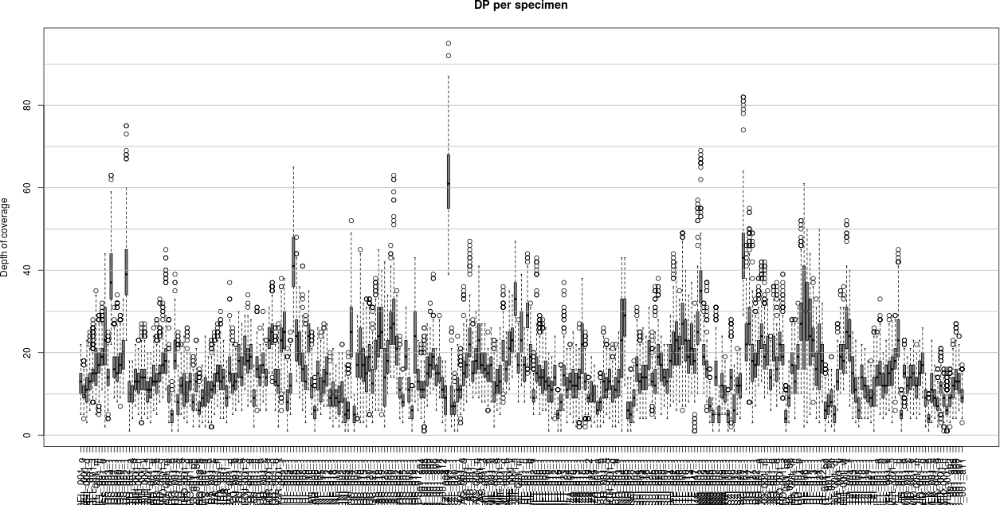 <!-- MERGE-REVIEW: no counterpart section found in QMD; content from TEX kept as-is. -->

### Bar plot of mean DP

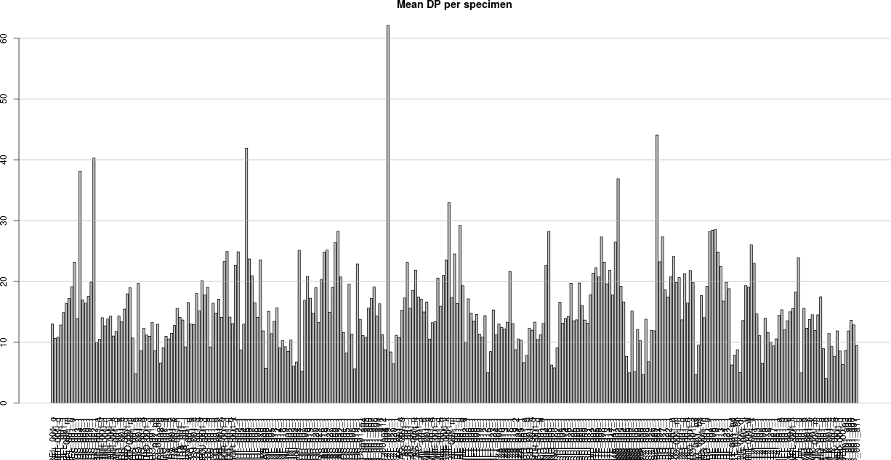 <!-- MERGE-REVIEW: no counterpart section found in QMD; content from TEX kept as-is. -->

### Heat map of DP

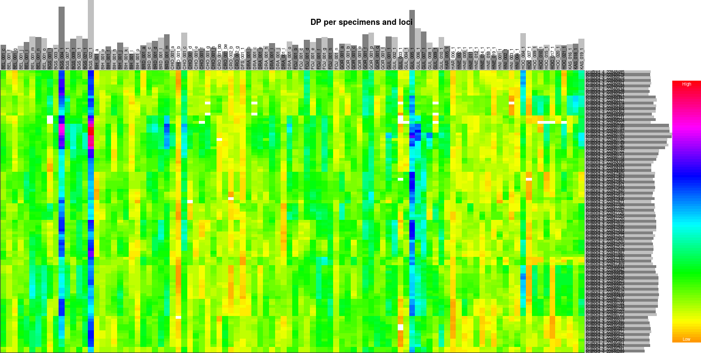 <!-- MERGE-REVIEW: no counterpart section found in QMD; content from TEX kept as-is. -->

### Extract the genotype quality (GQ)

```{r}
# Extract the GQ
arabidopsis.vcf.gq <- extract.gt(x=arabidopsis.vcf, element="GQ",
  as.numeric=TRUE)
dim(arabidopsis.vcf.gq)
arabidopsis.vcf.gq[1:10,1:10]
# Heatmap of GQ (subset)
heatmap.bp(x=arabidopsis.vcf.gq[1:100,1:100])
# Bar plot of mean GQ
barplot(apply(X=arabidopsis.vcf.gq, MARGIN=2, FUN=mean, na.rm=TRUE),
  las=3)
abline(h=seq(from=0, to=90, by=5), col="grey")
# Boxplot of GQ
boxplot(arabidopsis.vcf.gq, las=2, main="Genotype Quality (GQ)")
abline(h=seq(from=0, to=100, by=5), col="grey")
# Basically same as work with DP...
```

<!-- MERGE-REVIEW: no counterpart section found in QMD; code below comes from the old TEX version. -->

### Missing data

```{r}
# Extract information about missing data
arabidopsis.vcf.miss <- apply(X=arabidopsis.vcf.dp, MARGIN=2,
  FUN=function(x){sum(is.na(x))})
arabidopsis.vcf.miss <- arabidopsis.vcf.miss/nrow(arabidopsis.vcf)
# Bar plot of missing data
barplot(height=arabidopsis.vcf.miss, ylab="Percentage of missing data",
  las=2)
abline(h=seq(from=0, to=1, by=0.05), col="grey")
# Histogram of frequencies of missing data
arabidopsis.vcf.missg <- apply(X=arabidopsis.vcf.dp, MARGIN=1,
  FUN=function(x){sum(is.na(x))})
arabidopsis.vcf.missg <-
  arabidopsis.vcf.miss/ncol(arabidopsis.vcf@gt[,-1])
hist(x=arabidopsis.vcf.missg, xlab="Missingness (%)")
# Set abline parameters according to your data
abline(h=seq(from=0, to=350, by=25), col="grey")
```

<!-- MERGE-REVIEW: 1 old code block(s) in TEX frame were dropped in favor of the .qmd section 'Exporting data'. -->

<!-- MERGE-REVIEW: content of the .qmd section 'Exporting data' was inserted at 5 frames; remove the unwanted duplicates. -->

Convert genind into DF using genind2df()

Save microsatellites to disk - check settings of write.table

Export of DNA sequences into FASTA format

Export DNA sequnces as NEXUS

Export VCF

Export trees (objects of class phylo) - will be introduced later

```{r}
hauss_df <- genind2df(x = hauss_genind, pop = NULL, sep = "/", usepop = TRUE, oneColPerAll = FALSE)
```

```{r}
write.table(x = hauss_df, file = "haussdata.txt", quote = FALSE, sep = "\t", na = "NA", dec = ".", row.names = TRUE, col.names = TRUE)
```

```{r}
write.dna(x = usflu_dna, file = "usflu.fasta", format = "fasta", append = FALSE, nbcol = 6)
seqinr::write.fasta(sequences = as.character.DNAbin(gunnera_dna), names = names(gunnera_dna), file.out = "gunnera.fasta", open = "w")
```

```{r}
write.nexus.data(x = gunnera_dna, file = "gunnera.nexus", format = "dna")
```

```{r}
vcfR::write.vcf(x = arabidopsis_vcf, file = "arabidopsis.vcf.gz")
```

```{r}
write.tree(phy = hauss_nj_bruvo, file = "haussknechtii.nwk") # Writes tree(s) in NEWICK format
write.nexus(hauss_nj_bruvo, file = "haussknechtii.nexus") # Writes tree(s) in NEXUS format
```

### Remove non-biallelic loci and indels

- This is commonly done with SNPs as many downstream analysis are well defined only for biallelic loci (and do not work well with other loci)
- Other than biallelic loci are often suspicious of being laboratory/computational artifact

```{r}
# Remove indels
arabidopsis.vcf <- extract.indels(x=arabidopsis.vcf)
# Remove non-biallelic loci
arabidopsis.vcf <- arabidopsis.vcf[is.biallelic(x=arabidopsis.vcf),]
# See result
arabidopsis.vcf
```

- vcfR has relatively limited possibilities to filter VCF when comparing to specialized software like [GATK](https://gatk.broadinstitute.org/)
- More options are in [VariantAnnotation](https://bioconductor.org/packages/release/bioc/html/VariantAnnotation.html), but it uses different R class, so it's not handy for future work in this workflow <!-- MERGE-REVIEW: no counterpart section found in QMD; code below comes from the old TEX version. -->

### ChromR - filtration of VCF I

```{r}
# Loading reference sequence - download
# https://soubory.trapa.cz/rcourse/alygenomes.fasta into working directory
arabidopsis.dna <- read.dna(file="alygenomes.fasta", format="fasta")
arabidopsis.dna
# Conversion into chromosome object (ChromR)
arabidopsis.chrom <- create.chromR(vcf=arabidopsis.vcf,
  name="Arabidopsis arenosa", seq=arabidopsis.dna)
arabidopsis.chrom
plot(arabidopsis.chrom)
# Masking sites with too low/high DP and/or MQ (sites are not removed yet)
arabidopsis.chrom.mask <- masker(x=arabidopsis.chrom, min_QUAL=1,
  min_DP=8, max_DP=5000, min_MQ=40, max_MQ=200)
arabidopsis.chrom.mask
plot(arabidopsis.chrom.mask)
variant.table(arabidopsis.chrom.mask)
# Saving mask into new object (actually removing masked sites)
arabidopsis.chrom.fin <- proc.chromR(x=arabidopsis.chrom.mask)
```

<!-- MERGE-REVIEW: no counterpart section found in QMD; code below comes from the old TEX version. -->

### ChromR - filtration of VCF II

```{r}
# See results from the previous slide
arabidopsis.chrom.fin
chromoqc(chrom=arabidopsis.chrom.fin)
# The plot is bit empty as we have only single gene
```

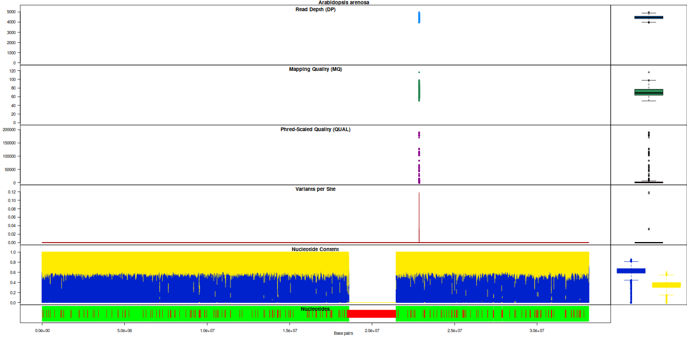 <!-- MERGE-REVIEW: no counterpart section found in QMD; code below comes from the old TEX version. -->

### Convert VCF into various objects for later processing

```{r}
# Genind - convert chromR or vcfR objects
arabidopsis.genind <- vcfR2genind(x=arabidopsis.chrom.fin@vcf, ploidy=4)
arabidopsis.genind # Check it
nInd(arabidopsis.genind)
indNames(arabidopsis.genind)
nLoc(arabidopsis.genind)
locNames(arabidopsis.genind)
# Genlight (suitable for huge data, not required now)
# Note that it introduces a lot of missing data due to variable ploidies
arabidopsis.genlight <- vcfR2genlight(x=arabidopsis.chrom.fin@vcf,
  n.cores=1) # On Linux/macOS and with large data use higher n.cores
warnings() # See errors - due to missing data when handling 4N vs. 2N
arabidopsis.genlight # Check it
arabidopsis.loci <- vcfR2loci(x=arabidopsis.chrom.fin) # Loci
arabidopsis.loci # Check it
print(x=arabidopsis.loci, details=TRUE)
```

<!-- MERGE-REVIEW: no counterpart section found in QMD; code below comes from the old TEX version. -->

### Convert vcfR into DNAbin

```{r}
# There are various options how
# to process variants in VCF
?vcfR2DNAbin
arabidopsis.dnabin <- vcfR2DNAbin
  (x=arabidopsis.chrom.fin,
  consensus=FALSE, extract.haps=
  TRUE, unphased_as_NA=FALSE,
  asterisk_as_del=FALSE)
arabidopsis.dnabin # Check it
dim(arabidopsis.dnabin)
as.character.DNAbin
  (arabidopsis.dnabin[1:15,1:12])
image.DNAbin(arabidopsis.dnabin)
snpposi.plot.DNAbin
  (arabidopsis.dnabin)
snpposi.test.DNAbin
  (arabidopsis.dnabin)
```

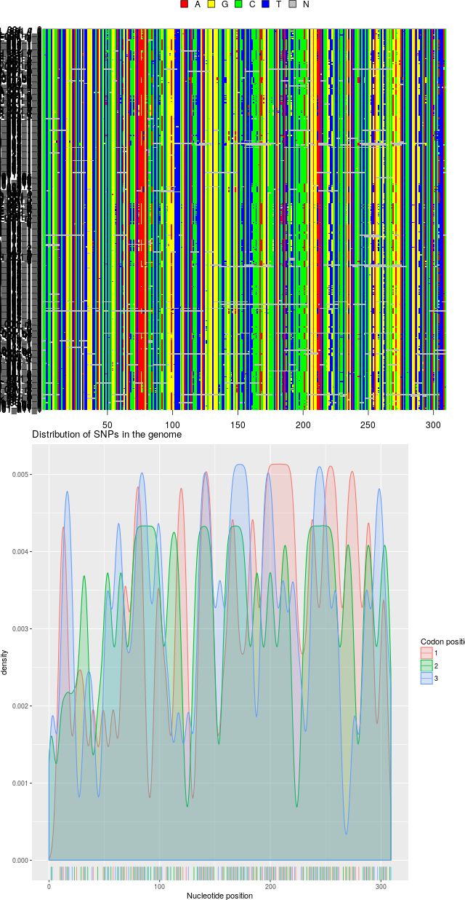 <!-- MERGE-REVIEW: no counterpart section found in QMD; code below comes from the old TEX version. -->

## Export

### Export data

```{r}
# Convert genind into DF using genind2df()
hauss.df <- genind2df(x=hauss.genind, pop=NULL, sep="/",
  usepop=TRUE, oneColPerAll=FALSE)
# Save microsatellites to disk - check settings of write.table
write.table(x=hauss.df, file="haussdata.txt", quote=FALSE,
  sep="\t", na="NA", dec=".", row.names=TRUE, col.names=TRUE)
# Export of DNA sequences into FASTA format
write.dna(x=usflu.dna, file="usflu.fasta", format="fasta",
  append=FALSE, nbcol=6)
seqinr::write.fasta(sequences=as.character.DNAbin(gunnera.dna),
  names=names(gunnera.dna), file.out="gunnera.fasta", open="w")
# Export DNA sequences as NEXUS
write.nexus.data(x=gunnera.dna, file="gunnera.nexus", format="dna")
write.vcf(x=arabidopsis.vcf, file="arabidopsis.vcf.gz") # Export VCF
# Export tree(s) (objects of class phylo) - will be introduced later
write.tree(phy=hauss.nj.bruvo, file="haussknechtii.nwk") # In NEWICK
write.nexus(hauss.nj.bruvo, file="haussknechtii.nexus") # In NEXUS
```

<!-- MERGE-REVIEW: 1 old code block(s) in TEX frame were dropped in favor of the .qmd section 'Exporting data'. -->

<!-- MERGE-REVIEW: content of the .qmd section 'Exporting data' was inserted at 5 frames; remove the unwanted duplicates. -->

Convert genind into DF using genind2df()

Save microsatellites to disk - check settings of write.table

Export of DNA sequences into FASTA format

Export DNA sequnces as NEXUS

Export VCF

Export trees (objects of class phylo) - will be introduced later

```{r}
hauss_df <- genind2df(x = hauss_genind, pop = NULL, sep = "/", usepop = TRUE, oneColPerAll = FALSE)
```

```{r}
write.table(x = hauss_df, file = "haussdata.txt", quote = FALSE, sep = "\t", na = "NA", dec = ".", row.names = TRUE, col.names = TRUE)
```

```{r}
write.dna(x = usflu_dna, file = "usflu.fasta", format = "fasta", append = FALSE, nbcol = 6)
seqinr::write.fasta(sequences = as.character.DNAbin(gunnera_dna), names = names(gunnera_dna), file.out = "gunnera.fasta", open = "w")
```

```{r}
write.nexus.data(x = gunnera_dna, file = "gunnera.nexus", format = "dna")
```

```{r}
vcfR::write.vcf(x = arabidopsis_vcf, file = "arabidopsis.vcf.gz")
```

```{r}
write.tree(phy = hauss_nj_bruvo, file = "haussknechtii.nwk") # Writes tree(s) in NEWICK format
write.nexus(hauss_nj_bruvo, file = "haussknechtii.nexus") # Writes tree(s) in NEXUS format
```

## Tasks

### Import your own data

1.  Prior to import into R, **ensure your data are correct** - same decimal separator everywhere, consistent structure of CSV/TSV, no syntactic problems in FASTA/NEXUS/NEWICK/...
2.  Import some of your data into R

- Be inspired by previous slides - edit commands to fit your needs and process your data
- R is extremely flexible, but not everything is figured out within one minute...
- Import preferably your data - you'll later use them to perform selected analysis

3.  **Check your data after import** to ensure they were correctly read

- Upcoming chapters can serve like inspiration (not exhaustive) how to process your data in R, what is possible to do with them...
- Previous examples are not covering all possibilities... <!-- MERGE-REVIEW: no counterpart section found in QMD; content from TEX kept as-is. -->

# Alignment

### Multiple sequence alignment

- Good alignment is basic condition for any analysis of DNA sequences

- DNA/RNA and protein sequences must be aligned prior any subsequent analysis (tree building, ...)

- R doesn't have any possibility for visual editing of alignments (use rather software like [Unipro UGENE](https://ugene.net/), [Geneious](https://www.geneious.com/) or [CLC Genomics Workbench](https://digitalinsights.qiagen.com/products-overview/analysis-and-visualization/qiagen-clc-genomics-workbench/))

- R can automatically (in batch) run multiple sequence alignments of multiple genes (there are several possibilities)

  - Simple scripts for this task can be written in any scripting language like BASH, Perl or Python - only matters what user likes, knows and wish to do with the results...
  - See e.g. <https://github.com/V-Z/hybseq-scripts/blob/master/bin/hybseq_4_alignment_3_run.r> from my [HybSeq scripts](https://github.com/V-Z/hybseq-scripts)

- R packages use common alignment software: [MAFFT](https://mafft.cbrc.jp/alignment/software/), [MUSCLE](https://www.drive5.com/muscle/), [Clustal](http://clustal.org/), ...

  - User must install this software manually - R is just using external applications (in the examples shown)

<!-- MERGE-REVIEW: content of the .qmd section 'Multiple sequence alignment' was inserted at 4 frames; remove the unwanted duplicates. -->

Libraries

Requires path to MAFFT binary - set it according to your installation Read ?mafft and mafft's documentation

Multiple sequence alignments using clustal, muscle and t-coffee are available in package ape Read "?clustal"and documentation of Clustal and Muscle to set correct parameters

See options in muscle package

Remove gaps from alignment - destroy it (not aligned anymore)

Align multiple genes Create a list of DNAbin objects to process

See it

Do the alignment

See result

Do the same in parallel (mclapply do the tasks in parallel, not one-by-one like lapply)

mclapply() relies on forking and hence is not available on Windows unless "mc.cores = 1" See result

Plotting alignment

Check the alignment

DNAbin can be technically list or matrix - some functions require list, some matrix, some can handle both - check manual and if needed, use

Matrix makes sense only for alignments, list for any import (sequences do no have to have same lengths)

Delete all columns/rows containing only gaps or missing data (N, ?, -)

Delete all columns containing at least 25% of gaps

Do not confuse with function delete.gaps() from phyloch package Delete every line (sample) containing at least 50% of missing data

Delete every alignment position having at least 20% of missing data

Display the result

See of settings of "nmax"value - threshold for gap deletion

```{r}
library("ape")
library("ips")
```

```{r}
gunnera_mafft <- ips::mafft(x = gunnera_dna, method = "localpair", maxiterate = 100, options = "--adjustdirection", exec = "/usr/bin/mafft") # Change "exec"to fit your path to mafft (on Windows point to mafft.bat)!
gunnera_mafft # See results, compare with 'gunnera'
class(gunnera_mafft)
image.DNAbin(gunnera_mafft) # Plot the alignment
```

```{r}
gunnera_clustal <- ape::clustal(x = gunnera_dna, pw.gapopen = 10, pw.gapext = 0.1, gapopen = 10, gapext = 0.2, exec = "/usr/bin/clustalw2", quiet = FALSE, original.ordering = TRUE) # Change "exec"to fit your path to clustal!
gunnera_clustal # See results
class(gunnera_clustal)
image.DNAbin(gunnera_clustal) # Plot the alignment
gunnera_muscle <- ape::muscle(x = gunnera_dna, exec = "muscle", quiet = FALSE, original.ordering = TRUE) # Change "exec"to fit your path to muscle!
gunnera_muscle # See results
class(gunnera_muscle)
image.DNAbin(gunnera_muscle) # Plot the alignment
```

```{r}
?muscle::muscle
```

```{r}
gunnera_nogaps <- del.gaps(gunnera_muscle)
?del.gaps # See for details
```

```{r}
multialign <- list(gunnera_dna, usflu_dna, usflu_dna2)
```

```{r}
multialign
class(multialign)
lapply(X = multialign, FUN = class)
```

```{r}
multialign_aln <- lapply(X = multialign, FUN = ips::mafft, method = "localpair", maxiterate = 100, exec = "/usr/bin/mafft") # Change "exec"to fit your path to mafft (on Windows point to mafft.bat)!
```

```{r}
multialign_aln
multialign_aln[[1]]
lapply(X = multialign_aln, FUN = class)
```

```{r}
library("parallel")
multialign_aln2 <- mclapply(X = multialign, FUN = ape::muscle, exec = "muscle", quiet = FALSE, original.ordering = TRUE) # Change "path"to fit your path to muscle!
```

```{r}
multialign_aln2
lapply(X = multialign_aln2, FUN = class)
?mclapply # See more options
?clusterApply # See more options (parLapply should work on Windows)
```

```{r}
image.DNAbin(x = gunnera_mafft)
```

```{r}
checkAlignment(x = usflu_dna, check.gaps = TRUE, plot = TRUE, what = 1:4)
checkAlignment(x = as.matrix.DNAbin(x = gunnera_clustal), check.gaps = TRUE, plot = TRUE, what = 1:4) # If it is saved as DNAbin list, not matrix
?checkAlignment # See details
```

```{r}
as.matrix.DNAbin() # or
as.list.DNAbin()
```

```{r}
```

```{r}
gunnera_mafft <- deleteEmptyCells(DNAbin = gunnera_mafft)
?ips::deleteEmptyCells # See help page for details
?phyloch::delete.empty.cells # See help page for details
```

```{r}
gunnera_mafft_ng <- deleteGaps(x = gunnera_mafft, gap.max = nrow(gunnera_mafft) / 4)
gunnera_mafft_ng
```

```{r}
gunnera_mafft_ng <- del.rowgapsonly(x = gunnera_mafft_ng, threshold = 0.5, freq.only = FALSE)
gunnera_mafft_ng
?ape::del.rowgapsonly # See help page for details
```

```{r}
gunnera_mafft_ng <- del.colgapsonly(x = gunnera_mafft_ng, threshold = 0.2, freq.only = FALSE)
gunnera_mafft_ng
?ape::del.colgapsonly # See help page for details
```

```{r}
image.DNAbin(x = gunnera_mafft_ng)
```

```{r}
?deleteGaps # "nmax = 0"deletes all columns with any gap
multialign_aln_ng <- lapply(X = multialign_aln, FUN = deleteGaps, gap.max = 5)
multialign_aln_ng
lapply(X = multialign_aln_ng, FUN = image.DNAbin)
```

## MAFFT

### Multiple sequence alignment with MAFFT

- MAFFT is available from (same author) in packages [ips](https://CRAN.R-project.org/package=ips) and [phyloch](http://www.christophheibl.de/Rpackages.html) - both read and write `DNAbin`

  - Phyloch is missing in CRAN, while ips is there and has generally more features, so we can use it

```{r}
library(ape)
library(ips)
# Requires path to MAFFT binary - set it according to your installation
# read ?mafft and mafft's documentation
# Change "exec" to fit your path to mafft (on Windows point to mafft.bat)!
gunnera.mafft <- mafft(x=gunnera.dna, method="localpair", maxiterate=100,
  options="--adjustdirection", exec="/usr/bin/mafft")
gunnera.mafft # See results, compare with 'gunnera'
class(gunnera.mafft)
image.DNAbin(gunnera.mafft)
```

<!-- MERGE-REVIEW: 1 old code block(s) in TEX frame were dropped in favor of the .qmd section 'Multiple sequence alignment'. -->

<!-- MERGE-REVIEW: content of the .qmd section 'Multiple sequence alignment' was inserted at 4 frames; remove the unwanted duplicates. -->

Libraries

Requires path to MAFFT binary - set it according to your installation Read ?mafft and mafft's documentation

Multiple sequence alignments using clustal, muscle and t-coffee are available in package ape Read "?clustal"and documentation of Clustal and Muscle to set correct parameters

See options in muscle package

Remove gaps from alignment - destroy it (not aligned anymore)

Align multiple genes Create a list of DNAbin objects to process

See it

Do the alignment

See result

Do the same in parallel (mclapply do the tasks in parallel, not one-by-one like lapply)

mclapply() relies on forking and hence is not available on Windows unless "mc.cores = 1" See result

Plotting alignment

Check the alignment

DNAbin can be technically list or matrix - some functions require list, some matrix, some can handle both - check manual and if needed, use

Matrix makes sense only for alignments, list for any import (sequences do no have to have same lengths)

Delete all columns/rows containing only gaps or missing data (N, ?, -)

Delete all columns containing at least 25% of gaps

Do not confuse with function delete.gaps() from phyloch package Delete every line (sample) containing at least 50% of missing data

Delete every alignment position having at least 20% of missing data

Display the result

See of settings of "nmax"value - threshold for gap deletion

```{r}
library("ape")
library("ips")
```

```{r}
gunnera_mafft <- ips::mafft(x = gunnera_dna, method = "localpair", maxiterate = 100, options = "--adjustdirection", exec = "/usr/bin/mafft") # Change "exec"to fit your path to mafft (on Windows point to mafft.bat)!
gunnera_mafft # See results, compare with 'gunnera'
class(gunnera_mafft)
image.DNAbin(gunnera_mafft) # Plot the alignment
```

```{r}
gunnera_clustal <- ape::clustal(x = gunnera_dna, pw.gapopen = 10, pw.gapext = 0.1, gapopen = 10, gapext = 0.2, exec = "/usr/bin/clustalw2", quiet = FALSE, original.ordering = TRUE) # Change "exec"to fit your path to clustal!
gunnera_clustal # See results
class(gunnera_clustal)
image.DNAbin(gunnera_clustal) # Plot the alignment
gunnera_muscle <- ape::muscle(x = gunnera_dna, exec = "muscle", quiet = FALSE, original.ordering = TRUE) # Change "exec"to fit your path to muscle!
gunnera_muscle # See results
class(gunnera_muscle)
image.DNAbin(gunnera_muscle) # Plot the alignment
```

```{r}
?muscle::muscle
```

```{r}
gunnera_nogaps <- del.gaps(gunnera_muscle)
?del.gaps # See for details
```

```{r}
multialign <- list(gunnera_dna, usflu_dna, usflu_dna2)
```

```{r}
multialign
class(multialign)
lapply(X = multialign, FUN = class)
```

```{r}
multialign_aln <- lapply(X = multialign, FUN = ips::mafft, method = "localpair", maxiterate = 100, exec = "/usr/bin/mafft") # Change "exec"to fit your path to mafft (on Windows point to mafft.bat)!
```

```{r}
multialign_aln
multialign_aln[[1]]
lapply(X = multialign_aln, FUN = class)
```

```{r}
library("parallel")
multialign_aln2 <- mclapply(X = multialign, FUN = ape::muscle, exec = "muscle", quiet = FALSE, original.ordering = TRUE) # Change "path"to fit your path to muscle!
```

```{r}
multialign_aln2
lapply(X = multialign_aln2, FUN = class)
?mclapply # See more options
?clusterApply # See more options (parLapply should work on Windows)
```

```{r}
image.DNAbin(x = gunnera_mafft)
```

```{r}
checkAlignment(x = usflu_dna, check.gaps = TRUE, plot = TRUE, what = 1:4)
checkAlignment(x = as.matrix.DNAbin(x = gunnera_clustal), check.gaps = TRUE, plot = TRUE, what = 1:4) # If it is saved as DNAbin list, not matrix
?checkAlignment # See details
```

```{r}
as.matrix.DNAbin() # or
as.list.DNAbin()
```

```{r}
```

```{r}
gunnera_mafft <- deleteEmptyCells(DNAbin = gunnera_mafft)
?ips::deleteEmptyCells # See help page for details
?phyloch::delete.empty.cells # See help page for details
```

```{r}
gunnera_mafft_ng <- deleteGaps(x = gunnera_mafft, gap.max = nrow(gunnera_mafft) / 4)
gunnera_mafft_ng
```

```{r}
gunnera_mafft_ng <- del.rowgapsonly(x = gunnera_mafft_ng, threshold = 0.5, freq.only = FALSE)
gunnera_mafft_ng
?ape::del.rowgapsonly # See help page for details
```

```{r}
gunnera_mafft_ng <- del.colgapsonly(x = gunnera_mafft_ng, threshold = 0.2, freq.only = FALSE)
gunnera_mafft_ng
?ape::del.colgapsonly # See help page for details
```

```{r}
image.DNAbin(x = gunnera_mafft_ng)
```

```{r}
?deleteGaps # "nmax = 0"deletes all columns with any gap
multialign_aln_ng <- lapply(X = multialign_aln, FUN = deleteGaps, gap.max = 5)
multialign_aln_ng
lapply(X = multialign_aln_ng, FUN = image.DNAbin)
```

## Clustal, MUSCLE and T-Coffee

### Clustal, MUSCLE and T-Coffee from ape

- MUSCLE is available in packages `muscle` and `ape` - first one reads classes "`*StringSet`" and writes classes "`*MultipleAlignment`" (see `?muscle::muscle`); the latter reads and writes object of class "`DNAbin`"
- `ape` also contains functions to use Clustal and T-Coffee - both read and write `DNAbin`

```{r}
# Read "?clustal" and documentation of Clustal, Muscle and T-Coffee
# when using them to set correct parameters
gunnera.clustal <- ape::clustal(x=gunnera.dna, pw.gapopen=10, pw.gapext=
  0.1, gapopen=10, gapext=0.2, exec="/usr/bin/clustalw2", quiet=FALSE,
  original.ordering=TRUE) # Change "exec" to fit your path to clustal!
gunnera.clustal
class(gunnera.clustal)
image.DNAbin(gunnera.clustal)
gunnera.muscle <- muscle(x=gunnera.dna, exec="muscle", quiet=FALSE,
  original.ordering=TRUE) # Change "exec" to fit your path to muscle!
gunnera.muscle # And "class(gunnera.muscle)"
```

<!-- MERGE-REVIEW: no counterpart section found in QMD; code below comes from the old TEX version. -->

### Multiple sequence alignment with MUSCLE

```{r}
image.DNAbin(gunnera.muscle)
```

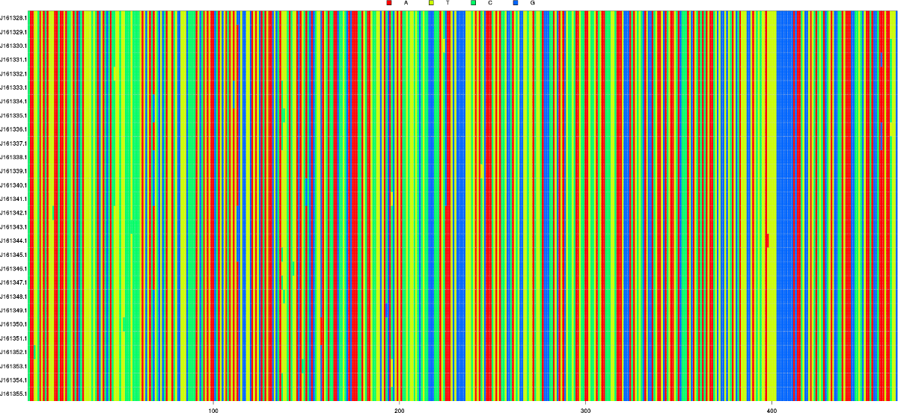

```{r}
# Remove gaps from alignment - destroy it (not aligned anymore)
gunnera.nogaps <- del.gaps(gunnera.muscle)
?del.gaps # See for details
```

<!-- MERGE-REVIEW: 2 old code block(s) in TEX frame were dropped in favor of the .qmd section 'Multiple sequence alignment'. -->

<!-- MERGE-REVIEW: content of the .qmd section 'Multiple sequence alignment' was inserted at 4 frames; remove the unwanted duplicates. -->

Libraries

Requires path to MAFFT binary - set it according to your installation Read ?mafft and mafft's documentation

Multiple sequence alignments using clustal, muscle and t-coffee are available in package ape Read "?clustal"and documentation of Clustal and Muscle to set correct parameters

See options in muscle package

Remove gaps from alignment - destroy it (not aligned anymore)

Align multiple genes Create a list of DNAbin objects to process

See it

Do the alignment

See result

Do the same in parallel (mclapply do the tasks in parallel, not one-by-one like lapply)

mclapply() relies on forking and hence is not available on Windows unless "mc.cores = 1" See result

Plotting alignment

Check the alignment

DNAbin can be technically list or matrix - some functions require list, some matrix, some can handle both - check manual and if needed, use

Matrix makes sense only for alignments, list for any import (sequences do no have to have same lengths)

Delete all columns/rows containing only gaps or missing data (N, ?, -)

Delete all columns containing at least 25% of gaps

Do not confuse with function delete.gaps() from phyloch package Delete every line (sample) containing at least 50% of missing data

Delete every alignment position having at least 20% of missing data

Display the result

See of settings of "nmax"value - threshold for gap deletion

```{r}
library("ape")
library("ips")
```

```{r}
gunnera_mafft <- ips::mafft(x = gunnera_dna, method = "localpair", maxiterate = 100, options = "--adjustdirection", exec = "/usr/bin/mafft") # Change "exec"to fit your path to mafft (on Windows point to mafft.bat)!
gunnera_mafft # See results, compare with 'gunnera'
class(gunnera_mafft)
image.DNAbin(gunnera_mafft) # Plot the alignment
```

```{r}
gunnera_clustal <- ape::clustal(x = gunnera_dna, pw.gapopen = 10, pw.gapext = 0.1, gapopen = 10, gapext = 0.2, exec = "/usr/bin/clustalw2", quiet = FALSE, original.ordering = TRUE) # Change "exec"to fit your path to clustal!
gunnera_clustal # See results
class(gunnera_clustal)
image.DNAbin(gunnera_clustal) # Plot the alignment
gunnera_muscle <- ape::muscle(x = gunnera_dna, exec = "muscle", quiet = FALSE, original.ordering = TRUE) # Change "exec"to fit your path to muscle!
gunnera_muscle # See results
class(gunnera_muscle)
image.DNAbin(gunnera_muscle) # Plot the alignment
```

```{r}
?muscle::muscle
```

```{r}
gunnera_nogaps <- del.gaps(gunnera_muscle)
?del.gaps # See for details
```

```{r}
multialign <- list(gunnera_dna, usflu_dna, usflu_dna2)
```

```{r}
multialign
class(multialign)
lapply(X = multialign, FUN = class)
```

```{r}
multialign_aln <- lapply(X = multialign, FUN = ips::mafft, method = "localpair", maxiterate = 100, exec = "/usr/bin/mafft") # Change "exec"to fit your path to mafft (on Windows point to mafft.bat)!
```

```{r}
multialign_aln
multialign_aln[[1]]
lapply(X = multialign_aln, FUN = class)
```

```{r}
library("parallel")
multialign_aln2 <- mclapply(X = multialign, FUN = ape::muscle, exec = "muscle", quiet = FALSE, original.ordering = TRUE) # Change "path"to fit your path to muscle!
```

```{r}
multialign_aln2
lapply(X = multialign_aln2, FUN = class)
?mclapply # See more options
?clusterApply # See more options (parLapply should work on Windows)
```

```{r}
image.DNAbin(x = gunnera_mafft)
```

```{r}
checkAlignment(x = usflu_dna, check.gaps = TRUE, plot = TRUE, what = 1:4)
checkAlignment(x = as.matrix.DNAbin(x = gunnera_clustal), check.gaps = TRUE, plot = TRUE, what = 1:4) # If it is saved as DNAbin list, not matrix
?checkAlignment # See details
```

```{r}
as.matrix.DNAbin() # or
as.list.DNAbin()
```

```{r}
```

```{r}
gunnera_mafft <- deleteEmptyCells(DNAbin = gunnera_mafft)
?ips::deleteEmptyCells # See help page for details
?phyloch::delete.empty.cells # See help page for details
```

```{r}
gunnera_mafft_ng <- deleteGaps(x = gunnera_mafft, gap.max = nrow(gunnera_mafft) / 4)
gunnera_mafft_ng
```

```{r}
gunnera_mafft_ng <- del.rowgapsonly(x = gunnera_mafft_ng, threshold = 0.5, freq.only = FALSE)
gunnera_mafft_ng
?ape::del.rowgapsonly # See help page for details
```

```{r}
gunnera_mafft_ng <- del.colgapsonly(x = gunnera_mafft_ng, threshold = 0.2, freq.only = FALSE)
gunnera_mafft_ng
?ape::del.colgapsonly # See help page for details
```

```{r}
image.DNAbin(x = gunnera_mafft_ng)
```

```{r}
?deleteGaps # "nmax = 0"deletes all columns with any gap
multialign_aln_ng <- lapply(X = multialign_aln, FUN = deleteGaps, gap.max = 5)
multialign_aln_ng
lapply(X = multialign_aln_ng, FUN = image.DNAbin)
```

## Multiple genes

### Align multiple genes

- NGS/HTS introduced work with hundreds and thousands of genes, it makes sense to process them in batch and not manually one-by-one

```{r}
# Create a list of DNAbin objects to process
multialign <- list(gunnera.dna, usflu.dna, usflu.dna2)
# See it
multialign
class(multialign)
lapply(X=multialign, FUN=class)
# Do the alignment
# Change "exec" to fit your path to mafft (on Windows point to mafft.bat)!
multialign.aln <- lapply(X=multialign, FUN=ips::mafft, method="localpair",
  maxiterate=100, exec="/usr/bin/mafft")
# See result
multialign.aln
multialign.aln[[1]]
lapply(X=multialign.aln, FUN=class)
```

<!-- MERGE-REVIEW: no counterpart section found in QMD; code below comes from the old TEX version. -->

### Align multiple genes in parallel

- There are plenty of implementations of parallelization and using of computer clusters, see <https://CRAN.R-project.org/web/views/HighPerformanceComputing.html>

```{r}
library(parallel)
# Do the same in parallel (mclapply do the tasks in parallel, not
# one-by-one like lapply)
multialign.aln2 <- mclapply(X=multialign, FUN=ape::muscle,
  exec="muscle", quiet=FALSE, original.ordering=TRUE)
# Change "path" to fit your path to muscle!
# mclapply() relies on forking and hence is not available on Windows
# unless "mc.cores=1"
# See result
multialign.aln2
lapply(X=multialign.aln2, FUN=class)
?mclapply # See more options
?clusterApply # See more options (parLapply should work on Windows)
```

<!-- MERGE-REVIEW: no counterpart section found in QMD; code below comes from the old TEX version. -->

## Checking

### Checking the alignment

```{r}
# Plotting alignment
image.DNAbin(x=gunnera.mafft)
# Check the alignment
checkAlignment(x=usflu.dna, check.gaps=TRUE, plot=TRUE, what=1:4)
checkAlignment(x=as.matrix.DNAbin(x=gunnera.clustal), check.gaps=TRUE,
  plot=TRUE, what=1:4) # If it is saved as DNAbin list, not matrix
?checkAlignment # See details
# DNAbin can be technically list or matrix - some functions require
# list, some matrix, some can handle both - check manual and if needed,
# use:
as.matrix.DNAbin() # or
as.list.DNAbin()
# Matrix makes sense only for alignments, list for any import
# (sequences do no have to have same lengths)
```

<!-- MERGE-REVIEW: no counterpart section found in QMD; code below comes from the old TEX version. -->

### Checking the alignment

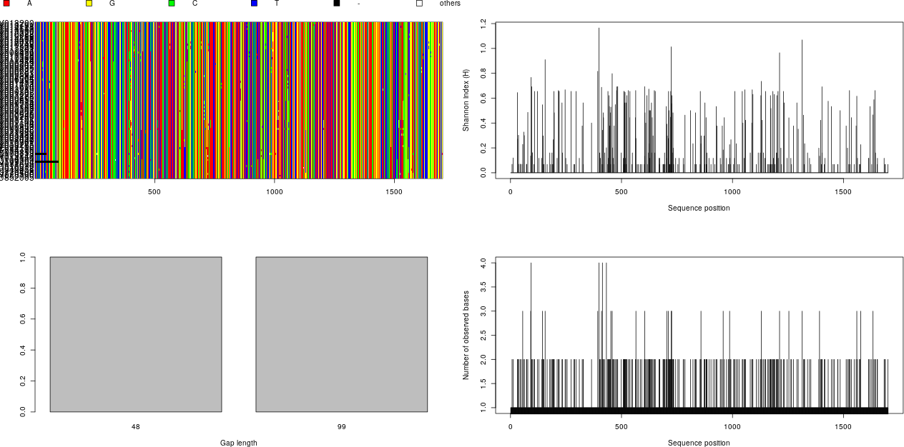 <!-- MERGE-REVIEW: no counterpart section found in QMD; content from TEX kept as-is. -->

## Cleanup

### Cleaning the alignment

```{r}
# Delete all columns/rows containing only gaps or missing data (N, ?, -)
gunnera.mafft <- deleteEmptyCells(DNAbin=gunnera.mafft)
?ips::deleteEmptyCells # See help page for details
?phyloch::delete.empty.cells # See help page for details
# Delete all columns containing at least 25% of gaps
gunnera.mafft.ng<-deleteGaps(x=gunnera.mafft,gap.max=nrow(gunnera.mafft)/4)
gunnera.mafft.ng
# Do not confuse with function delete.gaps() from phyloch package
# Delete every line (sample) containing at least 50% of missing data
gunnera.mafft.ng <- del.rowgapsonly(x=gunnera.mafft.ng, threshold=0.5,
  freq.only=FALSE)
gunnera.mafft.ng
?ape::del.rowgapsonly # See help page for details
# Delete every alignment position having at least 20% of missing data
gunnera.mafft.ng <- del.colgapsonly(x=gunnera.mafft.ng, threshold=0.2,
  freq.only=FALSE)
gunnera.mafft.ng
```

<!-- MERGE-REVIEW: no counterpart section found in QMD; code below comes from the old TEX version. -->

### Cleaning the alignment

```{r}
?ape::del.colgapsonly # See help page for details
# Display the result
image.DNAbin(x=gunnera.mafft.ng)
# See of settings of "nmax" value - threshold for gap deletion
?deleteGaps # "nmax=0" deletes all columns with any gap
multialign.aln.ng <- lapply(X=multialign.aln, FUN=deleteGaps, gap.max=5)
multialign.aln.ng
lapply(X=multialign.aln.ng, FUN=image.DNAbin)
```

- "Strictness" of alignment cleaning depends on following steps - NJ (and another distance-based methods) doesn't like more than \$\$10--15% of missing data, but some tree builders (MrBayes, IQ-TREE, ...) are able to work with gaps - check their documentation...
- Automated cleanup is useful especially if batch processing plenty of genes
- `lapply` or `mclapply` can be used in the same way for any batch processing of alignments <!-- MERGE-REVIEW: no counterpart section found in QMD; code below comes from the old TEX version. -->

## Tasks

### Practice alignment

1.  Download (import from on-line database or your file from disk) sequences of ITS (or other variable gene if you prefer) of your favorite organism.
2.  Check the imported data.
3.  Align sequences with your preferred aligner.
4.  Check the resulting alignment.
5.  Trim the alignment - delete columns/rows with too much missing data. Think about various thresholds and their implications.
6.  Compare outputs of several aligners and/or different parameters (gap penalty etc.).
7.  Obtain nice alignment suitable for any subsequent analysis.

<!-- MERGE-REVIEW: content of the .qmd section 'Multiple sequence alignment' was inserted at 4 frames; remove the unwanted duplicates. -->

Libraries

Requires path to MAFFT binary - set it according to your installation Read ?mafft and mafft's documentation

Multiple sequence alignments using clustal, muscle and t-coffee are available in package ape Read "?clustal"and documentation of Clustal and Muscle to set correct parameters

See options in muscle package

Remove gaps from alignment - destroy it (not aligned anymore)

Align multiple genes Create a list of DNAbin objects to process

See it

Do the alignment

See result

Do the same in parallel (mclapply do the tasks in parallel, not one-by-one like lapply)

mclapply() relies on forking and hence is not available on Windows unless "mc.cores = 1" See result

Plotting alignment

Check the alignment

DNAbin can be technically list or matrix - some functions require list, some matrix, some can handle both - check manual and if needed, use

Matrix makes sense only for alignments, list for any import (sequences do no have to have same lengths)

Delete all columns/rows containing only gaps or missing data (N, ?, -)

Delete all columns containing at least 25% of gaps

Do not confuse with function delete.gaps() from phyloch package Delete every line (sample) containing at least 50% of missing data

Delete every alignment position having at least 20% of missing data

Display the result

See of settings of "nmax"value - threshold for gap deletion

```{r}
library("ape")
library("ips")
```

```{r}
gunnera_mafft <- ips::mafft(x = gunnera_dna, method = "localpair", maxiterate = 100, options = "--adjustdirection", exec = "/usr/bin/mafft") # Change "exec"to fit your path to mafft (on Windows point to mafft.bat)!
gunnera_mafft # See results, compare with 'gunnera'
class(gunnera_mafft)
image.DNAbin(gunnera_mafft) # Plot the alignment
```

```{r}
gunnera_clustal <- ape::clustal(x = gunnera_dna, pw.gapopen = 10, pw.gapext = 0.1, gapopen = 10, gapext = 0.2, exec = "/usr/bin/clustalw2", quiet = FALSE, original.ordering = TRUE) # Change "exec"to fit your path to clustal!
gunnera_clustal # See results
class(gunnera_clustal)
image.DNAbin(gunnera_clustal) # Plot the alignment
gunnera_muscle <- ape::muscle(x = gunnera_dna, exec = "muscle", quiet = FALSE, original.ordering = TRUE) # Change "exec"to fit your path to muscle!
gunnera_muscle # See results
class(gunnera_muscle)
image.DNAbin(gunnera_muscle) # Plot the alignment
```

```{r}
?muscle::muscle
```

```{r}
gunnera_nogaps <- del.gaps(gunnera_muscle)
?del.gaps # See for details
```

```{r}
multialign <- list(gunnera_dna, usflu_dna, usflu_dna2)
```

```{r}
multialign
class(multialign)
lapply(X = multialign, FUN = class)
```

```{r}
multialign_aln <- lapply(X = multialign, FUN = ips::mafft, method = "localpair", maxiterate = 100, exec = "/usr/bin/mafft") # Change "exec"to fit your path to mafft (on Windows point to mafft.bat)!
```

```{r}
multialign_aln
multialign_aln[[1]]
lapply(X = multialign_aln, FUN = class)
```

```{r}
library("parallel")
multialign_aln2 <- mclapply(X = multialign, FUN = ape::muscle, exec = "muscle", quiet = FALSE, original.ordering = TRUE) # Change "path"to fit your path to muscle!
```

```{r}
multialign_aln2
lapply(X = multialign_aln2, FUN = class)
?mclapply # See more options
?clusterApply # See more options (parLapply should work on Windows)
```

```{r}
image.DNAbin(x = gunnera_mafft)
```

```{r}
checkAlignment(x = usflu_dna, check.gaps = TRUE, plot = TRUE, what = 1:4)
checkAlignment(x = as.matrix.DNAbin(x = gunnera_clustal), check.gaps = TRUE, plot = TRUE, what = 1:4) # If it is saved as DNAbin list, not matrix
?checkAlignment # See details
```

```{r}
as.matrix.DNAbin() # or
as.list.DNAbin()
```

```{r}
```

```{r}
gunnera_mafft <- deleteEmptyCells(DNAbin = gunnera_mafft)
?ips::deleteEmptyCells # See help page for details
?phyloch::delete.empty.cells # See help page for details
```

```{r}
gunnera_mafft_ng <- deleteGaps(x = gunnera_mafft, gap.max = nrow(gunnera_mafft) / 4)
gunnera_mafft_ng
```

```{r}
gunnera_mafft_ng <- del.rowgapsonly(x = gunnera_mafft_ng, threshold = 0.5, freq.only = FALSE)
gunnera_mafft_ng
?ape::del.rowgapsonly # See help page for details
```

```{r}
gunnera_mafft_ng <- del.colgapsonly(x = gunnera_mafft_ng, threshold = 0.2, freq.only = FALSE)
gunnera_mafft_ng
?ape::del.colgapsonly # See help page for details
```

```{r}
image.DNAbin(x = gunnera_mafft_ng)
```

```{r}
?deleteGaps # "nmax = 0"deletes all columns with any gap
multialign_aln_ng <- lapply(X = multialign_aln, FUN = deleteGaps, gap.max = 5)
multialign_aln_ng
lapply(X = multialign_aln_ng, FUN = image.DNAbin)
```

# Basic analysis

### Introductory overview of statistics and methods

- **Selected method depends on data type, question to answer, ...** - see further chapters

  - Check assumptions and requirements of the methods before usage
  - Think if the method answers your question
  - Always be opened for new possibilities coming with new methods and packages developed...

- [**Population-genetic**](https://en.wikipedia.org/wiki/Population_genetics) **indices** - from slide

  - Huge number...
  - Characterize differences among individuals/groups or genetic variability on various levels (within/among individuals/populations, ...)
  - One number tries to describe whole situation - always very rough
  - Description of heterozygosity, allelic richness, distribution of multi locus genotypes among populations, level of inbreeding, ...

- [**Distance**](https://en.wikipedia.org/wiki/Genetic_distance)**-based methods** - from slide

  - **It is crucial to select appropriate distance method for given data type**

  - Usually require the distance matrix to be Euclidean

  - Distance matrix has one single number (index) for each pair of comparisons (individuals, populations) - rough

  - Generally, the matrices describe pairwise similarities among the individuals/populations

  - Distance-based methods are phenetic

    - Based on similarity (described by the matrix), not on any (evolutionary) model
    - The matrix based on genetic data is supposed to well reflect the genetic similarity, thus real relationships among individuals/populations

  - [**Hierarchical clustering**](https://en.wikipedia.org/wiki/Hierarchical_clustering) - from slide

    - Several methods clustering individuals according to their (dis)similarity from top (i.e. starts by division into 2 groups etc.) or down (starts by grouping of the closest pair of samples) into clusters
    - (Un)weighted per-group mean average (**U/WPGMA**) and others
    - Used more in ecology, for genetic data not so much anymore (following methods use to produce better results)

  - [**Neighbor-Joining (NJ)**](https://en.wikipedia.org/wiki/Neighbor_joining) - from slide

    - A tree starting from the two most similar individuals and connecting in the next steps next and next the most similar individuals
    - In some cases artificially chains individuals
    - Several methods try to improve it - slide

  - **Principal Coordinates Analysis (PCoA)** - from slide

    - The most common method of [multivariate statistics](https://en.wikipedia.org/wiki/Multidimensional_scaling) for genetic data
    - Shows individuals in 2D scatter plot to retain maximum variability (starts with matrix of similarity indices)

- [**Minimum Spanning Network (MSN)**](https://en.wikipedia.org/wiki/Minimum_spanning_tree) - slide

  - Simple network connecting the most similar genotypes/haplotypes
  - Useful for clones, cpDNA, mtDNA, ...

- [**Multivariate statistics**](https://en.wikipedia.org/wiki/Multivariate_statistics)

  - Two variables are easily displayable in 2D xy-scatter plot (we can calculate correlation, whatever)

  - In molecular data, each locus is more or less independent variable - 1000 bp alignment has 1000 variables: How to display plot with 1000 axes to be able to really see something?

  - Methods like Principal Component Analysis (**PCA**), Non-Metric Multidimensional Scaling (**NMDS**) or **PCoA** look for correlations between pairs of variables to reduce them into new variables - after many steps new uncorrelated variables retaining maximum of original variability are constructed

    - PCoA requires as input distance matrix; PCA, NMDS and others source data matrix

  - New variables are sorted according amount of variability they show (the decrease is very steep - first 1--4 axes are usually enough) - it is possible to display xy-scatter plot showing most of variability of the data

  - Good for data display and creation of hypotheses - not to verify them (there is no statistical test) - researchers use to use them as *proof*, which is incorrect

  - Data are commonly scaled - all variables are in same scale

- [**Maximum Parsimony (MP)**](https://en.wikipedia.org/wiki/Maximum_parsimony) - from slide

  - Generally, the methods are looking for the most simple solution under given model, e.g. to construct phylogenetic tree requiring the lowest number of evolutionary changes (DNA mutations) under given alignment
  - It is easy to score how good the solution is (comparing to another solution), but computationally demanding to find the best one

- [**Maximum Likelihood (ML)**](https://en.wikipedia.org/wiki/Maximum_likelihood_estimation)

  - Methods look for the most likely (probable) solution of the data under given model, e.g. the most likely phylogenetic tree under given mutational model (and alignment)
  - It is easy to score how good the solution is (comparing to another solution), but computationally demanding to find the best one

- [**Bayesian statistics**](https://en.wikipedia.org/wiki/Bayesian_statistics)

  - Based on [Bayesian theorem](https://en.wikipedia.org/wiki/Bayes_theorem) - probability of model under given data

  - Methods are looking for the best (e.g. evolutionary) **model** (e.g. phylogenetic tree) **explaining the data** (e.g. DNA sequences) - reversed logic comparing to MP and ML

  - Algorithm exploring possible models, scoring them and approaching the best runs in steps (iterative generations)

    - After some time it converges to find optimal solution (usually described by logarithms of likelihood of given model)
    - Usually, \$\$millions (or even more) of generations (iterative steps) are required
    - Beginning use to be very unstable - it is discarded as burn-in ("heating" of [Markov Chain Monte Carlo (MCMC)](https://en.wikipedia.org/wiki/Markov_chain_Monte_Carlo) doing the exploration and optimization of models), usually \$\$10--25% of steps

- MP, ML and Bayesian statistics contain (evolutionary) **models** - they are not based on similarity (as matrix-based methods), so that they are supposed to reveal real structure in the data, on the other hand they are computationally demanding

- **Permutations**, **bootstraps** and another [tests](https://en.wikipedia.org/wiki/Resampling_(statistics))

  - It is necessary to test statistical significance of the obtained results
  - Most common methods somehow shuffle the data (drop one column, ...) and repeat the calculation to see how stable is the result (it might be driven by one or few loci, ...)
  - Whole process is repeated \$\$100--1000 times and output is shown as histogram of simulations vs. the observed value, in how many percents the same result was obtained (e.g. bootstrap) or as p-value (what is probability that the pattern was created by random process)
  - p = 0.05 means 95% probability that the data are non-random <!-- MERGE-REVIEW: no counterpart section found in QMD; content from TEX kept as-is. -->

### Questions and data

- Methods in this section answer questions about genetic characteristics of individuals/populations

  - Overall genetic similarity of individuals/populations (without spatial or another context) - various population-genetic indices, PCoA, ...
  - Distribution of genotypes within/among populations
  - Description of genetic characteristics of populations - heterozygosity, Hardy-Weinberg equilibrium, F-statistics, ...
  - Hierarchical relationships among individuals/populations (UPGMA, NJ, ...)

- Any data can be used

  - Population genetic studies use to use as variable genetic markers as possible (depending on scale, e.g. SSRs, AFLP, RAD-Seq, highly variable introns like ITS, ...)

- Nearly all data types are processed in similar/same way

  - It's important to select correct genetic index, distance method, etc. for particular data types and/or question
  - Only some examples are shown, try more yourselves <!-- MERGE-REVIEW: no counterpart section found in QMD; content from TEX kept as-is. -->

## First look at the data

### Load needed libraries

```{r}
library(ape) # Analysis of phylogenetics and evolution
library(ade4) # Analysis of ecological data, multivariate methods
library(adegenet) # Exploratory analysis of genetic and genomic data
library(pegas) # Population and evolutionary genetics
# Population genetic analysis, including populations with mixed
# reproduction
library(poppr)
library(hierfstat) # Hierarchical F-statistics
library(corrplot) # Visualization of correlation matrix
library(StAMPP) # Statistical analysis of mixed ploidy populations
library(philentropy) # Various genetic distances
```

- Of course, there are plenty of another options...

  - Representative, but not exhaustive examples are shown - **try more yourselves, adjust shown methods for your data** <!-- MERGE-REVIEW: no counterpart section found in QMD; code below comes from the old TEX version. -->

### Descriptive statistics I

- We will now work mainly with diploid SSRs of *Taraxacum haussknechtii*, you can **try with other data** examples by **yourselves**

```{r}
# Get summary - names and sizes of populations, heterozygosity, some info
# about loci
hauss.summ <- summary(hauss.genind)
# Plot expected vs. observed heterozygosity it looks like big difference
plot(x=hauss.summ$Hexp, y=hauss.summ$Hobs,
  main="Observed vs expected heterozygosity",
  xlab="Expected heterozygosity", ylab="Observed heterozygosity")
abline(0, 1, col="red")
# Bartlett's K-squared test of difference between observed and expected
# heterozygosity - not significant
bartlett.test(list(hauss.summ$Hexp, hauss.summ$Hobs))
              Bartlett test of homogeneity of variances
data:  list(hauss.summ$Hexp, hauss.summ$Hobs)
Bartlett's K-squared = 0.069894, df = 1, p-value = 0.7915
```

<!-- MERGE-REVIEW: 1 old code block(s) in TEX frame were dropped in favor of the .qmd section 'Descriptive statistics'. -->

<!-- MERGE-REVIEW: content of the .qmd section 'Descriptive statistics' was inserted at 5 frames; remove the unwanted duplicates. -->

Load needed libraries

Get summary - names and sizes of populations, heterozygosity, some info about loci

Plot expected vs. observed heterozygosity - it looks like big difference

Test normality of the vector - can we use bartlett.test() or t.test(), or do we have to use weaker kruskal.test() or wilcox.test()?

Bartlett's K-squared test of difference between observed and expected heterozygosity - not significant

T-test of difference between observed and expected heterozygosity - strongly significant

Create pane with some information

Plot alleles number vs. population sizes

Add text description to the point

Barplots of various data

poppr returns various population statistics for populations

Algorithms and equations utilized in poppr

Departure from HWE According to loci

Results per-locus

Summary across all loci

According to populations Separate genind object into list of genind objects for individual populations

Convert genind back to loci (list of loci objects according to populations)

Calculate the results per populations

FST Fit, Fst and Fis for each locus For Fst, fstat and theta.msat the loci object must contain population column

Nei's pairwise Fst between all pairs of populations - most common usage

For mixed ploidy data sets stamppFst requires population factor in genlight (here, population code consists of first three letters of individual's name)

Population code consists of first three letters of individual's name - extract the population name part

For large data use higher nclusters to parallelize calculations

Matrix of Fst among populations

Matrix of P values

Save results - open in spreadsheet (e.g. LibreOffice Calc)

Correlation plot of pairwise Fst

Display in similar way also another Fst tables

TODO Estimates of population theta according to Kimmel et al. 1998 theta.msat(hauss_loci)

```{r}
library("ape") # Analysis of phylogenetics and evolution
library("ade4") # Analysis of ecological data, multivariate methods
library("adegenet") # Exploratory analysis of genetic and genomic data
library("pegas") # Population and evolutionary genetics
library("poppr") # Population genetic analysis, including populations with mixed reproduction
library("hierfstat") # Hierarchical F-statistics
library("corrplot") # Visualization of correlation matrix
library("StAMPP") # Statistical analysis of mixed ploidy populations
library("philentropy") # Various genetic distances
```

```{r}
hauss_summ <- summary(hauss_genind)
hauss_summ
```

```{r}
plot(x = hauss_summ$Hexp, y = hauss_summ$Hobs, main = "Observed vs expected heterozygosity", xlab = "Expected heterozygosity", ylab = "Observed heterozygosity")
abline(0, 1, col = "red")
```

```{r}
shapiro.test(hauss_summ$Hexp)
```

```{r}
bartlett.test(list(hauss_summ$Hexp, hauss_summ$Hobs))
```

```{r}
t.test(x = hauss_summ$Hexp, y = hauss_summ$Hobs, paired = TRUE, var.equal = TRUE)
```

```{r}
par(mfrow = c(2, 2)) # Divide graphical devices into 4 smaller spaces
```

```{r}
plot(x = hauss_summ$n.by.pop, y = hauss_summ$pop.nall, xlab = "Populations sample size", ylab = "Number of alleles", main = "Alleles numbers and sample sizes", col = "red", pch = 20)
```

```{r}
text(x = hauss_summ$n.by.pop, y = hauss_summ$pop.nall, lab = names(hauss_summ$n.by.pop), cex = 1.5)
```

```{r}
barplot(height = hauss_summ$loc.n.all, ylab = "Number of alleles", main = "Number of alleles per locus", las = 3)
barplot(height = hauss_summ$Hexp - hauss_summ$Hobs, main = "Heterozygosity: expected-observed", ylab = "Hexp - Hobs", las = 3)
barplot(height = hauss_summ[["n.by.pop"]], main = "Sample sizes per population", ylab = "Number of genotypes", las = 3)
dev.off() # Closes graphical device - otherwise following graphs would still be divided into 4 parts
```

```{r}
?poppr # See details
poppr(dat = hauss_genind, total = TRUE, sample = 1000, method = 4, missing = "geno", cutoff = 0.15, quiet = FALSE, clonecorrect = FALSE, plot = TRUE, index = "rbarD", minsamp = 1, legend = TRUE)
```

```{r}
vignette("algo", package = "poppr")
```

```{r}
hauss_hwe_test <- hw.test(x = hauss_loci, B = 1000)
```

```{r}
hauss_hwe_test
```

```{r}
summary(hauss_hwe_test)
```

```{r}
hauss_pops <- seppop(hauss_genind)
hauss_pops
```

```{r}
hauss_pops_loci <- lapply(X = hauss_pops, FUN = genind2loci)
```

```{r}
lapply(X = hauss_pops_loci, FUN = hw.test, B = 1000)
```

```{r}
Fst(x = hauss_loci, pop = 1) # Calculation per locus
summary(Fst(x = hauss_loci, pop = 1)) # Summary across loci
```

```{r}
pairwise.neifst(dat = genind2hierfstat(dat = hauss_genind))
heatmap(x = pairwise.neifst(dat = genind2hierfstat(dat = hauss_genind)), Rowv = NA, Colv = NA) # Simple visualization
```

```{r}
indNames(arabidopsis_genlight)
```

```{r}
substr(x = indNames(arabidopsis_genlight), start = 1, stop = 3)
pop(arabidopsis_genlight) <- substr(x = indNames(arabidopsis_genlight), start = 1, stop = 3)
pop(arabidopsis_genlight) # Check it
popNames(arabidopsis_genlight)
arabidopsis_fst <- StAMPP::stamppFst(geno = arabidopsis_genlight, nboots = 100, percent = 95, nclusters = 8) # On Windows maybe "nclusters = 1"
```

```{r}
?StAMPP::stamppFst # See details
```

```{r}
arabidopsis_fst[["Fsts"]]
```

```{r}
arabidopsis_fst[["Pvalues"]]
```

```{r}
write.table(x = arabidopsis_fst[["Fsts"]], file = "arabidopsis_fst.tsv", quote = FALSE, sep = "\t")
```

```{r}
corrplot(corr = arabidopsis_fst[["Fsts"]], method = "circle", type = "lower", col = funky(15), title = "Correlation matrix of Fst among populations", is.corr = FALSE, diag = FALSE, outline = TRUE, order = "alphabet", tl.pos = "lt", tl.col = "black")
?corrplot # See for more options
```

### Descriptive statistics II

- `t.test` and `bartlett.test` require data to have normal distribution - if the condition is not met, it is necessary to use some weaker non-parametric test (`kruskal.test`, `wilcox.test`, ...)
- See respective manual pages for details
- `shapiro.test()` tests the normality of given vector

```{r}
# T-test of difference between observed and expected heterozygosity
t.test(x=hauss.summ$Hexp, y=hauss.summ$Hobs, paired=TRUE, var.equal=T)
             Paired t-test
data:  hauss.summ$Hexp and hauss.summ$Hobs
t = 3.5622, df = 11, p-value = 0.004456 # strongly significant
alternative hypothesis: true difference in means is not equal to 0
95 percent confidence interval:
 0.06114303 0.25887357
sample estimates:
mean of the differences
              0.1600083
```

<!-- MERGE-REVIEW: 1 old code block(s) in TEX frame were dropped in favor of the .qmd section 'Descriptive statistics'. -->

<!-- MERGE-REVIEW: content of the .qmd section 'Descriptive statistics' was inserted at 5 frames; remove the unwanted duplicates. -->

Load needed libraries

Get summary - names and sizes of populations, heterozygosity, some info about loci

Plot expected vs. observed heterozygosity - it looks like big difference

Test normality of the vector - can we use bartlett.test() or t.test(), or do we have to use weaker kruskal.test() or wilcox.test()?

Bartlett's K-squared test of difference between observed and expected heterozygosity - not significant

T-test of difference between observed and expected heterozygosity - strongly significant

Create pane with some information

Plot alleles number vs. population sizes

Add text description to the point

Barplots of various data

poppr returns various population statistics for populations

Algorithms and equations utilized in poppr

Departure from HWE According to loci

Results per-locus

Summary across all loci

According to populations Separate genind object into list of genind objects for individual populations

Convert genind back to loci (list of loci objects according to populations)

Calculate the results per populations

FST Fit, Fst and Fis for each locus For Fst, fstat and theta.msat the loci object must contain population column

Nei's pairwise Fst between all pairs of populations - most common usage

For mixed ploidy data sets stamppFst requires population factor in genlight (here, population code consists of first three letters of individual's name)

Population code consists of first three letters of individual's name - extract the population name part

For large data use higher nclusters to parallelize calculations

Matrix of Fst among populations

Matrix of P values

Save results - open in spreadsheet (e.g. LibreOffice Calc)

Correlation plot of pairwise Fst

Display in similar way also another Fst tables

TODO Estimates of population theta according to Kimmel et al. 1998 theta.msat(hauss_loci)

```{r}
library("ape") # Analysis of phylogenetics and evolution
library("ade4") # Analysis of ecological data, multivariate methods
library("adegenet") # Exploratory analysis of genetic and genomic data
library("pegas") # Population and evolutionary genetics
library("poppr") # Population genetic analysis, including populations with mixed reproduction
library("hierfstat") # Hierarchical F-statistics
library("corrplot") # Visualization of correlation matrix
library("StAMPP") # Statistical analysis of mixed ploidy populations
library("philentropy") # Various genetic distances
```

```{r}
hauss_summ <- summary(hauss_genind)
hauss_summ
```

```{r}
plot(x = hauss_summ$Hexp, y = hauss_summ$Hobs, main = "Observed vs expected heterozygosity", xlab = "Expected heterozygosity", ylab = "Observed heterozygosity")
abline(0, 1, col = "red")
```

```{r}
shapiro.test(hauss_summ$Hexp)
```

```{r}
bartlett.test(list(hauss_summ$Hexp, hauss_summ$Hobs))
```

```{r}
t.test(x = hauss_summ$Hexp, y = hauss_summ$Hobs, paired = TRUE, var.equal = TRUE)
```

```{r}
par(mfrow = c(2, 2)) # Divide graphical devices into 4 smaller spaces
```

```{r}
plot(x = hauss_summ$n.by.pop, y = hauss_summ$pop.nall, xlab = "Populations sample size", ylab = "Number of alleles", main = "Alleles numbers and sample sizes", col = "red", pch = 20)
```

```{r}
text(x = hauss_summ$n.by.pop, y = hauss_summ$pop.nall, lab = names(hauss_summ$n.by.pop), cex = 1.5)
```

```{r}
barplot(height = hauss_summ$loc.n.all, ylab = "Number of alleles", main = "Number of alleles per locus", las = 3)
barplot(height = hauss_summ$Hexp - hauss_summ$Hobs, main = "Heterozygosity: expected-observed", ylab = "Hexp - Hobs", las = 3)
barplot(height = hauss_summ[["n.by.pop"]], main = "Sample sizes per population", ylab = "Number of genotypes", las = 3)
dev.off() # Closes graphical device - otherwise following graphs would still be divided into 4 parts
```

```{r}
?poppr # See details
poppr(dat = hauss_genind, total = TRUE, sample = 1000, method = 4, missing = "geno", cutoff = 0.15, quiet = FALSE, clonecorrect = FALSE, plot = TRUE, index = "rbarD", minsamp = 1, legend = TRUE)
```

```{r}
vignette("algo", package = "poppr")
```

```{r}
hauss_hwe_test <- hw.test(x = hauss_loci, B = 1000)
```

```{r}
hauss_hwe_test
```

```{r}
summary(hauss_hwe_test)
```

```{r}
hauss_pops <- seppop(hauss_genind)
hauss_pops
```

```{r}
hauss_pops_loci <- lapply(X = hauss_pops, FUN = genind2loci)
```

```{r}
lapply(X = hauss_pops_loci, FUN = hw.test, B = 1000)
```

```{r}
Fst(x = hauss_loci, pop = 1) # Calculation per locus
summary(Fst(x = hauss_loci, pop = 1)) # Summary across loci
```

```{r}
pairwise.neifst(dat = genind2hierfstat(dat = hauss_genind))
heatmap(x = pairwise.neifst(dat = genind2hierfstat(dat = hauss_genind)), Rowv = NA, Colv = NA) # Simple visualization
```

```{r}
indNames(arabidopsis_genlight)
```

```{r}
substr(x = indNames(arabidopsis_genlight), start = 1, stop = 3)
pop(arabidopsis_genlight) <- substr(x = indNames(arabidopsis_genlight), start = 1, stop = 3)
pop(arabidopsis_genlight) # Check it
popNames(arabidopsis_genlight)
arabidopsis_fst <- StAMPP::stamppFst(geno = arabidopsis_genlight, nboots = 100, percent = 95, nclusters = 8) # On Windows maybe "nclusters = 1"
```

```{r}
?StAMPP::stamppFst # See details
```

```{r}
arabidopsis_fst[["Fsts"]]
```

```{r}
arabidopsis_fst[["Pvalues"]]
```

```{r}
write.table(x = arabidopsis_fst[["Fsts"]], file = "arabidopsis_fst.tsv", quote = FALSE, sep = "\t")
```

```{r}
corrplot(corr = arabidopsis_fst[["Fsts"]], method = "circle", type = "lower", col = funky(15), title = "Correlation matrix of Fst among populations", is.corr = FALSE, diag = FALSE, outline = TRUE, order = "alphabet", tl.pos = "lt", tl.col = "black")
?corrplot # See for more options
```

### Descriptive statistics III

```{r}
# Create pane with some information
par(mfrow=c(2, 2)) # Divide graphical devices into 4 smaller spaces
# Plot alleles number vs. population sizes
plot(x=hauss.summ$n.by.pop, y=hauss.summ$pop.nall, xlab="Populations
  sample size", ylab="Number of alleles", main="Alleles numbers and
  sample sizes", col="red", pch=20)
# Add text description to the point
text(x=hauss.summ$n.by.pop, y=hauss.summ$pop.nall,
  lab=names(hauss.summ$n.by.pop), cex=1.5)
# Barplots of various data
barplot(height=hauss.summ$loc.n.all, ylab="Number of alleles",
  main="Number of alleles per locus", las=3)
barplot(height=hauss.summ$Hexp-hauss.summ$Hobs, main="Heterozygosity:
  expected-observed", ylab="Hexp - Hobs", las=3)
barplot(height=hauss.summ[["n.by.pop"]], main="Sample sizes per
  population", ylab="Number of genotypes", las=3)
dev.off() # Closes graphical device to reset graphical settings
```

<!-- MERGE-REVIEW: 1 old code block(s) in TEX frame were dropped in favor of the .qmd section 'Descriptive statistics'. -->

<!-- MERGE-REVIEW: content of the .qmd section 'Descriptive statistics' was inserted at 5 frames; remove the unwanted duplicates. -->

Load needed libraries

Get summary - names and sizes of populations, heterozygosity, some info about loci

Plot expected vs. observed heterozygosity - it looks like big difference

Test normality of the vector - can we use bartlett.test() or t.test(), or do we have to use weaker kruskal.test() or wilcox.test()?

Bartlett's K-squared test of difference between observed and expected heterozygosity - not significant

T-test of difference between observed and expected heterozygosity - strongly significant

Create pane with some information

Plot alleles number vs. population sizes

Add text description to the point

Barplots of various data

poppr returns various population statistics for populations

Algorithms and equations utilized in poppr

Departure from HWE According to loci

Results per-locus

Summary across all loci

According to populations Separate genind object into list of genind objects for individual populations

Convert genind back to loci (list of loci objects according to populations)

Calculate the results per populations

FST Fit, Fst and Fis for each locus For Fst, fstat and theta.msat the loci object must contain population column

Nei's pairwise Fst between all pairs of populations - most common usage

For mixed ploidy data sets stamppFst requires population factor in genlight (here, population code consists of first three letters of individual's name)

Population code consists of first three letters of individual's name - extract the population name part

For large data use higher nclusters to parallelize calculations

Matrix of Fst among populations

Matrix of P values

Save results - open in spreadsheet (e.g. LibreOffice Calc)

Correlation plot of pairwise Fst

Display in similar way also another Fst tables

TODO Estimates of population theta according to Kimmel et al. 1998 theta.msat(hauss_loci)

```{r}
library("ape") # Analysis of phylogenetics and evolution
library("ade4") # Analysis of ecological data, multivariate methods
library("adegenet") # Exploratory analysis of genetic and genomic data
library("pegas") # Population and evolutionary genetics
library("poppr") # Population genetic analysis, including populations with mixed reproduction
library("hierfstat") # Hierarchical F-statistics
library("corrplot") # Visualization of correlation matrix
library("StAMPP") # Statistical analysis of mixed ploidy populations
library("philentropy") # Various genetic distances
```

```{r}
hauss_summ <- summary(hauss_genind)
hauss_summ
```

```{r}
plot(x = hauss_summ$Hexp, y = hauss_summ$Hobs, main = "Observed vs expected heterozygosity", xlab = "Expected heterozygosity", ylab = "Observed heterozygosity")
abline(0, 1, col = "red")
```

```{r}
shapiro.test(hauss_summ$Hexp)
```

```{r}
bartlett.test(list(hauss_summ$Hexp, hauss_summ$Hobs))
```

```{r}
t.test(x = hauss_summ$Hexp, y = hauss_summ$Hobs, paired = TRUE, var.equal = TRUE)
```

```{r}
par(mfrow = c(2, 2)) # Divide graphical devices into 4 smaller spaces
```

```{r}
plot(x = hauss_summ$n.by.pop, y = hauss_summ$pop.nall, xlab = "Populations sample size", ylab = "Number of alleles", main = "Alleles numbers and sample sizes", col = "red", pch = 20)
```

```{r}
text(x = hauss_summ$n.by.pop, y = hauss_summ$pop.nall, lab = names(hauss_summ$n.by.pop), cex = 1.5)
```

```{r}
barplot(height = hauss_summ$loc.n.all, ylab = "Number of alleles", main = "Number of alleles per locus", las = 3)
barplot(height = hauss_summ$Hexp - hauss_summ$Hobs, main = "Heterozygosity: expected-observed", ylab = "Hexp - Hobs", las = 3)
barplot(height = hauss_summ[["n.by.pop"]], main = "Sample sizes per population", ylab = "Number of genotypes", las = 3)
dev.off() # Closes graphical device - otherwise following graphs would still be divided into 4 parts
```

```{r}
?poppr # See details
poppr(dat = hauss_genind, total = TRUE, sample = 1000, method = 4, missing = "geno", cutoff = 0.15, quiet = FALSE, clonecorrect = FALSE, plot = TRUE, index = "rbarD", minsamp = 1, legend = TRUE)
```

```{r}
vignette("algo", package = "poppr")
```

```{r}
hauss_hwe_test <- hw.test(x = hauss_loci, B = 1000)
```

```{r}
hauss_hwe_test
```

```{r}
summary(hauss_hwe_test)
```

```{r}
hauss_pops <- seppop(hauss_genind)
hauss_pops
```

```{r}
hauss_pops_loci <- lapply(X = hauss_pops, FUN = genind2loci)
```

```{r}
lapply(X = hauss_pops_loci, FUN = hw.test, B = 1000)
```

```{r}
Fst(x = hauss_loci, pop = 1) # Calculation per locus
summary(Fst(x = hauss_loci, pop = 1)) # Summary across loci
```

```{r}
pairwise.neifst(dat = genind2hierfstat(dat = hauss_genind))
heatmap(x = pairwise.neifst(dat = genind2hierfstat(dat = hauss_genind)), Rowv = NA, Colv = NA) # Simple visualization
```

```{r}
indNames(arabidopsis_genlight)
```

```{r}
substr(x = indNames(arabidopsis_genlight), start = 1, stop = 3)
pop(arabidopsis_genlight) <- substr(x = indNames(arabidopsis_genlight), start = 1, stop = 3)
pop(arabidopsis_genlight) # Check it
popNames(arabidopsis_genlight)
arabidopsis_fst <- StAMPP::stamppFst(geno = arabidopsis_genlight, nboots = 100, percent = 95, nclusters = 8) # On Windows maybe "nclusters = 1"
```

```{r}
?StAMPP::stamppFst # See details
```

```{r}
arabidopsis_fst[["Fsts"]]
```

```{r}
arabidopsis_fst[["Pvalues"]]
```

```{r}
write.table(x = arabidopsis_fst[["Fsts"]], file = "arabidopsis_fst.tsv", quote = FALSE, sep = "\t")
```

```{r}
corrplot(corr = arabidopsis_fst[["Fsts"]], method = "circle", type = "lower", col = funky(15), title = "Correlation matrix of Fst among populations", is.corr = FALSE, diag = FALSE, outline = TRUE, order = "alphabet", tl.pos = "lt", tl.col = "black")
?corrplot # See for more options
```

### Graphs from previous slides

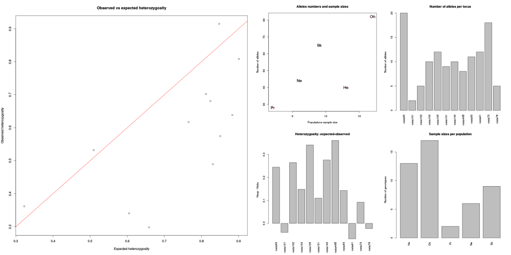 <!-- MERGE-REVIEW: no counterpart section found in QMD; content from TEX kept as-is. -->

## Statistics

### Population statistics returned by poppr()

- Package poppr has central function returning plenty of statistics

- See [poppr's manual](https://grunwaldlab.github.io/Population_Genetics_in_R/) and `vignette("algo", package="poppr")` for details

- `Pop` - Population analyzed

  - If `total=TRUE`, there are also statistics for whole dataset

- `N` - Number of individuals/isolates in the specified population

- `MLG` - Number of multilocus genotypes found in the specified population (see `?mlg`)

- `eMLG` - The expected number of MLG at the lowest common sample size (set by `minsamp`)

- `SE` - The standard error for the rarefaction analysis (assets species richness - how it grows with growing sample size)

  - Big difference between `MLG` and `eMLG` indicate some process lowering/increasing genetic diversity

- `H` - [Shannon-Wiener Diversity index](https://en.wikipedia.org/wiki/Diversity_index#Shannon_index) - evaluates number of genotypes and their distribution, takes entropy into account, grows with higher richness and diversity, sensitive to uneven sample size (is population sizes are very different, indices are not comparable)

  - One of the most common diversity indices (used elsewhere, not only in biology)

- `G` - [Stoddard and Taylor's Index](https://doi.org/10.1093/genetics/118.4.705) - roughly, similar approach as the previous one, highly enhanced

- `lambda` - [Simpson's index](https://en.wikipedia.org/wiki/Diversity_index#Simpson_index) \$\$ = 1 minus the sum of squared genotype frequencies - estimation of the probability that two randomly selected genotypes are different and scales from 0 (no genotypes are different) to 1 (all genotypes are different)

  - Commonly used in ecology to compare sites, communities, etc.

- `E.5` - Evenness - measure of the distribution of genotype abundances, wherein a population with equally abundant genotypes yields a value equal to 1 and a population dominated by a single genotype is closer to 0

- `Hexp` - [Nei's gene diversity](https://doi.org/10.1093/genetics/89.3.583) (expected heterozygosity) - unbiased gene diversity (from 0 = no diversity to 1 = highest diversity)

- `Ia` - Index of Association (`?ia`) - widely used to detect clonal reproduction within populations

  - Populations whose members are undergoing sexual reproduction will produce gametes via meiosis, and thus have a chance to shuffle alleles in the next generation
  - Populations whose members are undergoing clonal reproduction generally do so via mitosis - most likely mechanism for a change in genotype is via mutation - the rate of mutation varies from species to species, but it is rarely sufficiently high to approximate a random shuffling of alleles
  - The index of association is a calculation based on the ratio of the variance of the raw number of differences between individuals and the sum of those variances over each locus
  - It as the observed variance over the expected variance - if they are the same, then the index is zero (=prevailing clonal reproduction) after subtracting one - it rises with with increasing differences

- `p.Ia` - P-value for `Ia` from the number of reshuffling indicated in `sample`

- `rbarD` - Standardized Index of Association for each population (see `?ia`) - corrected for higher number of loci not to rise so steeply

- `p.rD` - P-value for `rbarD` from the number of reshuffles indicated in `sample`

  Generally, there are plenty of different population indices (and distances and another statistics) with different assumptions and usage in many packages - it can be complicated to pick the best one... The course shows many examples, but the list is far from being exhaustive... <!-- MERGE-REVIEW: no counterpart section found in QMD; content from TEX kept as-is. -->

### Population statistics by poppr()

- `poppr()` is central function of `poppr` package calculating plenty of population genetic indices

```{r}
?poppr # See details
poppr(dat=hauss.genind, total=TRUE, sample=1000, method=4,
  missing="geno", cutoff=0.15, quiet=FALSE, clonecorrect=FALSE,
  plot=TRUE, index="rbarD", minsamp=1, legend=TRUE)
# Output table with indices:
  Pop  N MLG eMLG       SE     H     G lambda   E.5  Hexp   Ia # More...
   He 13  11 1.97 1.58e-01 2.352  9.94  0.899 0.941 0.503 1.42 ...
   Ne  6   5 1.93 2.49e-01 1.561  4.50  0.778 0.930 0.604 3.44 ...
  ...... ...  ...      ...   ...   ...    ...   ...   ...  ... ...
Total 47  43 2.00 6.07e-02 3.732 40.16  0.975 0.961 0.742 1.88 ...
```

- If `plot=TRUE`, histogram of simulations (`sample` must be \> 1) is plotted for each population for `rbarD` or `Ia` (according to selected `index` - see following slides for details) <!-- MERGE-REVIEW: no counterpart section found in QMD; code below comes from the old TEX version. -->

### Histograms of simulations of rbarD for each population

**The populations are significantly far from being clonal**

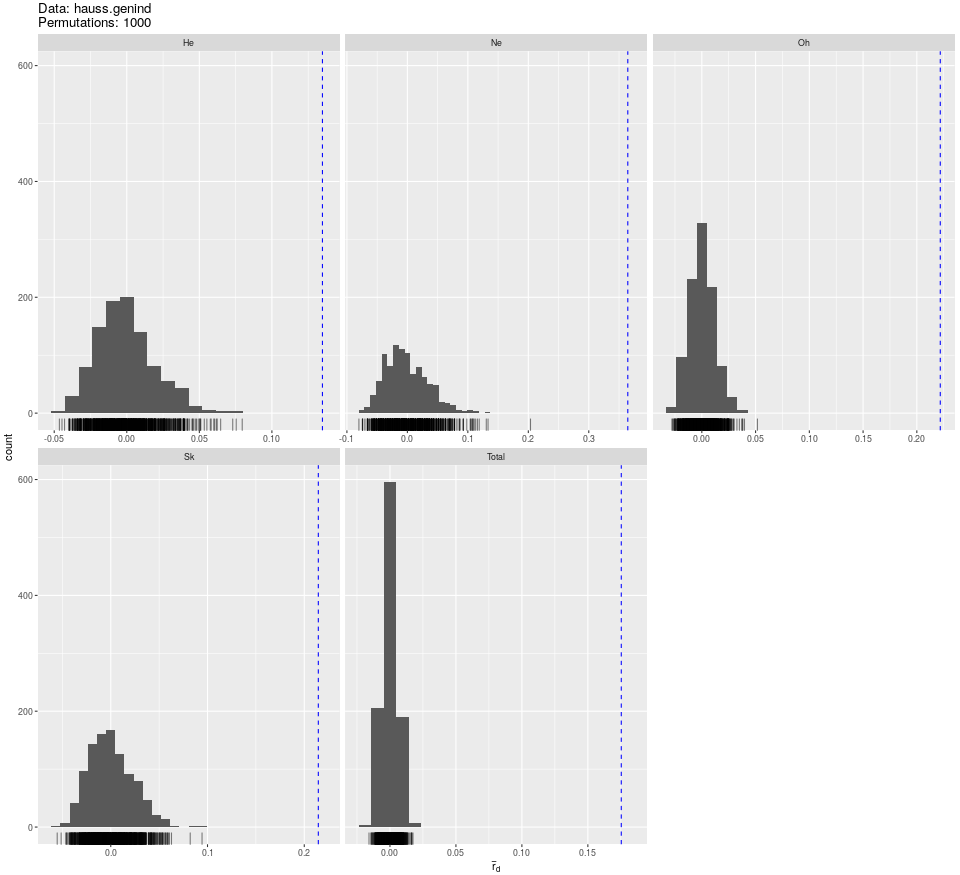 <!-- MERGE-REVIEW: no counterpart section found in QMD; content from TEX kept as-is. -->

### Departure from Hardy-Weinberg equilibrium

- [In theory](https://en.wikipedia.org/wiki/Hardy%E2%80%93Weinberg_principle), in large panmictic population without evolutionary influence everyone can mate with everyone (it is in equilibrium) and allele frequencies remain stable - in reality, environment, behavior, mutations, genetic drift, etc. are structuring the population

```{r}
# According to loci
hauss.hwe.test <- hw.test(x=hauss.loci, B=1000)
hauss.hwe.test # See results per locus
               chi^2   df   Pr(chi^2 >)  Pr.exact
 msta93  383.5519728  190  3.552714e-15     0.000
msta101    0.6927242    1  4.052393e-01     0.657
msta102   83.0741964   10  1.250111e-13     0.000
msta103   77.1819098   45  1.998865e-03     0.000
    ...          ...  ...           ...       ... # Another loci...
```

- Pr.exact shows significance of the departure (i.e. non-equilibrium distribution of alleles within population - calculated per loci)
- $^2$ [test](https://en.wikipedia.org/wiki/Pearson%27s_chi-squared_test) (without or with the permutations) test the departure - if it is significant or not - not how much it is departing <!-- MERGE-REVIEW: no counterpart section found in QMD; code below comes from the old TEX version. -->

### Departure from HWE

- Calculation is always done per-locus - see differences, possibly do statistics like `summary(hauss.hwe.test)` or so

```{r}
# According to populations
# Separate genind object into list of genind objects for individual
# populations
hauss.pops <- seppop(hauss.genind)
hauss.pops
# Convert genind back to loci (list of loci objects according to
# populations)
hauss.pops.loci <- lapply(X=hauss.pops, FUN=genind2loci)
# Calculate the results per populations
lapply(X=hauss.pops.loci, FUN=hw.test, B=1000)
```

- If there is significant departure from HWE, think about biological process (with respect to life traits of species studied) which could cause such structuring <!-- MERGE-REVIEW: no counterpart section found in QMD; code below comes from the old TEX version. -->

### F-statistics I

- Functions return tables of F-statistics values for populations/loci (roughly 0 - no structure, 1 - fully structured)

- The different [F-statistics](https://en.wikipedia.org/wiki/F-statistics) look at different levels of population structure:

  - F$_IT$ is the inbreeding coefficient of an individual relative to the total population (all samples)
  - F$_IS$ is the inbreeding coefficient of an individual relative to the subpopulation ("population" in common terminology) and averaging them
  - F$_ST$ is the effect of subpopulations ("populations") compared to the total population (all samples across all populations)

- For `Fst`, `theta.msat` and another similar functions the data object **must** contain population column (see manual of respective function)

```{r}
# Fit, Fst and Fis for each locus
Fst(x=hauss.loci, pop=1) # Calculation per locus
                Fit        Fst         Fis
msta93   0.31835291 0.17867087  0.17006829
   ...          ...        ...         ...
summary(Fst(x=hauss.loci, pop=1)) # Summary across loci
```

<!-- MERGE-REVIEW: 1 old code block(s) in TEX frame were dropped in favor of the .qmd section 'Descriptive statistics'. -->

<!-- MERGE-REVIEW: content of the .qmd section 'Descriptive statistics' was inserted at 5 frames; remove the unwanted duplicates. -->

Load needed libraries

Get summary - names and sizes of populations, heterozygosity, some info about loci

Plot expected vs. observed heterozygosity - it looks like big difference

Test normality of the vector - can we use bartlett.test() or t.test(), or do we have to use weaker kruskal.test() or wilcox.test()?

Bartlett's K-squared test of difference between observed and expected heterozygosity - not significant

T-test of difference between observed and expected heterozygosity - strongly significant

Create pane with some information

Plot alleles number vs. population sizes

Add text description to the point

Barplots of various data

poppr returns various population statistics for populations

Algorithms and equations utilized in poppr

Departure from HWE According to loci

Results per-locus

Summary across all loci

According to populations Separate genind object into list of genind objects for individual populations

Convert genind back to loci (list of loci objects according to populations)

Calculate the results per populations

FST Fit, Fst and Fis for each locus For Fst, fstat and theta.msat the loci object must contain population column

Nei's pairwise Fst between all pairs of populations - most common usage

For mixed ploidy data sets stamppFst requires population factor in genlight (here, population code consists of first three letters of individual's name)

Population code consists of first three letters of individual's name - extract the population name part

For large data use higher nclusters to parallelize calculations

Matrix of Fst among populations

Matrix of P values

Save results - open in spreadsheet (e.g. LibreOffice Calc)

Correlation plot of pairwise Fst

Display in similar way also another Fst tables

TODO Estimates of population theta according to Kimmel et al. 1998 theta.msat(hauss_loci)

```{r}
library("ape") # Analysis of phylogenetics and evolution
library("ade4") # Analysis of ecological data, multivariate methods
library("adegenet") # Exploratory analysis of genetic and genomic data
library("pegas") # Population and evolutionary genetics
library("poppr") # Population genetic analysis, including populations with mixed reproduction
library("hierfstat") # Hierarchical F-statistics
library("corrplot") # Visualization of correlation matrix
library("StAMPP") # Statistical analysis of mixed ploidy populations
library("philentropy") # Various genetic distances
```

```{r}
hauss_summ <- summary(hauss_genind)
hauss_summ
```

```{r}
plot(x = hauss_summ$Hexp, y = hauss_summ$Hobs, main = "Observed vs expected heterozygosity", xlab = "Expected heterozygosity", ylab = "Observed heterozygosity")
abline(0, 1, col = "red")
```

```{r}
shapiro.test(hauss_summ$Hexp)
```

```{r}
bartlett.test(list(hauss_summ$Hexp, hauss_summ$Hobs))
```

```{r}
t.test(x = hauss_summ$Hexp, y = hauss_summ$Hobs, paired = TRUE, var.equal = TRUE)
```

```{r}
par(mfrow = c(2, 2)) # Divide graphical devices into 4 smaller spaces
```

```{r}
plot(x = hauss_summ$n.by.pop, y = hauss_summ$pop.nall, xlab = "Populations sample size", ylab = "Number of alleles", main = "Alleles numbers and sample sizes", col = "red", pch = 20)
```

```{r}
text(x = hauss_summ$n.by.pop, y = hauss_summ$pop.nall, lab = names(hauss_summ$n.by.pop), cex = 1.5)
```

```{r}
barplot(height = hauss_summ$loc.n.all, ylab = "Number of alleles", main = "Number of alleles per locus", las = 3)
barplot(height = hauss_summ$Hexp - hauss_summ$Hobs, main = "Heterozygosity: expected-observed", ylab = "Hexp - Hobs", las = 3)
barplot(height = hauss_summ[["n.by.pop"]], main = "Sample sizes per population", ylab = "Number of genotypes", las = 3)
dev.off() # Closes graphical device - otherwise following graphs would still be divided into 4 parts
```

```{r}
?poppr # See details
poppr(dat = hauss_genind, total = TRUE, sample = 1000, method = 4, missing = "geno", cutoff = 0.15, quiet = FALSE, clonecorrect = FALSE, plot = TRUE, index = "rbarD", minsamp = 1, legend = TRUE)
```

```{r}
vignette("algo", package = "poppr")
```

```{r}
hauss_hwe_test <- hw.test(x = hauss_loci, B = 1000)
```

```{r}
hauss_hwe_test
```

```{r}
summary(hauss_hwe_test)
```

```{r}
hauss_pops <- seppop(hauss_genind)
hauss_pops
```

```{r}
hauss_pops_loci <- lapply(X = hauss_pops, FUN = genind2loci)
```

```{r}
lapply(X = hauss_pops_loci, FUN = hw.test, B = 1000)
```

```{r}
Fst(x = hauss_loci, pop = 1) # Calculation per locus
summary(Fst(x = hauss_loci, pop = 1)) # Summary across loci
```

```{r}
pairwise.neifst(dat = genind2hierfstat(dat = hauss_genind))
heatmap(x = pairwise.neifst(dat = genind2hierfstat(dat = hauss_genind)), Rowv = NA, Colv = NA) # Simple visualization
```

```{r}
indNames(arabidopsis_genlight)
```

```{r}
substr(x = indNames(arabidopsis_genlight), start = 1, stop = 3)
pop(arabidopsis_genlight) <- substr(x = indNames(arabidopsis_genlight), start = 1, stop = 3)
pop(arabidopsis_genlight) # Check it
popNames(arabidopsis_genlight)
arabidopsis_fst <- StAMPP::stamppFst(geno = arabidopsis_genlight, nboots = 100, percent = 95, nclusters = 8) # On Windows maybe "nclusters = 1"
```

```{r}
?StAMPP::stamppFst # See details
```

```{r}
arabidopsis_fst[["Fsts"]]
```

```{r}
arabidopsis_fst[["Pvalues"]]
```

```{r}
write.table(x = arabidopsis_fst[["Fsts"]], file = "arabidopsis_fst.tsv", quote = FALSE, sep = "\t")
```

```{r}
corrplot(corr = arabidopsis_fst[["Fsts"]], method = "circle", type = "lower", col = funky(15), title = "Correlation matrix of Fst among populations", is.corr = FALSE, diag = FALSE, outline = TRUE, order = "alphabet", tl.pos = "lt", tl.col = "black")
?corrplot # See for more options
```

### F-statistics II

```{r}
# Pairwise Fst comparing populations
# Convert Adegent's genind to format of hierfstat package
?genind2hierfstat
# Nei's pairwise Fst between all pairs of populations - most common usage
pairwise.neifst(dat=genind2hierfstat(dat=hauss.genind))
       He     Ne     Oh     Pr     Sk
He     NA 0.3204 0.1824 0.1942 0.1599 # 0 = no structure
Ne 0.3204     NA 0.1210 0.2548 0.1229 # 1 = maximal difference
Oh 0.1824 0.1210     NA 0.1038 0.0833
Pr 0.1942 0.2548 0.1038     NA 0.1407
Sk 0.1599 0.1229 0.0833 0.1407     NA
heatmap(x=pairwise.neifst(dat=genind2hierfstat(dat=hauss.genind)),
  Rowv=NA, Colv=NA) # Simple visualization
```

- Check also another functions of [hierfstat](https://CRAN.R-project.org/package=hierfstat) package, there are more options
- Hierfstat package implements F$_ST$ only for haploid and diploid populations, [StAMPP](https://CRAN.R-project.org/package=StAMPP) (next slide) also for another ploidies and mixed ploidy data <!-- MERGE-REVIEW: 1 old code block(s) in TEX frame were dropped in favor of the .qmd section 'Descriptive statistics'. -->

<!-- MERGE-REVIEW: content of the .qmd section 'Descriptive statistics' was inserted at 5 frames; remove the unwanted duplicates. -->

Load needed libraries

Get summary - names and sizes of populations, heterozygosity, some info about loci

Plot expected vs. observed heterozygosity - it looks like big difference

Test normality of the vector - can we use bartlett.test() or t.test(), or do we have to use weaker kruskal.test() or wilcox.test()?

Bartlett's K-squared test of difference between observed and expected heterozygosity - not significant

T-test of difference between observed and expected heterozygosity - strongly significant

Create pane with some information

Plot alleles number vs. population sizes

Add text description to the point

Barplots of various data

poppr returns various population statistics for populations

Algorithms and equations utilized in poppr

Departure from HWE According to loci

Results per-locus

Summary across all loci

According to populations Separate genind object into list of genind objects for individual populations

Convert genind back to loci (list of loci objects according to populations)

Calculate the results per populations

FST Fit, Fst and Fis for each locus For Fst, fstat and theta.msat the loci object must contain population column

Nei's pairwise Fst between all pairs of populations - most common usage

For mixed ploidy data sets stamppFst requires population factor in genlight (here, population code consists of first three letters of individual's name)

Population code consists of first three letters of individual's name - extract the population name part

For large data use higher nclusters to parallelize calculations

Matrix of Fst among populations

Matrix of P values

Save results - open in spreadsheet (e.g. LibreOffice Calc)

Correlation plot of pairwise Fst

Display in similar way also another Fst tables

TODO Estimates of population theta according to Kimmel et al. 1998 theta.msat(hauss_loci)

```{r}
library("ape") # Analysis of phylogenetics and evolution
library("ade4") # Analysis of ecological data, multivariate methods
library("adegenet") # Exploratory analysis of genetic and genomic data
library("pegas") # Population and evolutionary genetics
library("poppr") # Population genetic analysis, including populations with mixed reproduction
library("hierfstat") # Hierarchical F-statistics
library("corrplot") # Visualization of correlation matrix
library("StAMPP") # Statistical analysis of mixed ploidy populations
library("philentropy") # Various genetic distances
```

```{r}
hauss_summ <- summary(hauss_genind)
hauss_summ
```

```{r}
plot(x = hauss_summ$Hexp, y = hauss_summ$Hobs, main = "Observed vs expected heterozygosity", xlab = "Expected heterozygosity", ylab = "Observed heterozygosity")
abline(0, 1, col = "red")
```

```{r}
shapiro.test(hauss_summ$Hexp)
```

```{r}
bartlett.test(list(hauss_summ$Hexp, hauss_summ$Hobs))
```

```{r}
t.test(x = hauss_summ$Hexp, y = hauss_summ$Hobs, paired = TRUE, var.equal = TRUE)
```

```{r}
par(mfrow = c(2, 2)) # Divide graphical devices into 4 smaller spaces
```

```{r}
plot(x = hauss_summ$n.by.pop, y = hauss_summ$pop.nall, xlab = "Populations sample size", ylab = "Number of alleles", main = "Alleles numbers and sample sizes", col = "red", pch = 20)
```

```{r}
text(x = hauss_summ$n.by.pop, y = hauss_summ$pop.nall, lab = names(hauss_summ$n.by.pop), cex = 1.5)
```

```{r}
barplot(height = hauss_summ$loc.n.all, ylab = "Number of alleles", main = "Number of alleles per locus", las = 3)
barplot(height = hauss_summ$Hexp - hauss_summ$Hobs, main = "Heterozygosity: expected-observed", ylab = "Hexp - Hobs", las = 3)
barplot(height = hauss_summ[["n.by.pop"]], main = "Sample sizes per population", ylab = "Number of genotypes", las = 3)
dev.off() # Closes graphical device - otherwise following graphs would still be divided into 4 parts
```

```{r}
?poppr # See details
poppr(dat = hauss_genind, total = TRUE, sample = 1000, method = 4, missing = "geno", cutoff = 0.15, quiet = FALSE, clonecorrect = FALSE, plot = TRUE, index = "rbarD", minsamp = 1, legend = TRUE)
```

```{r}
vignette("algo", package = "poppr")
```

```{r}
hauss_hwe_test <- hw.test(x = hauss_loci, B = 1000)
```

```{r}
hauss_hwe_test
```

```{r}
summary(hauss_hwe_test)
```

```{r}
hauss_pops <- seppop(hauss_genind)
hauss_pops
```

```{r}
hauss_pops_loci <- lapply(X = hauss_pops, FUN = genind2loci)
```

```{r}
lapply(X = hauss_pops_loci, FUN = hw.test, B = 1000)
```

```{r}
Fst(x = hauss_loci, pop = 1) # Calculation per locus
summary(Fst(x = hauss_loci, pop = 1)) # Summary across loci
```

```{r}
pairwise.neifst(dat = genind2hierfstat(dat = hauss_genind))
heatmap(x = pairwise.neifst(dat = genind2hierfstat(dat = hauss_genind)), Rowv = NA, Colv = NA) # Simple visualization
```

```{r}
indNames(arabidopsis_genlight)
```

```{r}
substr(x = indNames(arabidopsis_genlight), start = 1, stop = 3)
pop(arabidopsis_genlight) <- substr(x = indNames(arabidopsis_genlight), start = 1, stop = 3)
pop(arabidopsis_genlight) # Check it
popNames(arabidopsis_genlight)
arabidopsis_fst <- StAMPP::stamppFst(geno = arabidopsis_genlight, nboots = 100, percent = 95, nclusters = 8) # On Windows maybe "nclusters = 1"
```

```{r}
?StAMPP::stamppFst # See details
```

```{r}
arabidopsis_fst[["Fsts"]]
```

```{r}
arabidopsis_fst[["Pvalues"]]
```

```{r}
write.table(x = arabidopsis_fst[["Fsts"]], file = "arabidopsis_fst.tsv", quote = FALSE, sep = "\t")
```

```{r}
corrplot(corr = arabidopsis_fst[["Fsts"]], method = "circle", type = "lower", col = funky(15), title = "Correlation matrix of Fst among populations", is.corr = FALSE, diag = FALSE, outline = TRUE, order = "alphabet", tl.pos = "lt", tl.col = "black")
?corrplot # See for more options
```

### F-statistics for mixed ploidy data I

- Methods from [StAMPP](https://CRAN.R-project.org/package=StAMPP) package (the same is the case for any method working somehow with distances) are sensitive to missing data...

  - Carefully filter the VCF before doing any analysis

- Populations must be already defined in the genlight object

```{r}
# stamppFst requires population factor in genlight (here, population
# code consists of first three letters of individual's name)
indNames(arabidopsis.genlight)
# Population code consists of first three letters of individual's name -
# extract the population name part
substr(x=indNames(arabidopsis.genlight), start=1, stop=3)
pop(arabidopsis.genlight) <- substr(x=indNames(arabidopsis.genlight),
  start=1, stop=3)
pop(arabidopsis.genlight) # Check it
popNames(arabidopsis.genlight)
?StAMPP::stamppFst # See method details
```

<!-- MERGE-REVIEW: no counterpart section found in QMD; code below comes from the old TEX version. -->

### F-statistics for mixed ploidy data II

```{r}
# Calcultaing the Fst
arabidopsis.fst <- StAMPP::stamppFst(geno=arabidopsis.genlight,
  nboots=100, percent=95, nclusters=8) # On Windows maybe "nclusters=1"
# For large data use higher nclusters to parallelize calculations
arabidopsis.fst[["Fsts"]] # Matrix of Fst among populations
arabidopsis.fst[["Pvalues"]] # Matrix of P values
# Save results - open in spreadsheet (e.g. LibreOffice Calc)
write.table(x=arabidopsis.fst[["Fsts"]], file="arabidopsis_fst.tsv",
  quote=FALSE, sep="\t")
# Correlation plot of pairwise Fst
corrplot(corr=arabidopsis.fst[["Fsts"]], method="circle", type="lower",
  col=funky(15), title="Correlation matrix of Fst among populations",
  is.corr=FALSE, diag=FALSE, outline=TRUE, order="alphabet", tl.pos="lt",
  tl.col="black")
?corrplot # See for more options
# Display in similar way also another Fst tables
```

<!-- MERGE-REVIEW: no counterpart section found in QMD; code below comes from the old TEX version. -->

### Multi locus genotypes and inbreeding coefficient

- Especially when working with clonal species or species with low genetic structure it is beneficial to know how many unique genotypes there are and how they are distributed across populations

- Inbreeding coefficient estimates level of mating among individuals with (nearly) identical genotypes - important e.g. for conservation studies or work with agricultural species

- Such studies require sufficiently variable marker (e.g. SSRs) so that results show real genetic structuring and not "just" low variability of selected marker

- Reliable estimation of such parameters also require high number of individuals from each population

  - 10 is usually considered as minimum, but more is recommended

<!-- MERGE-REVIEW: content of the .qmd section 'Multi locus genotypes' was inserted at 2 frames; remove the unwanted duplicates. -->

Total number of MLGs (simple value)

MLGs shared among populations (a list)

Detailed view on distribution of MLGs into populations (table and/or plot)

Which individual belong to which vector (two ways of display)

```{r}
mlg(gid = hauss_genind, quiet = FALSE)
```

```{r}
mlg.crosspop(gid = hauss_genind, df = TRUE, quiet = FALSE)
```

```{r}
mlg.table(gid = hauss_genind, plot = TRUE, total = TRUE, quiet = FALSE)
```

```{r}
mlg.vector(hauss_genind)
mlg.id(hauss_genind)
```

### Multi locus genotypes

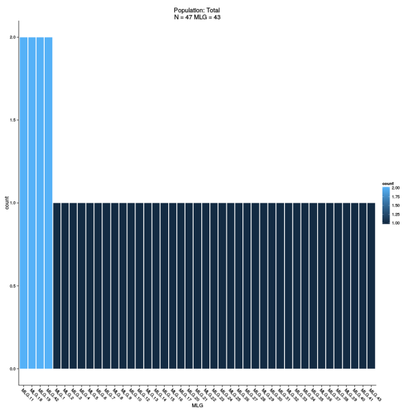

```{r}
# Total number of MLGs
# (simple value)
mlg(gid=hauss.genind, quiet=FALSE)
# MLGs shared among populations
mlg.crosspop(gid=hauss.genind,
  df=TRUE, quiet=FALSE)
# Detailed view on distribution
# of MLGs into populations
# (table and/or plot)
mlg.table(gid=hauss.genind,
  plot=TRUE, total=TRUE,
  quiet=FALSE)
mlg.vector(hauss.genind)
mlg.id(hauss.genind)
```

Functions from poppr package - the best for microsatellites, although available also for another data types <!-- MERGE-REVIEW: 1 old code block(s) in TEX frame were dropped in favor of the .qmd section 'Multi locus genotypes'. -->

<!-- MERGE-REVIEW: content of the .qmd section 'Multi locus genotypes' was inserted at 2 frames; remove the unwanted duplicates. -->

Total number of MLGs (simple value)

MLGs shared among populations (a list)

Detailed view on distribution of MLGs into populations (table and/or plot)

Which individual belong to which vector (two ways of display)

```{r}
mlg(gid = hauss_genind, quiet = FALSE)
```

```{r}
mlg.crosspop(gid = hauss_genind, df = TRUE, quiet = FALSE)
```

```{r}
mlg.table(gid = hauss_genind, plot = TRUE, total = TRUE, quiet = FALSE)
```

```{r}
mlg.vector(hauss_genind)
mlg.id(hauss_genind)
```

### Inbreeding

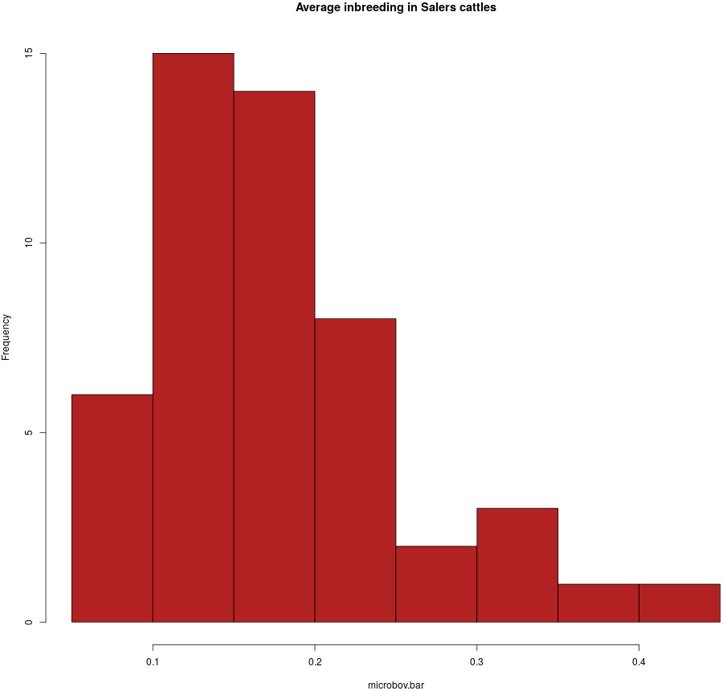

```{r}
# Load training data (cattle)
data(microbov)
# Separate populations of Salers
microbov.pops <- seppop(microbov)
  [["Salers"]]
microbov.pops # See it
# Calculate the inbreeding
microbov.inbr <- inbreeding(x=
  microbov.pops, N=100)
?inbreeding # Check for settings
# population means for plotting
microbov.bar <- sapply(X=
  microbov.inbr, FUN=mean)
# Plot it
hist(x=microbov.bar, col=
  "firebrick", main="Average
  inbreeding in Salers cattle")
```

<!-- MERGE-REVIEW: 1 old code block(s) in TEX frame were dropped in favor of the .qmd section 'Inbreeding'. -->

Load training data

Separate populations of Salers cattle

Calculate the inbreeding

Prepare population means for plotting

Plot it

```{r}
data(microbov)
```

```{r}
microbov_pops <- seppop(microbov)[["Salers"]]
microbov_pops # See it
```

```{r}
?inbreeding # Check for more settings
microbov_inbr <- inbreeding(x = microbov_pops, N = 100)
```

```{r}
microbov_bar <- sapply(X = microbov_inbr, FUN = mean)
```

```{r}
hist(x = microbov_bar, col = "firebrick", main = "Average inbreeding in Salers cattle")
```

## MSN

### Minimum Spanning Network (MSN)

- Package poppr, for SSRs based on Bruvo's distance, can handle any data type (requires `genind` objects)

- Shows relationships among haplotypes (unique genotypes), can be labeled by population, haplotype, ...

  - Size of pie is proportional to number of individuals assigned
  - Lines connect haplotypes according to their similarity

- Suitable for less variable datasets, e.g. some mitochondrial or plastide genes (or SSRs for less variable species) - otherwise the figure is messy

  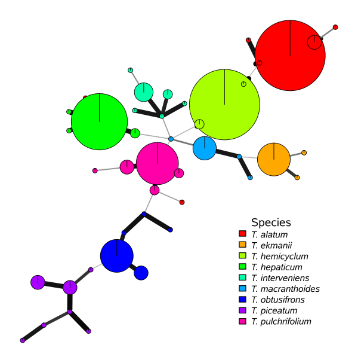 <!-- MERGE-REVIEW: no counterpart section found in QMD; content from TEX kept as-is. -->

### Minimum Spanning Network

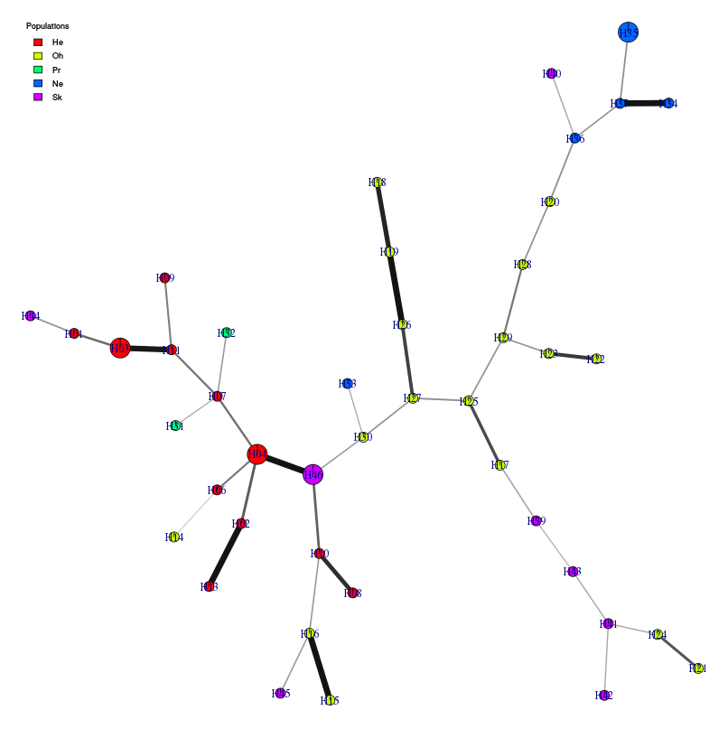

```{r}
# See details and options...
?bruvo.msn
# Get the MSN
# Note SSRs repeats 'rep(2, 12)' -
# change according to your data
# Here 12 SSRS loci of length 2 bp
bruvo.msn(gid=hauss.genind,
  replen=rep(x=2, times=12),
  loss=TRUE, palette=rainbow,
  vertex.label="inds", gscale=TRUE,
  wscale=TRUE, showplot=TRUE)
# For another data types
# (not only microsatellites)
?msn.poppr
# Interactive creation of MSN
?imsn
```

<!-- MERGE-REVIEW: no counterpart section found in QMD; code below comes from the old TEX version. -->

## Genetic distances

### Distances

- Distance-based methods are among the most popular in biology

- Huge number of applications

- A lot of different distances - it is crucial to select correct distance matrix for particular task

  - Which input data?
  - Which purpose?
  - Selecting wrong distance method can lead in misleading results in PCoA, NJ, ...

- All method have lots of assumptions and limits - check them prior usage

  - Genetic drift, infinite alleles, ...

- If resulting distance matrix is not [Euclidean](https://en.wikipedia.org/wiki/Euclidean_distance_matrix) (see also further), following analysis can be misleading

- For DNA sequences use `phangorn::modelTest` to select appropriate mutational model for particular sequence

<!-- MERGE-REVIEW: content of the .qmd section 'Genetic distances' was inserted at 3 frames; remove the unwanted duplicates. -->

Simple dissimilarity distance matrix

Nei's distance (not Euclidean) for populations (other methods are available, see ?dist.genpop)

Test if it is Euclidean

Turns to be Euclidean

Test if it is Euclidean

Show it

Bruvo's distances weighting SSRs repeats - take care about replen parameter - requires repetition length for every SSRs locus E.g. if having 5 SSRs with repeat lengths 2, 2, 3, 3 and 2 bp use: bruvo.dist(pop = ... replen = c(2, 2, 3, 3, 2)...)

Test if it is Euclidean

Turn to be Euclidean

Test if it is Euclidean

Show it

Nei's distance (very popular, but not Euclidean) for individuals (other methods are available, see "?poppr::nei.dist")

Test if it is Euclidean

Show it

Dissimilarity matrix returns a distance reflecting the number of allelic differences between two individuals

Test if it is Euclidean

Show it

Import custom distance matrix - distances.txt must exist of the disk

See details of distance methods in package poppr

Compare different distance matrices List of functions to be parsed to respective dist.\* function

Calculate the distance matrices

Add names for the distance names

Add Bruvo distance

Split graphical device into 2 lines, 3 panes each

Calculate NJ and plot all trees

Selecting model for calculating distances among DNA sequences

Sort results according to AIC or BIC - the lower the better fit

Same for Gunnera dataset

DNA distances - there are various models available

Distances and genlight object. Pairwise genetic distances for each data block (genlight objects with whole genome data) - sensitive to missing data

It is possible to use just basic dist function on whole genlight object (might require a lot of RAM)

Distances in mixed-ploidy data sets stamppNeisD requires population factor in genlight Nei's 1972 distance between individuals (use pop = TRUE to calculate among populations)

Check it

The same on population level

Check it

Export the distance matrix as Phylip format for usage in external software (e.g. SplitsTree)

Genomic relationship matrix

Check it

Over 40 distances from philentropy package

Calculate e.g. Jaccard index for AFLP data

See result

Make it distance matrix

Visualize pairwise genetic similarities table.paint() requires data frame, dist can't be directly converted to DF

Same visualization, colored heatmap() reorders values

Another possibility is to use function corrplot() from package corrplot

```{r}
?dist.gene # Details about methods of this distance constructions
hauss_dist <- dist.gene(x = hauss_genind@tab, method = "pairwise")
hauss_dist
```

```{r}
hauss_dist_pop <- dist.genpop(x = hauss_genpop, method = 1, diag = TRUE, upper = TRUE)
hauss_dist_pop
```

```{r}
is.euclid(hauss_dist_pop, plot = TRUE, print = TRUE, tol = 1e-10)
```

```{r}
hauss_dist_pop <- cailliez(distmat = hauss_dist_pop, print = FALSE, tol = 1e-07, cor.zero = TRUE)
```

```{r}
is.euclid(hauss_dist_pop, plot = TRUE, print = TRUE, tol = 1e-10)
```

```{r}
hauss_dist_pop
```

```{r}
hauss_dist_bruvo <- bruvo.dist(pop = hauss_genind, replen = rep(x = 2, times = 12), loss = TRUE)
```

```{r}
is.euclid(hauss_dist_bruvo, plot = TRUE, print = TRUE, tol = 1e-10)
```

```{r}
hauss_dist_bruvo <- cailliez(distmat = hauss_dist_bruvo, print = FALSE, tol = 1e-07, cor.zero = TRUE)
```

```{r}
is.euclid(hauss_dist_bruvo, plot = TRUE, print = TRUE, tol = 1e-10)
```

```{r}
hauss_dist_bruvo
```

```{r}
hauss_dist_nei <- poppr::nei.dist(x = hauss_genind, warning = TRUE)
```

```{r}
is.euclid(distmat = hauss_dist_nei, plot = TRUE, print = TRUE, tol = 1e-10)
```

```{r}
hauss_dist_nei

```

```{r}
hauss_dist_diss <- diss.dist(x = hauss_genind, percent = FALSE, mat = TRUE)
```

```{r}
is.euclid(distmat = as.dist(m = hauss_dist_diss), plot = TRUE, print = TRUE, tol = 1e-10)
```

```{r}
hauss_dist_diss
```

```{r}
my_dist <- read.csv("distances.txt", header = TRUE, sep = "\t", dec = ".", row.names = 1) # Or so...
my_dist <- as.dist(my_dist)
class(my_dist)
is.euclid(my_dist, plot = TRUE, print = TRUE, tol = 1e-10)
dim(my_dist)
my_dist
my_dist <- cailliez(my_dist, print = TRUE, tol = 1e-10, cor.zero = TRUE)
is.euclid(my_dist, plot = TRUE, print = TRUE, tol = 1e-10)
my_dist
```

```{r}
vignette("algo", package = "poppr")
```

```{r}
distances <- c("Nei", "Rogers", "Edwards", "Reynolds", "Prevosti")
```

```{r}
dists <- lapply(distances, function(x) {
  DISTFUN <- match.fun(paste(tolower(x), "dist", sep = "."))
  DISTFUN(hauss_genind_cor)
})
```

```{r}
names(dists) <- distances
```

```{r}
dists[["Bruvo"]] <- hauss_dist_bruvo
dists
```

```{r}
par(mfrow = c(2, 3))
```

```{r}
x <- lapply(names(dists), function(x) {
  plot(njs(dists[[x]]), main = x, type = "unrooted")
  add.scale.bar(lcol = "red", length = 0.1)
})
dev.off() # Close graphical device to reset settings
```

```{r}
library("phangorn") # Load needed library
?modelTest # Plenty of options, including possible parallelization
usflu_models <- modelTest(object = as.phyDat(usflu_dna)) # Test models
```

```{r}
head(usflu_models[order(usflu_models[["AIC"]]), ], n = 15L)
```

```{r}
gunnera_models <- modelTest(object = as.phyDat(gunnera_mafft_ng))
head(gunnera_models[order(gunnera_models[["AIC"]]), ], n = 15L)
```

```{r}
?dist.dna
usflu_dist <- dist.dna(x = usflu_dna, model = "F84")
usflu_dist
class(usflu_dist)
dim(as.matrix(usflu_dist))
gunnera_dist <- dist.dna(x = gunnera_mafft_ng, model = "TN93")
gunnera_dist
class(gunnera_dist)
dim(as.matrix(gunnera_dist))
```

```{r}
usflu_dists_l <- seploc(usflu_genlight, n.block = 10, parallel = FALSE)
class(usflu_dists_l)
usflu_dists <- lapply(X = usflu_dists_l, FUN = function(DDD) dist(as.matrix(DDD)))
class(usflu_dists)
names(usflu_dists)
class(usflu_dists[[1]])
usflu_distr <- Reduce(f = "+", x = usflu_dists)
class(usflu_distr)
usflu_distr
```

```{r}
usflu_distg <- dist.gene(as.matrix(usflu_genlight))
```

```{r}
arabidopsis_dist <- stamppNeisD(geno = arabidopsis_genlight, pop = FALSE)
```

```{r}
head(arabidopsis_dist)
dim(arabidopsis_dist)
class(arabidopsis_dist)
```

```{r}
arabidopsis_dist_pop <- stamppNeisD(geno = arabidopsis_genlight, pop = TRUE)
```

```{r}
head(arabidopsis_dist_pop)
dim(arabidopsis_dist_pop)
class(arabidopsis_dist_pop)
```

```{r}
stamppPhylip(distance.mat = arabidopsis_dist, file = "arabidopsis_dist.txt")
```

```{r}
?stamppGmatrix # Method details
arabidopsis_genomat <- stamppGmatrix(geno = arabidopsis_genlight)
```

```{r}
head(arabidopsis_genomat)
dim(arabidopsis_genomat)
class(arabidopsis_genomat)
```

```{r}
getDistMethods() # See available distances
?distance # See details of distances
```

```{r}
amara_jac <- distance(x = amara_aflp[, 2:30], method = "jaccard") # amara_aflp has 30 columns (see dim(amara_aflp), column 1 contains names (head(amara_aflp)))
```

```{r}
class(amara_jac)
amara_jac
```

```{r}
amara_jac <- as.dist(m = amara_jac, diag = TRUE, upper = TRUE)
amara_jac
```

```{r}
table.paint(df = as.data.frame(as.matrix(usflu_dist)), clegend = 0, clabel.row = 0.5, clabel.col = 0.5)
```

```{r}
heatmap(x = as.matrix(usflu_dist), Rowv = NA, Colv = NA, symm = TRUE)
```

```{r}
?corrplot::corrplot
```

### Basic distances

```{r}
# Simple dissimilarity distance matrix
?dist.gene # Details about methods of this distance constructions
hauss.dist <- dist.gene(x=hauss.genind@tab, method="pairwise")
# Nei's distance (not Euclidean) for populations (other methods are
# available, see ?dist.genpop)
hauss.dist.pop <- dist.genpop(x=hauss.genpop, method=1, diag=T, upper=T)
# Test if it is Euclidean
is.euclid(hauss.dist.pop, plot=TRUE, print=TRUE, tol=1e-10) # FALSE = No
# Turn to be Euclidean
hauss.dist.pop <- cailliez(distmat=hauss.dist.pop, print=FALSE, tol=1e-07,
  cor.zero=TRUE)
is.euclid(hauss.dist.pop, plot=TRUE, print=TRUE, tol=1e-10) # TRUE = OK
```

Most of analysis based on distances more or less require [Euclidean distances](https://en.wikipedia.org/wiki/Euclidean_distance_matrix) (non-negative vales only, Pythagorean theorem is valid, etc.). If the distance matrix contains non-Euclidean distances, the result can be misleading... <!-- MERGE-REVIEW: 1 old code block(s) in TEX frame were dropped in favor of the .qmd section 'Genetic distances'. -->

<!-- MERGE-REVIEW: content of the .qmd section 'Genetic distances' was inserted at 3 frames; remove the unwanted duplicates. -->

Simple dissimilarity distance matrix

Nei's distance (not Euclidean) for populations (other methods are available, see ?dist.genpop)

Test if it is Euclidean

Turns to be Euclidean

Test if it is Euclidean

Show it

Bruvo's distances weighting SSRs repeats - take care about replen parameter - requires repetition length for every SSRs locus E.g. if having 5 SSRs with repeat lengths 2, 2, 3, 3 and 2 bp use: bruvo.dist(pop = ... replen = c(2, 2, 3, 3, 2)...)

Test if it is Euclidean

Turn to be Euclidean

Test if it is Euclidean

Show it

Nei's distance (very popular, but not Euclidean) for individuals (other methods are available, see "?poppr::nei.dist")

Test if it is Euclidean

Show it

Dissimilarity matrix returns a distance reflecting the number of allelic differences between two individuals

Test if it is Euclidean

Show it

Import custom distance matrix - distances.txt must exist of the disk

See details of distance methods in package poppr

Compare different distance matrices List of functions to be parsed to respective dist.\* function

Calculate the distance matrices

Add names for the distance names

Add Bruvo distance

Split graphical device into 2 lines, 3 panes each

Calculate NJ and plot all trees

Selecting model for calculating distances among DNA sequences

Sort results according to AIC or BIC - the lower the better fit

Same for Gunnera dataset

DNA distances - there are various models available

Distances and genlight object. Pairwise genetic distances for each data block (genlight objects with whole genome data) - sensitive to missing data

It is possible to use just basic dist function on whole genlight object (might require a lot of RAM)

Distances in mixed-ploidy data sets stamppNeisD requires population factor in genlight Nei's 1972 distance between individuals (use pop = TRUE to calculate among populations)

Check it

The same on population level

Check it

Export the distance matrix as Phylip format for usage in external software (e.g. SplitsTree)

Genomic relationship matrix

Check it

Over 40 distances from philentropy package

Calculate e.g. Jaccard index for AFLP data

See result

Make it distance matrix

Visualize pairwise genetic similarities table.paint() requires data frame, dist can't be directly converted to DF

Same visualization, colored heatmap() reorders values

Another possibility is to use function corrplot() from package corrplot

```{r}
?dist.gene # Details about methods of this distance constructions
hauss_dist <- dist.gene(x = hauss_genind@tab, method = "pairwise")
hauss_dist
```

```{r}
hauss_dist_pop <- dist.genpop(x = hauss_genpop, method = 1, diag = TRUE, upper = TRUE)
hauss_dist_pop
```

```{r}
is.euclid(hauss_dist_pop, plot = TRUE, print = TRUE, tol = 1e-10)
```

```{r}
hauss_dist_pop <- cailliez(distmat = hauss_dist_pop, print = FALSE, tol = 1e-07, cor.zero = TRUE)
```

```{r}
is.euclid(hauss_dist_pop, plot = TRUE, print = TRUE, tol = 1e-10)
```

```{r}
hauss_dist_pop
```

```{r}
hauss_dist_bruvo <- bruvo.dist(pop = hauss_genind, replen = rep(x = 2, times = 12), loss = TRUE)
```

```{r}
is.euclid(hauss_dist_bruvo, plot = TRUE, print = TRUE, tol = 1e-10)
```

```{r}
hauss_dist_bruvo <- cailliez(distmat = hauss_dist_bruvo, print = FALSE, tol = 1e-07, cor.zero = TRUE)
```

```{r}
is.euclid(hauss_dist_bruvo, plot = TRUE, print = TRUE, tol = 1e-10)
```

```{r}
hauss_dist_bruvo
```

```{r}
hauss_dist_nei <- poppr::nei.dist(x = hauss_genind, warning = TRUE)
```

```{r}
is.euclid(distmat = hauss_dist_nei, plot = TRUE, print = TRUE, tol = 1e-10)
```

```{r}
hauss_dist_nei

```

```{r}
hauss_dist_diss <- diss.dist(x = hauss_genind, percent = FALSE, mat = TRUE)
```

```{r}
is.euclid(distmat = as.dist(m = hauss_dist_diss), plot = TRUE, print = TRUE, tol = 1e-10)
```

```{r}
hauss_dist_diss
```

```{r}
my_dist <- read.csv("distances.txt", header = TRUE, sep = "\t", dec = ".", row.names = 1) # Or so...
my_dist <- as.dist(my_dist)
class(my_dist)
is.euclid(my_dist, plot = TRUE, print = TRUE, tol = 1e-10)
dim(my_dist)
my_dist
my_dist <- cailliez(my_dist, print = TRUE, tol = 1e-10, cor.zero = TRUE)
is.euclid(my_dist, plot = TRUE, print = TRUE, tol = 1e-10)
my_dist
```

```{r}
vignette("algo", package = "poppr")
```

```{r}
distances <- c("Nei", "Rogers", "Edwards", "Reynolds", "Prevosti")
```

```{r}
dists <- lapply(distances, function(x) {
  DISTFUN <- match.fun(paste(tolower(x), "dist", sep = "."))
  DISTFUN(hauss_genind_cor)
})
```

```{r}
names(dists) <- distances
```

```{r}
dists[["Bruvo"]] <- hauss_dist_bruvo
dists
```

```{r}
par(mfrow = c(2, 3))
```

```{r}
x <- lapply(names(dists), function(x) {
  plot(njs(dists[[x]]), main = x, type = "unrooted")
  add.scale.bar(lcol = "red", length = 0.1)
})
dev.off() # Close graphical device to reset settings
```

```{r}
library("phangorn") # Load needed library
?modelTest # Plenty of options, including possible parallelization
usflu_models <- modelTest(object = as.phyDat(usflu_dna)) # Test models
```

```{r}
head(usflu_models[order(usflu_models[["AIC"]]), ], n = 15L)
```

```{r}
gunnera_models <- modelTest(object = as.phyDat(gunnera_mafft_ng))
head(gunnera_models[order(gunnera_models[["AIC"]]), ], n = 15L)
```

```{r}
?dist.dna
usflu_dist <- dist.dna(x = usflu_dna, model = "F84")
usflu_dist
class(usflu_dist)
dim(as.matrix(usflu_dist))
gunnera_dist <- dist.dna(x = gunnera_mafft_ng, model = "TN93")
gunnera_dist
class(gunnera_dist)
dim(as.matrix(gunnera_dist))
```

```{r}
usflu_dists_l <- seploc(usflu_genlight, n.block = 10, parallel = FALSE)
class(usflu_dists_l)
usflu_dists <- lapply(X = usflu_dists_l, FUN = function(DDD) dist(as.matrix(DDD)))
class(usflu_dists)
names(usflu_dists)
class(usflu_dists[[1]])
usflu_distr <- Reduce(f = "+", x = usflu_dists)
class(usflu_distr)
usflu_distr
```

```{r}
usflu_distg <- dist.gene(as.matrix(usflu_genlight))
```

```{r}
arabidopsis_dist <- stamppNeisD(geno = arabidopsis_genlight, pop = FALSE)
```

```{r}
head(arabidopsis_dist)
dim(arabidopsis_dist)
class(arabidopsis_dist)
```

```{r}
arabidopsis_dist_pop <- stamppNeisD(geno = arabidopsis_genlight, pop = TRUE)
```

```{r}
head(arabidopsis_dist_pop)
dim(arabidopsis_dist_pop)
class(arabidopsis_dist_pop)
```

```{r}
stamppPhylip(distance.mat = arabidopsis_dist, file = "arabidopsis_dist.txt")
```

```{r}
?stamppGmatrix # Method details
arabidopsis_genomat <- stamppGmatrix(geno = arabidopsis_genlight)
```

```{r}
head(arabidopsis_genomat)
dim(arabidopsis_genomat)
class(arabidopsis_genomat)
```

```{r}
getDistMethods() # See available distances
?distance # See details of distances
```

```{r}
amara_jac <- distance(x = amara_aflp[, 2:30], method = "jaccard") # amara_aflp has 30 columns (see dim(amara_aflp), column 1 contains names (head(amara_aflp)))
```

```{r}
class(amara_jac)
amara_jac
```

```{r}
amara_jac <- as.dist(m = amara_jac, diag = TRUE, upper = TRUE)
amara_jac
```

```{r}
table.paint(df = as.data.frame(as.matrix(usflu_dist)), clegend = 0, clabel.row = 0.5, clabel.col = 0.5)
```

```{r}
heatmap(x = as.matrix(usflu_dist), Rowv = NA, Colv = NA, symm = TRUE)
```

```{r}
?corrplot::corrplot
```

### Distances reflecting microsatellite repeats

```{r}
# Bruvo's distances weighting SSRs repeats - take care about replen
# parameter - requires repetition length for every SSRs locus
# E.g. if having 5 SSRs with repeat lengths 2, 2, 3, 3 and 2 bp use:
# bruvo.dist(pop=... replen=c(2, 2, 3, 3, 2)...)
hauss.dist.bruvo <- bruvo.dist(pop=hauss.genind, replen=rep(x=2, times=12),
  loss=TRUE)
# Test if it is Euclidean
is.euclid(hauss.dist.bruvo, plot=TRUE, print=TRUE, tol=1e-10)
hauss.dist.bruvo <- cailliez(distmat=hauss.dist.bruvo, print=FALSE,
  tol=1e-07, cor.zero=TRUE) # Turn to be Euclidean and verify below
is.euclid(hauss.dist.bruvo, plot=TRUE, print=TRUE, tol=1e-10)
hauss.dist.bruvo  # Show it
```

- See poppr's manual and manual pages of the functions for details and different possibilities of settings
- Be careful when changing non-Euclidean distances to Euclidean - **the transformation more or less changes meaning of the distances!** <!-- MERGE-REVIEW: no counterpart section found in QMD; code below comes from the old TEX version. -->

### Turning distance matrix into Euclidean is controversial...

**Histograms of Bruvo distance before and after transformation**

- How to deal with zero distances in original matrix? There is no really good solution...

  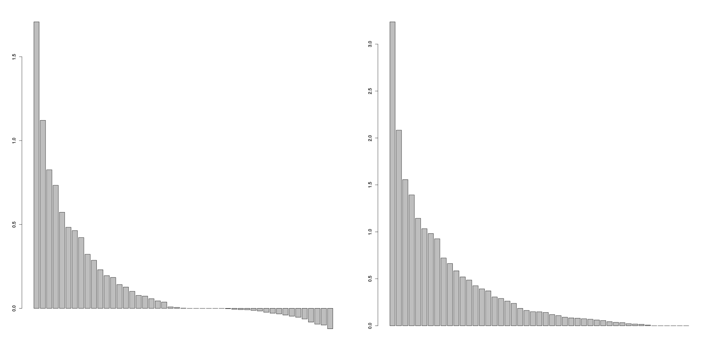 <!-- MERGE-REVIEW: no counterpart section found in QMD; content from TEX kept as-is. -->

### More distances...

```{r}
# Nei's distance (very popular, but not Euclidean) for individuals
# (other methods are available, see "?poppr::nei.dist")
hauss.dist.nei <- nei.dist(x=hauss.genind, warning=TRUE)
is.euclid(distmat=hauss.dist.nei, plot=TRUE, print=TRUE, tol=1e-10)
# Dissimilarity matrix returns a distance reflecting the number of
# allelic differences between two individuals
hauss.dist.diss <- diss.dist(x=hauss.genind, percent=FALSE, mat=TRUE)
is.euclid(as.dist(hauss.dist.diss), plot=TRUE, print=TRUE, tol=1e-10)
```

**Import own distance matrix from another software:**

```{r}
          Fe      He      Oh ...
Fe  0.000000 132.019 109.159 ...
He  132.0191 0.00000 9.89111 ...
Oh  109.1590 9.89111 0.00000 ...
Pr  139.5669 8.55312 4.40562 ...
Ne  156.7619 9.96143 16.6927 ...
...      ...     ...     ... ...
```

```{r}
MyDistance <- read.csv("distances.
  txt", header=TRUE, sep="\t",
  dec=".", row.names=1) # Or so...
MyDistance <- as.dist(MyDistance)
class(MyDistance)
dim(MyDistance)
MyDistance
```

<!-- MERGE-REVIEW: 3 old code block(s) in TEX frame were dropped in favor of the .qmd section 'Genetic distances'. -->

<!-- MERGE-REVIEW: content of the .qmd section 'Genetic distances' was inserted at 3 frames; remove the unwanted duplicates. -->

Simple dissimilarity distance matrix

Nei's distance (not Euclidean) for populations (other methods are available, see ?dist.genpop)

Test if it is Euclidean

Turns to be Euclidean

Test if it is Euclidean

Show it

Bruvo's distances weighting SSRs repeats - take care about replen parameter - requires repetition length for every SSRs locus E.g. if having 5 SSRs with repeat lengths 2, 2, 3, 3 and 2 bp use: bruvo.dist(pop = ... replen = c(2, 2, 3, 3, 2)...)

Test if it is Euclidean

Turn to be Euclidean

Test if it is Euclidean

Show it

Nei's distance (very popular, but not Euclidean) for individuals (other methods are available, see "?poppr::nei.dist")

Test if it is Euclidean

Show it

Dissimilarity matrix returns a distance reflecting the number of allelic differences between two individuals

Test if it is Euclidean

Show it

Import custom distance matrix - distances.txt must exist of the disk

See details of distance methods in package poppr

Compare different distance matrices List of functions to be parsed to respective dist.\* function

Calculate the distance matrices

Add names for the distance names

Add Bruvo distance

Split graphical device into 2 lines, 3 panes each

Calculate NJ and plot all trees

Selecting model for calculating distances among DNA sequences

Sort results according to AIC or BIC - the lower the better fit

Same for Gunnera dataset

DNA distances - there are various models available

Distances and genlight object. Pairwise genetic distances for each data block (genlight objects with whole genome data) - sensitive to missing data

It is possible to use just basic dist function on whole genlight object (might require a lot of RAM)

Distances in mixed-ploidy data sets stamppNeisD requires population factor in genlight Nei's 1972 distance between individuals (use pop = TRUE to calculate among populations)

Check it

The same on population level

Check it

Export the distance matrix as Phylip format for usage in external software (e.g. SplitsTree)

Genomic relationship matrix

Check it

Over 40 distances from philentropy package

Calculate e.g. Jaccard index for AFLP data

See result

Make it distance matrix

Visualize pairwise genetic similarities table.paint() requires data frame, dist can't be directly converted to DF

Same visualization, colored heatmap() reorders values

Another possibility is to use function corrplot() from package corrplot

```{r}
?dist.gene # Details about methods of this distance constructions
hauss_dist <- dist.gene(x = hauss_genind@tab, method = "pairwise")
hauss_dist
```

```{r}
hauss_dist_pop <- dist.genpop(x = hauss_genpop, method = 1, diag = TRUE, upper = TRUE)
hauss_dist_pop
```

```{r}
is.euclid(hauss_dist_pop, plot = TRUE, print = TRUE, tol = 1e-10)
```

```{r}
hauss_dist_pop <- cailliez(distmat = hauss_dist_pop, print = FALSE, tol = 1e-07, cor.zero = TRUE)
```

```{r}
is.euclid(hauss_dist_pop, plot = TRUE, print = TRUE, tol = 1e-10)
```

```{r}
hauss_dist_pop
```

```{r}
hauss_dist_bruvo <- bruvo.dist(pop = hauss_genind, replen = rep(x = 2, times = 12), loss = TRUE)
```

```{r}
is.euclid(hauss_dist_bruvo, plot = TRUE, print = TRUE, tol = 1e-10)
```

```{r}
hauss_dist_bruvo <- cailliez(distmat = hauss_dist_bruvo, print = FALSE, tol = 1e-07, cor.zero = TRUE)
```

```{r}
is.euclid(hauss_dist_bruvo, plot = TRUE, print = TRUE, tol = 1e-10)
```

```{r}
hauss_dist_bruvo
```

```{r}
hauss_dist_nei <- poppr::nei.dist(x = hauss_genind, warning = TRUE)
```

```{r}
is.euclid(distmat = hauss_dist_nei, plot = TRUE, print = TRUE, tol = 1e-10)
```

```{r}
hauss_dist_nei

```

```{r}
hauss_dist_diss <- diss.dist(x = hauss_genind, percent = FALSE, mat = TRUE)
```

```{r}
is.euclid(distmat = as.dist(m = hauss_dist_diss), plot = TRUE, print = TRUE, tol = 1e-10)
```

```{r}
hauss_dist_diss
```

```{r}
my_dist <- read.csv("distances.txt", header = TRUE, sep = "\t", dec = ".", row.names = 1) # Or so...
my_dist <- as.dist(my_dist)
class(my_dist)
is.euclid(my_dist, plot = TRUE, print = TRUE, tol = 1e-10)
dim(my_dist)
my_dist
my_dist <- cailliez(my_dist, print = TRUE, tol = 1e-10, cor.zero = TRUE)
is.euclid(my_dist, plot = TRUE, print = TRUE, tol = 1e-10)
my_dist
```

```{r}
vignette("algo", package = "poppr")
```

```{r}
distances <- c("Nei", "Rogers", "Edwards", "Reynolds", "Prevosti")
```

```{r}
dists <- lapply(distances, function(x) {
  DISTFUN <- match.fun(paste(tolower(x), "dist", sep = "."))
  DISTFUN(hauss_genind_cor)
})
```

```{r}
names(dists) <- distances
```

```{r}
dists[["Bruvo"]] <- hauss_dist_bruvo
dists
```

```{r}
par(mfrow = c(2, 3))
```

```{r}
x <- lapply(names(dists), function(x) {
  plot(njs(dists[[x]]), main = x, type = "unrooted")
  add.scale.bar(lcol = "red", length = 0.1)
})
dev.off() # Close graphical device to reset settings
```

```{r}
library("phangorn") # Load needed library
?modelTest # Plenty of options, including possible parallelization
usflu_models <- modelTest(object = as.phyDat(usflu_dna)) # Test models
```

```{r}
head(usflu_models[order(usflu_models[["AIC"]]), ], n = 15L)
```

```{r}
gunnera_models <- modelTest(object = as.phyDat(gunnera_mafft_ng))
head(gunnera_models[order(gunnera_models[["AIC"]]), ], n = 15L)
```

```{r}
?dist.dna
usflu_dist <- dist.dna(x = usflu_dna, model = "F84")
usflu_dist
class(usflu_dist)
dim(as.matrix(usflu_dist))
gunnera_dist <- dist.dna(x = gunnera_mafft_ng, model = "TN93")
gunnera_dist
class(gunnera_dist)
dim(as.matrix(gunnera_dist))
```

```{r}
usflu_dists_l <- seploc(usflu_genlight, n.block = 10, parallel = FALSE)
class(usflu_dists_l)
usflu_dists <- lapply(X = usflu_dists_l, FUN = function(DDD) dist(as.matrix(DDD)))
class(usflu_dists)
names(usflu_dists)
class(usflu_dists[[1]])
usflu_distr <- Reduce(f = "+", x = usflu_dists)
class(usflu_distr)
usflu_distr
```

```{r}
usflu_distg <- dist.gene(as.matrix(usflu_genlight))
```

```{r}
arabidopsis_dist <- stamppNeisD(geno = arabidopsis_genlight, pop = FALSE)
```

```{r}
head(arabidopsis_dist)
dim(arabidopsis_dist)
class(arabidopsis_dist)
```

```{r}
arabidopsis_dist_pop <- stamppNeisD(geno = arabidopsis_genlight, pop = TRUE)
```

```{r}
head(arabidopsis_dist_pop)
dim(arabidopsis_dist_pop)
class(arabidopsis_dist_pop)
```

```{r}
stamppPhylip(distance.mat = arabidopsis_dist, file = "arabidopsis_dist.txt")
```

```{r}
?stamppGmatrix # Method details
arabidopsis_genomat <- stamppGmatrix(geno = arabidopsis_genlight)
```

```{r}
head(arabidopsis_genomat)
dim(arabidopsis_genomat)
class(arabidopsis_genomat)
```

```{r}
getDistMethods() # See available distances
?distance # See details of distances
```

```{r}
amara_jac <- distance(x = amara_aflp[, 2:30], method = "jaccard") # amara_aflp has 30 columns (see dim(amara_aflp), column 1 contains names (head(amara_aflp)))
```

```{r}
class(amara_jac)
amara_jac
```

```{r}
amara_jac <- as.dist(m = amara_jac, diag = TRUE, upper = TRUE)
amara_jac
```

```{r}
table.paint(df = as.data.frame(as.matrix(usflu_dist)), clegend = 0, clabel.row = 0.5, clabel.col = 0.5)
```

```{r}
heatmap(x = as.matrix(usflu_dist), Rowv = NA, Colv = NA, symm = TRUE)
```

```{r}
?corrplot::corrplot
```

### Different distances have different use case and outputs...

**Different distances available in package poppr**

| **Method** | **Function** | **Assumption** | **Euclidean** |
|------------------|------------------|------------------|------------------|
| [Prevosti 1975](https://link.springer.com/article/10.1007/BF00831894) | `prevosti.dist`, | \- | **No** |
|  | `diss.dist` |  |  |
| [Nei 1972](https://www.jstor.org/stable/2459777), [1978](https://doi.org/10.1093/genetics/89.3.583) | `nei.dist` | Infinite Alleles, | **No** |
|  |  | Genetic Drift |  |
| [Edwards 1971](https://doi.org/10.2307/2528824) | `edwards.dist` | Genetic Drift | Yes |
| [Reynolds 1983](https://doi.org/10.1093/genetics/106.3.575) | `reynolds.dist` | Genetic Drift | Yes |
| Rogers 1972 *(Rogers (1972): Measures of genetic similarity and genetic distances. Pp. 145-153 of Studies in Genetics. University of Texas Publishers)* | `rogers.dist` | \- | Yes |
| [Bruvo 2004](https://doi.org/10.1111/j.1365-294X.2004.02209.x) | `bruvo.dist` | Step-wise Mutation | **No** |

```{r}
# See details of distance methods in package poppr
vignette("algo", package="poppr")
```

<!-- MERGE-REVIEW: no counterpart section found in QMD; code below comes from the old TEX version. -->

### Comparison of different matrices

```{r}
# Compare different distance matrices
# List of functions to be parsed to respective dist.* function
distances <- c("Nei", "Rogers", "Edwards", "Reynolds", "Prevosti")
# Calculate the distance matrices
dists <- lapply(distances, function(x) {
  DISTFUN <- match.fun(paste(tolower(x), "dist", sep="."))
  DISTFUN(hauss.genind.cor) })
# Add names for the distance names
names(dists) <- distances
dists[["Bruvo"]] <- hauss.dist.bruvo # Add Bruvo distance
dists # Check list of distances
par(mfrow=c(2, 3)) # Split graphical device into 2 lines, 3 panes each
# Calculate NJ and plot all trees
x <- lapply(names(dists), function(x) { plot(njs(dists[[x]]), main=x,
  type="unrooted")
  add.scale.bar(lcol="red", length=0.1) })
dev.off() # Close graphical device to reset settings
```

<!-- MERGE-REVIEW: no counterpart section found in QMD; code below comes from the old TEX version. -->

### Neighbor-Joining of same dataset under different matrices

**The results are very different...**

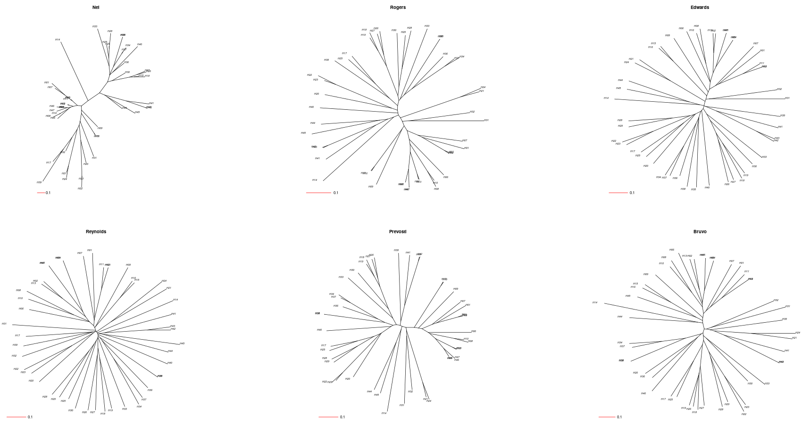 <!-- MERGE-REVIEW: no counterpart section found in QMD; content from TEX kept as-is. -->

### Selecting model for calculating distances among DNA sequences

- `phangorn::modelTest` has plenty of options

  - Only selected models can be tested
  - On Linux and macOS it's possible to speed up calculations with parallelization
  - Names of models are not exactly same as names of models in `ape::dist.dna`...

```{r}
library(phangorn) # Load needed library
?modelTest # Plenty of options, including possible parallelization
usflu.models <- modelTest(object=as.phyDat(usflu.dna)) # Test models
# Sort results according to AIC or BIC - the lower the better fit
head(usflu.models[order(usflu.models[["AIC"]]),], n=15L)
      Model  df    logLik      AIC       AICw     AICc      AICcw      BIC
91 GTR+G(4) 166 -5338.506'11009.01'0.24200823 11045.16 0.22990390 11911.88
83 TVM+G(4) 165 -5339.523 11009.05 0.23798173 11044.73 0.28399121 11906.48
...
gunnera.models <- modelTest(object=as.phyDat(gunnera.mafft.ng)) # Same for
head(gunnera.models[order(gunnera.models[["AIC"]]),], n=15L)    # Gunnera
```

<!-- MERGE-REVIEW: no counterpart section found in QMD; code below comes from the old TEX version. -->

### Distances among DNA sequences

- **The sequences must be aligned before calculating distances among them!**
- Selection of mutational model has significant impact to results...

```{r}
# There are various models available
?dist.dna
# Create the distance matrix
usflu.dist <- dist.dna(x=usflu.dna, model="F84")
# Check the resulting distance matrix
usflu.dist
class(usflu.dist)
dim(as.matrix(usflu.dist))
# Create another distance matrix
gunnera.dist <- dist.dna(x=gunnera.mafft.ng, model="TN93")
# Check it
gunnera.dist
class(gunnera.dist)
dim(as.matrix(gunnera.dist))
```

<!-- MERGE-REVIEW: 1 old code block(s) in TEX frame were dropped in favor of the .qmd section 'Topographical distances among trees'. -->

<!-- MERGE-REVIEW: content of the .qmd section 'Topographical distances among trees' was inserted at 7 frames; remove the unwanted duplicates. -->

Compute matrix of topological distances among phylogenetic trees

Basic information about the distance matrix

Create heatmaps using heatmap.2 function from gplots package

Robinsons-Foulds distance

Add names of columns and rows

Create heatmap using corrplot function from corrplot package

PCoA from distance matrices of topographical differences among trees Test if the distance matrix is Euclidean or not

Calculate the PCoA

Plot PCoA

Add kernel densities

Add histogram of eigenvalues

Add title to the plot

Alternative function to plot PCA plot

See current state

Remove outlying trees

See after removal

```{r}
library("gplots")
library("corrplot")
library("phytools")
```

```{r}
?dist.topo # See details of available computing methods
oxalis_trees_d <- dist.topo(x = oxalis_trees, method = "score")
```

```{r}
dim(as.matrix(oxalis_trees_d))
head.matrix(as.matrix(oxalis_trees_d))
```

```{r}
heatmap.2(x = as.matrix(x = oxalis_trees_d), Rowv = FALSE, Colv = "Rowv", dendrogram = "none", symm = TRUE, scale = "none", na.rm = TRUE, revC = FALSE, col = rainbow(15), cellnote = round(x = as.matrix(x = oxalis_trees_d), digits = 2), notecex = 1, notecol = "white", trace = "row", linecol = "black", labRow = names(oxalis_trees), labCol = names(oxalis_trees), key = TRUE, keysize = 2, density.info = "density", symkey = FALSE, main = "Correlation matrix of topographical distances", xlab = "Trees", ylab = "Trees")
```

```{r}
?multiRF # See help first...
oxalis_trees_d_rf <- multiRF(oxalis_trees)
```

```{r}
colnames(oxalis_trees_d_rf) <- names(oxalis_trees)
rownames(oxalis_trees_d_rf) <- names(oxalis_trees)
```

```{r}
corrplot(corr = oxalis_trees_d_rf, method = "circle", type = "upper", col = rainbow(15), title = "Correlation matrix of topographical distances", is.corr = FALSE, diag = FALSE, outline = TRUE, order = "alphabet", tl.pos = "lt", tl.col = "black")
corrplot(corr = oxalis_trees_d_rf, method = "number", type = "lower", add = TRUE, col = rainbow(15), title = "Correlation matrix of topographical distances", is.corr = FALSE, diag = FALSE, outline = FALSE, order = "alphabet", tl.pos = "ld", cl.pos = "n")
```

```{r}
library("ade4")
is.euclid(distmat = oxalis_trees_d, plot = TRUE)
```

```{r}
oxalis_trees_pcoa <- dudi.pco(d = oxalis_trees_d, scannf = TRUE, full = TRUE)
```

```{r}
s.label(dfxy = oxalis_trees_pcoa$li)
```

```{r}
s.kde2d(dfxy = oxalis_trees_pcoa$li, cpoint = 0, add.plot = TRUE)
```

```{r}
add.scatter.eig(oxalis_trees_pcoa[["eig"]], 3, 1, 2, posi = "topleft")
```

```{r}
title("PCoA of matrix of pairwise trees distances")
```

```{r}
scatter(x = oxalis_trees_pcoa, posieig = "topleft")
```

```{r}
oxalis_trees
```

```{r}
oxalis_trees[c("T471", "T639", "T654")] <- NULL
```

```{r}
oxalis_trees
```

### Distances and genlight object

Pairwise genetic distances for each data block (genlight objects with whole genome data) - sensitive to missing data (not useful in every case):

```{r}
usflu.dists.l <- seploc(usflu.genlight, n.block=10, parallel=FALSE)
class(usflu.dists.l)
usflu.dists <- lapply(X=usflu.dists.l, FUN=function(D) dist(as.matrix(D)))
class(usflu.dists)
names(usflu.dists)
class(usflu.dists[[1]])
usflu.distr <- Reduce(f="+", x=usflu.dists)
class(usflu.distr)
usflu.distr
# It is possible to use just basic dist function on whole genlight object
# (might require a lot of RAM)
usflu.distg <- dist.gene(as.matrix(usflu.genlight))
```

Rationale of this approach is to save resources when dividing whole data set into smaller blocks - useful for huge data, not for all of the cases <!-- MERGE-REVIEW: no counterpart section found in QMD; code below comes from the old TEX version. -->

### Distances in mixed-ploidy data sets I

**Nei's distance**

- Package [StAMPP](https://CRAN.R-project.org/package=StAMPP) implements Nei's distance and F$_ST$ for mixed-ploidy data
- It is highly sensitive to missing data

```{r}
# stamppNeisD requires population factor in genlight Nei's 1972 distance
# between individuals (use pop=TRUE to calculate among populations)
arabidopsis.dist <- stamppNeisD(geno=arabidopsis.genlight, pop=FALSE)
# Check it
head(arabidopsis.dist)
dim(arabidopsis.dist)
class(arabidopsis.dist)
# The same on population level
arabidopsis.dist.pop <- stamppNeisD(geno=arabidopsis.genlight, pop=TRUE)
# Check it
head(arabidopsis.dist.pop)
dim(arabidopsis.dist.pop)
class(arabidopsis.dist.pop)
```

<!-- MERGE-REVIEW: no counterpart section found in QMD; code below comes from the old TEX version. -->

### Distances in mixed-ploidy data sets II

```{r}
# Export the distance matrix as Phylip format for usage in external
# software (e.g. SplitsTree)
stamppPhylip(distance.mat=arabidopsis.dist, file="arabidopsis_dist.txt")
# Genomic relationship matrix
?stamppGmatrix # Method details
arabidopsis.genomat <- stamppGmatrix(geno=arabidopsis.genlight)
# Check it
head(arabidopsis.genomat)
dim(arabidopsis.genomat)
class(arabidopsis.genomat)
```

- If there are plenty of missing data and/or the distance is far from being Euclidean, it will not work very well... - sanitize missing data prior calculating distance (e.g. using `poppr::missingno`)
- Always check created distances <!-- MERGE-REVIEW: no counterpart section found in QMD; code below comes from the old TEX version. -->

### Over 40 distances from philentropy package

- There is enormous number of various distance measures...
- For example [Jaccard index](https://en.wikipedia.org/wiki/Jaccard_index) is used to compare binary (presence/absence) data like [AFLP](https://en.wikipedia.org/wiki/Amplified_fragment_length_polymorphism)

```{r}
getDistMethods() # See available distances
?distance # See details of distances
# Calculate e.g. Jaccard index for AFLP data
# amara.aflp has 30 columns, see dim(amara.aflp)
# column 1 contains names, see head(amara.aflp)
amara.jac <- distance(x=amara.aflp[,2:30], method="jaccard")
# See result
class(amara.jac)
amara.jac
# Make it distance matrix
amara.jac <- as.dist(m=amara.jac, diag=TRUE, upper=TRUE)
amara.jac
```

<!-- MERGE-REVIEW: no counterpart section found in QMD; code below comes from the old TEX version. -->

### Visualize pairwise genetic similarities

```{r}
# table.paint() requires data
# frame, dist can't be directly
# converted to DF
table.paint(df=as.data.frame(
  as.matrix(usflu.dist)), cleg=0,
  clabel.row=0.5, clabel.col=0.5)
# Same visualization, colored
# heatmap() reorders values
# because by default it plots
# also dendrograms on the edges
heatmap(x=as.matrix(usflu.dist),
  Rowv=NA, Colv=NA, symm=TRUE)
```

- Colored according to value

- Another possibility is to use `corrplot::corrplot()` for correlation plots

  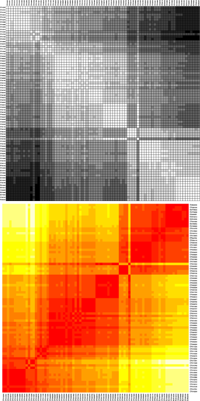 <!-- MERGE-REVIEW: no counterpart section found in QMD; code below comes from the old TEX version. -->

## Hierarchical clustering

### Heat maps

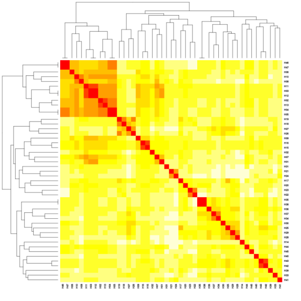

```{r}
# Based on various distances
heatmap(as.matrix(hauss.dist),
  symm=TRUE, labRow=rownames(
  as.matrix(hauss.dist.bruvo)),
  labCol=colnames(as.matrix(
  hauss.dist.bruvo)))
  # hauss.dist doesn't contain
  # names of individuals - add here
heatmap(as.matrix(hauss.dist.pop),
  symm=TRUE)
heatmap(as.matrix(hauss.dist.
  bruvo), symm=TRUE)
heatmap(as.matrix(hauss.dist.
  diss), symm=TRUE)
# See settings like colors,
# dendrogram, etc.
?heatmap
```

<!-- MERGE-REVIEW: 1 old code block(s) in TEX frame were dropped in favor of the .qmd section 'Maps'. -->

Load libraries

Plot basic map with state boundaries within selected range

Plot location points

Add text descriptions for points. Text is aside and with background

Insert legend

Pie charts on a map Prepare matrix with some data (exemplary distribution of haplotypes)

Plot basic map with state boundaries within selected range

Plot the pie charts

Add population labels

Google map is produced into a file Google recently started to require API key, see https://developers.google.com/maps/documentation/maps-static/overview

Download map

Plot saved map, with extra data

Google maps have their own internal scaling, adding of points by standard functions will not work correctly

Pie charts on Google map Prepare list to store recalculated coordinates

Calcualtion of coordinates to form required by Google Maps

Plot plain map

Plot pie charts

Alternative option to plot pie charts

Add population text labels

Plot a map, check parameters, among others projection and ?mapproject for its details

If you'd use projection, use - mapproject() to convert also coordinates! See ?mapproject for details

```{r}
library("sp")
library("rworldmap") # Basic world maps
library("TeachingDemos") # To be able to move text little bit
library("RgoogleMaps") # Google maps
library("mapplots") # Plot pie charts
library("adegenet")
```

```{r}
plot(x = getMap(resolution = "high"), xlim = c(19, 24), ylim = c(39, 44), asp = 1, lwd = 1.5)
box() # Add frame around the map
```

```{r}
points(x = hauss_genpop@other$xy[["lon"]], y = hauss_genpop@other$xy[["lat"]], pch = 15:19, col = "red", cex = 4)
```

```{r}
shadowtext(x = hauss_genpop@other$xy[["lon"]], y = hauss_genpop@other$xy[["lat"]], labels = as.vector(popNames(hauss_genind)), col = "black", bg = "white", theta = seq(pi / 4, 2 * pi, length.out = 8), r = 0.15, pos = c(1, 3, 2, 4, 4), offset = 0.75, cex = 1.5)
```

```{r}
legend(x = "topright", inset = 1 / 50, legend = c("He", "Oh", "Pr", "Ne", "Sk"), col = "red", border = "black", pch = 15:19, pt.cex = 2, bty = "o", bg = "lightgrey", box.lwd = 1.5, cex = 1.5, title = "Populations")
```

```{r}
hauss_pie <- cbind(c(20, 30, 15, 40, 10), c(30, 10, 25, 5, 45), c(10, 20, 20, 15, 5))
rownames(hauss_pie) <- popNames(hauss_genpop) # Add row names according to populations
colnames(hauss_pie) <- c("HapA", "HapB", "HapC") # Add column names according to data displayed
class(hauss_pie) # Check it is matrix
hauss_pie # See resulting matrix
```

```{r}
plot(x = getMap(resolution = "high"), xlim = c(20, 23), ylim = c(41, 42), asp = 1, lwd = 1.5)
box() # Add frame around the map
```

```{r}
for (pc in 1:5) {
  add.pie(z = hauss_pie[pc, ], x = as.vector(hauss_genpop@other$xy[["lon"]])[pc], y = as.vector(hauss_genpop@other$xy[["lat"]])[pc], labels = names(hauss_pie[pc, ]), radius = 0.1, col = topo.colors(3))
}
?add.pie # See more options
```

```{r}
text(x = hauss_genpop@other$xy[["lon"]], y = hauss_genpop@other$xy[["lat"]], labels = as.vector(popNames(hauss_genind)), col = "red", cex = 2)
```

```{r}
?GetMap # See all options
?PlotOnStaticMap # See all options
```

```{r}
hauss_gmap <- GetMap(center = c(lat = 41, lon = 21), size = c(640, 640), destfile = "gmap.png", zoom = 8, maptype = "satellite")
```

```{r}
PlotOnStaticMap(MyMap = hauss_gmap, lat = hauss_genpop@other$xy[["lat"]], lon = hauss_genpop@other$xy[["lon"]], FUN = points, pch = 19, col = "blue", cex = 5)
PlotOnStaticMap(MyMap = hauss_gmap, lat = hauss_genpop@other$xy[["lat"]], lon = hauss_genpop@other$xy[["lon"]], add = TRUE, FUN = points, pch = 19, col = "red", cex = 3)
PlotOnStaticMap(MyMap = hauss_gmap, lat = hauss_genpop@other$xy[["lat"]], lon = hauss_genpop@other$xy[["lon"]], add = TRUE, FUN = text, labels = as.vector(popNames(hauss_genind)), pos = 4, cex = 3, col = "white")
```

```{r}
hauss_gmap_coord <- list()
```

```{r}
for (lc in 1:5) {
  hauss_gmap_coord[[lc]] <- LatLon2XY.centered(MyMap = hauss_gmap, lat = as.vector(hauss_genpop@other$xy[["lat"]])[lc], lon = as.vector(hauss_genpop@other$xy[["lon"]])[lc], zoom = 8)
}
hauss_gmap_coord # See result
```

```{r}
PlotOnStaticMap(MyMap = hauss_gmap)
```

```{r}
for (lp in 1:5) {
  add.pie(z = hauss_pie[lp, ], x = hauss_gmap_coord[[lp]]$newX, y = hauss_gmap_coord[[lp]]$newY, labels = names(hauss_pie[lp, ]), radius = 25, col = topo.colors(n = 3, alpha = 0.7))
}
```

```{r}
for (lf in 1:5) {
  plotrix::floating.pie(xpos = hauss_gmap_coord[[lf]]$newX, ypos = hauss_gmap_coord[[lf]]$newY, x = hauss_pie[lf, ], radius = 30, col = heat.colors(n = 3, alpha = 0.5))
}
```

```{r}
PlotOnStaticMap(MyMap = hauss_gmap, lat = hauss_genpop@other$xy[["lat"]], lon = hauss_genpop@other$xy[["lon"]], add = TRUE, FUN = text, labels = as.vector(popNames(hauss_genind)), cex = 2.5, col = "white")

library("maps") # Various mapping tools (plotting, ...)
library("mapdata") # More detailed maps, but political boundaries often outdated, see https://CRAN.R-project.org/package = mapdata
library("mapproj") # Converts latitude/longitude into projected coordinates
```

```{r}
map(database = "world", boundary = TRUE, interior = TRUE, fill = TRUE, col = "lightgrey", plot = TRUE, xlim = c(16, 27), ylim = c(37, 46))
```

```{r}
points(x = hauss_genpop@other$xy[["lon"]], y = hauss_genpop@other$xy[["lat"]], pch = 15:19, col = "red", cex = 3)
```

```{=html}
<!--
# FIXME Plotting on SHP files
library("maptools")
library("rgdal")
# Load SHP file
# Data from https://download.geofabrik.de/europe/macedonia.html
# R working directory has to contain also respective DBF and SHX files (same name, only different suffix)
dir() # Verify required files are unpacked in the working directory
# Get from https://soubory.trapa.cz/rcourse/macedonia.zip
# Check correct import by plotting all layers
macedonia_building <- readOGR(dsn = "macedonia_buildings.shp")
plot(macedonia_building)
macedonia_landuse <- readOGR(dsn = "macedonia_landuse.shp")
plot(macedonia_landuse)
macedonia_natural <- readOGR(dsn = "macedonia_natural.shp")
plot(macedonia_natural)
macedonia_railways <- readOGR(dsn = "macedonia_railways.shp")
plot(macedonia_railways)
macedonia_roads <- readOGR(dsn = "macedonia_roads.shp")
plot(macedonia_roads)
macedonia_waterways <- readOGR(dsn = "macedonia_waterways.shp")
plot(macedonia_waterways)
# Plot all layers into single image, add more information
plot(macedonia_building)
plot(macedonia_landuse, add = TRUE, col = "darkgreen", fill = TRUE)
plot(macedonia_natural, add = TRUE, col = "green", fill = TRUE)
plot(macedonia_railways, add = TRUE, col = "brown", lty = "dotted")
plot(macedonia_roads, add = TRUE, col = "orange")
plot(macedonia_waterways, add = TRUE, col = "blue", lwd = 2)
# Add state boundaries
plot(x = getMap(resolution = "high"), xlim = c(19, 24), ylim = c(39, 44), asp = 1, lwd = 5, add = TRUE) # Or e.g.
map(database = "world", boundary = TRUE, interior = TRUE, fill = FALSE, col = "red", add = TRUE, plot = TRUE, xlim = c(16, 27), ylim = c(37, 46), lwd = 5)
# Add sampling points
points(x = hauss_genpop@other$xy[["lon"]], y = hauss_genpop@other$xy[["lat"]], pch = 15:19, col = "red", cex = 4)
# Add description of psampling points
shadowtext(x = hauss_genpop@other$xy[["lon"]], y = hauss_genpop@other$xy[["lat"]], labels = as.vector(popNames(hauss_genind)), col = "black", bg = "white", theta = seq(pi/4, 2*pi, length.out = 8), r = 0.15, pos = c(1, 3, 2, 4, 4), offset = 0.75, cex = 1.5)
# Add legend
legend(x = "topright", inset = 1/50, legend = c("He", "Oh", "Pr", "Ne", "Sk"), col = "red", border = "black", pch = 15:19, pt.cex = 2, bty = "o", bg = "lightgrey", box.lwd = 1.5, cex = 1.5, title = "Populations")
-->
```

### Hierarchical clustering - UPGMA and others

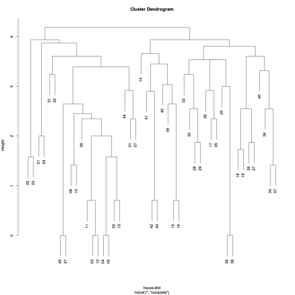

```{r}
# According to distance used
# How to use hierarchical
# clustering
?hclust
plot(hclust(d=hauss.dist,
  method="complete"))
plot(hclust(d=hauss.dist.pop,
  method="complete"))
plot(hclust(d=hauss.dist.bruvo,
  method="complete"))
```

- This is very basic function to make clustering dendrogram
- There are better possibilities (NJ etc - see slide and onward)
- More popular in ecology than in genetics <!-- MERGE-REVIEW: 1 old code block(s) in TEX frame were dropped in favor of the .qmd section 'Hierarchical clustering'. -->

According to distance used

```{r}
?hclust # How to use hierarchical clustering
plot(hclust(d = hauss_dist, method = "complete"))
plot(hclust(d = hauss_dist_pop, method = "complete"))
plot(hclust(d = hauss_dist_bruvo, method = "complete"))
```

### UPGMA and its test

```{r}
# Calculate it
# Saving as phylo object (and not hclust) gives more possibilities for
# further plotting and manipulations
usflu.upgma <- as.phylo(hclust(d=usflu.dist, method="average"))
plot.phylo(x=usflu.upgma, cex=0.75)
title("UPGMA tree")
# Test quality - tests correlation of original distance in the matrix and
# reconstructed distance from hclust object
plot(x=as.vector(usflu.dist), y=as.vector(as.dist(
  cophenetic(usflu.upgma))), xlab="Original pairwise distances",
  ylab="Pairwise distances on the tree", main="Is UPGMA
  appropriate?", pch=20, col=transp(col="black",
  alpha=0.1), cex=2)
# Add correlation line
abline(lm(as.vector(as.dist(cophenetic(usflu.upgma)))~
  as.vector(usflu.dist)), col="red")
# See NJ chapter for testing of this correlation
```

<!-- MERGE-REVIEW: no counterpart section found in QMD; code below comes from the old TEX version. -->

### UPGMA is not the best choice here...

**All points in the right graph should be clustered along the red line...**

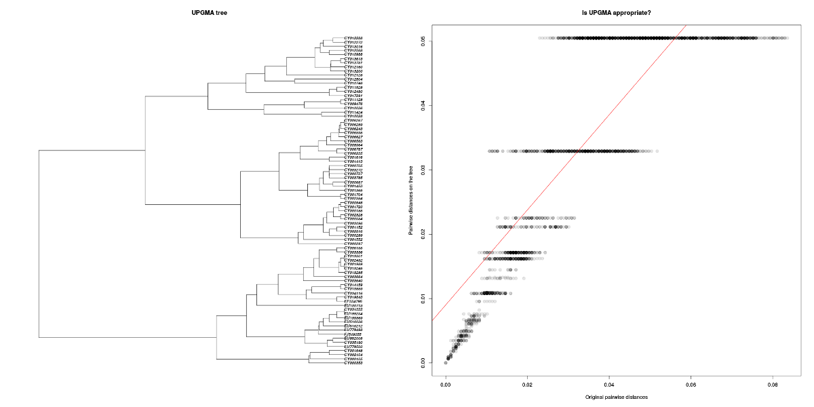 <!-- MERGE-REVIEW: no counterpart section found in QMD; content from TEX kept as-is. -->

## NJ (and UPGMA) tree

### Neighbor-Joining tree

- One of the oldest methods to reconstruct tree-like relationships among samples/populations, still commonly used
- Quality relies on good distance matrix (must be Euclidean etc.) - choose it well according to your data
- Relatively sensitive to amount of missing data - keep under ca. 10--15% missingness in input data
- Usually much better than hierarchical clustering (UPGMA and similar), can be constructed from any data (this universality is big advantage)
- Super fast to compute, easy to do bootstrap test, but usually not so accurate as MP, ML or Bayesian methods
- Suffers of some issues like chaining of individuals in case of low signal in data
- Several method try to reimplement and improve it (see slide ) <!-- MERGE-REVIEW: no counterpart section found in QMD; content from TEX kept as-is. -->

### Calculate and test NJ tree

```{r}
hauss.nj <- nj(hauss.dist) # Calculates the tree (try various distances)
# Test tree quality - plot original vs. reconstructed distance
plot(as.vector(hauss.dist), as.vector(as.dist(cophenetic(hauss.nj))),
  xlab="Original distance", ylab="Reconstructed distance")
abline(lm(as.vector(hauss.dist) ~
  as.vector(as.dist(cophenetic(hauss.nj)))), col="red")
cor.test(x=as.vector(hauss.dist), y=as.vector(as.dist(cophenetic
  (hauss.nj))), alternative="two.sided") # Testing the correlation
# Linear model for above graph
summary(lm(as.vector(hauss.dist) ~
  as.vector(as.dist(cophenetic(hauss.nj))))) # Prints summary text
# Plot a basic tree - see ?plot.phylo for details
plot.phylo(x=hauss.nj, type="phylogram")
plot.phylo(x=hauss.nj, type="cladogram", edge.width=2)
plot.phylo(x=hauss.nj, type="fan", edge.width=2, edge.lty=2)
plot.phylo(x=hauss.nj, type="radial", edge.color="red", edge.width=2,
  edge.lty=3, cex=2) # There are enormous graphical possibilities...
```

<!-- MERGE-REVIEW: no counterpart section found in QMD; code below comes from the old TEX version. -->

### Choose your tree...

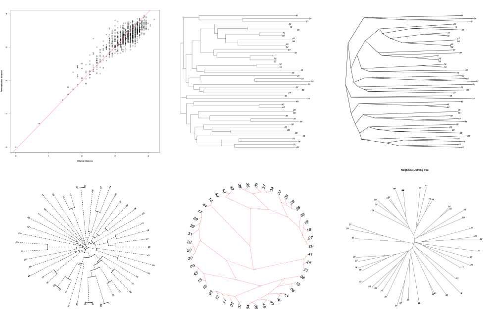 <!-- MERGE-REVIEW: no counterpart section found in QMD; content from TEX kept as-is. -->

### Bootstrap

**Test of reliability of estimated branching pattern**

```{r}
# boot.phylo() re-samples all columns - remove population column first
hauss.loci.nopop <- hauss.loci
hauss.loci.nopop[["population"]] <- NULL
# Calculate the bootstrap - repeat EXACTLY ALL STEPS from data to tree
hauss.boot <- boot.phylo(phy=hauss.nj, x=hauss.loci.nopop, FUN=function
  (XXX) nj(dist.gene(loci2genind(XXX)@tab, method="pairwise")), B=1000)
# boot.phylo returns NUMBER of replicates - NO PERCENTAGE
# Plot the tree
plot.phylo(x=hauss.nj, type="unrooted", main="Neighbor-Joining tree")
# Labels for nodes - bootstrap - see ?nodelabels for graphical settings
nodelabels(text=round(hauss.boot/10))
?boot.phylo # See details
# Another possibility
hauss.aboot <- aboot(x=hauss.genind, tree="nj", distance=nei.dist,
  sample=100) # Bootstrap values are in slot node.label
?aboot # Package poppr
```

<!-- MERGE-REVIEW: no counterpart section found in QMD; code below comes from the old TEX version. -->

### Plotting bootstrap and nicer trees

```{r}
# Plot the tree, explicitly display node labels
plot.phylo(x=hauss.aboot, show.node.label=TRUE)
?plot.phylo # See details...
## Plot a nice tree with colored tips
plot.phylo(x=hauss.nj, type="unr", show.tip=F, edge.width=3, main="NJ")
# Labels for nodes - bootstrap - see ?nodelabels for graphical settings
nodelabels(text=round(hauss.boot/10))
# Colored labels - creates vector of colors according to populations
nj.rainbow <- colorRampPalette(rainbow(length(popNames(hauss.genind))))
tiplabels(text=indNames(hauss.genind), bg=fac2col(x=pop(hauss.genind),
  col.pal=nj.rainbow)) # Colored tips
## Plot BW tree with tip symbols and legend
plot.phylo(x=hauss.nj, type="clad", show.tip=F, edge.width=3, main="NJ")
axisPhylo() # Add axis with distances
# From node labels let's remove unneeded frame
nodelabels(text=round(hauss.boot/10), frame="none", bg="white")
```

<!-- MERGE-REVIEW: no counterpart section found in QMD; code below comes from the old TEX version. -->

### Nicer trees

```{r}
# As tip label we use only symbols - see ?points for graphical details
tiplabels(frame="none", pch=rep(0:4, times=c(13, 17, 2, 6, 9)), lwd=2,
  cex=2)
# Plot a legend explaining symbols
legend(x="topleft", legend=c("He", "Oh", "Pr", "Ne", "Sk"),
  border="black", pch=0:4, pt.lwd=2, pt.cex=2, bty="o", bg="lightgrey",
  box.lwd=2, cex=1.2, title="Populations")
# See more options...
?plot.phylo
?nodelabels
?legend
?axisPhylo
```

- Functions in [ape](https://CRAN.R-project.org/package=ape) (`plot.phylo` and others), [adegenet](https://CRAN.R-project.org/package=adegenet) and another packages provide plenty of options to manipulate and display trees, for users of [ggplot2](https://CRAN.R-project.org/package=ggplot2), [ggtree](https://bioconductor.org/packages/release/bioc/html/ggtree.html) is an interesting alternative <!-- MERGE-REVIEW: no counterpart section found in QMD; code below comes from the old TEX version. -->

### Choose your tree...

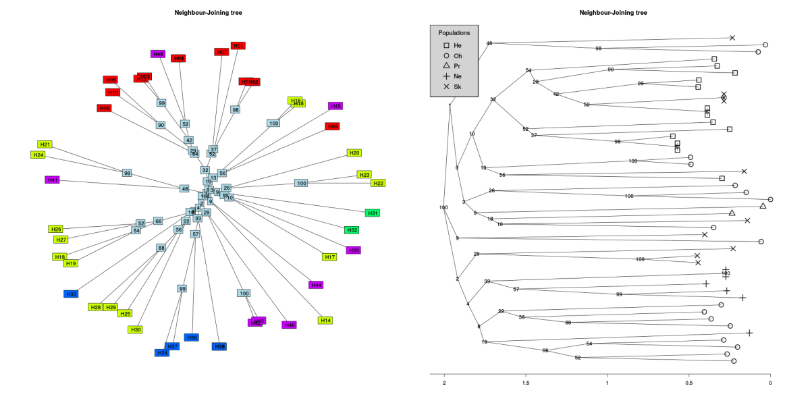 <!-- MERGE-REVIEW: no counterpart section found in QMD; content from TEX kept as-is. -->

### Trees based on Bruvo's distance

**Package poppr (bootstrap is incorporated within the function)**

```{r}
# NJ
hauss.nj.bruvo <- bruvo.boot(pop=hauss.genind, replen=rep(2, 12),
  sample=1000, tree="nj", showtree=TRUE, cutoff=1, quiet=FALSE)
plot.phylo(x=hauss.nj.bruvo, type="unrooted", show.tip=FALSE,
  edge.width=3, main="Neighbor-Joining tree")
# Call node labels as phylo$node.labels or phylo[["node.labels"]]
nodelabels(hauss.nj.bruvo[["node.labels"]]) tiplabels(hauss.nj.bruvo
  [["tip.label"]], bg=fac2col(x=hauss.genind$pop, col.pal=nj.rainbow))
# UPGMA
hauss.upgma <- bruvo.boot(pop=hauss.genind, replen=rep(2, 12),
  sample=1000, tree="upgma", showtree=TRUE, cutoff=1, quiet=FALSE)
plot.phylo(hauss.upgma, type="unrooted", show.tip=FALSE, edge.width=3,
  main="UPGMA tree")
nodelabels(hauss.upgma[["node.labels"]])
tiplabels(hauss.upgma[["tip.label"]], bg=fac2col(x=hauss.genind@pop,
  col.pal=nj.rainbow))
```

<!-- MERGE-REVIEW: 1 old code block(s) in TEX frame were dropped in favor of the .qmd section 'MSN based on Bruvo's distance'. -->

See details and options...

Get the MSN Note SSRs repeats 'rep(2, 12)' - change according to your data Here 12 SSRS loci of length 2 bp

For another data types

Interactive creation of MSN

```{r}
?bruvo.msn
```

```{r}
bruvo.msn(gid = hauss_genind, replen = rep(x = 2, times = 12), loss = TRUE, palette = rainbow, vertex.label = "inds", gscale = TRUE, wscale = TRUE, showplot = TRUE)
```

```{r}
?poppr.msn
```

```{r}
?imsn
```

### Choose your tree...

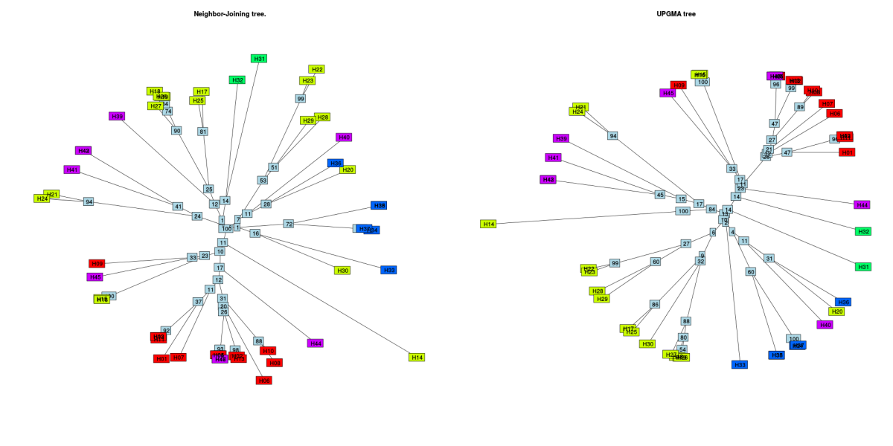 <!-- MERGE-REVIEW: no counterpart section found in QMD; content from TEX kept as-is. -->

### NJ tree of populations

```{r}
?poppr::aboot # aboot() can use distances implemented in poppr:
?poppr::nei.dist
# Calculations
hauss.nj.pop <- aboot(x=hauss.genpop, tree="nj", distance="nei.dist",
  sample=1000, showtree=FALSE)
print.phylo(hauss.nj.pop) # Information about result
# Plot a tree
plot.phylo(x=hauss.nj.pop, type="radial", show.node.label=TRUE,
  cex=1.2, edge.width=3, main="Neighbor-Joining tree of populations")
```

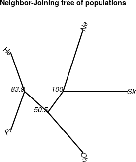 <!-- MERGE-REVIEW: 1 old code block(s) in TEX frame were dropped in favor of the .qmd section 'Tree manipulations'. -->

Library

Root the tree

root.phylo accepts either tip number or tip label resolve.root = TRUE ensures root will be bifurcating (without this parameter it sometimes doesn't work) outgroup can be single value or vector of multiple tips

root.multiPhylo() is an alias for root.phylo() for class multiPhylo

Check if it is rooted - returns TRUE/FALSE

Root the tree interactively

Unroot the tree

root(), unroot() and is.rooted() works with single or multiple trees (class phylo or multiPhylo)

Rotate (swap) clade plot.phylo plots tree in exact order as it is in the phylo object

Ladderize the tree - step-wise rotation of nodes

Drop "extinct"tips - those who don't reach end the tree tolerance is respective to the used metrics

See details

Extract clade, part of tree Plot source tree

See node labels (numbers) - needed for some tasks

Non-interactively extract clade

See new extracted tree

Interactive extraction

Select clade to extract by clicking on it

See new extracted tree

See more options

Bind two trees into one Bind donor "y"tree to a given position of the "x"tree

Bind two trees interactively Plot tree receiving the new one

Select where to bind new tree to

Work with multiple trees Read tree(s) in NEWICK format - single or multiple tree(s)

Export trees in NEWICK format

Export trees in NEXUS format

Root all trees

Drop a tip

Drop a tip from multiPhylo

See tip labels

Check if the tree is ultrametric - is variance of distances of all tips to node 0? It is required for some analysis

Fitting a chronogram to a phylogenetic tree whose branch lengths are in number of substitution per sites - force tree to be ultrametric

Compute branch lengths for trees without branch lengths

Computes the branch lengths of a tree giving its branching times (aka node ages or heights)

Function to calculate number of possible topologies for rooted fully bifurcating phylogenetic trees

See how many possible topologies are there...

```{r}
library("ape")
```

```{r}
plot.phylo(hauss_nj)
print.phylo(hauss_nj)
tiplabels() # Shows tip numbers
```

```{r}
hauss_nj_rooted <- root.phylo(phy = hauss_nj, resolve.root = TRUE, outgroup = 16) # Or
hauss_nj_rooted <- root.phylo(phy = hauss_nj, resolve.root = TRUE, outgroup = "H16") # Or
hauss_nj_rooted <- root.phylo(phy = hauss_nj, resolve.root = TRUE, outgroup = c("H42", "H43"))
```

```{r}
print.phylo(hauss_nj_rooted)
plot.phylo(hauss_nj_rooted)
```

```{r}
is.rooted(hauss_nj_rooted)
is.rooted(hauss_nj)
```

```{r}
plot.phylo(hauss_nj)
hauss_nj_rooted <- root.phylo(phy = hauss_nj, interactive = TRUE) # Click to selected tip
plot.phylo(hauss_nj_rooted)
```

```{r}
?unroot.phylo
```

```{r}
plot.phylo(hauss_nj)
nodelabels()
hauss_nj_rotated <- ape::rotate(phy = hauss_nj, node = 74)
plot.phylo(hauss_nj_rotated)
nodelabels()
```

```{r}
plot.phylo(hauss_nj)
hauss_nj_ladderized <- ladderize(hauss_nj)
plot.phylo(hauss_nj_ladderized)
```

```{r}
plot.phylo(hauss_nj)
axisPhylo()
hauss_nj_fossil <- drop.fossil(phy = hauss_nj, tol = 0.4)
plot.phylo(hauss_nj_fossil)
```

```{r}
?drop.fossil
```

```{r}
plot.phylo(hauss_nj)
```

```{r}
nodelabels()
```

```{r}
hauss_nj_extracted <- extract.clade(phy = hauss_nj, node = 60)
```

```{r}
plot.phylo(hauss_nj_extracted)
```

```{r}
plot.phylo(hauss_nj)
```

```{r}
hauss_nj_extracted <- extract.clade(phy = hauss_nj, interactive = TRUE)
```

```{r}
plot.phylo(hauss_nj_extracted)
```

```{r}
?extract.clade
?keep.tip # Does the opposite - keeps only selected tip(s)
```

```{r}
?bind.tree # See options
plot.phylo(hauss_nj_fossil)
nodelabels()
plot.phylo(hauss_nj_extracted)
nodelabels()
hauss_nj_bind <- bind.tree(x = hauss_nj_fossil, y = hauss_nj_extracted, where = "root", position = 0, interactive = FALSE)
plot.phylo(hauss_nj_bind)
```

```{r}
plot.phylo(hauss_nj_fossil)
```

```{r}
hauss_nj_bind <- bind.tree(x = hauss_nj_fossil, y = hauss_nj_extracted, interactive = TRUE)
plot.phylo(hauss_nj_bind)
```

```{r}
oxalis_trees <- read.tree(file = "https://soubory.trapa.cz/rcourse/oxalis.nwk")
oxalis_trees
lapply(X = oxalis_trees, FUN = print.phylo)
plot(x = oxalis_trees) # See all trees
summary(oxalis_trees)
length(oxalis_trees)
names(oxalis_trees)
```

```{r}
write.tree(phy = oxalis_trees, file = "trees.nwk")
```

```{r}
write.nexus(oxalis_trees, file = "trees.nexus")
```

```{r}
oxalis_trees_rooted <- root(phy = oxalis_trees, outgroup = "O._fibrosa_S159", resolve.root = TRUE)
lapply(X = oxalis_trees_rooted, FUN = print.phylo)
plot(x = oxalis_trees) # See all trees
```

```{r}
plot.phylo(hauss_nj)
hauss_nj[["tip.label"]]
tiplabels()
hauss_nj_drop <- drop.tip(phy = hauss_nj, tip = 47) # Or
hauss_nj_drop <- drop.tip(phy = hauss_nj, tip = "H31") # Or
hauss_nj_drop <- drop.tip(phy = hauss_nj, tip = c("H18", "H29", "H31"))
plot.phylo(hauss_nj_drop)
```

```{r}
plot(x = oxalis_trees)
```

```{r}
oxalis_trees[[1]][["tip.label"]]
oxalis_trees_drop <- lapply(X = oxalis_trees, FUN = drop.tip, tip = "O._callosa_S15")
class(oxalis_trees_drop) <- "multiPhylo"
plot(x = oxalis_trees_drop)
lapply(X = oxalis_trees_drop, FUN = print.phylo)
```

```{r}
is.ultrametric(oxalis_trees)
```

```{r}
?chronos
```

```{r}
?compute.brlen
```

```{r}
?compute.brtime
```

```{r}
nt <- function(n) {
  (factorial(2 * n - 3)) / (2^(n - 2) * factorial(n - 2))
}
```

```{r}
for (i in seq(from = 5, to = 90, by = 5)) {
  cat("Tips:", i, "topologies:", nt(i), "\n")
}
```

### NJ tree based on DNA sequences

**Commonly used as first look at the data**

```{r}
# Calculate the tree
usflu.tree <- nj(X=usflu.dist)
# Plot it
plot.phylo(x=usflu.tree, type="unrooted", show.tip=FALSE)
title("Unrooted NJ tree")
# Colored tips
usflu.pal <- colorRampPalette(topo.colors(length(levels(as.factor(
  usflu.annot[["year"]])))))
# Tip labels
tiplabels(text=usflu.annot$year, bg=num2col(usflu.annot$year,
  col.pal=usflu.pal), cex=0.75)
# Legend - describing years - pretty() automatically shows best
# values from given range, num2col() selects colors from color scale
legend(x="bottomright", fill=num2col(x=pretty(x=1993:2008, n=8),
  col.pal=usflu.pal), leg=pretty(x=1993:2008, n=8), ncol=1)
```

<!-- MERGE-REVIEW: no counterpart section found in QMD; code below comes from the old TEX version. -->

### Root the tree

```{r}
# Root the tree - "outgroup" is name of accession (in quotation marks)
# or number (position within phy object). Here, outgroup is the oldes
# (first) sample as viruses were sampled continuously during seveal years
usflu.tree.rooted <- root.phylo(phy=usflu.tree, outgroup=1)
# Plot it
plot.phylo(x=usflu.tree.rooted, show.tip=FALSE, edge.width=2)
title("Rooted NJ tree")
# Labeling of tips
tiplabels(text=usflu.annot$year, bg=transp(num2col(x=usflu.annot$year,
  col.pal=usflu.pal), alpha=0.7), cex=0.75, fg="transparent")
# Add axis with phylogenetic distance
axisPhylo()
# Legend - describing years - pretty() automatically shows best values
# from given range, num2col() selects colors from color scale
legend(x="topright", fill=num2col(x=pretty(x=1993:2008, n=8),
  col.pal=usflu.pal), leg=pretty(x=1993:2008, n=8), ncol=1)
```

<!-- MERGE-REVIEW: no counterpart section found in QMD; code below comes from the old TEX version. -->

### Bootstrap rooted tree

```{r}
# Calculate it
usflu.boot <- boot.phylo(phy=usflu.tree.rooted, x=usflu.dna, FUN=
  function(EEE) root.phylo(nj(dist.dna(EEE, model="TN93")), outgroup=1),
  B=1000)
# Plot the tree
plot.phylo(x=usflu.tree.rooted, show.tip=FALSE, edge.width=2)
title("NJ tree + bootstrap values")
tiplabels(frame="none", pch=20, col=transp(num2col(x=usflu.annot[["year"]],
  col.pal=usflu.pal), alpha=0.7), cex=3.5, fg="transparent")
axisPhylo()
# Legend - describing years - pretty() automatically shows best values
# from given range, num2col() selects colors from color scale
legend(x="topright", fill=num2col(x=pretty(x=1993:2008, n=8),
  col.pal=usflu.pal), leg=pretty(x=1993:2008, n=8), ncol=1)
# Plots bootstrap support - note usflu.boot contains raw numbers transform
# it into percent
nodelabels(text=round(usflu.boot/10), cex=0.75)
```

<!-- MERGE-REVIEW: no counterpart section found in QMD; code below comes from the old TEX version. -->

### Collapse branches with low bootstrap support

```{r}
usflu.tree.usflu.na.density <- usflu.tree.rooted
# Determine branches with low support - note BS values are in raw
# numbers - use desired percentage with respect to number of bootstraps
usflu.tocollapse <- match(x=which(usflu.boot < 700)+length(
  usflu.tree.rooted$tip.label),table=usflu.tree.usflu.na.density$edge[,2])
# Set length of bad branches to zero
usflu.tree.usflu.na.density$edge.length[usflu.tocollapse] <- 0
# Create new tree
usflu.tree.collapsed <- di2multi(usflu.tree.usflu.na.density, tol=0.00001)
# Plot the consensus tree
plot.phylo(x=usflu.tree.collapsed, show.tip=FALSE, edge.width=2)
title("NJ tree after collapsing weak nodes")
tiplabels(text=usflu.annot$year, bg=transp(num2col(x=usflu.annot
  [["year"]], col.pal=usflu.pal), alpha=0.7), cex=0.5, fg="transparent")
axisPhylo()
legend(x="topright", fill=num2col(x=pretty(x=1993:2008, n=8),
  col.pal=usflu.pal), leg=pretty(x=1993:2008, n=8), ncol=1)
```

<!-- MERGE-REVIEW: no counterpart section found in QMD; code below comes from the old TEX version. -->

### The trees

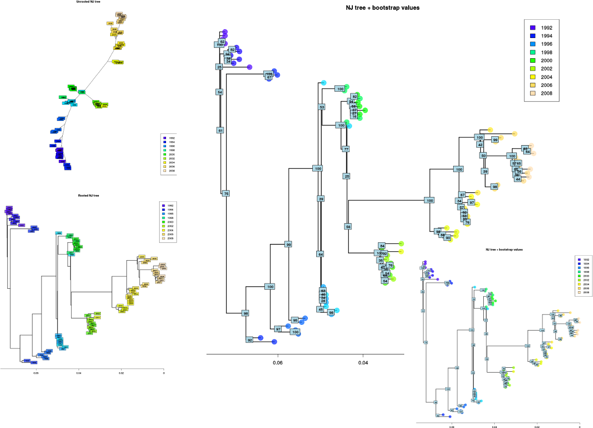 <!-- MERGE-REVIEW: no counterpart section found in QMD; content from TEX kept as-is. -->

### NJ is death. Long live NJ!

- "Basic" NJ has many limitations (problems with missing data, chaining of individuals, ...) - there are several tries to overcome them
- Package `phangorn` has functions `NJ()` and unweighted version `UNJ()`
- Package `ape` has functions `njs()` and `bionjs()` which are designed to perform well on distances with (more) missing values
- Function `bionj()` from `ape` implements BIONJ algorithm
- FastME functions (package `ape`) perform the minimum evolution algorithm and aim to be replacement of NJ - read `?fastme` before use
- All those functions read distance matrix and their usage is same as with "classical" `nj()` (read manual pages before using them) - it is also from package `ape` <!-- MERGE-REVIEW: no counterpart section found in QMD; content from TEX kept as-is. -->

## PCoA

### Principal Coordinate Analysis (PCoA), Principal Component Analysis (PCA) and relatives

- Create 2-D scatter plot (mostly) showing relationships among samples and their grouping

- PCoA is variant of PCA using distance matrix as input (not primary data as PCA)

  - It's crucial to select correct Euclidean distance matrix

- PCA is using as input data frame with any data type, but results are unstable for large number of variables (typical case for molecular data - each locus is one variable)

  - In genetic data, each locus (position in alignment, SSRs locus, ...) is separate variable from technical point of view
  - PCA is unstable if there are more variables than samples

- These methods are exploratory

  - For creating hypothesis, **not testing** them
  - There are no tests involved, no bootstraps, nothing like that

- There are variants of PCA for spatial data, for analysis of traits, etc.

- More such multivariate methods are used in another fields, like NMDS in ecology, ... <!-- MERGE-REVIEW: no counterpart section found in QMD; content from TEX kept as-is. -->

### PCoA I

```{r}
hauss.pcoa <- dudi.pco(d=dist.gene(x=scaleGen(x=hauss.genind, center=TRUE,
  scale=FALSE, truenames=TRUE), method="pairwise"), scannf=FALSE, nf=3)
s.label(dfxy=hauss.pcoa$li, clabel=0.75) # Basic display
# To plot different axes use for example dfxy=hauss.pcoa$li[c(2, 3)]
s.kde2d(dfxy=hauss.pcoa$li, cpoint=0, add.plot=TRUE) # Add kernel density
# Add histogram of Eigenvalues
add.scatter.eig(w=hauss.pcoa$eig, nf=3, xax=1, yax=2, posi="topleft",
  sub="Eigenvalues")
# Percentage of variance explained by each PC axis
100*hauss.pcoa$eig/sum(hauss.pcoa$eig)
# Colored display according to populations
# Creates vector of colors according to populations
hauss.pcoa.col <- rainbow(length(popNames(hauss.genind)))
s.class(dfxy=hauss.pcoa$li, fac=pop(hauss.genind), col=hauss.pcoa.col)
add.scatter.eig(w=hauss.pcoa$eig, nf=3, xax=1, yax=2, posi="bottomleft",
  sub="Eigenvalues")
title("Principal Coordinates Analysis") # Adds title to the graph
```

<!-- MERGE-REVIEW: 1 old code block(s) in TEX frame were dropped in favor of the .qmd section 'PCoA'. -->

<!-- MERGE-REVIEW: content of the .qmd section 'PCoA' was inserted at 2 frames; remove the unwanted duplicates. -->

Calculate it - based on various distance matrix

Basic display

To plot different axes use for example "...dfxy = hauss_pcoa\$li\[c(2, 3)\]..." Add kernel density

Add histogram of Eigenvalues

Percentage of variance explained by each PC axis

Colored display according to populations

Based on Bruvo's distance

Another possibility for colored plot (see ?colorplot for details)

```{r}
hauss_pcoa <- dudi.pco(d = dist.gene(x = scaleGen(x = hauss_genind, center = TRUE, scale = FALSE, truenames = TRUE), method = "pairwise"), scannf = FALSE, nf = 3)
```

```{r}
s.label(dfxy = hauss_pcoa$li, clabel = 0.75)
```

```{r}
s.kde2d(dfxy = hauss_pcoa$li, cpoint = 0, add.plot = TRUE)
```

```{r}
add.scatter.eig(w = hauss_pcoa$eig, nf = 3, xax = 1, yax = 2, posi = "topleft", sub = "Eigenvalues")
```

```{r}
100 * hauss_pcoa$eig / sum(hauss_pcoa$eig)
```

```{r}
hauss_pcoa_col <- rainbow(length(popNames(hauss_genind))) # Creates vector of colors according to populations
s.class(dfxy = hauss_pcoa$li, fac = pop(hauss_genind), col = hauss_pcoa_col)
add.scatter.eig(w = hauss_pcoa$eig, nf = 3, xax = 1, yax = 2, posi = "bottomleft", sub = "Eigenvalues")
title("Principal Coordinates Analysis") # Adds title to the graph
```

```{r}
hauss_pcoa_bruvo <- dudi.pco(d = bruvo.dist(pop = hauss_genind, replen = rep(2, 12)), scannf = FALSE, nf = 3)
s.class(dfxy = hauss_pcoa_bruvo$li, fac = pop(hauss_genind), col = hauss_pcoa_col)
add.scatter.eig(hauss_pcoa_bruvo$eig, posi = "bottomright", 3, 1, 2)
```

```{r}
colorplot(xy = hauss_pcoa$li[c(1, 2)], X = hauss_pcoa$li, transp = TRUE, cex = 3, xlab = "PC 1", ylab = "PC 2")
title(main = "PCoA, axes 1 and 2")
abline(v = 0, h = 0, col = "grey", lty = 2)
```

### PCoA II

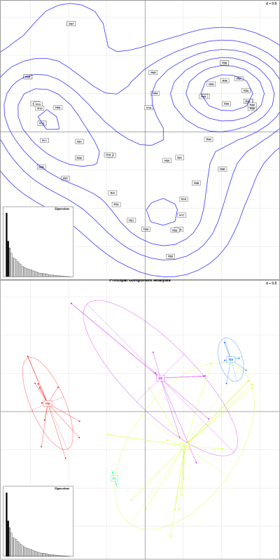

```{r}
# Based on Bruvo's distance
hauss.pcoa.bruvo <- dudi.pco(d=
  bruvo.dist(pop=hauss.genind,
  replen=rep(2, 12)),
  scannf=FALSE, nf=3)
s.class(dfxy=hauss.pcoa.bruvo$li,
  fac=pop(hauss.genind),
  col=hauss.pcoa.col)
add.scatter.eig(hauss.pcoa.bruvo$
  eig, posi="bottomright", 3,1,2)
# Another possibility for colored
# plot (see ?colorplot for details)
colorplot(xy=hauss.pcoa$li[c(1,2)],
  X=hauss.pcoa$li, transp=TRUE,
  cex=3, xlab="PC 1", ylab="PC 2")
title(main="PCoA, axes 1 and 2")
abline(v=0, h=0, col="gray", lty=2)
```

<!-- MERGE-REVIEW: 1 old code block(s) in TEX frame were dropped in favor of the .qmd section 'PCoA'. -->

<!-- MERGE-REVIEW: content of the .qmd section 'PCoA' was inserted at 2 frames; remove the unwanted duplicates. -->

Calculate it - based on various distance matrix

Basic display

To plot different axes use for example "...dfxy = hauss_pcoa\$li\[c(2, 3)\]..." Add kernel density

Add histogram of Eigenvalues

Percentage of variance explained by each PC axis

Colored display according to populations

Based on Bruvo's distance

Another possibility for colored plot (see ?colorplot for details)

```{r}
hauss_pcoa <- dudi.pco(d = dist.gene(x = scaleGen(x = hauss_genind, center = TRUE, scale = FALSE, truenames = TRUE), method = "pairwise"), scannf = FALSE, nf = 3)
```

```{r}
s.label(dfxy = hauss_pcoa$li, clabel = 0.75)
```

```{r}
s.kde2d(dfxy = hauss_pcoa$li, cpoint = 0, add.plot = TRUE)
```

```{r}
add.scatter.eig(w = hauss_pcoa$eig, nf = 3, xax = 1, yax = 2, posi = "topleft", sub = "Eigenvalues")
```

```{r}
100 * hauss_pcoa$eig / sum(hauss_pcoa$eig)
```

```{r}
hauss_pcoa_col <- rainbow(length(popNames(hauss_genind))) # Creates vector of colors according to populations
s.class(dfxy = hauss_pcoa$li, fac = pop(hauss_genind), col = hauss_pcoa_col)
add.scatter.eig(w = hauss_pcoa$eig, nf = 3, xax = 1, yax = 2, posi = "bottomleft", sub = "Eigenvalues")
title("Principal Coordinates Analysis") # Adds title to the graph
```

```{r}
hauss_pcoa_bruvo <- dudi.pco(d = bruvo.dist(pop = hauss_genind, replen = rep(2, 12)), scannf = FALSE, nf = 3)
s.class(dfxy = hauss_pcoa_bruvo$li, fac = pop(hauss_genind), col = hauss_pcoa_col)
add.scatter.eig(hauss_pcoa_bruvo$eig, posi = "bottomright", 3, 1, 2)
```

```{r}
colorplot(xy = hauss_pcoa$li[c(1, 2)], X = hauss_pcoa$li, transp = TRUE, cex = 3, xlab = "PC 1", ylab = "PC 2")
title(main = "PCoA, axes 1 and 2")
abline(v = 0, h = 0, col = "grey", lty = 2)
```

### PCoA - Bruvo and colorplot

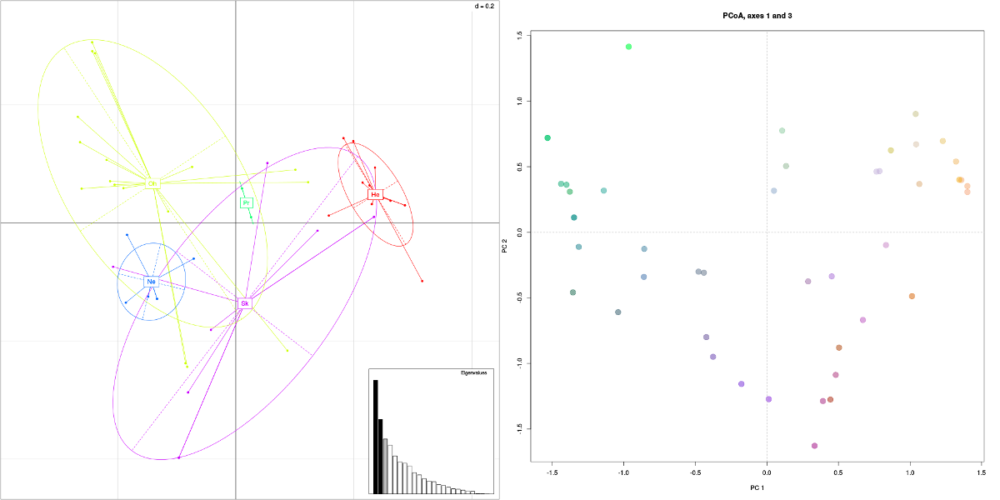 <!-- MERGE-REVIEW: no counterpart section found in QMD; content from TEX kept as-is. -->

## AMOVA

### AMOVA I

- Analysis of molecular variance tests if there are significant differences among populations (and/or another levels)
- Some implementations can partition variance into various levels
- `pegas::amova` returns a table of sums of square deviations (`SSD`), mean square deviations (`MSD`), and the number of degrees of freedom (`df`), and a vector of variance components (`sigma2`)
- See `sigma2` column for how much of the variance is on which level - percentage can be calculated as percentage of each level from total
- For more complicated hierarchy see `?poppr::poppr.amova`
- For mixed-ploidy dat sets see `?StAMPP::stamppAmova`

<!-- MERGE-REVIEW: content of the .qmd section 'AMOVA' was inserted at 2 frames; remove the unwanted duplicates. -->

From package pegas (doesn't directly show percentage of variance)

See results

For more complicated hierarchy

For mixed-ploidy dat sets

```{r}
hauss_pop <- pop(hauss_genind)
hauss_amova <- pegas::amova(hauss_dist ~ hauss_pop, data = NULL, nperm = 1000, is.squared = FALSE)
```

```{r}
hauss_amova
```

```{r}
?poppr::poppr.amova
```

```{r}
?StAMPP::stamppAmova
```

### AMOVA II

```{r}
hauss.pop <- pop(hauss.genind)
hauss.amova <- pegas::amova(hauss.dist~hauss.pop, data=NULL,
  nperm=1000, is.squared=FALSE)
# See results
hauss.amova
...
                SSD       MSD df
hauss.pop  5770.446 1442.6116  4
Error     12022.022  286.2386 42
Total     17792.468  386.7928 46
...
Variance components:
          sigma2 P.value
hauss.pop 133.37       0 # From here we can calculate the percentage
Error     286.24         # 100 * 133.37 / (133.37 + 286.24) = 31.78 %
...
```

<!-- MERGE-REVIEW: 1 old code block(s) in TEX frame were dropped in favor of the .qmd section 'AMOVA'. -->

<!-- MERGE-REVIEW: content of the .qmd section 'AMOVA' was inserted at 2 frames; remove the unwanted duplicates. -->

From package pegas (doesn't directly show percentage of variance)

See results

For more complicated hierarchy

For mixed-ploidy dat sets

```{r}
hauss_pop <- pop(hauss_genind)
hauss_amova <- pegas::amova(hauss_dist ~ hauss_pop, data = NULL, nperm = 1000, is.squared = FALSE)
```

```{r}
hauss_amova
```

```{r}
?poppr::poppr.amova
```

```{r}
?StAMPP::stamppAmova
```

## Tasks

### Process more data

**Not all combinations and possibilities were shown...**

1.  Most of examples of basic analysis were shown with the *Taraxacum haussknechtii* microsatellite dataset - try to do some analysis with another imported data
2.  Try some of the introduced analysis with your own custom imported data
3.  Try at least 2--3 analysis according to your interests

- Of course, following chapters will show more possible analysis...
- Previous examples are not covering all possibilities...
- It is crucial to be able to edit the introduced commands to be able to handle your data
- Check help pages of the functions for more options what to do with your data <!-- MERGE-REVIEW: no counterpart section found in QMD; content from TEX kept as-is. -->

# SNP

### Special functions to work with huge SNP data sets

- Those tools are designed mainly for situation when having multiple (nearly) complete genomes - not needed for smaller data sets
- Lets keep hoping in fast development of computers...
- **Windows users:** To speed up the processing, `gl*` functions use parallelization library **unavailable on Windows** - add parameter `parallel=FALSE` to be able to use them

```{r}
# Plot of missing data (white) and number of 2nd alleles
glPlot(x=usflu.genlight, legend=TRUE, posi="topleft")
# Sum of the number of second allele in each SNP
usflu.freq <- glSum(usflu.genlight)
# Plot distribution of (second) allele frequencies
hist(x=usflu.freq, proba=TRUE, col="gold", xlab="Allele frequencies",
  main="Distribution of (second) allele frequencies")
lines(x=density(usflu.freq)$x, y=density(usflu.freq)$y*1.5, col="red",
  lwd=3 )
```

<!-- MERGE-REVIEW: no counterpart section found in QMD; code below comes from the old TEX version. -->

### Number of missing values in each locus

```{r}
usflu.mean <- glMean(usflu.genlight)      # Mean number of second
usflu.mean <- c(usflu.mean, 1-usflu.mean) # allele in each SNP
# Plot distribution of allele frequencies
hist(x=usflu.mean, proba=TRUE, col="darkseagreen3", xlab="Allele
  frequencies", main="Distribution of allele frequencies", nclass=20)
lines(x=density(usflu.mean, bw=0.05)$x, y=density(usflu.mean, bw=0.05)$y*2,
  lwd=3)
# Play with bw parameter to get optimal image
usflu.na.density <- density(glNA(usflu.genlight), bw=10)
# Set range of xlim parameter from 0 to the length of original alignment
plot(x=usflu.na.density, type="n", xlab="Position in the alignment",
  main="Location of the missing values (NA)", xlim=c(0, 1701))
polygon(c(usflu.na.density$x, rev(usflu.na.density$x)),
  c(usflu.na.density$y, rep(0, length(usflu.na.density$x))),
  col=transp("blue", alpha=0.3))
points(glNA(usflu.genlight), rep(0, nLoc(usflu.genlight)), pch="|", cex=2,
  col="blue")
```

<!-- MERGE-REVIEW: no counterpart section found in QMD; code below comes from the old TEX version. -->

### Basic information about SNP: distribution of 2$^{nd}$ allele frequencies, missing data and number of 2$^{nd}$ allele, distribution of allele frequencies, and number of missing values in each locus

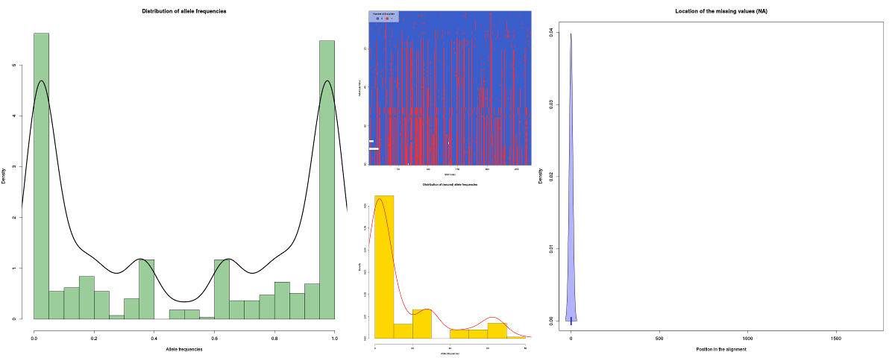 <!-- MERGE-REVIEW: no counterpart section found in QMD; content from TEX kept as-is. -->

## PCA and NJ

### PCA, NJ and genlight objects

```{r}
usflu.pca <- glPca(x=usflu.genlight, center=TRUE, scale=FALSE,
  loadings=TRUE) # Select number of retained PC axes, about 10 here
scatter.glPca(x=usflu.pca, posi="topright") # Plot PCA
title("PCA of the US influenza data")
# Loading plot - contribution of variables to the pattern observed
loadingplot.glPca(x=usflu.pca)
colorplot(usflu.pca$scores, usflu.pca$scores, transp=TRUE, cex=4) # Cols
title("PCA of the US influenza data")
abline(h=0, v=0, col="gray")
add.scatter.eig(usflu.pca[["eig"]][1:40], 2, 1, 2, posi="topright",
  inset=0.05, ratio=0.3)
usflu.tree.genlight <- nj(dist.gene(as.matrix(usflu.genlight))) # Get tree
# Plot colored phylogenetic tree
plot.phylo(x=usflu.tree.genlight, type="fan", show.tip=FALSE)
tiplabels(pch=20, col=num2col(usflu.annot[["year"]], col.pal=usflu.pal),
  cex=4)
title("NJ tree of the US influenza data")
```

<!-- MERGE-REVIEW: no counterpart section found in QMD; code below comes from the old TEX version. -->

### PCA, NJ and genlight objects

```{r}
legend(x="topright", fill=num2col(x=pretty(x=1993:2008, n=8),
  col.pal=usflu.pal), leg=pretty(x=1993:2008, n=8), ncol=1)
```

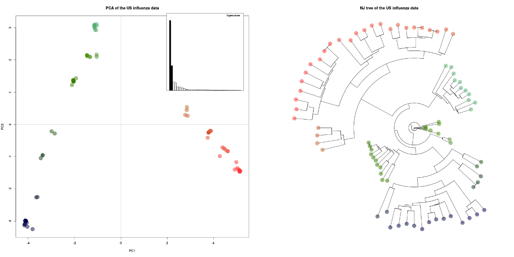 <!-- MERGE-REVIEW: no counterpart section found in QMD; code below comes from the old TEX version. -->

# DAPC

### DAPC

- Discriminant Analysis of Principal components ([Jombart et al. 2010](https://bmcgenet.biomedcentral.com/articles/10.1186/1471-2156-11-94))
- Runs K-means Bayesian clustering on data transformed with PCA (reduces number of variables, speeds up process)
- User selects best **K** - number of clusters; according to scores shown
- Finally it runs discriminant analysis (DA) to maximize differences among groups
- Various modes of displaying of results - "Structure-like", "PCA-like" and more
- More information at <https://adegenet.r-forge.r-project.org/>
- If following commands would seem too complicated, try web interface

```{r}
library(adegenet)
adegenetServer("DAPC") # Recommended to open in Google Chrome/Chromium
adegenetTutorial("dapc") # Tutorial, more information about DAPC
```

<!-- MERGE-REVIEW: 1 old code block(s) in TEX frame were dropped in favor of the .qmd section 'DAPC'. -->

<!-- MERGE-REVIEW: content of the .qmd section 'DAPC' was inserted at 3 frames; remove the unwanted duplicates. -->

K = 2 Create DAPC Number of informative PC (Here 15, adegenet recommends \< N/3). Select number of informative DA (here 1 - only one is available - it won't produce PCA graph).

Information

Density functions

Assignment of individuals to clusters

Structure-like plot

Loadingplot - alleles the most adding to separation of individuals

alfa-score - according to number of PC axis

K = 3 Create DAPC Number of informative PC (Here 15, adegenet recommends \< N/3). Select number of informative DA (here 2).

Information

A la PCA graph

Same in BW

Density functions - only for first axis here!

Assignment of individuals to clusters

Structure-like plot

Loadingplot - alleles the most adding to separation of individuals

alfa-score - according to number of PC axis

```{r}
hauss_dapc <- dapc(x = hauss_genind, pop = hauss_kfind$grp, center = TRUE, scale = FALSE, var.contrib = TRUE, pca.info = TRUE, truenames = TRUE)
```

```{r}
hauss_dapc
```

```{r}
scatter(x = hauss_dapc, xax = 1, yax = 1, main = "DAPC", bg = "white", solid = 0.5, leg = TRUE, txt.leg = c("Group 1", "Group 2"), posi.leg = "topright")
```

```{r}
assignplot(x = hauss_dapc)
```

```{r}
compoplot(x = hauss_dapc, xlab = "Individuals", leg = FALSE)
```

```{r}
loadingplot(x = hauss_dapc$var.contr)
```

```{r}
optim.a.score(x = hauss_dapc)

```

```{r}
hauss_dapc3 <- dapc(x = hauss_genind, pop = hauss_kfind3$grp, center = TRUE, scale = FALSE, var.contrib = TRUE, pca.info = TRUE, truenames = TRUE)
```

```{r}
hauss_dapc
```

```{r}
scatter(x = hauss_dapc3, main = "DAPC, Taraxacum haussknechtii", bg = "white", cex = 3, clab = 0, col = rainbow(3), posi.da = "bottomleft", scree.pca = TRUE, posi.pca = "bottomright", leg = TRUE, txt.leg = c("Group 1", "Group 2", "Group 3"), posi.leg = "topleft")
```

```{r}
scatter(x = hauss_dapc3, main = "DAPC, Taraxacum haussknechtii", bg = "white", pch = c(15:17), cell = 0, cstar = 0, solid = 1, cex = 2.5, clab = 0, col = gray.colors(3, start = 0, end = 0.8, gamma = 2, alpha = 0), posi.da = "bottomleft", scree.pca = TRUE, posi.pca = "bottomright", leg = TRUE, txt.leg = c("Group 1", "Group 2", "Group 3"), posi.leg = "topleft")
```

```{r}
scatter(x = hauss_dapc3, xax = 1, yax = 1, main = "DAPC", bg = "white", solid = 0.5, leg = TRUE, txt.leg = c("Group 1", "Group 2", "Group 3"), posi.leg = "topleft")
```

```{r}
assignplot(hauss_dapc3)
```

```{r}
compoplot(hauss_dapc3, xlab = "Individuals", leg = FALSE)
```

```{r}
loadingplot(hauss_dapc3$var.contr)
```

```{r}
optim.a.score(hauss_dapc3)

```

### Principal difference between PCA and DA

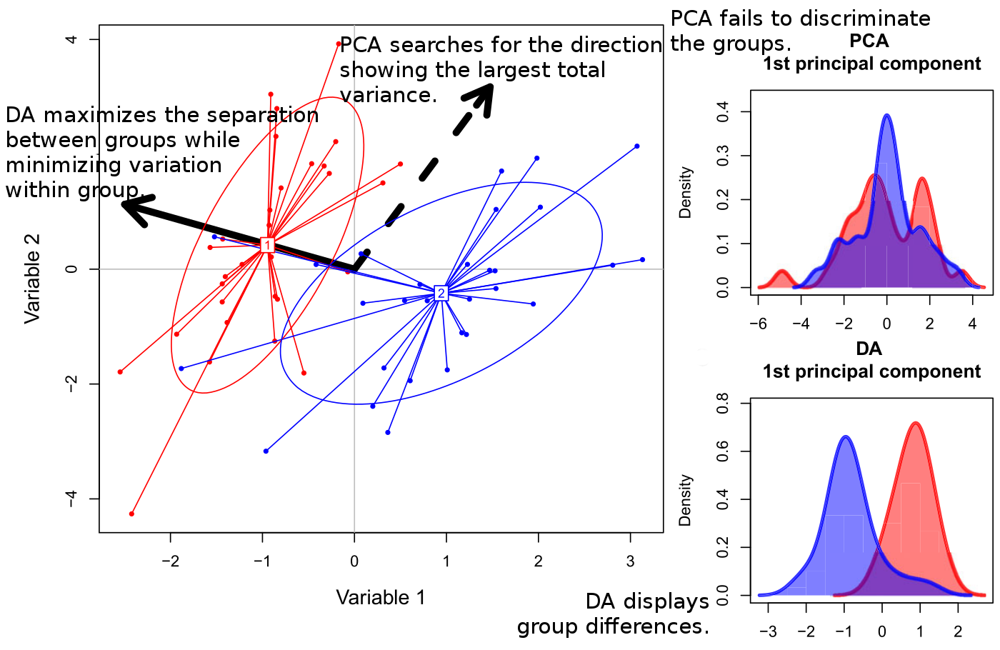 <!-- MERGE-REVIEW: no counterpart section found in QMD; content from TEX kept as-is. -->

### DAPC example of almost 500 samples of *Nuphar lutea*

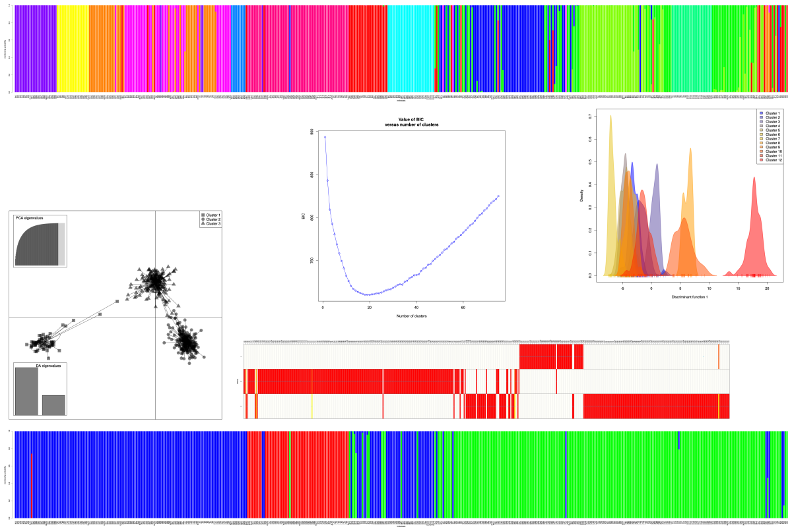 <!-- MERGE-REVIEW: no counterpart section found in QMD; content from TEX kept as-is. -->

## Bayesian clustering

### K-find - Bayesian K-means clustering

```{r}
# Retain all informative PC (here about 35)
# According to second graph select best K (here 2 or 3)
# Now we select K=2 and later rerun the analysis for K=3 (lines 14-18)
hauss.kfind <- find.clusters(x=hauss.genind, stat="BIC",
  choose.n.clust=TRUE, max.n.clust=10, n.iter=100000, n.start=100,
  scale=FALSE, truenames=TRUE)
table(pop(hauss.genind), hauss.kfind$grp) # See results as text
hauss.kfind
# Graph showing table of original and inferred populations and
# assignment of individuals
table.value(df=table(pop(hauss.genind), hauss.kfind$grp), col.lab=
  paste("Inferred\ncluster", 1:length(hauss.kfind$size)), grid=TRUE)
# For K=3 - note parameters n.pca and n.clust - we just rerun the
# analysis and when results are stable, no problem here
hauss.kfind3 <- find.clusters(x=hauss.genind, n.pca=35, n.clust=3,
  stat="BIC", choose.n.clust=FALSE, n.iter=100000, n.start=100,
  scale=FALSE, truenames=TRUE)
```

<!-- MERGE-REVIEW: no counterpart section found in QMD; code below comes from the old TEX version. -->

### K-find outputs

- Cumulative variance of axis

- BIC helps to select the best K

- Original and inferred groups

  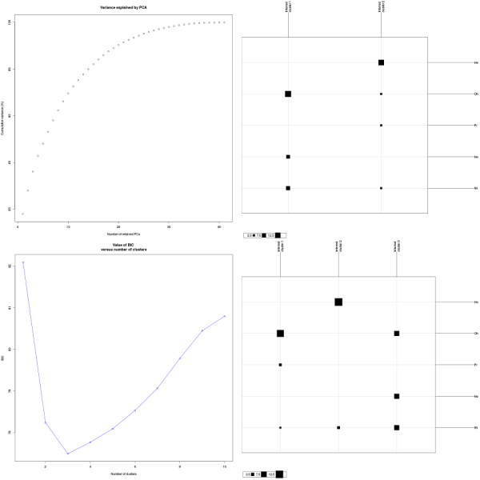

```{r}
# See results as text
table(pop(hauss.genind),
  hauss.kfind3$grp)
hauss.kfind3
# Graph showing table of original
# and inferred populations and
# assignment of individuals
table.value(
  df=table(pop(hauss.genind),
  hauss.kfind3$grp), col.lab=
  paste("Inferred\ncluster",
  1:length(hauss.kfind3$size)),
  grid=TRUE)
# If needed, use custom text for
# parameter col.lab=c("...", "...")
# as many labels as inferred groups
```

<!-- MERGE-REVIEW: 1 old code block(s) in TEX frame were dropped in favor of the .qmd section 'K-find'. -->

Bayesian K-means clustering Retain all informative PC (here about 35). According to second graph select best K (here 2 or 3).

See results as text

Graph showing table of original and inferred populations and assignment of individuals

For K = 3 - note parameters n.pca and n.clust - we just rerun the analysis and when results are stable, no problem here

See results as text

Graph showing table of original and inferred populations and assignment of individuals

```{r}
hauss_kfind <- find.clusters(x = hauss_genind, stat = "BIC", choose.n.clust = TRUE, max.n.clust = 10, n.iter = 100000, n.start = 100, scale = FALSE, truenames = TRUE)
```

```{r}
table(pop(hauss_genind), hauss_kfind$grp)
hauss_kfind
```

```{r}
table.value(df = table(pop(hauss_genind), hauss_kfind$grp), col.labels = paste("Inferred\ncluster", seq_along(hauss_kfind$size)), grid = TRUE)
```

```{r}
hauss_kfind3 <- find.clusters(x = hauss_genind, n.pca = 35, n.clust = 3, stat = "BIC", choose.n.clust = FALSE, n.iter = 100000, n.start = 100, scale = FALSE, truenames = TRUE)
```

```{r}
table(pop(hauss_genind), hauss_kfind3$grp)
hauss_kfind3
```

```{r}
table.value(df = table(pop(hauss_genind), hauss_kfind3$grp), col.labels = paste("Inferred\ncluster", seq_along(hauss_kfind3$size)), grid = TRUE)
```

## Discriminant analysis and visualization

### DAPC code I

```{r}
## K=2
# Create DAPC
# Number of informative PC (Here 15, adegenet recommends < N/3). Select
# number of informative DA (here only one is available - no PCA graph)
hauss.dapc <- dapc(x=hauss.genind, pop=hauss.kfind$grp, center=TRUE,
  scale=FALSE, var.contrib=TRUE, pca.info=TRUE, truenames=TRUE)
# Information
hauss.dapc
# Density function - only for first axis here!
scatter(x=hauss.dapc, xax=1, yax=1, main="DAPC", bg="white", solid=0.5,
  leg=TRUE, txt.leg=c("Group 1", "Group 2"), posi.leg="topright")
# Assignment of individuals to clusters
assignplot(x=hauss.dapc)
# Structure-like plot
compoplot(x=hauss.dapc, xlab="Individuals", leg=FALSE)
# Loadingplot - alleles the most adding to separation of individuals
loadingplot(x=hauss.dapc$var.contr)
```

<!-- MERGE-REVIEW: 1 old code block(s) in TEX frame were dropped in favor of the .qmd section 'DAPC'. -->

<!-- MERGE-REVIEW: content of the .qmd section 'DAPC' was inserted at 3 frames; remove the unwanted duplicates. -->

K = 2 Create DAPC Number of informative PC (Here 15, adegenet recommends \< N/3). Select number of informative DA (here 1 - only one is available - it won't produce PCA graph).

Information

Density functions

Assignment of individuals to clusters

Structure-like plot

Loadingplot - alleles the most adding to separation of individuals

alfa-score - according to number of PC axis

K = 3 Create DAPC Number of informative PC (Here 15, adegenet recommends \< N/3). Select number of informative DA (here 2).

Information

A la PCA graph

Same in BW

Density functions - only for first axis here!

Assignment of individuals to clusters

Structure-like plot

Loadingplot - alleles the most adding to separation of individuals

alfa-score - according to number of PC axis

```{r}
hauss_dapc <- dapc(x = hauss_genind, pop = hauss_kfind$grp, center = TRUE, scale = FALSE, var.contrib = TRUE, pca.info = TRUE, truenames = TRUE)
```

```{r}
hauss_dapc
```

```{r}
scatter(x = hauss_dapc, xax = 1, yax = 1, main = "DAPC", bg = "white", solid = 0.5, leg = TRUE, txt.leg = c("Group 1", "Group 2"), posi.leg = "topright")
```

```{r}
assignplot(x = hauss_dapc)
```

```{r}
compoplot(x = hauss_dapc, xlab = "Individuals", leg = FALSE)
```

```{r}
loadingplot(x = hauss_dapc$var.contr)
```

```{r}
optim.a.score(x = hauss_dapc)

```

```{r}
hauss_dapc3 <- dapc(x = hauss_genind, pop = hauss_kfind3$grp, center = TRUE, scale = FALSE, var.contrib = TRUE, pca.info = TRUE, truenames = TRUE)
```

```{r}
hauss_dapc
```

```{r}
scatter(x = hauss_dapc3, main = "DAPC, Taraxacum haussknechtii", bg = "white", cex = 3, clab = 0, col = rainbow(3), posi.da = "bottomleft", scree.pca = TRUE, posi.pca = "bottomright", leg = TRUE, txt.leg = c("Group 1", "Group 2", "Group 3"), posi.leg = "topleft")
```

```{r}
scatter(x = hauss_dapc3, main = "DAPC, Taraxacum haussknechtii", bg = "white", pch = c(15:17), cell = 0, cstar = 0, solid = 1, cex = 2.5, clab = 0, col = gray.colors(3, start = 0, end = 0.8, gamma = 2, alpha = 0), posi.da = "bottomleft", scree.pca = TRUE, posi.pca = "bottomright", leg = TRUE, txt.leg = c("Group 1", "Group 2", "Group 3"), posi.leg = "topleft")
```

```{r}
scatter(x = hauss_dapc3, xax = 1, yax = 1, main = "DAPC", bg = "white", solid = 0.5, leg = TRUE, txt.leg = c("Group 1", "Group 2", "Group 3"), posi.leg = "topleft")
```

```{r}
assignplot(hauss_dapc3)
```

```{r}
compoplot(hauss_dapc3, xlab = "Individuals", leg = FALSE)
```

```{r}
loadingplot(hauss_dapc3$var.contr)
```

```{r}
optim.a.score(hauss_dapc3)

```

### DAPC for K=2

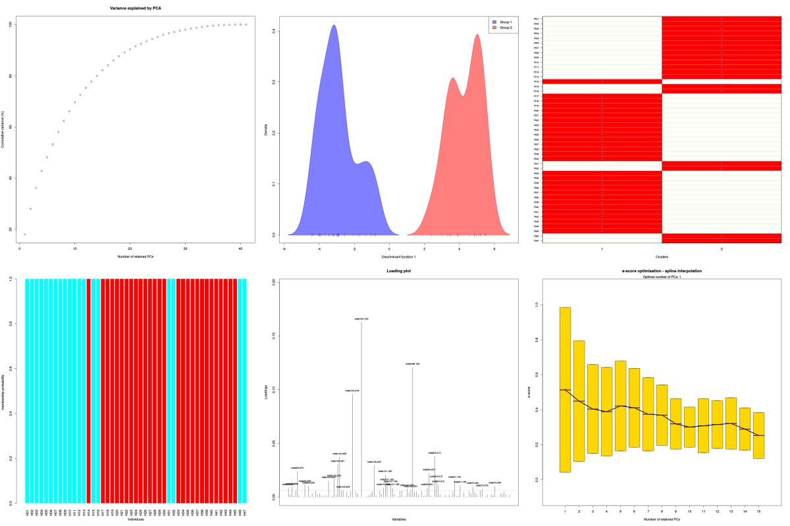 <!-- MERGE-REVIEW: no counterpart section found in QMD; content from TEX kept as-is. -->

### DAPC code II

```{r}
# alfa-score - according to number of PC axis
optim.a.score(x=hauss.dapc)
## K=3
# Create DAPC
# Number of informative PC (Here 15, adegenet recommends < N/3)
# Select number of informative DA (here 2 - usually keep all of them)
hauss.dapc3 <- dapc(x=hauss.genind, pop=hauss.kfind3$grp, center=TRUE,
  scale=FALSE, var.contrib=TRUE, pca.info=TRUE, truenames=TRUE)
hauss.dapc # Information
# A la PCA graph
scatter(x=hauss.dapc3, main="DAPC, Taraxacum haussknechtii",
  bg="white", cex=3, clab=0, col=rainbow(3), posi.da="bottomleft",
  scree.pca=TRUE, posi.pca="bottomright", leg=TRUE,
  txt.leg=c("Group 1", "Group 2", "Group 3"), posi.leg="topleft")
```

- Especially graphical parameters have huge possibilities...
- See `?scatter` and play with it... <!-- MERGE-REVIEW: no counterpart section found in QMD; code below comes from the old TEX version. -->

### DAPC for K=3

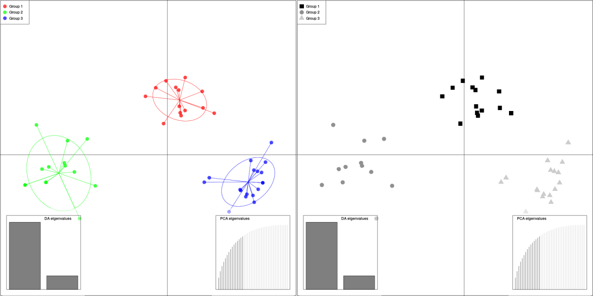 <!-- MERGE-REVIEW: no counterpart section found in QMD; content from TEX kept as-is. -->

### DAPC code III

```{r}
# Same in BW
scatter(x=hauss.dapc3, main="DAPC, Taraxacum haussknechtii",
  bg="white", pch=c(15:17), cell=0, cstar=0, solid=1, cex=2.5, clab=0,
  col=gray.colors(3, start=0, end=0.8, gamma=2, alpha=0), posi.da=
  "bottomleft", scree.pca=TRUE, posi.pca="bottomright", leg=TRUE,
  txt.leg=c("Group 1", "Group 2", "Group 3"), posi.leg="topleft")
# Density function - only for first axis here!
scatter(x=hauss.dapc3, xax=1, yax=1, main="DAPC", bg="white", solid=0.5,
  leg=T, txt.leg=c("Group 1", "Group 2", "Group 3"), posi.leg="topleft")
# Assignment of individuals to clusters
assignplot(hauss.dapc3)
# Structure-like plot
compoplot(hauss.dapc3, xlab="Individuals", leg=FALSE)
# Loadingplot - alleles the most adding to separation of individuals
loadingplot(hauss.dapc3$var.contr)
# alfa-score - according to number of PC axis
optim.a.score(hauss.dapc3)
```

<!-- MERGE-REVIEW: no counterpart section found in QMD; code below comes from the old TEX version. -->

### DAPC for K=3, extra information

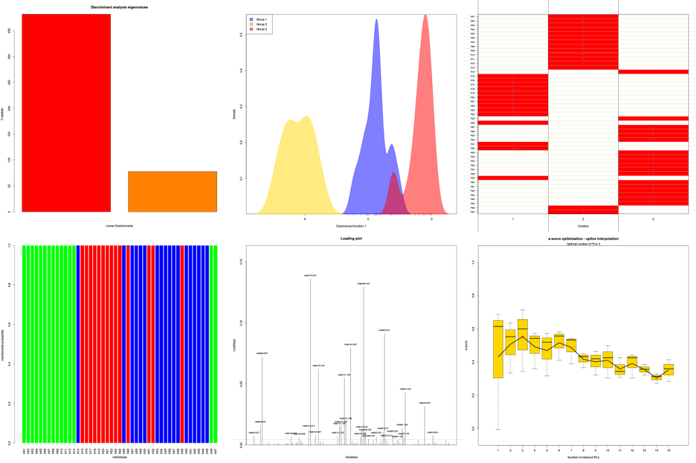 <!-- MERGE-REVIEW: no counterpart section found in QMD; content from TEX kept as-is. -->

## Tasks

### Try DAPC

1.  Try DAPC with `microbov` dataset (`data(microbov)`, see `?microbov`), the U.S. flu dataset (the `usflu.genind` object), or some other data according to your choice.

2.  Try K-means clustering as well as DAPC itself (think which highest `max.n.clust` to use - check data size and number of populations).

3.  Try various Ks (if appropriate).

4.  Try various displays.

5.  Interpret the results.

6.  When is DAPC good tool and when should you avoid it?

7.  Which data can you cluster using K-means clustering?

<!-- MERGE-REVIEW: content of the .qmd section 'DAPC' was inserted at 3 frames; remove the unwanted duplicates. -->

K = 2 Create DAPC Number of informative PC (Here 15, adegenet recommends \< N/3). Select number of informative DA (here 1 - only one is available - it won't produce PCA graph).

Information

Density functions

Assignment of individuals to clusters

Structure-like plot

Loadingplot - alleles the most adding to separation of individuals

alfa-score - according to number of PC axis

K = 3 Create DAPC Number of informative PC (Here 15, adegenet recommends \< N/3). Select number of informative DA (here 2).

Information

A la PCA graph

Same in BW

Density functions - only for first axis here!

Assignment of individuals to clusters

Structure-like plot

Loadingplot - alleles the most adding to separation of individuals

alfa-score - according to number of PC axis

```{r}
hauss_dapc <- dapc(x = hauss_genind, pop = hauss_kfind$grp, center = TRUE, scale = FALSE, var.contrib = TRUE, pca.info = TRUE, truenames = TRUE)
```

```{r}
hauss_dapc
```

```{r}
scatter(x = hauss_dapc, xax = 1, yax = 1, main = "DAPC", bg = "white", solid = 0.5, leg = TRUE, txt.leg = c("Group 1", "Group 2"), posi.leg = "topright")
```

```{r}
assignplot(x = hauss_dapc)
```

```{r}
compoplot(x = hauss_dapc, xlab = "Individuals", leg = FALSE)
```

```{r}
loadingplot(x = hauss_dapc$var.contr)
```

```{r}
optim.a.score(x = hauss_dapc)

```

```{r}
hauss_dapc3 <- dapc(x = hauss_genind, pop = hauss_kfind3$grp, center = TRUE, scale = FALSE, var.contrib = TRUE, pca.info = TRUE, truenames = TRUE)
```

```{r}
hauss_dapc
```

```{r}
scatter(x = hauss_dapc3, main = "DAPC, Taraxacum haussknechtii", bg = "white", cex = 3, clab = 0, col = rainbow(3), posi.da = "bottomleft", scree.pca = TRUE, posi.pca = "bottomright", leg = TRUE, txt.leg = c("Group 1", "Group 2", "Group 3"), posi.leg = "topleft")
```

```{r}
scatter(x = hauss_dapc3, main = "DAPC, Taraxacum haussknechtii", bg = "white", pch = c(15:17), cell = 0, cstar = 0, solid = 1, cex = 2.5, clab = 0, col = gray.colors(3, start = 0, end = 0.8, gamma = 2, alpha = 0), posi.da = "bottomleft", scree.pca = TRUE, posi.pca = "bottomright", leg = TRUE, txt.leg = c("Group 1", "Group 2", "Group 3"), posi.leg = "topleft")
```

```{r}
scatter(x = hauss_dapc3, xax = 1, yax = 1, main = "DAPC", bg = "white", solid = 0.5, leg = TRUE, txt.leg = c("Group 1", "Group 2", "Group 3"), posi.leg = "topleft")
```

```{r}
assignplot(hauss_dapc3)
```

```{r}
compoplot(hauss_dapc3, xlab = "Individuals", leg = FALSE)
```

```{r}
loadingplot(hauss_dapc3$var.contr)
```

```{r}
optim.a.score(hauss_dapc3)

```

# Spatial analysis

### Short overview of spatial genetics (in R)

**Basic approaches**

- [Moran's \*I](https://en.wikipedia.org/wiki/Moran%27s_I)\* - several implementations, generally it is autocorrelation coefficient with broader use (also in evolutionary studies)

  - As "classical" correlation index, spatial PCA, Monmonier's algorithm searching for genetic boundaries, ...

- [Mantel test](https://en.wikipedia.org/wiki/Mantel_test) - several implementations, popular, although recently criticized as biologically irrelevant, generally correlation of two matrices (here genetic and geographical)

- Bayesian clustering using geographical information as a proxy and showing results in geographical context (here as implemented in Geneland)

- Plenty of options with plotting maps, including interactive maps (e.g. with [R Leaflet](https://rstudio.github.io/leaflet/))

- There are unlimited possibilities with connections with GIS software - check specialized courses and literature... <!-- MERGE-REVIEW: no counterpart section found in QMD; content from TEX kept as-is. -->

## Moran's\~I

### Moran's *I*

- "Only" autocorrelation index - no genetic/evolutionary model involved - sometimes criticized as biologically irrelevant mechanism

- Used in many variants for plenty of applications

- This (or similar) approach can be used to test correlation between another characteristics (typically used in ecology or evolutionary studies)

- Calculations are done according to matrix of geographic distances, or connectivity network connecting individuals/populations (created by `chooseCN`) - carefully check its options and try several parameters

- Pay attention which hypothesis is tested (i.e. if lower, greater or two-sided) - similar to T-test

  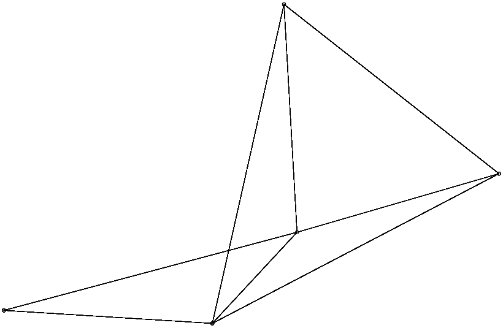

<!-- MERGE-REVIEW: content of the .qmd section 'Moran's I' was inserted at 4 frames; remove the unwanted duplicates. -->

Load required libraries

Creates connection network

Test of Moran's I for 1st PCoA axis

Plot the results

Test of Moran's I for 2nd PCoA axis

```{r}
library("adegenet")
library("spdep")
```

```{r}
hauss_connectivity <- chooseCN(xy = hauss_genind$other$xy, type = 5, d1 = 0, d2 = 1, plot.nb = TRUE, result.type = "listw", edit.nb = FALSE)
hauss_connectivity
```

```{r}
moran.test(x = hauss_pcoa$li[, 1], listw = hauss_connectivity, alternative = "greater", randomisation = TRUE)
hauss_pcoa1_mctest <- moran.mc(x = hauss_pcoa[["li"]][, 1], listw = hauss_connectivity, alternative = "greater", nsim = 1000)
hauss_pcoa1_mctest
```

```{r}
plot(hauss_pcoa1_mctest) # Plot of densitiy of permutations
moran.plot(x = hauss_pcoa$li[, 1], listw = hauss_connectivity) # PC plot
```

```{r}
moran.test(x = hauss_pcoa$li[, 2], listw = hauss_connectivity, alternative = "greater", randomisation = TRUE)
hauss_pcoa2_mctest <- moran.mc(x = hauss_pcoa$li[, 2], listw = hauss_connectivity, alternative = "greater", nsim = 1000)
hauss_pcoa2_mctest
plot(hauss_pcoa2_mctest) # Plot of densitiy of permutations
moran.plot(x = hauss_pcoa[["li"]][, 2], listw = hauss_connectivity) # PC plot
```

### Calculation of Moran's *I* I

```{r}
library(adegenet) # Load required libraries
library(spdep)
# Creates connection network
hauss.connectivity <- chooseCN(xy=hauss.genind$other$xy, type=5, d1=0,
  d2=1, plot.nb=TRUE, result.type="listw", edit.nb=FALSE)
hauss.connectivity
# Test of Moran's I for 1st PCoA axis
# Results can be checked against permuted values of moran.mc()
moran.test(x=hauss.pcoa[["li"]][,1], listw=hauss.connectivity,
  alternative="greater", randomisation=TRUE)
Moran's I test under randomisation
data:  hauss.pcoa$li[, 1]
Moran I statistic standard deviate = -18.514, p-value = 1
alternative hypothesis: greater
sample estimates:
Moran I statistic       Expectation          Variance
    -0.5232003724     -0.0217391304      0.0007336276
```

<!-- MERGE-REVIEW: 1 old code block(s) in TEX frame were dropped in favor of the .qmd section 'Moran's I'. -->

<!-- MERGE-REVIEW: content of the .qmd section 'Moran's I' was inserted at 4 frames; remove the unwanted duplicates. -->

Load required libraries

Creates connection network

Test of Moran's I for 1st PCoA axis

Plot the results

Test of Moran's I for 2nd PCoA axis

```{r}
library("adegenet")
library("spdep")
```

```{r}
hauss_connectivity <- chooseCN(xy = hauss_genind$other$xy, type = 5, d1 = 0, d2 = 1, plot.nb = TRUE, result.type = "listw", edit.nb = FALSE)
hauss_connectivity
```

```{r}
moran.test(x = hauss_pcoa$li[, 1], listw = hauss_connectivity, alternative = "greater", randomisation = TRUE)
hauss_pcoa1_mctest <- moran.mc(x = hauss_pcoa[["li"]][, 1], listw = hauss_connectivity, alternative = "greater", nsim = 1000)
hauss_pcoa1_mctest
```

```{r}
plot(hauss_pcoa1_mctest) # Plot of densitiy of permutations
moran.plot(x = hauss_pcoa$li[, 1], listw = hauss_connectivity) # PC plot
```

```{r}
moran.test(x = hauss_pcoa$li[, 2], listw = hauss_connectivity, alternative = "greater", randomisation = TRUE)
hauss_pcoa2_mctest <- moran.mc(x = hauss_pcoa$li[, 2], listw = hauss_connectivity, alternative = "greater", nsim = 1000)
hauss_pcoa2_mctest
plot(hauss_pcoa2_mctest) # Plot of densitiy of permutations
moran.plot(x = hauss_pcoa[["li"]][, 2], listw = hauss_connectivity) # PC plot
```

### Calculation of Moran's *I* II

```{r}
# Test of Moran's I for 1st PCoA axis
hauss.pcoa1.mctest <- moran.mc(x=hauss.pcoa$li[,1],
  listw=hauss.connectivity, alternative="greater", nsim=1000)
hauss.pcoa1.mctest
# Output:
  Monte-Carlo simulation of Moran I
data:  hauss.pcoa$li[, 1]
weights: hauss.connectivity
number of simulations + 1: 1001
statistic = -0.5163, observed rank = 1, p-value = 0.999
alternative hypothesis: greater
# Plot the results
plot(hauss.pcoa1.mctest) # Plot of densitiy of permutations
moran.plot(x=hauss.pcoa$li[,1], listw=hauss.connectivity) # PC plot
```

<!-- MERGE-REVIEW: 1 old code block(s) in TEX frame were dropped in favor of the .qmd section 'Moran's I'. -->

<!-- MERGE-REVIEW: content of the .qmd section 'Moran's I' was inserted at 4 frames; remove the unwanted duplicates. -->

Load required libraries

Creates connection network

Test of Moran's I for 1st PCoA axis

Plot the results

Test of Moran's I for 2nd PCoA axis

```{r}
library("adegenet")
library("spdep")
```

```{r}
hauss_connectivity <- chooseCN(xy = hauss_genind$other$xy, type = 5, d1 = 0, d2 = 1, plot.nb = TRUE, result.type = "listw", edit.nb = FALSE)
hauss_connectivity
```

```{r}
moran.test(x = hauss_pcoa$li[, 1], listw = hauss_connectivity, alternative = "greater", randomisation = TRUE)
hauss_pcoa1_mctest <- moran.mc(x = hauss_pcoa[["li"]][, 1], listw = hauss_connectivity, alternative = "greater", nsim = 1000)
hauss_pcoa1_mctest
```

```{r}
plot(hauss_pcoa1_mctest) # Plot of densitiy of permutations
moran.plot(x = hauss_pcoa$li[, 1], listw = hauss_connectivity) # PC plot
```

```{r}
moran.test(x = hauss_pcoa$li[, 2], listw = hauss_connectivity, alternative = "greater", randomisation = TRUE)
hauss_pcoa2_mctest <- moran.mc(x = hauss_pcoa$li[, 2], listw = hauss_connectivity, alternative = "greater", nsim = 1000)
hauss_pcoa2_mctest
plot(hauss_pcoa2_mctest) # Plot of densitiy of permutations
moran.plot(x = hauss_pcoa[["li"]][, 2], listw = hauss_connectivity) # PC plot
```

### Moran's *I* for our 1$^{st}$ axis isn't significant

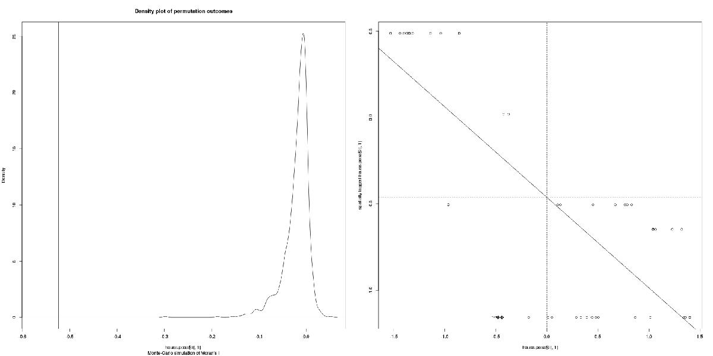

- Tested hypothesis "greater" - **no** significant **positive** autocorrelation
- If testing for hypothesis "less" - significant **negative** autocorrelation - individuals are significantly different <!-- MERGE-REVIEW: no counterpart section found in QMD; content from TEX kept as-is. -->

### Calculation of Moran's *I* (2$^{nd}$ axis)

```{r}
# Test of Moran's I for 2nd PCoA axis
moran.test(x=hauss.pcoa$li[,2], listw=hauss.connectivity,
  alternative="greater", randomisation=TRUE)
hauss.pcoa2.mctest <- moran.mc(x=hauss.pcoa$li[,2],
  listw=hauss.connectivity, alternative="greater", nsim=1000)
hauss.pcoa2.mctest
# Output
Monte-Carlo simulation of Moran's I
data:  hauss.pcoa$li[, 2]
weights: hauss.connectivity
number of simulations + 1: 1001
statistic = 0.0545, observed rank = 1001, p-value = 0.000999
alternative hypothesis: greater
# Plot the results
plot(hauss.pcoa2.mctest) # Plot of densitiy of permutations
moran.plot(x=hauss.pcoa$[,2], listw=hauss.connectivity) # PC plot
```

<!-- MERGE-REVIEW: no counterpart section found in QMD; code below comes from the old TEX version. -->

### Second axis is surprisingly significant

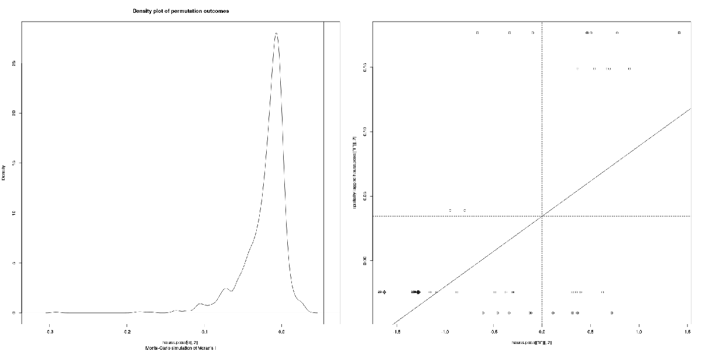

- Tested hypothesis "greater" - there **is** significant positive autocorrelation - individuals are genetically similar over space <!-- MERGE-REVIEW: no counterpart section found in QMD; content from TEX kept as-is. -->

### Reading and limits of Moran's *I*

- 1$^st$ and 2$^nd$ PC axes are orthogonal to each other, so they show different patterns
- Moran's *I* shows single index over all data (whole space), but different processes might be ongoing on large or small scale - commonly negative autocorrelation on large scale (distant individuals are significantly dissimilar) and positive autocorrelation on small scale (individuals, which are close to each other are significantly similar)
- Single number isn't always the best description of complex biological situation...
- Calculations using `moran.test` are done in connectivity network created by `chooseCN` - it's crucial to select connectivity network reflecting biological features of studied species and its geographic situation - different networks lead into different results... <!-- MERGE-REVIEW: no counterpart section found in QMD; content from TEX kept as-is. -->

## sPCA

### Spatial Analysis of Principal Components (sPCA)

- Implemented in adegenet, see `adegenetTutorial("spca")`
- Analyzes matrix of relative allele frequencies of genotypes/populations and spatial weighting matrix
- The geographical matrix is usually (as for Moran's *I*) created by `chooseCN()` - creates connectivity network among entities (genotypes/populations) - spatial coordinates are not directly used
- When using `chooseCN()`, look at the documentation and try various methods with changing settings to see differences

```{r}
data(rupica) # adegenet's toy dataset, Rupicapra rupicapra from French Alps
library(adespatial) # Part of sPCA calculations are in adespatial
# Try various settings for chooseCN (type=X) - type 1-4 as there
# are identical coordinates (multiple sampling from same locality)
?chooseCN # See for more details - select the best "type" for your data
chooseCN(xy=rupica$other$xy, ask=TRUE, type=5/6/7, plot.nb=TRUE,
  edit.nb=FALSE, ...) # Task: play with settings little bit...
```

<!-- MERGE-REVIEW: no counterpart section found in QMD; code below comes from the old TEX version. -->

### Calculations of sPCA

```{r}
hauss.spca <- spca(obj=hauss.genind, cn=hauss.connectivity,
  scale=TRUE, scannf=TRUE)
# Plot eigenvalues of sPCA - global vs. local structure
barplot(height=hauss.spca$eig, main="Eigenvalues of sPCA",
  col=spectral(length(hauss.spca$eig)))
legend("topright", fill=spectral(2), leg=c("Global structures",
  "Local structures")) # Add legend
abline(h=0, col="gray") # Add line showing zero
print.spca(hauss.spca) # Information about sPCA
summary.spca(hauss.spca) # Summary of sPCA results
# Shows connectivity network, 3 different scores
# barplot of eigenvalues and eigenvalues decomposition
plot.spca(hauss.spca)
colorplot.spca(hauss.spca, cex=3) # Display of scores in color canals
title("sPCA - colorplot of PC 1 and 2 (lagged scores)", line=1, cex=1.5)
# Spatial and variance components of the eigenvalues
screeplot.spca(x=hauss.spca, main=NULL)
```

<!-- MERGE-REVIEW: no counterpart section found in QMD; code below comes from the old TEX version. -->

### sPCA outputs


Explore various networks

Part of sPCA calculations are in adespatial package, load it

Try various settings for chooseCN (type = X) - type 1-4 as there are identical coordinates (multiple sampling from same locality)

Calculates sPCA - here is only 1 positive and 3 negative factors

Plot eigenvalues of sPCA - gobal vs. local structure

Information about sPCA

Summary of sPCA results

Shows connectivity network, 3 different scores, barplot of eigenvalues and eigenvalues decomposition

Display of scores in color canals (two analogous variants)

Spatial and variance components of the eigenvalues

Test if global/local structure is significant

```{r}
data(rupica)
```

```{r}
library("adespatial")
```

```{r}
?chooseCN # See for more details - select the best "type"for your data
chooseCN(xy = rupica$other$xy, ask = TRUE, type = 5 / 6 / 7, plot.nb = TRUE, edit.nb = FALSE, ...) # Task: play with settings little bit...
```

```{r}
hauss_spca <- spca(obj = hauss_genind, cn = hauss_connectivity, scale = TRUE, scannf = TRUE)
```

```{r}
barplot(height = hauss_spca$eig, main = "Eigenvalues of sPCA", col = spectral(length(hauss_spca[["eig"]])))
legend("topright", fill = spectral(2), legend = c("Global structures", "Local structures")) # Add legend
abline(h = 0, col = "grey") # Add line showing zero
```

```{r}
print.spca(hauss_spca)
```

```{r}
summary.spca(hauss_spca)
```

```{r}
plot.spca(hauss_spca)
```

```{r}
colorplot.spca(hauss_spca, cex = 3)
title("sPCA - colorplot of PC 1 and 2 (lagged scores)", line = 1, cex = 1.5)
colorplot(x = hauss_genind$other$xy, hauss_spca$ls, axes = seq_along(hauss_spca$li), cex = 3)
title("sPCA - colorplot of PC 1 and 2 (lagged scores)", line = 1, cex = 1.5)
```

```{r}
screeplot.spca(x = hauss_spca, main = NULL)
```

```{r}
hauss_spca_glo <- global.rtest(X = hauss_genind$tab, listw = hauss_spca$lw, nperm = 999)
hauss_spca_glo
plot(hauss_spca_glo)
hauss_spca_loc <- local.rtest(X = hauss_genind$tab, listw = hauss_spca$lw, nperm = 999)
hauss_spca_loc
plot(hauss_spca_loc)

```

```{=html}
<!--
# TODO Map of genetic clines
library("akima") # This library is needed for some manipulation with coordinates
hauss_spca_temp <- interp(other(hauss_genind)$xy[, 1], other(hauss_genind)$xy[, 2], hauss_spca$ls[, 1], xo = seq(min(other(hauss_genind)$xy[, 1]), max(other(hauss_genind)$xy[, 1]), le = 200), yo = seq(min(other(hauss_genind)$xy[, 2]), max(other(hauss_genind)$xy[, 2]), le = 200), duplicate = "median")
# For 1st axis
image(x = hauss_spca_temp, col = spectral(100))
s.value(dfxy = hauss_genind$other$xy, z = hauss_pcoa$li[, 1], add.p = TRUE, csize = 0.5, sub = "PCoA - first PC", csub = 2, possub = "topleft")
# For 2nd axis
image(x = hauss_spca_temp, col = spectral(100))
s.value(dfxy = hauss_genind$other$xy, z = hauss_pcoa[["li"]][, 2], add.p = TRUE, csize = 0.5, sub = "PCoA - second PC", csub = 2, possub = "topleft")
# Interpolated lagged score on a map
hauss_spca_annot <- function() {
    title("sPCA - interpolated map of individual scores")
    points(other(hauss_genind)$xy[, 1], other(hauss_genind)$xy[, 2])
    }
filled.contour(hauss_spca_temp, color.pal = colorRampPalette(lightseasun(100)), pch = 20, nlevels = 100, key.title = title("Lagged\nscore 1"), plot.title = hauss_spca_annot())

Loading plots - which alleles contribute the most?
-->
```

```{r}
hauss_spca_loadings <- hauss_spca$c1[, 1]^2
names(hauss_spca_loadings) <- rownames(hauss_spca$c1)
loadingplot(x = hauss_spca_loadings, xlab = "Alleles", ylab = "Weight of the alleles", main = "Contribution of alleles to the first sPCA axis")
boxplot(formula = hauss_spca_loadings ~ hauss_genind$loc.fac, las = 3, ylab = "Contribution", xlab = "Marker", main = "Contribution by markers into the first global score", col = "gray")
```

### Test if global/local structure is significant

```{r}
hauss.spca.glo <- global.rtest(X=hauss.genind$tab, listw=hauss.spca$lw,
  nperm=999)
hauss.spca.glo
plot(hauss.spca.glo)
hauss.spca.loc <- local.rtest(X=hauss.genind$tab, listw=hauss.spca$lw,
  nperm=999)
hauss.spca.loc
plot(hauss.spca.loc)
```

 <!-- MERGE-REVIEW: no counterpart section found in QMD; code below comes from the old TEX version. -->

### Map of genetic clines

```{=html}
<!--
TODO Genetic clines
    @@TOKEN0@@

-->
```

<!-- MERGE-REVIEW: no counterpart section found in QMD; content from TEX kept as-is. -->

### sPCA outputs II

```{=html}
<!--
    @@TOKEN0@@
    \begin{center}
        \includegraphics[width=\textwidth-6cm]{spca-pc.png}
    \end{center}

-->
```

<!-- MERGE-REVIEW: no counterpart section found in QMD; content from TEX kept as-is. -->

### Loading plots - which alleles contribute the most?

```{r}
hauss.spca.loadings <- hauss.spca[["c1"]][,1]^2
names(hauss.spca.loadings) <- rownames(hauss.spca$c1)
loadingplot(x=hauss.spca.loadings, xlab="Alleles", ylab="Weight of the
  alleles", main="Contribution of alleles to the first sPCA axis")
boxplot(formula=hauss.spca.loadings~hauss.genind$loc.fac, las=3,
  ylab="Contribution", xlab="Marker", main="Contribution by markers into
  the first global score", col="gray")
```

 <!-- MERGE-REVIEW: no counterpart section found in QMD; code below comes from the old TEX version. -->

## Mantel test

### Mantel test

- Originally created for biomedicine to test correlation between treatment and diseases
- It is universal method usable for plenty of tasks
- "Only" correlation of two matrices - no biologically relevant underlying model - because of that it is heavily criticized (mainly in ecology)
- Test of spatial and genetic relationships is probably one of few biologically relevant applications
- Package [vegan](https://CRAN.R-project.org/package=vegan) (set of ecological tools) has implementation to test genetic similarity in various distance classes - not only overall result - very useful
- Distance matrix can be calculated as simple Euclidean geometric distance by `dist()`, or for larger areas by geodesic distance along Earth surface (e.g. `pegas::geod()`), or using special package like [geosphere](https://CRAN.R-project.org/package=geosphere)

```{r}
library(pegas) # Geodesic distance
```

<!-- MERGE-REVIEW: no counterpart section found in QMD; code below comes from the old TEX version. -->

### Mantel test - isolation by distance

```{r}
# Geographical distance
hauss.gdist <- as.dist(m=geod(lon=hauss.genind$other$xy$lon,
  lat=hauss.genind$other$xy$lat), diag=TRUE, upper=TRUE)
# Mantel test
hauss.mantel <- mantel.randtest(m1=hauss.dist,m2=hauss.gdist, nrepet=1000)
hauss.mantel # See text output
plot(hauss.mantel, nclass=30)
# Libraries required by mantel.correlog:
library(permute)
library(lattice)
library(vegan)
# Different implementation of Mantel test testing distance classes
hauss.mantel.cor <- mantel.correlog(D.eco=hauss.dist, D.geo=hauss.gdist,
  XY=NULL, n.class=0, break.pts=NULL, cutoff=FALSE, r.type="pearson",
  nperm=1000, mult="holm", progressive=TRUE)
hauss.mantel.cor # See results for respective classes
summary(hauss.mantel.cor)
```

<!-- MERGE-REVIEW: 1 old code block(s) in TEX frame were dropped in favor of the .qmd section 'Mantel test - isolation by distance'. -->

Geodesic distance

Geographical distance

Mantel test

Libraries required by mantel.correlog:

Different implementation of Mantel test testing distance classes

See results for respective classes

Plot it

```{r}
library("pegas")
```

```{r}
hauss_gdist <- as.dist(m = geod(lon = hauss_genind$other$xy$lon, lat = hauss_genind$other$xy$lat), diag = TRUE, upper = TRUE)
```

```{r}
hauss_mantel <- mantel.randtest(m1 = hauss_dist, m2 = hauss_gdist, nrepet = 1000)
hauss_mantel # See text output
plot(hauss_mantel, nclass = 30)
```

```{r}
library("permute")
library("lattice")
library("vegan")
```

```{r}
hauss_mantel_cor <- mantel.correlog(D.eco = hauss_dist, D.geo = hauss_gdist, XY = NULL, n.class = 0, break.pts = NULL, cutoff = FALSE, r.type = "pearson", nperm = 1000, mult = "holm", progressive = TRUE)
```

```{r}
hauss_mantel_cor
summary(hauss_mantel_cor)
```

```{r}
plot(hauss_mantel_cor)
```

### Mantel test outputs - strongly significant


```{r}
hauss.mantel # See output
Monte-Carlo test
Call: mantel.randtest(m1 =
  hauss.dist, m2 =
  hauss.gdist, nrepet = 1000)
Observation: 0.35409
Based on 1000 replicates
Simulated p-value: 0.000999001
Alternative hypothesis: greater
   Std.Obs Expectation  Variance
7.61967545 0.001687140 0.0021389
```

```{r}
# Plot correlogram (next slide)
plot(hauss.mantel.cor)
```

<!-- MERGE-REVIEW: no counterpart section found in QMD; code below comes from the old TEX version. -->

### Plot of Mantel Correlogram Analysis


Correlation (genetic similarity) in several distance classes (positive **\[up\]** in short distance **\[left\]**, negative **\[down\]** in long **\[right\]**; **\[full\]** - significant, **\[empty\]** - not significant) - see `?mantel.correlog` for details <!-- MERGE-REVIEW: no counterpart section found in QMD; content from TEX kept as-is. -->

### Mantel correlogram - text output

```{r}
hauss.mantel.cor # See the text output:
Mantel Correlogram Analysis
Call:
mantel.correlog(D.eco = hauss.dist, D.geo = hauss.gdist, XY = NULL,
  n.class = 0, break.pts = NULL, cutoff = FALSE, r.type = "pearson",
  nperm = 1000, mult = "holm", progressive = TRUE)
        class.index     n.dist Mantel.cor Pr(Mantel) Pr(corrected)
D.cl.1     4.697165 532.000000   0.400101     0.0010      0.000999 ***
D.cl.2    14.091494   0.000000         NA         NA            NA
D.cl.3    23.485823   0.000000         NA         NA            NA
D.cl.4    32.880153  52.000000   0.079433     0.0490      0.048951 *
D.cl.5    42.274482 466.000000  -0.128236     0.0010      0.002997 **
D.cl.6    51.668811   0.000000         NA         NA            NA
D.cl.7    61.063140  36.000000  -0.027890     0.2547      0.254745
   ...          ...        ...        ...        ...           ...
---
Signif. codes:  0 ‘***’ 0.001 ‘**’ 0.01 ‘*’ 0.05 ‘.’ 0.1 ‘ ’ 1
```

<!-- MERGE-REVIEW: no counterpart section found in QMD; code below comes from the old TEX version. -->

## Monmonier

### Monmonier's algorithm - genetic boundaries

- Finds boundaries of maximum differences between contiguous polygons of a tessellation
- Detects genetic boundaries among georeferenced genotypes (or populations)
- For more information see `adegenetTutorial("basics")`
- Requires every point to have unique coordinates - in case of population data it is better to work with populations, not individuals (but it is not ideal)
- It uses [Voronoi tessellation](https://en.wikipedia.org/wiki/Voronoi_diagram) - it is used by a lot of spatial analysis, especially by tools relying on Bayesian statistics (like Geneland, slide )

```{r}
# Calculates Monmonier's function (for threshold use 'd')
hauss.monmonier <- monmonier(xy=hauss.genpop$other$xy, dist=rogers.dist
  (x=hauss.genpop), cn=chooseCN(hauss.genpop$other$xy, ask=FALSE, type=6,
  k=2, plot.nb=FALSE, edit.nb=FALSE), nrun=1)
coords.monmonier(hauss.monmonier) # See result as text
```

<!-- MERGE-REVIEW: 1 old code block(s) in TEX frame were dropped in favor of the .qmd section 'Monmonier - genetic boundaries'. -->

<!-- MERGE-REVIEW: content of the .qmd section 'Monmonier - genetic boundaries' was inserted at 3 frames; remove the unwanted duplicates. -->

It requires every point to have unique coordinates (one can use jitter() or difference in scale of meters). Example here is on population level, which is not ideal. Calculates Monmonier's function (for threshold use 'd')

Plot genetic boundaries

For plotting see

```{r}
hauss_monmonier <- monmonier(xy = hauss_genpop$other$xy, dist = rogers.dist(x = hauss_genpop), cn = chooseCN(hauss_genpop$other$xy, ask = FALSE, type = 6, k = 2, plot.nb = FALSE, edit.nb = FALSE), nrun = 1)
coords.monmonier(hauss_monmonier) # See result as text
```

```{r}
plot.monmonier(hauss_monmonier, add.arrows = FALSE, bwd = 10, sub = "Monmonier plot", csub = 2)
points(hauss_genpop$other$xy, cex = 2.5, pch = 20, col = "red")
text(x = hauss_genpop$other$xy$lon, y = hauss_genpop$other$xy$lat, labels = popNames(hauss_genpop), cex = 3)
legend("bottomright", legend = "Genetic boundaries\namong populations")
```

```{r}
?points
?text
?legend
```

### Voronoi tessellation


- In simplest case, all points have certain area and all points within this area are closer to the respective "main" point than to any other "neighbor" point
- Extreme differences among size of areas make computational problems and results are unstable - this typically occurs when calculations are done on individual level and there are large distances among populations
- The more similar sizes of polygons and the more even distribution of samples, the more stable and reliable results we get <!-- MERGE-REVIEW: no counterpart section found in QMD; content from TEX kept as-is. -->

### Plot genetic boundaries


```{r}
plot.monmonier(hauss.monmonier,
  add.arrows=FALSE, bwd=10,
  sub="Monmonier plot", csub=2)
points(hauss.genpop$other$xy,
  cex=2.5, pch=20, col="red")
text(x=hauss.genpop$other$xy$lon,
  y=hauss.genpop$other$xy$lat,
  labels=popNames(hauss.genpop),
  cex=3)
legend("bottomright",
  leg="Genetic boundaries\n
  among populations")
# For plotting see
?points
?text
?legend
```

<!-- MERGE-REVIEW: 1 old code block(s) in TEX frame were dropped in favor of the .qmd section 'Monmonier - genetic boundaries'. -->

<!-- MERGE-REVIEW: content of the .qmd section 'Monmonier - genetic boundaries' was inserted at 3 frames; remove the unwanted duplicates. -->

It requires every point to have unique coordinates (one can use jitter() or difference in scale of meters). Example here is on population level, which is not ideal. Calculates Monmonier's function (for threshold use 'd')

Plot genetic boundaries

For plotting see

```{r}
hauss_monmonier <- monmonier(xy = hauss_genpop$other$xy, dist = rogers.dist(x = hauss_genpop), cn = chooseCN(hauss_genpop$other$xy, ask = FALSE, type = 6, k = 2, plot.nb = FALSE, edit.nb = FALSE), nrun = 1)
coords.monmonier(hauss_monmonier) # See result as text
```

```{r}
plot.monmonier(hauss_monmonier, add.arrows = FALSE, bwd = 10, sub = "Monmonier plot", csub = 2)
points(hauss_genpop$other$xy, cex = 2.5, pch = 20, col = "red")
text(x = hauss_genpop$other$xy$lon, y = hauss_genpop$other$xy$lat, labels = popNames(hauss_genpop), cex = 3)
legend("bottomright", legend = "Genetic boundaries\namong populations")
```

```{r}
?points
?text
?legend
```

### Monmonier notes

- Sometimes it is needed to get rid of (random) noise in data. To do so use as parameter `dist` of `monmonier()` table from PCA (`pcaObject$li`) by something like:

```{r}
monmonier(..., dist=dudi.pco(d=dist.gene(x=GenindObject$tab),
  scannf=FALSE, nf=1)$li, ...)
```

- Generally (when dataset is bigger and more diverse) it is recommended to run it several times (parameter `nrun`) - there will be several iterations
- When running `monmonier(...)` when it asks for threshold of sorted local distances, try several values and see differences in output
- See `?plot.monmonier` for various graphical parameters to customize the plot
- Use `points()` to add for example colored symbols of samples and/or `text()` to add text labels <!-- MERGE-REVIEW: 1 old code block(s) in TEX frame were dropped in favor of the .qmd section 'Monmonier - genetic boundaries'. -->

<!-- MERGE-REVIEW: content of the .qmd section 'Monmonier - genetic boundaries' was inserted at 3 frames; remove the unwanted duplicates. -->

It requires every point to have unique coordinates (one can use jitter() or difference in scale of meters). Example here is on population level, which is not ideal. Calculates Monmonier's function (for threshold use 'd')

Plot genetic boundaries

For plotting see

```{r}
hauss_monmonier <- monmonier(xy = hauss_genpop$other$xy, dist = rogers.dist(x = hauss_genpop), cn = chooseCN(hauss_genpop$other$xy, ask = FALSE, type = 6, k = 2, plot.nb = FALSE, edit.nb = FALSE), nrun = 1)
coords.monmonier(hauss_monmonier) # See result as text
```

```{r}
plot.monmonier(hauss_monmonier, add.arrows = FALSE, bwd = 10, sub = "Monmonier plot", csub = 2)
points(hauss_genpop$other$xy, cex = 2.5, pch = 20, col = "red")
text(x = hauss_genpop$other$xy$lon, y = hauss_genpop$other$xy$lat, labels = popNames(hauss_genpop), cex = 3)
legend("bottomright", legend = "Genetic boundaries\namong populations")
```

```{r}
?points
?text
?legend
```

## Geneland

### About Geneland

- For installation see slide
- Works with haploid and diploid co-dominant markers (microsatellites or SNPs)
- Spatially explicit Bayesian clustering
- Produces maps of distribution of inferred genetic clusters
- Relative complicated tool with various modeling options
- For more information see <https://github.com/gilles-guillot/Geneland>

```{r}
# Load needed libraries
library(PBSmapping) # Required to transform coordinates
library(Geneland)
# Graphical interface is available, we will use only command line...
Geneland.GUI()
```

<!-- MERGE-REVIEW: 1 old code block(s) in TEX frame were dropped in favor of the .qmd section 'Geneland'. -->

<!-- MERGE-REVIEW: content of the .qmd section 'Geneland' was inserted at 2 frames; remove the unwanted duplicates. -->

Haploid and diploid codominant markers (microsattelites or SNPs) Load needed libraries

Graphical interface available for Geneland - we will use only command line

Loading and conversions of coordinates - Geneland requires specific coordinate space

Load data (only haploid or diploid data are supported) - only plain table with alleles

Set number of independent runs For real data use rather 10 or more

Set length of burnin chain For real data use ca. 20-25% of hauss_geneland_nit - is it is e.g. 5000000, set here at least 1000000

Set maximal K (number of populations) Use some value relevant from point of view of number of sampling sites etc.

In practice set much higher number of iterations (nit, millions), appropriate sampling (thinning, thousands) and longer burnin Number of iterations (MCMC steps) For real data use millions

Sampling (thinning) For real data, if hauss_geneland_nit is e.g. 5000000, use ca. 1000-10000

FOR loop will run several independent runs and produce output maps of genetic clusters - outputs are written into subdirectory within geneland directory

Prepare list to record values of Fst for all runs

Estimate Fst

Print Fst output

Estimate frequencies of null alleles

See output

Calculate average posterior probability

Sorts runs according to decreasing posterior probability - the first one is the best

```{r}
library("PBSmapping") # Required to transform coordinates
library("Geneland")
```

```{r}
Geneland.GUI()
```

```{r}
hauss_geneland_coord <- as.matrix(hauss_coord) # hauss_cord is DF, we need just plain matrix
colnames(hauss_geneland_coord) <- c("X", "Y")
attr(hauss_geneland_coord, "projection") <- "LL"
attr(hauss_geneland_coord, "zone") <- NA
hauss_geneland_coord_utm <- convUL(hauss_geneland_coord)
dim(hauss_geneland_coord)
hauss_geneland_coord
dim(hauss_geneland_coord_utm)
hauss_geneland_coord_utm # Final coordinates
```

```{r}
hauss_geneland_data <- read.table(file = "https://soubory.trapa.cz/rcourse/haussknechtii_geneland.txt", na.strings = "-999", header = FALSE, sep = "\t")
dim(hauss_geneland_data)
hauss_geneland_data
```

```{r}
hauss_geneland_nrun <- 5
```

```{r}
hauss_geneland_burnin <- 100
```

```{r}
hauss_geneland_maxpop <- 10
```

```{r}
hauss_geneland_nit <- 10000
```

```{r}
hauss_geneland_thinning <- 10
```

```{r}
for (hauss_geneland_irun in 1:hauss_geneland_nrun) {
  hauss_geneland_path_mcmc <- paste("geneland/", hauss_geneland_irun, "/", sep = "") # paste is good especially for joining several text chains into one
  # On Windows, remove following line and create subdirectories from 1 to max K manually (creating subdirs in Windows in R is complicated)
  system(paste("mkdir ", hauss_geneland_path_mcmc)) # Creates subdirectory
  # Inferrence - MCMC chain - see ?MCMC for details
  MCMC(coordinates = hauss_geneland_coord_utm, geno.dip.codom = hauss_geneland_data, path.mcmc = hauss_geneland_path_mcmc, delta.coord = 0.001, varnpop = TRUE, npopmin = 1, npopmax = hauss_geneland_maxpop, nit = hauss_geneland_nit, thinning = hauss_geneland_thinning, freq.model = "Uncorrelated", spatial = TRUE)
  # Post-process chains
  PostProcessChain(coordinates = hauss_geneland_coord_utm, path.mcmc = hauss_geneland_path_mcmc, nxdom = 500,    # Output
  # Simulated number of populations
  Plotnpop(path.mcmc = hauss_geneland_path_mcmc, printit = TRUE, file = paste(hauss_geneland_path_mcmc, "/geneland-number_of_clusters.pdf", sep = ""), format = "pdf", burnin = hauss_geneland_burnin)
  dev.off() # We must close graphical device manually
  # Map of estimated population membership
  PosteriorMode(coordinates = hauss_geneland_coord_utm, path.mcmc = hauss_geneland_path_mcmc, printit = TRUE, format = "pdf", file = paste(hauss_geneland_path_mcmc, "/geneland-map.pdf", sep = ""))
  dev.off() # We must close graphical device manually
}
```

```{r}
hauss_geneland_fstat <- list()
```

```{r}
for (hauss_geneland_irun in 1:hauss_geneland_nrun) {
  hauss_geneland_path_mcmc <- paste("geneland/", hauss_geneland_irun, "/", sep = "")
  # F-statistics - Fis and Fst
  hauss_geneland_fstat[[hauss_geneland_irun]] <- Fstat.output(coordinates = hauss_geneland_coord_utm, genotypes = hauss_geneland_data, burnin = hauss_geneland_burnin, ploidy = 2, path.mcmc = hauss_geneland_path_mcmc)
}
```

```{r}
hauss_geneland_fstat
```

```{=html}
<!--
# TODO MCMC inference under the admixture model
for (hauss_geneland_irun in 1:hauss_geneland_nrun) {
    hauss_geneland_path_mcmc <- paste("geneland/", hauss_geneland_irun, "/", sep = "")
    hauss_geneland_path_mcmc.adm <- paste(hauss_geneland_path_mcmc, "admixture", "/", sep = "")
    # On Windows, remove following line of code and create in each result directory (from 1 to max K) new subdirectory "admixture"(creating subdirs in Windows in R is complicated)
    system(paste("mkdir ", hauss_geneland_path_mcmc.adm))
    HZ(coordinates = hauss_geneland_coord_utm, geno.dip.codom = hauss_geneland_data, path.mcmc.noadm = hauss_geneland_path_mcmc, nit = hauss_geneland_nit, thinning = hauss_geneland_thinning, path.mcmc.adm = hauss_geneland_path_mcmc.adm)
    }
Produce maps of respective inferred clusters
-->
```

```{r}
for (hauss_geneland_irun in 1:hauss_geneland_nrun) {
  hauss_geneland_path_mcmc <- paste("geneland/", hauss_geneland_irun, "/", sep = "")
  # Maps - tesselations
  PlotTessellation(coordinates = hauss_geneland_coord_utm, path.mcmc = hauss_geneland_path_mcmc, printit = TRUE, path = hauss_geneland_path_mcmc)
  for (hauss_geneland_irun_img in 1:hauss_geneland_maxpop) {
    dev.off()
  } # We must close graphical device manually
}
```

```{r}
hauss_geneland_fna <- list()
for (hauss_geneland_irun in 1:hauss_geneland_nrun) {
  hauss_geneland_path_mcmc <- paste("geneland/", hauss_geneland_irun, "/", sep = "")
  # Estimation
  hauss_geneland_fna[[hauss_geneland_irun]] <- EstimateFreqNA(path.mcmc = hauss_geneland_path_mcmc)
}
```

```{r}
hauss_geneland_fna
```

```{r}
hauss_geneland_lpd <- rep(NA, hauss_geneland_nrun)
for (hauss_geneland_irun in 1:hauss_geneland_nrun) {
  hauss_geneland_path_mcmc <- paste("geneland/", hauss_geneland_irun, "/", sep = "")
  hauss_geneland_path_lpd <- paste(hauss_geneland_path_mcmc, "log.posterior.density.txt", sep = "")
  hauss_geneland_lpd[hauss_geneland_irun] <- mean(scan(hauss_geneland_path_lpd)[-(1:hauss_geneland_burnin)])
}
```

```{r}
order(hauss_geneland_lpd, decreasing = TRUE)
hauss_geneland_lpd
```

### Geneland GUI

- Some tasks are easier in GUI, some in command line...

- Command line is great for its repeatability...

- Always read manual! It is not the simplest tool...

  

<!-- MERGE-REVIEW: content of the .qmd section 'Geneland' was inserted at 2 frames; remove the unwanted duplicates. -->

Haploid and diploid codominant markers (microsattelites or SNPs) Load needed libraries

Graphical interface available for Geneland - we will use only command line

Loading and conversions of coordinates - Geneland requires specific coordinate space

Load data (only haploid or diploid data are supported) - only plain table with alleles

Set number of independent runs For real data use rather 10 or more

Set length of burnin chain For real data use ca. 20-25% of hauss_geneland_nit - is it is e.g. 5000000, set here at least 1000000

Set maximal K (number of populations) Use some value relevant from point of view of number of sampling sites etc.

In practice set much higher number of iterations (nit, millions), appropriate sampling (thinning, thousands) and longer burnin Number of iterations (MCMC steps) For real data use millions

Sampling (thinning) For real data, if hauss_geneland_nit is e.g. 5000000, use ca. 1000-10000

FOR loop will run several independent runs and produce output maps of genetic clusters - outputs are written into subdirectory within geneland directory

Prepare list to record values of Fst for all runs

Estimate Fst

Print Fst output

Estimate frequencies of null alleles

See output

Calculate average posterior probability

Sorts runs according to decreasing posterior probability - the first one is the best

```{r}
library("PBSmapping") # Required to transform coordinates
library("Geneland")
```

```{r}
Geneland.GUI()
```

```{r}
hauss_geneland_coord <- as.matrix(hauss_coord) # hauss_cord is DF, we need just plain matrix
colnames(hauss_geneland_coord) <- c("X", "Y")
attr(hauss_geneland_coord, "projection") <- "LL"
attr(hauss_geneland_coord, "zone") <- NA
hauss_geneland_coord_utm <- convUL(hauss_geneland_coord)
dim(hauss_geneland_coord)
hauss_geneland_coord
dim(hauss_geneland_coord_utm)
hauss_geneland_coord_utm # Final coordinates
```

```{r}
hauss_geneland_data <- read.table(file = "https://soubory.trapa.cz/rcourse/haussknechtii_geneland.txt", na.strings = "-999", header = FALSE, sep = "\t")
dim(hauss_geneland_data)
hauss_geneland_data
```

```{r}
hauss_geneland_nrun <- 5
```

```{r}
hauss_geneland_burnin <- 100
```

```{r}
hauss_geneland_maxpop <- 10
```

```{r}
hauss_geneland_nit <- 10000
```

```{r}
hauss_geneland_thinning <- 10
```

```{r}
for (hauss_geneland_irun in 1:hauss_geneland_nrun) {
  hauss_geneland_path_mcmc <- paste("geneland/", hauss_geneland_irun, "/", sep = "") # paste is good especially for joining several text chains into one
  # On Windows, remove following line and create subdirectories from 1 to max K manually (creating subdirs in Windows in R is complicated)
  system(paste("mkdir ", hauss_geneland_path_mcmc)) # Creates subdirectory
  # Inferrence - MCMC chain - see ?MCMC for details
  MCMC(coordinates = hauss_geneland_coord_utm, geno.dip.codom = hauss_geneland_data, path.mcmc = hauss_geneland_path_mcmc, delta.coord = 0.001, varnpop = TRUE, npopmin = 1, npopmax = hauss_geneland_maxpop, nit = hauss_geneland_nit, thinning = hauss_geneland_thinning, freq.model = "Uncorrelated", spatial = TRUE)
  # Post-process chains
  PostProcessChain(coordinates = hauss_geneland_coord_utm, path.mcmc = hauss_geneland_path_mcmc, nxdom = 500,    # Output
  # Simulated number of populations
  Plotnpop(path.mcmc = hauss_geneland_path_mcmc, printit = TRUE, file = paste(hauss_geneland_path_mcmc, "/geneland-number_of_clusters.pdf", sep = ""), format = "pdf", burnin = hauss_geneland_burnin)
  dev.off() # We must close graphical device manually
  # Map of estimated population membership
  PosteriorMode(coordinates = hauss_geneland_coord_utm, path.mcmc = hauss_geneland_path_mcmc, printit = TRUE, format = "pdf", file = paste(hauss_geneland_path_mcmc, "/geneland-map.pdf", sep = ""))
  dev.off() # We must close graphical device manually
}
```

```{r}
hauss_geneland_fstat <- list()
```

```{r}
for (hauss_geneland_irun in 1:hauss_geneland_nrun) {
  hauss_geneland_path_mcmc <- paste("geneland/", hauss_geneland_irun, "/", sep = "")
  # F-statistics - Fis and Fst
  hauss_geneland_fstat[[hauss_geneland_irun]] <- Fstat.output(coordinates = hauss_geneland_coord_utm, genotypes = hauss_geneland_data, burnin = hauss_geneland_burnin, ploidy = 2, path.mcmc = hauss_geneland_path_mcmc)
}
```

```{r}
hauss_geneland_fstat
```

```{=html}
<!--
# TODO MCMC inference under the admixture model
for (hauss_geneland_irun in 1:hauss_geneland_nrun) {
    hauss_geneland_path_mcmc <- paste("geneland/", hauss_geneland_irun, "/", sep = "")
    hauss_geneland_path_mcmc.adm <- paste(hauss_geneland_path_mcmc, "admixture", "/", sep = "")
    # On Windows, remove following line of code and create in each result directory (from 1 to max K) new subdirectory "admixture"(creating subdirs in Windows in R is complicated)
    system(paste("mkdir ", hauss_geneland_path_mcmc.adm))
    HZ(coordinates = hauss_geneland_coord_utm, geno.dip.codom = hauss_geneland_data, path.mcmc.noadm = hauss_geneland_path_mcmc, nit = hauss_geneland_nit, thinning = hauss_geneland_thinning, path.mcmc.adm = hauss_geneland_path_mcmc.adm)
    }
Produce maps of respective inferred clusters
-->
```

```{r}
for (hauss_geneland_irun in 1:hauss_geneland_nrun) {
  hauss_geneland_path_mcmc <- paste("geneland/", hauss_geneland_irun, "/", sep = "")
  # Maps - tesselations
  PlotTessellation(coordinates = hauss_geneland_coord_utm, path.mcmc = hauss_geneland_path_mcmc, printit = TRUE, path = hauss_geneland_path_mcmc)
  for (hauss_geneland_irun_img in 1:hauss_geneland_maxpop) {
    dev.off()
  } # We must close graphical device manually
}
```

```{r}
hauss_geneland_fna <- list()
for (hauss_geneland_irun in 1:hauss_geneland_nrun) {
  hauss_geneland_path_mcmc <- paste("geneland/", hauss_geneland_irun, "/", sep = "")
  # Estimation
  hauss_geneland_fna[[hauss_geneland_irun]] <- EstimateFreqNA(path.mcmc = hauss_geneland_path_mcmc)
}
```

```{r}
hauss_geneland_fna
```

```{r}
hauss_geneland_lpd <- rep(NA, hauss_geneland_nrun)
for (hauss_geneland_irun in 1:hauss_geneland_nrun) {
  hauss_geneland_path_mcmc <- paste("geneland/", hauss_geneland_irun, "/", sep = "")
  hauss_geneland_path_lpd <- paste(hauss_geneland_path_mcmc, "log.posterior.density.txt", sep = "")
  hauss_geneland_lpd[hauss_geneland_irun] <- mean(scan(hauss_geneland_path_lpd)[-(1:hauss_geneland_burnin)])
}
```

```{r}
order(hauss_geneland_lpd, decreasing = TRUE)
hauss_geneland_lpd
```

### Loading and conversions of coordinates

```{r}
# Geneland requires specific coordinate space
# hauss.cord is DF, we need just plain matrix
hauss.geneland.coord <- as.matrix(hauss.coord)
colnames(hauss.geneland.coord) <- c("X", "Y")
attr(hauss.geneland.coord, "projection") <- "LL"
attr(hauss.geneland.coord, "zone") <- NA
hauss.geneland.coord.utm <- convUL(hauss.geneland.coord)
dim(hauss.geneland.coord)
hauss.geneland.coord
dim(hauss.geneland.coord.utm)
hauss.geneland.coord.utm # Final coordinates
# Load data (only haploid or diploid data are supported)
# only plain table with alleles
hauss.geneland.data <- read.table(file= "https://soubory.trapa.cz/rcourse/
  haussknechtii_geneland.txt", na.string="-999", header=FALSE, sep="\t")
dim(hauss.geneland.data)
hauss.geneland.data
```

<!-- MERGE-REVIEW: no counterpart section found in QMD; code below comes from the old TEX version. -->

### Before running MCMC

- Monte Carlo Markov Chains (MCMC) require usually **millions** of generations (iterations, `nit)` to find optimal solution

- Beginning (\$\$10--25%) of the steps (`burnin`) use to be very unstable and useless for following analysis and it is discarded

- Geneland allows to set density of sampling among generations (`thinning`) - it is not necessary to sample (save) every generation

- Within millions of generations we can sample every 1000--10000$^th$ generation

- Denser sampling produces smoother data, but can consume too much disk space...

  Directory structure for Geneland:

   <!-- MERGE-REVIEW: no counterpart section found in QMD; content from TEX kept as-is. -->

### Settings MCMC

- For real analysis, Baysian tools require millions of MCMC steps (generations, iterations) - Here we use only 10000 to speed up processing
- Not every generation (step) is sampled, in case of millions of iterations, sampling (thinning) can be \$\$thousands
- Whole MCMC step is repeated several (usually \$\$10 times) using `for` loop (following 2 slides) to select the best run and compare them (MCMC process is by it's nature random)

```{r}
hauss.geneland.nrun <- 5 # Set number of independent runs
hauss.geneland.burnin <- 100 # Set length of burnin chain
hauss.geneland.maxpop <- 10 # Set maximal K (number of populations)
# In practice set much higher number of iterations (nit, millions),
# appropriate sampling (thinning, thousands) and longer burnin
hauss.geneland.nit <- 10000 # Number of iterations (MCMC steps)
hauss.geneland.thinning <- 10 # Sampling (thinning)
```

<!-- MERGE-REVIEW: no counterpart section found in QMD; code below comes from the old TEX version. -->

### Running MCMC I

```{r}
# FOR loop will run several independent runs and produce output maps
# of genetic clusters - outputs are written into subdirectory within
# geneland directory (this has to exist prior launching analysis)
for (hauss.geneland.irun in 1:hauss.geneland.nrun) {
  hauss.geneland.path.mcmc <- paste("geneland/", hauss.geneland.irun, "/",
  sep="") # paste is good especially for joining several texts
  # On Windows, remove following line and create subdirectories from
  # 1 to max K manually (creating subdirs in Windows in R is complicated)
  system(paste("mkdir ", hauss.geneland.path.mcmc)) # Creates subdirs
  # Inference - MCMC chain - see ?MCMC for details
  MCMC(coordinates=hauss.geneland.coord.utm, geno.dip.codom=
    hauss.geneland.data, path.mcmc=hauss.geneland.path.mcmc,
    delta.coord=0.001, varnpop=TRUE, npopmin=1,
    npopmax=hauss.geneland.maxpop, nit=hauss.geneland.nit,
    thinning=hauss.geneland.thinning, freq.model="Uncorrelated",
    spatial=TRUE) # Loop continues on next slide...
```

<!-- MERGE-REVIEW: no counterpart section found in QMD; code below comes from the old TEX version. -->

### Running MCMC II

```{r}
  # ...Start of FOR loop is on previous slide
  PostProcessChain(coordinates=hauss.geneland.coord.utm, path.mcmc=hauss.
    geneland.path.mcmc, nxdom=500, nydom=500,burnin=hauss.geneland.burnin)
  # Output
  # Simulated number of populations
  Plotnpop(path.mcmc=hauss.geneland.path.mcmc, printit=TRUE,
    file=paste(hauss.geneland.path.mcmc, "/geneland-number_of_clusters
    .pdf", sep=""), format="pdf", burnin=hauss.geneland.burnin)
  dev.off() # We must close graphical device manually
  # Map of estimated population membership
  PosteriorMode(coordinates=hauss.geneland.coord.utm,
    path.mcmc=hauss.geneland.path.mcmc, printit=TRUE, format="pdf",
    file=paste(hauss.geneland.path.mcmc,"/geneland-map.pdf", sep=""))
  dev.off() # We must close graphical device manually
  } # End of FOR loop from previous slide
```

<!-- MERGE-REVIEW: no counterpart section found in QMD; code below comes from the old TEX version. -->

### Estimate F$_{ST}$

```{r}
# Prepare list to record values of Fst for all runs
hauss.geneland.fstat <- list()
# Estimate Fst
for (hauss.geneland.irun in 1:hauss.geneland.nrun) {
  hauss.geneland.path.mcmc <- paste("geneland/",
  hauss.geneland.irun, "/", sep="")
  # F-statistics - Fis and Fst
  hauss.geneland.fstat[[hauss.geneland.irun]] <- Fstat.output(
    coordinates=hauss.geneland.coord.utm,
    genotypes=hauss.geneland.data,
    burnin=hauss.geneland.burnin, ploidy=2,
    path.mcmc=hauss.geneland.path.mcmc)
  }
hauss.geneland.fstat # Print Fst output
```

- Probably one of few implementations of F$_ST$ using Bayesian statistics (and geographically explicit model) <!-- MERGE-REVIEW: no counterpart section found in QMD; code below comes from the old TEX version. -->

### MCMC inference under the admixture model

```{=html}
<!--
TODO Admixture
    @@TOKEN0@@
    \begin{itemize}
        \item Currently, there is no much use for admixture results, at lest not without extra work\ldots
    \end{itemize}

-->
```

<!-- MERGE-REVIEW: no counterpart section found in QMD; content from TEX kept as-is. -->

### Produce maps of respective inferred clusters

```{r}
for (hauss.geneland.irun in 1:hauss.geneland.nrun) {
  hauss.geneland.path.mcmc <- paste("geneland/",
    hauss.geneland.irun, "/", sep="")
  # Maps - tessellations
  PlotTessellation(coordinates=hauss.geneland.coord.utm,
    path.mcmc=hauss.geneland.path.mcmc, printit=TRUE,
    path=hauss.geneland.path.mcmc)
  for (hauss.geneland.irun.img in 1:hauss.geneland.maxpop) {
    dev.off() } # We must close graphical device manually
  }
```

- Maps are produced as PS (PostScript) files in output directories
- Not every graphical software can handle PS (try for example [GIMP](https://www.gimp.org/))
- There are as many plots as was maximal K, but only those up to inferred number of clusters have some content (the others are empty) <!-- MERGE-REVIEW: no counterpart section found in QMD; code below comes from the old TEX version. -->

### Estimate frequencies of null alleles

```{r}
hauss.geneland.fna <- list()
for (hauss.geneland.irun in 1:hauss.geneland.nrun) {
  hauss.geneland.path.mcmc <- paste("geneland/", hauss.geneland.irun,
    "/", sep="")
  # Estimation
  hauss.geneland.fna[[hauss.geneland.irun]] <-
    EstimateFreqNA(path.mcmc=hauss.geneland.path.mcmc)
  }
# See output
hauss.geneland.fna
```

- Each item of the `list` object `hauss.geneland.fna` (from 1 to number of runs) contains vector of estimated frequencies of null alleles for every locus
- Estimation on null alleles (one from two alleles is missing, behaving like homozygote - `A-` instead of `AA`) is generally difficult, so this is nice and unique feature <!-- MERGE-REVIEW: no counterpart section found in QMD; code below comes from the old TEX version. -->

### Determine which run is the best

```{r}
# Calculate average posterior probability
hauss.geneland.lpd <- rep(NA, hauss.geneland.nrun)
for (hauss.geneland.irun in 1:hauss.geneland.nrun) {
  hauss.geneland.path.mcmc <- paste("geneland/", hauss.geneland.irun, "/",
    sep="")
  hauss.geneland.path.lpd <- paste(hauss.geneland.path.mcmc,
    "log.posterior.density.txt", sep="")
  hauss.geneland.lpd[hauss.geneland.irun] <-
    mean(scan(hauss.geneland.path.lpd)[-(1:hauss.geneland.burnin)]) }
order(hauss.geneland.lpd, decreasing=TRUE) # Sorts runs according to decre-
[1] 5 1 4 3 2 # Run 5 is the best here     # asing posterior probability
hauss.geneland.lpd # Here the runs are unsorted
[1] -645.0238 -782.7912 -676.9559 -664.9947 -601.7902 # Run 5 wins
```

- We will use figures and F$_ST$ outputs only from the best run
- It is useful to keep all runs especially for comparison if there are different solutions with similar posterior probability <!-- MERGE-REVIEW: no counterpart section found in QMD; code below comes from the old TEX version. -->

### MCMC chain, number of clusters and their map

**MCMC did not converge yet - too few generations, the most likely solution is K=4 followed by K=5. Final product is map of distribution of genetic clusters.**

 <!-- MERGE-REVIEW: no counterpart section found in QMD; content from TEX kept as-is. -->

### Map of posterior probability of belonging into cluster 1

 <!-- MERGE-REVIEW: no counterpart section found in QMD; content from TEX kept as-is. -->

### When using Geneland, remember...

- Within `MCMC()`, there must be at least hundreds thousands or millions of generations (`nit`) and appropriate sampling (thousands or higher, `thinning` - not to fill whole disk)
- To analyze geo-referenced data with a non-spatial prior set in `MCMC()` `spatial=FALSE`
- To analyze non-spatial data remove parameter `coordinates` from `MCMC()` function
- To obtain structure-like plots, file `proba.pop.membership.indiv.txt` in Geneland output directory can be used as input file for [distruct](https://web.stanford.edu/group/rosenberglab/distruct.html)
- To use SNPs, ATCG bases must be recoded as `1, 2, 3, 4`, fixed alleles must be removed
- Geneland can handle only haploids and diploids (no ploidy mixing)
- When unsure, consult [manual](https://github.com/gilles-guillot/Geneland/blob/master/vignettes/Geneland.pdf) <!-- MERGE-REVIEW: no counterpart section found in QMD; content from TEX kept as-is. -->

## Plotting maps

### Mapping overview

- There are plenty of options, only some basic options are shown...
- Some packages offer basic (state) maps
- It is possible to use various on-line maps
- [Shapefiles](https://en.wikipedia.org/wiki/Shapefile) (SHP) used in specialized GIS software can be used as base layer to plot points etc. to that map
- Interactive maps can be created with libraries like [leaflet](https://CRAN.R-project.org/package=leaflet)
- It is possible to plot to maps not only point and/or text labels, but also pie charts, bar charts, or e.g. [plot phylogeny to the map](https://blog.phytools.org/2019/03/projecting-phylogenetic-tree-onto-map.html)
- Much more options are available in specialized mapping packages, especially with connections with GIS (e.g. [QGIS](https://qgis.org/) or [GRASS GIS](https://grass.osgeo.org/)) <!-- MERGE-REVIEW: no counterpart section found in QMD; content from TEX kept as-is. -->

### Very basic mapping in R

```{r}
library(sp) # Load libraries
library(rworldmap) # Basic world maps
library(TeachingDemos) # To be able to move text little bit
library(RgoogleMaps) # Google and OpenStreetMaps
library(mapplots) # Plot pie charts
library(adegenet)
# Plot basic map with state boundaries within selected range
plot(x=getMap(resolution="high"),xlim=c(19,24),ylim=c(39,44),asp=1,lwd=1.5)
box() # Add frame around the map
# Plot location points
points(x=hauss.genpop@other$xy[["lon"]], y=hauss.genpop@other$xy[["lat"]],
  pch=15:19, col="red", cex=4)
# Add text descriptions for points. Text is aside and with background
shadowtext(x=hauss.genpop@other$xy[["lon"]], y=hauss.genpop@other$xy
  [["lat"]], labels=as.vector(popNames(hauss.genind)), col="black",
  bg="white", theta=seq(pi/4, 2*pi, length.out=8), r=0.15, pos=c(1,
  3, 2, 4, 4), offset=0.75, cex=1.5)
```

<!-- MERGE-REVIEW: no counterpart section found in QMD; code below comes from the old TEX version. -->

### Basic map

```{r}
# Insert legend
legend(x="topright", inset=1/50, legend=c("He", "Oh", "Pr", "Ne", "Sk"),
  col="red", border="black", pch=15:19, pt.cex=2, bty="o", bg="lightgrey",
  box.lwd=1.5, cex=1.5, title="Populations")
```

 <!-- MERGE-REVIEW: 1 old code block(s) in TEX frame were dropped in favor of the .qmd section 'Basic operations'. -->

<!-- MERGE-REVIEW: content of the .qmd section 'Basic operations' was inserted at 6 frames; remove the unwanted duplicates. -->

When loading saved project, you have to load again libraries and scripts (see further), data objects are restored This can be conveniently done in RStudio/RKWard

When loading saved project, you have to load again libraries and scripts (see further), data objects are restored

```{r}
x <- c(5, 6, 7, 8, 9) # Creates vector (see also ?rep)
x # Print "x" content
c() # Is generic function to concatenate objects into new one
length(x) # Length of the object - for matrices and DF use dim()
str(x) # Information about structure of the object
mode(x) # Gets type of storage mode of the object
class(x) # Shows class of the object
x[2] # Shows second element of the object
x <- x[-5] # Removes fifth element
x # See modified object
y <- matrix(data = 5:20, nrow = 4, ncol = 4) # Creates a matrix
is.matrix(y) # Is it matrix? Try is.<TAB><TAB> TAB key shows available functions and objects starting by typed text
y # Prints the matrix
dim(y) # Dimensions of "y"
y[, 2] # Prints second column
y[3, ] # Prints third row
y[4, 3] # Prints element from fourth row and third column
c(x, y[4, ]) # Concatenate "x"and 4th row of "y"
x2 <- c(x, 3, 2, 1) # Concatenate "x"and values "3", "2"and "1"
x <- y[2, ] # Replaces "x"by second row of "y"(no warning) - R doesn't ask neither notifies when overwriting objects! Be careful!
x # See modified object
rm(x) # Deletes x (no warning)
y[, 1:3] # Prints first through third column of the matrix
y[3, ] <- rep(x = 20, each = 4) # Replaces third line by value of 20
y # See modified object
y[y == 20] <- 10 # If value of y's element is 20, replace it by 10
y # See modified object
summary(y) # Basic statistics - according to columns
colnames(y) <- c("A", "B", "C", "D") # Set column names - Objects and functions are without quotation marks; files, text with
colnames(y) # Prints column names, use rownames() in same way
y # See modified object
y[, "C"] # Prints column C (R is case sensitive!)
y[, c("C", "B")] # Extract columns "C"and "B"
t(y) # Transposes the matrix
diag(y) # Get diagonal of the matrix
diag(y) <- rep(x = c(50, 100), times = 2) # Replace diagonal by repetition of values 50 and 100
y # See modified object
y <- as.data.frame(y) # Turns into DF (see other functions as.*)
class(y) # Is it data frame now?
y[y == 17] <- "NA"# Removes values of 17
y # See modified object
y$B # Gets variable B of data frame y ($ works similarly in S3 objects)
```

```{r}
save(list = ls(), file = "test.RData") # Saves all objects during the work
load("test.RData") # Loads saved R environment with all objects
```

```{r}
fix(y) # Use to edit matrices, data frames, functions, ...
rm(y) # Removing...
```

### Adding pie charts to map I

```{r}
# Prepare matrix with some data (exemplary distribution of haplotypes)
hauss.pie <- cbind(c(20, 30, 15, 40, 10), c(30, 10, 25, 5, 45),
  c(10, 20, 20, 15, 5))
# Add row names according to populations
rownames(hauss.pie) <- popNames(hauss.genpop)
# Add column names according to data displayed
colnames(hauss.pie) <- c("HapA", "HapB", "HapC")
class(hauss.pie) # Check it is matrix
hauss.pie # See resulting matrix
# Plot basic map with state boundaries within selected range
plot(x=getMap(resolution="high"),xlim=c(20,23),ylim=c(41,42),asp=1,lwd=1.5)
box() # Add frame around the map
# Plot the pie charts
for (L in 1:5) { add.pie(z=hauss.pie[L,], x=as.vector(
  hauss.genpop@other$xy[["lon"]])[L], y=as.vector(
  hauss.genpop@other$xy[["lat"]])[L], labels=names(hauss.pie[L,]),
  radius=0.1, col=topo.colors(3)) }
```

<!-- MERGE-REVIEW: no counterpart section found in QMD; code below comes from the old TEX version. -->

### Adding pie charts to map II

```{r}
?add.pie # See more options
# Add population labels
text(
  x=hauss.genpop@other$xy[["lon"]],
  y=hauss.genpop@other$xy[["lat"]],
  labels=
  as.vector(popNames(hauss.genind)),
  col="red", cex=2)
```

- As usually, play with colors and display options...

   <!-- MERGE-REVIEW: no counterpart section found in QMD; code below comes from the old TEX version. -->

### Google map basics

```{r}
# Basic help for Google maps
?GetMap
?PlotOnStaticMap
```

- For larger/complex maps Google requires [API key](https://developers.google.com/maps/documentation/maps-static/overview)

- See [documentation](https://rgooglemaps.r-forge.r-project.org/) and more options, it can use plenty of map resources (Bing maps, ...)

- Map is first downloaded with `GetMap()` into R object, and then plotted with `PlotOnStaticMap()` or with another function

- Many on-line map services do require (paid) API key...

   <!-- MERGE-REVIEW: no counterpart section found in QMD; code below comes from the old TEX version. -->

### Plotting Google map

```{r}
# Download map
hauss.gmap <- GetMap(center=c(lat=41, lon=21), size=c(640, 640),
  destfile="gmap.png", zoom=8, maptype="satellite")
# Plot saved map, with extra data
PlotOnStaticMap(MyMap=hauss.gmap, lat=hauss.genpop@other$xy[["lat"]],
  lon=hauss.genpop@other$xy[["lon"]], FUN=points, pch=19, col="blue",
  cex=5)
PlotOnStaticMap(MyMap=hauss.gmap, lat=hauss.genpop@other$xy[["lat"]],
  lon=hauss.genpop@other$xy[["lon"]], add=TRUE, FUN=points, pch=19,
  col="red", cex=3)
PlotOnStaticMap(MyMap=hauss.gmap, lat=hauss.genpop@other$xy[["lat"]],
  lon=hauss.genpop@other$xy[["lon"]], add=TRUE, FUN=text,
  labels=as.vector(popNames(hauss.genind)), pos=4, cex=3, col="white")
# Google maps have their own internal scaling, adding of points by
# standard functions will not work correctly
```

<!-- MERGE-REVIEW: no counterpart section found in QMD; code below comes from the old TEX version. -->

### Pie charts on Google map I

```{r}
# Prepare list to store recalculated coordinates
hauss.gmap.coord <- list()
# Calculation of coordinates to form required by Google Maps
for (LC in 1:5) { hauss.gmap.coord[[LC]] <- LatLon2XY.centered(MyMap=
  hauss.gmap, lat=as.vector(hauss.genpop@other$xy[["lat"]])[LC],
  lon=as.vector(hauss.genpop@other$xy[["lon"]])[LC], zoom=8) }
hauss.gmap.coord # See result
# Plot plain map
PlotOnStaticMap(MyMap=hauss.gmap)
# Plot pie charts
for (LP in 1:5) { add.pie(z=hauss.pie[LP,], x=hauss.gmap.coord[[LP]]
  $newX, y=hauss.gmap.coord[[LP]]$newY, labels=names(hauss.pie[LP,]),
  radius=25, col=topo.colors(n=3, alpha=0.7)) }
# Alternative option to plot pie charts
for (LF in 1:5) { plotrix::floating.pie(xpos=hauss.gmap.coord[[LF]]
  $newX, ypos=hauss.gmap.coord[[LF]]$newY, x=hauss.pie[LF,], radius=30,
  col=heat.colors(n=3, alpha=0.5) ) }
```

<!-- MERGE-REVIEW: no counterpart section found in QMD; code below comes from the old TEX version. -->

### Pie charts on Google map II

```{r}
# Add population text labels
PlotOnStaticMap(MyMap=hauss.gmap, lat=hauss.genpop@other$xy[["lat"]],
  lon=hauss.genpop@other$xy[["lon"]], add=TRUE, FUN=text,
  labels=as.vector(popNames(hauss.genind)), cex=2.5, col="white")
```

 <!-- MERGE-REVIEW: no counterpart section found in QMD; code below comes from the old TEX version. -->

### Datasets from mapproj

```{r}
# Plot on data sets from mapproj package
library(maps) # Various mapping tools (plotting, ...)
# More detailed maps, but political boundaries often outdated, see
# https://CRAN.R-project.org/package=mapdata
library(mapdata)
library(mapproj)
# Convert latitude/longitude into projected coordinates
# Plot a map, check parameters
# Check among others "projection" and ?mapproject for its details
map(database="world", boundary=TRUE, interior=TRUE, fill=TRUE,
  col="lightgrey", plot=TRUE, xlim=c(16, 27), ylim=c(37, 46))
# If you'd use projection, use mapproject to convert also coordinates!
?mapproject # See for details
points(x=hauss.genpop@other$xy[["lon"]], y=hauss.genpop@other$xy[["lat"]],
  pch=15:19, col="red", cex=3)
```

<!-- MERGE-REVIEW: no counterpart section found in QMD; code below comes from the old TEX version. -->

### Plotting on SHP files I

```{=html}
<!--
FIXME Plot SHP map
    \begin{itemize}
        \item \href{https://en.wikipedia.org/wiki/Shapefile}{Shapefile} (SHP) is common format for geographical data
        \item Get SHP files from \url{https://soubory.trapa.cz/rcourse/macedonia.zip} (originally from \href{https://download.geofabrik.de/europe/macedonia.html}{Geofabrik}) and unpack them into R working directory
        \item R working directory has to contain also respective DBF and SHX files (same name, only different extension)
    \end{itemize}
    @@TOKEN0@@

-->
```

<!-- MERGE-REVIEW: no counterpart section found in QMD; content from TEX kept as-is. -->

### Plotting on SHP files II

```{=html}
<!--
    @@TOKEN0@@

-->
```

<!-- MERGE-REVIEW: no counterpart section found in QMD; content from TEX kept as-is. -->

### Plotting on SHP files III

```{=html}
<!--
    @@TOKEN0@@

-->
```

<!-- MERGE-REVIEW: no counterpart section found in QMD; content from TEX kept as-is. -->

### Plotting on SHP files IV and maps from mapproj

```{=html}
<!--
    \begin{center}
        \includegraphics[height=6.5cm]{mapy.png}
    \end{center}

-->
```

<!-- MERGE-REVIEW: no counterpart section found in QMD; content from TEX kept as-is. -->

## Tasks

### Practicing work with spatial data

1.  Try some spatial analysis with adegenet's alpine *Rupicapra* dataset (see `?adegenet::rupica`), or cats from Nancy (see `?adegenet::nancycats` *(Note it has coordinates only for populations, not for individuals.)*), or with any other (your) data.
2.  Plot some of the above dataset, or some your data to map. Try several mapping options.
3.  Which problems can you encounter when doing spatial analysis or plotting maps over large spatial scale (level of continents and above), close to equator or in polar regions?
4.  What are possible problems when computing distances among sampling sites?
5.  Search the Internet for another options how to plot maps in R which could be suitable for your data.

<!-- MERGE-REVIEW: content of the .qmd section 'Work with data' was inserted at 2 frames; remove the unwanted duplicates. -->

Load training data

Data control

Conversion of loci to genind - used for many analysis

See population names

Read coordinates

Add coordinates - note identification of slots within object

See result

Conversion to genpop - for population-level analysis

See result

Removes missing data - see ?missingno for types of dealing with them

Convert corrected genind to loci

Writes loci file to the disk

Import of triploid (polyploid) microsattelites

Check the data

Convert to genind

See resulting genind object

Import of AFLP data

Populations - just one column with population names for all inds

Create genind object - ind.names and loc.names are taken from X

Read data sets from various software

Some useful functions for data manipulations

seppop and seploc return lists of objects - for further analysis read manuals (?...) of the functions before usage

Reading FASTA (reads also another formats, see ?read.dna), sequences of flu viruses from various years from USA (Adegenet toy data)

Check the object

Another possibility (only for FASTA alignments, same result):

Check the object

Read anotations

Convert DNAbin to genind - only polymorphic loci are retained

Read sequence data in NEXUS (similar to reading FASTA)

Importing DNA sequences from GeneBank - according to sequence ID, data from https://www.ncbi.nlm.nih.gov/popset/22854787

Query on-line sequence databases

Query selected database - there are much possibilities

See the sequences information

Get the sequences as a list

See sequences - just a plain list - must be converted into DNAbin

Get annotations

Close the bank when work is over

Convert sequences from a list to DNAbin (functions as.DNAbin\*)

Query NCBI databases

Search the database and get IDs of matched records

Fetch desired records according to their IDs

Conversion into DNAbin requires saving to disk as FASTA and then loading it

Importing large SNP

Extract SNP from FASTA alignment

See result

If it crashes (on Windows), try to add parameter "parallel = FALSE" Function has several options to speed up reading

Read SNP in Adegent format - check Adegenet tutorial first

Checking SNPs Position of polymorphism within alignment - snpposi.plot() requires input data in form of matrix

Position of polymorphism within alignment - differentiating codons

When converting to genind object, only polymorphic loci are kept - threshold for polymorphism can be arbitrary (polyThres = ...)

Test if distribution of SNP is random (1000 permutations)

Check sequences Nucleotide diversity

Base frequencies

GC content

Number of times any dimer/trimer/etc oligomers occur in a sequence

View sequences - all must be of the same length Function "image.DNAbin"requires as input matrix, so that sequences must be of same length (aligned) - stored as DNAbin.matrix

Sequences must be of same length - as.matrix.DNAbin() can help

VCF Required library

Read input file Download input file from https://soubory.trapa.cz/rcourse/arabidopsis.vcf.gz

Or directly load remote file

It returns object of class vcfR-class

Another option from package pegas returns list of objects loci and data.frame

Explore VCF

See description of depth of coverage (DP) slot

Extract the depth of coverage (DP)

See it

Boxplot of DP

Bar plot of mean DP

Heatmap of DP (subset)

Extract the genotype quality (GQ)

Heatmap of GQ (subset)

Bar plot of mean GQ

Boxplot of GQ

Basically same as work with DP...

Missing data Extract information about missing data

Bar plot of missing data

Histogram of frequencies of missing data

Remove indels

Remove non-biallelic loci

See result

ChromR - filtration of VCF Loading reference sequence Download https://soubory.trapa.cz/rcourse/alygenomes.fasta into working directory

Conversion into chromosome object (ChromR)

Masking sites with too low/high DP and/or MQ (sites are not removed yet)

Saving mask into new object (actually removing masked sites)

Convert VCF into various objects for later processing Genind

Check it

Genlight (suitable for huge data, not required now) Note that it introduces a lot of missing data due to variable ploidies

Check it

Loci

Check it

DNAbin

Check it

```{r}
hauss_loci <- read.loci("https://soubory.trapa.cz/rcourse/haussknechtii_ssrs.txt", header = TRUE, loci.sep = "\t", allele.sep = "/", col.pop = 2, col.loci = 3:14, row.names = 1)
```

```{r}
hauss_loci
print(hauss_loci, details = TRUE)
```

```{r}
hauss_genind <- loci2genind(hauss_loci)
```

```{r}
pop(hauss_genind)
hauss_genind$pop
```

```{r}
hauss_coord <- read.csv("https://soubory.trapa.cz/rcourse/haussknechtii_coordinates.csv", header = TRUE, sep = "\t", quote = "", dec = ".", row.names = 1)
hauss_coord
```

```{r}
hauss_genind$other$xy <- hauss_coord
```

```{r}
hauss_genind$other$xy
hauss_genind
```

```{r}
hauss_genpop <- genind2genpop(hauss_genind, process.other = TRUE)
```

```{r}
hauss_genpop
```

```{r}
hauss_genind_cor <- missingno(pop = hauss_genind, type = "mean", cutoff = 0.1, quiet = FALSE) # Use with caution! It modifies original data!
?missingno # See other options of handling missing data
```

```{r}
hauss_loci_cor <- genind2loci(hauss_genind_cor)
```

```{r}
write.loci(hauss_loci_cor, file = "hauss_loci_cor.txt", loci.sep = "\t", allele.sep = "/")
```

```{r}
tarax3n_table <- read.table("https://soubory.trapa.cz/rcourse/tarax3n.txt", header = TRUE, sep = "\t", quote = "", row.names = 1)
```

```{r}
tarax3n_table
class(tarax3n_table)
dim(tarax3n_table)
```

```{r}
tarax3n_genind <- df2genind(X = tarax3n_table[, 1:6], sep = "/", ncode = 3, pop = tarax3n_table[["pop"]], ploidy = 3, type = "codom")
```

```{r}
tarax3n_genind
summary(tarax3n_genind)
```

```{r}
amara_aflp <- read.table(file = "https://soubory.trapa.cz/rcourse/amara_aflp.txt", header = TRUE, sep = "\t", quote = "")
amara_aflp
dim(amara_aflp)
class(amara_aflp) # Must be matrix or data frame
```

```{r}
amara_pop <- read.table(file = "https://soubory.trapa.cz/rcourse/amara_pop.txt", header = TRUE, sep = "\t", quote = "")
amara_pop
dim(amara_pop)
```

```{r}
aflp_genind <- df2genind(X = amara_aflp, sep = "", ind.names = NULL, loc.names = NULL, pop = amara_pop[, 1], type = "PA")
indNames(aflp_genind) <- amara_aflp[, 1] # Add individual names
aflp_genind
summary(amara_aflp)
```

```{r}
?read.genalex # poppr - reads *.csv file
?read.fstat # adegenet - reads *.dat files, only haploid/diploid data
?read.genetix # adegenet - reads *.gtx files, only haploid/diploid data
?read.genepop # adegenet - reads *.gen files, only haploid/diploid data
?read.structure # adegenet - reads *.str files, only haploid/diploid data
?import2genind # adegenet - more automated version of above functions
```

```{r}
?genind2df # adegenet - export into data frame
?genind2genalex # poppr - export for genalex
?popsub # poppr - extracts only selected population(s)
?clonecorrect # poppr - corrects for clones
?informloci # poppr - removes uninformative loci
?seppop # adegenet - separates populations from genind or genlight object
?seploc # adegenet - splits genind, genpop or genlight by markers
?alleles2loci # pegas - transforms a matrix of alleles into "loci"
```

```{r}
usflu_dna <- read.dna(file = "https://adegenet.r-forge.r-project.org/files/usflu.fasta", format = "fasta")
```

```{r}
class(usflu_dna)
usflu_dna
```

```{r}
usflu_dna2 <- fasta2DNAbin(file = "https://adegenet.r-forge.r-project.org/files/usflu.fasta") # Normally keeps only SNP - see ?fasta2DNAbin
```

```{r}
class(usflu_dna2)
usflu_dna2
as.character(usflu_dna2)[1:5, 1:10]
dim(usflu_dna2) # Does it have correct size?
```

```{r}
usflu_annot <- read.csv("https://adegenet.r-forge.r-project.org/files/usflu.annot.csv", header = TRUE, row.names = 1)
head(usflu_annot)
```

```{r}
usflu_genind <- DNAbin2genind(x = usflu_dna, pop = usflu_annot[["year"]])
usflu_genind # Check it
```

```{r}
?read.nexus.data
```

```{r}
gunnera_dna <- read.GenBank(access.nb = c("AF447749.1", "AF447748.1", "AF447747.1", "AF447746.1", "AF447745.1", "AF447744.1", "AF447743.1", "AF447742.1", "AF447741.1", "AF447740.1", "AF447739.1", "AF447738.1", "AF447737.1", "AF447736.1", "AF447735.1", "AF447734.1", "AF447733.1", "AF447732.1", "AF447731.1", "AF447730.1", "AF447729.1", "AF447728.1"))
gunnera_dna
class(gunnera_dna)
```

```{r}
library("seqinr")
choosebank() # Genetic banks available for seqinr
choosebank("embl", timeout = 20) # Choose some bank
```

```{r}
?query # See how to construct the query
nothofagus <- query(listname = "nothofagus", query = "SP=Nothofagus AND K=rbcL", verbose = TRUE)
```

```{r}
nothofagus$req
```

```{r}
nothofagus_sequences <- getSequence(nothofagus$req)
```

```{r}
nothofagus_sequences
```

```{r}
nothofagus_annot <- getAnnot(nothofagus$req)
nothofagus_annot
```

```{r}
closebank()
```

```{r}
nothofagus_dna <- as.DNAbin.list(nothofagus_sequences)
nothofagus_dna # See it
```

```{r}
library("rentrez")
entrez_dbs() # Genetic banks available for rentrez
entrez_db_summary("nucleotide") # Brief description of the selected database
entrez_db_searchable("nucleotide") # Set of search terms that can used with this database
```

```{r}
nothofagus_search <- entrez_search(db = "nucleotide", term = "Nothofagus[ORGN] AND rbcL[GENE]")
nothofagus_search
```

```{r}
nothofagus_fasta <- entrez_fetch(db = "nucleotide", id = nothofagus_search[["ids"]], rettype = "fasta")
nothofagus_fasta
```

```{r}
write(x = nothofagus_fasta, file = "nothofagus.fasta")
nothofagus_dna <- read.dna(file = "nothofagus.fasta", format = "fasta")
nothofagus_dna
```

```{r}
?read.PLINK # See it for available options
```

```{r}
usflu_genlight <- fasta2genlight(file = "https://adegenet.r-forge.r-project.org/files/usflu.fasta", quiet = FALSE, saveNbAlleles = TRUE)
```

```{r}
usflu_genlight
```

```{r}
?fasta2genlight
```

```{r}
?read.snp
```

```{r}
snpposi.plot(x = as.matrix(usflu_dna), codon = FALSE)
```

```{r}
snpposi.plot(as.matrix(usflu_dna))
```

```{r}
usflu_genind2 <- DNAbin2genind(x = usflu_dna, polyThres = 0.01)
usflu_genind2 # See it
```

```{r}
snpposi.test(x = as.matrix(usflu_dna))
```

```{r}
pegas::nuc.div(x = usflu_dna)
```

```{r}
ape::base.freq(x = usflu_dna)
```

```{r}
ape::GC.content(x = usflu_dna)
```

```{r}
seqinr::count(seq = as.character.DNAbin(gunnera_dna[["AF447749.1"]]), wordsize = 3)
```

```{r}
image.DNAbin(x = usflu_dna)
```

```{r}
image.DNAbin(x = as.matrix.DNAbin(usflu_dna))
```

```{r}
library("vcfR")
```

```{r}
arabidopsis_vcf <- read.vcfR(file = file.choose()) # Pick up downloaded file 'arabidopsis.vcf.gz' from the disc
```

```{r}
arabidopsis_vcf <- read.vcfR(file = "https://soubory.trapa.cz/rcourse/arabidopsis.vcf.gz")
```

```{r}
?read.vcfR # See more import options
```

```{r}
?pegas::read.vcf
```

```{r}
arabidopsis_vcf
head(arabidopsis_vcf)
arabidopsis_vcf@fix[1:10, 1:5]
strwrap(arabidopsis_vcf@meta[1:21])
queryMETA(x = arabidopsis_vcf)
queryMETA(x = arabidopsis_vcf, element = "DP")
queryMETA(x = arabidopsis_vcf, element = "FORMAT.+DP")
queryMETA(x = arabidopsis_vcf, element = "FORMAT = <ID = DP")
head(x = getFIX(x = arabidopsis_vcf))
head(x = is.polymorphic(x = arabidopsis_vcf, na.omit = TRUE))
head(x = is.biallelic(x = arabidopsis_vcf))
arabidopsis_vcf@gt[1:10, 1:4]
```

```{r}
strwrap(x = grep(pattern = "ID = DP, ", x = arabidopsis_vcf@meta, value = TRUE))
```

```{r}
arabidopsis_vcf_dp <- extract.gt(x = arabidopsis_vcf, element = "DP", as.numeric = TRUE) # GT:GQ:DP:HQ
```

```{r}
dim(arabidopsis_vcf_dp)
head(arabidopsis_vcf_dp)
```

```{r}
boxplot(x = arabidopsis_vcf_dp, col = "#808080", ylab = "Depth of coverage", las = 3)
title("DP per specimen")
abline(h = seq(from = 0, to = 90, by = 10), col = "#b3b3b3")
```

```{r}
barplot(apply(X = arabidopsis_vcf_dp, MARGIN = 2, FUN = mean, na.rm = TRUE), las = 3)
title("Mean DP per specimen")
abline(h = seq(from = 0, to = 60, by = 10), col = "#b3b3b3")
```

```{r}
heatmap.bp(x = arabidopsis_vcf_dp[1:100, 1:100], col.ramp = rainbow(n = 100, start = 0.1)) # Subset - only first 100 loci and individuals
title("DP per specimens and loci")
```

```{r}
arabidopsis_vcf_gq <- extract.gt(x = arabidopsis_vcf, element = "GQ", as.numeric = TRUE)
dim(arabidopsis_vcf_gq)
arabidopsis_vcf_gq[1:10, 1:10]
```

```{r}
heatmap.bp(x = arabidopsis_vcf_gq[1:100, 1:100])
```

```{r}
barplot(apply(X = arabidopsis_vcf_gq, MARGIN = 2, FUN = mean, na.rm = TRUE), las = 3)
abline(h = seq(from = 0, to = 90, by = 5), col = "grey")
```

```{r}
boxplot(arabidopsis_vcf_gq, las = 2, main = "Genotype Quality (GQ)")
abline(h = seq(from = 0, to = 100, by = 5), col = "grey")
```

```{r}
arabidopsis_vcf_miss <- apply(X = arabidopsis_vcf_dp, MARGIN = 2, FUN = function(x) {
  sum(is.na(x))
})
arabidopsis_vcf_miss <- arabidopsis_vcf_miss / nrow(arabidopsis_vcf)
```

```{r}
barplot(height = arabidopsis_vcf_miss, ylab = "Percentage of missing data", las = 2)
abline(h = seq(from = 0, to = 1, by = 0.05), col = "grey")
```

```{r}
arabidopsis_vcf_missg <- apply(X = arabidopsis_vcf_dp, MARGIN = 1, FUN = function(x) {
  sum(is.na(x))
})
arabidopsis_vcf_missg <- arabidopsis_vcf_miss / ncol(arabidopsis_vcf@gt[, -1])
hist(x = arabidopsis_vcf_missg, xlab = "Missingness (%)")
abline(h = seq(from = 0, to = 350, by = 25), col = "grey") # Set abline parameters according to your data
```

```{r}
arabidopsis_vcf <- extract.indels(x = arabidopsis_vcf)
```

```{r}
arabidopsis_vcf <- arabidopsis_vcf[is.biallelic(x = arabidopsis_vcf), ]
```

```{r}
arabidopsis_vcf
```

```{r}
arabidopsis_dna <- read.dna(file = "alygenomes.fasta", format = "fasta")
arabidopsis_dna
```

```{r}
arabidopsis_chrom <- create.chromR(vcf = arabidopsis_vcf, name = "Arabidopsis arenosa", seq = arabidopsis_dna)
arabidopsis_chrom
plot(arabidopsis_chrom)
```

```{r}
arabidopsis_chrom_mask <- masker(x = arabidopsis_chrom, min_QUAL = 1, min_DP = 8, max_DP = 5000, min_MQ = 40, max_MQ = 200)
arabidopsis_chrom_mask
plot(arabidopsis_chrom_mask)
variant.table(arabidopsis_chrom_mask)
```

```{r}
arabidopsis_chrom_fin <- proc.chromR(x = arabidopsis_chrom_mask)
arabidopsis_chrom_fin
chromoqc(chrom = arabidopsis_chrom_fin) # The plot is bit empty as we have only single gene
```

```{r}
arabidopsis_genind <- vcfR2genind(x = arabidopsis_chrom_fin@vcf, ploidy = 4)
```

```{r}
arabidopsis_genind
nInd(arabidopsis_genind)
indNames(arabidopsis_genind)
nLoc(arabidopsis_genind)
locNames(arabidopsis_genind)
```

```{r}
arabidopsis_genlight <- vcfR2genlight(x = arabidopsis_chrom_fin@vcf, n.cores = 1) # On Linux/macOS and with large data use higher n.cores
```

```{r}
warnings() # See errors - due to missing data when handling tetraploids together with diploids
arabidopsis_genlight
```

```{r}
arabidopsis_loci <- vcfR2loci(x = arabidopsis_chrom_fin)
```

```{r}
arabidopsis_loci
print(x = arabidopsis_loci, details = TRUE)
```

```{r}
?vcfR2DNAbin # There are various options how to process variants in VCF
arabidopsis_dnabin <- vcfR2DNAbin(x = arabidopsis_chrom_fin, consensus = FALSE, extract.haps = TRUE, unphased_as_NA = FALSE, asterisk_as_del = FALSE)
```

```{r}
arabidopsis_dnabin
dim(arabidopsis_dnabin)
as.character.DNAbin(arabidopsis_dnabin[1:15, 1:12])
image.DNAbin(arabidopsis_dnabin)
snpposi.plot.DNAbin(arabidopsis_dnabin)
snpposi.test.DNAbin(arabidopsis_dnabin)
```

# Trees

### Working with phylogenetic trees in R

- To import one or more tree(s) in [NEWICK](https://en.wikipedia.org/wiki/Newick_format) (`*.tre`, `*.nwk`, ...) use `read.tree()`, for trees in [NEXUS](https://en.wikipedia.org/wiki/Nexus_file) (`*.nex`, `*.nexus`, ...) use `read.nexus()`

- To export tree(s) in NEWICK use `write.tree()`, in NEXUS use `write.nexus()`

- Another tree (ape's class `phylo`) formats can be imported/exported/manipulated with e.g. functions from [treeio](https://bioconductor.org/packages/release/bioc/html/treeio.html) package

- Some functions manipulating trees can work only with single tree (class `phylo`), some can work with multiple trees (class `multiPhylo`)

- [ape](https://CRAN.R-project.org/package=ape) has plenty of `*.multiPhylo` functions to handle tree sets (e.g. `root.phylo` vs. `root.multiPhylo`)

- If the function needed does not work with multiple trees, use `lapply()` (see further examples)

- Typical operations with trees in R

  - Calculation of individual phylogenetic trees - NJ, MP, ML, ...
  - Plotting, including various highlights and information on tips, nodes, labels, ...
  - Plotting two or more trees together to compare topologies (trees from various methods/genes, tree of plants vs. pollinators, ...)
  - Preparing trees for subsequent analysis (e.g. character evolution) - removal of outgroup(s), binding of trees (e.g. crown group from one gene and and stem lineages from another), removal of certain taxa, ...
  - Comparison and evaluation of multiple gene trees, identification of trees with outlying topology
  - Construction of species tree or network from set of multiple gene trees
  - And more...

- Plenty of packages available...

- Users of [ggplot2](https://ggplot2.tidyverse.org/) can e.g. use [ggtree](https://bioconductor.org/packages/release/bioc/html/ggtree.html) <!-- MERGE-REVIEW: no counterpart section found in QMD; content from TEX kept as-is. -->

## Manipulations

### Rooting and unrooting trees I

```{r}
plot.phylo(hauss.nj)
print.phylo(hauss.nj)
tiplabels() # Shows tip numbers
# root.phylo accepts either tip number or tip label
# resolve.root=TRUE ensures root will be bifurcating
# (without this parameter it sometimes doesn't work)
# outgroup can be single value or vector of multiple tips
hauss.nj.rooted <- root.phylo(phy=hauss.nj, resolve.root=TRUE,
  outgroup=16) # Or
hauss.nj.rooted <- root.phylo(phy=hauss.nj, resolve.root=TRUE,
  outgroup="H16") # Or
hauss.nj.rooted <- root.phylo(phy=hauss.nj, resolve.root=TRUE,
  outgroup=c("H42", "H43"))
# root.multiPhylo() is an alias for root.phylo() for class multiPhylo
print.phylo(hauss.nj.rooted)
plot.phylo(hauss.nj.rooted)
```

<!-- MERGE-REVIEW: no counterpart section found in QMD; code below comes from the old TEX version. -->

### Rooting and unrooting trees II & swap clade

```{r}
# Check if it is rooted - returns TRUE/FALSE
is.rooted(hauss.nj.rooted)
is.rooted(hauss.nj)
# Root the tree interactively - click to selected tip
plot.phylo(hauss.nj)
hauss.nj.rooted <- root.phylo(phy=hauss.nj, interactive=TRUE)
plot.phylo(hauss.nj.rooted)
?unroot.phylo # Unroot the tree
# root(), unroot() and is.rooted() works with single or multiple trees
# (class phylo or multiPhylo)
# Rotate (swap) clade
# plot.phylo plots tree in exact order as it is in the phylo object
plot.phylo(hauss.nj)
nodelabels()
hauss.nj.rotated <- ape::rotate(phy=hauss.nj, node=74)
plot.phylo(hauss.nj.rotated)
nodelabels()
```

<!-- MERGE-REVIEW: no counterpart section found in QMD; code below comes from the old TEX version. -->

### Ladderize tree, drop fossil (extinct) tips

- Trees are printed in exactly same order of tips as is written in source file - common tasks are various rearrangements for better display

```{r}
plot.phylo(hauss.nj)
# Ladderize the tree - step-wise rotation of nodes
hauss.nj.ladderized <- ladderize(hauss.nj)
# Topology is unchanged, nodes are only rotated
plot.phylo(hauss.nj.ladderized)
# Drop "extinct" tips - those who don't reach end the tree
# tolerance is respective to the used metrics
plot.phylo(hauss.nj)
axisPhylo()
hauss.nj.fossil <- drop.fossil(phy=hauss.nj, tol=0.4)
plot.phylo(hauss.nj.fossil)
# See details
?drop.fossil
```

<!-- MERGE-REVIEW: no counterpart section found in QMD; code below comes from the old TEX version. -->

### Extract clade, part of tree

```{r}
# Plot source tree
plot.phylo(hauss.nj)
# See node labels (numbers) - needed for some tasks
nodelabels()
# Non-interactively extract clade
hauss.nj.extracted <- extract.clade(phy=hauss.nj, node=60)
# See new extracted tree
plot.phylo(hauss.nj.extracted)
# Interactive extraction
plot.phylo(hauss.nj)
# Select clade to extract by clicking on it
hauss.nj.extracted <- extract.clade(phy=hauss.nj, interactive=TRUE)
# See new extracted tree
plot.phylo(hauss.nj.extracted)
# See more options
?extract.clade
?keep.tip # Does the opposite - keeps only selected tip(s)
```

<!-- MERGE-REVIEW: no counterpart section found in QMD; code below comes from the old TEX version. -->

### Bind two trees into one

```{r}
# Bind donor "y" tree to a given position of the "x" tree
?bind.tree # See options
plot.phylo(hauss.nj.fossil)
nodelabels()
plot.phylo(hauss.nj.extracted)
nodelabels()
hauss.nj.bind <- bind.tree(x=hauss.nj.fossil, y=hauss.nj.extracted,
  where="root", position=0, interactive=FALSE)
plot.phylo(hauss.nj.bind)
# Bind two trees interactively
# Plot tree receiving the new one
plot.phylo(hauss.nj.fossil)
# Select where to bind new tree to
hauss.nj.bind <- bind.tree(x=hauss.nj.fossil, y=hauss.nj.extracted,
  interactive=TRUE)
plot.phylo(hauss.nj.bind)
```

<!-- MERGE-REVIEW: no counterpart section found in QMD; code below comes from the old TEX version. -->

### Work with multiple trees

```{r}
# Read tree(s) in NEWICK format - single or multiple tree(s)
oxalis.trees <- read.tree("https://soubory.trapa.cz/rcourse/oxalis.nwk")
oxalis.trees
lapply(X=oxalis.trees, FUN=print.phylo)
plot(x=oxalis.trees) # See all trees
summary(oxalis.trees)
length(oxalis.trees)
names(oxalis.trees)
# Export trees in NEWICK format
write.tree(phy=oxalis.trees, file="trees.nwk")
# Export trees in NEXUS format
write.nexus(oxalis.trees, file="trees.nexus")
# Root all trees
oxalis.trees.rooted <- root(phy=oxalis.trees, outgroup="O._fibrosa_S159",
  resolve.root=TRUE)
lapply(X=oxalis.trees.rooted, FUN=print.phylo)
plot(x=oxalis.trees) # See all trees
```

<!-- MERGE-REVIEW: 1 old code block(s) in TEX frame were dropped in favor of the .qmd section 'Work with data'. -->

<!-- MERGE-REVIEW: content of the .qmd section 'Work with data' was inserted at 2 frames; remove the unwanted duplicates. -->

Load training data

Data control

Conversion of loci to genind - used for many analysis

See population names

Read coordinates

Add coordinates - note identification of slots within object

See result

Conversion to genpop - for population-level analysis

See result

Removes missing data - see ?missingno for types of dealing with them

Convert corrected genind to loci

Writes loci file to the disk

Import of triploid (polyploid) microsattelites

Check the data

Convert to genind

See resulting genind object

Import of AFLP data

Populations - just one column with population names for all inds

Create genind object - ind.names and loc.names are taken from X

Read data sets from various software

Some useful functions for data manipulations

seppop and seploc return lists of objects - for further analysis read manuals (?...) of the functions before usage

Reading FASTA (reads also another formats, see ?read.dna), sequences of flu viruses from various years from USA (Adegenet toy data)

Check the object

Another possibility (only for FASTA alignments, same result):

Check the object

Read anotations

Convert DNAbin to genind - only polymorphic loci are retained

Read sequence data in NEXUS (similar to reading FASTA)

Importing DNA sequences from GeneBank - according to sequence ID, data from https://www.ncbi.nlm.nih.gov/popset/22854787

Query on-line sequence databases

Query selected database - there are much possibilities

See the sequences information

Get the sequences as a list

See sequences - just a plain list - must be converted into DNAbin

Get annotations

Close the bank when work is over

Convert sequences from a list to DNAbin (functions as.DNAbin\*)

Query NCBI databases

Search the database and get IDs of matched records

Fetch desired records according to their IDs

Conversion into DNAbin requires saving to disk as FASTA and then loading it

Importing large SNP

Extract SNP from FASTA alignment

See result

If it crashes (on Windows), try to add parameter "parallel = FALSE" Function has several options to speed up reading

Read SNP in Adegent format - check Adegenet tutorial first

Checking SNPs Position of polymorphism within alignment - snpposi.plot() requires input data in form of matrix

Position of polymorphism within alignment - differentiating codons

When converting to genind object, only polymorphic loci are kept - threshold for polymorphism can be arbitrary (polyThres = ...)

Test if distribution of SNP is random (1000 permutations)

Check sequences Nucleotide diversity

Base frequencies

GC content

Number of times any dimer/trimer/etc oligomers occur in a sequence

View sequences - all must be of the same length Function "image.DNAbin"requires as input matrix, so that sequences must be of same length (aligned) - stored as DNAbin.matrix

Sequences must be of same length - as.matrix.DNAbin() can help

VCF Required library

Read input file Download input file from https://soubory.trapa.cz/rcourse/arabidopsis.vcf.gz

Or directly load remote file

It returns object of class vcfR-class

Another option from package pegas returns list of objects loci and data.frame

Explore VCF

See description of depth of coverage (DP) slot

Extract the depth of coverage (DP)

See it

Boxplot of DP

Bar plot of mean DP

Heatmap of DP (subset)

Extract the genotype quality (GQ)

Heatmap of GQ (subset)

Bar plot of mean GQ

Boxplot of GQ

Basically same as work with DP...

Missing data Extract information about missing data

Bar plot of missing data

Histogram of frequencies of missing data

Remove indels

Remove non-biallelic loci

See result

ChromR - filtration of VCF Loading reference sequence Download https://soubory.trapa.cz/rcourse/alygenomes.fasta into working directory

Conversion into chromosome object (ChromR)

Masking sites with too low/high DP and/or MQ (sites are not removed yet)

Saving mask into new object (actually removing masked sites)

Convert VCF into various objects for later processing Genind

Check it

Genlight (suitable for huge data, not required now) Note that it introduces a lot of missing data due to variable ploidies

Check it

Loci

Check it

DNAbin

Check it

```{r}
hauss_loci <- read.loci("https://soubory.trapa.cz/rcourse/haussknechtii_ssrs.txt", header = TRUE, loci.sep = "\t", allele.sep = "/", col.pop = 2, col.loci = 3:14, row.names = 1)
```

```{r}
hauss_loci
print(hauss_loci, details = TRUE)
```

```{r}
hauss_genind <- loci2genind(hauss_loci)
```

```{r}
pop(hauss_genind)
hauss_genind$pop
```

```{r}
hauss_coord <- read.csv("https://soubory.trapa.cz/rcourse/haussknechtii_coordinates.csv", header = TRUE, sep = "\t", quote = "", dec = ".", row.names = 1)
hauss_coord
```

```{r}
hauss_genind$other$xy <- hauss_coord
```

```{r}
hauss_genind$other$xy
hauss_genind
```

```{r}
hauss_genpop <- genind2genpop(hauss_genind, process.other = TRUE)
```

```{r}
hauss_genpop
```

```{r}
hauss_genind_cor <- missingno(pop = hauss_genind, type = "mean", cutoff = 0.1, quiet = FALSE) # Use with caution! It modifies original data!
?missingno # See other options of handling missing data
```

```{r}
hauss_loci_cor <- genind2loci(hauss_genind_cor)
```

```{r}
write.loci(hauss_loci_cor, file = "hauss_loci_cor.txt", loci.sep = "\t", allele.sep = "/")
```

```{r}
tarax3n_table <- read.table("https://soubory.trapa.cz/rcourse/tarax3n.txt", header = TRUE, sep = "\t", quote = "", row.names = 1)
```

```{r}
tarax3n_table
class(tarax3n_table)
dim(tarax3n_table)
```

```{r}
tarax3n_genind <- df2genind(X = tarax3n_table[, 1:6], sep = "/", ncode = 3, pop = tarax3n_table[["pop"]], ploidy = 3, type = "codom")
```

```{r}
tarax3n_genind
summary(tarax3n_genind)
```

```{r}
amara_aflp <- read.table(file = "https://soubory.trapa.cz/rcourse/amara_aflp.txt", header = TRUE, sep = "\t", quote = "")
amara_aflp
dim(amara_aflp)
class(amara_aflp) # Must be matrix or data frame
```

```{r}
amara_pop <- read.table(file = "https://soubory.trapa.cz/rcourse/amara_pop.txt", header = TRUE, sep = "\t", quote = "")
amara_pop
dim(amara_pop)
```

```{r}
aflp_genind <- df2genind(X = amara_aflp, sep = "", ind.names = NULL, loc.names = NULL, pop = amara_pop[, 1], type = "PA")
indNames(aflp_genind) <- amara_aflp[, 1] # Add individual names
aflp_genind
summary(amara_aflp)
```

```{r}
?read.genalex # poppr - reads *.csv file
?read.fstat # adegenet - reads *.dat files, only haploid/diploid data
?read.genetix # adegenet - reads *.gtx files, only haploid/diploid data
?read.genepop # adegenet - reads *.gen files, only haploid/diploid data
?read.structure # adegenet - reads *.str files, only haploid/diploid data
?import2genind # adegenet - more automated version of above functions
```

```{r}
?genind2df # adegenet - export into data frame
?genind2genalex # poppr - export for genalex
?popsub # poppr - extracts only selected population(s)
?clonecorrect # poppr - corrects for clones
?informloci # poppr - removes uninformative loci
?seppop # adegenet - separates populations from genind or genlight object
?seploc # adegenet - splits genind, genpop or genlight by markers
?alleles2loci # pegas - transforms a matrix of alleles into "loci"
```

```{r}
usflu_dna <- read.dna(file = "https://adegenet.r-forge.r-project.org/files/usflu.fasta", format = "fasta")
```

```{r}
class(usflu_dna)
usflu_dna
```

```{r}
usflu_dna2 <- fasta2DNAbin(file = "https://adegenet.r-forge.r-project.org/files/usflu.fasta") # Normally keeps only SNP - see ?fasta2DNAbin
```

```{r}
class(usflu_dna2)
usflu_dna2
as.character(usflu_dna2)[1:5, 1:10]
dim(usflu_dna2) # Does it have correct size?
```

```{r}
usflu_annot <- read.csv("https://adegenet.r-forge.r-project.org/files/usflu.annot.csv", header = TRUE, row.names = 1)
head(usflu_annot)
```

```{r}
usflu_genind <- DNAbin2genind(x = usflu_dna, pop = usflu_annot[["year"]])
usflu_genind # Check it
```

```{r}
?read.nexus.data
```

```{r}
gunnera_dna <- read.GenBank(access.nb = c("AF447749.1", "AF447748.1", "AF447747.1", "AF447746.1", "AF447745.1", "AF447744.1", "AF447743.1", "AF447742.1", "AF447741.1", "AF447740.1", "AF447739.1", "AF447738.1", "AF447737.1", "AF447736.1", "AF447735.1", "AF447734.1", "AF447733.1", "AF447732.1", "AF447731.1", "AF447730.1", "AF447729.1", "AF447728.1"))
gunnera_dna
class(gunnera_dna)
```

```{r}
library("seqinr")
choosebank() # Genetic banks available for seqinr
choosebank("embl", timeout = 20) # Choose some bank
```

```{r}
?query # See how to construct the query
nothofagus <- query(listname = "nothofagus", query = "SP=Nothofagus AND K=rbcL", verbose = TRUE)
```

```{r}
nothofagus$req
```

```{r}
nothofagus_sequences <- getSequence(nothofagus$req)
```

```{r}
nothofagus_sequences
```

```{r}
nothofagus_annot <- getAnnot(nothofagus$req)
nothofagus_annot
```

```{r}
closebank()
```

```{r}
nothofagus_dna <- as.DNAbin.list(nothofagus_sequences)
nothofagus_dna # See it
```

```{r}
library("rentrez")
entrez_dbs() # Genetic banks available for rentrez
entrez_db_summary("nucleotide") # Brief description of the selected database
entrez_db_searchable("nucleotide") # Set of search terms that can used with this database
```

```{r}
nothofagus_search <- entrez_search(db = "nucleotide", term = "Nothofagus[ORGN] AND rbcL[GENE]")
nothofagus_search
```

```{r}
nothofagus_fasta <- entrez_fetch(db = "nucleotide", id = nothofagus_search[["ids"]], rettype = "fasta")
nothofagus_fasta
```

```{r}
write(x = nothofagus_fasta, file = "nothofagus.fasta")
nothofagus_dna <- read.dna(file = "nothofagus.fasta", format = "fasta")
nothofagus_dna
```

```{r}
?read.PLINK # See it for available options
```

```{r}
usflu_genlight <- fasta2genlight(file = "https://adegenet.r-forge.r-project.org/files/usflu.fasta", quiet = FALSE, saveNbAlleles = TRUE)
```

```{r}
usflu_genlight
```

```{r}
?fasta2genlight
```

```{r}
?read.snp
```

```{r}
snpposi.plot(x = as.matrix(usflu_dna), codon = FALSE)
```

```{r}
snpposi.plot(as.matrix(usflu_dna))
```

```{r}
usflu_genind2 <- DNAbin2genind(x = usflu_dna, polyThres = 0.01)
usflu_genind2 # See it
```

```{r}
snpposi.test(x = as.matrix(usflu_dna))
```

```{r}
pegas::nuc.div(x = usflu_dna)
```

```{r}
ape::base.freq(x = usflu_dna)
```

```{r}
ape::GC.content(x = usflu_dna)
```

```{r}
seqinr::count(seq = as.character.DNAbin(gunnera_dna[["AF447749.1"]]), wordsize = 3)
```

```{r}
image.DNAbin(x = usflu_dna)
```

```{r}
image.DNAbin(x = as.matrix.DNAbin(usflu_dna))
```

```{r}
library("vcfR")
```

```{r}
arabidopsis_vcf <- read.vcfR(file = file.choose()) # Pick up downloaded file 'arabidopsis.vcf.gz' from the disc
```

```{r}
arabidopsis_vcf <- read.vcfR(file = "https://soubory.trapa.cz/rcourse/arabidopsis.vcf.gz")
```

```{r}
?read.vcfR # See more import options
```

```{r}
?pegas::read.vcf
```

```{r}
arabidopsis_vcf
head(arabidopsis_vcf)
arabidopsis_vcf@fix[1:10, 1:5]
strwrap(arabidopsis_vcf@meta[1:21])
queryMETA(x = arabidopsis_vcf)
queryMETA(x = arabidopsis_vcf, element = "DP")
queryMETA(x = arabidopsis_vcf, element = "FORMAT.+DP")
queryMETA(x = arabidopsis_vcf, element = "FORMAT = <ID = DP")
head(x = getFIX(x = arabidopsis_vcf))
head(x = is.polymorphic(x = arabidopsis_vcf, na.omit = TRUE))
head(x = is.biallelic(x = arabidopsis_vcf))
arabidopsis_vcf@gt[1:10, 1:4]
```

```{r}
strwrap(x = grep(pattern = "ID = DP, ", x = arabidopsis_vcf@meta, value = TRUE))
```

```{r}
arabidopsis_vcf_dp <- extract.gt(x = arabidopsis_vcf, element = "DP", as.numeric = TRUE) # GT:GQ:DP:HQ
```

```{r}
dim(arabidopsis_vcf_dp)
head(arabidopsis_vcf_dp)
```

```{r}
boxplot(x = arabidopsis_vcf_dp, col = "#808080", ylab = "Depth of coverage", las = 3)
title("DP per specimen")
abline(h = seq(from = 0, to = 90, by = 10), col = "#b3b3b3")
```

```{r}
barplot(apply(X = arabidopsis_vcf_dp, MARGIN = 2, FUN = mean, na.rm = TRUE), las = 3)
title("Mean DP per specimen")
abline(h = seq(from = 0, to = 60, by = 10), col = "#b3b3b3")
```

```{r}
heatmap.bp(x = arabidopsis_vcf_dp[1:100, 1:100], col.ramp = rainbow(n = 100, start = 0.1)) # Subset - only first 100 loci and individuals
title("DP per specimens and loci")
```

```{r}
arabidopsis_vcf_gq <- extract.gt(x = arabidopsis_vcf, element = "GQ", as.numeric = TRUE)
dim(arabidopsis_vcf_gq)
arabidopsis_vcf_gq[1:10, 1:10]
```

```{r}
heatmap.bp(x = arabidopsis_vcf_gq[1:100, 1:100])
```

```{r}
barplot(apply(X = arabidopsis_vcf_gq, MARGIN = 2, FUN = mean, na.rm = TRUE), las = 3)
abline(h = seq(from = 0, to = 90, by = 5), col = "grey")
```

```{r}
boxplot(arabidopsis_vcf_gq, las = 2, main = "Genotype Quality (GQ)")
abline(h = seq(from = 0, to = 100, by = 5), col = "grey")
```

```{r}
arabidopsis_vcf_miss <- apply(X = arabidopsis_vcf_dp, MARGIN = 2, FUN = function(x) {
  sum(is.na(x))
})
arabidopsis_vcf_miss <- arabidopsis_vcf_miss / nrow(arabidopsis_vcf)
```

```{r}
barplot(height = arabidopsis_vcf_miss, ylab = "Percentage of missing data", las = 2)
abline(h = seq(from = 0, to = 1, by = 0.05), col = "grey")
```

```{r}
arabidopsis_vcf_missg <- apply(X = arabidopsis_vcf_dp, MARGIN = 1, FUN = function(x) {
  sum(is.na(x))
})
arabidopsis_vcf_missg <- arabidopsis_vcf_miss / ncol(arabidopsis_vcf@gt[, -1])
hist(x = arabidopsis_vcf_missg, xlab = "Missingness (%)")
abline(h = seq(from = 0, to = 350, by = 25), col = "grey") # Set abline parameters according to your data
```

```{r}
arabidopsis_vcf <- extract.indels(x = arabidopsis_vcf)
```

```{r}
arabidopsis_vcf <- arabidopsis_vcf[is.biallelic(x = arabidopsis_vcf), ]
```

```{r}
arabidopsis_vcf
```

```{r}
arabidopsis_dna <- read.dna(file = "alygenomes.fasta", format = "fasta")
arabidopsis_dna
```

```{r}
arabidopsis_chrom <- create.chromR(vcf = arabidopsis_vcf, name = "Arabidopsis arenosa", seq = arabidopsis_dna)
arabidopsis_chrom
plot(arabidopsis_chrom)
```

```{r}
arabidopsis_chrom_mask <- masker(x = arabidopsis_chrom, min_QUAL = 1, min_DP = 8, max_DP = 5000, min_MQ = 40, max_MQ = 200)
arabidopsis_chrom_mask
plot(arabidopsis_chrom_mask)
variant.table(arabidopsis_chrom_mask)
```

```{r}
arabidopsis_chrom_fin <- proc.chromR(x = arabidopsis_chrom_mask)
arabidopsis_chrom_fin
chromoqc(chrom = arabidopsis_chrom_fin) # The plot is bit empty as we have only single gene
```

```{r}
arabidopsis_genind <- vcfR2genind(x = arabidopsis_chrom_fin@vcf, ploidy = 4)
```

```{r}
arabidopsis_genind
nInd(arabidopsis_genind)
indNames(arabidopsis_genind)
nLoc(arabidopsis_genind)
locNames(arabidopsis_genind)
```

```{r}
arabidopsis_genlight <- vcfR2genlight(x = arabidopsis_chrom_fin@vcf, n.cores = 1) # On Linux/macOS and with large data use higher n.cores
```

```{r}
warnings() # See errors - due to missing data when handling tetraploids together with diploids
arabidopsis_genlight
```

```{r}
arabidopsis_loci <- vcfR2loci(x = arabidopsis_chrom_fin)
```

```{r}
arabidopsis_loci
print(x = arabidopsis_loci, details = TRUE)
```

```{r}
?vcfR2DNAbin # There are various options how to process variants in VCF
arabidopsis_dnabin <- vcfR2DNAbin(x = arabidopsis_chrom_fin, consensus = FALSE, extract.haps = TRUE, unphased_as_NA = FALSE, asterisk_as_del = FALSE)
```

```{r}
arabidopsis_dnabin
dim(arabidopsis_dnabin)
as.character.DNAbin(arabidopsis_dnabin[1:15, 1:12])
image.DNAbin(arabidopsis_dnabin)
snpposi.plot.DNAbin(arabidopsis_dnabin)
snpposi.test.DNAbin(arabidopsis_dnabin)
```

### Drop a tip

```{r}
plot.phylo(hauss.nj)
hauss.nj[["tip.label"]]
tiplabels()
hauss.nj.drop <- drop.tip(phy=hauss.nj, tip=47) # Or
hauss.nj.drop <- drop.tip(phy=hauss.nj, tip="H31") # Or
hauss.nj.drop <- drop.tip(phy=hauss.nj, tip=c("H18", "H29", "H31"))
plot.phylo(hauss.nj.drop)
# Drop a tip from multiPhylo
plot(x=oxalis.trees)
# See tip labels
oxalis.trees[[1]][["tip.label"]]
oxalis.trees.drop <- lapply(X=oxalis.trees, FUN=drop.tip,
  tip="O._callosa_S15")
class(oxalis.trees.drop) <- "multiPhylo"
plot(x=oxalis.trees.drop)
lapply(X=oxalis.trees.drop, FUN=print.phylo)
```

<!-- MERGE-REVIEW: no counterpart section found in QMD; code below comes from the old TEX version. -->

### Branch lengths and ultrametricity of the tree

```{r}
# Check if the tree is ultrametric - is variance of distances of all
# tips to node 0? It is required for some analysis
is.ultrametric(oxalis.trees)
# Fitting a chronogram to a phylogenetic tree whose branch lengths are
# in number of substitution per sites - force tree to be ultrametric
?chronos
# Compute branch lengths for trees without branch lengths
?compute.brlen
# Computes the branch lengths of a tree giving its branching times
# (aka node ages or heights)
?compute.brtime
```

- Class `multiPhylo` is just a `list` of `phylo` objects to store multiple trees - you can perform most of analysis on it as on `phylo`, commonly using `lapply` (afterward use `class(x) <- "multiPhylo"`) <!-- MERGE-REVIEW: no counterpart section found in QMD; code below comes from the old TEX version. -->

## MP

### Maximum parsimony - theory

- [Maximum parsimony](https://en.wikipedia.org/wiki/Maximum_parsimony) finds optimal topology of the phylogenetic tree by minimizing of the total number of character-state changes
- It minimizes homoplasy (convergent evolution, parallel evolution, evolutionary reversals)
- Very simple criterion, easy to score the tree, but not to find it - exhaustive search to explore all possible trees is realistic until $$9 taxa, branch-and-bound swapping (guaranteeing finding the best tree) until $$`<!-- -->`{=html}20 taxa, for more taxa heuristic search is needed - it doesn't always guarantee to find the most probable (parsimonious) tree
- To speed up calculations, initial tree (usually NJ - slide ) is used to start the search
- With rising performance of computers, it uses to be replaced maximum likelihood or Bayesian methods
- Still underlying plenty of analysis, not only reconstruction of phylogeny

<!-- MERGE-REVIEW: content of the .qmd section 'Maximum parsimony' was inserted at 2 frames; remove the unwanted duplicates. -->

Conversion to phyDat for phangorn

Prepare starting tree

Parsimony details

Returns maximum parsimony score

Optimisation - returns maximum parsimony tree

Draw a tree

```{r}
library("phangorn")
```

```{r}
gunnera_phydat <- as.phyDat(gunnera_mafft_ng)
```

```{r}
gunnera_tre_ini <- nj(dist.dna(x = gunnera_mafft_ng, model = "raw"))
```

```{r}
?parsimony
```

```{r}
parsimony(tree = gunnera_tre_ini, data = gunnera_phydat)
```

```{r}
gunnera_tre_pars <- optim.parsimony(tree = gunnera_tre_ini, data = gunnera_phydat)
```

```{r}
plot.phylo(x = gunnera_tre_pars, type = "cladogram", edge.width = 2)
title("Maximum-parsimony tree of Gunnera spp.")

```

### Number of possible tree topologies

Number of possible rooted topologies for bifurcating tree with *n* tips:

f(n) = 2\^(n-2)(n-2)!

```{r}
# Function to calculate number of possible topologies for rooted fully
# bifurcating phylogenetic trees
nt <- function(n) { return((factorial(2*n-3))/(2^(n-2)*factorial(n-2))) }
# See how many possible topologies are there...
for (i in seq(from=5, to=90, by=5)) {
  cat("Tips:", i, "topologies:", nt(i), "\n")
  }
```

- You can find different variants of the above equation depending which cases are taken into account <!-- MERGE-REVIEW: no counterpart section found in QMD; code below comes from the old TEX version. -->

### Maximum parsimony - code and result


```{r}
library(phangorn)
# Conversion to phyDat for phangorn
gunnera.phydat <-
  as.phyDat(gunnera.mafft.ng)
# Prepare starting tree
gunnera.tre.ini <- nj(dist.dna(
  x=gunnera.mafft.ng, model="raw"))
?parsimony # Parsimony details
# Returns maximum parsimony score
parsimony(tree=gunnera.tre.ini,
  data=gunnera.phydat)
# Optimisation - returns MP tree
gunnera.tre.pars <- optim.parsimony
  (tree=gunnera.tre.ini,
  data=gunnera.phydat)
plot.phylo(x=gunnera.tre.pars,
  type="cladogram", edge.width=2)
```

<!-- MERGE-REVIEW: 1 old code block(s) in TEX frame were dropped in favor of the .qmd section 'Maximum parsimony'. -->

<!-- MERGE-REVIEW: content of the .qmd section 'Maximum parsimony' was inserted at 2 frames; remove the unwanted duplicates. -->

Conversion to phyDat for phangorn

Prepare starting tree

Parsimony details

Returns maximum parsimony score

Optimisation - returns maximum parsimony tree

Draw a tree

```{r}
library("phangorn")
```

```{r}
gunnera_phydat <- as.phyDat(gunnera_mafft_ng)
```

```{r}
gunnera_tre_ini <- nj(dist.dna(x = gunnera_mafft_ng, model = "raw"))
```

```{r}
?parsimony
```

```{r}
parsimony(tree = gunnera_tre_ini, data = gunnera_phydat)
```

```{r}
gunnera_tre_pars <- optim.parsimony(tree = gunnera_tre_ini, data = gunnera_phydat)
```

```{r}
plot.phylo(x = gunnera_tre_pars, type = "cladogram", edge.width = 2)
title("Maximum-parsimony tree of Gunnera spp.")

```

## Seeing trees in the forest

### Topographical distances among trees I - implementations

- Comparing plenty of individual gene trees, finding different topologies, construction of consensual species tree topology

- Robinsons-Foulds distance in `phytools::multiRF`

  - The index adds 1 for each difference between pair of trees
  - Well defined only for fully bifurcating trees - if not fulfilled, some results might be misleading
  - Allow comparison of trees created by different methods
  - If the difference is very close to root, RF value can be large, even there are not much differences in the tree at all - `dist.multiPhylo` from package [distory](https://CRAN.R-project.org/package=distory) can be an alternative, although interpretation of that geodesic distance is sometimes not so straightforward as simple logic of RF

- Methods implemented in `ape::dist.topo` allow comparison of trees with polytomies (`method="PH85"`) or use of squared lengths of internal branches (`method="score"`)

- Final matrices are commonly not [Euclidean](https://en.wikipedia.org/wiki/Euclidean_distance_matrix) - may be problematic for usage in methods like PCoA

  - Test it with `ade4::is.euclid`, can be scaled (forced to became Euclidean) by functions like `quasieuclid` or `cailliez` in `ade4` - carefully, it can damage meaning of the data
  - We get matrix of pairwise differences among trees (from multiple genes), we need display and analyze it

- Set of tools for identifying discordant phylogenetic trees are e.g. in package [kdetrees](https://github.com/V-Z/kdetrees)

- Filtered trees (with removed outlying topologies) are input for further species tree reconstruction method

- Other approach are phylogenetic networks searching consensus among phylogenetic trees

- In any case, there are plenty of options how to display the differences among the trees

<!-- MERGE-REVIEW: content of the .qmd section 'Topographical distances among trees' was inserted at 7 frames; remove the unwanted duplicates. -->

Compute matrix of topological distances among phylogenetic trees

Basic information about the distance matrix

Create heatmaps using heatmap.2 function from gplots package

Robinsons-Foulds distance

Add names of columns and rows

Create heatmap using corrplot function from corrplot package

PCoA from distance matrices of topographical differences among trees Test if the distance matrix is Euclidean or not

Calculate the PCoA

Plot PCoA

Add kernel densities

Add histogram of eigenvalues

Add title to the plot

Alternative function to plot PCA plot

See current state

Remove outlying trees

See after removal

```{r}
library("gplots")
library("corrplot")
library("phytools")
```

```{r}
?dist.topo # See details of available computing methods
oxalis_trees_d <- dist.topo(x = oxalis_trees, method = "score")
```

```{r}
dim(as.matrix(oxalis_trees_d))
head.matrix(as.matrix(oxalis_trees_d))
```

```{r}
heatmap.2(x = as.matrix(x = oxalis_trees_d), Rowv = FALSE, Colv = "Rowv", dendrogram = "none", symm = TRUE, scale = "none", na.rm = TRUE, revC = FALSE, col = rainbow(15), cellnote = round(x = as.matrix(x = oxalis_trees_d), digits = 2), notecex = 1, notecol = "white", trace = "row", linecol = "black", labRow = names(oxalis_trees), labCol = names(oxalis_trees), key = TRUE, keysize = 2, density.info = "density", symkey = FALSE, main = "Correlation matrix of topographical distances", xlab = "Trees", ylab = "Trees")
```

```{r}
?multiRF # See help first...
oxalis_trees_d_rf <- multiRF(oxalis_trees)
```

```{r}
colnames(oxalis_trees_d_rf) <- names(oxalis_trees)
rownames(oxalis_trees_d_rf) <- names(oxalis_trees)
```

```{r}
corrplot(corr = oxalis_trees_d_rf, method = "circle", type = "upper", col = rainbow(15), title = "Correlation matrix of topographical distances", is.corr = FALSE, diag = FALSE, outline = TRUE, order = "alphabet", tl.pos = "lt", tl.col = "black")
corrplot(corr = oxalis_trees_d_rf, method = "number", type = "lower", add = TRUE, col = rainbow(15), title = "Correlation matrix of topographical distances", is.corr = FALSE, diag = FALSE, outline = FALSE, order = "alphabet", tl.pos = "ld", cl.pos = "n")
```

```{r}
library("ade4")
is.euclid(distmat = oxalis_trees_d, plot = TRUE)
```

```{r}
oxalis_trees_pcoa <- dudi.pco(d = oxalis_trees_d, scannf = TRUE, full = TRUE)
```

```{r}
s.label(dfxy = oxalis_trees_pcoa$li)
```

```{r}
s.kde2d(dfxy = oxalis_trees_pcoa$li, cpoint = 0, add.plot = TRUE)
```

```{r}
add.scatter.eig(oxalis_trees_pcoa[["eig"]], 3, 1, 2, posi = "topleft")
```

```{r}
title("PCoA of matrix of pairwise trees distances")
```

```{r}
scatter(x = oxalis_trees_pcoa, posieig = "topleft")
```

```{r}
oxalis_trees
```

```{r}
oxalis_trees[c("T471", "T639", "T654")] <- NULL
```

```{r}
oxalis_trees
```

### Topographical distances among trees II

**We have plenty of trees. How much are their topologies different?**

```{r}
library(gplots)
library(corrplot)
library(phytools)
# Compute matrix of topological distances among phylogenetic trees
?dist.topo # See details of available computing methods
oxalis.trees.d <- dist.topo(x=oxalis.trees, method="score")
# Basic information about the distance matrix
dim(as.matrix(oxalis.trees.d))
head.matrix(as.matrix(oxalis.trees.d))
```

- There are more options how to display the differences and identify (and possibly exclude) outlying trees - heatmap, PCoA, hierarchical clustering (e.g. package [dbscan](https://CRAN.R-project.org/package=dbscan)), ...
- Sources of incongruencies among trees: low-quality DNA/laboratory mistake, problem with alignment/gene tree reconstruction, gene duplication and [paralogy](https://en.wikipedia.org/wiki/Sequence_homology) (e.g. in polyploids), [ILS](https://en.wikipedia.org/wiki/Incomplete_lineage_sorting), [HGT](https://en.wikipedia.org/wiki/Horizontal_gene_transfer), ... - such problems must be inspected <!-- MERGE-REVIEW: 1 old code block(s) in TEX frame were dropped in favor of the .qmd section 'Topographical distances among trees'. -->

<!-- MERGE-REVIEW: content of the .qmd section 'Topographical distances among trees' was inserted at 7 frames; remove the unwanted duplicates. -->

Compute matrix of topological distances among phylogenetic trees

Basic information about the distance matrix

Create heatmaps using heatmap.2 function from gplots package

Robinsons-Foulds distance

Add names of columns and rows

Create heatmap using corrplot function from corrplot package

PCoA from distance matrices of topographical differences among trees Test if the distance matrix is Euclidean or not

Calculate the PCoA

Plot PCoA

Add kernel densities

Add histogram of eigenvalues

Add title to the plot

Alternative function to plot PCA plot

See current state

Remove outlying trees

See after removal

```{r}
library("gplots")
library("corrplot")
library("phytools")
```

```{r}
?dist.topo # See details of available computing methods
oxalis_trees_d <- dist.topo(x = oxalis_trees, method = "score")
```

```{r}
dim(as.matrix(oxalis_trees_d))
head.matrix(as.matrix(oxalis_trees_d))
```

```{r}
heatmap.2(x = as.matrix(x = oxalis_trees_d), Rowv = FALSE, Colv = "Rowv", dendrogram = "none", symm = TRUE, scale = "none", na.rm = TRUE, revC = FALSE, col = rainbow(15), cellnote = round(x = as.matrix(x = oxalis_trees_d), digits = 2), notecex = 1, notecol = "white", trace = "row", linecol = "black", labRow = names(oxalis_trees), labCol = names(oxalis_trees), key = TRUE, keysize = 2, density.info = "density", symkey = FALSE, main = "Correlation matrix of topographical distances", xlab = "Trees", ylab = "Trees")
```

```{r}
?multiRF # See help first...
oxalis_trees_d_rf <- multiRF(oxalis_trees)
```

```{r}
colnames(oxalis_trees_d_rf) <- names(oxalis_trees)
rownames(oxalis_trees_d_rf) <- names(oxalis_trees)
```

```{r}
corrplot(corr = oxalis_trees_d_rf, method = "circle", type = "upper", col = rainbow(15), title = "Correlation matrix of topographical distances", is.corr = FALSE, diag = FALSE, outline = TRUE, order = "alphabet", tl.pos = "lt", tl.col = "black")
corrplot(corr = oxalis_trees_d_rf, method = "number", type = "lower", add = TRUE, col = rainbow(15), title = "Correlation matrix of topographical distances", is.corr = FALSE, diag = FALSE, outline = FALSE, order = "alphabet", tl.pos = "ld", cl.pos = "n")
```

```{r}
library("ade4")
is.euclid(distmat = oxalis_trees_d, plot = TRUE)
```

```{r}
oxalis_trees_pcoa <- dudi.pco(d = oxalis_trees_d, scannf = TRUE, full = TRUE)
```

```{r}
s.label(dfxy = oxalis_trees_pcoa$li)
```

```{r}
s.kde2d(dfxy = oxalis_trees_pcoa$li, cpoint = 0, add.plot = TRUE)
```

```{r}
add.scatter.eig(oxalis_trees_pcoa[["eig"]], 3, 1, 2, posi = "topleft")
```

```{r}
title("PCoA of matrix of pairwise trees distances")
```

```{r}
scatter(x = oxalis_trees_pcoa, posieig = "topleft")
```

```{r}
oxalis_trees
```

```{r}
oxalis_trees[c("T471", "T639", "T654")] <- NULL
```

```{r}
oxalis_trees
```

### Topographical distances among trees III

**Post process the matrix and plot it**

- There are several methods for calculating distance matrices among the trees - some take branch lengths into account, some only topology
- There are plenty of heatmap functions, like `heatmap`, `heatmap2` (from [gplots](https://cran.r-project.org/package=gplots)), `heatmap.plus` ([archived](https://cran.r-project.org/package=heatmap.plus)), and more...

```{r}
# Create heat maps using heatmap.2 function from gplots package
heatmap.2(x=as.matrix(x=oxalis.trees.d), Rowv=FALSE, Colv="Rowv",
  dendrogram="none", symm=TRUE, scale="none", na.rm=TRUE, revC=FALSE,
  col=rainbow(15), cellnote=round(x=as.matrix(x=oxalis.trees.d), digits=2),
  notecex=1, notecol="white", trace="row", linecol="black",
  labRow=names(oxalis.trees), labCol=names(oxalis.trees), key=TRUE,
  keysize=2, density.info="density", symkey=FALSE, main="Correlation
  matrix of topographical distances", xlab="Trees", ylab="Trees")
```

<!-- MERGE-REVIEW: 1 old code block(s) in TEX frame were dropped in favor of the .qmd section 'Topographical distances among trees'. -->

<!-- MERGE-REVIEW: content of the .qmd section 'Topographical distances among trees' was inserted at 7 frames; remove the unwanted duplicates. -->

Compute matrix of topological distances among phylogenetic trees

Basic information about the distance matrix

Create heatmaps using heatmap.2 function from gplots package

Robinsons-Foulds distance

Add names of columns and rows

Create heatmap using corrplot function from corrplot package

PCoA from distance matrices of topographical differences among trees Test if the distance matrix is Euclidean or not

Calculate the PCoA

Plot PCoA

Add kernel densities

Add histogram of eigenvalues

Add title to the plot

Alternative function to plot PCA plot

See current state

Remove outlying trees

See after removal

```{r}
library("gplots")
library("corrplot")
library("phytools")
```

```{r}
?dist.topo # See details of available computing methods
oxalis_trees_d <- dist.topo(x = oxalis_trees, method = "score")
```

```{r}
dim(as.matrix(oxalis_trees_d))
head.matrix(as.matrix(oxalis_trees_d))
```

```{r}
heatmap.2(x = as.matrix(x = oxalis_trees_d), Rowv = FALSE, Colv = "Rowv", dendrogram = "none", symm = TRUE, scale = "none", na.rm = TRUE, revC = FALSE, col = rainbow(15), cellnote = round(x = as.matrix(x = oxalis_trees_d), digits = 2), notecex = 1, notecol = "white", trace = "row", linecol = "black", labRow = names(oxalis_trees), labCol = names(oxalis_trees), key = TRUE, keysize = 2, density.info = "density", symkey = FALSE, main = "Correlation matrix of topographical distances", xlab = "Trees", ylab = "Trees")
```

```{r}
?multiRF # See help first...
oxalis_trees_d_rf <- multiRF(oxalis_trees)
```

```{r}
colnames(oxalis_trees_d_rf) <- names(oxalis_trees)
rownames(oxalis_trees_d_rf) <- names(oxalis_trees)
```

```{r}
corrplot(corr = oxalis_trees_d_rf, method = "circle", type = "upper", col = rainbow(15), title = "Correlation matrix of topographical distances", is.corr = FALSE, diag = FALSE, outline = TRUE, order = "alphabet", tl.pos = "lt", tl.col = "black")
corrplot(corr = oxalis_trees_d_rf, method = "number", type = "lower", add = TRUE, col = rainbow(15), title = "Correlation matrix of topographical distances", is.corr = FALSE, diag = FALSE, outline = FALSE, order = "alphabet", tl.pos = "ld", cl.pos = "n")
```

```{r}
library("ade4")
is.euclid(distmat = oxalis_trees_d, plot = TRUE)
```

```{r}
oxalis_trees_pcoa <- dudi.pco(d = oxalis_trees_d, scannf = TRUE, full = TRUE)
```

```{r}
s.label(dfxy = oxalis_trees_pcoa$li)
```

```{r}
s.kde2d(dfxy = oxalis_trees_pcoa$li, cpoint = 0, add.plot = TRUE)
```

```{r}
add.scatter.eig(oxalis_trees_pcoa[["eig"]], 3, 1, 2, posi = "topleft")
```

```{r}
title("PCoA of matrix of pairwise trees distances")
```

```{r}
scatter(x = oxalis_trees_pcoa, posieig = "topleft")
```

```{r}
oxalis_trees
```

```{r}
oxalis_trees[c("T471", "T639", "T654")] <- NULL
```

```{r}
oxalis_trees
```

### Topographical distances among trees IV

**Calculate Robinsons-Foulds distance matrix among trees and plot it**

```{r}
# Robinsons-Foulds distance
?multiRF # See help first...
oxalis.trees.d.rf <- multiRF(oxalis.trees)
# Add names of columns and rows
colnames(oxalis.trees.d.rf) <- names(oxalis.trees)
rownames(oxalis.trees.d.rf) <- names(oxalis.trees)
# Create heatmap using corrplot function from corrplot package
corrplot(corr=oxalis.trees.d.rf, method="circle", type="upper",
  col=rainbow(15), title="Correlation matrix of topographical
  distances", is.corr=FALSE, diag=FALSE, outline=TRUE,
  order="alphabet", tl.pos="lt", tl.col="black")
corrplot(corr=oxalis.trees.d.rf, method="number", type="lower",
  add=TRUE, col=rainbow(15), title="Correlation matrix of
  topographical distances", is.corr=FALSE, diag=FALSE,
  outline=FALSE, order="alphabet", tl.pos="ld", cl.pos="n")
```

<!-- MERGE-REVIEW: 1 old code block(s) in TEX frame were dropped in favor of the .qmd section 'Topographical distances among trees'. -->

<!-- MERGE-REVIEW: content of the .qmd section 'Topographical distances among trees' was inserted at 7 frames; remove the unwanted duplicates. -->

Compute matrix of topological distances among phylogenetic trees

Basic information about the distance matrix

Create heatmaps using heatmap.2 function from gplots package

Robinsons-Foulds distance

Add names of columns and rows

Create heatmap using corrplot function from corrplot package

PCoA from distance matrices of topographical differences among trees Test if the distance matrix is Euclidean or not

Calculate the PCoA

Plot PCoA

Add kernel densities

Add histogram of eigenvalues

Add title to the plot

Alternative function to plot PCA plot

See current state

Remove outlying trees

See after removal

```{r}
library("gplots")
library("corrplot")
library("phytools")
```

```{r}
?dist.topo # See details of available computing methods
oxalis_trees_d <- dist.topo(x = oxalis_trees, method = "score")
```

```{r}
dim(as.matrix(oxalis_trees_d))
head.matrix(as.matrix(oxalis_trees_d))
```

```{r}
heatmap.2(x = as.matrix(x = oxalis_trees_d), Rowv = FALSE, Colv = "Rowv", dendrogram = "none", symm = TRUE, scale = "none", na.rm = TRUE, revC = FALSE, col = rainbow(15), cellnote = round(x = as.matrix(x = oxalis_trees_d), digits = 2), notecex = 1, notecol = "white", trace = "row", linecol = "black", labRow = names(oxalis_trees), labCol = names(oxalis_trees), key = TRUE, keysize = 2, density.info = "density", symkey = FALSE, main = "Correlation matrix of topographical distances", xlab = "Trees", ylab = "Trees")
```

```{r}
?multiRF # See help first...
oxalis_trees_d_rf <- multiRF(oxalis_trees)
```

```{r}
colnames(oxalis_trees_d_rf) <- names(oxalis_trees)
rownames(oxalis_trees_d_rf) <- names(oxalis_trees)
```

```{r}
corrplot(corr = oxalis_trees_d_rf, method = "circle", type = "upper", col = rainbow(15), title = "Correlation matrix of topographical distances", is.corr = FALSE, diag = FALSE, outline = TRUE, order = "alphabet", tl.pos = "lt", tl.col = "black")
corrplot(corr = oxalis_trees_d_rf, method = "number", type = "lower", add = TRUE, col = rainbow(15), title = "Correlation matrix of topographical distances", is.corr = FALSE, diag = FALSE, outline = FALSE, order = "alphabet", tl.pos = "ld", cl.pos = "n")
```

```{r}
library("ade4")
is.euclid(distmat = oxalis_trees_d, plot = TRUE)
```

```{r}
oxalis_trees_pcoa <- dudi.pco(d = oxalis_trees_d, scannf = TRUE, full = TRUE)
```

```{r}
s.label(dfxy = oxalis_trees_pcoa$li)
```

```{r}
s.kde2d(dfxy = oxalis_trees_pcoa$li, cpoint = 0, add.plot = TRUE)
```

```{r}
add.scatter.eig(oxalis_trees_pcoa[["eig"]], 3, 1, 2, posi = "topleft")
```

```{r}
title("PCoA of matrix of pairwise trees distances")
```

```{r}
scatter(x = oxalis_trees_pcoa, posieig = "topleft")
```

```{r}
oxalis_trees
```

```{r}
oxalis_trees[c("T471", "T639", "T654")] <- NULL
```

```{r}
oxalis_trees
```

### Topographical distances among trees V - the matrices


<!-- MERGE-REVIEW: content of the .qmd section 'Topographical distances among trees' was inserted at 7 frames; remove the unwanted duplicates. -->

Compute matrix of topological distances among phylogenetic trees

Basic information about the distance matrix

Create heatmaps using heatmap.2 function from gplots package

Robinsons-Foulds distance

Add names of columns and rows

Create heatmap using corrplot function from corrplot package

PCoA from distance matrices of topographical differences among trees Test if the distance matrix is Euclidean or not

Calculate the PCoA

Plot PCoA

Add kernel densities

Add histogram of eigenvalues

Add title to the plot

Alternative function to plot PCA plot

See current state

Remove outlying trees

See after removal

```{r}
library("gplots")
library("corrplot")
library("phytools")
```

```{r}
?dist.topo # See details of available computing methods
oxalis_trees_d <- dist.topo(x = oxalis_trees, method = "score")
```

```{r}
dim(as.matrix(oxalis_trees_d))
head.matrix(as.matrix(oxalis_trees_d))
```

```{r}
heatmap.2(x = as.matrix(x = oxalis_trees_d), Rowv = FALSE, Colv = "Rowv", dendrogram = "none", symm = TRUE, scale = "none", na.rm = TRUE, revC = FALSE, col = rainbow(15), cellnote = round(x = as.matrix(x = oxalis_trees_d), digits = 2), notecex = 1, notecol = "white", trace = "row", linecol = "black", labRow = names(oxalis_trees), labCol = names(oxalis_trees), key = TRUE, keysize = 2, density.info = "density", symkey = FALSE, main = "Correlation matrix of topographical distances", xlab = "Trees", ylab = "Trees")
```

```{r}
?multiRF # See help first...
oxalis_trees_d_rf <- multiRF(oxalis_trees)
```

```{r}
colnames(oxalis_trees_d_rf) <- names(oxalis_trees)
rownames(oxalis_trees_d_rf) <- names(oxalis_trees)
```

```{r}
corrplot(corr = oxalis_trees_d_rf, method = "circle", type = "upper", col = rainbow(15), title = "Correlation matrix of topographical distances", is.corr = FALSE, diag = FALSE, outline = TRUE, order = "alphabet", tl.pos = "lt", tl.col = "black")
corrplot(corr = oxalis_trees_d_rf, method = "number", type = "lower", add = TRUE, col = rainbow(15), title = "Correlation matrix of topographical distances", is.corr = FALSE, diag = FALSE, outline = FALSE, order = "alphabet", tl.pos = "ld", cl.pos = "n")
```

```{r}
library("ade4")
is.euclid(distmat = oxalis_trees_d, plot = TRUE)
```

```{r}
oxalis_trees_pcoa <- dudi.pco(d = oxalis_trees_d, scannf = TRUE, full = TRUE)
```

```{r}
s.label(dfxy = oxalis_trees_pcoa$li)
```

```{r}
s.kde2d(dfxy = oxalis_trees_pcoa$li, cpoint = 0, add.plot = TRUE)
```

```{r}
add.scatter.eig(oxalis_trees_pcoa[["eig"]], 3, 1, 2, posi = "topleft")
```

```{r}
title("PCoA of matrix of pairwise trees distances")
```

```{r}
scatter(x = oxalis_trees_pcoa, posieig = "topleft")
```

```{r}
oxalis_trees
```

```{r}
oxalis_trees[c("T471", "T639", "T654")] <- NULL
```

```{r}
oxalis_trees
```

### PCoA from distance matrices of topographical differences among trees - the code

**PC plots help to identify outliers - trees with noticeably different topology**

```{r}
library(ade4) # Test if the distance matrix is Euclidean or not
is.euclid(distmat=oxalis.trees.d, plot=TRUE)
[1] TRUE # If FALSE, we can use e.g. quasieuclid() to make it Euclidean
# Calculate the PCoA
oxalis.trees.pcoa <- dudi.pco(d=oxalis.trees.d, scannf=TRUE, full=TRUE)
# Plot PCoA and add kernel densities
s.label(dfxy=oxalis.trees.pcoa$li)
s.kde2d(dfxy=oxalis.trees.pcoa$li, cpoint=0, add.plot=TRUE)
# Add histogram of eigenvalues
add.scatter.eig(oxalis.trees.pcoa[["eig"]], 3,1,2, posi="topleft")
# Add title to the plot
title("PCoA of matrix of pairwise trees distances")
scatter(x=oxalis.trees.pcoa, posieig="topleft") # Alternative plotting PCA
```

<!-- MERGE-REVIEW: no counterpart section found in QMD; code below comes from the old TEX version. -->

### PCoA from distance matrices of topographical differences among trees - the plot


```{r}
# See current state
oxalis.trees
# Remove outlying trees
oxalis.trees[c("T471", "T639",
  "T654")] <- NULL
# See after removal
oxalis.trees
```

- Of course, think what could cause observed difference...

  - Problem in lab?
  - Paralog? ILS? HGT? ... ?
  - Try to BLAST the gene <!-- MERGE-REVIEW: no counterpart section found in QMD; code below comes from the old TEX version. -->

### kdetrees - identification of outlying trees I

- See slide for installation
- Distance-based method of identification of trees with significantly different topology
- Function `kdetrees` has plenty of options...
- Parameter `k` sets threshold for trees to be removed - it requires repeated running with different `k` (and plotting the figures) to decide which trees to remove and which to keep

```{r}
# Load library
library(kdetrees)
?kdetrees # See options
# Run main function - play with parameter k
oxalis.kde <- kdetrees(trees=oxalis.trees, k=0.4,
  distance="dissimilarity", topo.only=FALSE, greedy=TRUE)
# See results
oxalis.kde
plot(oxalis.kde)
hist(oxalis.kde)
```

<!-- MERGE-REVIEW: no counterpart section found in QMD; code below comes from the old TEX version. -->

### kdetrees - identification of outlying trees II

 <!-- MERGE-REVIEW: no counterpart section found in QMD; content from TEX kept as-is. -->

### kdetrees - identification of outlying trees III

- Value of `k` is multiplication index: 1 is default, below 1 is more strict (more trees removed), above 1 more permissive (more trees kept)

```{r}
# See removed trees
plot(oxalis.kde[["outliers"]])
# Save removed trees
write.tree(phy=oxalis.kde[["outliers"]], file="oxalis_trees_outliers.nwk")
# Save kdetrees report
write.table(x=as.data.frame(x=oxalis.kde), file="oxalis_trees_scores.tsv",
  quote=FALSE, sep="\t")
# Extract passing trees
oxalis.trees.good <- oxalis.trees[names(oxalis.trees) %in%
  names(oxalis.kde[["outliers"]]) == FALSE]
oxalis.trees.good
# Save passing trees
write.tree(phy=oxalis.trees.good, file="trees_good.nwk")
```

<!-- MERGE-REVIEW: no counterpart section found in QMD; code below comes from the old TEX version. -->

### Consensus tree


- Very basic method simply collapsing all nodes with lower than required (typically 50--75%) identity
- There is no underlying model, only comparison of topologies

```{r}
# Consensus tree (50% rule)
oxalis.tree.con <- consensus
  (oxalis.trees.rooted, p=0.5,
  check.labels=TRUE)
print.phylo(oxalis.tree.con)
# Plot the tree
plot.phylo(oxalis.tree.con,
  edge.width=2, label.offset=0.3)
axisPhylo(side=1)
# What a nice tree... :-P
```

<!-- MERGE-REVIEW: no counterpart section found in QMD; code below comes from the old TEX version. -->

### Species tree - all trees must be ultrametric


```{r}
# Chronos scale trees
oxalis.trees.ultra <- lapply
  (X=oxalis.trees.rooted,
  FUN=chronos, model="correlated")
class(oxalis.trees.ultra) <-
  "multiPhylo"
?speciesTree # Mean distances
oxalis.tree.sp.mean <- speciesTree
  (x=oxalis.trees.ultra, FUN=mean)
# Plot the tree
plot.phylo(oxalis.tree.sp.mean,
  edge.width=2, label.offset=0.01)
edgelabels(text=round(oxalis.
  tree.sp.mean[["edge.length"]],
  digits=2), frame="none",
  col="red", bg="none")
axisPhylo(side=1)
```

<!-- MERGE-REVIEW: no counterpart section found in QMD; code below comes from the old TEX version. -->

### Parsimony super tree


```{r}
library(phytools)
?mrp.supertree # See details
oxalis.tree.sp <- mrp.supertree
  (tree=oxalis.trees.rooted,
  method="optim.parsimony",
  rooted=TRUE)
print.phylo(oxalis.tree.sp)
plot.phylo(oxalis.tree.sp,
  edge.width=2, label.offset=0.01)
axisPhylo(side=1)
# Similar function
?phangorn::superTree
# Coalescence model to handle
# multiple individuals per species
?phangorn::coalSpeciesTree
```

<!-- MERGE-REVIEW: no counterpart section found in QMD; code below comes from the old TEX version. -->

### Species trees from phybase

```{=html}
<!--
TODO phybase, STAR, STEAC
    \begin{itemize}
        \item Package \href{https://github.com/lliu1871/phybase}{phybase} (\href{https://academic.oup.com/bioinformatics/article/26/7/962/212978}{citation}) implements several methods of building of species tree ouf of list of gene trees (and some functions to manipulate trees, data, etc.) --- we try \href{https://www.liebertpub.com/doi/abs/10.1089/cmb.2012.0101}{STAR} and \href{https://academic.oup.com/sysbio/article/58/5/468/1635625}{STEAC}
    \end{itemize}
    @@TOKEN0@@

-->
```

<!-- MERGE-REVIEW: no counterpart section found in QMD; content from TEX kept as-is. -->

### Networks

```{r}
library(phangorn) # All tips must be in all trees
oxalis.tree.net <- consensusNet(oxalis.trees.rooted, prob=0.25)
plot(x=oxalis.tree.net, planar=FALSE, type="2D", use.edge.length=TRUE,
  show.tip.label=TRUE, show.edge.label=TRUE, show.node.label=TRUE,
  show.nodes=TRUE, edge.color="black", tip.color="blue") # 2D
plot(x=oxalis.tree.net, planar=FALSE, type="3D", use.edge.length=TRUE,
  show.tip.label=TRUE, show.edge.label=TRUE, show.node.label=TRUE,
  show.nodes=TRUE, edge.color= "black", tip.color="blue") # 3D
```

 <!-- MERGE-REVIEW: no counterpart section found in QMD; code below comes from the old TEX version. -->

## Comparisons

### Density tree I

```{r}
# Prepare list of trees to show
hauss.nj.trees <- list(hauss.nj, hauss.nj.bruvo, hauss.nj.rooted)
hauss.nj.trees <- lapply(X=hauss.nj.trees, FUN=compute.brlen)
hauss.nj.trees <- lapply(X=hauss.nj.trees, FUN=chronos)
class(hauss.nj.trees) <- "multiPhylo"
# The trees should be (otherwise plotting works, but may be ugly)...
is.rooted(hauss.nj.trees) # rooted,
is.ultrametric(hauss.nj.trees) # ultrametric and
is.binary(hauss.nj.trees) # binary bifurcating.
# Plotting has various options, play with it
phangorn::densiTree(x=hauss.nj.trees, direction="downwards",
  scaleX=TRUE, col=rainbow(3), width=5, cex=1.5) # See next slide
densiTree(x=hauss.nj.trees, direction="upwards", scaleX=TRUE, width=5)
densiTree(x=hauss.nj.trees, scaleX=TRUE, width=5, cex=1.5)
# Compare this option with similar on following slide
?phangorn::densiTree
?phytools::densityTree
```

<!-- MERGE-REVIEW: no counterpart section found in QMD; code below comes from the old TEX version. -->

### Density tree II

 <!-- MERGE-REVIEW: no counterpart section found in QMD; content from TEX kept as-is. -->

### Density tree III

```{r}
phytools::densityTree(trees=oxalis.trees.ultra, fix.depth=TRUE,
  use.gradient=TRUE, alpha=0.5, lwd=4) # Probably to much noise... :-?
phytools::densityTree(trees=oxalis.trees.ultra[1:3], fix.depth=TRUE,
  use.gradient=TRUE, alpha=0.5, lwd=4) # Nice selection
phytools::densityTree(trees=oxalis.trees.ultra[c(2,4,6,7)],
  fix.depth=TRUE, use.gradient=TRUE, alpha=0.5, lwd=4) # Nice selection
```

 <!-- MERGE-REVIEW: no counterpart section found in QMD; code below comes from the old TEX version. -->

### Kronoviz - see all trees on same scale


```{r}
kronoviz(x=oxalis.trees.rooted,
  layout=length(
  oxalis.trees.rooted),
  horiz=TRUE)
# Close graphical device to
# cancel division of plotting
# device
dev.off()
```

- The plot can be very long and it can be hard to see details
- But one can get impression if all trees are more or less in same scale (have comparable length) or not <!-- MERGE-REVIEW: no counterpart section found in QMD; code below comes from the old TEX version. -->

### Compare two trees

```{r}
# Compare topology of the species trees - basically outputs TRUE/FALSE
all.equal.phylo(oxalis.tree.sp, oxalis.tree.sp.mean, use.edge.length=FALSE)
?all.equal.phylo # Use to see comparison possibilities
# Plot two trees with connecting lines
# We need 2 column matrix with tip labels
tips.labels <- matrix(data=c(sort(oxalis.tree.sp[["tip.label"]]),
  sort(oxalis.tree.sp.mean[["tip.label"]])), nrow=length
  (oxalis.tree.sp[["tip.label"]]), ncol=2)
# Draw a tree - play with graphical parameters and use rotate=TRUE
# to be able to adjust fit manually
cophyloplot(x=ladderize(oxalis.tree.sp), y=ladderize(oxalis.tree.sp.mean),
  assoc=tips.labels, use.edge.length=FALSE, space=60, length.line=1, gap=2,
  type="phylogram", rotate=TRUE, col="red", lwd=1.5, lty=2)
title("Comparing the trees\nParsimony super tree\tSpecies tree")
legend("topleft", legend="Red lines\nconnect tips", text.col="red",
  cex=0.75, bty="n", x.intersp=-2, y.intersp=-2)
```

<!-- MERGE-REVIEW: 1 old code block(s) in TEX frame were dropped in favor of the .qmd section 'Compare two trees'. -->

<!-- MERGE-REVIEW: content of the .qmd section 'Compare two trees' was inserted at 2 frames; remove the unwanted duplicates. -->

Compare topology of the species trees - basically outputs TRUE/FALSE

Plot two trees with connecting lines We need 2 column matrix with tip labels

Draw a tree - play with graphical parameters and use rotate = TRUE to be able to adjust fit manually

Alternative implementation

```{r}
all.equal.phylo(oxalis_tree_sp, oxalis_tree_sp_mean, use.edge.length = FALSE)
?all.equal.phylo # Use to see comparison possibilities
```

```{r}
tips_labels <- matrix(data = c(sort(oxalis_tree_sp[["tip.label"]]), sort(oxalis_tree_sp_mean[["tip.label"]])), nrow = length(oxalis_tree_sp[["tip.label"]]), ncol = 2)
tips_labels
```

```{r}
cophyloplot(x = ladderize(oxalis_tree_sp), y = ladderize(oxalis_tree_sp_mean), assoc = tips_labels, use.edge.length = FALSE, space = 60, length.line = 1, gap = 2, type = "phylogram", rotate = TRUE, col = "red", lwd = 1.5, lty = 2)
title("Comparing the trees\nParsimony super tree\tSpecies tree")
legend("topleft", legend = "Red lines\nconnect tips", text.col = "red", cex = 0.75, bty = "n", x.intersp = -2, y.intersp = -2)
```

```{r}
oxalis_cophylo <- cophylo(tr1 = oxalis_tree_sp, tr2 = oxalis_tree_sp_mean, assoc = (cbind(sort(oxalis_tree_sp$tip.label), sort(oxalis_tree_sp$tip.label))), rotate = TRUE)
plot.cophylo(x = oxalis_cophylo, lwd = 2, link.type = "curved")
title("Comparisson of species tree (left) and parsimony supertree (right)")
```

### Cophyloplot comparing two trees


- `ladderize()` pre-sorts tips in the tree - it can help to `cophyloplot()` to reduce crossings
- `cophyloplot()` has not any optimization to plot the lines
- Automatic plot is usually not perfect - there use to be unneeded crossing lines - `rotate=TRUE` is recommended to can fix this manually by clicking to the nodes
- `cophyloplot()` has similar parameters like `plot.phylo()` - play with it and/or adjust in graphical editor
- Other options are in package [dendextend](https://CRAN.R-project.org/package=dendextend)

<!-- MERGE-REVIEW: content of the .qmd section 'Compare two trees' was inserted at 2 frames; remove the unwanted duplicates. -->

Compare topology of the species trees - basically outputs TRUE/FALSE

Plot two trees with connecting lines We need 2 column matrix with tip labels

Draw a tree - play with graphical parameters and use rotate = TRUE to be able to adjust fit manually

Alternative implementation

```{r}
all.equal.phylo(oxalis_tree_sp, oxalis_tree_sp_mean, use.edge.length = FALSE)
?all.equal.phylo # Use to see comparison possibilities
```

```{r}
tips_labels <- matrix(data = c(sort(oxalis_tree_sp[["tip.label"]]), sort(oxalis_tree_sp_mean[["tip.label"]])), nrow = length(oxalis_tree_sp[["tip.label"]]), ncol = 2)
tips_labels
```

```{r}
cophyloplot(x = ladderize(oxalis_tree_sp), y = ladderize(oxalis_tree_sp_mean), assoc = tips_labels, use.edge.length = FALSE, space = 60, length.line = 1, gap = 2, type = "phylogram", rotate = TRUE, col = "red", lwd = 1.5, lty = 2)
title("Comparing the trees\nParsimony super tree\tSpecies tree")
legend("topleft", legend = "Red lines\nconnect tips", text.col = "red", cex = 0.75, bty = "n", x.intersp = -2, y.intersp = -2)
```

```{r}
oxalis_cophylo <- cophylo(tr1 = oxalis_tree_sp, tr2 = oxalis_tree_sp_mean, assoc = (cbind(sort(oxalis_tree_sp$tip.label), sort(oxalis_tree_sp$tip.label))), rotate = TRUE)
plot.cophylo(x = oxalis_cophylo, lwd = 2, link.type = "curved")
title("Comparisson of species tree (left) and parsimony supertree (right)")
```

### Alternative implementation - phytools::cophylo

```{r}
?cophylo # See options
# Prepare the object for plotting
oxalis.cophylo <- cophylo(tr1=oxalis.tree.sp, tr2=oxalis.tree.sp.mean,
  assoc=(cbind(sort(oxalis.tree.sp$tip.label),
  sort(oxalis.tree.sp$tip.label))), rotate=TRUE)
plot.cophylo(x=oxalis.cophylo, lwd=2, link.type="curved") # Plot it
title("Comparison of species tree (left) and parsimony supertree (right)")
```

 <!-- MERGE-REVIEW: no counterpart section found in QMD; code below comes from the old TEX version. -->

## Notes about plotting the trees

### Change orientation of plots

- `plot.phylo()` has plenty of possibilities to influence - check `?plot.phylo`, `?par`, `?points`, ...\*\*

```{r}
?plot.phylo # check it for various possibilities what to influence
par(mfrow=c(1, 2)) # Plot two plots in one row
plot.phylo(x=hauss.nj, type="cladogram", use.edge.length=FALSE,
  direction="rightwards")
plot.phylo(x=hauss.nj, type="cladogram", use.edge.length=FALSE,
  direction="leftwards")
dev.off() # Close graphical device to cancel par() settings
```

 <!-- MERGE-REVIEW: no counterpart section found in QMD; code below comes from the old TEX version. -->

### Highlighted labels


```{r}
# Load tree in text format
trape <- read.tree(text=
  "((Homo, Pan), Gorilla);")
# Plot the tree
plot.phylo(x=trape,
  show.tip.label=FALSE)
# Add colored tip labels
tiplabels(trape[["tip.label"]],
  bg=c("white", "black",
  "white"), col=c("black",
  "white", "black"), cex=2)
# Add colored node labels
nodelabels(text=c("6.4 Ma",
  "5.4 Ma"), frame="circle",
  bg="yellow")
add.scale.bar() # Add scale bar
# Note vectors for tip/node labels
```

<!-- MERGE-REVIEW: no counterpart section found in QMD; code below comes from the old TEX version. -->

## Tasks

### Trees tasks

1.  Import/export some tree(s), preferably your data you are working with. Try various plotting options.
2.  Try various displays of some tree(s) from phytools dataset (see `data(package="phytools")`).
3.  Use some method to analyze Apicomplexa trees (see `?kdetrees::apicomplexa`) or some your data. Find discordant trees and try to construct species tree from the set of gene trees.
4.  Browse <https://blog.phytools.org/> for a while. Do you find there some interesting/useful display? Try something with your or test data. <!-- MERGE-REVIEW: no counterpart section found in QMD; content from TEX kept as-is. -->

# Evolution

### Overview of methods and questions of reconstruction of evolution of traits

- Testing if there is correlation between evolution of two or more characters (if they evolve together)

- Testing if there is correlation between one character and phylogenetic history (if trait changes follow evolution)

- Reconstruction of ancestral states of character

- For some methods, taxonomic level can be taken into account (if there is significant evolutionary signal on the trait evolution on e.g. level of genus or family)

- Generally available for continuous as well as discrete characters (not all methods)

- Some methods can handle more observations per accession

- There are various methods how to display everything

- Methods and models are highly debated in the literature

  - Different experts commonly disagree what is the best method...
  - General methods are not usable everywhere (e.g. evolution of genome size must take into account polyploidization - [chromEvol](https://chromevol.evolseq.net/))
  - Usage is better to be consulted with some relevant expert
  - This is very difficult chapter by meaning of how to find the best method to analyze particular data...

- Always read manual and original papers explaining the methods

  - Some methods match values and tips according to labels, some according to order (**!**)
  - Functions often require input in specific form <!-- MERGE-REVIEW: no counterpart section found in QMD; content from TEX kept as-is. -->

## PIC

### Phylogenetic independent contrast

- When analyzing comparative data takes phylogeny into account
- If we assume that a continuous trait evolves randomly in any direction (i.e. following [Brownian motion](https://en.wikipedia.org/wiki/Brownian_motion) model), then the "[contrast](https://en.wikipedia.org/wiki/Contrast_(statistics))" between two species is expected to have a normal distribution with mean zero, and variance proportional to the time since divergence

```{r}
data(shorebird, package="caper") # Load training data
?caper::shorebird # See it
head(shorebird.data) # See the data part
shorebird.tree # See the phylogeny
plot.phylo(shorebird.tree)
# The tree must be fully bifurcating for most of methods
# multi2di randomly splits polytomies into bifurcating topology
shorebird.tree <- multi2di(phy=shorebird.tree)
plot.phylo(shorebird.tree) # See result
```

<!-- MERGE-REVIEW: 1 old code block(s) in TEX frame were dropped in favor of the .qmd section 'Phylogenetic PCA'. -->

Calculate pPCA

Print results

See summary information

See PCA scores for variables on phylogenetic tree

See decomposition of pPCA eigenvalues

Plot pPCA results - global vs. local structure, decomposition of pPCA eigenvalues, PCA plot of variables and PCA scores for variables on phylogenetic tree

Implementation in caper package

See the plot of observer and fitted values

```{r}
library("adephylo") # Library needed to create phylo4d object required by ppca
library("phylobase")
```

```{r}
shorebird_ppca <- ppca(x = phylo4d(x = shorebird_tree, shorebird.data[, 2:5]), method = "patristic", center = TRUE, scale = TRUE, scannf = TRUE, nfposi = 1, nfnega = 0)
```

```{r}
print(shorebird_ppca)
```

```{r}
summary(shorebird_ppca)
```

```{r}
scatter(shorebird_ppca)
```

```{r}
screeplot(shorebird_ppca)
```

```{r}
plot(shorebird_ppca)
```

```{=html}
<!--
## TODO Orthonormal Decomposition - phylogenetic eigenvector regression
#
# Decomposition of topographical distances (right plot)
library("phylobase")
table.phylo4d(x = phylo4d(x = shorebird_tree, tip.data = treePart(x = shorebird_tree, result = "orthobasis")), treetype = "cladogram")
#
# Generate some random variable
library("geiger")
shorebird_eco <- sim.char(phy = shorebird_tree, par = 0.1, nsim = 1, model = "BM")[, , 1]
?sim.char # See it for another possibilities to simulate data
# Names for the values
names(shorebird_eco) <- shorebird_tree[["tip.label"]]
shorebird_eco # See it
#
# significant result - significant phylogenetic inertia (phylogenetic effect) - the tendency for traits to resist evolutionary change despite environmental perturbations
anova(lm(shorebird_eco ~ as.matrix(orthobasis.phylo(x = shorebird_tree, method = "patristic")[, 1:2])))
anova(lm(shorebird.data[["M.Mass"]] ~ as.matrix(orthobasis.phylo(x = shorebird_tree, method = "patristic")[, 1:2])))
orthogram(x = shorebird_eco, tre = shorebird_tree, nrepet = 1000, alter = "two-sided")
?orthogram # See another calculation possibilities
orthogram(x = shorebird.data[["M.Mass"]], tre = shorebird_tree, nrepet = 1000, alter = "two-sided")

## Phylogenetic Generalized Least Squares

Functions corBlomberg, corBrownian, corMartins and corPagel from ape package create correlation matrix of evolution of continuous character according to the given tree - same parameters (except 'value')
Fitting an Ornstein-Uhlenbeck Motion model in PGLS
-->
```

```{r}
library("nlme")
summary(gls(model = F.Mass ~ Egg.Mass, data = shorebird.data, correlation = corBrownian(value = 1, phy = shorebird_tree)))
```

```{r}
library("caper") # Load needed library
shorebird_pgls <- pgls(formula = shorebird.data[["F.Mass"]] ~ shorebird.data[["Egg.Mass"]], data = comparative.data(phy = shorebird_tree, data = as.data.frame(cbind(shorebird.data[["F.Mass"]], shorebird.data[["Egg.Mass"]], shorebird.data[["Species"]])), names.col = V3, vcv = TRUE))
summary(shorebird_pgls) # See the result
```

```{r}
plot(shorebird_pgls)
abline(a = 0, b = 1, col = "red")
anova(shorebird_pgls) # ANOVA view of the model
AIC(shorebird_pgls) # Akaike's information criterion (smaller = better)
```

### PIC and its plotting

```{r}
shorebird.pic.fmass <- pic(x=shorebird.data[["F.Mass"]], phy=
  shorebird.tree, scaled=TRUE, var.contrasts=FALSE, rescaled.tree=FALSE)
shorebird.pic.eggmass <- pic(x=shorebird.data[["Egg.Mass"]], phy=
  shorebird.tree, scaled=TRUE, var.contrasts=FALSE, rescaled.tree=FALSE)
# Plot a tree with PIC values
plot.phylo(x=shorebird.tree, edge.width=2)
nodelabels(round(shorebird.pic.fmass, digits=3), adj=c(0, -0.5),
  frame="none", col="red")
nodelabels(round(shorebird.pic.eggmass, digits=3), adj=c(0, 1),
  frame="none", col="red")
add.scale.bar()
# Plot PIC
plot(x=shorebird.pic.fmass, y=shorebird.pic.eggmass, pch=16, cex=1.5)
abline(a=0, b=1, lty=2) # x=y line
# Correlation of PIC of body mass and longevity
cor(x=shorebird.pic.fmass, y=shorebird.pic.eggmass, method="pearson")
[1] 0.879019
```

<!-- MERGE-REVIEW: no counterpart section found in QMD; code below comes from the old TEX version. -->

### Plot of PIC (on the tree) and test the correlation

```{r}
# Correlation test
cor.test(x=shorebird.pic.fmass, y=shorebird.pic.eggmass,
  alternative="greater", method="pearson")
```

 <!-- MERGE-REVIEW: no counterpart section found in QMD; code below comes from the old TEX version. -->

### Test it

```{r}
# Linear model of both PICs
lm(formula=shorebird.pic.fmass~shorebird.pic.eggmass)
Coefficients:
      (Intercept)  shorebird.pic.eggmass
            2.636                  9.110
# Because PICs have expected mean zero - such linear regressions should
# be done through the origin (i.e. the intercept is set to zero)
lm(formula=shorebird.pic.fmass~shorebird.pic.eggmass-1)
Coefficients:
      (Intercept)  shorebird.pic.eggmass
            2.636                  9.110
# Permutation procedure to test PIC
lmorigin(formula=shorebird.pic.fmass~shorebird.pic.eggmass, nperm=1000)
Coefficients and parametric test results
                      Coefficient Std_error t-value  Pr(>|t|)
shorebird.pic.eggmass     9.14518   0.60274  15.173 < 2.2e-16 ***
```

<!-- MERGE-REVIEW: no counterpart section found in QMD; code below comes from the old TEX version. -->

### Intraspecific variation

- `pic.ortho()` requires list of measurements (numeric vectors) for all taxa - their lengths can differ
- We must for each `list` item provide numeric vector (construct by something like `values <- list(taxon1, taxon2, taxon3, ...)`), otherwise usage is same as with `pic()` - plotting, tests, etc.
- Transforming data into required form can require considerable work...

```{r}
# See help
?pic.ortho
```

<!-- MERGE-REVIEW: no counterpart section found in QMD; code below comes from the old TEX version. -->

## Autocorrelation

### Phylogenetic autocorrelation

- Autocorrelation coefficient to quantify whether the distribution of a trait among a set of species is affected or not by their phylogenetic relationships
- In the absence of phylogenetic autocorrelation, the mean expected value of *I* and its variance are known - it is thus possible to test the null hypothesis of the absence of dependence among observations

```{r}
# Let's choose weights as wij = 1/dij, where the d’s is the distances
# measured on the tree - cophenetic() calculates cophenetic distances
# can be just cophenetic(shorebird.tree) or some other transformation
shorebird.weights <- 1/cophenetic(shorebird.tree)
# See it
class(shorebird.weights)
head(shorebird.weights)
# Set diagonal to 0
diag(shorebird.weights) <- 0
```

<!-- MERGE-REVIEW: 1 old code block(s) in TEX frame were dropped in favor of the .qmd section 'Phylogenetic autocorrelation'. -->

Autocorrelation coefficient to quantify whether the distribution of a trait among a set of species is affected or not by their phylogenetic relationships In the absence of phylogenetic autocorrelation, the mean expected value of I and its variance are known - it is thus possible to test the null hypothesis of the absence of dependence among observations Let's choose weights as wij = 1/dij, where the d’s is the distances measured on the tree - cophenetic() calculates cophenetic distances

See it

Set diagonal to 0

Calculate Moran's I

Test of Moran's with randomisation procedure

Test of Abouheif designed to detect phylogenetic autocorrelation in a quantitative trait - in fact Moran's I test using a particular phylogenetic proximity between tips

correlogram can be used to visualize the results of phylogenetic autocorrelative analysis Loads training data set

Look at the data

Calculate the correlogram

See results

Calculate the correlogram - test for both body masses

See results

Plot it

Plot it - test for both body masses Two graphs

Only one graph

```{r}
```

```{r}
shorebird_weights <- 1 / cophenetic(shorebird_tree) # can be just cophenetic(shorebird_tree) or some other transformation
```

```{r}
class(shorebird_weights)
head(shorebird_weights)
```

```{r}
diag(shorebird_weights) <- 0
```

```{r}
Moran.I(x = shorebird.data[["M.Mass"]], weight = shorebird_weights, alternative = "greater") # Significant, but super small, positive phylogenetic correlation among body mass
Moran.I(x = shorebird.data[["F.Mass"]], weight = shorebird_weights, alternative = "greater") # Significant, but super small, positive phylogenetic correlation among body mass
```

```{r}
library("ade4")
?gearymoran
gearymoran(bilis = shorebird_weights, X = shorebird.data[, 2:5], nrepet = 1000) # For all characters significant, but very small
```

```{r}
library("adephylo")
abouheif.moran(x = shorebird.data[, 2:5], W = shorebird_weights, method = "oriAbouheif", nrepet = 1000, alter = "greater")
```

```{r}
data(carnivora)
```

```{r}
head(carnivora)
```

```{r}
?correlogram.formula
carnivora_correlogram <- correlogram.formula(formula = SW ~ Order / SuperFamily / Family / Genus, data = carnivora)
```

```{r}
carnivora_correlogram
```

```{r}
carnivora_correlogram2 <- correlogram.formula(formula = SW + FW ~ Order / SuperFamily / Family / Genus, data = carnivora)
```

```{r}
carnivora_correlogram2
```

```{r}
plot(x = carnivora_correlogram, legend = TRUE, test.level = 0.05, col = c("white", "black"))
```

```{r}
plot(x = carnivora_correlogram2, lattice = TRUE, legend = TRUE, test.level = 0.05)
```

```{r}
plot(x = carnivora_correlogram2, lattice = FALSE, legend = TRUE, test.level = 0.05)
```

### Testing of Moran's *I*

```{r}
# Calculate Moran's I
# Significant, but super small, positive phylogenetic correlation
Moran.I(x=shorebird.data[["M.Mass"]], weight=shorebird.weights,
  alternative="greater")
Moran.I(x=shorebird.data[["F.Mass"]], weight=shorebird.weights,
  alternative="greater")
# Test of Moran's with randomisation procedure
library(ade4)
?gearymoran
# For all characters significant, but very small
gearymoran(bilis=shorebird.weights, X=shorebird.data[,2:5], nrepet=1000)
# Test of Abouheif designed to detect phylogenetic autocorrelation
# in a quantitative trait - in fact Moran's I test using a particular
# phylogenetic proximity between tips
library(adephylo)
abouheif.moran(x=shorebird.data[,2:5], W=shorebird.weights,
  method="oriAbouheif", nrepet=1000, alter="greater")
```

<!-- MERGE-REVIEW: 1 old code block(s) in TEX frame were dropped in favor of the .qmd section 'Moran's I'. -->

<!-- MERGE-REVIEW: content of the .qmd section 'Moran's I' was inserted at 4 frames; remove the unwanted duplicates. -->

Load required libraries

Creates connection network

Test of Moran's I for 1st PCoA axis

Plot the results

Test of Moran's I for 2nd PCoA axis

```{r}
library("adegenet")
library("spdep")
```

```{r}
hauss_connectivity <- chooseCN(xy = hauss_genind$other$xy, type = 5, d1 = 0, d2 = 1, plot.nb = TRUE, result.type = "listw", edit.nb = FALSE)
hauss_connectivity
```

```{r}
moran.test(x = hauss_pcoa$li[, 1], listw = hauss_connectivity, alternative = "greater", randomisation = TRUE)
hauss_pcoa1_mctest <- moran.mc(x = hauss_pcoa[["li"]][, 1], listw = hauss_connectivity, alternative = "greater", nsim = 1000)
hauss_pcoa1_mctest
```

```{r}
plot(hauss_pcoa1_mctest) # Plot of densitiy of permutations
moran.plot(x = hauss_pcoa$li[, 1], listw = hauss_connectivity) # PC plot
```

```{r}
moran.test(x = hauss_pcoa$li[, 2], listw = hauss_connectivity, alternative = "greater", randomisation = TRUE)
hauss_pcoa2_mctest <- moran.mc(x = hauss_pcoa$li[, 2], listw = hauss_connectivity, alternative = "greater", nsim = 1000)
hauss_pcoa2_mctest
plot(hauss_pcoa2_mctest) # Plot of densitiy of permutations
moran.plot(x = hauss_pcoa[["li"]][, 2], listw = hauss_connectivity) # PC plot
```

### Correlogram to visualize results of phylogenetic autocorrelation analysis

```{r}
data(carnivora) # Loads training data set
head(carnivora) # Look at the data
# Calculate the correlogram
?correlogram.formula
carnivora.correlogram <- correlogram.formula
  (formula=SW~Order/SuperFamily/Family/Genus, data=carnivora)
carnivora.correlogram # See results
# Calculate the correlogram - test for both body masses
carnivora.correlogram2 <- correlogram.formula
  (formula=SW+FW~Order/SuperFamily/Family/Genus, data=carnivora)
carnivora.correlogram2 # See results
plot(x=carnivora.correlogram, legend=TRUE, test.level=0.05, col=c("white",
  "black")) # Plot it
# Plot it - test for both body masses - two or one graph(s)
plot(x=carnivora.correlogram2, lattice=TRUE, legend=TRUE, test.level=0.05)
plot(x=carnivora.correlogram2, lattice=FALSE, legend=TRUE, test.level=0.05)
```

<!-- MERGE-REVIEW: no counterpart section found in QMD; code below comes from the old TEX version. -->

### Correlograms of SW and SW+FW (in one or two graphs) depending on taxonomic level with marked significance

 <!-- MERGE-REVIEW: no counterpart section found in QMD; content from TEX kept as-is. -->

## pPCA

### Phylogenetic principal component analysis

**PCA corrected for phylogeny**

- It requires as input phylogenetic tree and respective comparative data
- Phylogenetic component is removed from the data, then classical PCA is calculated
- Very useful for comparison of plenty of characters
- Together with nodes (taxa), PCA scores for PC axes are plotted - **not** the characters - it shows trends of character evolution on the tree, not positions of taxa in PC space
- Other graphs show global vs. local structure, eigenvalues decomposition and positions of characters in virtual space (if they correlate or not)
- From package [adephylo](https://doi.org/10.1093/bioinformatics/btq292) by [Jombart et al. 2010](https://doi.org/10.1016/j.jtbi.2010.03.038)
- It doesn't contain any test, it is more method of data exploration or dealing with big data sets, it is not for verifying hypothesis <!-- MERGE-REVIEW: no counterpart section found in QMD; content from TEX kept as-is. -->

### Phylogenetic principal component analysis - the code

```{r}
# Library needed to create phylo4d object required by ppca
library(adephylo)
library(phylobase)
# Calculate pPCA
shorebird.ppca <- ppca(x=phylo4d(x=shorebird.tree, shorebird.data[,2:5]),
  method="patristic", center=TRUE, scale=TRUE, scannf=TRUE, nfposi=1,
  nfnega=0)
print(shorebird.ppca) # Print results
summary(shorebird.ppca) # See summary information
# See PCA scores for variables on phylogenetic tree
scatter(shorebird.ppca)
# See decomposition of pPCA eigenvalues
screeplot(shorebird.ppca)
# Plot pPCA results - global vs. local structure, decomposition of pPCA
# eigenvalues, PCA plot of variables and PCA scores for variables on
# phylogenetic tree
plot(shorebird.ppca)
```

<!-- MERGE-REVIEW: no counterpart section found in QMD; code below comes from the old TEX version. -->

### Plot pPCA results - global vs. local structure, decomposition of pPCA eigenvalues, PCA plot of variables and PCA scores for variables on phylogenetic tree

 <!-- MERGE-REVIEW: no counterpart section found in QMD; content from TEX kept as-is. -->

## Decomposition

### Decomposition of topographical distances

```{=html}
<!--
    @@TOKEN0@@
    \begin{center}
        \includegraphics[height=5.5cm]{shorebird_tree_decomp.png}
    \end{center}

-->
```

<!-- MERGE-REVIEW: content of the .qmd section 'Topographical distances among trees' was inserted at 7 frames; remove the unwanted duplicates. -->

Compute matrix of topological distances among phylogenetic trees

Basic information about the distance matrix

Create heatmaps using heatmap.2 function from gplots package

Robinsons-Foulds distance

Add names of columns and rows

Create heatmap using corrplot function from corrplot package

PCoA from distance matrices of topographical differences among trees Test if the distance matrix is Euclidean or not

Calculate the PCoA

Plot PCoA

Add kernel densities

Add histogram of eigenvalues

Add title to the plot

Alternative function to plot PCA plot

See current state

Remove outlying trees

See after removal

```{r}
library("gplots")
library("corrplot")
library("phytools")
```

```{r}
?dist.topo # See details of available computing methods
oxalis_trees_d <- dist.topo(x = oxalis_trees, method = "score")
```

```{r}
dim(as.matrix(oxalis_trees_d))
head.matrix(as.matrix(oxalis_trees_d))
```

```{r}
heatmap.2(x = as.matrix(x = oxalis_trees_d), Rowv = FALSE, Colv = "Rowv", dendrogram = "none", symm = TRUE, scale = "none", na.rm = TRUE, revC = FALSE, col = rainbow(15), cellnote = round(x = as.matrix(x = oxalis_trees_d), digits = 2), notecex = 1, notecol = "white", trace = "row", linecol = "black", labRow = names(oxalis_trees), labCol = names(oxalis_trees), key = TRUE, keysize = 2, density.info = "density", symkey = FALSE, main = "Correlation matrix of topographical distances", xlab = "Trees", ylab = "Trees")
```

```{r}
?multiRF # See help first...
oxalis_trees_d_rf <- multiRF(oxalis_trees)
```

```{r}
colnames(oxalis_trees_d_rf) <- names(oxalis_trees)
rownames(oxalis_trees_d_rf) <- names(oxalis_trees)
```

```{r}
corrplot(corr = oxalis_trees_d_rf, method = "circle", type = "upper", col = rainbow(15), title = "Correlation matrix of topographical distances", is.corr = FALSE, diag = FALSE, outline = TRUE, order = "alphabet", tl.pos = "lt", tl.col = "black")
corrplot(corr = oxalis_trees_d_rf, method = "number", type = "lower", add = TRUE, col = rainbow(15), title = "Correlation matrix of topographical distances", is.corr = FALSE, diag = FALSE, outline = FALSE, order = "alphabet", tl.pos = "ld", cl.pos = "n")
```

```{r}
library("ade4")
is.euclid(distmat = oxalis_trees_d, plot = TRUE)
```

```{r}
oxalis_trees_pcoa <- dudi.pco(d = oxalis_trees_d, scannf = TRUE, full = TRUE)
```

```{r}
s.label(dfxy = oxalis_trees_pcoa$li)
```

```{r}
s.kde2d(dfxy = oxalis_trees_pcoa$li, cpoint = 0, add.plot = TRUE)
```

```{r}
add.scatter.eig(oxalis_trees_pcoa[["eig"]], 3, 1, 2, posi = "topleft")
```

```{r}
title("PCoA of matrix of pairwise trees distances")
```

```{r}
scatter(x = oxalis_trees_pcoa, posieig = "topleft")
```

```{r}
oxalis_trees
```

```{r}
oxalis_trees[c("T471", "T639", "T654")] <- NULL
```

```{r}
oxalis_trees
```

### Prepare toy data set (the variable)

```{=html}
<!--
    @@TOKEN0@@
    \begin{itemize}
        \item \texttt{sim.char()} creates an array (we keep only numeric vector of 1$^{st}$ simulation --- \texttt{[,,1]}) of simulated characters, with \texttt{model="BM"} under \href{https://en.wikipedia.org/wiki/Brownian_motion}{Brownian motion}
        \item Many methods compare \textbf{names} of character values with \texttt{tip.label} slot of the tree to pair character values with correct taxa
        \begin{itemize}
            \item Otherwise values must be ordered in same way as in \texttt{tip.label} slot
            \item \alert{Always check manual for respective function and all data!}
        \end{itemize}
    \end{itemize}

-->
```

<!-- MERGE-REVIEW: no counterpart section found in QMD; content from TEX kept as-is. -->

### Orthonormal decomposition - phylogenetic eigenvector regression

```{=html}
<!--
    @@TOKEN0@@
    \begin{itemize}
        \item Significant result --- significant phylogenetic inertia (phylogenetic effect) --- the tendency for traits to resist evolutionary change despite environmental perturbations
        \item \texttt{orthobasis.phylo()} return matrix, which is linear transformation of cophenetic distances --- columns 1~and 2~can be used to calculate phylogenetic variance --- it can be used to calculate linear regression
    \end{itemize}

-->
```

<!-- MERGE-REVIEW: no counterpart section found in QMD; content from TEX kept as-is. -->

### Orthonormal decomposition of variance of a quantitative variable on an orthonormal basis

```{=html}
<!--
    @@TOKEN0@@
    \begin{itemize}
        \item Analyses one quantitative trait
        \item Do not confuse with \texttt{ade4::orthogram} --- similar, but require data in little bit different form, marked as deprecated and replaced by the \texttt{adephylo} version
        \item It returns results of 5~non-parametric tests associated to the variance decomposition
        \item Procedure decomposes data matrix to separate phylogeny and phenotype to see if there is significant signal
    \end{itemize}

-->
```

<!-- MERGE-REVIEW: no counterpart section found in QMD; content from TEX kept as-is. -->

### Orthogram

```{=html}
<!--
    \begin{center}
        \includegraphics[height=6cm]{orthogram.png}
    \end{center}
    \begin{itemize}
        \item Observed value is out of permutations --- significant \href{https://en.wikipedia.org/wiki/Phylogenetic_inertia}{inertia of the trait to phylogeny}
    \end{itemize}

-->
```

<!-- MERGE-REVIEW: no counterpart section found in QMD; content from TEX kept as-is. -->

## PGLS

### Phylogenetic Generalized Least Squares

- Model-based testing if there is significant correlation between two traits (after removing the phylogenetic component)
- `nlme::gls` fits a linear model using [generalized least squares](https://en.wikipedia.org/wiki/Generalized_least_squares)
- Functions `corBlomberg`, `corBrownian`, `corMartins` and `corPagel` from `ape` package create correlation matrix of evolution of continuous character according to the given tree

```{r}
library(nlme)
summary(gls(model=F.Mass ~ Egg.Mass, data=shorebird.data,
  correlation=corBrownian(value=1, phy=shorebird.tree)))
  Generalized least squares fit by REML
      AIC      BIC    logLik
  798.813 805.5154 -396.4065
                Value Std.Error   t-value p-value
(Intercept) -2.384233  73.54508 -0.032419  0.9742
Egg.Mass     9.145185   0.60274 15.172606  0.0000
```

<!-- MERGE-REVIEW: no counterpart section found in QMD; code below comes from the old TEX version. -->

### Implementation in caper package

```{r}
library(caper) # Load needed library
data(shorebird) # Load training data, see ?shorebird.data
# Calculate the model
shorebird.pgls <- pgls(formula=shorebird.data[["F.Mass"]] ~
  shorebird.data[["Egg.Mass"]], data=comparative.data(phy=
  shorebird.tree, data=as.data.frame(cbind(shorebird.data[["F.Mass"]],
  shorebird.data[["Egg.Mass"]], shorebird.data[["Species"]])),
  names.col=V3, vcv=TRUE))
# See the result
summary(shorebird.pgls)
# See the plot of observer and fitted values
plot(shorebird.pgls)
abline(a=0, b=1, col="red")
# ANOVA view of the model
anova(shorebird.pgls)
# Akaike's information criterion (smaller = better)
AIC(shorebird.pgls)
```

<!-- MERGE-REVIEW: no counterpart section found in QMD; code below comes from the old TEX version. -->

### Results of PGLS


- `pgls()` uses maximum likelihood to test for phylogenetic signal
- The signal is clearly presented
- Usually, tuning the model (possible data transformations and/or changing model parameters) is necessary to find the best model - AIC helps (lower is better)
- See [caper manual](https://CRAN.R-project.org/package=caper) for details <!-- MERGE-REVIEW: no counterpart section found in QMD; content from TEX kept as-is. -->

## GEE

### Generalized Estimating Equations

- Extension of GLM for correlated data, usage is similar
- It is possible to use phylogeny or correlation matrix (typically based on phylogeny)

```{r}
# Calculate the model
compar.gee(formula=shorebird.data[["F.Mass"]] ~
  shorebird.data[["Egg.Mass"]], phy=shorebird.tree)
# or with correlation matrix
compar.gee(formula=shorebird.data[["F.Mass"]] ~
  shorebird.data[["Egg.Mass"]], corStruct=corMartins(value=1,
  phy=shorebird.tree, fixed=TRUE))
# for corStruct there are similar functions corBlomberg, corMartins,
# corPagel, corBrownian - see manuals for differences
```

<!-- MERGE-REVIEW: 1 old code block(s) in TEX frame were dropped in favor of the .qmd section 'Generalized Estimating Equations'. -->

Calculate the model

or with correlation matrix

for corStruct there are similar functions corBlomberg, corMartins, corPagel, corBrownian - see manuals for differences

```{r}
compar.gee(formula = shorebird.data[["F.Mass"]] ~ shorebird.data[["Egg.Mass"]], phy = shorebird_tree)
```

```{r}
compar.gee(formula = shorebird.data[["F.Mass"]] ~ shorebird.data[["Egg.Mass"]], corStruct = corMartins(value = 1, phy = shorebird_tree, fixed = TRUE))
```

```{=html}
<!--
# TODO multiple phylogenetic regressions and residuals
# x can be matrix of data
phyl.resid(tree = shorebird_tree, x = primates.body, Y = primates.longevity, method = "BM")
phyl.resid(tree = shorebird_tree, x = primates.body, Y = primates.longevity, method = "lambda")

# TODO Ornstein-Uhlenbeck Model
# Simulation of evolution on phylogenetic tree
compar.ou(x = shorebird_eco, phy = shorebird_tree, alpha = 100)

## TODO Variance Partitioning
# vare: the estimated residual variance–covariance matrix;
# vara: the estimated additive effect variance–covariance matrix;
# u: the estimates of the phylogeny wide means;
# A: the additive value estimates;
# E: the residual value estimates;
# lik: the log-likelihood.
# x can be vector, matric or df
apiaceae.lynch <- compar.lynch(x = shorebird_eco, G = vcv.phylo(phy = shorebird_tree, model = "Brownian", corr = TRUE))
mantel.test(m1 = apiaceae.lynch$vara, m2 = apiaceae.lynch$vare, nperm = 1000, graph = TRUE, alternative = "two.sided")
-->
```

### Not significant in this case...

```{r}
Call: compar.gee(formula = shorebird.data[["F.Mass"]] ~
  shorebird.data[["Egg.Mass"]], phy = shorebird.tree)
Number of observations:  71
Model:
                      Link: identity
 Variance to Mean Relation: gaussian
QIC: 449593.7
Summary of Residuals:
        Min          1Q      Median          3Q         Max
-121.577831  -48.195170  -32.598282   -2.168055  295.586322
Coefficients:
                              Estimate       S.E.           t  Pr(T > |t|)
(Intercept)                  -2.384233 41.1202553 -0.05798195 9.545638e-01
shorebird.data[["Egg.Mass"]]  9.145185  0.3370035 27.13676219 1.003642e-13
Estimated Scale Parameter:  6515.203
"Phylogenetic" df (dfP):  16.3298
```

<!-- MERGE-REVIEW: no counterpart section found in QMD; code below comes from the old TEX version. -->

## Partitioning

### Variance partitioning

```{=html}
<!--
    @@TOKEN0@@

-->
```

<!-- MERGE-REVIEW: no counterpart section found in QMD; content from TEX kept as-is. -->

## Phylosignal

### Phylogenetic signal

**Blomberg's K statistic of phylogenetic signal**

- Direct consequence of the evolution of trait depends on evolution - if trait variation is driven by environment, phylogenetic signal is 0
- Blomberg's values of 1 correspond to a Brownian motion process, which implies some degree of phylogenetic signal or conservatism
- K values closer to zero correspond to a random or convergent pattern of evolution, while K values greater than 1 indicate strong phylogenetic signal and conservatism of traits

```{r}
library(picante)
# It requires named vector of trait values
shorebird.mmass <- shorebird.data[["M.Mass"]]
names(shorebird.mmass) <- rownames(shorebird.data)
shorebird.mmass
```

<!-- MERGE-REVIEW: 1 old code block(s) in TEX frame were dropped in favor of the .qmd section 'Phylogenetic Signal'. -->

If Blomberg's values of 1 correspond to a Brownian motion process, which implies some degree of phylogenetic signal or conservatism. K values closer to zero correspond to a random or convergent pattern of evolution, while K values greater than 1 indicate strong phylogenetic signal and conservatism of traits. It requires named vector of trait values

Bloomberg's K statistics

Test with permutations

Analyze multiple traits in once with multiPhylosignal, it requires data frame of numerical values

When there are vectors with standard errors of measurements

Test for phylogenetic signal (here without SE)

phylosig() can be used as an alternative to phylosignal() - the functions are similar in basic usage

Examples of usage of GLS for testing of phylogenetic signal

```{r}
library("picante")
```

```{r}
shorebird_mmass <- shorebird.data[["M.Mass"]]
names(shorebird_mmass) <- rownames(shorebird.data)
shorebird_mmass
```

```{r}
Kcalc(x = shorebird_mmass, phy = shorebird_tree, checkdata = TRUE)
```

```{r}
phylosignal(x = shorebird_mmass, phy = shorebird_tree, reps = 1000, checkdata = TRUE)
```

```{r}
multiPhylosignal(x = shorebird.data[, 2:5], phy = shorebird_tree, reps = 1000)
```

```{r}
library("phytools")
?phylosig # See for details
```

```{r}
phylosig(tree = shorebird_tree, x = shorebird_mmass, method = "K", test = TRUE, nsim = 1000)
plot(phylosig(tree = shorebird_tree, x = shorebird_mmass, method = "K", test = TRUE, nsim = 1000))
phylosig(tree = shorebird_tree, x = shorebird_mmass, method = "lambda", test = TRUE)
```

```{r}
summary(gls(model = shorebird_mmass ~ 1, correlation = corBrownian(value = 1, phy = shorebird_tree)))
summary(pgls(formula = shorebird_mmass ~ 1, data = comparative.data(phy = shorebird_tree, data = as.data.frame(cbind(shorebird.data[["M.Mass"]], shorebird.data[["Species"]])), names.col = V2, vcv = TRUE)))
```

### Analyze, including multiple traits in once

```{r}
# Bloomberg's K statistics
Kcalc(x=shorebird.mmass, phy=shorebird.tree, checkdata=TRUE)
# Test with permutations
phylosignal(x=shorebird.mmass, phy=shorebird.tree, reps=1000, checkdata=T)
# Analyze multiple traits in once with multiPhylosignal,
# it requires data frame of numerical values
multiPhylosignal(x=shorebird.data[,2:5], phy=shorebird.tree, reps=1000)
                K PIC.variance.obs PIC.variance.rnd.mean PIC.variance.P...
M.Mass   1.089419     5.139489e+02          3.278559e+03    0.000999001...
F.Mass   1.092474     6.316701e+02          3.993696e+03    0.000999001...
Egg.Mass 1.139078     4.160653e+00          2.783029e+01    0.000999001...
Cl.size  0.673523     8.397776e-03          3.323744e-02    0.000999001...
# See help
?phylosignal
?multiPhylosignal
```

<!-- MERGE-REVIEW: no counterpart section found in QMD; code below comes from the old TEX version. -->

### When there are vectors with standard errors of measurements

- Functions for testing of phylogenetic signal do not work with more measurements per taxon

  - Currently, the only possibility is `phylosig()` which is able to work with SE (user must prepare this vector from the data manually; from e.g. `plotrix::std.error`)

- `phylosig()` can be used as an alternative to `phylosignal()` - the functions are similar in basic usage

```{r}
library(phytools)
?phylosig # See for details
# Test for phylogenetic signal (here without SE)
phylosig(tree=shorebird.tree, x=shorebird.mmass, method="K", test=TRUE,
  nsim=1000)
plot(phylosig(tree=shorebird.tree, x=shorebird.mmass, method="K",
  test=TRUE, nsim=1000))
phylosig(tree=shorebird.tree, x=shorebird.mmass, method="lambda",
  test=TRUE)
```

<!-- MERGE-REVIEW: no counterpart section found in QMD; code below comes from the old TEX version. -->

### Alternative testing for phylogenetic signal with GLM

- It is possible to use intercept-only (`model/formula` will be something like `variable $$ 1` instead of `variable1 $$ variable2`) GLM to quantify phylogenetic signal in trait
- It is tricky to select the best correlation structure - AIC can help with selections (`AIC(pgls(...))`)

```{r}
# Examples of usage of GLS for testing of phylogenetic signal
summary(gls(model=shorebird.mmass ~ 1,
  correlation=corBrownian(value=1, phy=shorebird.tree)))
summary(pgls(formula=shorebird.mmass ~ 1,
  data=comparative.data(phy=shorebird.tree,
  data=as.data.frame(cbind(shorebird.data[["M.Mass"]],
  shorebird.data[["Species"]])), names.col=V2, vcv=TRUE)))
```

<!-- MERGE-REVIEW: no counterpart section found in QMD; code below comes from the old TEX version. -->

## Ancestral state

### Training data I

```{r}
# Load library
library(ape)
# Loading data - morphological characteristics of Acer species
# Ackerly & Donoghue (1998) https://doi.org/10.1086/286208
data(maples, package="adephylo")
?adephylo::maples
# Process the phylogenetic tree
# maples data provide tree as plain text in NEWICK, must be imported
# into the phylo object
maples.tree <- read.tree(text=maples[["tre"]])
maples.tree
plot.phylo(maples.tree)
# For plenty of analysis it must be fully resolved (bifurcating),
# rooting and ultrametricity often helps
is.binary.phylo(maples.tree)
is.rooted.phylo(maples.tree)
is.ultrametric.phylo(maples.tree)
```

<!-- MERGE-REVIEW: 1 old code block(s) in TEX frame were dropped in favor of the .qmd section 'Exporting data'. -->

<!-- MERGE-REVIEW: content of the .qmd section 'Exporting data' was inserted at 5 frames; remove the unwanted duplicates. -->

Convert genind into DF using genind2df()

Save microsatellites to disk - check settings of write.table

Export of DNA sequences into FASTA format

Export DNA sequnces as NEXUS

Export VCF

Export trees (objects of class phylo) - will be introduced later

```{r}
hauss_df <- genind2df(x = hauss_genind, pop = NULL, sep = "/", usepop = TRUE, oneColPerAll = FALSE)
```

```{r}
write.table(x = hauss_df, file = "haussdata.txt", quote = FALSE, sep = "\t", na = "NA", dec = ".", row.names = TRUE, col.names = TRUE)
```

```{r}
write.dna(x = usflu_dna, file = "usflu.fasta", format = "fasta", append = FALSE, nbcol = 6)
seqinr::write.fasta(sequences = as.character.DNAbin(gunnera_dna), names = names(gunnera_dna), file.out = "gunnera.fasta", open = "w")
```

```{r}
write.nexus.data(x = gunnera_dna, file = "gunnera.nexus", format = "dna")
```

```{r}
vcfR::write.vcf(x = arabidopsis_vcf, file = "arabidopsis.vcf.gz")
```

```{r}
write.tree(phy = hauss_nj_bruvo, file = "haussknechtii.nwk") # Writes tree(s) in NEWICK format
write.nexus(hauss_nj_bruvo, file = "haussknechtii.nexus") # Writes tree(s) in NEXUS format
```

### Training data II

```{r}
# See the character matrix
head(maples[["tab"]])
maples.data <- maples[["tab"]][,1:30]
head(maples.data)
summary(maples.data)
# Maples mature height (m)
maples.height <- maples[["tab"]][["MatHt"]]
names(maples.height) <- rownames(maples[["tab"]])
maples.height
# Maples seed size (mg)
maples.sdsz  <- maples[["tab"]][["SdSz"]]
names(maples.sdsz) <- rownames(maples[["tab"]])
maples.sdsz
# Maples leaf + petiole length (mm)
maples.lfpt <- maples[["tab"]][["LfPt"]]
names(maples.lfpt) <- rownames(maples[["tab"]])
maples.lfpt
```

<!-- MERGE-REVIEW: 1 old code block(s) in TEX frame were dropped in favor of the .qmd section 'Exporting data'. -->

<!-- MERGE-REVIEW: content of the .qmd section 'Exporting data' was inserted at 5 frames; remove the unwanted duplicates. -->

Convert genind into DF using genind2df()

Save microsatellites to disk - check settings of write.table

Export of DNA sequences into FASTA format

Export DNA sequnces as NEXUS

Export VCF

Export trees (objects of class phylo) - will be introduced later

```{r}
hauss_df <- genind2df(x = hauss_genind, pop = NULL, sep = "/", usepop = TRUE, oneColPerAll = FALSE)
```

```{r}
write.table(x = hauss_df, file = "haussdata.txt", quote = FALSE, sep = "\t", na = "NA", dec = ".", row.names = TRUE, col.names = TRUE)
```

```{r}
write.dna(x = usflu_dna, file = "usflu.fasta", format = "fasta", append = FALSE, nbcol = 6)
seqinr::write.fasta(sequences = as.character.DNAbin(gunnera_dna), names = names(gunnera_dna), file.out = "gunnera.fasta", open = "w")
```

```{r}
write.nexus.data(x = gunnera_dna, file = "gunnera.nexus", format = "dna")
```

```{r}
vcfR::write.vcf(x = arabidopsis_vcf, file = "arabidopsis.vcf.gz")
```

```{r}
write.tree(phy = hauss_nj_bruvo, file = "haussknechtii.nwk") # Writes tree(s) in NEWICK format
write.nexus(hauss_nj_bruvo, file = "haussknechtii.nexus") # Writes tree(s) in NEXUS format
```

### Ancestral state reconstruction

- By default `ape::ace()` performs estimation for continuous characters assuming a Brownian motion model fit by maximum likelihood
- `ace()` can handle continuous as well as discrete data

```{r}
library(ape)
?ace # See for possible settings
maples.height.ace <- ace(x=maples.height, phy=maples.tree,
  type="continuous", method="REML", corStruct=corBrownian(value=1,
  phy=maples.tree))
# See result - reconstructions are in ace slot - to be plotted on
# nodes - 1st column are node numbers
maples.height.ace
# Plot it
plot.phylo(x=maples.tree, lwd=2, cex=0.75)
tiplabels(maples.height, adj=c(1, 0), frame="none", col="blue", cex=0.75)
nodelabels(round(maples.height.ace[["ace"]], digits=1), frame="none",
  col="red", cex=0.75)
```

<!-- MERGE-REVIEW: 1 old code block(s) in TEX frame were dropped in favor of the .qmd section 'Ancestral state reconstruction'. -->

<!-- MERGE-REVIEW: content of the .qmd section 'Ancestral state reconstruction' was inserted at 3 frames; remove the unwanted duplicates. -->

Loading data - morphological characteristics of Acer species Ackerly & Donoghue (1998) https://doi.org/10.1086/286208

Process the phylogenetic tree maples data provide tree as plain text in NEWICK, must be imported into the phylo object

For plenty of analysis it must be fully resolved (bifurcating), rooting and ultrametricity often helps

See the character matrix

Maples mature height (m)

Maples seed size (mg)

Maples leaf + petiole length (mm)

By default performs estimation for continuous characters assuming a Brownian motion model fit by maximum likelihood

See result - reconstructions are in \$ace slot - to be plotted on nodes - 1st column are node numbers

Plot it

ACE returns long numbers - truncate them by e.g.

Other implementations are available in packages geiger, phangorn, ape, phytools, ... Parsimony based method

For continuous characters using Maximum Likelihood

For continuous characters using Markov Chain Monte Carlo

For discrete characters, various models available

Marginal reconstruction of the ancestral character states

ML estimation of a continuous trait

ACE for Brownian evolution with directional trend

ACE for Brownian evolution using likelihood

Bayesian ancestral character estimation

Get end (discard ca. first 20%) of ancestral states from Bayesian posterior distribution (it should converge to certain values)

Get means of ancestral states from Bayesian posterior distribution

Statistics of reconstructed values

Plot the ancestral states from posterior distribution (it should converge to certain values)

Plot the tree and reconstructed ancestral states

Continuous map

Change colors with setMap()

See ?par for more settings

```{r}
data(maples, package = "adephylo")
?adephylo::maples
```

```{r}
maples_tree <- read.tree(text = maples[["tre"]])
maples_tree
plot.phylo(maples_tree)
```

```{r}
is.binary.phylo(maples_tree)
is.rooted.phylo(maples_tree)
is.ultrametric.phylo(maples_tree)
```

```{r}
head(maples[["tab"]])
maples_data <- maples[["tab"]][, 1:30]
head(maples_data)
summary(maples_data)
```

```{r}
maples_height <- maples[["tab"]][["MatHt"]]
names(maples_height) <- rownames(maples[["tab"]])
maples_height
```

```{r}
maples_sdsz <- maples[["tab"]][["SdSz"]]
names(maples_sdsz) <- rownames(maples[["tab"]])
maples_sdsz
```

```{r}
maples_lfpt <- maples[["tab"]][["LfPt"]]
names(maples_lfpt) <- rownames(maples[["tab"]])
maples_lfpt
```

```{r}
library("ape")
?ace # See for possible settings
maples_height_ace <- ace(x = maples_height, phy = maples_tree, type = "continuous", method = "REML", corStruct = corBrownian(value = 1, phy = maples_tree))
```

```{r}
maples_height_ace
```

```{r}
plot.phylo(x = maples_tree, lwd = 2, cex = 0.75)
tiplabels(maples_height, adj = c(1, 0), frame = "none", col = "blue", cex = 0.75)
nodelabels(round(maples_height_ace[["ace"]], digits = 2), frame = "none", col = "red", cex = 0.75)
```

```{r}
round(x = ..., digits = 3) # "x"is vector with ACE values
```

```{r}
?ape::MPR
```

```{r}
?geiger::fitContinuous
```

```{r}
?geiger::fitContinuousMCMC
```

```{r}
?geiger::fitDiscrete
```

```{r}
?phangorn::ancestral.pml
library("phytools")
```

```{r}
?fastAnc
maples_height_fa <- fastAnc(tree = maples_tree, x = maples_height, vars = FALSE, CI = TRUE)
maples_height_fa
plot.phylo(x = maples_tree, edge.width = 2, cex = 0.75)
tiplabels(maples_height, adj = c(1, 0), frame = "none", col = "blue", cex = 0.75)
nodelabels(round(maples_height_fa[["ace"]], digits = 2), frame = "none", col = "red", cex = 0.75)
```

```{r}
?anc.trend
maples_height_ac <- anc.trend(tree = maples_tree, x = maples_height, maxit = 1000000)
maples_height_ac
```

```{r}
?anc.ML
maples_height_ml <- anc.ML(tree = maples_tree, x = maples_height, maxit = 1000000, model = "BM")
maples_height_ml
```

```{r}
?anc.Bayes
maples_height_bayes <- anc.Bayes(tree = maples_tree, x = maples_height, ngen = 1000000) # Use more MCMC generations
maples_height_bayes
```

```{r}
tail(maples_height_bayes[["mcmc"]])
dim(maples_height_bayes[["mcmc"]])
```

```{r}
maples_height_bayes_anc <- colMeans(maples_height_bayes[["mcmc"]][2001:nrow(maples_height_bayes[["mcmc"]]), as.character(1:maples_tree$Nnode + length(maples_tree$tip.label))])
maples_height_bayes_anc
```

```{r}
summary(maples_height_bayes[["mcmc"]][2001:nrow(maples_height_bayes[["mcmc"]]), as.character(1:maples_tree$Nnode + length(maples_tree$tip.label))])
```

```{r}
plot(maples_height_bayes)
```

```{r}
plot.phylo(x = maples_tree, edge.width = 2, cex = 2)
tiplabels(maples_height, adj = c(1, 0), col = "blue", bg = "yellow", cex = 1.5)
nodelabels(round(x = maples_height_bayes_anc, digits = 2), cex = 1.5)
```

```{r}
?contMap
contMap(tree = maples_tree, x = maples_height)
```

```{r}
maples_contmap <- setMap(x = contMap(tree = maples_tree, x = maples_height), colors = c("white", "black"))
plot(maples_contmap)
```

### Ancestral state reconstructions of primates body weights

- ACE returns long numbers - truncate them by e.g. `round(x=..., digits=3)` (`x` is vector with ACE values)

  

```{r}
# Other implementations are
# available in packages geiger,
# phangorn, ape, phytools, ...
# Parsimony based method
?ape::MPR
# For continuous characters using
# Maximum Likelihood
?geiger::fitContinuous
# For continuous characters using
# Markov Chain Monte Carlo
?geiger::fitContinuousMCMC
# For discrete characters, various
# models available
?geiger::fitDiscrete
# Marginal reconstruction of the
# ancestral character states
?phangorn::ancestral.pml
```

<!-- MERGE-REVIEW: 1 old code block(s) in TEX frame were dropped in favor of the .qmd section 'Ancestral state reconstruction'. -->

<!-- MERGE-REVIEW: content of the .qmd section 'Ancestral state reconstruction' was inserted at 3 frames; remove the unwanted duplicates. -->

Loading data - morphological characteristics of Acer species Ackerly & Donoghue (1998) https://doi.org/10.1086/286208

Process the phylogenetic tree maples data provide tree as plain text in NEWICK, must be imported into the phylo object

For plenty of analysis it must be fully resolved (bifurcating), rooting and ultrametricity often helps

See the character matrix

Maples mature height (m)

Maples seed size (mg)

Maples leaf + petiole length (mm)

By default performs estimation for continuous characters assuming a Brownian motion model fit by maximum likelihood

See result - reconstructions are in \$ace slot - to be plotted on nodes - 1st column are node numbers

Plot it

ACE returns long numbers - truncate them by e.g.

Other implementations are available in packages geiger, phangorn, ape, phytools, ... Parsimony based method

For continuous characters using Maximum Likelihood

For continuous characters using Markov Chain Monte Carlo

For discrete characters, various models available

Marginal reconstruction of the ancestral character states

ML estimation of a continuous trait

ACE for Brownian evolution with directional trend

ACE for Brownian evolution using likelihood

Bayesian ancestral character estimation

Get end (discard ca. first 20%) of ancestral states from Bayesian posterior distribution (it should converge to certain values)

Get means of ancestral states from Bayesian posterior distribution

Statistics of reconstructed values

Plot the ancestral states from posterior distribution (it should converge to certain values)

Plot the tree and reconstructed ancestral states

Continuous map

Change colors with setMap()

See ?par for more settings

```{r}
data(maples, package = "adephylo")
?adephylo::maples
```

```{r}
maples_tree <- read.tree(text = maples[["tre"]])
maples_tree
plot.phylo(maples_tree)
```

```{r}
is.binary.phylo(maples_tree)
is.rooted.phylo(maples_tree)
is.ultrametric.phylo(maples_tree)
```

```{r}
head(maples[["tab"]])
maples_data <- maples[["tab"]][, 1:30]
head(maples_data)
summary(maples_data)
```

```{r}
maples_height <- maples[["tab"]][["MatHt"]]
names(maples_height) <- rownames(maples[["tab"]])
maples_height
```

```{r}
maples_sdsz <- maples[["tab"]][["SdSz"]]
names(maples_sdsz) <- rownames(maples[["tab"]])
maples_sdsz
```

```{r}
maples_lfpt <- maples[["tab"]][["LfPt"]]
names(maples_lfpt) <- rownames(maples[["tab"]])
maples_lfpt
```

```{r}
library("ape")
?ace # See for possible settings
maples_height_ace <- ace(x = maples_height, phy = maples_tree, type = "continuous", method = "REML", corStruct = corBrownian(value = 1, phy = maples_tree))
```

```{r}
maples_height_ace
```

```{r}
plot.phylo(x = maples_tree, lwd = 2, cex = 0.75)
tiplabels(maples_height, adj = c(1, 0), frame = "none", col = "blue", cex = 0.75)
nodelabels(round(maples_height_ace[["ace"]], digits = 2), frame = "none", col = "red", cex = 0.75)
```

```{r}
round(x = ..., digits = 3) # "x"is vector with ACE values
```

```{r}
?ape::MPR
```

```{r}
?geiger::fitContinuous
```

```{r}
?geiger::fitContinuousMCMC
```

```{r}
?geiger::fitDiscrete
```

```{r}
?phangorn::ancestral.pml
library("phytools")
```

```{r}
?fastAnc
maples_height_fa <- fastAnc(tree = maples_tree, x = maples_height, vars = FALSE, CI = TRUE)
maples_height_fa
plot.phylo(x = maples_tree, edge.width = 2, cex = 0.75)
tiplabels(maples_height, adj = c(1, 0), frame = "none", col = "blue", cex = 0.75)
nodelabels(round(maples_height_fa[["ace"]], digits = 2), frame = "none", col = "red", cex = 0.75)
```

```{r}
?anc.trend
maples_height_ac <- anc.trend(tree = maples_tree, x = maples_height, maxit = 1000000)
maples_height_ac
```

```{r}
?anc.ML
maples_height_ml <- anc.ML(tree = maples_tree, x = maples_height, maxit = 1000000, model = "BM")
maples_height_ml
```

```{r}
?anc.Bayes
maples_height_bayes <- anc.Bayes(tree = maples_tree, x = maples_height, ngen = 1000000) # Use more MCMC generations
maples_height_bayes
```

```{r}
tail(maples_height_bayes[["mcmc"]])
dim(maples_height_bayes[["mcmc"]])
```

```{r}
maples_height_bayes_anc <- colMeans(maples_height_bayes[["mcmc"]][2001:nrow(maples_height_bayes[["mcmc"]]), as.character(1:maples_tree$Nnode + length(maples_tree$tip.label))])
maples_height_bayes_anc
```

```{r}
summary(maples_height_bayes[["mcmc"]][2001:nrow(maples_height_bayes[["mcmc"]]), as.character(1:maples_tree$Nnode + length(maples_tree$tip.label))])
```

```{r}
plot(maples_height_bayes)
```

```{r}
plot.phylo(x = maples_tree, edge.width = 2, cex = 2)
tiplabels(maples_height, adj = c(1, 0), col = "blue", bg = "yellow", cex = 1.5)
nodelabels(round(x = maples_height_bayes_anc, digits = 2), cex = 1.5)
```

```{r}
?contMap
contMap(tree = maples_tree, x = maples_height)
```

```{r}
maples_contmap <- setMap(x = contMap(tree = maples_tree, x = maples_height), colors = c("white", "black"))
plot(maples_contmap)
```

### Implementation in phytools


```{r}
# ML estimation of continuous trait
?fastAnc
maples.height.fa <- fastAnc(tree=
  maples.tree, x=maples.height,
  vars=FALSE, CI=TRUE)
maples.height.fa
plot.phylo(x=maples.tree,
  edge.width=2, cex=0.75)
tiplabels(maples.height,
  adj=c(1, 0), frame="none",
  col="blue", cex=0.75)
```

```{r}
nodelabels(round(
  maples.height.fa[["ace"]],
  digits=2), frame="none",
  col="red", cex=0.75)
# ACE for Brownian evolution
# with directional trend
?anc.trend
maples.height.ac <- anc.trend(
  tree=maples.tree,
  x=maples.height, maxit=1000000)
maples.height.ac
# ACE for Brownian evolution
# using likelihood
?anc.ML
maples.height.ml <- anc.ML(tree=
  maples.tree, x=maples.height,
  maxit=1000000, model="BM")
```

<!-- MERGE-REVIEW: no counterpart section found in QMD; code below comes from the old TEX version. -->

### Bayesian ancestral character estimation I

```{r}
?anc.Bayes
maples.height.bayes <- anc.Bayes(tree=maples.tree, x=maples.height,
  ngen=1000000) # Use more MCMC generations
maples.height.bayes
# Get end (discard ca. first 20%) of ancestral states from Bayesian
# posterior distribution (it should converge to certain values)
tail(maples.height.bayes[["mcmc"]])
dim(maples.height.bayes[["mcmc"]])
# Get means of ancestral states from Bayesian posterior distribution
maples.height.bayes.anc <- colMeans(maples.height.bayes[["mcmc"]][2001:
  nrow(maples.height.bayes[["mcmc"]]),as.character(1:
  maples.tree$Nnode+length(maples.tree$tip.label))])
# Plot the ancestral states from posterior distribution
# (it should converge to certain values)
plot(maples.height.bayes)
```

<!-- MERGE-REVIEW: no counterpart section found in QMD; code below comes from the old TEX version. -->

### Bayesian ancestral character estimation II

```{r}
# Mean ancestral states from posterior distribution
maples.height.bayes.anc
      18       19       20       21       22       23       24       25
2.722285 2.646832 2.927672 2.482144 2.449808 2.507120 2.767445 2.922756
      26       27       28       29       30       31       32       33
2.755663 2.723439 2.621110 2.560384 2.437797 2.285165 2.406589 2.527682
# Statistics of reconstructed values
summary(maples.height.bayes[["mcmc"]][2001:nrow(maples.height.bayes
  [["mcmc"]]),as.character(1:maples.tree$Nnode+length(
  maples.tree$tip.label))])
# Plot the tree and reconstructed ancestral states
plot.phylo(x=maples.tree, edge.width=2, cex=2)
tiplabels(maples.height, adj=c(1, 0), col="blue", bg="yellow", cex=1.5)
nodelabels(round(x=maples.height.bayes.anc, digits=2), cex=1.5)
```

<!-- MERGE-REVIEW: no counterpart section found in QMD; code below comes from the old TEX version. -->

### Bayesian ancestral character estimation III

**Likelihood of Bayesian posterior probability and the tree with reconstructions**

 <!-- MERGE-REVIEW: no counterpart section found in QMD; content from TEX kept as-is. -->

### Continuous map


```{r}
?contMap
contMap(tree=maples.tree,
  x=maples.height)
# Change colors with setMap()
maples.contmap <- setMap(
  x=contMap(tree=maples.tree,
  x=maples.height),
  colors=c("white", "black"))
plot(maples.contmap)
# See ?par for more settings
```

 <!-- MERGE-REVIEW: no counterpart section found in QMD; code below comes from the old TEX version. -->

## Phenogram

### Display more characters on a tree in a table

```{r}
library(adephylo)
table.phylo4d(x=phylo4d(x=maples.tree, tip.data=maples.data),
  treetype="cladogram", symbol="circles", scale=FALSE, ratio.tree=0.5)
table.phylo4d(x=phylo4d(x=maples.tree, tip.data=maples.data),
  treetype="cladogram", symbol="circles", scale=TRUE, ratio.tree=0.5)
```

 <!-- MERGE-REVIEW: no counterpart section found in QMD; code below comes from the old TEX version. -->

### Phenogram

**Vertical axis shows character values**

```{r}
phenogram(tree=maples.tree, x=maples.height, ftype="i", colors="red",
  main="Maples adult heights")
fancyTree(tree=maples.tree, type="phenogram95", x=maples.height,
  ftype="i", main="95-percentile of Maples adult heights")
```

 <!-- MERGE-REVIEW: 1 old code block(s) in TEX frame were dropped in favor of the .qmd section 'Phenogram'. -->

2 characters on 2 axis

3D - 3 characters it a rotating cube

3 characters on 2 axis and ancestral state reconstruction for all of them

See manuals for more settings

Plotting traits on trees

See options for plotting functions

Plot the trees Tip labels with bars with length proportional to character values

Tip labels with dots with size proportional to character values

```{r}
library("adephylo")
table.phylo4d(x = phylo4d(x = maples_tree, tip.data = maples_data), treetype = "cladogram", symbol = "circles", scale = FALSE, ratio.tree = 0.5)
table.phylo4d(x = phylo4d(x = maples_tree, tip.data = maples_data), treetype = "cladogram", symbol = "circles", scale = TRUE, ratio.tree = 0.5)
phenogram(tree = maples_tree, x = maples_height, ftype = "i", colors = "red", main = "Maples adult heights")
fancyTree(tree = maples_tree, type = "phenogram95", x = maples_height, ftype = "i", main = "95-percentile of Maples adult heights")
```

```{r}
phylomorphospace(tree = shorebird_tree, X = shorebird.data[, 2:3], label = "horizontal", lwd = 2)
```

```{r}
phylomorphospace3d(tree = shorebird_tree, X = shorebird.data[, 2:4], label = TRUE)
```

```{r}
fancyTree(tree = shorebird_tree, type = "scattergram", X = shorebird.data[, 2:4], res = 500, ftype = "i")
```

```{r}
?fancyTree
?phenogram
?phylomorphospace
?phylomorphospace3d
?contMap
?setMap
?par
?plot
```

```{r}
?plotTree.wBars # There are more variants available
?dotTree
?plotSimmap
```

```{r}
plotTree.wBars(tree = shorebird_tree, x = shorebird_mmass, tip.labels = TRUE)
```

```{r}
dotTree(tree = shorebird_tree, x = shorebird_mmass, tip.labels = TRUE, type = "cladogram")
```

```{=html}
<!--
## TODO Disparity-through-time
disparity(phy = shorebird_tree, data = primates.body)
dtt(phy = shorebird_tree, data = primates.body, nsim = 1000)
# lineage-through-time plot
ltt(tree = shorebird_tree, plot = TRUE, drop.extinct = FALSE, log.lineages = TRUE, gamma = TRUE)
-->
```

### Display 2 continuous characters in space and 3D tree connecting them

```{r}
# 2 characters on 2 axis
phylomorphospace(
  tree=shorebird.tree,
  X=shorebird.data[,2:3],
  label="horizontal", lwd=2)
# 3D - 3 characters in a
# rotating cube
phylomorphospace3d(
  tree=shorebird.tree,
  X=shorebird.data[,2:4],
  label=TRUE)
```

 <!-- MERGE-REVIEW: no counterpart section found in QMD; code below comes from the old TEX version. -->

### Combine phenograms and ancestral state reconstructions

```{r}
# 3 characters on 2 axis and
# ancestral state reconstruction
# for all of them
fancyTree(tree=shorebird.tree,
  type="scattergram",
  X=shorebird.data[,2:4],
  res=500, ftype="i")
# See manuals for more settings
?fancyTree
?phenogram
?phylomorphospace
?phylomorphospace3d
?contMap
?setMap
?par
?plot
```

 <!-- MERGE-REVIEW: 1 old code block(s) in TEX frame were dropped in favor of the .qmd section 'Ancestral state reconstruction'. -->

<!-- MERGE-REVIEW: content of the .qmd section 'Ancestral state reconstruction' was inserted at 3 frames; remove the unwanted duplicates. -->

Loading data - morphological characteristics of Acer species Ackerly & Donoghue (1998) https://doi.org/10.1086/286208

Process the phylogenetic tree maples data provide tree as plain text in NEWICK, must be imported into the phylo object

For plenty of analysis it must be fully resolved (bifurcating), rooting and ultrametricity often helps

See the character matrix

Maples mature height (m)

Maples seed size (mg)

Maples leaf + petiole length (mm)

By default performs estimation for continuous characters assuming a Brownian motion model fit by maximum likelihood

See result - reconstructions are in \$ace slot - to be plotted on nodes - 1st column are node numbers

Plot it

ACE returns long numbers - truncate them by e.g.

Other implementations are available in packages geiger, phangorn, ape, phytools, ... Parsimony based method

For continuous characters using Maximum Likelihood

For continuous characters using Markov Chain Monte Carlo

For discrete characters, various models available

Marginal reconstruction of the ancestral character states

ML estimation of a continuous trait

ACE for Brownian evolution with directional trend

ACE for Brownian evolution using likelihood

Bayesian ancestral character estimation

Get end (discard ca. first 20%) of ancestral states from Bayesian posterior distribution (it should converge to certain values)

Get means of ancestral states from Bayesian posterior distribution

Statistics of reconstructed values

Plot the ancestral states from posterior distribution (it should converge to certain values)

Plot the tree and reconstructed ancestral states

Continuous map

Change colors with setMap()

See ?par for more settings

```{r}
data(maples, package = "adephylo")
?adephylo::maples
```

```{r}
maples_tree <- read.tree(text = maples[["tre"]])
maples_tree
plot.phylo(maples_tree)
```

```{r}
is.binary.phylo(maples_tree)
is.rooted.phylo(maples_tree)
is.ultrametric.phylo(maples_tree)
```

```{r}
head(maples[["tab"]])
maples_data <- maples[["tab"]][, 1:30]
head(maples_data)
summary(maples_data)
```

```{r}
maples_height <- maples[["tab"]][["MatHt"]]
names(maples_height) <- rownames(maples[["tab"]])
maples_height
```

```{r}
maples_sdsz <- maples[["tab"]][["SdSz"]]
names(maples_sdsz) <- rownames(maples[["tab"]])
maples_sdsz
```

```{r}
maples_lfpt <- maples[["tab"]][["LfPt"]]
names(maples_lfpt) <- rownames(maples[["tab"]])
maples_lfpt
```

```{r}
library("ape")
?ace # See for possible settings
maples_height_ace <- ace(x = maples_height, phy = maples_tree, type = "continuous", method = "REML", corStruct = corBrownian(value = 1, phy = maples_tree))
```

```{r}
maples_height_ace
```

```{r}
plot.phylo(x = maples_tree, lwd = 2, cex = 0.75)
tiplabels(maples_height, adj = c(1, 0), frame = "none", col = "blue", cex = 0.75)
nodelabels(round(maples_height_ace[["ace"]], digits = 2), frame = "none", col = "red", cex = 0.75)
```

```{r}
round(x = ..., digits = 3) # "x"is vector with ACE values
```

```{r}
?ape::MPR
```

```{r}
?geiger::fitContinuous
```

```{r}
?geiger::fitContinuousMCMC
```

```{r}
?geiger::fitDiscrete
```

```{r}
?phangorn::ancestral.pml
library("phytools")
```

```{r}
?fastAnc
maples_height_fa <- fastAnc(tree = maples_tree, x = maples_height, vars = FALSE, CI = TRUE)
maples_height_fa
plot.phylo(x = maples_tree, edge.width = 2, cex = 0.75)
tiplabels(maples_height, adj = c(1, 0), frame = "none", col = "blue", cex = 0.75)
nodelabels(round(maples_height_fa[["ace"]], digits = 2), frame = "none", col = "red", cex = 0.75)
```

```{r}
?anc.trend
maples_height_ac <- anc.trend(tree = maples_tree, x = maples_height, maxit = 1000000)
maples_height_ac
```

```{r}
?anc.ML
maples_height_ml <- anc.ML(tree = maples_tree, x = maples_height, maxit = 1000000, model = "BM")
maples_height_ml
```

```{r}
?anc.Bayes
maples_height_bayes <- anc.Bayes(tree = maples_tree, x = maples_height, ngen = 1000000) # Use more MCMC generations
maples_height_bayes
```

```{r}
tail(maples_height_bayes[["mcmc"]])
dim(maples_height_bayes[["mcmc"]])
```

```{r}
maples_height_bayes_anc <- colMeans(maples_height_bayes[["mcmc"]][2001:nrow(maples_height_bayes[["mcmc"]]), as.character(1:maples_tree$Nnode + length(maples_tree$tip.label))])
maples_height_bayes_anc
```

```{r}
summary(maples_height_bayes[["mcmc"]][2001:nrow(maples_height_bayes[["mcmc"]]), as.character(1:maples_tree$Nnode + length(maples_tree$tip.label))])
```

```{r}
plot(maples_height_bayes)
```

```{r}
plot.phylo(x = maples_tree, edge.width = 2, cex = 2)
tiplabels(maples_height, adj = c(1, 0), col = "blue", bg = "yellow", cex = 1.5)
nodelabels(round(x = maples_height_bayes_anc, digits = 2), cex = 1.5)
```

```{r}
?contMap
contMap(tree = maples_tree, x = maples_height)
```

```{r}
maples_contmap <- setMap(x = contMap(tree = maples_tree, x = maples_height), colors = c("white", "black"))
plot(maples_contmap)
```

### Plotting traits on trees - code

```{r}
# See options for plotting functions
?plotTree.wBars # There are more variants available
?dotTree
?plotSimmap
# Plot the trees
# Tip labels with bars with length proportional to character values
plotTree.wBars(tree=shorebird.tree, x=shorebird.mmass, tip.labels=TRUE)
# Tip labels with dots with size proportional to character values
dotTree(tree=shorebird.tree, x=shorebird.mmass, tip.labels=TRUE,
  type="cladogram")
```

<!-- MERGE-REVIEW: no counterpart section found in QMD; code below comes from the old TEX version. -->

### Plotting traits on trees - plots

 <!-- MERGE-REVIEW: no counterpart section found in QMD; content from TEX kept as-is. -->

## Disparity

### Disparity through time

```{=html}
<!--
    @@TOKEN0@@

-->
```

<!-- MERGE-REVIEW: no counterpart section found in QMD; content from TEX kept as-is. -->

## Tasks

### Evolutionary tasks

1.  Browse <https://blog.phytools.org/> and see if you find some interesting method to display your data. If so, try it with any suitable data.
2.  See relevant training datasets `data(package=c("adephylo", "caper", "geiger","phytools"))` and select some training data set (or use your own data) to try at least 1--2 of the above methods. <!-- MERGE-REVIEW: no counterpart section found in QMD; content from TEX kept as-is. -->

# 

### Process more data

**Not all combinations and possibilities were shown...**

1.  Try to do some analysis with another introduced toy data
2.  Try some of the introduced analysis with your own custom imported data

- Working code can be easily recycled to process another data in similar way
- R is always moving forward - new and new options are arising - be opened for news and search them on the Internet
- Previous examples are not covering all possibilities...
- It is crucial to be able to edit the introduced commands to be able to handle your data
- Check help pages of the functions for more options what to do with your data <!-- MERGE-REVIEW: no counterpart section found in QMD; content from TEX kept as-is. -->

# The end

## Graphics

### Direct saving of plots to disk

**Useful e.g. if plot should be bigger than screen, requires special settings, if done in batch, script, etc.**

```{r}
# Output figure will be saved to the disk as OutputFile.png
png(filename="OutputFile.png", width=720, height=720, bg="white")
# Here can go any number of functions making plots...
plot(...) # Whatever...
# When using plotting commands, nothing is shown on the screen
# The final plot(s) will be saved by:
dev.off() # Closes graphical device - needed after use of plotting
          # functions png(), svg(), pdf(), ... followed by any
          # function like plot() to write the file(s) to the disk
filename="OutFiles_%03d.png" # Returns list of files named
                             # OutFiles_001.png, OutFiles_002.png, ...
                             # Useful for functions returning more
                             # graphs.
?png # These functions have various possibilities to set size, whatever.
?svg # Exact possibilities of all 3 functions vary from system to system
?pdf # according to graphical libraries available in the computer.
```

<!-- MERGE-REVIEW: no counterpart section found in QMD; code below comes from the old TEX version. -->

### Graphical packages

- Basic plotting functions in R are very limited...

  - The usage is simple, but anything more complicated requires extensive coding (plenty of examples were shown in the course)...
  - It can be tricky to get desired figure - some magic use to be needed (search the Internet)...

- There are plenty of graphical packages...

- Advanced functions we used internally by used packages are [lattice](https://CRAN.R-project.org/package=lattice) ([web](https://lattice.r-forge.r-project.org/)), [gplot](https://CRAN.R-project.org/package=gplots) and [ggplot2](https://CRAN.R-project.org/package=ggplot2) ([web](https://ggplot2.tidyverse.org/))

  - They have enormous possibilities, it is large topic for another long course...

- `par()` sets graphical parameters for following plots (splitting into panes, style of lines, points, text - see `pch`, `lwd`, `lty`, `cex`, `mai`, `mar`, `mfcol`, `mfrow`, ...) - see help pages...

- Most important low-level functions are `points`, `lines`, `text`, `abline`, `legend`, `axis`, `axes`, `arrows`, `box` - see help pages... <!-- MERGE-REVIEW: no counterpart section found in QMD; content from TEX kept as-is. -->

## GitHub

### Install package from GitHub

- [GitHub](https://github.com/) is currently probably the most popular platform to host development of open-source projects - plenty of R packages are there
- [Git](https://git-scm.com/book/en/v2) is version controlling system - it traces changes among all versions - absolutely crucial for any software development
- Normal stable version of package is installed from repository as usual, but sometimes it can be useful to get latest developmental version (e.g. when it fixes some bug and new release is not available yet)

```{r}
# Needed library
require(devtools)
dev_mode(on=TRUE)
# Install selected package from GitHub (user/project)
install_github("thibautjombart/adegenet")
# when finished go back to normal version
dev_mode(on=FALSE)
```

<!-- MERGE-REVIEW: 1 old code block(s) in TEX frame were dropped in favor of the .qmd section 'Install packages from GitHub'. -->

<!-- MERGE-REVIEW: content of the .qmd section 'Install packages from GitHub' was inserted at 3 frames; remove the unwanted duplicates. -->

Needed library

Install selected package from GitHub (user/project)

when finished go back to normal version

```{r}
require(devtools)
dev_mode(on = TRUE)
```

```{r}
install_github("thibautjombart/adegenet")
```

```{r}
dev_mode(on = FALSE)
```

## Scripts

### R script and its running from command line

- R script is just plain `TXT` file with `.r` (e.g. `myscript.r`) extension containing list of R commands

- Mark all user comments with `#` on the beginning

- In command line (Linux/macOS/Windows/...) use

  - `Rscript myscript.r` to work **interactively** - all output is written to the terminal (screen; as usual), user can be asked for some values, ...
  - `R CMD BATCH myscript.r` to let it run **non-interactively** - all output is written into file `myscript.Rout`, terminal (screen) is clean and user can not influence the script anyhow - e.g. on [MetaCentrum](https://www.metacentrum.cz/) - be sure the script doesn't require user input and works correctly

- Script ends when there is any error or on the end of the file

- When working on both Windows and macOS/Linux, take care about end of lines, and in case of usage of accented characters (e.g. for labels) also about encoding

  - Windows and UNIX (Linux, macOS, ...) have different internal symbol for [new line](https://en.wikipedia.org/wiki/Newline)
  - Use UNIX command line utilities `dos2unix myscript.r` or `unix2dos myscript.r` to get correct ends of lines for target system
  - Linux and macOS use to use UTF-8, Windows use regional encoding, e.g. Czech CP-1250 - use advanced text editor (slide ) to convert the encoding, or use some command line tool, like `iconv` <!-- MERGE-REVIEW: no counterpart section found in QMD; content from TEX kept as-is. -->

## MetaCentrum

### CESNET and MetaCentrum

- [CESNET](https://www.cesnet.cz/en) ([česky](https://www.cesnet.cz/)) is organization of Czech universities, Academy of Science and other organizations taking care about Czech backbone Internet, one of world leading institutions of this type

- CESNET provides various [services](https://www.cesnet.cz/en/services) ([česky](https://www.cesnet.cz/sluzby/))

  - Massive computations - [MetaCentrum](https://www.cesnet.cz/en/services/computing-2/metacentrum-10) ([česky](https://www.cesnet.cz/sluzby/vypocty-2/narocne-vypocty-metacentrum-10))
  - Large [data storage](https://www.cesnet.cz/en/services/data-storage-3) ([česky](https://www.cesnet.cz/sluzby/datova-uloziste-3/datova-uloziste-13))
  - [FileSender](https://www.cesnet.cz/en/services/data-storage-3/filesender-15) ([česky](https://www.cesnet.cz/sluzby/datova-uloziste-3/filesender-15)) to be able to send up to 1.9 TB file
  - [Cloud](https://www.metacentrum.cz/en/Sluzby/Cloud/) ([česky](https://www.metacentrum.cz/cs/Sluzby/Cloud/)) - computing (HPC) cloud similar to e.g. Amazon Elastic Compute Cloud (EC2), Google Compute Engine or Microsoft Azure
  - [ownCloud](https://www.cesnet.cz/en/services/data-storage-3/owncloud-16) ([česky](https://www.cesnet.cz/sluzby/datova-uloziste-3/owncloud-16)) to backup and/or sync data across devices (default capacity is 100 GB, user may ask for more) - similar to e.g. Dropbox, Google Drive or Microsoft OneDrive

- Information about MetaCentrum <https://www.metacentrum.cz/en/> ([česky](https://www.metacentrum.cz/cs/)) and documentation <https://docs.metacentrum.cz/> (main information for users containing all needed documentation)

- Check my special course <https://soubory.trapa.cz/linuxcourse/> <!-- MERGE-REVIEW: no counterpart section found in QMD; content from TEX kept as-is. -->

### Running R tasks on MetaCentrum

- There are only some R packages, to get more create own package library and use it in scripts (see e.g. `.libPaths()` within `R`)
- **Be careful about paths!**
- In the `metacentrum.sh` script load R, e.g. `module add r/4.1.3-gcc-10.2.1-6xt26dl` and start there R script as usually `R CMD BATCH script.r`

1.  Login to selected front node via SSH and load R module
2.  Create somewhere new directory for R packages `mkdir rpkgs` (or use default `$$/R/`)
3.  Start R `R` and install **all** R packages needed for the task - install them into the `rpkgs` directory `install.packages(pkgs=..., lib="rpkgs")`
4.  In the R script `*.r` load the packages from the `rpkgs` directory `library(package=..., lib.loc="/storage/.../rpkgs")`
5.  Ensure all needed outputs are saved from the R script <!-- MERGE-REVIEW: no counterpart section found in QMD; content from TEX kept as-is. -->

### OnDemand

**Applications in web browser**

- It allows to run selected interactive applications in web browser

- See <https://docs.metacentrum.cz/en/docs/graphical/ondemand> and <https://ondemand.grid.cesnet.cz/>

- Applications start in `/storage/brno3-cerit/home/$USER/` - ensure to have everything needed there

   <!-- MERGE-REVIEW: no counterpart section found in QMD; content from TEX kept as-is. -->

### Jupyter Notebook

- Web service allowing to record code as well as its output for languages like BASH, R, Python, ...

- Convenient for recording and sharing code, interactive work, ...

- Use [Jupyter Hub](https://docs.metacentrum.cz/en/docs/software/sw-list/jupyter) for MetaCentrum users

  - Data are typically in `/storage/brno2/home/USER/`

- Available also as part of OnDemand (previous slide), or bit experimental [CERIT hub](https://hub.cloud.e-infra.cz/), which allows to select custom storage and also custom docker image (see [documentation](https://docs.cerit.io/en/docs/web-apps/jupyterhub))

   <!-- MERGE-REVIEW: no counterpart section found in QMD; content from TEX kept as-is. -->

## Functions

### Simple function

- Functions pack sets of commands for more comfortable repeated usage
- People more interested in R programming need to check special courses and/or [documentation](https://CRAN.R-project.org/manuals.html)

```{r}
# General syntax:
MyFunction <- function (x, y) {
  # Any commands can be here...
  x + y
  }
# Use as usually:
MyFunction(5, 8)
MyFunction(1, 4)
MyFunction(x=4, y=7)
MF <- MyFunction(9, 15)
MF # See it works
```

<!-- MERGE-REVIEW: no counterpart section found in QMD; code below comes from the old TEX version. -->

## Loops

### Simple loop - for cycles

- Loops repeat one task given number of times
- Variable `i` has changing value for every repetition - useful for working with indexes (within lists, matrices, ...)
- It is possible to use variables or numeric output of functions in `from:to` expression - this is very variable
- In `for` loop we know in advance the number of repetitions (cycles), in `while` loop (next slide) we don't

```{r}
# Simplest loop - print value of "i" in each step
# "i" is commonly used for various indexing
for (i in 1:5) { print(i) }
[1] 1 # This is the value of "i"...
[1] 2
[1] 3
[1] 4
[1] 5
```

<!-- MERGE-REVIEW: no counterpart section found in QMD; code below comes from the old TEX version. -->

### For and while loops

```{r}
# In every step modify value of variable "X" (add 1 to previous value)
X <- 0 # Set initial value
for (i in 1:10) {
  # Any commands can be here...
  print("Loop turn") # Some message for user
  print(i) # Print number of turn - note how it is increasing
  X <- X+i # Rise value of "X" by current value of "i" (previous line)
  print(paste("Variable value:", X)) } # Print current value of "X"
for (i in 10:5) { print(i) } # Can be descending...
# Work on each item of a list object
# Print length of each sequence in gunnera.dna
for (L in 1:length(gunnera.dna)) {
  print(length(gunnera.dna[[L]])) }
# While loop - it is done while the condition is valid
# While value of "Q" is < 5 (starting from 0), print it and add 1
Q <- 0
while (Q < 5) { print(Q <- Q+1) }
```

<!-- MERGE-REVIEW: no counterpart section found in QMD; code below comes from the old TEX version. -->

## If-else branching

### If-else branching I

- Basic method of branching the code - **if** the condition is met, **then** one branch is followed, **else** - in any other case - the other branch of the code is executed
- `else` part can be missing - the code is executed **only if** the condition is met

```{r}
XX <- seq(from=-3, to=6.5, by=0.1)
XX
YY <- c()
for (II in 1:length(XX)) {
  if(XX[II] <= 2) { # Executed for XX <= 2
    YY[II] <- XX[II]^2
    } else { # if(XX[II] > 2) # Executed for XX > 2
      YY[II] <- 6-XX[II]
      }
  }
YY # See next two slides for the end of the example
```

<!-- MERGE-REVIEW: 1 old code block(s) in TEX frame were dropped in favor of the .qmd section 'If-else branching'. -->

<!-- MERGE-REVIEW: content of the .qmd section 'If-else branching' was inserted at 3 frames; remove the unwanted duplicates. -->

Or (different possibility to get very same result) Note "xx"is reused from the previous variant

gunnera_raxml \<- raxml(DNAbin = usflu_dna, N = "autoFC", exec = "\~/bin/") gunnera_raxml \<- phyloch::raxml(x = gunnera_nogaps, runs = 10, file = "gunnera_raxml", path = "\~/bin/") axisGeo() \# package phyloch - adds scale in geological time, has many options library("combinat") library("polysat") polysat_test \<- read.GeneMapper("https://soubory.trapa.cz/rcourse/GeneMapperExample.txt") summary(polysat_test) Loci(polysat_test) \# Information about loci class(polysat_test) Description(polysat_test) \<- "Dataset for the tutorial"\# Description of data set PopNames(polysat_test) \<- c("PopA", "PopB", "PopC") \# Population names PopInfo(polysat_test) \<- rep(x = 1:3, each = 100) \# Which individuals belong to which population PopInfo(polysat_test) \# Which individuals belong to which population Usatnts(polysat_test) \<- c(2, 3, 2) \# Ploidies Usatnts(polysat_test) \# Get information about ploidy levels for populations Samples(polysat_test) polysat_test2 \<- Samples(object = polysat_test, populations = "PopA") summary(polysat_test2) viewGenotypes(polysat_test, samples = paste("A", 1:20, sep = ""), loci = "loc1") find.missing.gen(polysat_test) summary(polysat_test) testmat \<- meandistance.matrix(polysat_test) pca \<- cmdscale(testmat) mycol \<- c("red", "green", "blue") plot(pca\[, 1\], pca\[, 2\], col = mycol\[PopInfo(polysat_test)\], + main = "PCA with Bruvo distance") testmat2 \<- meandistance.matrix(polysat_test, distmetric = Lynch.distance) pca2 \<- cmdscale(testmat2) plot(pca2\[, 1\], pca2\[, 2\], col = rep(c("red", "green", "blue"), each = 100), + main = "PCA with Lynch distance") polysat_test2 \<- deleteSamples(polysat_test, c("B59", "C30")) polysat_test2 \<- deleteLoci(polysat_test2, "loc2")

```{r}
xx <- seq(from = -3, to = 6.5, by = 0.1)
xx
yy <- c()
for (ii in seq_along(xx)) {
  if (xx[ii] <= 2) { # Executed for xx <= 2
    yy[ii] <- xx[ii]^2
  } else { # if(xx[ii] > 2) # Executed for xx > 2
    yy[ii] <- 6 - xx[ii]
  }
}
yy
plot(xx, yy) # See the result
```

```{r}
cc <- function(aa) {
  if (aa <= 2) { # Executed for xx <= 2
    bb <- aa^2
  } else { # Executed for xx > 2
    bb <- 6 - aa
  }
  bb # The output value
}
cc # Previously, "yy"contained values to plot made by the for loop, here "cc"contains function to by used by sapply() when plotting
plot(sapply(xx, cc)) # See the result

```

````{=html}
<!--
################################################################################
TODO more topics

## RAxML

```{r}

```

## Extra

```{r}

```

## Polysat - microsattelites and mixed ploidies

```{r}

```

Basic information

```{r}

```

Add information missing in input data file

```{r}

```

Show samples

```{r}

```

Subsetting of populations:

```{r}

```

View genotypes (for locus loc1) of samples A1-A20

```{r}

```

Show missing data

```{r}

```
-->
````

### If-else branching II

```{r}
# Plot from example from previous slide
plot(XX, YY) # See the result
# Or (different possibility to get very same result)
# Note "XX" is reused from the previous slide
CC <- function(AA) {
  if(AA <= 2) { # Executed for XX <= 2
  BB <- AA^2
  } else { # Executed for XX > 2
    BB <- 6-AA
    }
  return(BB) # The output value
  }
 CC # Previously, "YY" contained values to plot made by the for loop,
    # here "CC" contains function to by used by sapply() when plotting
 plot(sapply(XX, CC)) # See the result
# The plot (same for both ways how to do it) is on next slide
```

<!-- MERGE-REVIEW: 1 old code block(s) in TEX frame were dropped in favor of the .qmd section 'If-else branching'. -->

<!-- MERGE-REVIEW: content of the .qmd section 'If-else branching' was inserted at 3 frames; remove the unwanted duplicates. -->

Or (different possibility to get very same result) Note "xx"is reused from the previous variant

gunnera_raxml \<- raxml(DNAbin = usflu_dna, N = "autoFC", exec = "\~/bin/") gunnera_raxml \<- phyloch::raxml(x = gunnera_nogaps, runs = 10, file = "gunnera_raxml", path = "\~/bin/") axisGeo() \# package phyloch - adds scale in geological time, has many options library("combinat") library("polysat") polysat_test \<- read.GeneMapper("https://soubory.trapa.cz/rcourse/GeneMapperExample.txt") summary(polysat_test) Loci(polysat_test) \# Information about loci class(polysat_test) Description(polysat_test) \<- "Dataset for the tutorial"\# Description of data set PopNames(polysat_test) \<- c("PopA", "PopB", "PopC") \# Population names PopInfo(polysat_test) \<- rep(x = 1:3, each = 100) \# Which individuals belong to which population PopInfo(polysat_test) \# Which individuals belong to which population Usatnts(polysat_test) \<- c(2, 3, 2) \# Ploidies Usatnts(polysat_test) \# Get information about ploidy levels for populations Samples(polysat_test) polysat_test2 \<- Samples(object = polysat_test, populations = "PopA") summary(polysat_test2) viewGenotypes(polysat_test, samples = paste("A", 1:20, sep = ""), loci = "loc1") find.missing.gen(polysat_test) summary(polysat_test) testmat \<- meandistance.matrix(polysat_test) pca \<- cmdscale(testmat) mycol \<- c("red", "green", "blue") plot(pca\[, 1\], pca\[, 2\], col = mycol\[PopInfo(polysat_test)\], + main = "PCA with Bruvo distance") testmat2 \<- meandistance.matrix(polysat_test, distmetric = Lynch.distance) pca2 \<- cmdscale(testmat2) plot(pca2\[, 1\], pca2\[, 2\], col = rep(c("red", "green", "blue"), each = 100), + main = "PCA with Lynch distance") polysat_test2 \<- deleteSamples(polysat_test, c("B59", "C30")) polysat_test2 \<- deleteLoci(polysat_test2, "loc2")

```{r}
xx <- seq(from = -3, to = 6.5, by = 0.1)
xx
yy <- c()
for (ii in seq_along(xx)) {
  if (xx[ii] <= 2) { # Executed for xx <= 2
    yy[ii] <- xx[ii]^2
  } else { # if(xx[ii] > 2) # Executed for xx > 2
    yy[ii] <- 6 - xx[ii]
  }
}
yy
plot(xx, yy) # See the result
```

```{r}
cc <- function(aa) {
  if (aa <= 2) { # Executed for xx <= 2
    bb <- aa^2
  } else { # Executed for xx > 2
    bb <- 6 - aa
  }
  bb # The output value
}
cc # Previously, "yy"contained values to plot made by the for loop, here "cc"contains function to by used by sapply() when plotting
plot(sapply(xx, cc)) # See the result

```

````{=html}
<!--
################################################################################
TODO more topics

## RAxML

```{r}

```

## Extra

```{r}

```

## Polysat - microsattelites and mixed ploidies

```{r}

```

Basic information

```{r}

```

Add information missing in input data file

```{r}

```

Show samples

```{r}

```

Subsetting of populations:

```{r}

```

View genotypes (for locus loc1) of samples A1-A20

```{r}

```

Show missing data

```{r}

```
-->
````

### Output of the if-else branching example


<!-- MERGE-REVIEW: content of the .qmd section 'If-else branching' was inserted at 3 frames; remove the unwanted duplicates. -->

Or (different possibility to get very same result) Note "xx"is reused from the previous variant

gunnera_raxml \<- raxml(DNAbin = usflu_dna, N = "autoFC", exec = "\~/bin/") gunnera_raxml \<- phyloch::raxml(x = gunnera_nogaps, runs = 10, file = "gunnera_raxml", path = "\~/bin/") axisGeo() \# package phyloch - adds scale in geological time, has many options library("combinat") library("polysat") polysat_test \<- read.GeneMapper("https://soubory.trapa.cz/rcourse/GeneMapperExample.txt") summary(polysat_test) Loci(polysat_test) \# Information about loci class(polysat_test) Description(polysat_test) \<- "Dataset for the tutorial"\# Description of data set PopNames(polysat_test) \<- c("PopA", "PopB", "PopC") \# Population names PopInfo(polysat_test) \<- rep(x = 1:3, each = 100) \# Which individuals belong to which population PopInfo(polysat_test) \# Which individuals belong to which population Usatnts(polysat_test) \<- c(2, 3, 2) \# Ploidies Usatnts(polysat_test) \# Get information about ploidy levels for populations Samples(polysat_test) polysat_test2 \<- Samples(object = polysat_test, populations = "PopA") summary(polysat_test2) viewGenotypes(polysat_test, samples = paste("A", 1:20, sep = ""), loci = "loc1") find.missing.gen(polysat_test) summary(polysat_test) testmat \<- meandistance.matrix(polysat_test) pca \<- cmdscale(testmat) mycol \<- c("red", "green", "blue") plot(pca\[, 1\], pca\[, 2\], col = mycol\[PopInfo(polysat_test)\], + main = "PCA with Bruvo distance") testmat2 \<- meandistance.matrix(polysat_test, distmetric = Lynch.distance) pca2 \<- cmdscale(testmat2) plot(pca2\[, 1\], pca2\[, 2\], col = rep(c("red", "green", "blue"), each = 100), + main = "PCA with Lynch distance") polysat_test2 \<- deleteSamples(polysat_test, c("B59", "C30")) polysat_test2 \<- deleteLoci(polysat_test2, "loc2")

```{r}
xx <- seq(from = -3, to = 6.5, by = 0.1)
xx
yy <- c()
for (ii in seq_along(xx)) {
  if (xx[ii] <= 2) { # Executed for xx <= 2
    yy[ii] <- xx[ii]^2
  } else { # if(xx[ii] > 2) # Executed for xx > 2
    yy[ii] <- 6 - xx[ii]
  }
}
yy
plot(xx, yy) # See the result
```

```{r}
cc <- function(aa) {
  if (aa <= 2) { # Executed for xx <= 2
    bb <- aa^2
  } else { # Executed for xx > 2
    bb <- 6 - aa
  }
  bb # The output value
}
cc # Previously, "yy"contained values to plot made by the for loop, here "cc"contains function to by used by sapply() when plotting
plot(sapply(xx, cc)) # See the result

```

````{=html}
<!--
################################################################################
TODO more topics

## RAxML

```{r}

```

## Extra

```{r}

```

## Polysat - microsattelites and mixed ploidies

```{r}

```

Basic information

```{r}

```

Add information missing in input data file

```{r}

```

Show samples

```{r}

```

Subsetting of populations:

```{r}

```

View genotypes (for locus loc1) of samples A1-A20

```{r}

```

Show missing data

```{r}

```
-->
````

## Solving problems

### Most common problems and their solutions

- Something was not found (object, function, file, ...)

  - Check spelling of all methods, parameters, etc.
  - Check all paths (slide )
  - Check if all required objects were correctly created in previous steps
  - Check if all required libraries are loaded

- Unknown parameter, method, etc.

  - Check spelling of all parameters, consult manual pages
  - Check if all required libraries are loaded

- Graphics is not plotted correctly

  - Graphical window is too small (common problem with RStudio on screen with low resolution) - try to enlarge plotting window/pane
  - Reset graphical settings from some previous plot(s) by (repeated) calling of `dev.off()`

- R does nothing (but CPU is not extensively used)

  - R is waiting for some user input
  - If command line starts with `+`, previous line was not completed correctly (e.g. missing closing bracket `)`) - check syntax, add it and hit `Enter`
  - Some functions show plots and ask user for decision what to do (e.g DAPC, slide ) - write the answer into command line or special window and hit `Enter`

- Some functions are not (without extra work) usable on all operating systems, some don't work correctly in GUI

  - Check manual and/or some on-line forum (slide and onward)

- R and packages are more or less changing from version to version

  - Old methods can became outdated and not working anymore
  - Check release notes and change logs for new versions, manual pages and on-line forums (slide and onward)
  - Generally, follow news for your topic (appropriate mailing list, ...)
  - Unmaintained packages are archived, new created... <!-- MERGE-REVIEW: no counterpart section found in QMD; content from TEX kept as-is. -->

### How to ask for help

- **Never ever** ask simple silly lazy questions you can quickly find in manual or web

- People on mailing lists and forums respond voluntarily in their spare free time - do not waste it - be polite, brief and informative

- Be as specific and exact as possible

  - Write **exactly** what you did ("It doesn't work!" is useless...)
  - Copy/paste your commands and their output, especially error messages - they are keys to solve the problem
  - Try to search web for the error messages (or their parts)
  - Try to provide minimal working example - add at least part of your data (if applicable) so that the problem is reproducible
  - Specify version(s) of R/packages, operating system and/or another important details - authors will commonly insist on newest versions: add outputs of `sessionInfo()` and `packageVersion("PackageName")`
  - Try to find forum most appropriate for your question (does package have dedicate forum?)

- **R is free as freedom of speech - not as free beer!**

  - As soon as you don't pay for support, you can't blame anyone for lack of responses
  - There are plenty of reasons some package/function doesn't work - usage/data author didn't expect, unsupported operating system, author's mistake, user's mistake, ...
  - Authors wish their software to be useful - constructive feedback, reporting bugs and wishes is welcomed, but it must be provided in the way useful for the developer

- R functions commonly lack control of input data - error messages are returned by internal functions

  - They are not straightforward
  - It requires some training and experience to be quickly able to find what is going on
  - Always carefully read error messages and think about them

- Imagine you should answer - which information do you need? <!-- MERGE-REVIEW: no counterpart section found in QMD; content from TEX kept as-is. -->

### ChatGPT and others

- Usage of generative AI, large language models (LLM) like ChatGPT can help a lot
- Very good to improve code and fixing non-working code
- Can well explain existing code - good starting point
- Good for adaptation of existing code for user's needs
- Limited usage to generate new code - can misunderstand request, code can be technically wrong, but not well working, can be incomplete or limited in corner-cases
- Without at least basic understanding of subject it is hard to realize if ChatGPT solution is correct - user should be at least basically able to work without AI, otherwise there is high risk of failures
- One should never rely on tool with unclear functionality and problematic usage of of users' data and copyrighted content <!-- MERGE-REVIEW: no counterpart section found in QMD; content from TEX kept as-is. -->

### Where to look for the help

Before asking, **ensure your question is in answerable form** - slide .

- Sloppily asked question can't be answered at all...

- Check documentation, manuals and search the Internet before asking

- R homepage <https://www.r-project.org/> and packages <https://CRAN.R-project.org/web/packages/> (with documentation and links)

- R phylogeny mailing list <https://stat.ethz.ch/mailman/listinfo/r-sig-phylo>

- R genetics mailing list <https://stat.ethz.ch/mailman/listinfo/r-sig-genetics>

- Bioconductor home page <https://bioconductor.org/> and support forum <https://support.bioconductor.org/>

- Adegenet help mailing list <https://lists.r-forge.r-project.org/cgi-bin/mailman/listinfo/adegenet-forum> and GitHub page <https://github.com/thibautjombart/adegenet/wiki>

- Poppr forum <https://groups.google.com/g/poppr/about>

- R help mailing list <https://stat.ethz.ch/mailman/listinfo/r-help>

- R announce mailing list <https://stat.ethz.ch/mailman/listinfo/r-announce>

- R ecology mailing list <https://stat.ethz.ch/mailman/listinfo/r-sig-ecology>

- R at StackOverflow StackExchange (for programmers) <https://stackoverflow.com/questions/tagged/r>

- R at CrossValidated StackExchange (for statisticians, mathematicians, etc.) <https://stats.stackexchange.com/questions/tagged/r>

- Biostars - general bioinformatics forum <https://www.biostars.org/>

- Biology - general forum about biology at StackExchange <https://biology.stackexchange.com/>

- Bioinformatics at StackExchange <https://bioinformatics.stackexchange.com/>

- Do not hesitate to ask on the forum or contact author of package with which you have problem, preferably through some public forum or mailing list, they usually respond quickly and helpfully... - they wish their packages to be working and useful

- [Uncle Google](https://rseek.org/) is your friend here (*"how to XXX in R*")... <!-- MERGE-REVIEW: no counterpart section found in QMD; content from TEX kept as-is. -->

## Resources

### Citations

- To correctly cite R launch `citation()` and see information there - it is slightly different for every version of R
- Cite used packages - launch `citation("PackageName")` - if this information is missing, go to its manual page and/or homepage and find the information there
- Most of packages implementing methods are created by scientists - they like to be cited :-)
- Packages/functions commonly provide various methods to calculate desired task - check function's help page (`?**FunctionName`) and find references there and cite them accordingly
- Check original papers to fully understand respective method <!-- MERGE-REVIEW: no counterpart section found in QMD; content from TEX kept as-is. -->

### Further reading

**The most important books for our topics**

Emmanuel Paradis Analysis of Phylogenetics and Evolution with R, second edition Springer, 2012

```         
Michael J. Crawley
 The R Book, second edition
 Wiley, 2012

Paurush Praveen Sinha
 Bioinformatics with R Cookbook
 Packt Publishing, 2014

Anthony R. Ives
 Mixed and Phylogenetic Models: A Conceptual Introduction to Correlated Data
 Leanpub, 2018
 <https://leanpub.com/correlateddata> (free to read on-line)
```

<!-- MERGE-REVIEW: no counterpart section found in QMD; content from TEX kept as-is. -->

### Learning resources

- R homepage <https://www.r-project.org/> and packages <https://CRAN.R-project.org/web/packages/> (with documentation and links)
- Books about R <https://www.r-project.org/doc/bib/R-books.html>
- List of R documentation <https://CRAN.R-project.org/manuals.html>
- Bioconductor help pages <https://master.bioconductor.org/help/>
- R phylogenetics wiki <https://www.r-phylo.org/wiki/Main_Page>
- [R CRAN Views](https://cran.r-project.org/web/views/), especially Phylogenetics <https://CRAN.R-project.org/web/views/Phylogenetics.html>
- Integrated documentation search <https://www.rdocumentation.org/>
- Better interface to R and packages documentation and integrated search <https://rdrr.io/>
- RForge package repository <https://r-forge.r-project.org/> (with documentation)
- Little Book of R for Bioinformatics <https://a-little-book-of-r-for-bioinformatics.readthedocs.org/>
- Little Book of R for Multivariate Analysis <https://little-book-of-r-for-multivariate-analysis.readthedocs.org/>
- Little Book of R for Biomedical Statistics <https://a-little-book-of-r-for-biomedical-statistics.readthedocs.org/>
- Little Book of R for Time Series <https://a-little-book-of-r-for-time-series.readthedocs.org/>
- Adegenet web <https://adegenet.r-forge.r-project.org/> and GitHub page <https://github.com/thibautjombart/adegenet/wiki>
- APE home page <https://emmanuelparadis.r-universe.dev/ape>
- Information and manual about pegas <https://emmanuelparadis.github.io/pegas.html>
- Phytools <http://phytools.org/>, its blog <https://blog.phytools.org/> and GitHub page <https://github.com/liamrevell/phytools>
- Poppr documentation <https://grunwaldlab.github.io/poppr/reference/poppr-package.html>
- Population Genetics in R <https://popgen.nescent.org/> by [Kamvar et al](https://doi.org/10.1111/1755-0998.12558)
- ade4 documentation <https://adeverse.github.io/ade4/>
- Phangorn resources <https://CRAN.R-project.org/package=phangorn>
- The R journal <https://journal.r-project.org/>
- R Programming <https://en.wikibooks.org/wiki/R_Programming>
- Posit (RStudio) Cheat Sheets <https://posit.co/resources/cheatsheets/> and Online learning resources <https://education.rstudio.com/learn/>
- R-bloggers - aggregation of R blogs <https://www.r-bloggers.com/>
- R on The Molecular Ecologist <https://www.molecularecologist.com/category/software/r/>
- R tutorial <https://www.r-tutor.com/>
- Cookbook for R <http://www.cookbook-r.com/>
- R for open big data <https://ropensci.org/>
- Statistics with R <http://zoonek2.free.fr/UNIX/48_R/all.html>
- The R Inferno book <https://www.burns-stat.com/documents/books/the-r-inferno/> (Feeling like being in hell when using R?)
- Springer Use R! series <https://www.springer.com/series/6991/books>
- ggplot2 (the most powerful graphical library used by many packages) information <https://ggplot2.tidyverse.org/>
- plyr documentation <https://plyr.had.co.nz/> - manipulation with data (split-apply-combine)
- Leaflet for R <https://rstudio.github.io/leaflet/>
- Learning R blog <https://learnr.wordpress.com/>
- R datacamp <https://www.datacamp.com/doc/r/category/r-documentation>
- Visualizing and annotating phylogenetic trees with ggtree <https://4va.github.io/biodatasci/r-ggtree.html>
- [Uncle Google](https://rseek.org/) is your friend (*"how to XXX in R*")...
- R packages commonly contain vignettes (tutorials) - list them by `vignette()` and load selected by `vignette("VignetteName")`
- And finally: **Reading documentation is not wasting of time!** ;-) <!-- MERGE-REVIEW: no counterpart section found in QMD; content from TEX kept as-is. -->

## Summary

### Packages we used...

**We used following packages - but not all functions - explore them for more possibilities**

- [ade4](https://CRAN.R-project.org/package=ade4): multivariate data analysis and graphical display (enhancements: [ade4TkGUI](https://CRAN.R-project.org/package=ade4TkGUI) - GUI, [adegraphics](https://CRAN.R-project.org/package=adegraphics) - extra graphical functions, commonly used internally)
- [adegenet](https://CRAN.R-project.org/package=adegenet): exploration of genetic and genomic data
- [adephylo](https://CRAN.R-project.org/package=adephylo): multivariate tools to analyze comparative data
- [adespatial](https://CRAN.R-project.org/package=adespatial): multiscale spatial analysis of multivariate data
- [akima](https://CRAN.R-project.org/package=akima): cubic spline interpolation methods for irregular and regular grids data
- [ape](https://CRAN.R-project.org/package=ape): analysis of phylogenetics and evolution
- [BiocManager](https://CRAN.R-project.org/package=BiocManager): access the Bioconductor project package repository
- [caper](https://CRAN.R-project.org/package=caper): phylogenetic comparative analysis
- [corrplot](https://CRAN.R-project.org/package=corrplot): graphical display of a correlation or general matrix
- [devtools](https://CRAN.R-project.org/package=devtools): package development tools, access to GitHub
- [gee](https://CRAN.R-project.org/package=gee): generalized estimation equation solver
- [geiger](https://CRAN.R-project.org/package=geiger): fitting macroevolutionary models to phylogenetic trees
- [Geneland](https://github.com/gilles-guillot/Geneland): stochastic simulation and MCMC inference of structure from genetic data
- [ggplot2](https://CRAN.R-project.org/package=ggplot2): data visualizations using the Grammar of Graphics
- [gplots](https://CRAN.R-project.org/package=gplots): plotting data
- [hierfstat](https://CRAN.R-project.org/package=hierfstat): estimation and tests of hierarchical F-statistics
- [ips](https://CRAN.R-project.org/package=ips): interfaces to phylogenetic software
- [kdetrees](https://github.com/V-Z/kdetrees): non-parametric method for identifying potential outlying observations in a collection of phylogenetic trees
- [lattice](https://CRAN.R-project.org/package=lattice): Trellis graphics, with an emphasis on multivariate data
- [mapdata](https://CRAN.R-project.org/package=mapdata): supplement to maps, larger and/or higher-resolution databases
- [mapplots](https://CRAN.R-project.org/package=mapplots): extra map plotting, pie charts and more
- [mapproj](https://CRAN.R-project.org/package=mapproj): converts latitude/longitude into projected coordinates
- [maps](https://CRAN.R-project.org/package=maps): draws geographical maps
- [nlme](https://CRAN.R-project.org/package=nlme): fits and compares Gaussian linear and nonlinear mixed-effects models
- [PBSmapping](https://CRAN.R-project.org/package=PBSmapping): spatial analysis tools
- [pegas](https://CRAN.R-project.org/package=pegas): population and evolutionary genetics analysis
- [phangorn](https://CRAN.R-project.org/package=phangorn): phylogenetic analysis
- [philentropy](https://CRAN.R-project.org/package=philentropy): over 40 optimized distance and similarity measures for comparing probability functions
- [phylobase](https://CRAN.R-project.org/package=phylobase): phylogenetic structures and comparative data
- [phyloch](http://www.christophheibl.de/Rpackages.html): interfaces and graphic tools for phylogenetic data
- [phytools](https://CRAN.R-project.org/package=phytools): phylogenetic analysis, comparative biology, graphics
- [picante](https://CRAN.R-project.org/package=picante): integrates phylogeny and ecology
- [plotrix](https://CRAN.R-project.org/package=plotrix): various labeling, axis and color scaling functions
- [poppr](https://CRAN.R-project.org/package=poppr): genetic analysis of populations with mixed reproduction
- [raster](https://CRAN.R-project.org/package=raster): reading, writing, manipulating, analyzing and modeling of gridded spatial data
- [rentrez](https://CRAN.R-project.org/package=rentrez): interface to the NCBI, allowing to search databases like GenBank
- [rgl](https://CRAN.R-project.org/package=rgl): visualization using OpenGL
- [RgoogleMaps](https://CRAN.R-project.org/package=RgoogleMaps): interface to query the Google server for static maps and uses the map as a background image to overlay plots
- [Rmpi](https://CRAN.R-project.org/package=Rmpi): interface (wrapper) to MPI (used for parallel processing)
- [rworldmap](https://CRAN.R-project.org/package=rworldmap): mapping global data (and extra data in [rworldxtra](https://CRAN.R-project.org/package=rworldxtra))
- [seqinr](https://CRAN.R-project.org/package=seqinr): exploratory data analysis and data visualization for biological sequence
- [sf](https://CRAN.R-project.org/package=sf): standardized way to encode spatial vector data
- [shapefiles](https://CRAN.R-project.org/package=shapefiles): read and write ESRI shapefiles
- [snow](https://CRAN.R-project.org/package=snow): simple parallel computing
- [sp](https://CRAN.R-project.org/package=sp): classes and methods for spatial data
- [spdep](https://CRAN.R-project.org/package=spdep): spatial dependence: weighting schemes, statistics and models
- [splancs](https://CRAN.R-project.org/package=splancs): display and analysis of spatial point pattern data
- [StAMPP](https://CRAN.R-project.org/package=StAMPP): statistical analysis of mixed ploidy populations
- [TeachingDemos](https://CRAN.R-project.org/package=TeachingDemos): demonstrations for teaching and learning, enhanced plotting of text
- [tripack](https://CRAN.R-project.org/package=tripack): constrained two-dimensional Delaunay triangulation
- [vcfR](https://CRAN.R-project.org/package=vcfR): import/export, basic checking and manipulations of VCF
- [vegan](https://CRAN.R-project.org/package=vegan): community ecology <!-- MERGE-REVIEW: no counterpart section found in QMD; content from TEX kept as-is. -->

### Another interesting packages (we did not use)...

**For your own explorations...**

```{=html}
<!--
    \item \href{https://CRAN.R-project.org/package=adhoc}{adhoc}: ad hoc distance thresholds for DNA barcoding identification % FIXME Removed from CRAN
-->
```

- [addTaxa](https://github.com/eliotmiller/addTaxa): adding missing taxa to phylogenies
- [admixr](https://CRAN.R-project.org/package=admixr): interface for running [ADMIXTOOLS](https://doi.org/10.1534/genetics.112.145037)

```{=html}
<!--
        \item \href{https://CRAN.R-project.org/package=apex}{apex}: analysis of multiple gene data % FIXME Removed from CRAN
        \item \href{https://CRAN.R-project.org/package=apTreeshape}{apTreeshape}: analysis of phylogenetic tree topologies % FIXME Removed from CRAN
-->
```

- [BAMMtools](https://CRAN.R-project.org/package=BAMMtools): analyzing and visualizing complex macroevolutionary dynamics on phylogenetic trees
- [betapart](https://CRAN.R-project.org/package=betapart): partitioning beta diversity into turnover and nestedness components
- [Biodem](https://CRAN.R-project.org/package=Biodem): biodemography
- [Biostrings](https://www.bioconductor.org/packages/release/bioc/html/Biostrings.html): string matching algorithms, and other utilities, for fast manipulation of large biological sequences or sets of sequences
- [castor](https://CRAN.R-project.org/package=castor): phylogenetic analyses on massive phylogenies
- [convevol](https://CRAN.R-project.org/package=convevol): quantifies and assesses the significance of convergent evolution
- [corHMM](https://CRAN.R-project.org/package=corHMM): analysis of binary character evolution
- [DAMOCLES](https://CRAN.R-project.org/package=DAMOCLES): maximum likelihood of a dynamical model of community assembly
- [dbscan](https://CRAN.R-project.org/package=dbscan): implementation of several density-based algorithms ([DBSCAN](https://en.wikipedia.org/wiki/DBSCAN), [OPTICS](https://en.wikipedia.org/wiki/OPTICS_algorithm), etc.)
- [DDD](https://CRAN.R-project.org/package=DDD): diversity-dependent diversification
- [dendextend](https://CRAN.R-project.org/package=dendextend): extending dendrogram objects, comparing trees
- [distory](https://CRAN.R-project.org/package=distory): geodesic distance between phylogenetic trees
- [diversitree](https://CRAN.R-project.org/package=diversitree): comparative phylogenetic analysis of diversification

```{=html}
<!--
        \item \href{https://CRAN.R-project.org/package=diveRsity}{diveRsity}: calculation of both genetic diversity partition statistics, genetic differentiation statistics, and locus informativeness for ancestry assignment % FIXME Removed from CRAN
-->
```

- [dplyr](https://CRAN.R-project.org/package=dplyr): various manipulations with data frames
- [ecodist](https://CRAN.R-project.org/package=ecodist): dissimilarity-based functions for ecological analysis, spatial and community data
- [evobiR](https://CRAN.R-project.org/package=evobiR): comparative and population genetic analysis
- [factoextra](https://CRAN.R-project.org/package=factoextra): extract and visualize the results of multivariate data analyses
- [fields](https://CRAN.R-project.org/package=fields): tools for spatial data
- [genetics](https://CRAN.R-project.org/package=genetics): population genetics

```{=html}
<!--
        \item \href{https://CRAN.R-project.org/package=genotypeR}{genotypeR}: design of genotyping markers from VCF files, output of markers for multiplexing on various platforms, various QA/QC and analysis % FIXME Removed from CRAN
-->
```

- [geomorph](https://CRAN.R-project.org/package=geomorph): geometric morphometric analysis of 2D/3D landmark data
- [geosphere](https://CRAN.R-project.org/package=geosphere): spherical trigonometry for geographic applications - distances and related measures for angular (longitude/latitude) locations
- [ggtree](https://bioconductor.org/packages/release/bioc/html/ggtree.html): visualization and annotation of phylogenetic trees ([documentation](https://guangchuangyu.github.io/software/ggtree/documentation/))
- [HardyWeinberg](https://CRAN.R-project.org/package=HardyWeinberg): statistical tests and graphics for HWE
- [heatmaply](https://CRAN.R-project.org/package=heatmaply): interactive cluster heat maps
- [HMPTrees](https://CRAN.R-project.org/package=HMPTrees): models, compares, and visualizes populations of taxonomic tree objects
- [hwde](https://CRAN.R-project.org/package=hwde): models and tests for departure from HWE and independence between loci

```{=html}
<!--
        \item \href{https://CRAN.R-project.org/package=HyPhy}{HyPhy}: macroevolutionary phylogentic analysis of species trees and gene trees % FIXME Removed from CRAN
-->
```

- [IRanges](https://bioconductor.org/packages/release/bioc/html/IRanges.html): infrastructure for manipulating intervals on sequences

```{=html}
<!--
        \item \href{https://CRAN.R-project.org/package=iteRates}{iteRates}: iterates through a~phylogenetic tree to identify regions of rate variation % FIXME Removed from CRAN
-->
```

- [knitr](https://CRAN.R-project.org/package=knitr): general-purpose tool for dynamic report generation

```{=html}
<!--
        \item \href{https://CRAN.R-project.org/package=LDheatmap}{LDheatmap}: graphical display, as a~heat map, of measures of pairwise linkage disequilibrium between SNPs % FIXME Removed from CRAN
-->
```

- [LEA](https://www.bioconductor.org/packages/release/bioc/html/LEA.html): landscape and ecological association studies
- [leaflet](https://CRAN.R-project.org/package=leaflet): interactive web maps with the JavaScript Leaflet library
- [Linarius](https://github.com/giby/Linarius): dominant marker analysis with mixed ploidy levels
- [markophylo](https://CRAN.R-project.org/package=markophylo): Markov chain models for phylogenetic trees
- [MASS](https://CRAN.R-project.org/package=MASS): functions and data sets for Venables and Ripley's MASS
- [MCMCglmm](https://CRAN.R-project.org/package=MCMCglmm): MCMC generalized linear mixed models
- [microseq](https://CRAN.R-project.org/package=microseq): microbial sequence data analysis (using [tibble](https://CRAN.R-project.org/package=tibble))
- [MINOTAUR](https://github.com/NESCent/MINOTAUR): multivariate visualization and outlier analysis
- [MonoPhy](https://CRAN.R-project.org/package=MonoPhy): visualization and exploration of monophyletic clades on a tree

```{=html}
<!--
        \item \href{https://CRAN.R-project.org/package=motmot}{motmot}: fitting models of trait evolution on phylogenies for continuous traits % FIXME Removed from CRAN
-->
```

- [MPSEM](https://CRAN.R-project.org/package=MPSEM): modeling phylogenetic signals using eigenvector maps
- [muscle](https://bioconductor.org/packages/release/bioc/html/muscle.html): multiple sequence alignment with MUSCLE
- [mvMORPH](https://CRAN.R-project.org/package=mvMORPH): multivariate comparative tools for fitting evolutionary models to morphometric data
- [mvtnorm](https://CRAN.R-project.org/package=mvtnorm): multivariate normal and t probabilities
- [onemap](https://CRAN.R-project.org/package=onemap): molecular marker data from model (backcrosses, F2 and recombinant inbred lines) and non-model systems (outcrossing species), constructions of genetic maps
- [OpenStreetMap](https://CRAN.R-project.org/package=OpenStreetMap): plotting OpenStreetMap maps (various layers)
- [ouch](https://CRAN.R-project.org/package=ouch): Ornstein-Uhlenbeck models for evolution along a phylogenetic tree
- [OUwie](https://CRAN.R-project.org/package=OUwie): analysis of evolutionary rates in an OU framework
- [paleoPhylo](https://r-forge.r-project.org/projects/paleophylo/): assess how speciation, extinction and character change contribute to biodiversity
- [paleotree](https://CRAN.R-project.org/package=paleotree): paleontological and phylogenetic analysis of evolution
- [paleoTS](https://CRAN.R-project.org/package=paleoTS): analyze paleontological time-series
- [ParallelStructure](https://r-forge.r-project.org/projects/parallstructure/): running analysis in the population genetics software STRUCTURE

```{=html}
<!--
        \item \href{https://CRAN.R-project.org/package=pastis}{pastis}: phylogenetic assembly with soft taxonomic inferences % FIXME Removed from CRAN
        \item \href{https://CRAN.R-project.org/package=pirouette}{pirouette}: create a Bayesian posterior from a phylogeny % FIXME Removed from CRAN
-->
```

- [PBD](https://CRAN.R-project.org/package=PBD): protracted birth-death model of diversification
- [pcadapt](https://CRAN.R-project.org/package=pcadapt): PCA and search for loci responsible for the grouping (no support for mixing ploidy levels), uses VCF
- [PCPS](https://CRAN.R-project.org/package=PCPS): principal coordinates of phylogenetic structure
- [permute](https://CRAN.R-project.org/package=permute): restricted permutation designs
- [Phybase](https://github.com/lliu1871/phybase): read, write, manipulate, simulate, estimate, and summarize phylogenetic trees (gene trees and species trees)
- [phyclust](https://CRAN.R-project.org/package=phyclust): phylogenetic clustering

```{=html}
<!--
        \item \href{https://CRAN.R-project.org/package=phyloclim}{phyloclim}: integrating phylogenetics and climatic niche modeling % FIXME Removed from CRAN
-->
```

- [PHYLOGR](https://CRAN.R-project.org/package=PHYLOGR): manipulation and analysis of phylogenetically simulated data sets and phylogenetically based analysis using GLS

```{=html}
<!--
        \item \href{https://CRAN.R-project.org/package=phyloland}{phyloland}: models a~space colonization process mapped onto a~phylogeny % FIXME Removed from CRAN
-->
```

- [phylolm](https://CRAN.R-project.org/package=phylolm): phylogenetic linear models and phylogenetic generalized linear models
- [phyloTop](https://CRAN.R-project.org/package=phyloTop): calculating and viewing topological properties of phylogenetic trees

```{=html}
<!--
        \item \href{https://CRAN.R-project.org/package=phylotools}{phylotools}: supermatrix for DNA barcodes using different genes % FIXME Removed from CRAN
-->
```

- [plotly](https://CRAN.R-project.org/package=plotly): creates interactive web graphics
- [plyr](https://CRAN.R-project.org/package=plyr): splitting, applying and combining data
- [pmc](https://CRAN.R-project.org/package=pmc): phylogenetic Monte Carlo

```{=html}
<!--
        \item \href{https://CRAN.R-project.org/package=polyfreqs}{polyfreqs}: Gibbs sampling algorithm to perform Bayesian inference on biallelic SNP frequencies, genotypes and heterozygosity in a~population of autopolyploids % FIXME Removed from CRAN
-->
```

- [polysat](https://CRAN.R-project.org/package=polysat): polyploid microsatellite analysis

```{=html}
<!--
        \item \href{https://CRAN.R-project.org/package=RandomFields}{RandomFields}: simulation of Gaussian fields (+ \href{https://CRAN.R-project.org/package=RandomFieldsUtils}{RandomFieldsUtils}) % FIXME Removed from CRAN
-->
```

- [radiator](https://github.com/thierrygosselin/radiator): RADseq data exploration, manipulation and visualization
- [rCharts](https://github.com/ramnathv/rCharts): interactive JS charts
- [RColorBrewer](https://CRAN.R-project.org/package=RColorBrewer): ColorBrewer palettes
- [rdryad](https://CRAN.R-project.org/package=rdryad): access for Dryad web services
- [reshape2](https://CRAN.R-project.org/package=reshape2): restructure and aggregate data
- [rMaps](https://github.com/ramnathv/rMaps): interactive maps
- [RPHAST](https://github.com/CshlSiepelLab/RPHAST): interface to PHAST software for comparative genomics
- [RMesquite](https://r-forge.r-project.org/projects/rmesquite/): interoperability with Mesquite

```{=html}
<!--
        \item \href{https://CRAN.R-project.org/package=Rphylip}{Rphylip}: interface for PHYLIP % FIXME Removed from CRAN
-->
```

- [Rsamtools](https://bioconductor.org/packages/release/bioc/html/Rsamtools.html): BAM, FASTA, BCF and tabix file import and manipulations
- [rwty](https://CRAN.R-project.org/package=rwty): tests, visualizations, and metrics for diagnosing convergence of MCMC chains in phylogenetics
- [sangeranalyseR](https://bioconductor.org/packages/release/bioc/html/sangeranalyseR.html): analysis of Sanger sequence
- [sensiPhy](https://CRAN.R-project.org/package=sensiPhy): sensitivity analysis for phylogenetic comparative methods, statistical and graphical methods that estimate and report different types of uncertainty
- [seqLogo](https://www.bioconductor.org/packages/release/bioc/html/seqLogo.html): sequence logos for DNA sequence alignments

```{=html}
<!--
        \item \href{https://CRAN.R-project.org/package=SigTree}{SigTree}: identify and visualize significantly responsive branches in a~phylogenetic tree % FIXME Removed from CRAN
        \item \href{https://CRAN.R-project.org/package=SimRAD}{SimRAD}: simulate restriction enzyme digestion, library construction and fragments size selection to predict the number of loci expected from most of the RAD and GPS approaches % FIXME Removed from CRAN
-->
```

- [SNPassoc](https://CRAN.R-project.org/package=SNPassoc): SNPs-based whole genome association studies
- [SNPRelate](https://www.bioconductor.org/packages/release/bioc/html/SNPRelate.html): parallel computing toolset for relatedness and principal component analysis of SNP data
- [snpStats](https://bioconductor.org/packages/release/bioc/html/snpStats.html): classes and statistical methods for large SNP association studies
- [spatstat](https://CRAN.R-project.org/package=spatstat): spatial point pattern analysis
- [splits](https://r-forge.r-project.org/projects/splits/): delimiting species and automated taxonomy at many levels of biological organization
- [strap](https://CRAN.R-project.org/package=strap): stratigraphic analysis of phylogenetic trees, palaeontology
- [strataG](https://github.com/cran/strataG): analyzing stratified population genetic data by vast range of methods, very powerful
- [stringi](https://CRAN.R-project.org/package=stringi) and [stringr](https://CRAN.R-project.org/package=stringr): character string processing, internally used by many packages
- [SYNCSA](https://CRAN.R-project.org/package=SYNCSA): analysis of metacommunities based on functional traits and phylogeny of the community components

```{=html}
<!--
        \item \href{https://CRAN.R-project.org/package=taxize}{taxize}: taxonomic information from around the web % FIXME Removed from CRAN
        \item \href{https://CRAN.R-project.org/package=TESS}{TESS}: simulation of reconstructed phylogenetic trees under tree-wide time-heterogeneous birth-death processes and estimation of diversification parameters under the same model % FIXME Removed from CRAN
-->
```

- [tidysq](https://CRAN.R-project.org/package=tidysq): tidy approach to analysis of biological sequences
- [tmap](https://CRAN.R-project.org/package=tmap): various thematic maps
- [treebase](https://CRAN.R-project.org/package=treebase): discovery, access and manipulation of TreeBASE phylogeny
- [treeio](https://bioconductor.org/packages/release/bioc/html/treeio.html): read, parse and write various tree formats

```{=html}
<!--
        \item \href{https://CRAN.R-project.org/package=TreePar}{TreePar}: estimating birth and death rates based on phylogeny % FIXME Removed from CRAN
-->
```

- [TreeSearch](https://CRAN.R-project.org/package=TreeSearch): search for phylogenetic trees that are optimal using a user-defined criterion
- [TreeSim](https://CRAN.R-project.org/package=TreeSim): simulating phylogenetic trees
- [treespace](https://CRAN.R-project.org/package=treespace): exploration of distributions of phylogenetic trees
- [UpSetR](https://CRAN.R-project.org/package=UpSetR): visualizations of intersecting sets using a novel matrix design, along with visualizations of several common set, element and attribute related tasks
- [VariantAnnotation](https://bioconductor.org/packages/VariantAnnotation/): annotation of genetic variants (useful to filter VCF)
- [XVector](https://bioconductor.org/packages/release/bioc/html/XVector.html): representation and manipulation of external sequences

And more... R is continuously evolving and new packages are arising... <!-- MERGE-REVIEW: no counterpart section found in QMD; content from TEX kept as-is. -->

### Orientation in so many packages...

- ... is not easy...

- Many methods are implemented in more packages

  - Quality and richness of implementations may vary a lot...
  - Same methods in different packages may require data in different formats/R classes (conversion use to be simple - but always see respective documentation)

- Anyone can create and submit R package...

  - Plenty of packages to choose from...
  - No restrictions (apart basic technical requirements in repositories) - quality may be variable...

- Follow news on R sites, mailing lists, journal articles introducing new packages, etc.

- Be open for new tools, explore, try, share your experience <!-- MERGE-REVIEW: no counterpart section found in QMD; content from TEX kept as-is. -->

## The end

### The methods are over

- We went in more or less details through plenty of methods to work with molecular data to analyze phylogeny, population genetics, evolution and so on in R
- There are many more methods to try...
- It is nearly impossible to go in reasonable time through all relevant R tools - a lot of space for you <!-- MERGE-REVIEW: no counterpart section found in QMD; content from TEX kept as-is. -->

### The end

**Our course is over...**

... I hope it was helpful for You...\\

... any feedback is welcomed...

... happy ***R*** hacking...

... any final questions?

[Typesetting](https://en.wikipedia.org/wiki/XeTeX) using on [openSUSE](https://www.opensuse.org/) [GNU](https://en.wikipedia.org/wiki/GNU)/[Linux](https://en.wikipedia.org/wiki/Linux), . <!-- MERGE-REVIEW: no counterpart section found in QMD; content from TEX kept as-is. -->

# Unmatched sections from QMD (place manually)

<!-- MERGE-REVIEW: qmd section 'Get information about object classes' has no counterpart in TEX. -->

### Get information about object classes

```{r}
getClassDef("data.frame") # Or select any other class name
```

<!-- MERGE-REVIEW: qmd section 'Libraries for loading data and population genetic analysis' has no counterpart in TEX. -->

### Libraries for loading data and population genetic analysis

Load needed libraries

```{r}
library("ape")
library("ade4")
library("adegenet")
library("pegas")
library("poppr")
```

<!-- MERGE-REVIEW: qmd section 'Heatmaps' has no counterpart in TEX. -->

### Heatmaps

Based on various distances

```{r}
heatmap(as.matrix(hauss_dist), symm = TRUE, labRow = rownames(as.matrix(hauss_dist_bruvo)), labCol = colnames(as.matrix(hauss_dist_bruvo))) # hauss_dist doesn't contain names of individuals - we have to add them here
heatmap(as.matrix(hauss_dist_pop), symm = TRUE)
heatmap(as.matrix(hauss_dist_bruvo), symm = TRUE)
heatmap(as.matrix(hauss_dist_diss), symm = TRUE)
?heatmap # Other options
```

<!-- MERGE-REVIEW: qmd section 'UPGMA' has no counterpart in TEX. -->

### UPGMA

Calculate it Saving as phylo object (and not hclust) gives more possibilities for further plotting and manipulations

Test quality - tests correlation of original distance in the matrix and reconstructed distance from hclust object

See NJ chapter for testing of this correlation

```{r}
usflu_upgma <- as.phylo(hclust(d = usflu_dist, method = "average"))
plot.phylo(x = usflu_upgma, cex = 0.75)
title("UPGMA tree")
```

```{r}
plot(x = as.vector(usflu_dist), y = as.vector(as.dist(cophenetic(usflu_upgma))), xlab = "Original pairwise distances", ylab = "Pairwise distances on the tree", main = "Is UPGMA appropriate?", pch = 20, col = transp(col = "black", alpha = 0.1), cex = 2)
abline(lm(as.vector(as.dist(cophenetic(usflu_upgma))) ~ as.vector(usflu_dist)), col = "red")
```

<!-- MERGE-REVIEW: qmd section 'NJ' has no counterpart in TEX. -->

### NJ

Calculates the tree (try with various distances)

Test tree quality - plot original vs. reconstructed distance

Plot a basic tree - see ?plot.phylo for details

Bootstrap

boot.phylo() resamples all columns - remove population column first

Calculate the bootstrap - repeat EXACTLY ALL STEPS from data to tree

boot.phylo returns NUMBER of replicates - NO PERCENTAGE Plot the tree

Labels for nodes - bootstrap - see ?nodelabels for graphical settings

Another bootstrap possibility

Plot the tree, explicitly display node labels

Plot a nice tree with colored tips

Labels for nodes - bootstrap - see ?nodelabels for graphical settings

Coloured labels - creates vector of colors according to population information in genind object

Colored tips

Plot BW tree with tip symbols and legend

Add axis with distances

From node labels let's remove unneeded frame

As tip label we use only symbols - see ?points for graphical details

Plot a legend explainindg symbols

Bruvo's distance - NJ

bruvo.boot() writes all needed information into resulting object, so there is no need for external bootstrap function

Bruvo's distance - UPGMA

Populations aboot() can use distances implemented in poppr:

Calculations

Information about result

Plot a tree

Make a tree based on DNA sequences

Plot it

Coloured tips

Tip labels

Legend - describing years - pretty() automatically shows best values from given range, num2col() selects colors from color scale

Root the tree - "outgroup"is name of accession (in quotation marks) or number (position within phy object) Here, outgroup is the oldes (first) sample as viruses were sampled continuously during seveal years

Plot it

Labeling of tips

Add axis with phylogenetic distance

Legend - describing years - pretty() automatically shows best values from given range, num2col() selects colors from color scale

Bootstrap rooted tree Calculate it

Plot the tree

Legend - describing years - pretty() automatically shows best values from given range, num2col() selects colors from color scale

Plots bootstrap support - note usflu_boot contains raw numbers - transform it into percent

Collapse branches with low bootstrap support

Determine branches with low support - note BS values are in raw numbers - use desired percentage with respect to number of bootstraps

Set length of bad branches to zero

Create new tree

Plot the consensus tree

```{r}
hauss_nj <- nj(hauss_dist)
```

```{r}
plot(as.vector(hauss_dist), as.vector(as.dist(cophenetic(hauss_nj))), xlab = "Original distance", ylab = "Reconstructed distance")
abline(lm(as.vector(hauss_dist) ~ as.vector(as.dist(cophenetic(hauss_nj)))), col = "red")
cor.test(x = as.vector(hauss_dist), y = as.vector(as.dist(cophenetic(hauss_nj))), alternative = "two.sided") # Testing the correlation
summary(lm(as.vector(hauss_dist) ~ as.vector(as.dist(cophenetic(hauss_nj))))) # Prints summary text
```

```{r}
plot.phylo(x = hauss_nj, type = "phylogram")
plot.phylo(x = hauss_nj, type = "cladogram", edge.width = 2)
plot.phylo(x = hauss_nj, type = "fan", edge.width = 2, edge.lty = 2)
plot.phylo(x = hauss_nj, type = "radial", edge.color = "red", edge.width = 2, edge.lty = 3, cex = 2)
```

```{r}
hauss_loci_nopop <- hauss_loci
hauss_loci_nopop[["population"]] <- NULL
```

```{r}
hauss_boot <- boot.phylo(phy = hauss_nj, x = hauss_loci_nopop, FUN = function(xxX) nj(dist.gene(loci2genind(xxX)@tab, method = "pairwise")), B = 1000)
```

```{r}
plot.phylo(x = hauss_nj, type = "unrooted", main = "Neighbour-Joining tree")
```

```{r}
nodelabels(text = round(hauss_boot / 10))
?boot.phylo # See details
```

```{r}
hauss_aboot <- aboot(x = hauss_genind, tree = nj, distance = nei.dist, sample = 100) # Bootstrap values are in slot node.label
```

```{r}
plot.phylo(x = hauss_aboot, show.node.label = TRUE)
?aboot # See details...
?plot.phylo
```

```{r}
plot.phylo(x = hauss_nj, type = "unrooted", show.tip = FALSE, edge.width = 3, main = "Neighbour-Joining tree")
```

```{r}
nodelabels(text = round(hauss_boot / 10))
```

```{r}
nj_rainbow <- colorRampPalette(rainbow(length(popNames(hauss_genind))))
```

```{r}
tiplabels(text = indNames(hauss_genind), bg = fac2col(x = pop(hauss_genind), col.pal = nj_rainbow))
```

```{r}
plot.phylo(x = hauss_nj, type = "cladogram", show.tip = FALSE, edge.width = 3, main = "Neighbour-Joining tree")
```

```{r}
axisPhylo()
```

```{r}
nodelabels(text = round(hauss_boot / 10), frame = "none", bg = "white")
```

```{r}
tiplabels(frame = "none", pch = rep(x = 0:4, times = c(13, 17, 2, 6, 9)), lwd = 2, cex = 2)
```

```{r}
legend(x = "topleft", legend = c("He", "Oh", "Pr", "Ne", "Sk"), border = "black", pch = 0:4, pt.lwd = 2, pt.cex = 2, bty = "o", bg = "lightgrey", box.lwd = 2, cex = 1.2, title = "Populations")
?plot.phylo
?nodelabels
?legend
?axisPhylo
```

```{r}
hauss_nj_bruvo <- bruvo.boot(pop = hauss_genind, replen = rep(2, 12), sample = 1000, tree = "nj", showtree = TRUE, cutoff = 1, quiet = FALSE)
plot.phylo(x = hauss_nj_bruvo, type = "unrooted", show.tip = FALSE, edge.width = 3, main = "Neighbor-Joining tree")
```

```{r}
nodelabels(hauss_nj_bruvo[["node.labels"]]) # Note you can call node labels from phylo object as phylo$node.labels or phylo[["node.labels"]]
tiplabels(hauss_nj_bruvo[["tip.label"]], bg = fac2col(x = hauss_genind$pop, col.pal = nj_rainbow))
```

```{r}
hauss_upgma <- bruvo.boot(pop = hauss_genind, replen = rep(2, 12), sample = 1000, tree = "upgma", showtree = TRUE, cutoff = 1, quiet = FALSE)
plot.phylo(hauss_upgma, type = "unrooted", show.tip = FALSE, edge.width = 3, main = "UPGMA tree")
nodelabels(hauss_upgma[["node.labels"]])
tiplabels(hauss_upgma[["tip.label"]], bg = fac2col(x = hauss_genind@pop, col.pal = nj_rainbow))
```

```{r}
?poppr::aboot
?poppr::nei.dist
```

```{r}
hauss_nj_pop <- aboot(x = hauss_genpop, tree = "nj", distance = "nei.dist", sample = 1000, showtree = FALSE)
```

```{r}
print.phylo(hauss_nj_pop)
```

```{r}
plot.phylo(x = hauss_nj_pop, type = "radial", show.node.label = TRUE, cex = 1.2, edge.width = 3, main = "Neighbor-Joining tree of populations")

```

```{r}
usflu_tree <- nj(X = usflu_dist)
```

```{r}
plot.phylo(x = usflu_tree, type = "unrooted", show.tip = FALSE)
title("Unrooted NJ tree")
```

```{r}
usflu_pal <- colorRampPalette(topo.colors(length(levels(as.factor(usflu_annot[["year"]])))))
```

```{r}
tiplabels(text = usflu_annot$year, bg = num2col(usflu_annot$year, col.pal = usflu_pal), cex = 0.75)
```

```{r}
legend(x = "bottomright", fill = num2col(x = pretty(x = 1993:2008, n = 8), col.pal = usflu_pal), legend = pretty(x = 1993:2008, n = 8), ncol = 1)
```

```{r}
usflu_tree_rooted <- root.phylo(phy = usflu_tree, outgroup = 1)
```

```{r}
plot.phylo(x = usflu_tree_rooted, show.tip = FALSE, edge.width = 2)
title("Rooted NJ tree")
```

```{r}
tiplabels(text = usflu_annot$year, bg = transp(num2col(x = usflu_annot$year, col.pal = usflu_pal), alpha = 0.7), cex = 0.75, fg = "transparent")
```

```{r}
axisPhylo()
```

```{r}
legend(x = "topright", fill = num2col(x = pretty(x = 1993:2008, n = 8), col.pal = usflu_pal), legend = pretty(x = 1993:2008, n = 8), ncol = 1)
```

```{r}
usflu_boot <- boot.phylo(phy = usflu_tree_rooted, x = usflu_dna, FUN = function(EEE) root.phylo(nj(dist.dna(EEE, model = "TN93")), outgroup = 1), B = 1000)
```

```{r}
plot.phylo(x = usflu_tree_rooted, show.tip = FALSE, edge.width = 2)
title("NJ tree + bootstrap values")
tiplabels(frame = "none", pch = 20, col = transp(num2col(x = usflu_annot$year, col.pal = usflu_pal), alpha = 0.7), cex = 3.5, fg = "transparent")
axisPhylo()
```

```{r}
legend(x = "topright", fill = num2col(x = pretty(x = 1993:2008, n = 8), col.pal = usflu_pal), legend = pretty(x = 1993:2008, n = 8), ncol = 1)
```

```{r}
nodelabels(text = round(usflu_boot / 10), cex = 0.75)
```

```{r}
usflu_tree_usflu_na_density <- usflu_tree_rooted
```

```{r}
usflu_tocollapse <- match(x = which(usflu_boot < 700) + length(usflu_tree_rooted$tip.label), table = usflu_tree_usflu_na_density$edge[, 2])
```

```{r}
usflu_tree_usflu_na_density$edge.length[usflu_tocollapse] <- 0
```

```{r}
usflu_tree_collapsed <- di2multi(phy = usflu_tree_usflu_na_density, tol = 0.00001)
```

```{r}
plot.phylo(x = usflu_tree_collapsed, show.tip = FALSE, edge.width = 2)
title("NJ tree after collapsing weak nodes")
tiplabels(text = usflu_annot$year, bg = transp(num2col(x = usflu_annot$year, col.pal = usflu_pal), alpha = 0.7), cex = 0.5, fg = "transparent")
axisPhylo()
legend(x = "topright", fill = num2col(x = pretty(x = 1993:2008, n = 8), col.pal = usflu_pal), legend = pretty(x = 1993:2008, n = 8), ncol = 1)
```

<!-- MERGE-REVIEW: qmd section 'Replacements of NJ' has no counterpart in TEX. -->

### Replacements of NJ

Usage is same as nj() Check

```{r}
?njs
?bionj
?bionjs
?NJ
?UNJ
?FastME
```

<!-- MERGE-REVIEW: qmd section 'SNP' has no counterpart in TEX. -->

### SNP

Plot of missing data (white) and number of 2nd alleles

Sum of the number of second allele in each SNP

Plot distribution of (second) allele frequencies

Mean number of second allele in each SNP

Plot distribution of allele frequencies - play with parameters to get nice image

Number of missing values in each locus

Set range of xlim parameter from 0 to the length of original alignment

PCA - select number of retained PC axes, about 10 here

Plot PCA

Loading plot - contribution of variables to the pattern observed

Coloured plot

Calculate phylogenetic tree

Plot colored phylogenetic tree

Add legend

```{r}
glPlot(x = usflu_genlight, legend = TRUE, posi = "topleft")
```

```{r}
usflu_freq <- glSum(usflu_genlight)
```

```{r}
hist(x = usflu_freq, proba = TRUE, col = "gold", xlab = "Allele frequencies", main = "Distribution of (second) allele frequencies")
lines(x = density(usflu_freq)$x, y = density(usflu_freq)$y * 1.5, col = "red", lwd = 3)
```

```{r}
usflu_mean <- glMean(usflu_genlight)
usflu_mean <- c(usflu_mean, 1 - usflu_mean)
```

```{r}
hist(x = usflu_mean, proba = TRUE, col = "darkseagreen3", xlab = "Allele frequencies", main = "Distribution of allele frequencies", nclass = 20)
lines(x = density(usflu_mean, bw = 0.05)$x, y = density(usflu_mean, bw = 0.05)$y * 2, lwd = 3)

```

```{r}
usflu_na_density <- density(glNA(usflu_genlight), bw = 10) # Play with bw parameter to get optimal image
```

```{r}
plot(x = usflu_na_density, type = "n", xlab = "Position in the alignment", main = "Location of the missing values (NA)", xlim = c(0, 1701))
polygon(c(usflu_na_density$x, rev(usflu_na_density$x)), c(usflu_na_density$y, rep(0, length(usflu_na_density$x))), col = transp("blue", alpha = 0.3))
points(glNA(usflu_genlight), rep(0, nLoc(usflu_genlight)), pch = "|", cex = 2, col = "blue")
```

```{r}
usflu_pca <- glPca(x = usflu_genlight, center = TRUE, scale = FALSE, loadings = TRUE)
```

```{r}
scatter.glPca(x = usflu_pca, posi = "topright")
title("PCA of the US influenza data")
```

```{r}
loadingplot.glPca(x = usflu_pca)
```

```{r}
colorplot(usflu_pca$scores, usflu_pca$scores, transp = TRUE, cex = 4)
title("PCA of the US influenza data")
abline(h = 0, v = 0, col = "grey")
add.scatter.eig(usflu_pca$eig[1:40], 2, 1, 2, posi = "topright", inset = 0.05, ratio = 0.3)
```

```{r}
usflu_tree_genlight <- nj(dist.gene(as.matrix(usflu_genlight)))
```

```{r}
plot.phylo(x = usflu_tree_genlight, typ = "fan", show.tip = FALSE)
tiplabels(pch = 20, col = num2col(usflu_annot[["year"]], col.pal = usflu_pal), cex = 4)
title("NJ tree of the US influenza data")
```

```{r}
legend(x = "topright", fill = num2col(x = pretty(x = 1993:2008, n = 8), col.pal = usflu_pal), legend = pretty(x = 1993:2008, n = 8), ncol = 1)
```

<!-- MERGE-REVIEW: qmd section 'Clustering analysis' has no counterpart in TEX. -->

### Clustering analysis

Needed library

Tutorial, more information about DAPC

Graphical web interface for DAPC

```{r}
library("adegenet")
```

```{r}
adegenetTutorial("dapc")
```

```{r}
adegenetServer("DAPC")
```

<!-- MERGE-REVIEW: qmd section 'Seeing trees in the forest' has no counterpart in TEX. -->

### Seeing trees in the forest

<!-- MERGE-REVIEW: qmd section 'kdetrees' has no counterpart in TEX. -->

### kdetrees

Load library

Run main function - play with parameter k

See results

See removed trees

Save removed trees

Save kdetrees report

Extract passing trees

Save passing trees

```{r}
library("kdetrees")
?kdetrees # See options
```

```{r}
oxalis_kde <- kdetrees(trees = oxalis_trees, k = 0.4, distance = "dissimilarity", topo.only = FALSE, greedy = TRUE)
```

```{r}
oxalis_kde
plot(oxalis_kde)
hist(oxalis_kde)
```

```{r}
plot(oxalis_kde[["outliers"]])
```

```{r}
write.tree(phy = oxalis_kde[["outliers"]], file = "oxalis_trees_outliers.nwk")
```

```{r}
write.table(x = as.data.frame(x = oxalis_kde), file = "oxalis_trees_scores.tsv", quote = FALSE, sep = "\t")
```

```{r}
oxalis_trees_good <- oxalis_trees[names(oxalis_trees) %in% names(oxalis_kde[["outliers"]]) == FALSE]
oxalis_trees_good
```

```{r}
write.tree(phy = oxalis_trees_good, file = "trees_good.nwk")
```

<!-- MERGE-REVIEW: qmd section 'Species tree out of bunch of gene trees' has no counterpart in TEX. -->

### Species tree out of bunch of gene trees

Consenus tree (50% rule)

Plot the tree

Species tree All trees must be ultrametric - chronos scale them

Mean distances

Plot the tree

Parsimony super tree

TODO STAR and STEAC species trees https://github.com/lliu1871/phybase

Networks All tips must be in all trees

Density tree Prepare list of trees to show

The trees should be (otherwise plotting works, but may be more ugly)...

Plotting has various options, play with it

Another version for comparing several trees

Plot all trees on same scale

Close graphical device to cancel division of plotting device

```{r}
oxalis_tree_con <- ape::consensus(oxalis_trees_rooted, p = 0.5, check.labels = TRUE)
print.phylo(oxalis_tree_con)
```

```{r}
plot.phylo(oxalis_tree_con, edge.width = 2, label.offset = 0.3)
axisPhylo(side = 1)
```

```{r}
oxalis_trees_ultra <- lapply(X = oxalis_trees_rooted, FUN = chronos, model = "correlated")
class(oxalis_trees_ultra) <- "multiPhylo"
```

```{r}
?speciesTree # See underlying method
oxalis_tree_sp_mean <- speciesTree(x = oxalis_trees_ultra, FUN = mean)
print.phylo(oxalis_tree_sp_mean)
```

```{r}
plot.phylo(oxalis_tree_sp_mean, edge.width = 2, label.offset = 0.01)
edgelabels(text = round(oxalis_tree_sp_mean[["edge.length"]], digits = 2), frame = "none", col = "red", bg = "none")
axisPhylo(side = 1)

```

```{r}
library("phytools")
?mrp.supertree # See details
oxalis_tree_sp <- mrp.supertree(tree = oxalis_trees_rooted, method = "optim.parsimony", rooted = TRUE)
print.phylo(oxalis_tree_sp)
plot.phylo(oxalis_tree_sp, edge.width = 2, label.offset = 0.01)
axisPhylo(side = 1)
?phangorn::superTree # Similar function
?phangorn::coalSpeciesTree # Has coalescence model to handle multiple individuals per species
```

```{r}
library("phangorn")
oxalis_tree_net <- consensusNet(oxalis_trees_rooted, prob = 0.25)
plot(x = oxalis_tree_net, planar = FALSE, type = "2D", use.edge.length = TRUE, show.tip.label = TRUE, show.edge.label = TRUE, show.node.label = TRUE, show.nodes = TRUE, edge.color = "black", tip.color = "blue") # 2D
plot(x = oxalis_tree_net, planar = FALSE, type = "3D", use.edge.length = TRUE, show.tip.label = TRUE, show.edge.label = TRUE, show.node.label = TRUE, show.nodes = TRUE, edge.color = "black", tip.color = "blue") # 3D
```

```{r}
hauss_nj_trees <- list(hauss_nj, hauss_nj_bruvo, hauss_nj_rooted)
hauss_nj_trees <- lapply(X = hauss_nj_trees, FUN = compute.brlen)
hauss_nj_trees <- lapply(X = hauss_nj_trees, FUN = chronos)
class(hauss_nj_trees) <- "multiPhylo"
```

```{r}
is.rooted(hauss_nj_trees) # rooted,
is.ultrametric(hauss_nj_trees) # ultrametric and
is.binary(hauss_nj_trees) # binary bifurcating.
```

```{r}
phangorn::densiTree(x = hauss_nj_trees, direction = "downwards", scaleX = TRUE, col = rainbow(3), width = 5, cex = 1.5)
densiTree(x = hauss_nj_trees, direction = "upwards", scaleX = TRUE, width = 5)
densiTree(x = hauss_nj_trees, scaleX = TRUE, width = 5, cex = 1.5)
?phangorn::densiTree
?phytools::densityTree
```

```{r}
phytools::densityTree(trees = oxalis_trees_ultra, fix.depth = TRUE, use.gradient = TRUE, alpha = 0.5, lwd = 4) # Probably to much noise... :-?
phytools::densityTree(trees = oxalis_trees_ultra[1:3], fix.depth = TRUE, use.gradient = TRUE, alpha = 0.5, lwd = 4) # Nice selection
phytools::densityTree(trees = oxalis_trees_ultra[c(2, 4, 6, 7)], fix.depth = TRUE, use.gradient = TRUE, alpha = 0.5, lwd = 4) # Nice selection
```

```{r}
kronoviz(x = oxalis_trees_rooted, layout = length(oxalis_trees_rooted), horiz = TRUE)
```

```{r}
dev.off()
```

<!-- MERGE-REVIEW: qmd section 'More about plotting the trees' has no counterpart in TEX. -->

### More about plotting the trees

Nice tiplabels and higlighted tiplabel Load tree in text format

Plot the tree

Add colored tip labels

Add colored node labels

Add scale bar

Note vectors for tip/node labels

```{r}
?plot.phylo # check it for various possibilities what to influence
?par
?points
par(mfrow = c(1, 2)) # Plot two plots in one row
plot.phylo(x = hauss_nj, type = "cladogram", use.edge.length = FALSE, direction = "rightwards")
plot.phylo(x = hauss_nj, type = "cladogram", use.edge.length = FALSE, direction = "leftwards")
dev.off() # Close graphical device to cancel par() settings
```

```{r}
trape <- read.tree(text = "((Homo, Pan), Gorilla);")
```

```{r}
plot.phylo(x = trape, show.tip.label = FALSE)
```

```{r}
tiplabels(trape[["tip.label"]], bg = c("white", "black", "white"), col = c("black", "white", "black"), cex = 2)
```

```{r}
nodelabels(text = c("6.4 Ma", "5.4 Ma"), frame = "circle", bg = "yellow")
```

```{r}
add.scale.bar()
```

<!-- MERGE-REVIEW: qmd section 'PIC' has no counterpart in TEX. -->

### PIC

Load library

Load training data

See it

See the data part

See the phylogeny

The tree must be fully bifurcating for most of methods multi2di randomly splits polytomies into bifurcating topology

See result

PIC - phylogenetically independent contrasts

Plot a tree with PIC values

Plot PIC

Correlation of PIC of body mass and longevity

Correlation test

Linear model of both PICs

Because PICs have expected mean zero - such linear regressions should be done through the origin (i.e. the intercept is set to zero)

Permutation procedure to test PIC

Intraspecific variation PIC - orthonormal contrasts List of numerical vectors is required as an input, otherwise usage is same as with pic()

```{r}
library("ape")
```

```{r}
data(shorebird, package = "caper")
```

```{r}
?caper::shorebird
```

```{r}
head(shorebird.data)
```

```{r}
shorebird.tree
plot.phylo(shorebird.tree)
```

```{r}
shorebird_tree <- multi2di(phy = shorebird.tree)
```

```{r}
plot.phylo(shorebird_tree)
```

```{r}
shorebird_pic_fmass <- pic(x = shorebird.data[["F.Mass"]], phy = shorebird_tree, scaled = TRUE, var.contrasts = FALSE, rescaled.tree = FALSE)
shorebird_pic_eggmass <- pic(x = shorebird.data[["Egg.Mass"]], phy = shorebird_tree, scaled = TRUE, var.contrasts = FALSE, rescaled.tree = FALSE)
```

```{r}
plot.phylo(x = shorebird_tree, edge.width = 2, cex = 0.8)
nodelabels(round(shorebird_pic_fmass, digits = 3), adj = c(0, -0.5), frame = "none", col = "red")
nodelabels(round(shorebird_pic_eggmass, digits = 3), adj = c(0, 1), frame = "none", col = "red")
add.scale.bar()
```

```{r}
plot(x = shorebird_pic_fmass, y = shorebird_pic_eggmass, pch = 16, cex = 1.5)
abline(a = 0, b = 1, lty = 2) # x = y line
```

```{r}
cor(x = shorebird_pic_fmass, y = shorebird_pic_eggmass, method = "pearson")
```

```{r}
cor.test(x = shorebird_pic_fmass, y = shorebird_pic_eggmass, alternative = "greater", method = "pearson")
```

```{r}
lm(formula = shorebird_pic_fmass ~ shorebird_pic_eggmass)
```

```{r}
lm(formula = shorebird_pic_fmass ~ shorebird_pic_eggmass - 1)
```

```{r}
lmorigin(formula = shorebird_pic_fmass ~ shorebird_pic_eggmass, nperm = 1000)
```

```{r}
?pic.ortho
```

<!-- MERGE-REVIEW: qmd section 'Graphics' has no counterpart in TEX. -->

### Graphics

Output figure will be saved to the disk as OutputFile.png

Here can go any number of functions making plots...

When using plotting commands, nothing is shown on the screen The final plot(s) will be saved by:

filename = "OutFiles\_%03d.png"\# Returns list of files named OutFiles_001.png, OutFiles_002.png, ... Useful for functions returning more graphs.

```{r}
png(filename = "OutputFile.png", width = 720, height = 720, bg = "white")
```

```{r}
plot(...) # Whatever...
```

```{r}
dev.off() # Closes graphical device - needed after use of plotting functions png(), svg(), pdf(), ... followed by any function like plot() to write the file(s) to the disk
```

```{r}
?png # These functions have various possibilities to set size, whatever.
?svg # Exact possibilities of all 3 functions vary from system to system
?pdf # according to graphical libraries available in the computer.
```

<!-- MERGE-REVIEW: qmd section 'Functions' has no counterpart in TEX. -->

### Functions

Use as usually:

```{r}
my_function <- function(x, y) {
  # Any commands can be here...
  x + y
}
```

```{r}
my_function(5, 8)
my_function(1, 4)
my_function(x = 4, y = 7)
mf_res <- my_function(9, 15)
mf_res # See it works
```

<!-- MERGE-REVIEW: qmd section 'Loops' has no counterpart in TEX. -->

### Loops

For loop Simplest loop - print value of "i"in each step "i"is commonly used for various indexing

In every step modify value of variable "xf"(add 1 to previous value)

Work on each item of a list object Print length of each sequence in gunnera_dna

While loop - it is done while the condition is valid While value of "q"is \< 5 (starting from 0), print it and add 1

```{r}
for (i in 1:5) {
  print(i)
}

```

```{r}
xf <- 0 # Set initial value
for (i in 1:10) {
  # Any commands can be here...
  print("Loop turn") # Some message for user
  print(i) # Print number of turn - note how it is increasing
  xf <- xf + i # Rise value of "xf"by current value of "i"(see previous line)
  print(paste("Variable value:", xf)) # Print current value of "xf"
}
for (i in 10:5) {
  print(i)
} # Can be descending...
```

```{r}
for (l in seq_along(gunnera_dna)) {
  print(length(gunnera_dna[[l]]))
}
```

```{r}
q <- 0
while (q < 5) {
  print(q <- q + 1)
}
```
